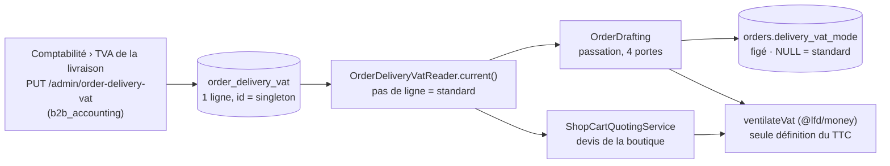

# La TVA des frais de port

**État : ✅ bâti le 2026-10-08, relu contre le code le 2026-10-12.** Ce document
remplace `plan-tva-des-frais-de-port` (supprimé le 2026-10-12, historique
dans git), dont la décision et la contradiction de `vitruve` sont reprises ici.
Il touche **l'argent** : une phrase fausse ici se paie en TVA.

## 1. Ce que fait le système

L'admin choisit, **globalement** (pas par zone), comment la TVA des frais de
livraison est calculée :

| Mode (`order_delivery_vat.mode`) | Effet                                                                                   |
| -------------------------------- | --------------------------------------------------------------------------------------- |
| `standard`                       | le port est taxé au taux normal, `DELIVERY_VAT_RATE = 20` (`packages/money/src/vat.ts`) |
| `follows_goods`                  | le port, accessoire de la vente, **suit le taux de ce qu'il transporte**, au prorata    |

Décisions de Hugo : le choix (2026-09-21), global et non par zone (2026-10-08).
Le mode est **figé sur chaque commande** à la passation ; une commande passée ne
se réécrit jamais.

## 2. Le calcul — un seul endroit

`ventilateVat` (`packages/money/src/vat.ts`) reçoit des extras typés
`VatExtra` : soit `{ htCents, ratePercent }`, soit `{ htCents, followsGoods: true }`.
Les marchandises (`VatLine`) ne peuvent pas porter `followsGoods`.

Un extra qui suit la marchandise est réparti **au prorata de la base brute de
chaque taux** (`num(taux) += extra × ht(taux)` sur le dénominateur commun
`sous-total`). Tant que le net est positif, les proportions sont celles du net ;
quand une remise ou un bon de fidélité absorbe toute la marchandise, le résultat
reste défini. **Aucun arrondi neuf** : la TVA de chaque taux est arrondie une
fois. Sous-total nul : l'extra prend le taux normal.

## 3. Le réglage

- **Table `order_delivery_vat`** (`orders.prisma`, modèle `OrderDeliveryVat`), une
  ligne `singleton`, colonne `mode` tenue par un CHECK
  (`standard` | `follows_goods`) ; migration `20261008120000_la_tva_de_la_livraison`.
- **Le lecteur fait le repli** : pas de ligne = `standard`. Enregistrer le taux
  normal sur un réglage jamais posé n'écrit aucun fait.
- **Droit : `b2b_accounting`**, aucune ressource neuve. Routes
  `GET` / `PUT /admin/order-delivery-vat` (`order-waivers/http/admin-order-delivery-vat.controller.ts`).
- **Fait de journal** : `order_delivery_vat.mode_set`
  (`packages/contracts/src/journal-facts/orders-production.ts`).
- **Écran** : `apps/lfd-backoffice-frontend/src/app/comptabilite/order-delivery-vat/`.

## 4. Figé sur la commande

`orders.delivery_vat_mode` est nullable : `NULL` = commande d'avant le réglage =
taux normal. Les quatre portes de passation (client, équipe, boutique, devis pro)
passent par `OrderDrafting`, qui lit le mode courant (`order-drafting.service.ts`)
et le fait persister (`prisma-order.repository.ts`).

**Rien ne recalcule après coup** : bon, relevé et prélèvement lisent `vatShares`
et `totalCents` figés. Le mode figé sert à l'**affichage** (« Livraison : TVA au
prorata des produits » / « TVA 20 % », `packages/b2b-ui/src/order/order-pricing.ts`)
et au dossier de facturation. Au compte et au prorata, le bon n'affiche **aucun**
taux (il n'y en a pas un seul).

⚠️ Les valeurs `standard` et `follows_goods` sont **persistées** : les renommer
sera une migration de données. `lint:dated-decisions` ne couvre pas ce réglage ;
le gel sur la commande est la seule protection, et elle suffit puisque rien ne
recalcule.

## 5. Le devis répond comme la passation

`shop-cart-quoting.service.ts` lit le même lecteur (`deliveryExtraOf`) ; l'effet
d'un bon de fidélité hérite de l'entrée du devis. Si le réglage change entre un
devis et sa passation, le total change — comme pour un prix : la passation fait
foi. Éprouvé : `quote-order-parity.e2e-spec.ts` et `order-delivery-vat.e2e-spec.ts`
(`apps/lfd-api/test/`).

## 6. Reste à faire (relevé le 2026-10-12)

- **Non vérifié, à confirmer par le cabinet comptable** : la justesse fiscale du
  prorata sur la base **brute** plutôt que nette. Identiques tant que le net est
  positif.
- **La surtaxe de retard** reste hors de ce chantier : son taux est figé à part
  (`late_fee_adjustment`) et sa nature — indemnité ou supplément de prix — est
  une autre question.
- **Dossier de facturation** : la part HT du port par taux n'est figée nulle
  part (`vatShares` = `{ rate, amountCents }`) ; le dossier la recalcule sur
  l'agrégat et range l'écart dans « arrondi de la TVA »
  ([simulateur](../comptabilite/facturation/simulateur-dossier-de-facturation.md)).
