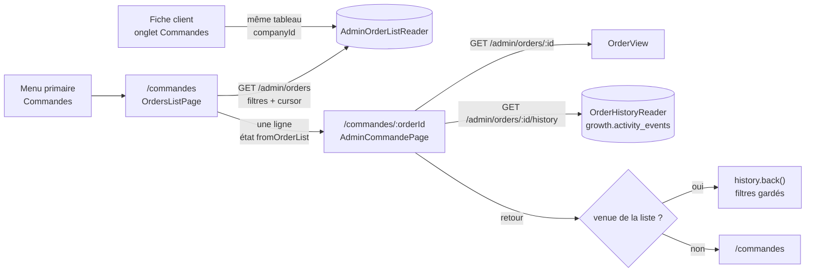

# La page Commandes du back-office

> **État : ✅ bâti et sur `dev`** (relu dans le code le 2026-10-24). La liste
> (C1 serveur, `2c2d81cf2` ; C2 écran, `873f28dff`), l'historique d'une
> commande (C2b, `cd533ea2a`), puis l'annulation et le remboursement par le
> staff (C3 `76d54e9f6`, C5 `e8a2d6dd6`, C4 `ccde38758`, tous du 2026-10-12),
> décrits dans [`annulation-par-le-staff.md`](../annulation/annulation-par-le-staff.md).
> Ce qui reste est en fin de document. Le plan d'origine et ses étapes vivent
> dans l'historique git (`git log -- documentation/commandes/back-office/plan-page-commandes.md`).

La demande (Hugo, 2026-10-12) : une liste paginée de **toutes** les commandes,
pro et particuliers, filtrable, la plus récente d'abord, qui ouvre le détail.

## 1. Le parcours

## 2. Le serveur

`GET /admin/orders` (`b2b/orders/http/admin-orders.controller.ts`, garde
`b2b_orders:read`) rend **toujours** `{ rows, nextCursor }` (`AdminOrdersPage`,
module `admin-order-list` de `@lfd/contracts`). Les appelants — les écrans et
l'outil agent `account_orders` — lisent `.rows`.

| Paramètre                           | Sens                                                                                         |
| ----------------------------------- | -------------------------------------------------------------------------------------------- |
| `cursor`                            | pagination par `(createdAt, id)`, stable sous l'insertion                                    |
| `limit`                             | 1 à 200, défaut 50                                                                           |
| `companyId`, `withSubAccounts`      | une société (la fiche client) ; absent = toutes                                              |
| `clientele`                         | `pro` · `public` ; une commande à `clientele` nul (historique) ne répond à aucun des deux    |
| `placedFrom` / `placedTo`           | jour de passation (Paris)                                                                    |
| `fulfillmentFrom` / `fulfillmentTo` | jour de retrait ou de livraison                                                              |
| `status`, `paymentStatus`, `method` | statut, règlement, `pickup` · `delivery`                                                     |
| `q`                                 | chaque mot dans la référence, la raison sociale, l'enseigne, le prénom ou le nom de l'auteur |

- Lecteur dédié : port `AdminOrderListReader`, adaptateur
  `prisma-admin-order-list.reader.ts`, critères dans
  `application/queries/admin-order-list-criteria.ts`.
- Index `orders(created_at DESC, id DESC)` (migration
  `20261012600000_l_ordre_de_la_liste_des_commandes`).
- `AdminOrderRow` porte `clientele`, `fulfillmentDay`, `fulfillmentMethod`,
  `paymentStatus`, et le `siteId` du snapshot de retrait (servi aux couleurs,
  [`tri-depart-et-couleurs.md`](tri-depart-et-couleurs.md)).
- e2e : `apps/lfd-api/test/admin-orders-list.e2e-spec.ts`.

### L'historique d'une commande

`GET /admin/orders/:id/history` (même garde ; 404 si la commande est inconnue)
rend des `ActivityEventView`, du plus récent au plus ancien, bornés à 200. Le
port `OrderHistoryReader` (adaptateur `prisma-order-history.reader.ts`) lit le
journal sous deux sujets :

- sujet `order` = l'id de la commande (`delivery_bin.*`, `packing_container.*`) ;
- sujet `user` = l'auteur, filtré sur `payload.orderId` (`order.placed`,
  `order.ready`, `order.handed_over`, `order.abandoned`) — par l'index
  `(subject_type, subject_id, occurred_at)`.

Le paiement et le remboursement ne sont pas journalisés (`order.paid` est un
fait de bus) : le règlement se lit dans sa propre carte. e2e :
`apps/lfd-api/test/admin-order-history.e2e-spec.ts`.

## 3. L'écran

- Route `/commandes` (`commandes/orders-list-page/`), garde `b2b_orders:read`,
  entrée au **menu primaire** dans les deux arbres (rail et tuiles).
- Le tableau `commandes/orders-table/` est **partagé** avec l'onglet Commandes
  de la fiche client (entrée `wide` pour les colonnes Client et « Pour le »,
  `siteOf` pour la colonne Site d'un principal). La colonne **Mode** dit
  « Livraison » ou « Retrait <site> » à la couleur logistique de la commande
  (depuis le 2026-10-14, `2f3b00736`).
- Les filtres sont des queryParams aux noms de l'API
  (`commandes/order-list-filters.ts`), liés en `input()` ; une valeur inconnue
  retombe à « Tous » ; poser un filtre réécrit l'adresse (`replaceUrl`).
  « Charger plus » suit le curseur.
- **Le retour du détail garde les filtres par l'historique**
  (`commandes/order-list-return.ts`) : venue de la liste (état `fromOrderList`),
  la commande remonte l'historique ; ouverte autrement, elle mène à
  `/commandes`. `fold-back-link` ne transmet pas de `queryParams`.
- Le détail montre statut et frise (`lfd-order-detail`, `audience="staff"`),
  composition et explication du prix (`app-price-explain`), la carte
  **Historique** (`commandes/order-history-card/`, phrases du moteur du journal ;
  vide : « Aucun fait enregistré pour cette commande. »), et les gestes
  d'annulation et de remboursement.
- L'onglet Commandes de la fiche client a sa garde `b2b_orders:read`
  (`fiche-client/fiche-client.routes.ts`) et il est masqué sans ce droit.

## 4. Décisions

- **2026-10-12 (Hugo)** : la page s'inspire de l'onglet Commandes d'un pro —
  même table fold, filtres pro / particulier et retrait / livraison, détail
  avec historique, composition, prix, statut, annulation et remboursement,
  retour vers la liste. Entrée au menu primaire.
- **2026-10-12** : contrat cassé dans le même déploiement (pré-release) — la
  forme tableau de `GET /admin/orders` n'est plus servie.
- **2026-10-12** : `clientele` nul ne se devine pas après coup ; il ne répond à
  aucun filtre de clientèle.
- **2026-10-12 (Hugo)** : l'historique de la commande se lit au journal
  existant, sans fait neuf.
- Pas de `vitruve` d'office sur la liste : ni argent, ni migration de données,
  ni frontière de sécurité (lecture sous un droit déjà accordé). L'annulation
  et le remboursement, eux, ont été contredits dans leurs propres plans.

## 5. Reste à faire

- **Filtre par point de retrait** : pas bâti. Une commande ne garde pas l'id
  de son point de retrait, seulement le snapshot postal ; le `siteId` du
  snapshot (lot S2 des sites) existe désormais sur la ligne, un filtre **par
  site** serait le chemin naturel — à décider.
- **La fiche d'un client particulier** : rien ne lit un `User` sans société
  côté staff. Donnée personnelle absente du registre RGPD : finalité et
  permission à décider par Hugo **avant tout code**, puis `vitruve` (frontière
  de sécurité). En attendant, la liste montre le nom du particulier.
- **Remboursement par cas de figure** : Hugo, 2026-10-12 — « adapter les
  comportements de remboursement en fonction des cas de figure, on verra ça à
  la fin » ; suivi dans [`todo-annulation.md`](../annulation/todo-annulation.md).
- **Les outils agent** : la trousse des commandes (outils nommés, lecture
  seule) sur la route de C1 — pas commencée.
- **Le tri par heure de départ** de la liste : cf.
  [`tri-depart-et-couleurs.md`](tri-depart-et-couleurs.md) (Q2).
