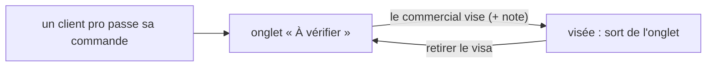

# Plan — le visa des commandes pro passées par le client

> **Plan, 2026-11-21.** Rien n'est bâti. Décidé par Hugo le 2026-11-21 :
> un onglet de vérification sur `/commandes`, « un seal of approval des
> commerciaux sur les commandes passées par les clients pro seuls ».

## En simple

Quand un **client pro passe lui-même** une commande (dans la boutique, sans
l'équipe), un commercial la **relit et la vise** : « vu, c'est bon ». Le visa
est **une trace** : il ne bloque rien, la commande est produite et servie
comme toute autre. On peut retirer un visa posé par erreur, et laisser une
note avec.

Décisions de Hugo (2026-11-21) :

| Question      | Réponse                                                  |
| ------------- | -------------------------------------------------------- |
| Effet du visa | une trace seulement, rien ne se bloque                   |
| Qui vise      | un droit dédié, accordé à l'écran des rôles              |
| Gestes        | viser, retirer son visa, laisser une note                |
| Périmètre     | les commandes passées **à partir de la mise en service** |

## Ce qui entre dans l'onglet

Une commande est **à vérifier** quand, ensemble :

- elle n'a **pas été saisie par l'équipe** : `orders.placed_by_staff_id` est
  nul (le critère de `orderOriginOf`, `orders/domain/services/order-origin.ts`).
  Les commandes d'**abonnement** y entrent aussi (Hugo, 2026-11-21) ;
- sa clientèle est **pro** ;
- elle n'est ni **annulée**, ni une **tentative abandonnée** ;
- elle a été passée **après la mise en service** ;
- elle n'a **pas de visa en cours**, ou elle a été **révisée depuis** son
  visa (voir V2).

## Ce qui change

### V1 — La base (deux migrations additives)

1. La valeur `b2b_order_review` ajoutée à `StaffResource`, seule dans sa
   migration (comme `20260915230000_ressource_notes_du_commercial`). **Aucun
   droit accordé par migration** (`lint:no-role-grants-in-migrations`). En
   même temps : `STAFF_RESOURCES`, `STAFF_RESOURCE_LABELS` (« Visa des
   commandes »), `STAFF_RESOURCE_SCOPES`, la graine `ROLE_GRANTS` (`admin` et
   `commercial` en écriture : sans quoi personne ne vise en dev ni en e2e ;
   en production, rien n'est accordé avant le geste à l'écran), et le compte
   de `grant-chips.spec.ts`.
2. Une table `order_reviews` (schéma `public`, propriété du contexte `orders`) :
   `id`, `order_id` (clé vers `orders`), `reviewed_revision` (la révision de la
   commande que le visa a vue), `reviewed_by_staff_id`, `reviewed_at`, `note`
   (nulle, ou un texte non vide : CHECK `note IS NULL OR note <> ''`),
   `withdrawn_by_staff_id`, `withdrawn_at`.
   - CHECK `order_reviews_withdrawn_together` : les deux `withdrawn_*` sont
     nuls ensemble ou posés ensemble.
   - **Aucune suppression** : retirer remplit `withdrawn_*` ; viser à nouveau
     crée une ligne. L'historique se lit en entier.
   - Index unique partiel `WHERE withdrawn_at IS NULL` : un seul visa en cours.
   - Les colonnes `*_staff_id` et la `note` (texte libre du staff sur un
     client) entrent au registre RGPD (`documentation/legal/rgpd-registre.json`,
     `lint:rgpd-staff`).
3. **Pas de table de réglage** pour la mise en service : une **constante
   datée** du domaine (`ORDER_REVIEW_STARTS_AT` (minuit de Paris, le 2026-11-21)), posée par le commit de mise
   en service. Pure, testable avec `FixedClock`, rien à remettre dans le
   harnais e2e (vitruve, bloquant 1).

### V2 — Le serveur (contexte `orders`)

- **L'agrégat est le registre des visas d'une commande** (`OrderReviews`,
  `load(orderId)` / `save`, §3.1) : il voit le visa en cours et refuse un
  double visa ou un retrait sans visa. L'index partiel reste le dernier
  gardien d'une course entre deux commerciaux : l'adaptateur traduit sa
  violation en `BusinessError` qui nomme le cas (« déjà visée par X »).
- `review(order, staff, note, at)` refuse une commande hors périmètre (voir
  plus haut) ; il garde la **révision** de la commande. Une commande **révisée
  depuis son visa** (`orders.revision` > `reviewed_revision`, client ou
  équipe) **revient dans l'onglet**, marquée « modifiée depuis le visa ».
  La vérifier à nouveau **remplace** le visa en un seul geste (2026-11-21) :
  l'agrégat retire l'ancien (`withdrawn_by` = qui vérifie à nouveau,
  `withdrawn_at` = maintenant) et pose le nouveau, dans la même transaction.
  Une commande visée et **non** révisée depuis reste refusée (409, déjà
  visée).
- `withdraw(staff, at)` : tout porteur du droit en écriture peut retirer un
  visa (pas seulement son auteur) ; le retrait garde qui et quand.
- Faits dans la boîte d'envoi, dans la même transaction, nommés comme les
  autres faits des commandes : `order.reviewed`, `order.review_withdrawn`
  (un remplacement publie le retrait de l'ancien visa, puis le nouveau). Le
  journal de la commande les lit, comme `order.no_show` : deux abonnés
  durables du contexte `growth` (`b2b.growth.record-order-reviewed`,
  `b2b.growth.record-order-review-withdrawn`) inscrivent le témoin sous le nom
  du client, avec la fiche qui a agi — jamais la note. Leurs charges sont au
  catalogue `@lfd/contracts/journal-facts` ; leurs **phrases** au back-office
  (`shared/journal/phrases/orders-phrases.ts`) appartiennent au lot de
  l'écran.
- Routes `POST /admin/orders/:id/review` et `.../review/withdraw`, sous
  `@RequirePermission("b2b_order_review:write")`, avec la clé d'intention de
  l'écran (`@IntentKey`, `lint:write-idempotence`).
- Lecture : la vue `to_review` (`ADMIN_ORDER_LIST_VIEWS`, `viewWhere` passe à
  un `switch`), **refusée côté serveur** sans `b2b_order_review:read`. Le visa
  en cours et son historique dans le détail d'une commande : servis à qui lit
  la commande (`b2b_orders:read`), c'est une trace.

### V3 — L'écran

- Les mots disent « vérifier », le verbe de Hugo : l'onglet **« À vérifier »**
  sur `/commandes` (`?view=to_review`), avec son compte dans la pastille,
  visible à qui a `b2b_order_review:read`. La table est celle des commandes.
  « Visa » reste le nom du concept ici et dans le code (`OrderReview`).
- Sur la page d'une commande à vérifier : une carte — « Vérifier » (avec une
  note facultative) ; une fois vérifiée, « Vérifié par X le … », la note, et
  « Retirer la vérification ». Une commande modifiée depuis le dit.
- Dans la liste générale des commandes, une commande vérifiée porte la
  pastille **« Vérifié · Prénom Nom »** (Hugo, 2026-11-21) : le nom lu par
  l'annuaire en une lecture pour la page (`StaffAuthorDirectory`) ; un auteur
  que l'annuaire ne reconnaît plus donne « Vérifié » seul.

### V4 — Les alertes commerciales, sous la ligne

Décidé par Hugo le 2026-11-21 : « le bon endroit pour mettre les alertes
commerciales en extension de row ».

Les **alertes de compte** existent (contexte `lafoliecoffee/alerts`,
`documentation/comptes-client/architecture-alertes-compte-client.md`) :
produit jamais commandé, écart de quantité, quantité hors norme, abonnement
modifié. Chacune porte **sa commande** (`account_alerts.order_id`,
`order_number`) et ses constats (produit, quantité, référence, écart), et se
**acquitte** (`acknowledged_at`, `acknowledged_by`) — relu dans
`alerts.prisma` et `account-alert-finding.ts` le 2026-11-21.

- Dans l'onglet « À vérifier », une ligne qui a des alertes se **déplie**
  (le `rowDetail` de `fold-data-table`) : chaque alerte, ses constats en une
  phrase, et son geste « Acquitter » existant. Une pastille sur la ligne dit
  combien d'alertes l'attendent.
- La lecture : le contexte des alertes publie une lecture nommée **par lot de
  commandes** (`AlertsOfOrders`, une requête pour la page entière) ; le
  commerce ne lit pas sa table (`lint:prisma-model-ownership`). Route
  `GET /admin/alerts?orderIds=…`, sous `b2b_alerts:read` (`@AdminSurface("b2b_alerts")`, comme les autres routes des alertes).
- **Vérifier une commande acquitte ses alertes en cours** — un seul geste
  (Hugo, 2026-11-21). Le visa émet `order.reviewed` dans la boîte
  d'envoi ; le contexte des alertes s'y abonne
  (`@DurableHandler` `b2b.alerts.acknowledge-reviewed-order`, rejoué
  après un redémarrage) et acquitte les alertes de cette commande au nom de
  qui a vérifié, sous la condition `acknowledged_at IS NULL` qu'il tient déjà.
  Les commandes ne touchent pas la table des alertes. Retirer la vérification
  ne « désacquitte » rien : une alerte vue l'a été.

## Ce que ça n'est pas

- Pas un blocage : ni la production, ni le retrait, ni la facturation ne lisent
  le visa.
- Pas pour les particuliers, ni pour les commandes saisies par l'équipe.

## Tests

- Domaine : l'agrégat refuse chaque cas hors périmètre, le double visa, le
  double retrait.
- E2E : viser, retirer, viser à nouveau ; l'onglet ne montre que le
  périmètre ; le droit refuse un staff sans `b2b_order_review:write` ; une
  commande d'avant la mise en service n'y paraît pas.
- Écran : l'onglet, la carte, les gestes.

## Contradiction (vitruve, 2026-11-21)

Trois bloquants, intégrés : la table de réglage vidée par le harnais e2e
(remplacée par une constante), le double visa tenu par une ligne qui ne voit
pas ses sœurs (le registre par commande), une commande révisée après son visa
(la révision gardée, la commande qui revient). Sérieux intégrés : le critère
`placed_by_staff_id`, les faits, le RGPD, tout ce que
touche une ressource neuve, le CHECK des colonnes de retrait, le droit de
lecture tenu côté serveur, la note nulle ou non vide.

## Décisions prises en écrivant (à confirmer)

1. Une commande **annulée** en sort.
2. N'importe quel porteur du droit peut **retirer** un visa, pas seulement
   son auteur.
3. La **graine** donne le droit au commercial (dev, e2e) ; en production,
   l'écran des rôles.

## Questions ouvertes

Aucune. (Vérifier acquitte les alertes : Hugo, 2026-11-21.)
