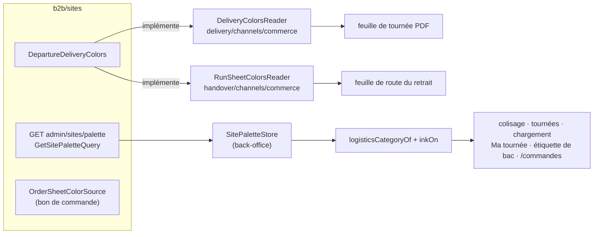
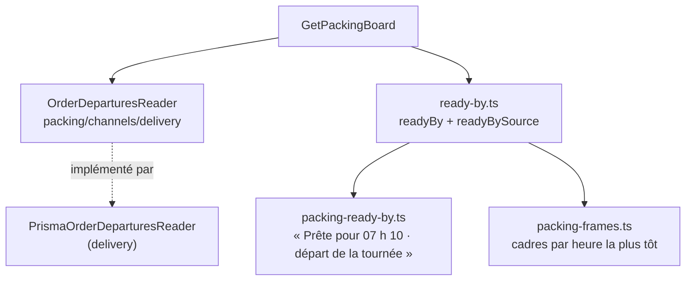

# Trier les commandes par heure de départ, et les colorer

> **État : 🟡 partiel** (relu dans le code le 2026-10-24). Bâti et sur `dev` :
> les couleurs logistiques à l'écran et sur le papier (L1a, L1b, L5 —
> `1679e1888`, 2026-10-13), la couleur de la colonne Mode de `/commandes`
> (`2f3b00736`, 2026-10-14), le colisage rangé par heure « prête pour » (L2,
> partie colisage — `bc5046cb6`, 2026-10-14). **Reste** : le tri de la liste
> `/commandes` par heure de départ (Q2). Le plan d'origine, la contradiction de
> `vitruve` et les questions tranchées vivent dans l'historique git
> (`git log -- documentation/commandes/back-office/plan-tri-depart-et-couleurs.md`).
> Les couleurs elles-mêmes sont des données de site :
> [`../../sites/sites.md`](../../sites/sites.md). Le village est servi par
> [`../../livraisons/transferts/plan-transfert-interne.md`](../../livraisons/transferts/plan-transfert-interne.md).

## 1. La demande

Une responsable logistique, après une visite du back-office (2026-10-13) :
trier les commandes par heure de départ — le retrait de Val Village traité
comme une livraison pro — et identifier chaque commande par une couleur
modifiable (pas de vert ni de rouge, gardés pour les surligneurs OK / KO) :
livraison pro bleu, retrait pro jaune, retrait particulier Adroit orange,
retrait particulier Val Village gris. Un « Écrire » (formulaire de
coordonnées) est mis de côté.

## 2. La couleur d'une commande

La couleur **se lit à l'affichage**, jamais figée sur la commande : la commande
(et la copie qu'en tient le colisage) porte son **site** et sa **clientèle**,
la palette se lit au site. Un changement en Réglages › Sites se voit partout
tout de suite — sauf sur le bon de commande, figé à la passation.

| Catégorie                                | Couleur lue                                                              |
| ---------------------------------------- | ------------------------------------------------------------------------ |
| livraison pro / particulier              | `deliveryColorB2b` / `deliveryColorB2c` du site **de départ actuel**     |
| retrait pro                              | `pickupColorB2b` du site de retrait                                      |
| retrait particulier                      | `pickupColorB2c` du site de retrait                                      |
| `clientele` nul, retrait sans `siteId`   | teinte neutre (`surface-sunken` + `border`), jamais une couleur inventée |
| site sans couleur                        | teinte neutre                                                            |
| arrêt de transfert (mêle des clientèles) | neutre ; ses commandes portent leur clientèle dans la vue, non peinte    |

- **Serveur (L1a)** : le fait `production.packing_list_drawn` porte `siteId` ;
  le colisage le recopie dans `packing.packing_order.site_id` (migration
  `20261013730000_le_site_suit_au_colisage`, sans rattrapage : les lignes
  tirées avant restent neutres). `DeliveryOrdersReader.byIds` rend `clientele`
  et `siteId` ; `TransferOrderContentsReader.categoriesOf` rend clientèle et
  site par lot. Les vues des tournées, du chargement, de Ma tournée, du
  manifeste de transfert et de l'étiquette exposent ces champs.
- **Palette** : `GET admin/sites/palette` (id, nom, approvisionnement, quatre
  couleurs, `isDeparture`), en lecture sous `RequireAnyPermission` —
  `production_packing`, `delivery_rounds`, `delivery_loading`,
  `delivery_driving` — sans `lfc_site_settings`.
- **Back-office (L1b)**, `shared/logistics-colors/` : `SitePaletteStore` (relu à
  l'ouverture de chaque écran), `logisticsCategoryOf`, `inkOn` (encre claire ou
  sombre par luminance WCAG : les couleurs sont libres), `LogisticsSwatch`.
  `logisticsCategoryOf` vit côté back-office, pas dans `@lfd/contracts` : la
  boutique ne s'en sert pas et le baril pèse sur son budget.
- **Papier (L5)** : carré cerclé en tête de chaque arrêt de livraison de la
  feuille de tournée PDF ; `color` par arrêt sur la feuille de route du
  retrait ; carré en haut à droite de l'étiquette de bac ; trait épais sous
  « Bon de commande » sur le bon, lu au rendu par `OrderSheetColorSource` et
  donc figé avec le bon archivé (la version de dessin `-d2` n'a pas bougé : les
  bons déjà rangés restent sans trait).

## 3. Le colisage : cadres et heure « prête pour »

| Commande                                        | Heure « prête pour »                                                   | `readyBySource` |
| ----------------------------------------------- | ---------------------------------------------------------------------- | --------------- |
| livraison                                       | départ de sa tournée (`plannedDepartureAt ?? departedAt`)              | `round`         |
| livraison sans tournée ou sans départ prévu     | aucune — « Pas encore de départ », en fin                              | —               |
| retrait porté par un transfert                  | départ de la tournée qui porte l'arrêt du transfert, sinon départ réel | `transfer`      |
| idem, transfert sans départ ; retrait sur place | l'échéance figée `dueAt`                                               | `due`           |

- Le port est **déclaré par le colisage** et implémenté par la livraison
  (relié dans `appBootstrap/packing-delivery-feed.module.ts`) : `packing →
delivery` reste interdit, même forme que `BinDesk`.
- Aucune marge de chargement n'est retirée au départ : les réglages de la
  livraison n'en ont pas.
- Le départ prévu est **effacé dès qu'un geste à la main change les arrêts** :
  une journée composée à la main n'a pas d'heure de livraison au colisage tant
  qu'« Appliquer » ne l'a pas rechronométrée.
- **Cadres** (`packing-frames.ts`) : un cadre par catégorie, bordé de sa
  couleur, titre dans la bordure ; les commandes rangées par heure dans un
  cadre, les cadres par leur heure la plus tôt ; l'ordre fixe ne départage que
  les égalités : « Transfert <site> » (cadre neutre englobant les retraits pro
  et particulier du village), « Livraison pro », « Livraison particulier »,
  puis les retraits sur place coupés par créneau s'il y en a plusieurs.

Le tri par échéance répond, pour le village, à la question 1 de
[`../../colisage/todo-colisage-tri-par-echeance.md`](../../colisage/todo-colisage-tri-par-echeance.md).

## 4. Décisions

- **2026-10-13 (Hugo)** : les couleurs sont des **données de site**, libres et
  facultatives ; la livraison a les siennes sur le site qui livre (Q-S7, bâti
  ainsi) ; Val Village se range avec les tournées par le **transfert interne** ;
  « Adroit » est un site ; « Écrire » (Q1) est mis de côté.
- **2026-10-13 (Hugo, Q8)** : écran **et** papier. Le bon porte la couleur —
  revenu sur l'objection de `vitruve` : elle y est celle du moment de la
  passation, le client la voit, les bons antérieurs n'en ont pas.
- **2026-10-13** : la couleur se lit à l'affichage ; la palette s'ouvre en
  lecture aux droits de la logistique ; la livraison et le retrait la lisent
  par un port qu'ils déclarent, implémenté par le commerce.
- **2026-10-14 (Hugo)** : au colisage, trier **dans** chaque cadre et ordonner
  les cadres par leur échéance la plus tôt ; un seul cadre par livraison pro /
  particulier.
- **2026-10-14 (Hugo)** : la colonne Mode de `/commandes` prend la couleur de
  la catégorie.

## 5. Reste à faire

- **Q2 — le tri de la liste `/commandes` par heure de départ** : quel écran
  porte le tri ? Non tranché (la réponse de Q2 ne parlait que des couleurs). Il
  demanderait un lecteur côté commerce des départs (le `OrderDepartureReader`
  du plan, **non bâti**) ; aucune liste de commandes ne porte aujourd'hui
  d'heure de départ.
- **Plusieurs sites de départ** : la livraison lit les couleurs du départ
  **actuel** (`DepartureSiteReader`) ; un second départ demandera que la
  tournée retienne le sien.
- **Le cadre « Réapprovisionnement <site> »** du colisage : la forme l'accepte
  (`PackingReplenishmentFrame`, troisième argument de `packingFrames`), rien ne
  le sert encore.
- **Les commandes d'un arrêt de transfert** portent leur clientèle dans la vue,
  mais l'écran ne les peint pas.
- **L4 « Écrire »** : hors chantier (Q1 mise de côté).
