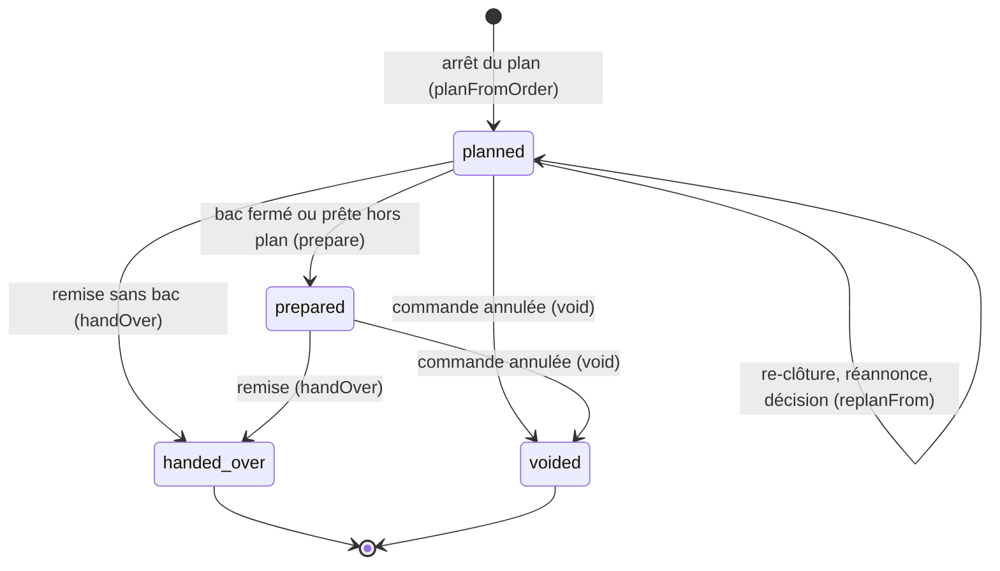
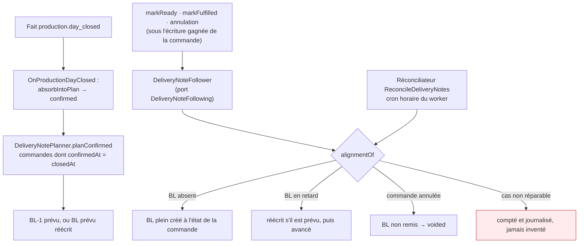
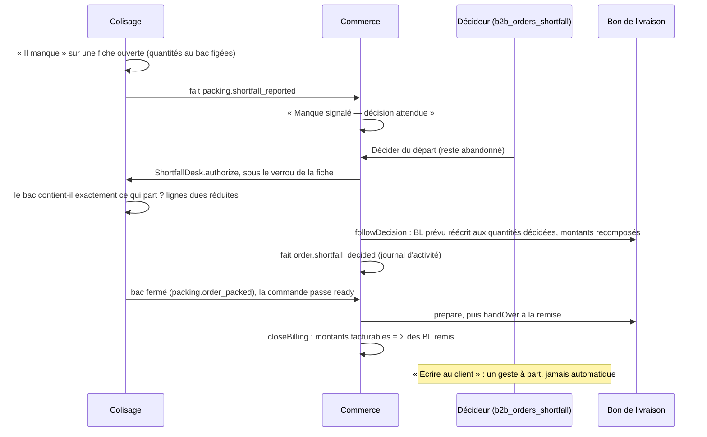
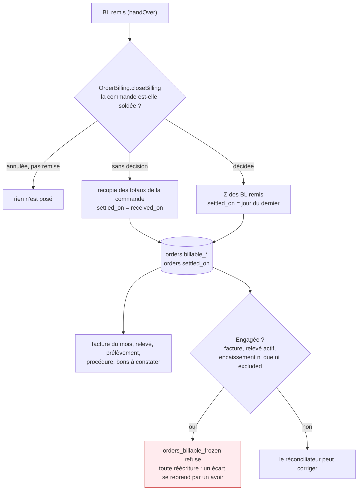

# Le bon de livraison, le départ incomplet et les montants facturables

> **Doc d'état, relue contre le code le 2026-10-25** (HEAD `c95188d91`, branche
> `dev`). Chemins relatifs à `apps/lfd-api/` sauf mention. Elle remplace les
> plans des lots E1, E2, E4a, E4b, E5a, E6 (E6a à E6c2) et E6d, retirés le même
> jour : leurs décisions sont au tableau [« Les décisions »](#les-décisions),
> et les paragraphes que le code cite encore (« plan E6, § 14 ») sont traduits
> à la fin, [« Renvois des plans retirés »](#renvois-des-plans-retirés).
>
> **Où c'est servi.** Tout est en production : E1, E2 et E4a depuis
> `71f61c869` (2026-10-24), E5a à E6d depuis `07ff2f541` (2026-10-25, 10 h 40).
> Le runbook prévoyait deux promotions (« Avant de déployer E6c2 ») ; le hook
> `pre-push` n'en promeut qu'une, le sommet de `dev`. Hugo a choisi de tout
> pousser et de rapprocher tout de suite après : la facture ne retient qu'une
> commande dont `billable_total_cents` est posé (`billable-order-criterion.ts`,
> vérifié le 2026-10-25), donc une commande remise non encore rapprochée est
> **absente** de la facture et des lots, jamais facturée faux. Les quatre
> requêtes du runbook se lisent après le premier rapprochement.
>
> **Ce qui reste** (le reliquat, le retrait par BL, solder, rembourser, les
> gestes après l'arrêt) : [« Ce qui reste »](#ce-qui-reste). Le programme
> d'ensemble garde son plan-cadre,
> [`plan-commande-bon-de-livraison-facture.md`](plan-commande-bon-de-livraison-facture.md).

## Quatre documents

| Document                     | Dit                                                | Naît                                                     | Code                                                      |
| ---------------------------- | -------------------------------------------------- | -------------------------------------------------------- | --------------------------------------------------------- |
| **Confirmation de commande** | ce que le client a demandé ; porte le QR           | à la passation                                           | `b2b/orders/domain/services/order-sheet*.ts`              |
| **Fiche d'atelier**          | ce qu'il faut produire, sans prix                  | à l'arrêt du plan                                        | `atelierSheetOf` (même fichier)                           |
| **Bon de livraison** (BL)    | ce qui part, en une fois                           | à l'arrêt du plan (prévu), ou au premier geste hors plan | `b2b/delivery-notes/`                                     |
| **Facture**                  | ce qu'on fait payer : les **montants facturables** | à l'émission                                             | `b2b/accounting/` (lit `orders.billable_*`, `settled_on`) |

La « confirmation de commande » est l'ancien « bon de commande » : seuls les
**libellés** ont changé (lot E5b, `473093bdf`) ; les identifiants du code
(`OrderSheet`, `clientSheetOf`…) et les clés des pièces archivées restent.

## Le modèle

**Tables** (`prisma/schema/public/delivery-notes.prisma`) :

- `delivery_note` — `order_id` (clé vers `orders`, `RESTRICT`), `rank` (≥ 1),
  `number` unique, `status` (`planned` · `prepared` · `handed_over` ·
  `voided`), `planned_at`, `prepared_at`, `handed_over_at`, `received_on`,
  `voided_at`, l'en-tête d'argent (`subtotal_cents`, `discount_cents`,
  `voucher_discount_cents`, `delivery_fee_cents`, `delivery_vat_mode`,
  `late_fee_cents`, `late_fee_adjustment`, `vat_shares`, `vat_cents`,
  `total_cents`), `content_version`, et la dernière impression
  (`printed_version`, `printed_at`, `printed_by`). Unicité `(order_id, rank)`.
- `delivery_note_line` — SKU, nom, prix HT en millicentimes, taux, quantité
  (≥ 0 : une ligne à zéro est recopiée), totaux HT et TTC (TTC recopié tel
  quel, `NULL` compris), `pickup_discount_eligible` (`NULL` sur une ligne
  d'avant E4a). **Aucune clé vers `order_lines`** : la révision supprime et
  recrée les lignes d'une commande.

**Contraintes en base** (migrations `20261024190000`, `20261024210000`,
`20261024230000`, `20261025140100`) : `rank >= 1`, `quantity >= 0`, les CHECK
d'état (`prepared` exige `prepared_at` ; `handed_over` exige aussi
`handed_over_at` et `received_on` ; `planned` n'a aucun des trois ; `voided`
peut garder `prepared_at`), l'en-tête « tout ou rien » sur ses sept entiers,
l'impression « les trois ensemble ou aucun ».

**L'agrégat** `DeliveryNote` (`domain/entities/delivery-note.ts`) :

| Méthode             | Ce qu'elle fait, ce qu'elle refuse                                                                                                   |
| ------------------- | ------------------------------------------------------------------------------------------------------------------------------------ |
| `planFromOrder`     | BL prévu, lignes et en-tête **recopiés** de la commande ; refuse une commande sans ligne (`DeliveryNoteWithoutLinesError`)           |
| `replanFrom`        | réécrit lignes et en-tête d'un BL **prévu** seulement (`DeliveryNoteNotPlannedError`) ; `content_version` + 1 si le contenu a changé |
| `completeTermsFrom` | remplit l'en-tête **vide** d'un BL d'avant E4a, remis compris — la seule exception à « remis, il ne change plus »                    |
| `prepare`           | `planned` → `prepared`                                                                                                               |
| `handOver`          | `planned` ou `prepared` → `handed_over` ; depuis `planned`, `prepared_at` = la remise                                                |
| `void`              | `planned` ou `prepared` → `voided` ; un BL remis ne s'annule pas                                                                     |
| `recordPrint`       | la version du contenu imprimée, l'instant, la fiche staff                                                                            |

**Le numéro** : `BL-` + le numéro de commande sans `ORD-` + `-` + rang
(`BL-1042-1`, et `BL-MV84O2XA-Y9W3-1` pour un numéro ancien). Un BL annulé
consomme son rang et son numéro : un numéro ne se réemploie jamais. Depuis
`20261025120000`, la base refuse un numéro de commande hors du format
`^ORD-([1-9][0-9]*|[A-Z0-9]{8}-[A-Z0-9]{4})$`.

**Aujourd'hui, une commande a au plus un BL vivant**, le BL-1. Le rang 2
n'existe qu'avec le reliquat (E7, prévu).

## Le cycle de vie du BL

**Trois écrivains, une règle.** Tous passent par l'agrégat, et la règle
d'alignement `alignmentOf` (`domain/services/delivery-note-alignment.ts`) est
partagée par les gestes et le réconciliateur :

- **À l'arrêt du plan** (`application/services/delivery-note-planner.ts`) :
  dans l'unité de travail de l'absorption, chaque commande de l'instantané
  dont `confirmedAt = closedAt` reçoit son BL-1 prévu, ou voit son BL prévu
  réécrit. Un refus du domaine (numéro atypique, commande sans ligne) est
  sauté et journalisé : il n'annule pas la confirmation.
- **Le BL suit la commande** (`application/services/delivery-note-follower.ts`)
  par le port `DeliveryNoteFollowing` (`b2b/orders/domain/ports/`), relié par
  `appBootstrap/delivery-note-planning.module.ts`. Une commande prête ou remise
  **hors plan**, sans BL, en reçoit un plein à ce moment (Q-E5).
- **Le réconciliateur** (`application/commands/reconcile-delivery-notes.handler.ts`)
  passe toutes les heures (`container/worker.ts`, `triggerDeliveryNotesReconcile`
  → `POST admin/delivery-notes/sweep`, jeton du `RecomputeGuard`) ; l'équipe le
  lance à la demande par `POST admin/delivery-notes/reconcile` (`ops_health`).
  Il crée, avance, annule, complète les en-têtes vides, pose et corrige les
  montants facturables, et **nomme** ce qu'il ne répare pas :
  `voided_only`, `several_live_notes`, `dead_status`, `missing_instant`,
  `atypical_number`, `note_ahead_of_order`, `invalid_source`.

## Le départ incomplet

Une commande au compte dont une ligne ne se remplit pas au colisage peut
partir incomplète, sur **décision** d'une personne qui en a le droit.

**Le signal (E6a).** `POST admin/packing/:date/orders/:orderId/shortfall`
(`PackingSheet.reportShortfall`) fige les quantités au bac par article et
publie `packing.shortfall_reported` (`packing/channels/commerce/`). Le commerce
le tient dans l'agrégat `OrderShortfall` (`orders.shortfall_reported_at`,
`shortfall_lines`, `shortfall_cleared_at`) ; la page Commandes, la fiche
commande et la Supervision du jour le montrent. Refermer le bac **complet**
efface le signal (`packing.shortfall_cleared`). Tant que le commerce n'a
pas décidé, le bac **incomplet** ne se ferme pas (`ShortfallAwaitingDecisionError`,
409, Hugo, 2026-10-25) : le poste dit « En attente de la décision d'un
manager ». Le signal ne bloque rien d'autre.

**La décision (E6b).** `POST admin/orders/:id/shortfall-decision`, sous
`b2b_orders_shortfall:write` (migration `20261025140000` ; la ressource
s'accorde à l'écran, cf. runbook). L'agrégat `ShortfallDecision`
(`b2b/orders/domain/entities/shortfall-decision.ts`), une par commande et
définitive (table `order_shortfall_decision`, unique par `order_id`), refuse :

| Refus                             | Cas                                                                    |
| --------------------------------- | ---------------------------------------------------------------------- |
| `ShortfallAlreadyDecidedError`    | déjà décidée                                                           |
| `NoShortfallToDecideError`        | aucun signal en vigueur                                                |
| `ShortfallOrderNotConfirmedError` | la commande n'est pas `confirmed`                                      |
| `CardOrderShortfallError`         | réglée par carte (`due`, `paid`) — attend le remboursement partiel, E9 |
| `VoucherOrderShortfallError`      | elle porte un bon de fidélité                                          |
| `OrderTooOldForShortfallError`    | un montant non nul sans la règle figée qui l'a produit                 |
| `NothingDepartsError`             | aucune pièce au bac : annulez la commande                              |

Ce qui part est **exactement** ce que le colisage a figé au signal, jamais une
saisie. Le reste n'a qu'une valeur, `abandoned` (CHECK en base) : « à
relivrer » arrive avec E7. Le colisage refuse sous son verrou une fiche déjà
fermée (`ShortfallSheetSealedError`) ou dont le bac a changé depuis le signal
(`ShortfallContentsChangedError`). Une fiche autorisée survit à une
réouverture du jour (`withdrawUntouched` l'épargne), une commande décidée
reste confirmée (`releaseFromPlan` l'épargne) et refuse la révision
(`orders.revise.shortfall_decided`).

**Le BL partiel.** `departingSourceOf` (`domain/services/departing-source.ts`)
réduit les lignes aux quantités décidées (une ligne qui ne part pas reste, à
zéro) et recompose l'en-tête par `DeliveryNoteTerms.composePartial`
(`domain/value-objects/delivery-note-terms.ts`) : les ajustements figés de la
commande réappliqués aux lignes livrées, par les mêmes fonctions que la
passation. Les trois écrivains du BL lisent la décision par
`ShortfallDecisionReader` : un BL décidé n'est jamais réaligné sur la commande
entière.

**Écrire au client (E6d).** `GET admin/orders/:id/shortfall-letter` rend une
proposition (gabarit `customer.order-shortfall`, langue de la commande,
français sans elle) ; `POST` envoie le texte **relu**, une fois par décision
(clé `order-shortfall:<décision>`), au client qui a passé la commande. La
décision garde `customer_notified_at` et `customer_notified_by_staff_id` ;
un envoi refusé par le fournisseur n'est pas tracé. Aucun abonné n'envoie quoi
que ce soit : `no-automatic-shortfall-mail.spec.ts` le garde.

## Les montants facturables et leur gel

- **Le solde** est un agrégat à part, `OrderBilling`
  (`b2b/orders/domain/entities/order-billing.ts`), sur la ligne `orders` :
  `Order` est l'agrégat de passation et ne se recharge pas. Deux écrivains,
  `OrderBillingCloser` (`b2b/delivery-notes/application/services/`) à la
  remise et le réconciliateur, exclus l'un de l'autre par le
  `WHERE billable_total_cents IS NULL` de la pose.
- **Les colonnes** (migration `20261025140100`) : `billable_subtotal_cents`,
  `billable_discount_cents`, `billable_voucher_discount_cents`,
  `billable_delivery_fee_cents`, `billable_late_fee_cents`,
  `billable_vat_cents`, `billable_vat_shares`, `billable_total_cents`,
  `settled_on` — CHECK « tout ou rien ».
- **Le gel** : déclencheur `orders_billable_frozen` (migration
  `20261025160000`), qui refuse par `IS DISTINCT FROM` toute réécriture des
  colonnes posées d'une commande **engagée** — portée par une facture
  (`invoice_order`), un relevé actif, ou un encaissement ni `due` ni
  `excluded`.
- **Qui lit** : `billable-order-criterion.ts` range une commande par
  `settled_on` et exige `billable_total_cents` posé (dans `billableOrderWhere`
  et `billableSinceWhere`, jamais `accountOrderWhere`) ; la couture
  `billable-invoice-order.mapper.ts` lit les totaux `billable_*`, et les lignes
  des BL remis pour une commande décidée, celles de la commande sinon. Un bon
  remis mais non soldé est nommé par le bloqueur `order_unsettled`
  (`invoice-issuance-blockers.ts`). Au solde, la ligne d'encaissement encore
  ouverte suit le montant facturable (`AccountOrderSettlement`).
- **Ce qui garde la commande** : la **facture carte** (`total_cents`,
  `received_on` — pas de départ incomplet par carte) ; « Mes factures » et
  l'espace client.
- **La ligne de référence de la facture** cite commandes et BL :
  « Commandes : ORD-1042 — Bons de livraison : BL-1042-1 »
  (`accounting/domain/services/facturx-mentions.ts`), stockée dans
  `invoice_order.delivery_note_numbers` (vide pour une pièce émise avant).
  La mention « Confirmations de commande : … » remplace « Bons de commande »
  (`8be52e80e`).

## Les impressions

**Le lecteur décide, pas un réglage** : trois projections nommées
(`domain/services/delivery-note-sheet.ts`), jamais un aiguilleur, sur la
forme du bon de commande
([`bon-et-pieces/architecture-bon-de-commande.md`](bon-et-pieces/architecture-bon-de-commande.md)).

| Projection      | Lecteur                                     | Contenu                                                                                                   | Où                                                                                                                |
| --------------- | ------------------------------------------- | --------------------------------------------------------------------------------------------------------- | ----------------------------------------------------------------------------------------------------------------- |
| `carrierNoteOf` | colisage, livreur, personne qui réceptionne | articles et quantités, zone « Reçu par, le, signature » ; **aucun montant dans son type** (`CarrierNote`) | `GET admin/orders/:orderId/delivery-notes/:number/carrier.pdf` (ouvert, à imprimer)                               |
| `clientNoteOf`  | client, service facturation, comptabilité   | le même, plus prix, totaux, TVA (pro HT, public TTC)                                                      | `GET orders/:orderId/delivery-note.pdf` (client, sous le mur, dernier BL remis) ; `…/:number/client.pdf` (équipe) |
| `staffNoteOf`   | l'équipe                                    | la liste des BL de la commande, leur état, `reprintNeeded`                                                | `GET admin/orders/:orderId/delivery-notes` (`b2b_orders`)                                                         |

- Titre « BON DE LIVRAISON », pied « Ce n'est pas une facture. »
  (`delivery-note-pdf-parts.ts`). Un BL sans en-tête (d'avant E4a) refuse le
  chiffré (`DeliveryNoteWithoutTermsError`, 409) et s'imprime en transport.
- **La planche** : `admin/document-specimens/delivery-note-carrier.pdf` et
  `delivery-note-client-pro.pdf` (`lint:pdf-specimens`).
- **Réimprimer** : chaque PDF servi à l'équipe trace son impression
  (`RecordDeliveryNotePrintCommand`). Si la version imprimée diffère de
  `content_version`, « Le bon de livraison a changé depuis son impression —
  réimprimez-le » s'affiche sur la fiche commande et au poste de colisage,
  qui le lit par `DeliveryNoteReprintsReader` (déclaré par le colisage dans
  `packing/channels/commerce/`, implémenté par le commerce). Le chemin normal
  ne fait jamais avancer `content_version` : seuls la décision et la
  réécriture d'un BL prévu dont les lignes ont réellement changé.
- **Après la décision** (2026-10-25) : le poste de colisage et la carte de la
  Supervision lisent `PackingSheet.deliveryNotePrint` — « BL à réimprimer »
  (changé depuis son impression, ou départ décidé jamais imprimé depuis),
  puis « Nouveau BL imprimé » — et `abandonedRemainder`, « Reste abandonné :
  <n> <produit> » par article (dû au signal moins parti). Le commerce le sert
  par `ShortfallAftermathReader` (déclaré par le colisage dans
  `packing/channels/commerce/`) ; la fiche commande le relit sur son manque
  décidé. Le même lecteur rend la décision elle-même (reste, instant, auteur
  nommé par l'annuaire du staff) : le poste dit « Décision : départ
  incomplet, reste abandonné — par <nom> à <heure> » (`shortfallDecision`).
- **Au comptoir** (2026-10-25) : la file et la fiche de retrait lisent
  `HandoverQueueEntryView.abandonedRemainder` et des quantités QUI PARTENT
  (`totalUnits`, lignes de `OrderHandoverView`) — le commerce les sert par
  `HandoverQueueReader` / `HandoverSubjectReader` (déclarés par le retrait,
  `handover/channels/commerce/`), via `departureOf`
  (`b2b/orders/infrastructure/handover-order.query.ts`), qui réutilise
  `abandonedOf` et `decisionMarkOf`. Au retrait : « Commande incomplète — ces
  articles ne sont pas dans le sac : <n> <produit> » ; en livraison :
  « Départ incomplet. Ces articles ne partent pas : ». Il informe le vendeur ;
  prévenir le client reste « Écrire au client » (E6d).
- **Sur la feuille de route du livreur** (2026-10-25) : chaque arrêt porte
  `DeliveryRunSheetStopView.shortfall` (`{ remainder, lines }`, `null` sans
  décision) et un `totalUnits` QUI PART. Le commerce le sert par
  `DeliveryRunSheetReader` (déclaré par le retrait), via le même `departureOf`.
  L'écran (`RunSheetStop`) réutilise le composant du comptoir : « Départ
  incomplet. Ces articles ne partent pas : <n> <produit> ». `remainder` ne vaut
  que `abandoned` ; il voyage jusqu'à l'écran pour qu'un « à relivrer » (E7)
  dise « reste relivré le <date> ». Non couvert : le PDF de tournée, qui
  n'affiche aucune quantité.
- **Dans « Ma tournée »**, l'écran du coursier (2026-10-25) : la fiche de
  l'arrêt (`MyDeliveryStopView.sheet`) dit les quantités QUI PARTENT — un
  article qui ne part pas du tout en est absent — et l'arrêt porte
  `shortfall`, de la même forme que la feuille de route. La livraison le lit
  par `DeliveryDeparturesReader` (`delivery/channels/commerce/`, déclaré par
  la livraison), que le commerce implémente par le même `DEPARTURE_SELECT` /
  `departureOf` ; les bacs attendus suivent ce qui part. `MyRoundStop`
  réutilise le composant du comptoir. La proposition de colisage, elle, lit
  toujours les lignes DUES (`DeliveryOrderLinesReader`).

## Les décisions

| Décision                                                                                                                                                          | Qui, quand                                             | Lot     |
| ----------------------------------------------------------------------------------------------------------------------------------------------------------------- | ------------------------------------------------------ | ------- |
| **Q-E1** — le QR reste celui de la commande ; le comptoir remet le BL prêt                                                                                        | Hugo, 2026-10-24                                       | E7.3    |
| **Q-E2** — une commande soldée affiche « Reçue le » à la date de son dernier BL ; la colonne de la commande garde le premier                                      | Hugo, 2026-10-24                                       | E7      |
| **Q-E3** — abandonner un reste demande la même permission que décider d'un départ incomplet                                                                       | Hugo, 2026-10-24                                       | E6b, E8 |
| **Q-E4** — les BL se numérotent `BL-1042-1`, `BL-1042-2`                                                                                                          | Hugo, 2026-10-24                                       | E1      |
| **Q-E1-1** — un numéro ancien donne `BL-MV84O2XA-Y9W3-1`, sans cas à part                                                                                         | Hugo, 2026-10-24                                       | E1      |
| **Q-E5** — une commande remise sans être passée au colisage reçoit un BL plein                                                                                    | Hugo, 2026-10-24                                       | E2      |
| **Q-I2** — une remise en % suit le livré ; les montants fixes (remise fixe, port, surtaxe) restent entiers sur le premier BL ; un reliquat n'a ni port ni surtaxe | Hugo, 2026-10-24                                       | E6, E7  |
| **Q-E6-1** — un port ou une surtaxe en **pourcentage** suit ce qui part                                                                                           | Hugo (« prends les meilleures décisions »), 2026-10-25 | E6c1    |
| **Q-E6-2** — une remise fixe est plafonnée au BL : un BL n'a jamais un total négatif                                                                              | idem                                                   | E6c1    |
| **Q-E6-3** — une commande se facture au mois de son solde (`settled_on`)                                                                                          | idem                                                   | E6c2    |
| BL chiffré ou non : le lecteur décide, ce n'est pas un réglage                                                                                                    | Hugo, 2026-10-24                                       | E5a     |
| « Bon de commande » devient « confirmation de commande » dans les libellés                                                                                        | Hugo, 2026-10-24                                       | E5b     |
| La facture cite commandes **et** BL ; le texte « Confirmations de commande : … »                                                                                  | Hugo, 2026-10-25                                       | E6c2    |
| Réimprimer un BL qui a changé ; seule la décision change le contenu en chemin normal                                                                              | Hugo, 2026-10-25                                       | E6b     |
| Avertir le client est un choix du décideur, jamais un envoi automatique                                                                                           | Hugo, 2026-10-24                                       | E6d     |
| Le BL prévu naît à l'arrêt du plan, pas à la fermeture du bac                                                                                                     | Hugo, 2026-10-24                                       | E1      |
| Un BL prévu se réécrit, il ne s'annule pas, à chaque arrêt                                                                                                        | assistant, 2026-10-24 (vitruve)                        | E1      |
| Le rattrapage est un réconciliateur dans le code, pas une migration SQL                                                                                           | assistant, 2026-10-24 (vitruve)                        | E2      |
| Un BL complet **recopie** les totaux de sa commande, jamais un calcul                                                                                             | assistant, 2026-10-24                                  | E4a     |
| `completeTermsFrom` remplit l'en-tête d'un BL remis : il remplit, il ne change rien                                                                               | assistant, 2026-10-24                                  | E4a     |
| E4b (la facture lit les BL) n'est pas bâti : la commande reste l'unité de facturation, fondu dans E6                                                              | assistant, 2026-10-24                                  | E4b     |
| E6 ne vise que les commandes au compte ; ni carte, ni bon de fidélité, ni commande trop ancienne                                                                  | assistant, 2026-10-25 (vitruve)                        | E6b     |
| Le reste n'est que « abandonné » tant qu'E7 n'existe pas ; « rien ne part » est refusé                                                                            | assistant, 2026-10-25                                  | E6b     |
| L'assiette éligible d'un BL partiel se lit sur la ligne de commande ; une fabrique nommée (`composePartial`)                                                      | assistant, 2026-10-25                                  | E6c1    |
| Le solde est un agrégat à part (`OrderBilling`) ; le verbe `settle` désigne déjà le règlement                                                                     | assistant, 2026-10-25                                  | E6c1    |
| Le gel ne vaut qu'une fois la commande **engagée** ; une ligne d'encaissement `excluded` reste libre                                                              | assistant, 2026-10-25                                  | E6c2    |
| La facture carte garde `total_cents`                                                                                                                              | assistant, 2026-10-25                                  | E6c2    |
| Une commande au compte dont le BL remis vaut 0 € entre dans l'assiette à 0 € (quasi impossible : « rien ne part » est refusé)                                     | 2026-10-25                                             | E6c2    |
| La décision apparaît au journal d'activité (`order.shortfall_decided`)                                                                                            | assistant, 2026-10-25                                  | E6c2    |

## Ce qui reste

| Sujet                                                                                                            | État            | Où                                                                                                                                                         |
| ---------------------------------------------------------------------------------------------------------------- | --------------- | ---------------------------------------------------------------------------------------------------------------------------------------------------------- |
| Le reliquat : « reste à relivrer », BL-2, cycle de vie par BL (E7.0 à E7.5), le retrait par BL (ex-E3)           | prévu           | [`plan-e7-le-reliquat.md`](plan-e7-le-reliquat.md), [`e7-recensement.md`](e7-recensement.md), [`plan-e7-1-le-jour-du-bon.md`](plan-e7-1-le-jour-du-bon.md) |
| « Commandé / livré / reste » sur le BL et les écrans                                                             | prévu (avec E7) | le plan-cadre, lot E5                                                                                                                                      |
| Solder : abandonner un reste après coup, `fulfilled` au solde (E8)                                               | prévu           | [`plan-commande-bon-de-livraison-facture.md`](plan-commande-bon-de-livraison-facture.md) § 5                                                               |
| Rembourser un reste abandonné payé par carte (E9) — et donc le départ incomplet par carte                        | prévu           | idem                                                                                                                                                       |
| Annuler, modifier après l'arrêt du plan (A1, A2) ; réserve et avoir (R1, R2) ; hors plan, statuts morts (H1, H2) | prévu           | idem, § 11                                                                                                                                                 |
| Un signal sur la carte de santé pour le réconciliateur (seulement journal et compte rendu)                       | non bâti        | —                                                                                                                                                          |
| Borner le passage horaire du réconciliateur, qui relit toutes les commandes vivantes                             | non bâti        | —                                                                                                                                                          |

## Renvois des plans retirés

Le code cite encore les paragraphes des plans retirés (« plan E6, § 14 »).
Voici où chacun se lit désormais.

| Renvoi                             | Sujet                                                         | Ici                                                                           |
| ---------------------------------- | ------------------------------------------------------------- | ----------------------------------------------------------------------------- |
| plan E1, § 1 à § 6                 | le BL prévu à l'arrêt, réécrit, jamais annulé par réouverture | [Le cycle de vie du BL](#le-cycle-de-vie-du-bl), [Le modèle](#le-modèle)      |
| plan E2, § 1 à § 8.5               | le BL suit la commande, le réconciliateur et ses cas nommés   | [Le cycle de vie du BL](#le-cycle-de-vie-du-bl)                               |
| plan E4a, § 1 à § 4                | l'en-tête recopié, `completeTermsFrom`, le contrôle d'écarts  | [Le modèle](#le-modèle), [Les décisions](#les-décisions)                      |
| plan E4b                           | non bâti, fondu dans E6                                       | [Les décisions](#les-décisions)                                               |
| plan E5a, § 1 à § 4                | les trois projections, le PDF, où on le trouve                | [Les impressions](#les-impressions)                                           |
| plan E6, § 3                       | le signal (E6a)                                               | [Le départ incomplet](#le-départ-incomplet)                                   |
| plan E6, § 9.2, § 11, § 12.2, § 13 | la décision, ses refus, le BL partiel et ses montants         | [Le départ incomplet](#le-départ-incomplet), [Les décisions](#les-décisions)  |
| plan E6, § 12.3                    | le solde (E6c1)                                               | [Les montants facturables et leur gel](#les-montants-facturables-et-leur-gel) |
| plan E6, § 14                      | réimprimer un BL qui a changé                                 | [Les impressions](#les-impressions)                                           |
| plan E6c2, § 0 à § 6               | les lecteurs qui basculent, le gel, l'engagement              | [Les montants facturables et leur gel](#les-montants-facturables-et-leur-gel) |
| plan E6d, § 1 et § 2               | écrire au client                                              | [Le départ incomplet](#le-départ-incomplet)                                   |

Le texte intégral des plans se relit dans l'historique git, au commit qui les
retire (2026-10-25).

## Les lots bâtis

| Lot        | Ce qu'il a posé                                                      | Commit      | Date       | Sur `main` |
| ---------- | -------------------------------------------------------------------- | ----------- | ---------- | ---------- |
| E1         | le BL prévu à l'arrêt du plan, en ombre                              | `5b49793db` | 2026-10-24 | oui        |
| E2         | le BL suit la commande, le réconciliateur                            | `f17c4d7c5` | 2026-10-24 | oui        |
| E4a        | le BL porte les totaux de sa commande, le contrôle d'écarts          | `111537375` | 2026-10-24 | oui        |
| E5a        | le BL imprimé, une pièce par lecteur                                 | `219eac683` | 2026-10-24 | non        |
| E5b        | « confirmation de commande » dans les libellés                       | `473093bdf` | 2026-10-24 | non        |
| E6a        | « Il manque » au colisage, « décision attendue »                     | `f934db449` | 2026-10-25 | non        |
| —          | la facture cite les confirmations de commande                        | `8be52e80e` | 2026-10-25 | non        |
| E6b + E6c1 | la décision, le BL partiel et ses montants, `billable_*` en ombre    | `05b74b7f6` | 2026-10-25 | non        |
| E6c2       | la facture et le prélèvement lisent les montants facturables, le gel | `58fb48d9e` | 2026-10-25 | non        |
| E6d        | écrire au client                                                     | `c95188d91` | 2026-10-25 | non        |
