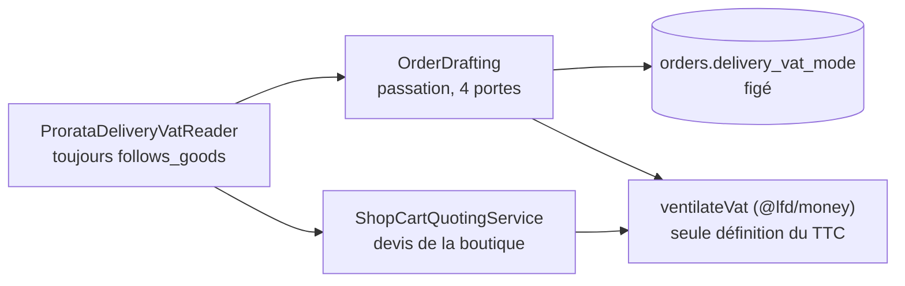

# La TVA des frais de port

**État : ✅ bâti.** Il touche **l'argent** : une phrase fausse ici se paie en TVA.

## 1. Ce que fait le système

Les frais de livraison d'une commande **suivent toujours le taux de ce qu'ils
transportent**, répartis au prorata de la base hors taxe de chaque taux (décidé
par Hugo le 2026-11-19). Livrer ses propres marchandises est l'accessoire de la
vente : le port entre dans le prix de la vente (CGI, art. 267) et suit le taux
des produits. Aucun réglage ne le change.

Un panier tout à 5,5 % a donc un port à 5,5 % ; un panier mêlé répartit le port
entre ses taux, au poids hors taxe de chacun.

Le mode reste **figé sur chaque commande** à sa passation, et une commande
passée ne se réécrit jamais : celles passées sous le taux normal gardent
`standard` (ou `NULL`, d'avant tout mode), et le moteur sait toujours les
calculer.

## 2. Le calcul — un seul endroit

`ventilateVat` (`packages/money/src/vat.ts`) reçoit des extras typés
`VatExtra` : soit `{ htCents, ratePercent }`, soit `{ htCents, followsGoods: true }`.
Les marchandises (`VatLine`) ne peuvent pas porter `followsGoods`.

Un extra qui suit la marchandise est réparti **au prorata de la base brute de
chaque taux** (`num(taux) += extra × ht(taux)` sur le dénominateur commun
`sous-total`). Tant que le net est positif, les proportions sont celles du net ;
quand une remise ou un bon de fidélité absorbe toute la marchandise, le résultat
reste défini. **Aucun arrondi neuf** : la TVA de chaque taux est arrondie une
fois. Sous-total nul : l'extra prend le taux normal.

## 3. Le mode des commandes neuves

- **Le port de lecture** `OrderDeliveryVatReader`
  (`orders/domain/ports/order-delivery-vat.reader.ts`) n'a qu'une
  implémentation, `ProrataDeliveryVatReader`, liée dans `orders.module.ts` :
  elle rend toujours `follows_goods`. Le port reste pour que les tests du moteur
  éprouvent aussi `standard`.
- **Aucun écran, aucune route** : l'ancien réglage de la comptabilité
  (Comptabilité › « TVA de la livraison », `GET` / `PUT /admin/order-delivery-vat`)
  est retiré. La table `order_delivery_vat` reste en base, plus lue ni écrite.
- **Les faits passés** `order_delivery_vat.mode_set` se lisent encore dans le
  journal (`orders-phrases.ts`) ; aucun nouveau n'est écrit.

## 4. Figé sur la commande

`orders.delivery_vat_mode` est nullable : `NULL` = commande d'avant tout mode =
taux normal. Les quatre portes de passation (client, équipe, boutique, devis pro)
passent par `OrderDrafting`, qui lit le mode courant (`order-drafting.service.ts`)
et le fait persister (`prisma-order.repository.ts`).

**Rien ne recalcule après coup** : bon, relevé et prélèvement lisent `vatShares`
et `totalCents` figés. Le mode figé sert à l'**affichage** (« Livraison : TVA au
prorata des produits » / « TVA 20 % », `packages/b2b-ui/src/order/order-pricing.ts`)
et au dossier de facturation. Au compte et au prorata, le bon n'affiche **aucun**
taux (il n'y en a pas un seul).

⚠️ Les valeurs `standard` et `follows_goods` sont **persistées** : les renommer
sera une migration de données. `lint:dated-decisions` ne couvre pas ce réglage ;
le gel sur la commande est la seule protection, et elle suffit puisque rien ne
recalcule.

## 5. Le devis répond comme la passation

`shop-cart-quoting.service.ts` lit le même port (`deliveryExtraOf`) ; l'effet
d'un bon de fidélité hérite de l'entrée du devis. Éprouvé :
`quote-order-parity.e2e-spec.ts` (`apps/lfd-api/test/`), et le golden master du
chiffrage, dont chaque panier livré a son port au prorata.

## 6. Reste à faire

- **Non vérifié, à confirmer par le cabinet comptable** : la justesse fiscale du
  prorata sur la base **brute** plutôt que nette. Identiques tant que le net est
  positif.
- **Un transporteur externe**, facturé comme une prestation distincte, relèverait
  du taux normal : le système ne le connaît pas aujourd'hui.
- **La surtaxe de retard** reste hors de ce chantier : son taux est figé à part
  (`late_fee_adjustment`) et sa nature — indemnité ou supplément de prix — est
  une autre question.
- **Dossier de facturation** : la part HT du port par taux n'est figée nulle
  part (`vatShares` = `{ rate, amountCents }`) ; le dossier la recalcule sur
  l'agrégat et range l'écart dans « arrondi de la TVA »
  ([simulateur](../../comptabilite/facturation/simulateur-dossier-de-facturation.md)).
