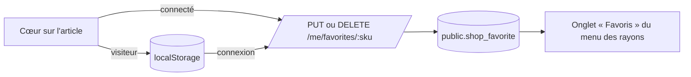

# Les favoris de la boutique

> ✅ En production depuis le 2026-11-27. Décidé par Hugo le 2026-11-26 : les
> favoris sont gardés **par espace** (une société, ou l'espace personnel du
> particulier) ; un visiteur non connecté peut en mettre, gardés dans son
> navigateur et rattachés à l'espace à la connexion.

## En simple

Sur chaque article de la boutique, un cœur. Le toucher met l'article en favori
(ou l'en retire). Dès qu'il y a au moins un favori, le menu des rayons gagne un
onglet **« Favoris »**, placé juste **avant « Incontournable »**, qui ne montre
que ces articles.

Tous les membres d'un même compte pro voient les mêmes favoris ; un site (sous-compte)
a les siens, puisqu'il est son propre espace. Le particulier a les siens.

## Technique

### Données — `public.shop_favorite`

| Colonne       | Type                      | Sens                                                      |
| ------------- | ------------------------- | --------------------------------------------------------- |
| `holder_type` | `text` (`company`/`user`) | l'espace : une société, ou l'espace personnel             |
| `holder_id`   | `text`                    | `companyId`, ou `userId` quand `@ActingCompany()` est nul |
| `sku`         | `text`                    | le SKU du référentiel, opaque (aucune clé vers `pim`)     |
| `created_at`  | `timestamptz`             | le `Clock` de la requête                                  |

Clé primaire `(holder_type, holder_id, sku)`. Pas d'archivage : un favori retiré
n'est pas un agrégat métier, c'est une préférence (CRUD honnête, §3.1 — aucune
règle ne peut refuser l'écriture). Le titulaire se prend **du principal**
(`@ActingCompany()`, la figure de `me/loyalty`), jamais du corps : le mur est
dans le `where`. Un SKU qui n'est plus servi reste en base et n'apparaît
simplement plus dans l'onglet (la vitrine filtre les articles qu'elle a).

Contexte : `src/lafoliecoffee/shop-favorites/`, modèle Prisma rangé dans
`prisma/schema/public/shop-favorites.prisma`.

### Routes (client, sous jeton)

| Route                       | Effet                 | Idempotence                                           |
| --------------------------- | --------------------- | ----------------------------------------------------- |
| `GET /me/favorites`         | `{ skus: string[] }`  | lecture                                               |
| `PUT /me/favorites/:sku`    | pose le favori, 204   | `@Idempotent` : reposer un favori posé ne change rien |
| `DELETE /me/favorites/:sku` | retire le favori, 204 | `@Idempotent` : retirer un absent ne change rien      |

Contrat `MyFavoritesView` dans `@lfd/contracts`. Le SKU est validé en forme
(chaîne non vide, bornée), pas en existence : ce n'est pas au commerce de lire
le référentiel pour une préférence.

### Boutique

- `FAVORITES_SHELF = 'vitrine:favorites'` dans `shelves.ts`, à côté de
  `FEATURED_SHELF` ; `shelf-nav.ts` et `shelf-address.ts` l'ajoutent **avant**
  l'onglet des incontournables, seulement si un article servi est en favori.
- `ShopFavorites` (`shop/shop-favorites.store.ts`), clé par l'espace (`client/context-keyed/`, porte
  `lint:context-keyed-readers`) : connecté → les routes ; visiteur →
  `localStorage` (clé `lfc.favorites`, lue en `try/catch`, inscrite au
  [registre des traceurs](../../legal/registre-des-traceurs.md)).
- À la connexion, les SKU locaux sont posés dans l'espace courant (un `PUT` par
  SKU, idempotent) puis la clé locale est vidée ; un SKU dont l'envoi échoue
  reste en local pour la fois suivante. La clé est aussi effacée à la
  déconnexion (`sign-out/stored-keys.ts`). Le cœur bascule tout de suite et
  revient en arrière si l'appel échoue.
- Le cœur (`shop/favorite-toggle/`, qui compose `fold-toggle-icon`) est en bas
  à droite de la photo, sur la vignette (`product-tile`) comme dans la fiche :
  la pastille de quantité au panier et la mise en avant gardent le haut, et le
  cœur reste visible quand l'article est au panier (Hugo, 2026-11-27). Bouton
  `aria-pressed`, libellé « Ajouter aux favoris » / « Retirer des favoris »
  dans les dictionnaires (FR, EN, IT). Sur la vignette, il est le second arrêt
  de tabulation, à côté du nom qui ouvre la fiche (décidé par Hugo le
  2026-11-26, entorse assumée au « un seul arrêt par produit » du lot RGAA A2).
- `legacy/data/favorites.service.ts` (le POC en mémoire) ne sert pas à la
  boutique.

### Reste à faire

- Inscrire `lfc.favorites` dans la politique cookies, texte édité à l'écran
  (Réglages › Légal › Cookies) : le registre des traceurs la porte déjà.
