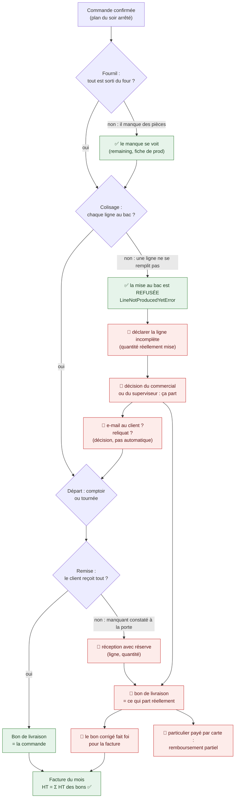

# Le traitement des commandes incomplètes

> **Doc-first, écrit le 2026-10-24** à la demande de Hugo : « on a beaucoup
> travaillé le happy path, mais on ne sait pas déclarer qu'une commande est
> incomplète et qu'elle doit partir quand même, avec un bon de livraison qui
> correspond à ce qui est envoyé ; donner au superviseur et au commercial la
> possibilité de dire “ok, ça part” ». **Rien n'est bâti.** Ce document est
> d'abord un schéma et une table des gestes manquants ; le plan viendra après
> les décisions du § 4.

## 1. Le schéma — où une commande devient incomplète, et ce qui manque

En vert, ce qui existe (ouvert le 2026-10-24) ; en rouge, le geste qui
n'existe pas.

Une seule idée tient tout le schéma : **le bon de livraison doit dire ce qui
est parti, pas ce qui a été commandé**, parce que la facture est la somme des
bons ([`bons-et-facture-concordants.md`](../comptabilite/facturation/bons-et-facture-concordants.md))
et que le client compare les deux.

## 2. Ce qui existe (ouvert le 2026-10-24)

| Où          | Ce que le système sait faire                                                                                                                                                                                     | Fichier                                                                                                                                              |
| ----------- | ---------------------------------------------------------------------------------------------------------------------------------------------------------------------------------------------------------------- | ---------------------------------------------------------------------------------------------------------------------------------------------------- |
| Fournil     | voir le manque par ligne (`remaining`), dérivé des fournées ; la clôture de la journée ne l'empêche pas                                                                                                          | `production/domain/services/production-output.ts`, `production/domain/entities/production-day.ts`                                                    |
| Colisage    | **refuser** de mettre au bac une quantité non sortie du four                                                                                                                                                     | `packing/domain/errors/packing-station-errors.ts` (`LineNotProducedYetError`)                                                                        |
| Commerce    | réviser les lignes d'une commande **au compte ou à total nul** (M1) ; la carte attend M2, « à concevoir »                                                                                                        | `b2b/orders/domain/entities/order-revision.ts`                                                                                                       |
| Commerce    | annuler une commande **en entier** ; l'annulation après production des particuliers est un plan non bâti (C7)                                                                                                    | [`annulation/plan-annulation-apres-production.md`](annulation/plan-annulation-apres-production.md)                                                   |
| Bon         | produit **à partir de la commande**                                                                                                                                                                              | `b2b/orders/domain/services/order-sheet.ts`                                                                                                          |
| Facture     | prend les bons livrés avant la clôture ; HT = Σ HT des bons                                                                                                                                                      | `b2b/accounting/domain/services/pending-order-cycle.ts`                                                                                              |
| Supervision | **voir**, pas agir : la Supervision du jour renvoie vers les postes ; c'est une ressource de permission (`b2b_supervision`), pas un rôle — les rôles sont `admin`, `commercial`, `comptabilite`, `communication` | [`../supervision/architecture-supervision-du-jour.md`](../supervision/architecture-supervision-du-jour.md), `packages/contracts/src/staff-access.ts` |
| Boutique    | un texte « Cet article n'est plus disponible » (`shop.pieceUnavailable`) existe, sans geste derrière côté commande                                                                                               | `b2b/shop-copy/…/shop-copy-manifest.json`                                                                                                            |

Non trouvé : un statut ou un drapeau « incomplète », un manquant déclaré à la
porte, un bon qui diffère de la commande, une approbation par un rôle.

## 3. La table des gestes manquants

| #   | Geste                                                    | Qui                                      | Où                             | Ce qu'il change                                                                                                |
| --- | -------------------------------------------------------- | ---------------------------------------- | ------------------------------ | -------------------------------------------------------------------------------------------------------------- |
| G1  | Déclarer une ligne incomplète (quantité réellement mise) | colisage                                 | colisage                       | la ligne porte « commandé 12, parti 9 », sans toucher la commande d'origine                                    |
| G2  | « Ok, ça part » — autoriser le départ incomplet          | superviseur, commercial                  | supervision ? fiche commande ? | lève le refus du colisage pour cette commande ; tracé, avec auteur et motif                                    |
| G3  | Prévenir le client du manque et de la décision prise     | commercial ou superviseur, **à la main** | e-mail, depuis la décision G2  | une décision d'affaires, pas un envoi automatique : il choisit d'écrire ou non, et le texte part tracé         |
| G4  | Réception avec réserve à la porte                        | livreur, comptoir                        | retrait                        | un manquant constaté à la remise rejoint la même correction que G1                                             |
| G5  | Le bon de livraison dit ce qui est parti                 | —                                        | bon                            | quantités réelles, ligne « non livré » visible                                                                 |
| G6  | La facture suit le bon corrigé                           | —                                        | facturation                    | déjà vrai par construction si G5 écrit les quantités que la facture somme                                      |
| G7  | Rembourser la part non livrée (particulier, carte)       | automatique ou comptabilité              | remboursement                  | dépend de M2 (révision d'une commande par carte), non conçu                                                    |
| G8  | Remplacer par un autre produit                           | commercial                               | ?                              | hors de ce document tant que Hugo ne le demande pas                                                            |
| G9  | Renvoyer le reste dans une autre livraison (reliquat)    | commercial ou superviseur, **à la main** | décision G2                    | le manque devient une commande de reliquat sur une date choisie, rattachée à l'origine ; ou rien n'est renvoyé |

## 4. Décisions de Hugo (2026-10-24)

- **Q1 / Q2 — le commercial ou le superviseur décide.** Le départ incomplet
  passe par sa décision, puis ça part.
- **Ce qu'il décide, en plus du départ** : faut-il **renvoyer la suite dans
  une autre livraison** (G9), et faut-il **signaler par e-mail le manque et
  la décision prise** (G3). **Rien d'automatique** : ce sont des décisions
  d'affaires, prises cas par cas.

- **Q1 — une permission**, « décider d'un départ incomplet », accordée à
  l'écran à qui on veut (`/admin/staff-roles`). Pas de rôle « superviseur ».
- **Q3 — la commande d'origine reste intacte.** « C'est à nous de décider
  comment traiter le manque » : la commande dit ce que le client a demandé,
  le bon dit ce qui est parti, et la décision dit ce qu'on fait de l'écart.
- **Q5 — le manquant à la porte (G4) : à voir après.** Hors de ce chantier.
- **Q6 — le reliquat est la suite de la même commande**, aux **mêmes
  conditions de prix**, avec sa propre livraison. Sa date est choisie par le
  **commercial**, quand il décide de relivrer.

- **Q7 — rien ne part incomplet sans décision** (confirmé). La commande
  reste au colisage, et la Supervision du jour la montre « décision attendue ».
- **La facture d'une commande en deux livraisons : oui**, chaque livraison a
  son bon et la facture somme les bons. Le système doit permettre un reliquat
  livré un autre jour, même si le cas courant sera une **seconde livraison le
  jour même** (« same day second delivery »).

## 5. Ce qui reste ouvert

- **Le particulier payé par carte** (G7) : le reliquat non relivré se
  rembourse ; le remboursement partiel attend M2. À trancher au plan.
