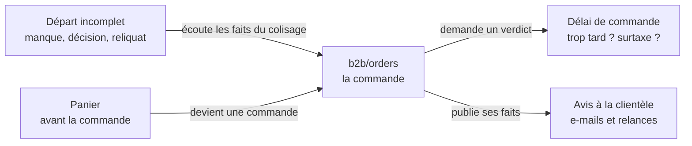

# Les domaines à découper dans `b2b/orders`

> **Doc-first, 2026-11-10.** Un inventaire, pas un plan : ce qui, dans le bloc
> des commandes, mériterait d'être isolé comme le paiement l'a été dans
> `card-payment`. Rien n'est décidé ni bâti. Les comptes ont été lus dans
> l'arborescence le 2026-11-10 ; les couplages fins (qui lit quoi, qui écrit
> quoi) ne l'ont **pas** été — c'est la première étape de chaque chantier.

## Partie 1 — l'idée simple

`b2b/orders` est le plus gros bloc du dépôt : **716 fichiers** hors tests au
2026-11-10. Tout ce qui touche une commande y a été rangé, y compris ce qui a
son propre métier.

Le paiement en est sorti (plan M2, bloc `card-payment`) parce qu'il avait son
propre cycle de vie et n'avait pas besoin de savoir ce qu'est une commande.
La question à poser à chaque partie est la même :

> **A-t-elle son propre métier, ses propres états, et pourrait-elle répondre
> à une question sans connaître l'intérieur d'une commande ?**

Si oui, elle gagne à devenir un contexte à part, que la commande interroge
par un canal — un seul endroit à changer quand sa règle change.

## Partie 2 — les candidats

### 2.1 Le délai de commande (l'heure limite) — le plus utile

**Aujourd'hui.** Les **réglages** sont bien rangés : le contexte
`b2b/order-cutoffs` possède l'heure limite générale, les réglages par jour,
le « jour même », les jours de livraison. Mais le **jugement** — « est-ce trop
tard pour ces articles, ce jour, cet acheteur, à cet instant, et qu'en
fait-on ? » — vit dans `orders` : `OrderCutoffGate`
(`application/services/order-cutoff-gate.service.ts`) et `order-cutoff-guard`
(`domain/services/order-cutoff-guard.ts`) lisent eux-mêmes trois sources
(réglage du commerce, limite propre à chaque article publiée par le
référentiel, dérogation accordée au client), choisissent la plus fermée et
appliquent le rattrapage ; la surtaxe tardive (`late-fee-judgement`), la
tolérance de retard, les relances avant l'heure limite et les avis de fin de
commande y sont aussi. **39 fichiers** de `orders` en parlent : passation,
devis, modification, hausse, vente sur stock, relances, expiration des
paniers non réglés.

**Le signe.** Le 2026-11-10, pour la hausse carte (plan S2, R6), il a fallu
faire juger l'heure limite « à l'instant de la décision » : trois services
partagés avec la passation ont changé de signature, parce que le jugement
lisait l'horloge à trois endroits.

**La forme visée.** Un contexte « délai de commande » qui rend un **verdict**
— ouverte, en rattrapage (avec la surtaxe), ou fermée, avec la raison — pour
(articles, jour, acheteur, instant). `orders` demande et applique ; la
passation, la modification, la hausse et les relances posent la même
question à la même brique.

### 2.2 Le départ incomplet — le plus proche du paiement

**Aujourd'hui.** Environ **48 fichiers** dans `orders` : le manque constaté
(`OrderShortfall`), la décision (`ShortfallDecision`), l'avis
(`ShortfallNotice`), le courrier, les reliquats et leur expédition
(`order-remainder-settler`, `remainder-shipment`). Il écoute déjà le
colisage par des faits (`on-packing-shortfall-reported` / `-cleared`). Doc
d'état : [`../comptoir/depart-incomplet.md`](../comptoir/depart-incomplet.md).

**Le signe.** Ses propres agrégats, son propre cycle (constater, décider,
écrire, relivrer) ; sa clé est la commande, mais son métier est « ce qu'on
n'a pas pu livrer et ce qu'on en fait » — la même forme que le retrait,
sorti du fournil le 2026-09-10.

**Le prix.** 27 autres fichiers de `orders` le citent (relevé du
2026-11-10) : il faudrait un canal, pas un simple déménagement.

### 2.3 Les avis à la clientèle (e-mails et relances)

**Aujourd'hui.** Environ **26 fichiers** : les abonnés qui envoient « commande
passée », « prête », « annulée », « paiement échoué », « en route », les
relances avant l'heure limite (`order-customer-nudges`), la liste des
e-mails d'une commande — et, depuis le 2026-11-10, « commande modifiée ».

**Le signe.** Presque tous **écoutent** des faits de la commande et ne
décident rien. Les sortir ferait de `orders` un émetteur, et du nouveau
contexte un abonné : « quoi dire, et quand ». Le bloc `mail` existe déjà pour
l'envoi lui-même.

### 2.4 Le panier de la boutique

**Aujourd'hui.** Une douzaine de fichiers : `shop-cart.repository`,
`shop-cart-quoting.service`, `cart-adjustments`, l'enregistrement et le
chiffrage du panier.

**Le signe.** Un panier vit **avant** la commande, avec son stockage et son
cycle propres ; la passation le transforme en commande. Le plus simple des
quatre.

### 2.5 Ce qui reste dans `orders`, rangé en sous-dossiers

**L'annulation** (environ 60 fichiers) et **la modification** (environ 36,
plus la hausse) agissent sur l'état de la commande à chaque étape : elles
sont le cœur du bloc. Elles gagneraient un sous-dossier chacune
(`orders/cancellation/`, `orders/revision/`), pas un contexte.

## L'ordre proposé

1. **Le délai de commande** — le plus de profit, il est traversé par chaque
   geste ; à faire hors d'un chantier qui modifie la même porte.
2. **Le départ incomplet** — le cas le plus net, et un canal à concevoir.
3. **Les avis à la clientèle** et **le panier** — plus simples, à faire
   quand on y touche.

Chacun commence par la lecture des couplages réels, puis un plan court, puis
`vitruve` (une frontière se déplace), avant tout code.
