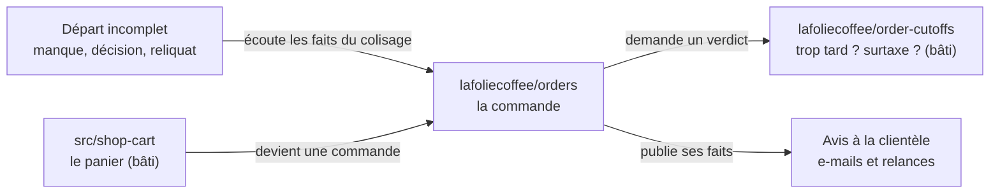

# Les domaines à découper dans `lafoliecoffee/orders`

> **Inventaire, relu le 2026-11-20.** Ce qui, dans le bloc des commandes,
> mériterait d'être isolé comme le paiement l'a été dans `card-payment`. Deux
> candidats sont bâtis (le délai de commande, §2.1 ; le panier, §2.4) ; les deux
> autres ne sont ni décidés ni bâtis. Les comptes de fichiers ont été lus dans
> l'arborescence le 2026-11-20 (ceux des §2.2 et 2.3, le 2026-11-10) ; les couplages fins (qui lit
> quoi, qui écrit quoi) ne l'ont **pas** été — c'est la première étape de
> chaque chantier.

## Partie 1 — l'idée simple

`lafoliecoffee/orders` est le plus gros bloc du dépôt : **839 fichiers** hors tests au
2026-11-20. Tout ce qui touche une commande y a été rangé, y compris ce qui a
son propre métier.

Le paiement en est sorti (plan M2, bloc `card-payment`) parce qu'il avait son
propre cycle de vie et n'avait pas besoin de savoir ce qu'est une commande.
La question à poser à chaque partie est la même :

> **A-t-elle son propre métier, ses propres états, et pourrait-elle répondre
> à une question sans connaître l'intérieur d'une commande ?**

Si oui, elle gagne à devenir un contexte à part, que la commande interroge
par un canal — un seul endroit à changer quand sa règle change.

## Partie 2 — les candidats

### 2.1 Le délai de commande (l'heure limite) — bâti

**Fait** (lots V1 à V7 du verdict, 2026-11-19). Le jugement vit dans
`lafoliecoffee/order-cutoffs`, derrière une seule question, `OrderDeadline`
(`order-cutoffs/{domain,application,infrastructure}/deadline/`) : un juge pur
et ses sources. Ceux qui appliquent le verdict restent dans `orders` — la
passation, l'avis d'heure limite, la surtaxe prévue, la modification et la
hausse, la relance et les suggestions. L'ancien jugement est retiré (V7), et
`lint:order-deadline-door` refuse qu'on le réimporte ou qu'on appelle une
fonction de décision hors du juge ; sa dette est vide.

Le même jour, le verdict a appris le **dépassement d'une limite de produit**
(lots O1 à O7) : l'équipe passe outre, avec un droit, un motif et une trace,
à la saisie comme à la modification ; le plancher suit le geste (J6).

**Ce qui reste couplé** (relevé du 2026-11-20) : 23 fichiers de `orders` hors
tests importent `order-cutoffs/`, dont 8 citent `OrderDeadline`. Le canal
reste à l'intérieur du bloc `lafoliecoffee`, sans porte de frontière : c'est la
discipline de l'`index.ts` qui le tient, pas la matrice.

Doc d'état :
[`../limites-de-commande/le-verdict-de-l-heure-limite.md`](../limites-de-commande/le-verdict-de-l-heure-limite.md) ;
le dépassement :
[`../limites-de-commande/passer-outre-la-limite-d-un-produit.md`](../limites-de-commande/passer-outre-la-limite-d-un-produit.md).

### 2.2 Le départ incomplet — le plus proche du paiement

**Aujourd'hui.** Environ **48 fichiers** dans `orders` : le manque constaté
(`OrderShortfall`), la décision (`ShortfallDecision`), l'avis
(`ShortfallNotice`), le courrier, les reliquats et leur expédition
(`order-remainder-settler`, `remainder-shipment`). Il écoute déjà le
colisage par des faits (`on-packing-shortfall-reported` / `-cleared`). Doc
d'état : [`reliquat/reliquat.md`](reliquat/reliquat.md).

**Le signe.** Ses propres agrégats, son propre cycle (constater, décider,
écrire, relivrer) ; sa clé est la commande, mais son métier est « ce qu'on
n'a pas pu livrer et ce qu'on en fait » — la même forme que le retrait,
sorti du fournil le 2026-09-10.

**Le prix.** 27 autres fichiers de `orders` le citent (relevé du
2026-11-10) : il faudrait un canal, pas un simple déménagement.

### 2.3 Les avis à la clientèle (e-mails et relances)

**Aujourd'hui.** Environ **26 fichiers** : les abonnés qui envoient « commande
passée », « prête », « annulée », « paiement échoué », « en route », les
relances avant l'heure limite (`order-customer-nudges`), la liste des
e-mails d'une commande — et, depuis le 2026-11-10, « commande modifiée ».

**Le signe.** Presque tous **écoutent** des faits de la commande et ne
décident rien. Les sortir ferait de `orders` un émetteur, et du nouveau
contexte un abonné : « quoi dire, et quand ». Le bloc `mail` existe déjà pour
l'envoi lui-même.

### 2.4 Le panier de la boutique — bâti

**Fait** le 2026-11-20 : un bloc de premier niveau, `src/shop-cart/`, avec son
schéma Postgres `cart` et sans clé étrangère. Le chiffrage du panier reste au
commerce ; le catalogue lui demande par `ShopCartSkuUsage` si un article est
dans un panier. État : [`le-panier.md`](le-panier.md).

### 2.5 Ce qui reste dans `orders`, rangé en sous-dossiers

**L'annulation** et **la modification** (hausse et baisse comprises) agissent
sur l'état de la commande à chaque étape : elles sont le cœur du bloc, pas des
contextes à part. Chacune a son sous-dossier depuis le 2026-11-10 :
`orders/cancellation/` (87 fichiers) et `orders/revision/` (119 fichiers), aux
mêmes couches que le reste des commandes.

## L'ordre proposé

1. ~~**Le délai de commande**~~ — bâti le 2026-11-19 (§2.1).
2. **Le départ incomplet** — le prochain : le cas le plus net, et un canal à
   concevoir.
3. ~~**Le panier**~~ — bâti le 2026-11-20 (§2.4).
4. **Les avis à la clientèle** — plus simple, à faire quand on y touche.

Chacun commence par la lecture des couplages réels, puis un plan court, puis
`vitruve` (une frontière se déplace), avant tout code.
