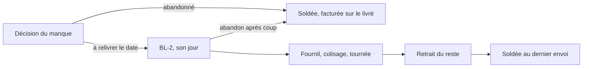

# E7, le reliquat : état du chantier

> **Relu le 2026-10-26.** Tout ce qui est dit bâti est commité sur `dev` et
> poussé (`c46d4f6a0`), mais pas sur `main`. Le détail de chaque lot, ses
> choix et ce qu'il a appris se trouvent dans le plan de bâti
> [`plan-e7-reliquat-bati.md`](plan-e7-reliquat-bati.md) (§3, §3 bis et
> annexes). Ce document en donne la vue d'ensemble.

## 1. De quoi il s'agit

Une commande au compte qui part incomplète peut avoir un **reste**. Ce reste
est la suite de la **même** commande, aux mêmes prix. Il porte son propre bon
de livraison (le BL-2) et son propre jour : on le fabrique, on le colise et
on le livre comme un **envoi** de plus. Le programme et les décisions de
Hugo sont dans [`plan-e7-le-reliquat.md`](plan-e7-le-reliquat.md).

Un envoi se désigne par **(commande, rang)**. Le rang 1 est la commande
elle-même : ses écrans et ses clés n'ont pas changé. Un rang supérieur à 1
est un reste.

État des boîtes du schéma :

- **bâties** : la décision « abandonné » (E6), puis fabrication, colisage,
  retrait et solde d'un BL-2 déjà existant ;
- **pas bâties** : la naissance du BL-2 (L8) et l'abandon après coup (L9).

## 2. Les décisions de Hugo

| Date       | Décision                                                                                                                                                                                          |
| ---------- | ------------------------------------------------------------------------------------------------------------------------------------------------------------------------------------------------- |
| 2026-10-25 | Q-R1 : chaque BL suit la règle de son propre arrêt (signature, nom, dépôt).                                                                                                                       |
| 2026-10-25 | Q-R2 : le superviseur abandonne un reste « à relivrer » avec le même geste que pour le départ incomplet.                                                                                          |
| 2026-10-25 | Q-R3 : la commande est soldée quand son dernier envoi est retiré ou quand son reste est abandonné.                                                                                                |
| 2026-10-25 | Q-R4 : la facture d'une commande carte part au solde. Sans objet aujourd'hui : le départ incomplet est refusé sur carte, et le remboursement E9 attend M2.                                        |
| 2026-10-25 | Mandat : bâtir tout le reliquat sans poser de question. E9 est exclu.                                                                                                                             |
| 2026-10-26 | Un reste ne paie **pas** de livraison. Le port, la surtaxe et la remise fixe restent dans le modèle, à 0 €, mais n'apparaissent ni sur le bon ni sur la facture. Une remise en % est réappliquée. |
| 2026-10-26 | Une commande « prête » compte dans le chiffre d'affaires, les alertes et les barèmes de volume.                                                                                                   |
| 2026-10-26 | On facture **sur le livré** une fois le sort du reste décidé. L'onglet Factures montre « Partielle — reste à relivrer », sans compter la commande « à facturer ».                                 |

## 3. Ce qui est bâti

| Lot       | Ce qu'il fait                                                                                                                                  | Commit      |
| --------- | ---------------------------------------------------------------------------------------------------------------------------------------------- | ----------- |
| plan      | Plan de bâti, contredit trois fois par `vitruve`                                                                                               | `21ecff34a` |
| L0        | Recensement : 140 lecteurs, le manque, les faits, le jeton, 27 listes de statuts                                                               | `d9261fbd5` |
| L-points  | Les points de fidélité portent sur ce qui est parti (`billable_*`)                                                                             | `d9851af88` |
| L1        | `delivery_note.service_day` : le jour d'un reste, et la fabrique `DeliveryNote.planRemainder`                                                  | `6668de6fd` |
| L2        | L'alignement ne suit que le BL-1. La re-clôture ne réécrit plus un reste                                                                       | `8ea1ae122` |
| (D7)      | Le jour d'un reste fait bouger la version de journée                                                                                           | `b7f87fb28` |
| L3a       | Les faits du flux portent l'envoi (`ShipmentRef`), avec des clés `:r<rang>` au-delà du rang 1                                                  | `1d03edf9e` |
| L3b       | Le rang en base au fournil et au colisage                                                                                                      | `0361e4501` |
| L3c       | Le rang en base à la livraison (arrêts, disponibilité du jour)                                                                                 | `32d636973` |
| L3d       | Le rang en base au retrait (attestation, départ, preuves)                                                                                      | `d6a5386d9` |
| L4a       | Un reste colisé prépare son BL                                                                                                                 | `41d23158f` |
| L4b       | Le retrait se juge par envoi. La référence prend `-<rang>`                                                                                     | `82651e355` |
| L4c       | Au comptoir, le QR et la saisie `ORD-…-2` rendent les envois prêts. Le choix entre deux envois. L'annulation refuse dès qu'un envoi est retiré | `e8d0c243e` |
| L4d       | Le reste a ses courriels « prête » et « en route » (fr, en, it)                                                                                | `c283d04fa` |
| L5a       | L'état « En partie retirée ». Annuler annule tous les BL vivants                                                                               | `28566239c` |
| L5b       | Le solde au dernier envoi. Solde, facture au compte et points portent sur la somme des BL                                                      | `3a1268d83` |
| L5c       | Le client voit « En partie retirée / livrée » dans son suivi                                                                                   | `84fd906f4` |
| LB        | Le manque et sa décision par envoi (`order_shortfall`)                                                                                         | `f1c5fdcc3` |
| décisions | « Prête » compte, Partielle aux Factures, le port du reste n'est pas affiché                                                                   | `c46d4f6a0` |

**Ce que ça donne aujourd'hui.** Tout le système sait porter, fabriquer,
coliser, retirer, solder et facturer un second envoi. Mais **aucun geste à
l'écran ne crée encore un reste** : seuls les tests en fabriquent, par
`DeliveryNote.planRemainder`. Avec un seul envoi, tout se comporte comme
avant, et chaque lot l'a prouvé.

## 4. Ce qui reste à faire

| Lot    | Contenu                                                                                                                                                                                                                                                                       |
| ------ | ----------------------------------------------------------------------------------------------------------------------------------------------------------------------------------------------------------------------------------------------------------------------------- |
| **L7** | Les sources du jour lisent les BL-2 (`DayShipmentsReader`) : fournil, colisage (une seconde feuille par reste), tournées, feuille de route, « Ma tournée », file du comptoir au jour du reste. Le manque d'un reste est visible à l'écran.                                    |
| **L8** | Le geste « reste à relivrer le <date> » dans la décision du manque. Il fait naître le BL-2 avec la règle du port à zéro. L'entrée au plan de D2, y compris un jour déjà arrêté par le retirage, et le jour même avec sa garde. Les écrans disent « reste relivré le <date> ». |
| **L9** | L'abandon d'un reste après coup par le superviseur, puis le solde.                                                                                                                                                                                                            |

Ensuite :

- passer la suite complète ;
- relire les migrations de la nuit avant tout passage sur `main` (`lecteur-de-migrations`, puis `vitruve` pour les migrations de données L3c et LB) ;
- transformer le plan en doc d'état ;
- mettre à jour [`parcours-complet.md`](parcours-complet.md) et
  [`bon-de-livraison.md`](bon-de-livraison.md).

**Exclu** : E9, le remboursement d'un reste payé par carte, qui dépend de
M2 (reporté le 2026-10-23).

## 5. Migrations ajoutées (à relire avant `main`)

| Migration                                                   | Nature                                                |
| ----------------------------------------------------------- | ----------------------------------------------------- |
| `20261026050000_le_jour_du_reliquat`                        | additive : colonne et CHECK                           |
| `20261026060000_le_jour_du_reliquat_fait_bouger_la_journee` | additive : déclencheur                                |
| `20261026070000_le_rang_au_fournil_et_au_colisage`          | **clés** : clés primaires et FK composites recréées   |
| `20261026080000_le_rang_a_la_livraison`                     | **clés et données** : recopie de `delivery_order_ids` |
| `20261026090000_le_rang_au_retrait`                         | **clés**                                              |
| `20261026100000_la_commande_en_partie_retiree`              | valeur d'énum                                         |
| `20261026110000_le_manque_par_envoi`                        | **données** : recopie du manque au rang 1             |

## 6. Questions encore ouvertes

- Le client règle encore « dépôt autorisé » sur ses adresses, côté
  boutique. La règle ne le lit plus : faut-il le retirer aussi de la
  boutique ?
- Une commande « en attente du reste » laisse l'onglet Factures à « fait ».
  Faut-il un état « en attente » ?
- Le bundle de la boutique est à 1,38 Mo pour un budget de 1,35 Mo, et celui
  du back-office à 1,28 Mo pour 1,25 Mo. Il reste à vérifier si ces
  dépassements datent d'avant la nuit.
