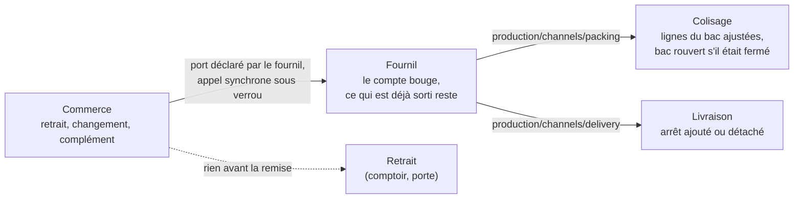

# Étude — l'arrêt du plan comme publication, et les ajustements qui suivent

> **Étude, 2026-10-25. Rien n'est décidé, rien n'est bâti.** Demandée par Hugo
> (« est-ce que la manière d'arrêter la journée est un frein ? ») avant de
> reprendre le reliquat ([`plan-e7-le-reliquat.md`](plan-e7-le-reliquat.md)).
> Règle de Hugo : se rapprocher le plus de la réalité. Touche la production,
> l'argent (annuler une commande produite) et le reliquat : `vitruve` avant
> Hugo. Chaque affirmation sur le code a été ouverte le 2026-10-25 ; chemins
> relatifs à `apps/lfd-api/src/`.

## 0. La question

Ce matin, l'assistant a décrit l'arrêt du plan comme un **mur** : après lui,
rien ne bouge. En ouvrant le code, c'est **à moitié faux** — l'arrêt est déjà
une publication suivie d'ajustements, mais **seulement dans un sens** : on sait
ajouter, on ne sait ni retirer ni changer. C'est ce demi-modèle qui freine
A1/A2 (annuler, modifier après l'arrêt) et le reliquat (E7).

## 1. Ce qui existe après l'arrêt (ouvert le 2026-10-25)

| Geste après l'arrêt                  | Où                                                                                                                                                         | Ce qu'il fait                                                                                                                                                                       | Sens         |
| ------------------------------------ | ---------------------------------------------------------------------------------------------------------------------------------------------------------- | ----------------------------------------------------------------------------------------------------------------------------------------------------------------------------------- | ------------ |
| **Retirage**                         | `production/application/commands/retake-production-day.handler.ts`, `ProductionDay.retake`                                                                 | absorbe les commandes `placed` arrivées depuis ; publie `production.packing_list_drawn` par commande (colisage) et `production.day_retaken` durable avec les `orderIds` (livraison) | **ajout**    |
| **Réassort « au plus tôt »**         | `ProductionDay.launchResupply`                                                                                                                             | un réassort entre au plan d'une journée arrêtée, le compte se refait                                                                                                                | **ajout**    |
| **Manque au colisage** (E6a)         | `packing.shortfall_reported` → la commande attend une décision                                                                                             | le colisage dit « il en manque » ; le plan du fournil ne bouge pas                                                                                                                  | aval         |
| **Départ incomplet** (E6b)           | `order_shortfall_decision`, le BL-1 réécrit ; `PackingSheet.authorizeShortfall` écrase la ligne due                                                        | le commerce décide, en aval de la production                                                                                                                                        | aval         |
| **Réouverture**                      | `ProductionDay.reopen`                                                                                                                                     | efface tout le plan ; refusée dès que quelque chose a commencé (`assertReopenable`)                                                                                                 | tout ou rien |
| Annuler une commande inscrite        | refus n° 5 de `cancellationOf` (`annulation/annulation-par-le-staff.md` § C3.3)                                                                            | **refusé**                                                                                                                                                                          | —            |
| Modifier une commande inscrite       | règle R1 (`modification/plan-modifier-une-commande.md` § 2) ; `OrderRevisionNotice` (`prisma/schema/production.prisma`) départage une révision et un arrêt | **refusé**                                                                                                                                                                          | —            |
| Second envoi le même jour (reliquat) | clés `production_order (serviceDay, orderId)`, `packing_order (serviceDay, orderId)`                                                                       | **impossible**                                                                                                                                                                      | —            |

Deux propriétés du retirage sont précieuses et à garder :

- **la course est tenue** : `OrderWithdrawalDesk` (fournil, sous
  `ProductionDayLock`) départage une annulation et une clôture qui se
  croisent (§ C3.4) ;
- **les coches héritées sont matérialisées** avant d'absorber
  (`ProductionDay.materialize`) : « 30 cochés, puis 30 → 42 » ne devient pas
  « 42 sortis ».

## 2. La proposition : un ajustement, quatre sortes

**L'arrêt publie la version 1 du plan** — inchangé : même instantané, même
fiche, mêmes faits. **Tout changement ensuite est un ajustement** : un fait
nommé, daté, signé, que chaque poste lit comme un **écart** à ce qu'il a déjà.

| Sorte                 | Exemple                                   | Origine                | Existe ?                |
| --------------------- | ----------------------------------------- | ---------------------- | ----------------------- |
| **Ajout de commande** | une commande tardive                      | le retirage            | ✅ (retirage, réassort) |
| **Retrait**           | une commande inscrite annulée (A1)        | le commerce            | ❌                      |
| **Changement**        | +2 baguettes, −1 pain de mie (A2)         | le commerce (révision) | ❌                      |
| **Complément**        | le reste d'un départ incomplet (reliquat) | la décision (E7.5)     | ❌                      |

Chaque poste réagit à **son** écart. ⚠️ **Pas par les canaux d'aujourd'hui**
(`vitruve`, § 6) : ils sont en ajout seul et ignorent un doublon. Il faut un
fait neuf, des abonnés neufs, et une clé d'idempotence **par ajustement**. Et
le commerce **appelle** un port que le fournil déclare, sous
`ProductionDayLock`, comme `OrderWithdrawalDesk` : un fait asynchrone perdrait
le départage avec l'arrêt et le retirage.

Ce qui ne change pas : `production → b2b` reste interdit (le fournil
publie, il ne sait pas qui écoute) ; le commerce ne relaie pas les faits des
autres.

## 3. Ce que ça change pour le reliquat (E7) — ❌ réfuté par `vitruve`

> **Réfuté le 2026-10-25** (§ 6, bloquant 1) : le texte ci-dessous est gardé
> pour qu'on ne le repropose pas. Le reliquat arrive quand l'inscription est
> déjà **réduite** (la ligne due écrasée par `authorizeShortfall`), **fermée**
> (le scellé est sur la commande, pas sur le contenant) et **partie** (`BinDesk`
> refuse de rouvrir un bac chargé). Rien n'y est versionné. **La clé par BL
> d'E7.4 reste nécessaire.**

C'était la conséquence la plus utile, et elle était à **contredire** avant d'y
croire. Aujourd'hui E7 suppose un **second envoi** de la même commande, donc
de nouvelles lignes dans `production_order` et `packing_order` — d'où les
migrations de clé (E7.4). Vu comme un **complément**, le reliquat du même jour
est un **changement de l'inscription existante** de `(jour, commande)` : des
lignes de plus au plan, un bac rouvert ou un second bac sous la même
inscription — **sans nouvelle clé** au fournil ni au colisage.

Ce que le complément **ne règle pas** :

- **la remise** : `order_handover.orderId @unique` (et `reference`, la
  preuve, le départ) impose une remise par commande. Une seconde livraison
  le même jour reste une seconde remise — E7.3 reste nécessaire ;
- **un autre jour** : un complément au jour D2 entre au plan de D2, où la
  commande n'a pas d'inscription — c'est un **ajout** au jour D2, porté par
  le BL-2, et les sources du jour doivent le voir (E7.1, toujours bloqué).

## 4. Ce qui reste à trancher (Hugo)

1. **Qui ajuste, et jusqu'où.** Proposition : retrait et changement par le
   staff sous une permission, jusqu'au chargement du bac ; au-delà, c'est un
   départ incomplet ou un retour. Le client, lui, garde ses règles (heure
   limite) — C7 décide s'il peut abandonner une commande produite.
2. **Ce que devient ce qui est déjà produit** quand on retire ou réduit :
   invendu au comptoir, don, perte — un compte, pas un geste caché.
3. **Comment le fournil voit un ajustement** : un bandeau « +2 baguettes pour
   ORD-…, ORD-… annulée » sur la fiche, et un dossier du jour réimprimé
   (comme après un retirage), ou seulement le compte qui bouge.
4. **L'argent** : un retrait est une annulation (remboursement carte, sortie
   d'assiette au compte) ; un changement est une révision (R3 : prix figés
   pour les lignes présentes). Les verrous existants (`verrous-de-l-annulation.md`)
   s'appliquent tels quels.

## 5. Ordre proposé, si l'étude tient

1. **A1 — le retrait d'une commande inscrite** : le cas le plus simple (tout
   part ou rien), il pose le fait d'ajustement et la réaction des trois postes.
2. **A2 — le changement** : le même fait avec des écarts par ligne.
3. **E7 inchangé dans sa forme** : un BL-2 a ses propres clés (E7.4), sa
   remise (E7.3) et son jour (E7.1). Il réutilise le fait d'ajustement
   d'A1/A2 pour annoncer le complément aux postes.

## 6. Contradiction de `vitruve` (2026-10-25)

Le § 1 est **exact**, relu fichier par fichier. Les §§ 2 et 3 ne tenaient pas.

**BLOQUANTS**

1. **Le complément sans nouvelle clé est faux** (§ 3, réfuté) :
   `PackingLine @@id([serviceDay, orderId, sku])` n'a qu'une quantité due
   par SKU, `authorizeShortfall` l'a déjà écrasée, le scellé est sur la
   commande, `BinDesk` refuse un bac chargé ; au fournil,
   `production_order @@unique([serviceDay, orderId])`, lignes non
   versionnées.
2. **Aucun canal ne transporte un changement** : `absorbArrivals` écarte une
   commande déjà connue ; `drawOrder` écrit en `skipDuplicates` (« jamais
   réécrite »). Il faut un fait, des abonnés et une idempotence par
   ajustement — corrigé au § 2.
3. **Commerce → fournil par fait durable viole la matrice** (`production →
b2b` interdit) et perdrait la course : corrigé au § 2 (port synchrone sous
   verrou, comme `OrderWithdrawalDesk`).

**SÉRIEUX — ouverts, à trancher dans le plan d'A1**

- un compte qui baisse après des fournées sorties : `countOf` recalcule
  depuis les commandes, `itemToMark` lève `ProducedItemNotFoundError` pour un
  SKU disparu ; le surplus (invendu, don, perte) n'a pas de mécanisme ;
- un retrait sur un bac fermé : libérer contenants et `PackingStock`
  (`packed ≤ received − returned`), une ligne due sous le « au bac » viole
  `assertAllAllocated` ; la borne « jusqu'au chargement » n'est tenue par
  rien d'autre que `BinDesk` à la réouverture ;
- l'argent : annuler une commande produite contredit le refus n° 5, qui
  existe justement parce que rien ne règle le sort de la marchandise ;
- le fait d'ajustement durable engage le contrat de trois postes : son nom
  et sa charge ne se renomment plus gratuitement une fois en production ;
- aucun chiffrage des fichiers et écrans d'A1/A2.

## 7. Conclusion

**L'arrêt n'est pas le frein ; il est même le bon modèle** — une publication
suivie d'ajustements, déjà vraie pour l'ajout. Ce qui manque est double :

1. **des ajustements qui retirent et changent** (A1, A2) : un fait neuf, des
   ports synchrones sous le verrou de la journée, et les règles du surplus
   et du bac fermé — un chantier à part entière, pas un détail ;
2. **une identité par envoi** (E7.4) pour le reliquat : elle ne se contourne
   pas.

Le reliquat garde donc sa forme ; A1/A2 deviennent un chantier propre,
utile aussi au reliquat (le fait qui annonce un complément aux postes).
**Décision attendue de Hugo** : l'ordre — A1/A2 d'abord, ou E7 d'abord — et
les quatre questions du § 4.
