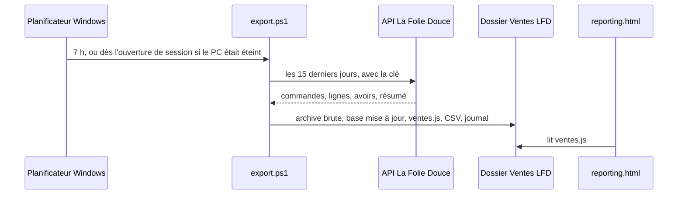

# Notice — l'export des ventes, sur le poste de la Direction

> ⚠️ **Le script [`export.ps1`](poste-direction/export.ps1) n'a jamais été
> exécuté** (2026-11-23) : il a été écrit et relu pour Windows PowerShell 5.1
> sur un poste sans PowerShell. Il doit être éprouvé sur un Windows réel avant
> d'être remis (version de PowerShell, stratégie d'exécution imposée par un
> administrateur, notification). La page
> [`reporting.html`](poste-direction/reporting.html) a été vérifiée sur un
> ventes.js d'exemple. Plan d'origine :
> [`plan-export-des-ventes.md`](plan-export-des-ventes.md).

## Partie 1 — En clair

Chaque matin, un petit programme sur votre ordinateur va chercher les ventes
chez nous et les range dans un fichier. Votre page lit ce fichier. Vous n'avez
qu'à ouvrir la page.



**Pourquoi 15 jours, et pas seulement la veille ?** Une commande peut changer
après coup : annulée, révisée, remboursée. Chaque matin, le programme
redemande les 15 derniers jours. Une commande qui revient **remplace**
l'ancienne dans votre fichier, par son numéro, avec toutes ses lignes : il n'y
a jamais deux versions de la même commande, et rien n'est à réconcilier à la
main.

**Un chiffre passé peut donc bouger pendant 15 jours**, puis il est stable. Un
point mensuel se fait après le 15 du mois suivant. Une fois par mois (le 1er,
ou au premier lancement qui suit), le programme redemande aussi le mois
précédent en entier, pour ramasser ce qui a changé plus tard (une annulation
tardive, un remboursement).

**Ce que l'export ne contient pas :**

- les ventes de la **caisse de la boutique** : les commandes réglées à cette
  caisse sont listées, mais ne comptent pas dans le CA — la caisse les compte
  déjà ;
- une **comptabilité** : les montants figés sont ceux des factures et des
  avoirs. L'export dit les ventes telles qu'elles sont aujourd'hui ;
- aucune donnée personnelle : ni nom, ni e-mail, ni téléphone, ni adresse.
  Pour un professionnel, le nom de son enseigne ; une entreprise individuelle
  peut porter le nom d'une personne. Pour un particulier, rien. L'heure de la
  commande (à la minute), le jour et les articles, croisés, peuvent encore
  faire reconnaître un habitué : à garder pour la Direction.

**Lire la page, journée par journée.** En ouvrant `reporting.html` :

- le **résumé par jour** donne une ligne par journée sur la période choisie
  (« Du … Au … », le mois en cours par défaut) : commandes, CA HT, CA
  marchandises HT, TVA, CA TTC, retours, net, avoirs, et le total en bas ;
- **cliquez sur une journée** : les **ventes par famille** (pièces, poids, HT
  des lignes) et la **liste des commandes** se limitent à ce jour-là ; « Revenir
  à toute la période » annule ;
- **cliquez sur une commande** : ses articles se déplient (quantité, prix, TVA,
  HT, TTC) ;
- les ventes par famille additionnent les **articles**, avant les remises de
  panier, le bon de fidélité et les frais : leur total n'est pas le CA, qui se
  lit dans le résumé.

Dans Excel, `csv\resume.csv` donne la même ligne par journée, prête pour un
tableau croisé dynamique par semaine ou par mois.

**Et si ça ne marche pas ?** Une notification Windows prévient et nomme la
cause. Votre fichier n'est pas touché : la page garde les chiffres de la
veille, avec leur date en haut, et un bandeau rouge s'ils ont plus de 26
heures.

**La clé.** Elle ouvre l'export, et rien d'autre.

- Elle est rangée sur **ce poste, pour votre compte Windows**, chiffrée par
  Windows, dans `%LOCALAPPDATA%\LFD\export-key.xml` — pas dans le dossier des
  ventes, qui peut être sauvegardé sans risque. Copiée ailleurs, elle est
  illisible.
- **Ne l'envoyez jamais** : ni e-mail, ni messagerie, ni dossier partagé. Elle
  se transmet une seule fois, au premier lancement, avec un membre de l'équipe
  La Folie Douce à côté de vous ou en partage d'écran.
- **Perdue, ou vous changez d'ordinateur** : demandez une nouvelle clé ;
  l'équipe révoque l'ancienne en un clic, puis vous lancez
  `export.ps1 -NouvelleCle` sur le nouveau poste.
- **Vous pensez qu'elle a fuité** : prévenez-nous, elle est coupée
  immédiatement.
- Qui ouvre votre session peut lancer le programme : verrouillez votre poste
  quand vous le quittez.

## Partie 2 — Technique

### Installation, pas à pas

1. Copier le dossier `poste-direction` sous `Documents\Ventes LFD` (le script
   et la page). Ouvrir PowerShell (menu Démarrer, « Windows PowerShell »).
2. Débloquer le script, que Windows marque comme téléchargé :
   `Unblock-File "$HOME\Documents\Ventes LFD\export.ps1"`.
3. Si Windows refuse d'exécuter des scripts (stratégie « Restricted », le
   défaut d'un poste personnel) :
   `Set-ExecutionPolicy -Scope CurrentUser RemoteSigned`. Si un administrateur
   impose une stratégie, c'est lui qui décide.
4. Premier lancement : `& "$HOME\Documents\Ventes LFD\export.ps1"`. Il demande
   la clé (collée, elle ne s'affiche pas), la range, puis fait un premier
   export (les 15 derniers jours et le mois précédent).
5. Planifier : `& "$HOME\Documents\Ventes LFD\export.ps1" -Planifier 07:00`.
   La tâche « LFD - export des ventes » tourne tous les jours à l'heure dite,
   est rattrapée dès que possible si le PC était éteint, et ne tourne **que
   session ouverte** : c'est ce qui donne accès à la clé. Elle lance
   `powershell.exe -ExecutionPolicy Bypass -WindowStyle Hidden`.
6. `-Deplanifier` retire la tâche ; `-NouvelleCle` remplace la clé ;
   `-Url` change l'adresse de l'API (défaut :
   `https://lfd-gateway.lafoliedouce.workers.dev`) ; `-Dossier` change le
   dossier (défaut `Documents\Ventes LFD`). `-Planifier` retient `-Url` et
   `-Dossier` dans la tâche.

⚠️ Le script est enregistré en **UTF-8 avec BOM** : PowerShell 5.1 lit un
fichier sans BOM comme de l'ANSI, et ses messages accentués deviendraient
illisibles. Le modifier avec un éditeur qui garde le BOM.

### Le dossier

```
Documents\Ventes LFD\
├── reporting.html       la page d'exemple, ouverte d'un double-clic
├── ventes.js            window.VENTES = {...} : tout l'historique, pour la page
├── base\ventes.json     la base cumulée, depuis le début (et ventes.json.bak, la précédente)
├── archives\AAAA-MM-JJ.json   la réponse brute de chaque appel, jamais modifiée
│                              (AAAA-MM-JJ-mois-AAAA-MM.json pour le relu du mois)
├── csv\commandes.csv, lignes.csv, resume.csv, avoirs.csv
├── export.log           une ligne par lancement (OK ou ÉCHEC et sa cause)
└── export.ps1
```

- **Ce que fait un lancement** : tous les appels d'abord (15 derniers jours,
  jour de Paris, bornes incluses ; le mois précédent s'il n'a pas encore été
  relu ce mois-ci — `monthsReread` dans la base). Si un seul échoue, rien
  n'est écrit hormis la ligne du journal. Sinon : archives, puis la base
  (écrite dans un fichier temporaire, puis remplacée d'un coup), puis
  ventes.js et les CSV.
- **La fusion** : chaque commande reçue remplace la commande de même
  `orderNumber` **et toutes ses lignes** ; chaque jour reçu remplace le jour du
  résumé ; chaque avoir reçu remplace ou s'ajoute par son `number`. Le reste ne
  bouge pas.
- **ventes.js, pas un JSON** : une page ouverte en `file://` ne peut pas lire
  un JSON local, elle charge `<script src="ventes.js">`. Il porte
  `misAJourLe` (ISO 8601) et les quatre tableaux.
- **CSV au format Excel français** : séparateur `;`, virgule décimale, UTF-8
  avec BOM, `VRAI`/`FAUX`, cellule vide pour `null`. En-têtes = noms des champs
  JSON ; `settled` est aplati en `settled_settledOn`, `settled_totalHt`…, le
  résumé par clientèle en `byClientele_pro_revenueHt`…. Les listes
  (`discountIds`, `orderNumbers`) sont jointes par des virgules. Ne sont pas
  dans les CSV : `vatByRate` et le détail de `refunds` (dans ventes.json).
- **Sauvegarde** : `base\` (et `archives\` en secours). Perdue, la base se
  reconstruit en redemandant l'API mois par mois (31 jours au plus par appel).

### La route

`GET https://lfd-gateway.lafoliedouce.workers.dev/api/lfd/exports/sales?from=AAAA-MM-JJ&to=AAAA-MM-JJ`,
en-tête `X-Export-Key: <clé>` (jamais `Authorization`). Bornes incluses, sur le
**jour de passation** à l'heure de Paris, 31 jours au plus. La route n'ouvre
pas le CORS : une page web ne peut pas l'appeler, et c'est voulu — la clé est
lue par un programme, jamais par le JavaScript d'une page.

Pour qui veut brancher un serveur :

```powershell
$key = Read-Host -AsSecureString 'Clé'
$plain = [Runtime.InteropServices.Marshal]::PtrToStringBSTR([Runtime.InteropServices.Marshal]::SecureStringToBSTR($key))
$ventes = Invoke-RestMethod -Uri 'https://lfd-gateway.lafoliedouce.workers.dev/api/lfd/exports/sales?from=2026-11-01&to=2026-11-15' -Headers @{ 'X-Export-Key' = $plain }
$ventes.summary | Format-Table day, orders, revenueHt, vat, revenueTtc
```

Un serveur fait la même fusion que le script : remplacer la commande et
**toutes** ses lignes, jamais une mise à jour ligne par ligne (une révision
peut retirer un article). Ne pas se fier à une date de modification : elle
n'est pas servie.

### La forme de la réponse

Tous les montants sont en **euros** (deux décimales ; cinq pour un prix
unitaire), toutes les dates en ISO 8601 à l'heure de Paris avec leur
décalage. Un `null` est une donnée absente, jamais un zéro.

```json
{ "orders": [...], "lines": [...], "creditNotes": [...], "summary": [...] }
```

#### `orders` — une ligne par commande passée dans la période

| Champ                                                                 | Sens                                                                                                                                                                 |
| --------------------------------------------------------------------- | -------------------------------------------------------------------------------------------------------------------------------------------------------------------- |
| `orderNumber`                                                         | le numéro, clé de remplacement                                                                                                                                       |
| `placedAt`                                                            | passée le, à la minute                                                                                                                                               |
| `receivedOn`                                                          | jour où la marchandise a changé de mains ; `null` = pas encore                                                                                                       |
| `status`, `cancelledAt`                                               | état de la commande, et date d'annulation le cas échéant                                                                                                             |
| `countsAsRevenue`                                                     | **compte dans le CA** (règle ci-dessous)                                                                                                                             |
| `paymentStatus`                                                       | état du règlement (`not_required`, `paid`, …)                                                                                                                        |
| `settlementVenue`                                                     | `shop_till` si réglée à la caisse de la boutique, sinon `null`                                                                                                       |
| `offered`, `offeredTtc`                                               | commande offerte (total nul), et sa valeur TTC                                                                                                                       |
| `offerNature`                                                         | pourquoi elle l'est : `tasting`, `event`, `goodwill`, `replacement`, `sample`, ou `in_house` (commande interne d'un de nos restaurants) ; `null` hors offre          |
| `clientele`                                                           | `pro`, `public` (particulier), ou `null` pour les commandes d'avant la distinction — jamais deviné                                                                   |
| `buyerKind`                                                           | `guest` (sans compte) ou `registered`                                                                                                                                |
| `companyName`, `nafCode`                                              | enseigne d'aujourd'hui (à défaut la raison sociale) et code NAF ; `null` pour un particulier                                                                         |
| `fulfillment`                                                         | `pickup` (retrait) ou `delivery`                                                                                                                                     |
| `vatMethod`                                                           | `line_ht` (pro, composée en HT) ou `exact_ht` (particulier, composée en TTC)                                                                                         |
| `subtotalHt`, `discountHt`, `voucherHt`, `deliveryFeeHt`, `lateFeeHt` | sous-total, remises, bon de fidélité, port, pénalité de retard, HT                                                                                                   |
| `totalHt`                                                             | HT total, port et pénalité compris : `totalTtc − vat`                                                                                                                |
| `goodsHt`                                                             | **CA marchandises HT**, celui du cockpit : `subtotalHt − discountHt − voucherHt`, sans port ni pénalité, ramené à 0                                                  |
| `vat`, `totalTtc`                                                     | TVA et TTC                                                                                                                                                           |
| `vatByRate`                                                           | `[{rate, ht, vat, ttc}]` ; `ht` et `ttc` seulement pour `exact_ht`, sinon `null` ; tout le champ `null` pour les commandes d'avant le 2026-09-07                     |
| `settled`                                                             | montants figés au solde : `{settledOn, subtotalHt, discountHt, voucherHt, deliveryFeeHt, lateFeeHt, totalHt, vat, totalTtc}` ; `null` avant. Ce n'est pas la facture |
| `refunds`                                                             | `[{refundedAt, amountTtc, nature}]`, remboursements par carte réussis ; `nature` = `return`, `adjustment` ou `null` (fait hors de la plateforme)                     |
| `returnRefundedTtc`                                                   | la **seule** somme à déduire du CA (règle ci-dessous)                                                                                                                |

#### `lines` — une ligne par article

| Champ                  | Sens                                                                                     |
| ---------------------- | ---------------------------------------------------------------------------------------- |
| `orderNumber`, `sku`   | la commande et l'article                                                                 |
| `article`              | le nom de l'article, figé à la commande                                                  |
| `familyId`, `family`   | la famille : identifiant de la vente, **nom d'aujourd'hui** ; `null` avant le 2026-10-22 |
| `quantity`, `saleUnit` | quantité ; `saleUnit` = `piece`, ou `weight` (la quantité compte alors des grammes)      |
| `unitPriceHt`          | prix unitaire HT, cinq décimales (au kilo si `weight`)                                   |
| `lineHt`               | montant HT de la ligne                                                                   |
| `vatRate`              | taux de TVA en pour cent (`5.5`, `20`)                                                   |
| `lineTtc`              | TTC de la ligne ; `null` pour une commande pro ou ancienne                               |
| `discountIds`          | les remises de panier qui **couvrent** cette ligne (sans en chiffrer la part)            |

🔴 **La somme des lignes n'est pas le HT de la commande** : les remises, le
bon, le port et la pénalité vivent sur la commande et ne sont pas répartis.
Le CA se lit sur `orders` (ou `summary`) ; `lines` dit **quoi** a été vendu.

#### `creditNotes` — les avoirs émis dans la période

`number`, `issuedOn` (jour d'émission), `companyName` (nom d'aujourd'hui),
`ht`, `vat`, `ttc` (tels qu'écrits sur l'avoir), `orderNumbers` (les commandes
que l'avoir nomme ; vide pour un avoir global). Un avoir est le seul signe
d'une réduction sur une facture pro réglée au compte.

#### `summary` — une ligne par jour de passation

`day`, puis les chiffres des commandes qui comptent dans le CA : `orders`
(nombre), `revenueHt`, `goodsHt`, `vat`, `revenueTtc`, `vatByRate`
(`[{rate, vat}]`), `returnRefundedTtc`, `netRevenueTtc`
(`revenueTtc − returnRefundedTtc`) ; `byClientele.pro`, `.public`, `.unknown`
avec les mêmes chiffres ; `creditNotesHt`, `creditNotesVat`, `creditNotesTtc`,
les avoirs **émis** ce jour-là. Un jour sans vente est servi à zéro.

### Les règles

- **Le CA** : `countsAsRevenue = true`, c'est-à-dire ni annulée ni non retirée,
  règlement `not_required` ou `paid`, pas réglée à la caisse de la boutique,
  pas offerte. Le même périmètre que le cockpit de La Folie Douce. Les autres
  commandes sont servies pour voir les annulations et la caisse.
- **Deux HT** : `totalHt` / `revenueHt` comprennent le port et la pénalité ;
  `goodsHt` est le CA marchandises, celui du cockpit.
- **Les remboursements** : un remboursement n'a ni ligne ni TVA, seulement un
  TTC. Seule la nature `return` se déduit, et seulement d'une commande qui
  compte encore dans le CA : c'est `returnRefundedTtc`. Un `adjustment` est
  déjà dans `totalTtc` (le déduire le compterait deux fois). Il n'y a pas de
  HT remboursé, donc pas de CA HT net. Le cockpit, lui, ne déduit pas encore
  ces remboursements : son CA TTC peut dépasser le net de l'export.
- **Les avoirs** se rangent à leur **date d'émission**, à part du CA du jour.
- **L'export somme les commandes, jamais les lignes** : additionner soi-même
  les lignes donnerait un autre chiffre.

### Les limites

- **30 appels par minute et par adresse IP** à la passerelle, **10 par minute**
  dans l'API. Un lancement fait un ou deux appels.
- **31 jours au plus par appel.**
- **Pas jour par jour avec le cockpit** : sur une période, la somme de
  `revenueTtc` est le CA TTC du cockpit, et celle de `goodsHt` son CA
  marchandises ; mais le cockpit range ses jours en heure universelle (UTC),
  l'export à Paris, et une commande passée près de minuit change de jour entre
  les deux.
- **Pas promis** : que `subtotalHt − discountHt − voucherHt + deliveryFeeHt +
lateFeeHt = totalHt` tienne au centime. C'est vérifié sans remise, bon, port
  ni pénalité ; l'équation complète ne l'est pas.

### Les messages d'erreur

Chaque échec écrit une ligne `ÉCHEC` dans `export.log`, montre une bulle de
notification Windows (`System.Windows.Forms.NotifyIcon`, intégré à Windows,
rien à installer) et ne touche ni à la base ni à la page.

| Message                                        | Cause                                                         | Geste                                                                    |
| ---------------------------------------------- | ------------------------------------------------------------- | ------------------------------------------------------------------------ |
| « API injoignable »                            | pas de réseau, adresse fausse, délai dépassé                  | vérifier la connexion ; le lancement suivant rattrape                    |
| « Clé refusée (401) »                          | clé absente, inconnue, révoquée, échue, ou adresse non admise | demander une nouvelle clé, puis `-NouvelleCle`                           |
| « Limite d'appels atteinte (429) »             | trop d'appels en une minute                                   | attendre une minute                                                      |
| « Période refusée (400) »                      | bornes illisibles, inversées, ou plus de 31 jours             | le message de l'API dit laquelle ; ne devrait pas arriver avec le script |
| « Aucune clé sur ce poste »                    | la tâche planifiée tourne avant le premier lancement          | lancer une fois `export.ps1 -NouvelleCle` à la main                      |
| « La clé rangée sur ce poste est illisible »   | autre compte Windows, ou fichier copié d'un autre poste       | `-NouvelleCle`                                                           |
| « La base … est illisible »                    | `base\ventes.json` abîmé                                      | restaurer `ventes.json.bak` ou une sauvegarde                            |
| « Réponse illisible » / « Réponse incomplète » | réponse inattendue de l'API                                   | réessayer plus tard ; si cela dure, prévenir La Folie Douce              |
| « L'API a répondu 5xx »                        | panne chez nous                                               | rien : le lancement suivant rattrape (15 jours de marge)                 |
