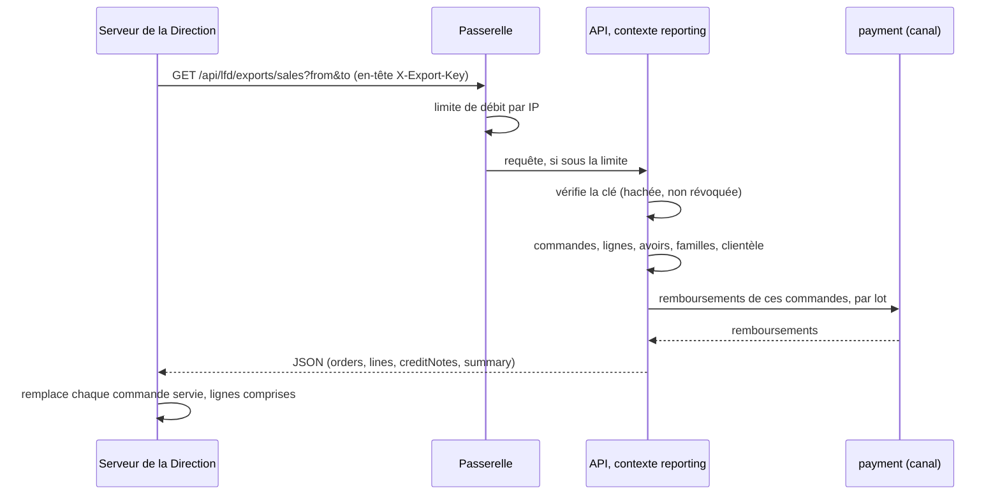
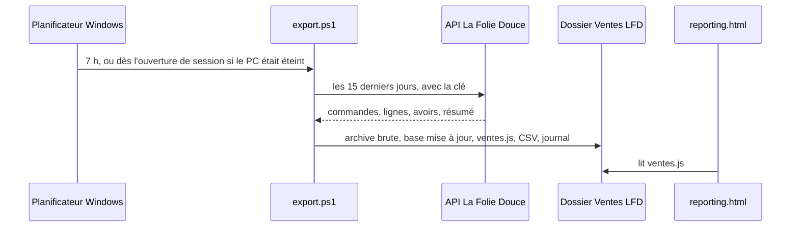

# Plan — l'export des ventes pour la Direction

> 📝 **Plan, rien n'est bâti.** Écrit le 2026-11-23 à la demande de Hugo, sur la
> demande de la Direction (reporting sur une page web, données gardées chez
> elle). Chaque affirmation sur l'existant a été ouverte dans le code ce
> jour-là, puis contredite par `vitruve` le même jour : ses deux objections
> bloquantes et ses neuf sérieuses sont intégrées (§ 11). Les décisions de
> Hugo sont au § 10.

## 1. En deux mots

La Direction veut chaque vente en détail, **sans données personnelles**, pour
filtrer chez elle : CA HT, TVA, CA TTC, date et heure, type de client, famille,
article, annulations, remboursements.

Son serveur vient chercher ces données chaque nuit sur une route de lecture de
notre API, avec une clé. Il redemande les 15 derniers jours et **remplace** ce
qu'il avait : une commande peut changer après coup.



**Ce que l'export ne contient pas**, à dire à la Direction :

- les ventes de la **caisse de la boutique**. Les commandes réglées à cette
  caisse (`settlementVenue = shop_till`) sont servies, mais **ne comptent pas
  dans le CA** : la caisse les compte déjà ;
- une **comptabilité** : un chiffre peut bouger tant que la commande bouge. Les
  montants figés sont ceux des **factures et des avoirs**.

## 2. Pourquoi lire les commandes, et pas une table tenue par les faits

Décidé avec Hugo le 2026-11-23. Une table de mouvements alimentée par la boîte
d'envoi (`order.placed`, `order.cancelled`, `order.revised`…) garderait
l'histoire de chaque modification, mais demande un abonné, un remplissage
initial et une table à tenir. Lire les commandes donne tout de suite tout
l'historique, avec un seul défaut : **l'état d'aujourd'hui, pas l'histoire**.
Le relu sur 15 jours (§ 6.3) le compense pour un reporting. Si un jour
l'histoire exacte est nécessaire, la table de mouvements viendra derrière la
même route, sans changer le contrat.

## 3. Ce que dit la route

`GET /api/lfd/exports/sales?from=AAAA-MM-JJ&to=AAAA-MM-JJ` — bornes incluses,
sur le **jour de passation** (Europe/Paris), 31 jours au plus par appel. Le
préfixe `/api/lfd` est déjà routé par la passerelle (`gateway/src/routes.ts`).

Réponse : trois tableaux plats, reliés par `orderNumber`, et un résumé par jour (§ 3.5).

### 3.1 Quelles commandes, et lesquelles font du CA

L'export sert **toutes les commandes passées** de la période (les brouillons
vivent dans `order_drafts`, pas dans `orders`, et `draft` n'est écrit par aucun
chemin). Chacune porte :

- **`countsAsRevenue`** : `true` si et seulement si elle entre dans le
  **périmètre du CA partagé** de `lafoliecoffee/growth/domain/revenue-scope.ts`
  — statut dans `REVENUE_ORDER_STATUSES` (ni `cancelled`, ni `no_show`),
  règlement dans `REVENUE_PAYMENT_STATUSES` (`not_required` ou `paid`), lieu
  de règlement nul (pas la caisse de la boutique), et non offerte. La lecture
  **importe** ce périmètre, elle ne le recopie pas : l'export et le cockpit
  disent le même CA, au centime.
- les champs qui expliquent le verdict : `status`, `paymentStatus`,
  `settlementVenue`, `offered`.

La Direction filtre `countsAsRevenue = true` pour le CA, et garde les autres
pour voir les annulations et les commandes de la caisse.

### 3.2 `orders` — une ligne par commande

| Champ                                                                 | Source (vérifiée le 2026-11-23)                                                                                   | Remarque                                                                                                                                                                                            |
| --------------------------------------------------------------------- | ----------------------------------------------------------------------------------------------------------------- | --------------------------------------------------------------------------------------------------------------------------------------------------------------------------------------------------- |
| `orderNumber`                                                         | `orders.order_number`                                                                                             | la clé de remplacement                                                                                                                                                                              |
| `placedAt`                                                            | `orders.created_at`                                                                                               | **à la minute**, ISO 8601 avec fuseau (§ 7)                                                                                                                                                         |
| `receivedOn`                                                          | `orders.received_on`                                                                                              | jour où la marchandise a changé de mains ; `null` = pas encore                                                                                                                                      |
| `status`, `cancelledAt`                                               | `orders.status`, `orders.cancelled_at`                                                                            |                                                                                                                                                                                                     |
| `countsAsRevenue`                                                     | § 3.1                                                                                                             |                                                                                                                                                                                                     |
| `paymentStatus`, `settlementVenue`                                    | colonnes du même nom                                                                                              |                                                                                                                                                                                                     |
| `offered`, `offeredTtc`                                               | `offer_nature`, `offered_total_cents`                                                                             | une commande offerte a un total nul et garde sa valeur                                                                                                                                              |
| `clientele`                                                           | `orders.clientele`                                                                                                | `pro`, `public`, ou `null` pour les commandes d'avant la distinction — jamais deviné                                                                                                                |
| `buyerKind`                                                           | `orders.buyer_kind`                                                                                               | `guest` / `registered`                                                                                                                                                                              |
| `companyName`, `nafCode`                                              | `companies.enseigne` (à défaut, `raison_sociale`), `companies.naf_code`                                           | pros seulement ; le NAF dit hôtel, restaurant… ; § 7                                                                                                                                                |
| `fulfillment`                                                         | `orders.fulfillment_method`                                                                                       | `pickup` / `delivery`                                                                                                                                                                               |
| `vatMethod`                                                           | `orders.vat_method`                                                                                               | `line_ht` (pro, composée en HT) ou `exact_ht` (particulier, composée en TTC)                                                                                                                        |
| `subtotalHt`, `discountHt`, `voucherHt`, `deliveryFeeHt`, `lateFeeHt` | colonnes `*_cents`                                                                                                | en euros, deux décimales                                                                                                                                                                            |
| `totalHt`, `vat`, `totalTtc`                                          | `total_cents`, `vat_cents`                                                                                        | `totalHt` = `totalTtc − vat`                                                                                                                                                                        |
| `vatByRate`                                                           | `vat_shares` (`[{rate, amountCents}]`) ; pour `exact_ht`, `ttc_by_rate` (`[{rate, htCents, vatCents, ttcCents}]`) | la base HT par taux n'existe que pour `exact_ht` ; `null` avant le 2026-09-07                                                                                                                       |
| `settled*`                                                            | colonnes `billable_*`, `settled_on`                                                                               | **les montants du solde**, posés quand la commande est soldée ; `null` avant. Ce n'est pas encore ce que la facture lit (le schéma le dit : aucun lecteur de facture ne les lit) — la notice le dit |
| `refunds`                                                             | lecture `payment` (§ 5)                                                                                           | `[{refundedAt, amountTtc, nature}]`, réussis seulement                                                                                                                                              |
| `returnRefundedTtc`                                                   | § 5                                                                                                               | la seule somme à déduire du CA, cf. § 5                                                                                                                                                             |

### 3.3 `lines` — une ligne par article

| Champ                  | Source                                                                                                                                                        |
| ---------------------- | ------------------------------------------------------------------------------------------------------------------------------------------------------------- |
| `orderNumber`, `sku`   | `@@unique([orderId, sku])`                                                                                                                                    |
| `article`              | `order_lines.product_name_snapshot` (figé à la passation)                                                                                                     |
| `familyId`, `family`   | `order_lines.category_id` → `catalog_categories.name` ; `null` avant le 2026-10-22. **Le nom servi est celui d'aujourd'hui**, l'identifiant celui de la vente |
| `quantity`, `saleUnit` | `piece`, ou `weight` (la quantité compte alors des grammes)                                                                                                   |
| `unitPriceHt`          | `unit_price_millicents` (prix au kilo si `weight`)                                                                                                            |
| `lineHt`               | `line_total_cents`                                                                                                                                            |
| `vatRate`              | `order_lines.vat_rate`                                                                                                                                        |
| `lineTtc`              | `line_total_ttc_cents` ; `null` pour une commande pro ou d'avant R3                                                                                           |
| `discountIds`          | `order_line_discounts` : les remises de panier qui **couvrent** cette ligne                                                                                   |

🔴 **La somme des lignes n'est pas le HT de la commande.** Les remises panier,
le bon de fidélité, le port et la pénalité vivent sur la commande. L'export
**ne les répartit pas** en montants par ligne : une répartition maison serait
une seconde arithmétique, qui finirait par différer au centime de celle qui
facture. Il dit **quelles** lignes chaque remise couvre (`discountIds`, tiré
d'`OrderLineDiscount`, qui existe pour ça), sans chiffrer la part. Le CA se lit
sur `orders` ; `lines` dit **quoi** a été vendu.

### 3.4 `creditNotes` — les avoirs de la période

Un avoir (facture de type 381) sur une facture pro réduit le CA **sans aucun
remboursement par carte** : au compte, c'est le seul signe. L'export sert les
avoirs **émis** dans la période : `number`, `issuedOn`, `companyName`, `ht`,
`vat`, `ttc`, et les `orderNumber` concernés quand l'avoir en nomme. Les
montants sont ceux de l'avoir, lus tels quels.

### 3.5 `summary` — une ligne par jour de passation

Les agrégats que la Direction a demandés (CA HT, TVA, CA TTC), **calculés par
nous**, dans la même réponse que le détail : additionner soi-même, c'est
risquer d'oublier `countsAsRevenue`, de déduire un remboursement d'ajustement
ou de sommer les lignes au lieu des commandes.

| Champ                                               | Contenu                                                                                 |
| --------------------------------------------------- | --------------------------------------------------------------------------------------- |
| `day`                                               | le jour de passation (Europe/Paris) ; un jour sans vente est servi à zéro               |
| `orders`                                            | nombre de commandes avec `countsAsRevenue = true`                                       |
| `revenueHt`, `vat`, `revenueTtc`                    | sommes de `totalHt`, `vat`, `totalTtc` de ces commandes                                 |
| `vatByRate`                                         | TVA par taux, sommée sur ces commandes                                                  |
| `returnRefundedTtc`                                 | somme des `returnRefundedTtc` de ces commandes (§ 5)                                    |
| `netRevenueTtc`                                     | `revenueTtc − returnRefundedTtc`                                                        |
| `byClientele`                                       | les mêmes chiffres pour `pro`, `public` et `unknown` (commandes d'avant la distinction) |
| `creditNotesHt`, `creditNotesVat`, `creditNotesTtc` | les avoirs **émis** ce jour-là                                                          |

Règles :

- **On somme les commandes, jamais les lignes**, et seulement celles qui
  comptent dans le CA. Le résumé est calculé dans le même handler, sur les
  mêmes commandes que `orders` : les deux ne peuvent pas diverger.
- **Pas de CA HT net** : un remboursement n'a pas de HT (§ 5), l'export n'en
  invente pas. Le net est en TTC ; le HT net d'un pro se lit avec ses avoirs.
- **Les avoirs restent à part**, rangés à leur jour d'émission, pas à celui de
  la commande : les mélanger au CA du jour fausserait les deux.
- **La même addition que le cockpit.** Comment le cockpit obtient son CA HT
  (`total − TVA`, ou une autre somme) n'est **pas vérifié** au 2026-11-23 : E1
  l'ouvre et le résumé fait exactement la même addition ; le test « même CA
  que le cockpit » d'E3 le prouve.

## 4. Où vit le code

Un contexte neuf, `src/lafoliecoffee/reporting/`, en quatre couches. Il
**lit** ; il n'écrit que ses propres clés (§ 6).

| Ce qu'il lit                         | Propriétaire               | Comment                                                                                                 |
| ------------------------------------ | -------------------------- | ------------------------------------------------------------------------------------------------------- |
| commandes, lignes, remises couvertes | `lafoliecoffee/orders`     | une lecture nommée publiée par `orders` (`SalesExportReader`), par période, qui compose `revenue-scope` |
| avoirs                               | `lafoliecoffee/accounting` | une lecture nommée, par période d'émission                                                              |
| familles                             | `lafoliecoffee/catalog`    | une lecture nommée : les noms de ces identifiants                                                       |
| référence, code NAF                  | `lafoliecoffee/account`    | une lecture nommée, par lot                                                                             |
| remboursements                       | `payment`                  | une lecture de `payment/channels/requests/`, par lot (§ 5)                                              |

Toutes par lot : un appel de 31 jours fait **six requêtes**, jamais une par
commande.

⚠️ **Rien ne fait respecter ce découpage.** `lint:prisma-model-ownership`
découpe par **bloc**, et tout ce tableau est dans `lafoliecoffee` : une lecture
Prisma directe des tables d'`orders` depuis `reporting` resterait verte. Seul
le passage par `payment` est tenu (`lint:context-boundaries`). Le reste est une
discipline, tenue à la relecture — c'est dit plutôt que présenté comme gardé.

Le contrôleur n'injecte que le `QueryBus` (`lint:controller-buses`) :
`GetSalesExportQuery` et son handler.

## 5. Les remboursements, et ce qui se déduit

Vérifié dans `prisma/schema/payment/card.prisma` : un `CardRefund` porte un
**montant TTC**, une date, une nature, un statut. Ni ligne, ni TVA. C'est le
**seul** remboursement qui existe : un virement ne fait que solder une facture,
et il n'y a de remboursement ni par virement ni par prélèvement.

Deux natures, et elles ne se lisent pas pareil :

| Nature       | Ce qu'elle veut dire              | Déduire du CA ?                                                                                                                             |
| ------------ | --------------------------------- | ------------------------------------------------------------------------------------------------------------------------------------------- |
| `adjustment` | le montant dû a baissé (révision) | **non** : `total_cents` est déjà baissé, la déduire la compterait deux fois                                                                 |
| `return`     | la vente n'a pas lieu             | **seulement si** la commande compte encore dans le CA (`countsAsRevenue`) ; une commande annulée ou remboursée en entier en est déjà sortie |

D'où `returnRefundedTtc` : la somme des remboursements `return` réussis d'une
commande qui compte dans le CA, `0` sinon. Le CA net TTC d'une commande est
`totalTtc − returnRefundedTtc`. Il n'y a **pas de HT remboursé** : il n'existe
nulle part, et l'export n'en fabrique pas. Côté pro, l'avoir (§ 3.4) porte la
TVA.

⚠️ Le cockpit, lui, **ne déduit pas** un remboursement partiel
(`revenue-scope.ts`, commentaire de `REVENUE_PAYMENT_STATUSES`). Servir
`returnRefundedTtc` donne à la Direction un net que le cockpit ne montre pas :
décidé par Hugo de servir ce net (§ 10, Q5).

La lecture par lot des remboursements n'existe pas encore dans le canal
(`SubjectRefundPosition` est à l'unité) : `payment` la déclare et
l'implémente, avec la même règle de « réussi » que son carnet.

## 6. L'accès

### 6.1 La clé

Une **clé par lecteur**, jamais partagée.

- Table `public.export_reader_key`, propriété de `lafoliecoffee/reporting` —
  dans `public` comme les autres contextes du bloc, pas de schéma neuf pour une
  table : `id`, `label` (« Direction »), `secret_hash` (SHA-256 d'un secret de
  32 octets tiré par le port d'aléa), `created_at`, `created_by_staff_id`,
  `expires_at`, `revoked_at`, `revoked_by_staff_id`, `allowed_ips` (liste,
  vide = toute adresse ; § 6.5).
- La clé voyage dans un en-tête **à elle**, `X-Export-Key` — jamais dans
  `Authorization: Bearer`, que la garde Auth0 globale lirait. La route est
  `@Public()` pour la garde Auth0, et porte sa propre garde.
- La garde compare le haché, refuse une clé expirée ou révoquée, et pose
  l'acteur **`system`** avec l'id `export-reader:<id de la clé>`, comme
  `RecomputeGuard` pose `system` — pas de nouveau type d'acteur, qui toucherait
  `platform` et les recopies d'`ActorType` dans `growth`.
- **Une lecture n'écrit rien** (§ 4 du CLAUDE.md) : pas de « dernière
  utilisation » en base. L'usage se lit dans les journaux de requête, par l'id
  de l'acteur.
- Le secret n'est montré **qu'une fois**, à la création, au back-office.
  Ressource de permission neuve `exports`, accordée à l'écran
  (`lint:no-role-grants-in-migrations`).
- Créer et révoquer une clé sont des gestes du staff : chacun écrit un fait au
  journal d'activité (`export_key.created`, `export_key.revoked`), dans la
  transaction, et porte sa clé d'intention (`lint:write-idempotence`).
- La révocation est immédiate : la garde relit la base à chaque appel.

### 6.2 La limite de débit

- **Passerelle**, devant tout : un binding `ratelimits`, **par IP**, posé
  **avant** toute vérification de clé, sur le chemin `/api/lfd/exports/` —
  la figure de `route-planner-guard.ts`. La passerelle ne peut pas valider une
  clé : limiter par clé laisserait un attaquant changer de clé à chaque appel,
  et enverrait le secret en clair comme clé de compteur. Proposé : 30 appels
  par minute.
- **API** : `@Throttle` sur la route, plus strict que le défaut de 300 par
  minute du `ThrottlerGuard` global (`platform/security/security.module.ts`).

### 6.3 Ce que la Direction doit respecter

- la clé est lue **par un serveur**, jamais par le JavaScript d'une page ;
- l'API **n'ouvre pas le CORS** : un appel depuis un navigateur échoue, et
  c'est voulu ;
- chaque nuit, redemander les **15 derniers jours** (choix de la Direction, 2026-11-23), et pour chaque commande
  servie, **remplacer la commande et TOUTES ses lignes** — pas un upsert ligne
  par ligne : une révision peut retirer un article, et une ligne absente de la
  réponse doit disparaître chez elle ;
- ce qui change **après** 15 jours n'arrive pas tout seul : une annulation
  tardive, un remboursement ou un avoir sur une commande plus ancienne. Les
  remboursements et les avoirs se rangent à la commande, par sa date de
  passation. Une fois par mois, la Direction redemande le mois précédent en
  entier (deux appels de 31 jours au plus) ;
- ne pas se fier à un « modifié depuis » : `updated_at` n'est pas exposé (les
  migrations de données et les déclencheurs ne le tiennent pas).

Une notice d'une page, rédigée au lot E5, le dit avec un exemple d'appel.

### 6.4 Une page HTML ouverte depuis son ordinateur

Si la Direction ouvre sa page de reporting depuis son disque (`file://`), la
page **n'appelle pas** l'API :

- son origine est `null` pour le navigateur, et l'autoriser en CORS ouvrirait
  la route à tout fichier local et à toute iframe isolée sur internet ;
- la clé serait écrite en clair dans un fichier qui se copie et se partage.

C'est un **script sur son poste** qui appelle l'API et range les données ; la
page ne fait que lire un fichier. Le poste de la Direction est décrit au § 6.6.

### 6.5 Si la clé fuit, et ce qu'elle n'ouvre pas

**Le script seul ne donne rien** : il ne contient pas la clé. Tout repose sur
la clé, et sur ce qu'on fait quand elle fuit.

| Mesure                                     | Ce qu'elle tient                                                                                                                                                                                                |
| ------------------------------------------ | --------------------------------------------------------------------------------------------------------------------------------------------------------------------------------------------------------------- |
| une clé par personne                       | on ne coupe que celle qui a fui                                                                                                                                                                                 |
| révocation d'un clic, relue à chaque appel | une clé volée meurt à l'appel suivant                                                                                                                                                                           |
| `expires_at`                               | une clé oubliée finit par mourir seule                                                                                                                                                                          |
| clé hachée en base                         | une fuite de notre base ne donne aucune clé utilisable                                                                                                                                                          |
| `allowed_ips`, **facultatif par clé**      | une clé volée ne sert à rien hors de l'adresse admise. Lue sur `x-lfc-client-ip`, que la passerelle garantit (`platform/security/client-ip.ts`). Inutilisable avec une IP de box qui change : option, pas règle |
| alerte d'usage inhabituel                  | une clé appelée depuis une adresse jamais vue, ou bien plus que d'habitude, prévient le staff (doute D5)                                                                                                        |
| journal de chaque appel, par id de clé     | on sait qui a lu quoi, et quand                                                                                                                                                                                 |

**Elle n'ouvre que l'export, et c'est prouvé, pas supposé :**

1. **e2e « la clé n'ouvre rien d'autre »** : la liste de **toutes** les routes
   de l'API est lue sur l'application démarrée (pas une liste écrite à la
   main) ; chacune, appelée avec une clé d'export valide, répond 401 ou 403.
   Une route ajoutée demain est éprouvée sans qu'on y pense.
2. **e2e inverse** : un jeton staff ou client valide sur la route d'export est
   refusé — elle n'accepte que sa clé.
3. **Une porte, `lint:export-key-guard`** : la garde de la clé d'export n'est
   posée que sur le contrôleur d'export ; ailleurs, la CI échoue.

Le risque restant, dit dans la notice : quelqu'un qui a sa **session ouverte**
peut lancer le script. Ça se règle par le verrouillage du poste, pas par nous.

### 6.6 Le poste de la Direction (lot E5)

La Direction est sur **Windows**. Le script est en **PowerShell** : déjà
installé sur Windows 10 et 11, rien à installer ni à mettre à jour.

#### En clair (le début de la notice)

> Chaque matin, un petit programme sur votre ordinateur va chercher les ventes
> chez nous et les range dans un fichier. Votre page lit ce fichier. Vous
> n'avez qu'à ouvrir la page.



- **Pourquoi 15 jours et pas la veille ?** Une commande peut changer après
  coup. La commande revient avec son nouvel état et **remplace** l'ancienne
  dans le fichier, par son numéro : il n'y a jamais deux versions de la même
  commande, et rien n'est à réconcilier à la main.
- **Un chiffre passé peut bouger pendant 15 jours**, puis il est stable. Un
  point mensuel se fait après le 15 du mois suivant ; le script redemande de
  toute façon le mois précédent une fois par mois.
- **Et si ça ne marche pas ?** Une notification Windows prévient, et la page
  garde les chiffres de la veille avec leur date en haut.

#### Le dossier

```
Documents\Ventes LFD\
├── reporting.html       la page d'exemple, ouverte d'un double-clic
├── ventes.js            window.VENTES = {...} : tout l'historique, pour la page
├── base\ventes.json     la base cumulée, depuis le début
├── archives\AAAA-MM-JJ.json   la réponse brute de chaque appel, jamais modifiée
├── csv\commandes.csv, lignes.csv, resume.csv, avoirs.csv
├── export.log           une ligne par lancement
└── export.ps1
```

#### Ce que fait `export.ps1`

1. lit la clé (ci-dessous) et appelle la route sur les 15 derniers jours ; le
   1er de chaque mois, aussi le mois précédent en entier (31 jours au plus par
   appel) ;
2. range la réponse brute dans `archives\` ;
3. **met à jour la base** : pour chaque commande reçue, remplace la commande et
   **toutes** ses lignes (§ 6.3) ; remplace le résumé des jours reçus ; ajoute
   les avoirs par numéro. Ce qui est plus ancien ne bouge pas ;
4. régénère `ventes.js` (avec la date de mise à jour) et les CSV ;
5. écrit une ligne dans `export.log`.

**Un échec s'arrête avant l'étape 3** : base et page gardent la veille, une
notification Windows nomme la cause (« clé refusée », « API injoignable »,
« limite atteinte »).

- **`ventes.js`, pas `ventes.json`** : une page `file://` ne peut pas lire un
  JSON local ; elle peut charger `<script src="ventes.js">`.
- **CSV au format Excel français** : séparateur `;`, virgule décimale, UTF-8
  avec BOM, en-têtes stables.
- **Volume** : quelques centaines de commandes par mois, quelques Mo par an.
- **Sauvegarde** : `base\` (et `archives\` en secours). Perdue, la base se
  reconstruit en redemandant l'API mois par mois.

#### La clé sur le poste

- rangée par `Export-Clixml` d'une `SecureString` : chiffrée par Windows
  (DPAPI) **pour son compte, sur ce poste**, dans
  `%LOCALAPPDATA%\LFD\export-key.xml` — **hors** du dossier `Ventes LFD`, qui
  peut donc être sauvegardé ou synchronisé sans risque. Copié ailleurs ou lu
  par un autre compte, le fichier est illisible ;
- `export.ps1 -NouvelleCle` la remplace (après une révocation) ;
- **transmise sans jamais l'envoyer** : un admin la crée au back-office avec
  la personne à côté ou en partage d'écran, et elle la colle au premier
  lancement. Jamais par e-mail ni messagerie, jamais dans un dossier
  synchronisé.

#### La planification

- `export.ps1 -Planifier 07:00` crée la tâche (`Register-ScheduledTask`),
  `-Deplanifier` la retire ;
- options : **exécuter dès que possible après un démarrage manqué** (PC
  éteint), **seulement si l'utilisateur est connecté** — c'est ce qui donne
  accès à la clé, et la clé n'est jamais utilisable hors de sa session ;
- limite : le poste doit être allumé et la session ouverte à un moment de la
  journée. Sinon, une machine toujours allumée et le montage serveur du § 6.3.

#### Le premier lancement

1. copier le dossier ; débloquer le script une fois (`Unblock-File`, Windows
   bloque un script téléchargé) ;
2. lancer `export.ps1` : il demande la clé et la range ;
3. `export.ps1 -Planifier 07:00`. C'est tout.

## 7. Données personnelles

L'export ne porte ni nom, ni e-mail, ni téléphone, ni adresse, ni carte. Ce
qui reste, et ce qu'il faut décider :

- **`companyName`** — le nom d'enseigne (décidé par Hugo le 2026-11-23), à
  défaut la raison sociale. Une société est une personne morale, sauf une
  **entreprise individuelle**, dont le nom est souvent celui d'une personne.
  Le registre `documentation/legal/rgpd-registre.json` se tient colonne par
  colonne et ne connaît pas de champ « transmise à » : la forme de l'entrée
  pour ces deux colonnes **lues et transmises** s'écrit au lot E2, avant E3.
- **`created_by_staff_id`, `revoked_by_staff_id`** : `lint:rgpd-staff` les
  réclame au registre (motif `_staff_id`). Entrée écrite au lot E2.
- **Particuliers : aucun identifiant** (décidé par Hugo le 2026-11-23).
  L'heure de passation, le jour de retrait, le mode et les articles, croisés,
  peuvent encore désigner un habitué : d'où `placedAt` **à la minute**, et le
  risque restant décrit dans la notice, pas tu.

## 8. Les lots

| Lot    | Contenu                                                                                                                                                                                                                                                                                                                                                                                                    | Portes concernées                                                                                         |
| ------ | ---------------------------------------------------------------------------------------------------------------------------------------------------------------------------------------------------------------------------------------------------------------------------------------------------------------------------------------------------------------------------------------------------------- | --------------------------------------------------------------------------------------------------------- |
| **E0** | Lectures publiées par `orders` (avec `revenue-scope`), `accounting`, `catalog`, `account` ; lecture par lot des remboursements dans `payment/channels/`                                                                                                                                                                                                                                                    | `context-boundaries`                                                                                      |
| **E1** | `GetSalesExportQuery` + handler + mapping euros/ISO + `countsAsRevenue` + `returnRefundedTtc` ; tests unitaires : centimes → euros, `null` conservés, commande offerte, poids, `shop_till`, remboursement `adjustment` jamais déduit, `return` sur commande annulée non déduit ; résumé : jour sans vente servi à zéro, commande `shop_till` hors du total, somme des commandes et non des lignes          | `clock-port`, `code-language`                                                                             |
| **E2** | Table des clés (avec `allowed_ips`), garde `X-Export-Key` qui lit aussi l'IP admise, création et révocation au back-office (faits, clé d'intention), ressource `exports`, entrées du registre RGPD                                                                                                                                                                                                         | `prisma-schema-layout`, `schema-drift`, `no-role-grants-in-migrations`, `write-idempotence`, `rgpd-staff` |
| **E3** | Route, limite par IP à la passerelle, `@Throttle` ; e2e : clé absente, révoquée, expirée, passée en `Bearer`, IP non admise, période > 31 jours, aucune donnée personnelle dans la réponse, même CA que le cockpit sur un jeu commun ; **étanchéité** : la clé sur toutes les routes → 401/403, un jeton staff ou client sur l'export → refusé ; porte `lint:export-key-guard` ; alerte d'usage inhabituel | `cache-control`, `log-no-email`, la porte neuve (compte du § 10 du CLAUDE.md à monter)                    |
| **E4** | Écran de création et de révocation des clés (back-office)                                                                                                                                                                                                                                                                                                                                                  | portes du front                                                                                           |
| **E5** | Le poste de la Direction (§ 6.6) : `export.ps1` (appel, archive, base cumulée, `ventes.js`, CSV, journal, notification, clé DPAPI, planification), `reporting.html` d'exemple, et la notice (`documentation/commandes/export/notice-direction.md`) en deux parties : l'explication simple, puis la technique. Livrés à la Direction, hors du code servi ; éprouvés sur un Windows réel avant remise        | `doc-orphans`                                                                                             |

## 9. Doutes restants

- **D1 — `settle()`** : `vitruve` lit dans son commentaire un `updateMany`
  Prisma, sans l'avoir ouvert au-delà. Sans effet sur ce plan depuis que
  `updated_at` n'est plus exposé.
- **D2 — l'équation d'une commande `exact_ht`** : que
  `subtotal − remises − bon + port + pénalité = totalHt` tienne au centime n'est
  pas vérifié. E1 l'éprouve sur des commandes réelles du jeu de démonstration ;
  si elle ne tient pas, la notice ne la promet pas.
- **D3 — l'en-tête personnalisé** : que la passerelle transmette `X-Export-Key`
  tel quel n'est pas vérifié ; E3 l'éprouve.
- **D4 — les liens de paiement** : un lien a pour sujet une facture ; ses
  remboursements éventuels ne sont pas couverts par ce plan
  (`payment/les-liens-de-paiement.md`, non relu).

- **D5 — l'alerte d'usage inhabituel.** Une lecture n'écrit rien (§ 4 du
  CLAUDE.md) : la route ne peut pas retenir les adresses déjà vues. L'alerte
  doit donc venir d'ailleurs — des journaux de requête (le bloc `ops`
  observe), lus par une tâche planifiée qui prévient le staff par la cloche.
  Que ces journaux soient gardés et lisibles ainsi n'est **pas vérifié** :
  E3 l'ouvre ; à défaut, l'alerte sort du lot et le dit.
- **D6 — PowerShell sur le poste réel.** Version de PowerShell, stratégie
  d'exécution imposée par un éventuel administrateur, notifications : rien
  n'est vérifié sur la machine de la Direction. E5 s'éprouve sur un Windows
  réel avant remise.

## 10. Décisions de Hugo (2026-11-23)

- **Q1** — la période se lit sur le jour de **passation**.
- **Q2** — les annulées sont servies, hors CA (§ 3.1).
- **Q3** — **aucun identifiant** pour les particuliers ; pour un pro, le **nom
  d'enseigne** (à défaut, la raison sociale) au lieu de la référence `C-…`.
- **Q4** — 30 appels par minute par IP, 31 jours au plus par appel ; relu de
  15 jours chaque nuit (choix de la Direction).
- **Agrégats** — le résumé par jour (§ 3.5) est servi par nous.
- **Le poste** — Windows, script PowerShell planifié, base cumulée chez la
  Direction, clé chiffrée par Windows (§ 6.6) ; restriction d'IP facultative,
  alerte d'usage et tests d'étanchéité (§ 6.5).
- **Q5** — `returnRefundedTtc` est servi, même si le cockpit ne déduit pas
  encore les remboursements partiels. L'écart entre les deux se dit dans la
  notice ; aligner le cockpit est un chantier à part.

Tranché au bâti d'E0 (2026-11-23), sur les failles qu'il a remontées :

- **La société d'une commande** est `company_id` (celle qui commande), ni la
  société facturée ni le principal.
- **Le nom sur un avoir** est celui d'aujourd'hui (enseigne, à défaut raison
  sociale), lu par la même lecture que les commandes sur `payer_company_id` ;
  le nom figé dans `buyer` n'est pas servi : un seul nom par société dans
  l'export.
- **Les commandes d'un avoir** sont celles qu'il nomme (`invoice_order`) ; un
  avoir global n'en nomme aucune, et la notice le dit.
- **Un remboursement sans nature** (fait hors de la plateforme) n'est pas
  déduit : seule `return` se déduit (§ 5).

E0 est bâti ; E1 suit.

## 11. Ce que la contradiction a changé

`vitruve`, 2026-11-23 :

- **Bloquant** — le CA n'était pas défini, et différait du cockpit : § 3.1
  compose `revenue-scope`, et les commandes de la caisse de la boutique ne
  sont plus comptées deux fois.
- **Bloquant** — les remboursements d'ajustement auraient été déduits deux
  fois : § 5, règle par nature.
- **Sérieux** — la porte citée ne gardait rien : § 4 le dit ; limite par clé
  contournable : § 6.2 par IP ; écriture de `last_used_at` dans une lecture :
  retirée ; type d'acteur neuf : `system` ; upsert par ligne : remplacement
  par commande ; `OrderLineDiscount` ignoré : `discountIds` ; `billable*`
  présenté comme facturé : renommé `settled*` et décrit ; avoirs facultatifs :
  § 3.4 dans le premier lot ; registre RGPD : § 7.
- **Mineurs** — nom de table, `vat_shares` sans base HT, `vat_method` exposé,
  route réelle, en-tête distinct et `@Public()`, pas de schéma Postgres neuf.
