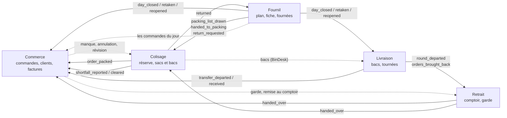
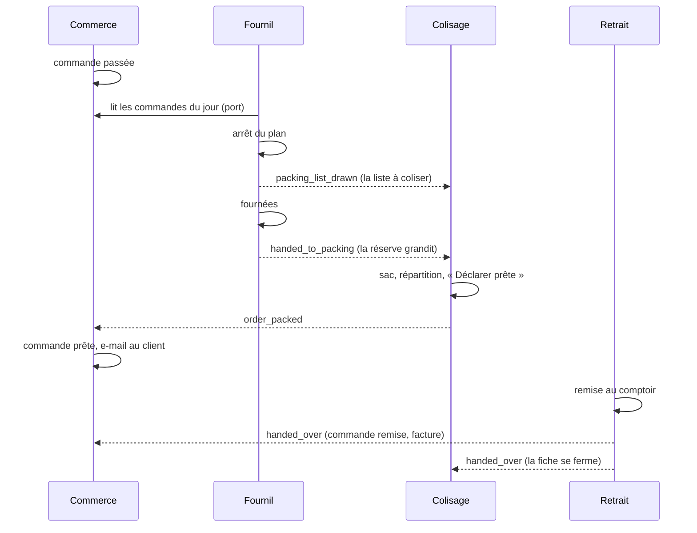

# La chaîne de la commande, de bloc en bloc

**État : 🗺️ carte de l'existant, relevée dans le code le 2026-11-18**, plus
les cas que le plan des niveaux du colisage
([`../colisage/plan-niveaux-de-suivi-colisage.md`](../colisage/plan-niveaux-de-suivi-colisage.md))
doit tenir. Les faits et leurs abonnés ont été listés par un relevé de tous les
`@DurableHandler` de `apps/lfd-api/src` ; les ports, par les classes
abstraites des dossiers `channels/`. Demande de Hugo : voir les interactions
entre blocs et s'assurer que tout marche dans tous les cas.

## 1. En simple

Cinq blocs se passent une commande. Deux façons de se parler :

- **un fait** (flèche pleine) : un bloc dit ce qu'il a fait, dans sa boîte
  d'envoi, et ne sait pas qui écoute ; l'abonné le traite plus tard, et le
  rejoue s'il échoue ;
- **une question** (flèche pointillée) : un bloc pose une question à un port
  qu'il déclare, et un autre bloc y répond tout de suite.

**Le fil d'une commande à retirer**, aujourd'hui (tout en détaillé) :

## 2. Les faits entre blocs (relevé du 2026-11-18)

| Fait                            | Publié par | Déclaré dans   | Écouté par                             |
| ------------------------------- | ---------- | -------------- | -------------------------------------- |
| `production.day_closed`         | fournil    | fournil        | commerce, livraison, fournil (dossier) |
| `production.day_retaken`        | fournil    | fournil        | livraison, fournil (dossier)           |
| `production.day_reopened`       | fournil    | fournil        | commerce, livraison, colisage          |
| `production.packing_list_drawn` | fournil    | fournil        | colisage                               |
| `production.handed_to_packing`  | fournil    | fournil        | colisage                               |
| `production.return_requested`   | fournil    | fournil        | colisage                               |
| `production.resupply_*`         | fournil    | fournil        | colisage, livraison, commerce          |
| `production.output_corrected`   | fournil    | fournil        | **personne** (🔴 cas G)                |
| `packing.order_packed`          | colisage   | ⚠️ **fournil** | commerce (prête, bon de reliquat)      |
| `packing.returned`              | colisage   | ⚠️ **fournil** | fournil                                |
| `packing.shortfall_reported`    | colisage   | colisage       | commerce                               |
| `packing.shortfall_cleared`     | colisage   | colisage       | commerce                               |
| `handover.handed_over`          | retrait    | retrait        | commerce, colisage                     |
| `delivery.round_departed`       | livraison  | livraison      | retrait, commerce (e-mail)             |
| `delivery.orders_brought_back`  | livraison  | livraison      | retrait                                |
| `delivery.transfer_*`           | livraison  | livraison      | commerce                               |

⚠️ **Deux faits du colisage sont déclarés chez le fournil**
(`production/channels/packing/packing-order-packed.event.ts`, et
`packing.returned`). Le propriétaire doit parler de ce qui est à lui : ils
rentrent au colisage (plan du colisage, lot C0), sans changer leur valeur.

Les **questions** synchrones les plus chargées : le fournil lit les commandes
du jour au commerce (`production/channels/commerce/DayOrdersReader`) ; le
commerce fait geler, retirer ou réviser au colisage
(`packing/channels/commerce/ShortfallDesk`, `PackingWithdrawalDesk`,
`PackingRevisionDesk`) ; le colisage déclare les bacs à la livraison
(`packing/channels/delivery/BinDesk`), dans sa propre transaction.

## 3. Tous les cas de figure

Pour chaque cas : ce qui se passe aujourd'hui (tout en détaillé), puis ce que
le colisage **toujours vert** ou **simple** du retrait devra tenir. ✅ tient,
⚠️ à écrire dans le plan, 🔴 casse aujourd'hui.

| #     | Cas                                               | Aujourd'hui                                                                                                                            | Avec le colisage à niveaux (retrait)                                                                                                                                                                                       |
| ----- | ------------------------------------------------- | -------------------------------------------------------------------------------------------------------------------------------------- | -------------------------------------------------------------------------------------------------------------------------------------------------------------------------------------------------------------------------- |
| **A** | Commande à retirer, tout va bien                  | ✅ fil du § 1                                                                                                                          | ✅ prête d'elle-même quand la réserve contient tout (toujours vert), ou « Tout est prêt » (simple)                                                                                                                         |
| **B** | Commande livrée, tout va bien                     | ✅ bacs déclarés à la livraison, scan au chargement                                                                                    | ✅ inchangée : la livraison reste en détaillé                                                                                                                                                                              |
| **C** | Commande arrivée après l'arrêt (« compléter »)    | ✅ le retirage republie `packing_list_drawn` pour les commandes absorbées (`production/plan/application/services/retake-recording.ts`) | ✅ même abonné que l'arrêt : la fiche fige son niveau au même endroit                                                                                                                                                      |
| **D** | Annulation après l'arrêt                          | ✅ le commerce retire la fiche (`PackingWithdrawalDesk`) tant que le sac n'est pas fermé                                               | ⚠️ une commande auto-prête est **fermée** des heures avant son heure : l'annulation est refusée (`withdrawSheet`, sac fermé). Il faut rouvrir puis retirer                                                                 |
| **E** | Modification après l'arrêt                        | ✅ `PackingRevisionDesk` révise les lignes d'un sac ouvert                                                                             | ⚠️ même fenêtre fermée que D (`reviseDue` refuse un sac fermé)                                                                                                                                                             |
| **F** | Réouverture du plan                               | ✅ `day_reopened` : le colisage, le commerce et la livraison oublient le plan                                                          | ✅ rien de neuf, tant que rien n'est colisé (réouverture refusée sinon)                                                                                                                                                    |
| **G** | Le fournil déclare moins que sorti (« Problème ») | 🔴 `output_corrected` publié, **personne n'écoute** : la réserve du colisage garde des pièces qui n'existent pas                       | 🔴 en toujours vert, le colisage les mettrait dans des commandes. Le lot C5 doit l'écouter **avant** que le toujours vert soit servi, et rattraper les corrections déjà publiées (`OutputCorrectionsReader`)               |
| **H** | Le fournil demande un retour                      | ✅ `return_requested` → le colisage rend ce qui est libre → `packing.returned`                                                         | ⚠️ en toujours vert, peu de pièces restent libres : le retour rend moins. À vérifier                                                                                                                                       |
| **I** | Le colisage manque de pièces (« Il manque »)      | ✅ `shortfall_reported` → le commerce attend une décision → départ incomplet ou reliquat                                               | 🔴 voir J et K                                                                                                                                                                                                             |
| **J** | « Problème » sur une commande auto-prête          | —                                                                                                                                      | 🔴 le commerce la garde **prête** : rouvrir le sac ne publie rien, et le manque ne retire pas l'état prêt. Le comptoir la remettrait pendant que la décision est attendue                                                  |
| **K** | Les pièces déclarées absentes                     | —                                                                                                                                      | 🔴 rendues à la réserve, elles redeviennent libres : le toujours vert les remet dans la même commande et efface le manque (`seal`). Elles doivent **sortir** de la réserve, et une fiche en manque sortir du toujours vert |
| **L** | Remise au comptoir d'une commande pas colisée     | ✅ `handed_over` → `leaveAtHandover` ferme la fiche sans rien publier                                                                  | ✅ inchangé                                                                                                                                                                                                                |
| **M** | Reliquat (le reste d'un envoi incomplet)          | ✅ une fiche au rang 2, son propre `order_packed`                                                                                      | ⚠️ son niveau n'est pas encore dit : celui de la commande d'origine (proposé)                                                                                                                                              |
| **N** | Réassort boutique                                 | ✅ fiche de réassort à part                                                                                                            | ✅ hors du champ : les niveaux ne valent que pour les commandes à retirer                                                                                                                                                  |
| **O** | Auteur d'une fermeture automatique                | —                                                                                                                                      | ⚠️ `order_packed` porte `packedBy`, que le commerce traite comme une fiche staff (`MarkOrderReadyCommand`) : un auteur système doit y être admis                                                                           |

## 4. Ce que ça change au plan du colisage

Les 🔴 J et K et le 🔴 G sont les objections bloquantes de `vitruve` du
2026-11-18 ; le plan les reprend en décisions avant d'être soumis à Hugo.
