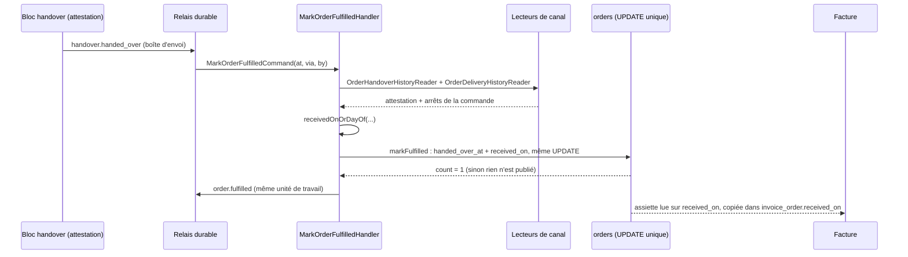

# La date de réception d'une commande

> **État : implémenté et en production depuis le 2026-10-24** (commits
> `d1ab93fa0`, `66c5c392c`, `31afb22f7`, `8a6933ed8`). Contrôlé en production le
> même jour : 0 remise sans date, 0 date sans remise. Chemins relatifs à
> `apps/lfd-api/` sauf mention ; chaque fichier cité a été ouvert le 2026-10-24.

La **date de réception** d'une commande est le jour de Paris où la marchandise
change de mains, livrée à la porte ou retirée au comptoir. Elle vit dans
`orders.received_on` (`@db.Date`). Le modèle la rend **inséparable de la
remise** : l'une ne s'écrit pas sans l'autre, et la base le refuse sinon. Elle
entre dans l'assiette de la facture, d'où sa rigueur : une remise sans date
aurait disparu de toute facture, en silence.

## La règle

`receivedOnOf` (`src/b2b/accounting/domain/services/monthly-invoicing.ts`) :

1. pas de remise : `null` ;
2. remise **à la porte** : le jour de service du dernier arrêt parti, clos et
   non ramené (`actualDeliveryDay` de `orderHistory`) ;
3. sinon : le jour Europe/Paris de l'instant de la remise.

`receivedOnOrDayOf`, dans le même fichier, ajoute le dernier repli : si la
règle ne rend rien (aucune attestation lisible), le jour de Paris de l'instant
porté par le fait (`command.at`). **Une remise a donc toujours un jour non
nul.**

## Un seul écrivain

`MarkOrderFulfilledHandler`
(`src/b2b/orders/application/commands/mark-order-fulfilled.handler.ts`) lit les
deux canaux que le commerce implémente (`handover/channels/commerce/`,
`delivery/channels/commerce/`), applique la règle, puis appelle
`OrderRepository.markFulfilled(reference, at, by, via, receivedOn)`
(`src/b2b/orders/infrastructure/prisma-order.repository.ts`). Cet appel écrit
`handed_over_at`, `handed_over_by`, `handed_over_via`, le statut `fulfilled` et
`received_on` dans **un seul `updateMany`**, conditionné par
`handed_over_at IS NULL` et un statut non annulé. C'est ce qui rend les CHECK
tenables en immédiat. À la porte, l'arrêt est clos et la preuve écrite dans la
même unité de travail du livreur que le fait, et le relais ne livre qu'après
validation : le jour de tournée est donc lisible au moment du calcul (prouvé par
`test/order-received-on.e2e-spec.ts`).

## Ce que la base tient

Migration `prisma/migrations/20261024120000_la_date_de_reception` : renommage
de `delivered_on` en `received_on` sur `orders` et `invoice_order` (valeurs non
recalculées), index et déclencheur suivent.

- **Déclencheur `orders_received_on_frozen`** : refuse tout changement d'une
  valeur posée, y compris vers `NULL`. La date ne bouge jamais, même si la
  commande est annulée ensuite.

Migration `prisma/migrations/20261024150000_la_reception_suit_la_remise`, dans
une transaction explicite (`BEGIN` / `COMMIT`) :

- **`orders_handover_has_received_on`** : `handed_over_at IS NULL OR received_on
IS NOT NULL` (une remise porte sa date) ;
- **`orders_received_on_has_handover`** : `received_on IS NULL OR handed_over_at
IS NOT NULL` (une date suppose une remise).

Elle a aussi daté l'unique remise sans date (reprise par la règle simple).
Une seule conversion de fuseau y compte : `handed_over_at` est un
`TIMESTAMP(3)` **sans fuseau, écrit en UTC**, il faut le lire comme UTC puis le
projeter sur Paris, `(("handed_over_at" AT TIME ZONE 'UTC') AT TIME ZONE
'Europe/Paris')::date`. Le seul `AT TIME ZONE 'Europe/Paris'` le lirait comme
une heure de Paris et rendrait le jour de la session.

## Les lecteurs

| Lecteur                                                                     | Usage                                                               |
| --------------------------------------------------------------------------- | ------------------------------------------------------------------- |
| `src/b2b/accounting/infrastructure/billable-order-criterion.ts`             | l'assiette facture / relevé / lot : `received_on` dans `[from, to[` |
| `src/b2b/accounting/infrastructure/cycle-order-membership.ts`               | appartenance d'un bon au cycle                                      |
| `src/b2b/accounting/infrastructure/prisma-monthly-invoicing.reader.ts`      | le jour copié dans la ligne de facture                              |
| `src/b2b/accounting/infrastructure/prisma-unconfirmed-deliveries.reader.ts` | « Bons à constater » : pas de date égale pas remis                  |
| `src/b2b/accounting/infrastructure/prisma-procedure-orders.reader.ts`       | statut de l'onglet Factures                                         |
| `src/b2b/accounting/application/card-invoice-support.ts`                    | facture carte : lit la colonne, sans recalcul                       |
| `src/b2b/accounting/domain/services/facturx-xml.ts`, `facturx-mentions.ts`  | BT-72 `ActualDeliverySupplyChainEvent` et « reçue le … »            |

**La copie figée** : `invoice_order.received_on` est écrite à l'émission et ne
bouge plus. Une ligne émise avant le lot ZL garde `NULL` et ses mentions sans
date ; la facture l'emporte toujours dans l'onglet Factures. Côté écrans, le
libellé est **« Reçue le »** partout
(`apps/lfd-backoffice-frontend/src/app/comptabilite/facture-emise/facture-emise-page.html`,
`apps/lfc-ecommerce-frontend/src/app/client/mes-factures/invoice-dialog/`),
et « réception non constatée » pour une ligne sans date.

## Les décisions de Hugo

- **Q1 (2026-10-24)** : option A, le commerce calcule le jour en copiant la remise ; la règle n'est pas déplacée dans le bloc `handover`.
- **Q2 (2026-10-24)** : vérifiée, l'arrêt est clos et la preuve écrite avant que le fait ne parte (test e2e « Q2 »).
- **Q3 (2026-10-24)** : « Reçue le » partout, livrée ou retirée.
- **Q4 (2026-10-24)** : la date ne change jamais une fois posée, même si la commande est annulée ensuite.
- **Q5 (2026-10-24)** : les deux sens, « remise ⇒ date » et « date ⇒ remise », posés au troisième temps.
- **Q6, révisée (2026-10-24)** : la reprise se fait dans la migration du troisième temps, par la règle simple (jour de Paris de la remise), pas par un script d'exploitation ; une seule commande concernée, aucune jointure inter-schémas.

## Ce qui est assumé

- **Une remise ne se défait plus**, même à la main : le déclencheur et les deux
  CHECK la refusent. Lever une remise constatée par erreur demande de retirer
  une contrainte en production, sur décision de Hugo
  ([`../../ops/runbook.md`](../../ops/runbook.md), « Une remise ne se défait pas »).
- **Lettres mortes laissées en place** : l'abonné
  `accounting.record-delivery-day.on-handover` est retiré ; ses livraisons
  encore en attente finissent en lettres mortes, sans rien de perdu (la remise
  pose déjà la date). Ne pas les rejouer.
- La preuve à la porte peut être purgée : une reprise tardive prendrait le jour
  de Paris au lieu du jour de tournée. Sans objet aujourd'hui, la reprise est faite.
- Une date reprise peut tomber dans une période déjà facturée : l'assiette la
  prend à la facture suivante.

## Reste à faire

Rien de bâti n'est en attente. Une seule vérification d'exploitation : constater
les lettres mortes de l'abonné retiré via `GET /admin/outbox/dead-letters`
(décrit au runbook), sans les rejouer.
