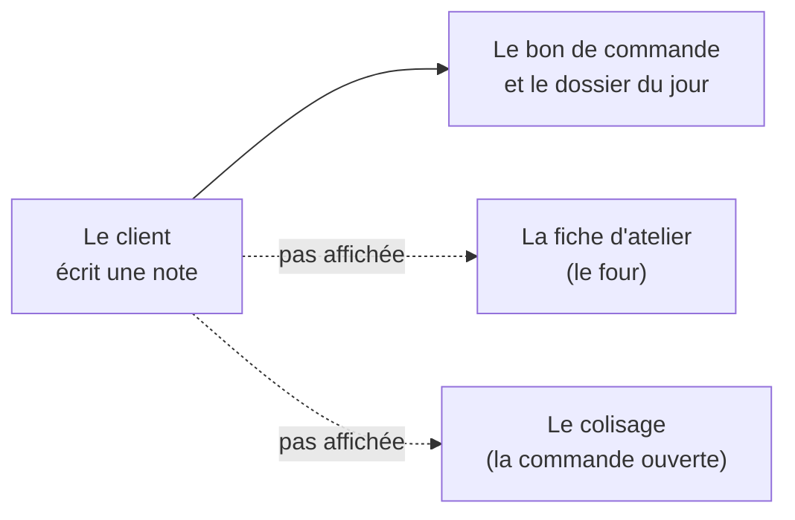

# TODO — la note du client, aux postes qui la font

**État : 📌 à réfléchir, rien n'est décidé** (Hugo, 2026-11-21).

## En simple

Un client peut laisser une note sur sa commande. Le 2026-11-21, la commande
ORD-9 du Grizzly portait « PAIN DE CAMPAGNE TRANCHE » : le client voulait ses
pains tranchés. La note est sur les **papiers** de la commande, mais pas sur
les **écrans** des postes qui la fabriquent et la préparent. Une note que
personne ne lit au moment du geste est une note qui ne sert à rien.

## Ce qui existe (vérifié le 2026-11-21)

- **Le bon de commande** l'imprime : `note()` dans
  `apps/lfd-api/src/lafoliecoffee/orders/domain/services/order-sheet-pdf.ts`.
- **Le dossier du jour** l'imprime aussi sous chaque commande
  (`drawNote(doc, head.note, …)` dans
  `apps/lfd-api/src/production/plan/domain/services/day-dossier-pdf.ts`).
- **La fiche d'atelier** ne l'affiche pas : elle est rangée par **produit**,
  pas par commande (aucune note dans `production/fiche-atelier/` du
  back-office).
- **Le colisage** ne l'affiche pas dans la commande ouverte
  (`colisage/packing-open-order/` : seul l'avis d'impression du bon y figure).

## Les questions à trancher

1. **Qui doit la lire ?** Le four (« tranché » change le geste du boulanger),
   le colisage (la vérifier avant de déclarer prête), ou les deux.
2. **Sur une fiche rangée par produit**, une note qui porte sur UN produit
   d'UNE commande : un drapeau sur la ligne (« 1 commande a une note »), et la
   note au toucher ? Ou une note libre reste-t-elle au colisage seulement ?
3. **Une note libre, ou des options** : « tranché » revient-il assez souvent
   pour devenir une option du produit, comptée et préparée comme le reste,
   plutôt qu'un texte qu'on lit ?
4. **Le colisage en toujours vert**, s'il est bâti : une commande qui porte une
   note ne devrait-elle pas rester à confirmer à la main ?
