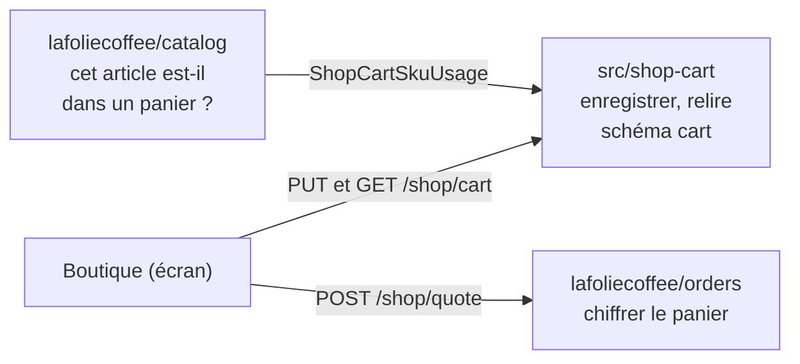

# Le panier de la boutique

> **Doc d'état, 2026-11-20.** Le panier est un bloc de premier niveau,
> `apps/lfd-api/src/shop-cart/`, avec son schéma Postgres `cart`. Il est sorti
> de `lafoliecoffee/orders` le 2026-11-20 (candidat §2.4 de
> [`domaines-a-decouper.md`](domaines-a-decouper.md)).

## Partie 1 — l'idée simple

Le panier, c'est ce qu'un client connecté met de côté **avant** de commander,
pour le retrouver sur un autre appareil. Deux gestes seulement : l'écran
**enregistre** le panier entier, et le **relit**. Aucune règle ne peut refuser
un panier : c'est un brouillon personnel, un par personne et par espace de
travail.

Ce qu'il coûterait si on commandait maintenant — le **chiffrage** — n'est pas
au panier : c'est le calcul même de la passation, et il reste au commerce.
L'écran envoie les lignes au devis, qui ne relit jamais le panier enregistré.

## Partie 2 — la partie technique

### 2.1 Le bloc

| Fichier (`apps/lfd-api/src/shop-cart/…`)        | Rôle                                                    |
| ----------------------------------------------- | ------------------------------------------------------- |
| `application/commands/save-shop-cart.*`         | remplace le panier (personne, espace)                   |
| `application/queries/get-shop-cart.*`           | relit, ou `null`                                        |
| `domain/ports/shop-cart.repository.ts`          | `find` / `save`, sans agrégat : aucun invariant         |
| `infrastructure/prisma-shop-cart.repository.ts` | `INSERT … ON CONFLICT` sur `"cart"."shop_carts"`        |
| `http/shop-cart.controller.ts`                  | `GET` / `PUT /shop/cart`, `@Idempotent`                 |
| `channels/commerce/`                            | `ShopCartSkuUsage`, la seule surface pour un autre bloc |
| `shop-cart.module.ts`                           | `@Global`, importé par `AppModule`                      |

**Frontières.** Le bloc n'importe que `platform`. Le commerce ne l'atteint que
par `shop-cart/channels/` (`lint:context-boundaries`) ; personne d'autre ne
lit `shop_carts` (`lint:prisma-model-ownership`, qui reconnaît l'écriture en
SQL brut et le délégué Prisma passé en valeur — sans quoi le panier n'aurait
eu aucun propriétaire).

### 2.2 La table

`cart.shop_carts` (`apps/lfd-api/prisma/schema/cart.prisma`) : `payload` en
`jsonb`, validé à l'écriture et à la relecture ; unicité
`(user_id, company_id) NULLS NOT DISTINCT` (`shop_carts_user_company_unique`,
écrite dans les migrations, que Prisma ne sait pas décrire).

**Aucune clé étrangère** ne sort de `cart` : `user_id` et `company_id` sont des
identifiants opaques. Effacer un compte ne vide donc pas ses paniers.

- Aucun compte n'est effacé physiquement en production.
- Le seed de remise à zéro de dev (`src/dev/seeding/reset.seed.ts`) vide les
  paniers des comptes qu'il efface.
- **Reste à faire** : le jour où l'effacement RGPD d'un compte existera, il
  videra ses paniers par un abonné durable.

Migration `20261120180000_le_panier_a_son_schema` ; retour arrière dans
`apps/lfd-api/prisma/rollback/`, qui purge d'abord les paniers orphelins avant
de recréer les clés.

### 2.3 Pourquoi pas de gestes « ajouter » / « retirer »

Un geste serveur par ligne ne vaut que s'il peut **refuser**. Les règles qui
refusent un article aujourd'hui — l'audience qui le réserve, une opération
datée close, le sur-mesure — sont des **droits de commande** : elles dépendent
de l'acheteur, de l'espace, du catalogue et du jour, et le commerce les juge
au devis (à chaque changement du panier) puis à la passation. Les juger aussi
à l'ajout ferait deux juges pour une règle, et ne protégerait pas un droit qui
change après l'ajout (un changement d'espace, une opération qui ferme). Le
visiteur non connecté, lui, compose dans son navigateur sans appeler le
serveur.

Ces gestes viendront avec une règle **propre au panier** — un plafond par
article dans un panier, une réservation de stock — et ce bloc est l'endroit où
les écrire.

### 2.4 Le déploiement de la bascule

Entre le `migrate deploy` et le nouveau conteneur, l'ancien code écrivait dans
`public.shop_carts` : quelques secondes de 500 sur `/shop/cart`, acceptées en
pré-release. La boutique garde sa copie et la reverse à l'écriture suivante.
