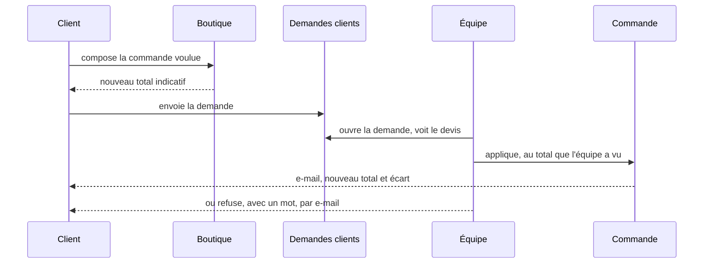
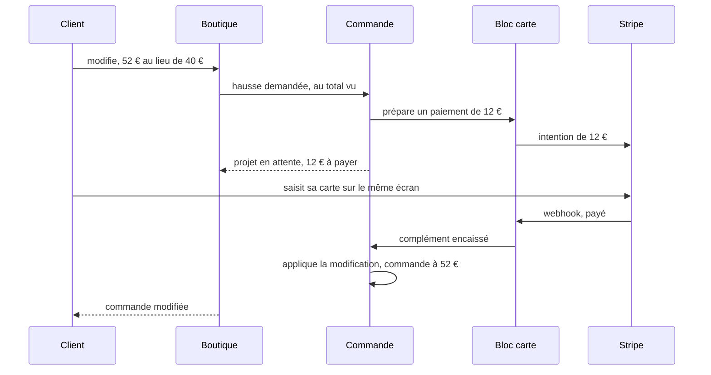
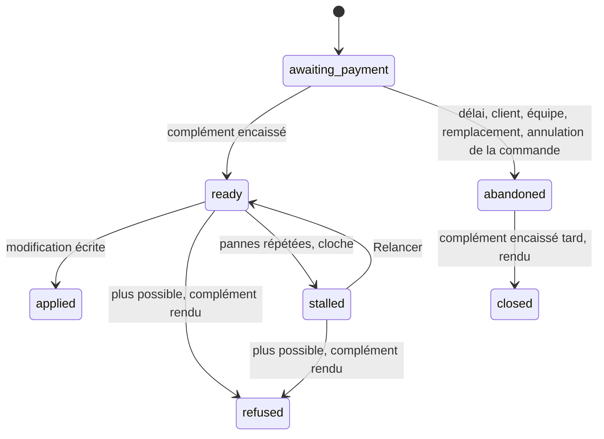
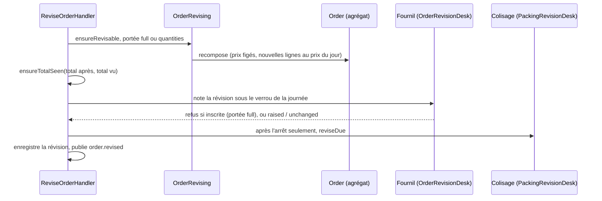

# Modifier une commande

> **Doc d'état, 2026-11-10.** Remplace, pour ce qui est bâti,
> le plan de modification (M1, M3, M4), le plan A2, le plan S2 de la hausse
> par carte — tous retirés le 2026-11-10, citations repointées ici — et
> l'architecture des avenants d'août (retirée). Chaque phrase de la
> partie 2 a été confrontée au code le 2026-11-10. La hausse d'une commande
> payée par carte est en production depuis le 2026-11-10 (§2.7) ; ce qui est
> **en cours** — la baisse par carte — est marqué comme tel et renvoie à son
> plan.

## Partie 1 — l'explication simple

Une commande passée se corrige : on change les quantités, on ajoute ou on
retire un article, on change la date, le créneau, le point de retrait, ou on
passe du retrait à la livraison. Le client voit **une seule commande,
corrigée**, sous le même numéro. Chaque correction garde l'ancienne version
dans un historique que l'équipe peut relire.

### Qui modifie, et jusqu'à quand

| Qui       | Quand                                                                             | Quoi                                                             |
| --------- | --------------------------------------------------------------------------------- | ---------------------------------------------------------------- |
| Le client | avant l'heure limite de commande (celle de l'ancienne ET de la nouvelle date)     | tout                                                             |
| L'équipe  | tant que la commande n'est pas inscrite au fournil (l'heure limite ne compte pas) | tout                                                             |
| L'équipe  | après l'inscription, jusqu'à la commande prête                                    | **seulement les quantités**, et seulement d'un **pro au compte** |
| Le client | après l'heure limite, avant l'inscription                                         | il **demande** ; l'équipe applique ou refuse                     |

Dans tous les cas, on ne modifie pas une commande annulée, prête, remise,
déjà engagée en comptabilité ou dont le départ incomplet est décidé.

### Les prix

- Un article **déjà dans la commande** garde son prix d'origine, quelle que
  soit sa nouvelle quantité.
- Un article **nouveau** prend le prix du jour.
- Une quantité qui change doit respecter le **minimum d'achat** publié
  aujourd'hui pour l'article ; une ligne qu'on ne touche pas n'est pas relue.
- La remise de retrait, les frais de livraison et la TVA se recalculent sur
  la nouvelle composition, comme à la passation.

### L'e-mail « commande modifiée » (depuis le 2026-11-10)

Une fois la modification appliquée, le client reçoit **« Votre commande ORD-…
est modifiée »** : le détail à jour, l'ancien et le nouveau total, le bon
révisé joint, et une phrase sur l'argent (« figurera sur votre facture » au
compte, « réglée par carte » pour une hausse payée). Une demande appliquée par
l'équipe ne le déclenche pas : le client reçoit déjà la réponse à sa demande.

### Le total vu (depuis le 2026-11-10)

Une modification envoie **le total qu'elle a montré**. Si le prix a bougé
entre l'affichage et la validation, elle est refusée avec le même
avertissement qu'à la passation, et l'écran redemande le devis. Aucune
commande ne change de montant sans que quelqu'un ait vu ce montant.

### La demande après l'heure limite

Le client compose comme s'il modifiait, et voit un total **indicatif**.
C'est l'équipe qui applique : la modification se fait en son nom, et le
total vu est **le sien** — c'est une délégation, une responsabilité
commerciale. Une seule demande en attente par commande.

### Et la carte ?

| Ce qui existe                                                                                           | État                                                         |
| ------------------------------------------------------------------------------------------------------- | ------------------------------------------------------------ |
| Payer, puis rembourser tout ou partie : le bloc `card-payment` (lots P0 et P1)                          | ✅ en production                                             |
| Modifier une commande au compte ou à total nul                                                          | ✅ en production                                             |
| **La hausse** : le client paie la différence sur le même écran (ci-dessous, et §2.7)                    | ✅ en production depuis le 2026-11-10                        |
| Une baisse, ou un changement à total égal, sur une commande carte : refusée, « annulez et recommandez » | ✅ (c'est le refus qui est en production)                    |
| **La baisse** : la différence remboursée tout de suite ([`plan-s1-la-baisse.md`](plan-s1-la-baisse.md)) | 🚧 **en cours**                                              |
| Une baisse sous le bon de fidélité imputé (lot C-2b)                                                    | 📝 non bâti ; refusée aujourd'hui, au compte comme par carte |

### La hausse payée par carte

Un client a payé 40 € par carte. Il ajoute deux tartes : la commande vaudrait
52 €. On ne touche pas à sa commande tant qu'il n'a pas payé les 12 € de
différence.

- **Le client voit « 12,00 € à payer »** dès le devis, et paie **sur le même
  écran**, en saisissant sa carte. Nous ne gardons aucune carte : chaque
  paiement est une intention Stripe sans client ni carte enregistrée.
- **Rien ne change tant que ce n'est pas payé.** La modification attend dans
  un **projet** ; la commande garde sa composition, son total et sa place au
  fournil.
- **Le délai pour payer est de 15 minutes**, raccourci à l'heure limite de
  commande si elle tombe avant. Pas payé à temps : le projet est abandonné,
  la commande intacte, et le client peut recommencer. Le délai est un
  plancher, pas un couperet : un paiement validé avant l'abandon s'applique.
- **Payé, mais la modification n'est plus possible** (la journée est partie
  au fournil ou son plan arrêté entre-temps, un prix a bougé, quelqu'un
  d'autre a modifié la commande) : on **rend les 12 €**, la commande reste à
  40 €, et le client reçoit un e-mail « modification impossible ».
- **Payé après l'abandon** : les 12 € sont rendus aussi.
- **L'équipe ne fait pas de hausse sur une commande carte.** Elle reçoit un
  refus qui dit quoi faire : « demandez au client de modifier sa commande, ou
  passez une seconde commande ». Elle voit, sur la fiche, le complément qui
  attend, peut l'**abandonner**, et **relancer** une modification payée
  restée en panne.
- **Le total vu, sur toute modification** : la modification envoie le total
  qu'elle a montré (§ « Le total vu » plus haut) ; un prix qui a bougé est
  refusé avant de payer.
- **Si Stripe ne nous prévient pas** (le message de paiement se perd), le
  passage de contrôle toutes les 5 minutes **demande à Stripe** où en est le
  paiement et rattrape tout seul.

Le projet, ses états :

## Partie 2 — la technique

Chemins sous `apps/lfd-api/src/` sauf mention.

### 2.1 Une révision, pas des avenants

Une modification produit une **nouvelle révision** de la commande : même
identifiant, même numéro ; lignes, acheminement et montants remplacés ;
`orders.revision` monte de 1 (`0` à la passation) et `orders.revised_at` est
posé. La composition remplacée est rangée **en entier** dans
`public.order_revision` (modèle `OrderRevisionEntry`,
`prisma/schema/public/orders.prisma`) : colonnes qui changent et lignes
complètes, changements (`lines`, `date`, `method`…), totaux avant / après,
auteur client ou fiche staff (tenu par un CHECK), unique par
`(order_id, replaced_revision)`.

**Pourquoi pas les avenants** (le modèle d'août, retiré le 2026-11-10) : tout ce qui lit une commande
— fournil, bon, BL, facture, prélèvement, « Mes commandes », dossier de
facturation — lit **une** commande. Des avenants auraient obligé chacun à
additionner « commande + avenants », dix lecteurs et dix façons de se
tromper. La raison d'être des avenants était l'historique et l'argent :
l'historique est la table ci-dessus ; **l'argent**, lui, est bien fait de
mouvements immuables, mais côté carte, dans le bloc `card-payment`
(paiements et remboursements par montant, forme C du plan M2) — pas dans la
commande. La commande dit ce qui est dû ; le carnet de la carte dit ce qui
a été encaissé et rendu.

### 2.2 Le chemin d'une modification

- Geste : `ReviseOrderCommand` / `ReviseOrderHandler`
  (`b2b/orders/application/commands/`) ; devis : `QuoteOrderRevisionQuery`.
  Routes `POST /orders/:id/revisions` (+ `/quote`) côté client, sous le mur
  de `GET /orders/:id` (`RevisionWall`), et `POST /admin/orders/:id/revisions`
  (+ `/quote`) côté équipe, droit `b2b_place_order:write`.
- Recomposition : `application/services/order-revising.service.ts`, sur le
  calcul partagé avec la passation (`order-composition.service.ts`,
  `order-cutoff-gate.service.ts`).
- Règles pures : `domain/entities/order-revision.ts`,
  `domain/services/revised-lines.ts`, `domain/services/order-revisability.ts`.
- Lecture « se modifie-t-elle ? » : `revisability` et `revision` sur les vues
  client et équipe (`GetOrderRevisabilityQuery`), par la même règle que le
  refus du geste.
- Historique : `GET /admin/orders/:id/revisions` (`ListOrderRevisionsQuery`,
  port de lecture `OrderRevisionHistoryReader`), carte « Versions
  précédentes » du back-office.

### 2.3 Les règles, telles que le code les tient

- **R1 — Qui et jusqu'à quand.** La frontière commune est celle de
  l'annulation (`standingBlockOf` → `cancellationOf`) : annulée, prête,
  inscrite, engagée en comptabilité, remboursement en vol → refus. Puis le
  règlement, puis les CGV figées (une commande sans CGV figées ne se modifie
  pas). Pour le client seulement : le plan de la journée arrêté
  (`plan_closed`) et l'heure limite (`past_cutoff`, la même
  `decideStrictestOrderCutoff` qu'à la passation, sans dérogation), de
  l'ancienne ET de la nouvelle date. Un départ incomplet décidé refuse
  (`ShortfallDecidedRevisionError`).
- **R2 — Ce qui se modifie.** Lignes, date, créneau, mode, point, adresse,
  note. Payeur, société, clientèle, CGV et langue sont relus, jamais changés.
  Une commande prise à la vitrine (`supply = shelf`) ne change ni de mode, ni
  de journée, ni de point (`shelf_closed`).
- **R3 — Les prix.** Une ligne dont le SKU était dans la révision précédente
  garde son prix et son taux (`FrozenLinePriceChangedError` si un appelant
  tente de le changer) ; une nouvelle est tarifée au jour. Une ligne gardée
  dont la quantité change se tient au minimum d'achat publié aujourd'hui
  (`ensureKeptMinimums`, `QuantityBelowMinimumError`) ; une ligne inchangée
  n'est pas relue.
- **R4 — Le reste se recalcule** : remise de retrait, frais (barème et seuil
  de franco **figés à la passation**, repris par la révision), TVA du port
  selon le mode figé. La surtaxe tardive figée est réappliquée au nouveau
  sous-total, ni créée ni retirée. Le bon imputé reste imputé ; une révision
  qui passerait sous sa part est refusée (`RevisionBelowVoucherError`).
- **R5 — La journée.** Une nouvelle date doit tomber dans une journée
  ouverte (`ensureDayOpen`) ; un déplacement vers une journée au plan arrêté
  est refusé, équipe comprise (`RevisionIntoClosedDayError`).
- **R6 — Rien de changé, rien d'écrit** (`UnchangedOrderRevisionError`).
- **R7 — Concurrence.** La modification porte la révision qu'elle corrige ;
  si elle a bougé : 409 `OrderRevisedElsewhereError` (« rechargez »).
- **Refus de règlement.** Une commande gratuite qui deviendrait payante
  (`RevisionRequiresPaymentError`) ; une commande au compte qui tomberait à
  zéro (`RevisionFreesAccountOrderError` : son encaissement ne se ferme que
  par l'annulation) ; une carte (`CardOrderNotRevisableError`, §2.7).
- **R14 — Le total vu.** `ReviseOrderCommand.expectedTotalCents`, obligatoire,
  comparé par `ensureTotalSeen` (`domain/services/seen-total.ts`, le même
  qu'à la passation) au total après révision, avant toute écriture :
  `OrderTotalChangedError`, code `orders.total_changed`. La boutique et le
  back-office l'attrapent et redemandent le devis.

### 2.4 Après l'inscription : les quantités seulement (A2)

Le §7 du plan A2 l'a emporté sur ses §§1 à 5, et c'est lui que le code tient.

- **Portée.** `ensureRevisable` rend `full` ou `quantities` ;
  `quantitiesAfterArrestAllowed` (`domain/services/revision-after-arrest.ts`)
  n'ouvre `quantities` qu'à **l'équipe** et au règlement **au compte**. La
  révision ne doit changer que `lines`, mêmes articles, chacun **≥ 1**
  (`isQuantitiesOnly`, sinon `QuantitiesOnlyAfterArrestError`). Tout à zéro,
  c'est le retrait d'une commande inscrite (A1), pas une révision.
- **Deux grandeurs au fournil.** Les lignes de la commande au fournil disent
  le **dû**, dans les deux sens (`ProductionDay.reviseOrder`). Le **compte du
  four par article** ne baisse jamais après l'arrêt : `floorCounts`
  (`production/domain/services/production-count.ts`) prend le plus grand du
  compte précédent et du compte refait, après matérialisation des coches.
  Une baisse laisse le surplus partir en réserve au colisage, comme A1. Fait
  `production.order_quantities_raised` sur une hausse seulement.
- **Une journée.** Le guichet refuse une commande inscrite un autre jour que
  celui révisé (`production.revision.inscribed_another_day`, 409, ajout du
  2026-11-03).
- **Le colisage.** `PackingRevisionDesk` (`packing/channels/commerce/`) →
  `PackingSheet.reviseDue` : feuille absente → refus temporaire
  (`PackingSheetNotYetDrawnError`, « réessayez ») ; bac de livraison vivant →
  refus (`delivery_bin`) ; feuille colisée ou décidée → refus ; **baisse sous
  ce qui est déjà au bac → refusée** (`RevisedDueBelowPackedError`, « retirez
  d'abord du bac ») ; une hausse efface la marque « au bac » si la ligne n'est
  plus complète. Fait `packing_sheet.revised`.
- **Verrous** : ligne `orders` → journée du fournil → feuille → BL.

### 2.5 La demande après l'heure limite (M4)

- Type `order_change` de `CustomerRequest` (`b2b/contact/`), colonnes
  `change_base_revision`, `change_content`, `change_applied_revision`,
  `change_refusal`, et un index unique partiel : une demande en attente par
  commande. Seul `past_cutoff` admet la demande ; une commande carte ne
  dépose pas de demande (`card_settled` sur le chemin `request`).
- `POST /me/orders/:id/change-request` (débit limité) ; le total indicatif du
  client vient de `POST /orders/:id/revisions/change-request-quote`
  (`QuoteOrderChangeRequestQuery`, recomposé aux règles de l'équipe, rien
  d'écrit, aucun montant rangé dans la demande).
- Répondre : `/admin/customer-requests/:id/order-change/{quote,apply,refuse}`.
  « Appliquer » est `ApplyOrderChangeCommand` → `BusOrderChangeApplier`
  (`b2b/contact/infrastructure/bus-order-change.applier.ts`) →
  `ReviseOrderCommand` au nom de l'équipe, dans une seule transaction avec la
  réponse. Le total vu transmis est **celui du devis de l'équipe**
  (`expectedTotalCents` du corps de `apply`), jamais recalculé par
  l'applicateur. Tout refus du geste remonte avec sa phrase ; la demande
  reste en attente.
- Courriels `customer.order-change-applied` (nouveau total et écart, tirés de
  l'entrée de révision) et `customer.order-change-refused`.

### 2.6 L'argent au compte

La facture lit les lignes de la commande au mois de sa livraison, donc la
dernière révision. L'encaissement au compte est recalculé dans la même
transaction : port `AccountOrderRevaluation` →
`b2b/accounting/application/services/account-order-revaluing.ts` →
`OrderCollection.revalue()`, seulement si l'encaissement n'est pas engagé
(sinon la frontière commune refuse). Le prélèvement suit la facture.

### 2.7 L'argent par carte

Une commande dont le règlement est carte (`isCardSettlement`) ne passe
**jamais** par le chemin de M1 : `ReviseOrderCommand` la refuse
(`CardOrderNotRevisableError`, avec sa raison). Le seul chemin ouvert est la
**hausse**, en production depuis le 2026-11-10 ; la baisse est en cours
(§2.7.12). Fichiers sous `b2b/orders/` sauf mention.

#### 2.7.1 Le projet — `order_revision_proposal`

`public.order_revision_proposal` (modèle dans
`prisma/schema/public/order-revision-proposal.prisma`, migration
`20261110040000_le_projet_de_hausse_par_carte`), agrégat
`CardIncreaseProposal` (`domain/entities/card-increase-proposal.ts`), dépôt
`infrastructure/prisma-card-increase-proposal.repository.ts`.

| colonne                                                        | sens                                                                                 |
| -------------------------------------------------------------- | ------------------------------------------------------------------------------------ |
| `order_id`, `base_revision`                                    | la commande et la révision corrigée                                                  |
| `content`, `rules`                                             | jsonb — le contenu saisi, les règles figées de l'auteur (`rulesOf`)                  |
| `target_total_cents`, `complement_cents`                       | figés au geste ; `complement_cents > 0`                                              |
| `revised_by_kind`, `revised_by_user_id`, `revised_by_staff_id` | l'auteur, comme `order_revision` (le dernier au registre RGPD)                       |
| `payment_id`                                                   | le paiement dans `card_payment.payment`, **unique**, sans clé étrangère (autre bloc) |
| `state`                                                        | sept états                                                                           |
| `expires_at`                                                   | le délai de paiement                                                                 |
| `attempts`, `next_attempt_at`, `leased_until`, `last_failure`  | la reprise de l'exécuteur                                                            |
| `provider_checks`                                              | les contrôles au prestataire en échec, compteur à part                               |
| `refusal`                                                      | le code du refus métier                                                              |
| `created_at`, `settled_at`, `closed_at`                        |                                                                                      |

Les sept états — `awaiting_payment`, `ready`, `applied`, `refused`,
`stalled`, `abandoned`, `closed` — et leurs transitions (le diagramme de la
partie 1) sont tenus par l'agrégat seul. Un seul projet **vivant**
(`awaiting_payment | ready | stalled`) par commande, par un index unique
partiel. Toute transition s'écrit **conditionnée** sur l'état relu
(`expectedState`) : deux gestes qui se croisent n'écrivent jamais l'un sur
l'autre. Pas de `DELETE`.

**Ordre des verrous, partout** : `orders` (`OrderLock.lock` ou
`revisions.lock`), puis le projet `FOR UPDATE`, puis `card-payment`.

Le délai (`CARD_INCREASE_PAYMENT_DELAY_MS`, 15 min) est borné par l'heure
limite de la journée ; une heure limite déjà passée refuse
(`CardIncreaseAfterCutoffError`).

#### 2.7.2 Le tri du règlement — `RevisionSettlement`

`domain/entities/revision-settlement.ts`. `Order.recompose` rend la révision
**et** son règlement, après la composition, sans lever :

- `same_settlement` — au compte ou à total nul : le chemin de M1 ;
- `card_complement` — carte encaissée et hausse : un complément à payer ;
- `card_not_revisable` — carte, avec la raison : `unsettled` (carte pas
  encore encaissée), `decrease`, `same_total`.

`settlementBy` y ajoute l'auteur : une hausse composée par l'équipe devient
`card_not_revisable` / `increase_by_staff` (Q3 a, Hugo, 2026-11-10), dont le
message nomme le geste de sortie. `ensureSettlementExpected` refuse tout ce
qui n'est pas le chemin du geste — M1 attend `same_settlement`, la hausse
`card_complement` — **avant** le « rien n'a changé » et avant le total vu.
Les trois appelants de `ReviseOrderCommand`, dont `BusOrderChangeApplier`
(une demande M4 appliquée par l'équipe), refusent donc toute carte.

Une révision carte garde son régime (`onAccount` faux quand le régime
d'avant est carte) : `deferPayment()` ne la fait pas passer « au compte ».

Le chemin de la demande M4 reste fermé à la carte : `GetOrderRevisabilityQuery`
porte un `purpose` (`revise` pour la boutique, `request` pour
`order-changeable-order.reader.ts`), et `request` garde `card_settled` sur
toute carte. Le devis et `revisabilityOf` annoncent le règlement :
« X € à payer » sur une hausse, le refus sur une baisse.

#### 2.7.3 Le geste — `ProposeCardIncreaseCommand`

`application/commands/propose-card-increase.{command,handler}.ts`, route
**client seulement** `POST /orders/:id/revisions/card-increase`
(`order-revisions.controller.ts`). La commande porte `expectedRevision`,
`content` et `expectedTotalCents`.

1. **Hors verrou** : le mur, la révision corrigée (R7), hors stock
   (`CardIncreaseOnShelfOrderError`), `ensureRevisable` (chemin `revise`),
   la recomposition — `card_complement` exigé —, puis le total vu, avant
   toute préparation.
2. **Remplacement** : un projet du même auteur qui attend son paiement voit
   son intention annulée (`cards.cancel`, hors transaction) ; un autre
   auteur est refusé (`RevisionProposalPendingError`).
3. L'intention du complément préparée (`cards.prepare`), hors transaction.
4. Transaction : `orders` verrouillée, R7 et la règle rejugées, journée
   **non inscrite** (lue au fournil, sans rien inscrire), l'ancien projet
   abandonné par une écriture conditionnée (rien d'écrit ⇒ refus « votre
   précédent complément vient d'être payé »), le paiement rattaché au rôle
   `complement`, le nouveau projet, le journal.
5. Échec ⇒ `cards.release`.
6. Réponse : de quoi monter le formulaire Stripe (identifiant du projet,
   complément, `clientSecret`, clé publiable, échéance).

#### 2.7.4 Le paiement, routé par rôle

Chaque ligne `card_payment.payment` porte son rôle (`first` | `complement`),
et le canal le passe à `OrderSubjectSettlement.onPaid`
(`application/services/order-subject-settlement.ts`). `first` suit le chemin
de la passation ; `complement` part vers `OrderComplementSettlement`
(`order-complement-settlement.ts`), qui **ne touche jamais la commande** :

- `awaiting_payment` ⇒ `ready`, réveil de l'exécuteur après validation ;
- `abandoned` ⇒ `closed`, fait durable `order.complement_paid_late`
  (`OrderComplementPaidLateEvent`) ;
- autre état ⇒ rejeu, rien ne bouge ;
- aucun projet ⇒ `ComplementWithoutProposalError`, bruyante : le webhook se
  rejoue puis passe en lettre morte, jamais un complément gardé en silence.

Un échec de paiement laisse le projet `awaiting_payment` : le client
réessaie jusqu'à l'échéance. Au rechargement de la page,
`GET /orders/:id/complement` (`GetComplementPaymentQuery`, mur de
`ensureOrderVisible`) relit l'intention chez le prestataire — jamais un
secret stocké — et refuse un projet qui n'attend plus son paiement
(`NoComplementAwaitingPaymentError`).

#### 2.7.5 Appliquer — `ApplyCardIncrease`

`application/commands/apply-card-increase.handler.ts`, à bail
(`CARD_INCREASE_LEASE_MS`, 2 min), réveillé après validation et rattrapé par
le balayage :

1. Le bail ; pris ailleurs, on sort.
2. **Hors verrou** : projet et commande relus, le contenu recomposé avec les
   règles de l'auteur et `decidedAt` = naissance du projet — jamais
   l'horloge, gelée dans la requête du cron.
3. Transaction : `revisions.lock`, projet `FOR UPDATE`, `ready` exigé ; R7 et
   `ensureRevisable` ; **plan de la journée arrêté ⇒ refus**
   (`CardIncreasePlanClosedError`), pour tout auteur (Q5) ; **total recomposé
   ≠ total payé ⇒ refus** (`CardIncreaseTotalChangedError`), aucune variation
   absorbée, même favorable ; puis l'écriture de M1, extraite en
   `OrderRevisionRecording` (`order-revision-recording.ts`, partagée avec
   `ReviseOrderHandler` : guichet du fournil, journée tenue, révision, faits
   durables) ; projet `applied`.
4. **Refus métier** (`CardIncreaseOutcomes.refuse`,
   `card-increase-outcomes.ts`) : seconde transaction, projet `refused` avec
   son `refusal`, fait durable `order.card_increase_refused`.
5. **Panne** : un essai de plus (1 min, 5 min, 15 min, 1 h) ; au 5ᵉ
   (`CARD_INCREASE_MAX_ATTEMPTS`), `stalled`, et la cloche « un complément
   payé n'a pas pu être appliqué » (`CardIncreaseBell`).

**Relancer** : `POST /admin/orders/:id/card-increase/relaunch`
(`RelaunchCardIncreaseCommand`), sous `@AdminSurface("b2b_orders")`, le droit
qui modifie une commande. `stalled` ⇒ `ready`, l'exécuteur repart ; rien en
panne ⇒ `NoStalledComplementError`.

#### 2.7.6 L'abandon

Un projet `awaiting_payment` s'abandonne pour cinq causes
(`CardIncreaseAbandonCause`) — toujours l'intention annulée **hors
transaction**, puis la transition conditionnée sous `orders` :

- **le délai** (`expired`) : le cron d'expiration (§2.7.7) ;
- **le client** (`customer`) : `DELETE /orders/:id/complement`, mur de
  `ensureOrderVisible` ;
- **l'équipe** (`staff`) : `DELETE /admin/orders/:id/complement`, sous
  `@AdminSurface("b2b_orders")` — « Abandonner » sur la fiche ;
- **le remplacement** (`replaced`) : une nouvelle hausse du même auteur
  (§2.7.3) ;
- **l'annulation de la commande** (`order_cancelled`) :
  `CardIncreaseCancellation` (`card-increase-cancellation.ts`), dans la
  transaction d'`OrderCancellation` (équipe, client, invité).

Les deux gestes d'abandon (`AbandonCardIncreaseCommand`) refusent un
complément qui vient d'être payé (`CardComplementJustPaidError`) ou un
prestataire muet. À l'annulation, un projet `ready | stalled` passe
`refused` (`order_cancelled`) **sans** remboursement propre ni e-mail :
l'annulation rend ensuite tous les paiements encaissés, complément compris.

#### 2.7.7 `settleFromProvider` et les balayages

`CardPayments.settleFromProvider(paymentId)`
(`card-payment/channels/requests/card-payments.ts`, implémenté dans
`card-payment/application/block-card-payments.ts`) : hors transaction, relit
l'intention chez le prestataire ; encaissée ⇒ le **même** chemin que le
webhook (la machine de la ligne dédoublonne) ; en attente ⇒ rien ; annulée ⇒
la ligne fermée.

Deux routes machine (`http/card-increase-sweep.controller.ts`, `@Public()` +
`RecomputeGuard`), présentées toutes les 5 minutes par le cron du Worker
(`apps/lfd-api/container/worker.ts`) :

- **`POST admin/orders/card-increases/sweep`** (`SweepCardIncreasesCommand`) :
  les projets `ready` dont l'essai est dû (l'exécuteur), et les projets
  `awaiting_payment` nés depuis plus de 5 minutes et encore dans leur délai
  (`settleFromProvider`, pour un webhook perdu) ;
- **`POST admin/orders/card-increases/expire`** (`ExpireCardIncreasesCommand`) :
  les projets dont le délai est passé, `cards.cancel` puis, selon l'issue —
  `cancelled | already_cancelled` ⇒ `abandoned` ; `already_paid` ⇒
  `settleFromProvider`, le projet passe `ready` ; `in_progress` ⇒ au passage
  suivant ; `unavailable` ⇒ au passage suivant, `provider_checks + 1`.

Un contrôle en échec compte dans `provider_checks` (jamais `attempts`) ; au
3ᵉ, la cloche (`card-increase-provider-checks.ts`).

#### 2.7.8 Rendre le complément — les deux abonnés (R11)

Deux abonnés durables, après validation (le paiement n'est encaissé pour le
bloc qu'après `onPaid`) :

- `RefundRefusedIncrease` (`application/handlers/refund-refused-increase.handler.ts`)
  sur `order.card_increase_refused` : rend, puis envoie
  `customer.order-modification-failed` ;
- `RefundLateComplement` (`refund-late-complement.handler.ts`) sur
  `order.complement_paid_late` : rend, sans e-mail.

Les deux passent par `CardIncreaseRefund.returnRemainder`
(`card-increase-refund.ts`), dans une unité de travail : `OrderLock.lock`, le
projet par son paiement, puis le reste de ce paiement
(`CardSettlementReader.remainderOf`) :

- reste = complément ⇒ `requestAmount(complément)` ;
- reste nul ⇒ journal `order.card_increase_already_returned` (l'annulation a
  tout rendu), sortie normale ;
- reste partiel ⇒ `requestAmount(reste)` et la cloche « rendu en partie ».

Toujours un **ajustement** (`nature: 'adjustment'`), raisons
`revision_refused` et `late_payment`, `requestedBy: null` : la facture carte
le retranche (encaissé 52 − ajusté 12 = 40). Jamais `requestRemainder` sur
le sujet.

#### 2.7.9 Le journal

`packages/contracts/src/journal-facts/order-card-increases.ts`, phrases au
back-office (`shared/journal/phrases/card-increase-phrases.ts`) :
`order.card_increase_proposed`, `_paid`, `_applied`, `_refused` (avec
`refusal`), `_abandoned` (avec la cause), `_stalled`, `_closed`,
`_relaunched`, `_already_returned` — chacun dans la transaction qui écrit la
transition (`card-increase-facts.ts`).

#### 2.7.10 Les écrans

- **Boutique** (`client/order-revision/card-complement-payment/`) : après
  « Valider », le formulaire de carte, le complément et le délai restant ;
  après paiement, une relecture toutes les 2 s, bornée à 30 s, puis « nous
  finalisons votre modification ».
- **Back-office**, fiche commande (`commandes/order-card-increase-banner/`) :
  le projet vivant, lu par `admin-order-card-increase.ts` (contrat
  `AdminOrderCardIncrease` : complément, état, échéance, refus) ; en
  `awaiting_payment`, « Abandonner » ; en `stalled`, « Relancer ». Le refus
  nommé quand l'équipe tente une hausse carte
  (`modifier-commande/revision-refusals.ts`).

#### 2.7.11 Ce qui ne se défait pas

- Les raisons `revision_refused` et `late_payment` des demandes de
  remboursement (valeurs écrites, immuables).
- La table `order_revision_proposal`, ses sept états et leur `CHECK`.
- Les routes de la boutique et le contrat de leur réponse.
- `CardOrderNotRevisableError` et ses raisons, lues par les écrans.

#### 2.7.12 La baisse — en cours

La différence remboursée tout de suite, par montant
(`CardRefunds.requestAmount`, lot P1) :
[`plan-s1-la-baisse.md`](plan-s1-la-baisse.md), qui **ne fait pas foi ici**.
Le bon de fidélité sous la différence — lot C-2b, plus tard.

### 2.8 Les autres blocs

- **Fournil** : avant l'inscription, la clôture et le retirage lisent les
  commandes **sous le verrou de la journée** ; la révision passe par
  `OrderRevisionDesk` (`production/channels/commerce/order-revision.desk.ts`)
  sous ce même verrou (des deux journées si la date change), qui refuse une
  commande inscrite en portée `full`.
- **Livraison** : fait durable `commerce.order_revised`
  (`delivery/channels/commerce/commerce-order-revised.fact.ts`) ;
  `ReconcileOnOrderRevised` détache et rattache le transfert,
  `LocateOnOrderRevised` regéocode, quand mode, date, point ou adresse
  changent.
- **Colisage** : rien avant l'inscription ; après, §2.4.
- **Bon de commande** : la clé d'archive `r<n>` suit `orders.revision`
  (`domain/services/order-sheet.ts`) ; le bon révisé se produit à la demande.
- **BL** : le BL prévu suit la révision (`DeliveryNoteFollowing.followRevision`,
  `b2b/delivery-notes/application/services/delivery-note-follower.ts`).
- **Journal** : `order.revised` (auteur, révision, changements, totaux),
  `order.change_requested` / `order.change_applied` / `order.change_refused`,
  `production.order_quantities_raised`, `packing_sheet.revised`, avec leurs
  libellés au back-office.
- **E-mail au client** : `SendOrderRevisedMail`
  (`apps/lfd-api/src/b2b/orders/application/handlers/send-order-revised-mail.handler.ts`), un
  `@DurableHandler` sur `order.revised`, écrit `customer.order-revised` au
  titulaire (`placedByUserId`) : la feuille projetée de la révision courante,
  le bon joint par référence, les deux totaux du fait, et la phrase sur
  l'argent (`revisionMoneyNoteOf`, `apps/lfd-api/src/b2b/orders/domain/services/revision-money-note.ts` :
  au compte ou à total nul → facture ; carte en hausse → réglée ; carte en
  baisse → remboursée, prête pour la baisse ; total égal → rien). Clé
  `order.revised:<commande>:<révision>`, sans adresse. Le fait porte une
  **origine** (`direct` | `change_request`) que `ReviseOrderCommand` reçoit de
  son appelant — les deux contrôleurs et l'exécuteur de la hausse
  (`OrderRevisionRecording.record`) passent `direct`, `BusOrderChangeApplier`
  passe `change_request` — et l'abonné saute `change_request` : la demande
  M4 a déjà son e-mail (`customer.order-change-applied`, bloc `contact`). Un
  fait écrit avant ce champ se lit `direct`.

### 2.9 Ce qui reste ouvert

- **L'équipe compose, le client paie par un lien** (Q3 b, Hugo, 2026-11-10 :
  « plus tard ») : une route `POST admin/orders/:id/revisions/card-increase`
  sans secret dans la réponse, l'e-mail `customer.order-complement-due` (clé
  d'intention de l'écran), une page `reglement/:id/complement`, un délai
  jusqu'à l'heure limite et au plus 24 h (à reposer à Hugo à ce moment). Le
  socle n'a rien à défaire pour l'accueillir.
- **La cause d'un projet `stalled`** n'est pas sur la fiche :
  `last_failure` est en base, mais `AdminOrderCardIncrease` ne l'expose pas
  (vérifié le 2026-11-10).
- **Le « lien renvoyé »** au client, que le plan prévoyait sur la fiche,
  n'existe pas : il suppose le lien de paiement ci-dessus.
- **Le destinataire de l'e-mail « modification impossible »** : l'auteur
  client du projet, sinon le titulaire de la commande
  (`refund-refused-increase.handler.ts`) — à confirmer quand l'équipe
  composera des hausses.
