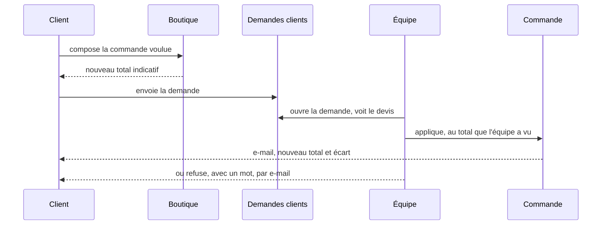
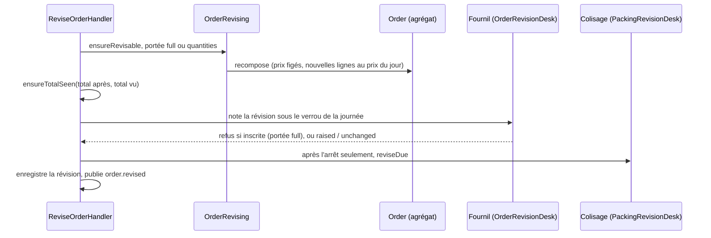

# Modifier une commande

> **Doc d'état, 2026-11-10.** Remplace, pour ce qui est bâti,
> `plan-modifier-une-commande.md` (M1, M3, M4), `plan-a2-modifier-une-commande-inscrite.md`
> (A2) et `architecture-commande-immuable-avenants.md`. Chaque phrase de la
> partie 2 a été confrontée au code le 2026-11-10. Ce qui est **en cours** —
> l'argent d'une commande carte — est marqué comme tel et renvoie à son plan.

## Partie 1 — l'explication simple

Une commande passée se corrige : on change les quantités, on ajoute ou on
retire un article, on change la date, le créneau, le point de retrait, ou on
passe du retrait à la livraison. Le client voit **une seule commande,
corrigée**, sous le même numéro. Chaque correction garde l'ancienne version
dans un historique que l'équipe peut relire.

### Qui modifie, et jusqu'à quand

| Qui       | Quand                                                                             | Quoi                                                             |
| --------- | --------------------------------------------------------------------------------- | ---------------------------------------------------------------- |
| Le client | avant l'heure limite de commande (celle de l'ancienne ET de la nouvelle date)     | tout                                                             |
| L'équipe  | tant que la commande n'est pas inscrite au fournil (l'heure limite ne compte pas) | tout                                                             |
| L'équipe  | après l'inscription, jusqu'à la commande prête                                    | **seulement les quantités**, et seulement d'un **pro au compte** |
| Le client | après l'heure limite, avant l'inscription                                         | il **demande** ; l'équipe applique ou refuse                     |

Dans tous les cas, on ne modifie pas une commande annulée, prête, remise,
déjà engagée en comptabilité ou dont le départ incomplet est décidé.

### Les prix

- Un article **déjà dans la commande** garde son prix d'origine, quelle que
  soit sa nouvelle quantité.
- Un article **nouveau** prend le prix du jour.
- Une quantité qui change doit respecter le **minimum d'achat** publié
  aujourd'hui pour l'article ; une ligne qu'on ne touche pas n'est pas relue.
- La remise de retrait, les frais de livraison et la TVA se recalculent sur
  la nouvelle composition, comme à la passation.

### Le total vu (depuis le 2026-11-10)

Une modification envoie **le total qu'elle a montré**. Si le prix a bougé
entre l'affichage et la validation, elle est refusée avec le même
avertissement qu'à la passation, et l'écran redemande le devis. Aucune
commande ne change de montant sans que quelqu'un ait vu ce montant.

### La demande après l'heure limite

Le client compose comme s'il modifiait, et voit un total **indicatif**.
C'est l'équipe qui applique : la modification se fait en son nom, et le
total vu est **le sien** — c'est une délégation, une responsabilité
commerciale. Une seule demande en attente par commande.

### Et la carte ?

| Ce qui existe                                                                                                     | État                                                                                        |
| ----------------------------------------------------------------------------------------------------------------- | ------------------------------------------------------------------------------------------- |
| Payer, puis rembourser tout ou partie : le bloc `card-payment` (lots P0 et P1)                                    | ✅ en production                                                                            |
| Modifier une commande au compte ou à total nul                                                                    | ✅ en production                                                                            |
| Modifier une commande payée par carte — **en production, refusée** : « annulez et recommandez, ou demandez-nous » | ✅ (c'est le refus qui est en production)                                                   |
| **La hausse** : le client paie la différence sur le même écran ([`plan-s2-la-hausse.md`](plan-s2-la-hausse.md))   | 🚧 **non bâti en entier** : socle et geste sur `dev`, le reste en cours, rien en production |
| **La baisse** : la différence remboursée tout de suite ([plan M2](plan-m2-historique-de-transactions.md), lot S1) | 📝 **non bâti**                                                                             |
| Une baisse sous le bon de fidélité imputé (lot C-2b)                                                              | 📝 non bâti ; refusée aujourd'hui, au compte comme par carte                                |

## Partie 2 — la technique

Chemins sous `apps/lfd-api/src/` sauf mention.

### 2.1 Une révision, pas des avenants

Une modification produit une **nouvelle révision** de la commande : même
identifiant, même numéro ; lignes, acheminement et montants remplacés ;
`orders.revision` monte de 1 (`0` à la passation) et `orders.revised_at` est
posé. La composition remplacée est rangée **en entier** dans
`public.order_revision` (modèle `OrderRevisionEntry`,
`prisma/schema/public/orders.prisma`) : colonnes qui changent et lignes
complètes, changements (`lines`, `date`, `method`…), totaux avant / après,
auteur client ou fiche staff (tenu par un CHECK), unique par
`(order_id, replaced_revision)`.

**Pourquoi pas les avenants** (le modèle d'août,
`architecture-commande-immuable-avenants.md`) : tout ce qui lit une commande
— fournil, bon, BL, facture, prélèvement, « Mes commandes », dossier de
facturation — lit **une** commande. Des avenants auraient obligé chacun à
additionner « commande + avenants », dix lecteurs et dix façons de se
tromper. La raison d'être des avenants était l'historique et l'argent :
l'historique est la table ci-dessus ; **l'argent**, lui, est bien fait de
mouvements immuables, mais côté carte, dans le bloc `card-payment`
(paiements et remboursements par montant, forme C du plan M2) — pas dans la
commande. La commande dit ce qui est dû ; le carnet de la carte dit ce qui
a été encaissé et rendu.

### 2.2 Le chemin d'une modification

- Geste : `ReviseOrderCommand` / `ReviseOrderHandler`
  (`b2b/orders/application/commands/`) ; devis : `QuoteOrderRevisionQuery`.
  Routes `POST /orders/:id/revisions` (+ `/quote`) côté client, sous le mur
  de `GET /orders/:id` (`RevisionWall`), et `POST /admin/orders/:id/revisions`
  (+ `/quote`) côté équipe, droit `b2b_place_order:write`.
- Recomposition : `application/services/order-revising.service.ts`, sur le
  calcul partagé avec la passation (`order-composition.service.ts`,
  `order-cutoff-gate.service.ts`).
- Règles pures : `domain/entities/order-revision.ts`,
  `domain/services/revised-lines.ts`, `domain/services/order-revisability.ts`.
- Lecture « se modifie-t-elle ? » : `revisability` et `revision` sur les vues
  client et équipe (`GetOrderRevisabilityQuery`), par la même règle que le
  refus du geste.
- Historique : `GET /admin/orders/:id/revisions` (`ListOrderRevisionsQuery`,
  port de lecture `OrderRevisionHistoryReader`), carte « Versions
  précédentes » du back-office.

### 2.3 Les règles, telles que le code les tient

- **R1 — Qui et jusqu'à quand.** La frontière commune est celle de
  l'annulation (`standingBlockOf` → `cancellationOf`) : annulée, prête,
  inscrite, engagée en comptabilité, remboursement en vol → refus. Puis le
  règlement, puis les CGV figées (une commande sans CGV figées ne se modifie
  pas). Pour le client seulement : le plan de la journée arrêté
  (`plan_closed`) et l'heure limite (`past_cutoff`, la même
  `decideStrictestOrderCutoff` qu'à la passation, sans dérogation), de
  l'ancienne ET de la nouvelle date. Un départ incomplet décidé refuse
  (`ShortfallDecidedRevisionError`).
- **R2 — Ce qui se modifie.** Lignes, date, créneau, mode, point, adresse,
  note. Payeur, société, clientèle, CGV et langue sont relus, jamais changés.
  Une commande prise à la vitrine (`supply = shelf`) ne change ni de mode, ni
  de journée, ni de point (`shelf_closed`).
- **R3 — Les prix.** Une ligne dont le SKU était dans la révision précédente
  garde son prix et son taux (`FrozenLinePriceChangedError` si un appelant
  tente de le changer) ; une nouvelle est tarifée au jour. Une ligne gardée
  dont la quantité change se tient au minimum d'achat publié aujourd'hui
  (`ensureKeptMinimums`, `QuantityBelowMinimumError`) ; une ligne inchangée
  n'est pas relue.
- **R4 — Le reste se recalcule** : remise de retrait, frais (barème et seuil
  de franco **figés à la passation**, repris par la révision), TVA du port
  selon le mode figé. La surtaxe tardive figée est réappliquée au nouveau
  sous-total, ni créée ni retirée. Le bon imputé reste imputé ; une révision
  qui passerait sous sa part est refusée (`RevisionBelowVoucherError`).
- **R5 — La journée.** Une nouvelle date doit tomber dans une journée
  ouverte (`ensureDayOpen`) ; un déplacement vers une journée au plan arrêté
  est refusé, équipe comprise (`RevisionIntoClosedDayError`).
- **R6 — Rien de changé, rien d'écrit** (`UnchangedOrderRevisionError`).
- **R7 — Concurrence.** La modification porte la révision qu'elle corrige ;
  si elle a bougé : 409 `OrderRevisedElsewhereError` (« rechargez »).
- **Refus de règlement.** Une commande gratuite qui deviendrait payante
  (`RevisionRequiresPaymentError`) ; une commande au compte qui tomberait à
  zéro (`RevisionFreesAccountOrderError` : son encaissement ne se ferme que
  par l'annulation) ; une carte (`CardOrderNotRevisableError`, §2.7).
- **R14 — Le total vu.** `ReviseOrderCommand.expectedTotalCents`, obligatoire,
  comparé par `ensureTotalSeen` (`domain/services/seen-total.ts`, le même
  qu'à la passation) au total après révision, avant toute écriture :
  `OrderTotalChangedError`, code `orders.total_changed`. La boutique et le
  back-office l'attrapent et redemandent le devis.

### 2.4 Après l'inscription : les quantités seulement (A2)

Le §7 du plan A2 l'a emporté sur ses §§1 à 5, et c'est lui que le code tient.

- **Portée.** `ensureRevisable` rend `full` ou `quantities` ;
  `quantitiesAfterArrestAllowed` (`domain/services/revision-after-arrest.ts`)
  n'ouvre `quantities` qu'à **l'équipe** et au règlement **au compte**. La
  révision ne doit changer que `lines`, mêmes articles, chacun **≥ 1**
  (`isQuantitiesOnly`, sinon `QuantitiesOnlyAfterArrestError`). Tout à zéro,
  c'est le retrait d'une commande inscrite (A1), pas une révision.
- **Deux grandeurs au fournil.** Les lignes de la commande au fournil disent
  le **dû**, dans les deux sens (`ProductionDay.reviseOrder`). Le **compte du
  four par article** ne baisse jamais après l'arrêt : `floorCounts`
  (`production/domain/services/production-count.ts`) prend le plus grand du
  compte précédent et du compte refait, après matérialisation des coches.
  Une baisse laisse le surplus partir en réserve au colisage, comme A1. Fait
  `production.order_quantities_raised` sur une hausse seulement.
- **Une journée.** Le guichet refuse une commande inscrite un autre jour que
  celui révisé (`production.revision.inscribed_another_day`, 409, ajout du
  2026-11-03).
- **Le colisage.** `PackingRevisionDesk` (`packing/channels/commerce/`) →
  `PackingSheet.reviseDue` : feuille absente → refus temporaire
  (`PackingSheetNotYetDrawnError`, « réessayez ») ; bac de livraison vivant →
  refus (`delivery_bin`) ; feuille colisée ou décidée → refus ; **baisse sous
  ce qui est déjà au bac → refusée** (`RevisedDueBelowPackedError`, « retirez
  d'abord du bac ») ; une hausse efface la marque « au bac » si la ligne n'est
  plus complète. Fait `packing_sheet.revised`.
- **Verrous** : ligne `orders` → journée du fournil → feuille → BL.

### 2.5 La demande après l'heure limite (M4)

- Type `order_change` de `CustomerRequest` (`b2b/contact/`), colonnes
  `change_base_revision`, `change_content`, `change_applied_revision`,
  `change_refusal`, et un index unique partiel : une demande en attente par
  commande. Seul `past_cutoff` admet la demande ; une commande carte ne
  dépose pas de demande (`card_settled` sur le chemin `request`).
- `POST /me/orders/:id/change-request` (débit limité) ; le total indicatif du
  client vient de `POST /orders/:id/revisions/change-request-quote`
  (`QuoteOrderChangeRequestQuery`, recomposé aux règles de l'équipe, rien
  d'écrit, aucun montant rangé dans la demande).
- Répondre : `/admin/customer-requests/:id/order-change/{quote,apply,refuse}`.
  « Appliquer » est `ApplyOrderChangeCommand` → `BusOrderChangeApplier`
  (`b2b/contact/infrastructure/bus-order-change.applier.ts`) →
  `ReviseOrderCommand` au nom de l'équipe, dans une seule transaction avec la
  réponse. Le total vu transmis est **celui du devis de l'équipe**
  (`expectedTotalCents` du corps de `apply`), jamais recalculé par
  l'applicateur. Tout refus du geste remonte avec sa phrase ; la demande
  reste en attente.
- Courriels `customer.order-change-applied` (nouveau total et écart, tirés de
  l'entrée de révision) et `customer.order-change-refused`.

### 2.6 L'argent au compte

La facture lit les lignes de la commande au mois de sa livraison, donc la
dernière révision. L'encaissement au compte est recalculé dans la même
transaction : port `AccountOrderRevaluation` →
`b2b/accounting/application/services/account-order-revaluing.ts` →
`OrderCollection.revalue()`, seulement si l'encaissement n'est pas engagé
(sinon la frontière commune refuse). Le prélèvement suit la facture.

### 2.7 L'argent par carte

En production, une commande dont le règlement est carte attendu ou encaissé
(`isCardSettlement`) est refusée (`CardOrderNotRevisableError`). Le bloc
`card-payment` sait déjà rembourser **un montant**
(`CardRefunds.requestAmount`, `card-payment/channels/requests/card-refunds.ts`,
lot P1) ; la modification ne s'en sert pas encore.

Ce qui est en cours, et **ne fait pas foi ici** :

- **La hausse** — [`plan-s2-la-hausse.md`](plan-s2-la-hausse.md) : un projet
  qui attend le complément, payé sur le même écran, appliqué au paiement ;
  le client seul. Sur `dev`, le socle (S2.a) et le geste (S2.b) sont commités
  (`cardIncreaseOnly` dans `order-revisability.ts`,
  `ProposeCardIncreaseCommand`) ; l'application, le rendu et les écrans
  (S2.c à S2.e) restent à bâtir.
- **La baisse** — [plan M2](plan-m2-historique-de-transactions.md), lot S1 :
  remboursée tout de suite, par montant.
- **Le bon de fidélité sous la différence** — lot C-2b, plus tard.

Le §3 « L'argent » de `plan-modifier-une-commande.md` ne décrit ni l'un ni
l'autre : il est **contredit** par les décisions de Hugo du 2026-11-09.

### 2.8 Les autres blocs

- **Fournil** : avant l'inscription, la clôture et le retirage lisent les
  commandes **sous le verrou de la journée** ; la révision passe par
  `OrderRevisionDesk` (`production/channels/commerce/order-revision.desk.ts`)
  sous ce même verrou (des deux journées si la date change), qui refuse une
  commande inscrite en portée `full`.
- **Livraison** : fait durable `commerce.order_revised`
  (`delivery/channels/commerce/commerce-order-revised.fact.ts`) ;
  `ReconcileOnOrderRevised` détache et rattache le transfert,
  `LocateOnOrderRevised` regéocode, quand mode, date, point ou adresse
  changent.
- **Colisage** : rien avant l'inscription ; après, §2.4.
- **Bon de commande** : la clé d'archive `r<n>` suit `orders.revision`
  (`domain/services/order-sheet.ts`) ; le bon révisé se produit à la demande.
- **BL** : le BL prévu suit la révision (`DeliveryNoteFollowing.followRevision`,
  `b2b/delivery-notes/application/services/delivery-note-follower.ts`).
- **Journal** : `order.revised` (auteur, révision, changements, totaux),
  `order.change_requested` / `order.change_applied` / `order.change_refused`,
  `production.order_quantities_raised`, `packing_sheet.revised`, avec leurs
  libellés au back-office.
