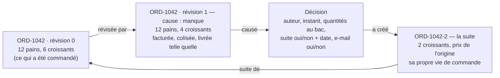
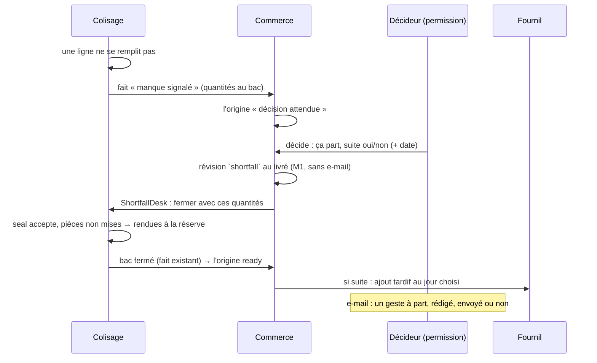

# Plan — faire partir une commande incomplète

> ⛔ **Remplacé le 2026-10-24** par [`../plan-commande-bon-de-livraison-facture.md`](../plan-commande-bon-de-livraison-facture.md) :
> Hugo a choisi le modèle commande / bon de livraison / facture. Ce plan (v3)
> reste pour l'historique des trois contradictions ; ses lots I1–I6 ne se
> bâtissent pas.

> **Doc-first, 2026-10-24, v3.** Suite de
> [`commandes-incompletes.md`](commandes-incompletes.md) (le schéma, les gestes
> manquants, les décisions de Hugo). Touche **l'argent** et porte des
> **migrations** : `vitruve` avant Hugo. **Rien n'est bâti.**
>
> **Pourquoi une v3.** La v1 inventait un « envoi » pour toute commande ; la v2
> gardait les lignes de l'origine et leur ajoutait une colonne « livré ».
> `vitruve` a trouvé trois bloquants à chacune. Ceux de la v2 : les totaux
> figés de l'origine (total, TVA par taux, remises, port) resteraient au
> commandé et chaque origine sortirait en écart de facture ; 35 fichiers lisent
> le montant des lignes ; le fournil compterait deux fois le reliquat. Hugo a
> tranché le 2026-10-24 : **l'origine est révisée au livré** par la révision
> qui existe (M1), et le commandé reste lisible dans son historique.

## 0. Ce qui existe (ouvert le 2026-10-24)

- **Le colisage refuse deux fois.** `PackingStock.take` lève
  `LineNotProducedYetError` (`packing/domain/entities/packing-stock.ts`) ;
  `PackingSheet.seal` lève `UnallocatedLinesError` tant qu'une ligne n'est pas
  entièrement répartie (`packing/domain/entities/packing-sheet.ts`).
- **Le bac fermé** publie `PackingOrderPackedEvent`, déclaré dans
  `production/channels/packing/`, clé durable `packed:${orderId}`, sans
  quantités ; le commerce passe la commande `ready`.
- **La révision M1** : `ReviseOrderHandler`
  (`b2b/orders/application/commands/revise-order.handler.ts`) remplace la
  composition d'une commande **au compte**, garde le prix d'une ligne déjà
  présente, recalcule les totaux par le même chemin que la passation, écrit
  l'ancienne composition dans `order_revision` (`composition`, `changes`,
  `total_before_cents`, `total_after_cents`, auteur, instant — **aucun motif**)
  et publie `order.revised`. Ses abonnés : le journal d'activité
  (`b2b/growth/application/handlers/on-order-revised.handler.ts`) et deux
  réconciliations de la livraison (`delivery/application/handlers/*-on-order-revised.handler.ts`).
  **Aucun n'envoie d'e-mail** (vérifié le 2026-10-24).
- **La porte du plan du jour** : toute écriture de commande passe par
  `PlanAdmissionDesk.admit` (`production/channels/commerce/plan-admission.desk.ts`,
  appelé par `b2b/orders/application/services/order-plan-gate.service.ts`), qui
  rend `closed` une fois la journée arrêtée. Le colisage reçoit ses commandes
  par `production.packing_list_drawn`, tiré à l'arrêt du plan.
- **Le numéro** `ORD-1042` vient de `formatOrderNumber`
  (`b2b/orders/domain/services/order-number.ts`), pris par
  `PrismaOrderRepository.place` ; son JSDoc tient qu'un numéro court a **un**
  tiret, l'ancien format deux.
- **La facture** relit les lignes et les totaux de la commande au moment où
  elle se calcule (`frozen-invoice-order.mapper.ts`) ; seul `invoice_order` est
  figé par déclencheur.

## 1. Les décisions de Hugo

Une **permission** décide. Rien ne part incomplet **sans décision** : la
commande attend au colisage, la Supervision la montre. Le décideur choisit de
**relivrer la suite** (il en fixe la date, le jour même compris) et d'**écrire
au client**. **Aucun e-mail ne part tout seul** : avertir est un choix du
décideur, jamais un effet de bord. Le reliquat est la **suite** de la commande,
aux **mêmes prix**. Q-I1 à Q-I4 (2026-10-24), toutes « oui » :

- **Q-I1** — la suite peut partir **le jour même**, après l'arrêt du plan ;
- **Q-I2** — une remise en pourcentage suit le livré ; les montants fixes
  (remise fixe, port, surtaxe) restent entiers sur l'origine ; la suite n'a ni
  port ni surtaxe ;
- **Q-I3** — commandes **au compte** d'abord ; la carte après M2 ;
- **Q-I4** — une décision prise est définitive ; la suite s'annule comme une
  commande.

## 2. Le modèle

- **L'origine est révisée au livré** par M1 : une révision de plus, de
  **cause** `shortfall`. Les totaux, la TVA par taux et les remises se
  recalculent par le chemin d'argent existant ; tous les lecteurs (facture,
  relevé, prélèvement, fournil, bon, tournée) lisent une commande cohérente
  sans changer. Le **commandé** reste dans `order_revision.composition`.
- **La cause d'une révision** : colonne `order_revision.cause`, `requested`
  (une modification demandée) ou `shortfall` (un manque au départ). Les
  révisions existantes restent à `NULL` : elles sont toutes demandées, mais une
  valeur posée après coup serait inventée. Une révision `shortfall` porte
  `shortfall_decision_id`.
- **Le lien de suite** : `orders.continues_order_id` (vers la **racine**,
  jamais une autre suite) et `orders.continuation_rank` (2, 3…). Unicité
  `(continues_order_id, continuation_rank)` ; CHECK : nuls ensemble ou
  renseignés ensemble.
- **Le numéro de la suite** `ORD-1042-2` : fabriqué par une fonction voisine
  de `formatOrderNumber`, à partir du numéro de la racine et du rang — pas un
  rang du compteur. Le JSDoc de `formatOrderNumber` (« un tiret = court ») est
  corrigé : un numéro court a un tiret, une suite deux, l'ancien format deux
  aussi mais avec 8 caractères entre eux.
- **La décision** : table `order_shortfall_decision`, une ligne par origine
  (unique), auteur, instant, quantités au bac par SKU, suite oui/non, date,
  `continuation_order_id`, e-mail envoyé ou non et quand. **Définitive**
  (Q-I4) : ni elle ni le numéro de suite ne se défont en production.

## 3. Le flux

- **Signaler** : « il manque » sur la fiche de colisage publie un fait déclaré
  dans `packing/channels/commerce/`, clé `shortfall:${orderId}` (un second
  signalement avant la décision **remplace** les quantités, il ne s'ajoute
  pas). Le commerce s'y abonne par un `@DurableHandler`.
- **Autoriser** : le colisage déclare **et** implémente `ShortfallDesk` dans
  `packing/channels/commerce/` ; le commerce l'appelle dans la transaction de
  la décision (sens `b2b → packing`, forme de `BinDesk`). Comme la révision a
  ramené la ligne due au livré, la fiche de colisage reçoit la nouvelle
  quantité due et `seal` passe **sans exception à sa règle** : il n'y a plus de
  « fermeture incomplète », seulement une ligne due plus petite.
- **Les pièces non mises** : elles restent dans la réserve du jour
  (`PackingStock`), libres pour la suite si elle part le jour même.
- **La suite** est créée par une méthode nommée de l'agrégat
  (`Order.continueFrom(origine, lignes, jour)`) : statut et règlement de
  l'origine (au compte), payeur et société de l'origine, prix recopiés, sans
  port ni surtaxe (Q-I2). Elle se révise et s'annule comme toute commande.

## 4. L'ajout tardif au jour déjà arrêté (Q-I1)

C'est le seul chemin neuf hors du commerce, et il est **nécessaire au cas
courant**. Aujourd'hui la porte du plan rend `closed` et le colisage ne
reçoit sa liste qu'à l'arrêt. Il faut :

- au fournil : un geste « ajouter au jour arrêté » que la porte accepte
  **seulement** pour une suite (`continues_order_id` non nul), qui l'inscrit
  au plan du jour et publie un fait d'ajout ;
- au colisage : écouter ce fait et ouvrir la fiche de la suite, avec la
  réserve libre du jour.

Ce lot passe par `vitruve` à part : il touche la clôture du fournil, que
d'autres blocs écoutent (livraison, colisage).

## 5. L'e-mail

Un geste de la fiche commande, réservé à la même permission : « Écrire au
client ». Un gabarit **manque et décision** pré-rempli (ce qui manque, ce qui
part, la suite et sa date), modifiable avant l'envoi, envoyé ou non. L'envoi
est tracé sur la décision. **Aucun abonné** à la révision, à la décision ou à
la suite n'envoie de courrier ; un test le garde.

## 6. Les droits

Ressource `b2b_orders_shortfall` (« Décider d'un départ incomplet »),
écriture. Aucune migration ne l'accorde. **Geste au déploiement** : l'accorder
à l'écran (`/admin/staff-roles`) avant le premier manque — sinon une commande
attendrait une décision que personne ne peut prendre. Le runbook le dit.

## 7. Lots

| Lot | Contenu                                                                                                           | Déployable seul                 |
| --- | ----------------------------------------------------------------------------------------------------------------- | ------------------------------- |
| I1  | `order_revision.cause` (+ lien vers la décision), table de décision, lien et numéro de suite, ressource de droit. | oui, rien ne les écrit          |
| I2  | « Il manque » au colisage, le fait, l'origine « décision attendue », la Supervision et la page Commandes.         | oui (on voit, on ne décide pas) |
| I3  | La décision : écran, révision `shortfall`, `ShortfallDesk`, fermeture du bac. Sans suite.                         | oui                             |
| I4  | L'ajout tardif au jour arrêté (fournil, colisage) — `vitruve` à part.                                             | oui                             |
| I5  | La suite : création, date, ajout au plan, « suite de / suite : » partout.                                         | après I4                        |
| I6  | Le bon « commandé / livré » (révision 0 contre courante), l'e-mail à la main.                                     | oui                             |

## 8. Questions qui restent

- **Q-I5.** La facture de l'origine : mentionne-t-elle la suite
  (« reliquat : ORD-1042-2 ») ?
- **Q-I6.** La suite programmée un **autre** jour : passe-t-elle par la porte
  ordinaire du plan (heure limite du jour visé), ou toujours par l'ajout
  tardif ?
