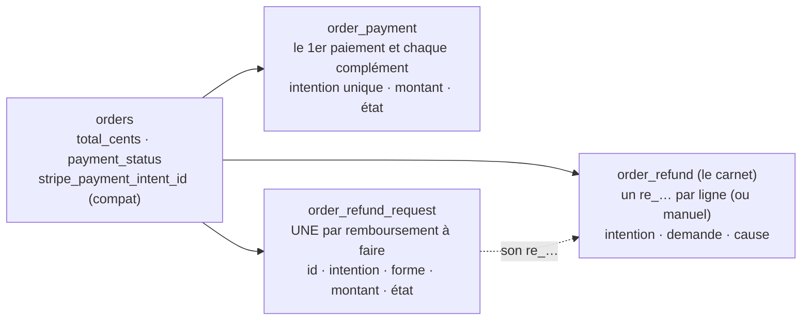
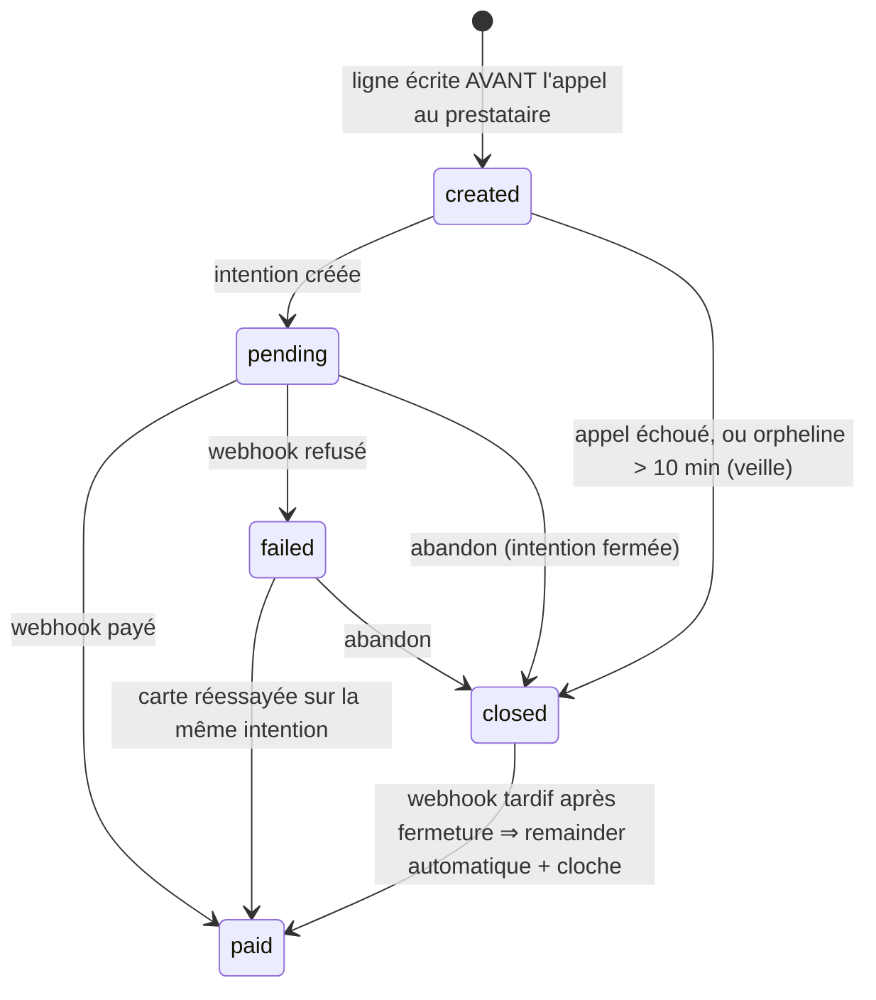
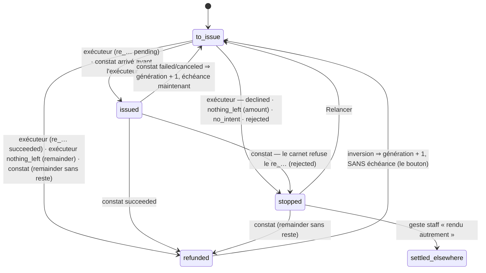
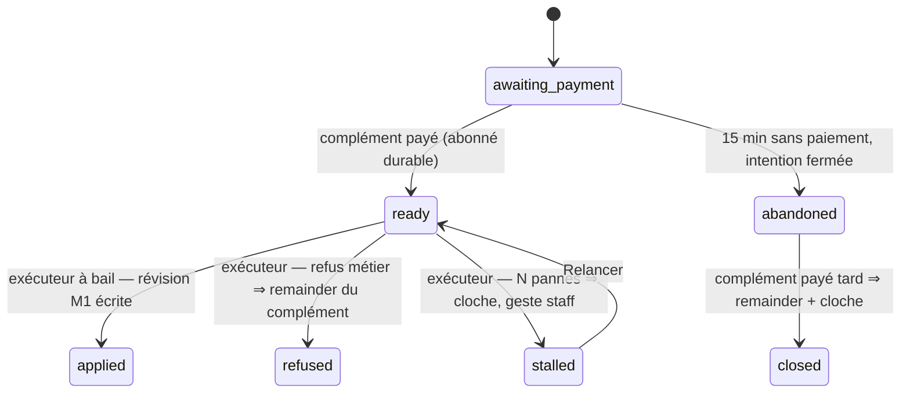

# Plan M2 — modifier une commande payée par carte : l'historique de transactions

> **Doc-first, 2026-11-09.** Le plan **unique** de M2, écrit après la relecture
> complète du paiement et du remboursement
> ([`../reglement/relecture-paiement-et-remboursement.md`](../reglement/relecture-paiement-et-remboursement.md),
> à lire d'abord). Il **remplace** les §9 à §20 de
> [`plan-modifier-une-commande-payee-par-carte.md`](plan-modifier-une-commande-payee-par-carte.md),
> qui gardent l'historique des décisions et des contradictions de `vitruve`.
> **Version 2** : la première (`d2632e136`, puis `dfbb78189`) a été contredite
> le même jour (six bloquants sur S0, consignés au commit `6eef19357`) ; tout
> est intégré ici. Rien n'est bâti. Touche l'argent : `vitruve` avant Hugo.

## 0. Les décisions de Hugo, et ce qu'elles fixent

| Décision (2026-11-09)                                                           | Conséquence                                                                               |
| ------------------------------------------------------------------------------- | ----------------------------------------------------------------------------------------- |
| La **forme C** : une commande, un numéro, plusieurs paiements et remboursements | §2 — jamais de seconde commande, jamais de renumérotation                                 |
| Une **baisse** est remboursée **tout de suite**                                 | §5                                                                                        |
| Une **hausse** se paie **tout de suite**, sur le même écran                     | §6 — 15 min de grâce si le client quitte la page                                          |
| **Pas de modification carte après l'arrêt du plan**                             | §5.1 — jugé comme M1, sous le verrou de la journée                                        |
| Le reste sous le **bon de fidélité** devient un **bon neuf**                    | hors du cœur : lot **C-2b**, §8 ; d'ici là le refus actuel reste                          |
| **D'abord le cœur**, « 10/10, aucun angle mort » sur **notre** état             | §3 le socle d'abord ; §9 les garanties ; §10 les tests                                    |
| **Sans rapprochement automatique** pour le moment : notre donnée fait foi       | §3.9 un geste à la main, §3.10 une veille sur nos données, §3.11 le rapprochement reporté |
| **Pas de passage en mode test Stripe** : « au culot »                           | §10 — la première baisse réelle, par l'équipe, vérifiée au clic                           |
| **Pouvoir changer de prestataire** facilement                                   | §4 — rien ici n'ajoute d'adhérence hors des adaptateurs                                   |

## 1. Ce qui existe

Dans la relecture. En une ligne : **un paiement par commande**
(`orders.stripe_payment_intent_id`, `@unique`), **une demande de
remboursement par commande** (clé `order_id`), **un état déduit** à chaque
lecture (`refundRequestStateOf`), **un remboursement sans montant**, **un
plafond sur `total_cents`** (lu par **quatre** adaptateurs :
`prisma-order-refund.repository.ts`, `prisma-order-refund-request.reader.ts`,
`cancellation-subject.row.ts`, `revisable-order.row.ts`), et **aucun regard
périodique** vers le prestataire.

## 2. Le modèle cible

**Encaissé** d'une commande = `Σ order_payment paid` (le premier paiement est
une ligne `role = first`, le reste des `complement`).
**Remboursé** = `Σ order_refund succeeded`, dont **remboursé de révision** =
ceux de cause `revision`. **L'égalité G3** : encaissé − remboursé de révision
= `total_cents` sur une commande vivante soldée ; encaissé − remboursé (toute
cause) = 0 sur une annulée soldée. Les autres causes (annulation, geste
commercial, paiement après annulation) ne touchent pas la première égalité :
elles gardent facture + avoir.

## 3. Lot S0 — le socle (aucune règle de modification)

S0 ne rend aucune commande carte modifiable. Il rend l'état **écrit**, borné
par la base, prêt pour plusieurs transactions. Il se déploie **seul**.

⚠️ **S0 change des choses visibles** : le bandeau de remboursement du
back-office (plusieurs demandes par commande, plus d'état `failed`, « Relancer »
par demande), le contrat `AdminOrderRefund` (liste), la route
`POST admin/orders/:id/refund/retry` → `admin/refund-requests/:id/retry`. Les
cinq géographies de ce cassage (contrat, lecteur, bandeau, route, e2e) sont
dans le lot ; pré-release (`CLAUDE.md` §0), Hugo averti ici.

### 3.0 Le module `settlement` — l'argent d'une commande, à un seul endroit

> Hugo, 2026-11-09 : « est-ce qu'au niveau isolation du code on aura un
> refund module propre avec une API ? » → oui, dans S0.

Aujourd'hui le remboursement vit **dans `b2b/orders`** (agrégats, demandes,
exécuteur, routes, 18 lecteurs), mêlé à l'annulation ; `b2b/payments` ne
porte que les ports vers le prestataire, les liens et les mandats. S0 **crée
le sous-contexte `b2b/payments/settlement`**, qui **possède** `order_payment`,
`order_refund`, `order_refund_request` (et, en S2, `order_revision_proposal`
reste aux commandes : c'est une révision, pas de l'argent). Même bloc `b2b` :
la matrice du `CLAUDE.md` ne change pas ; c'est `lint:prisma-model-ownership`
qui tient la frontière — ces modèles ne se lisent que depuis `settlement`.

**L'API interne** (port `OrderSettlementDesk`, déclaré et implémenté par
`settlement`, consommé par `orders` et `accounting`) :

| Geste / lecture                                                                      | Appelé par                                              | Dans la transaction de l'appelant ?           |
| ------------------------------------------------------------------------------------ | ------------------------------------------------------- | --------------------------------------------- |
| `openFirstPayment(orderId, intent, amount)`                                          | la passation                                            | oui (ligne `created → pending`)               |
| `recordPaid(intent, amountReceived)` / `recordFailed`                                | le webhook                                              | oui                                           |
| `openComplement(orderId, amount, revision)` → intention                              | la hausse (S2)                                          | ligne dans la transaction, Stripe hors        |
| `requestRemainder(orderId, intent, cause)`                                           | l'annulation, l'inversion, l'abandon tardif             | oui, sous le verrou `orders` déjà pris        |
| `requestAmount(orderId, intent, amount, cause)`                                      | la baisse (S1), le refus de hausse                      | oui                                           |
| `position(orderId)` → encaissé, remboursé par cause, en vol par forme, par intention | annulation, révision, facture carte                     | lecture, sous le verrou de l'appelant ou sans |
| `settleElsewhere(requestId, staff, motif)`, `retry(requestId)`, `verify(orderId)`    | les routes staff (déménagées sous `admin/settlement/…`) | —                                             |

**Les faits** que `settlement` publie (durables) : `order.paid`,
`order.payment_failed` (inchangés, déplacés), `order.complement_paid`,
`order.refund_succeeded | _failed | _reversed`, `order.fully_refunded`.
`orders` garde `payment_status` et `stripe_payment_intent_id` sur sa ligne
(les 24 lecteurs ; `payment_status` est **la vue de la commande** sur son
règlement, écrite par `orders` sur les faits de `settlement`, comme aujourd'hui
`markPaid`) — l'encaissé, lui, n'est plus une colonne d'`orders` : c'est la
ligne `order_payment role = first`, **reprise** pour toute commande qui a une
intention (montant = `total_cents` si payée/remboursée/portant un carnet ou
une demande `paid_after_cancellation`, sinon `pending`/`failed` selon
`payment_status`).

**L'ordre des verrous** ne change pas : ligne `orders` (prise par l'appelant)
→ tables de `settlement` → bon. Le port est appelé **dans** l'unité de travail
de l'appelant, comme le fournil appelle le commerce.

**Ce qui déménage** : les trois agrégats et leurs erreurs, l'exécuteur, le
bail, l'enregistreur, le constat, l'inversion, « Relancer », le balayage, la
cloche de remboursement, les faits, les routes staff, la vue admin — et les
18 lecteurs d'`orders` deviennent des appels au port. `cancellation-subject`
et `revisable-order` ne lisent plus le carnet : ils demandent `position()`.
La facture carte et le rapprochement des avoirs lisent `position()` et un
port de lecture des remboursements (`RefundsToCredit` reste à `accounting`
pour l'écriture de `credit_note_id` / `credited_reason` : la seule écriture
d'`accounting` dans une table de `settlement`, déclarée au gate comme
aujourd'hui).

### 3.1 Les paiements

- **`order_payment`** : `id`, `order_id`, `payment_intent_id` (`@unique`,
  nul tant que `created`), `role` (`complement`), `amount_cents` (> 0),
  `state`, `revision` (la révision payée, nullable), `created_at`, `paid_at`.

Déclencheur de transitions (comme §3.4), `(x, x)` admis.

- **L'encaissé s'écrit au webhook, pas à `markPaid`** (bloquant 1 :
  `markPaid` exclut une commande `cancelled`, qui garderait un encaissé nul
  et ne serait jamais remboursée). L'événement réduit `succeeded` porte
  désormais `amountCents` (`payment_intent.amount_received`) et, s'il y en a
  une, la métadonnée `paymentLinkId`. `settlement.recordPaid` passe la ligne
  `order_payment` de l'intention (`first` ou `complement`) à `paid` avec
  `amount_cents := amountCents`, **sans condition sur le statut de la
  commande** ; puis `orders` fait `markPaid` comme aujourd'hui (qui, lui,
  refuse une annulée). **Reprise** de la ligne `first` : §3.0.
- **Intention inconnue** des deux tables **et sans `paymentLinkId`** ⇒
  journal `payment.unmatched` + cloche (bloquant 2 : les liens de société
  passent par `payment_intent.succeeded` aussi). Avec `paymentLinkId` : rien,
  c'est `SettlePaymentLink` qui traite la session.
- Un complément franchi publie `order.complement_paid` (durable).

### 3.2 La demande a son identité

- `order_refund_request` : `id` (ULID) clé ; `order_id` ; `payment_intent_id`
  (**nullable** : la cause `no_payment_intent` existe) ; `form` (`remainder |
amount`) ; `amount_cents` (CHECK `(form = 'amount') = (amount_cents IS NOT
NULL)`) ; `state` (§3.4) ; les colonnes d'aujourd'hui.
- **Reprise**, dans l'ordre, chaque demande existante : `id := order_id` (les
  clés d'idempotence déjà chez Stripe gardent leur préfixe) ;
  `payment_intent_id := orders.stripe_payment_intent_id` ; `form :=
'remainder'` ; **`state`** par cette priorité **écrite** (bloquant 3) :
  1. le carnet dit l'intention sans reste, ou le `re_…` de la demande est
     `succeeded` ⇒ `refunded` ;
  2. le `re_…` est `failed | canceled` (état lu `failed`) ⇒ `to_issue`,
     `generation + 1`, `stripe_refund_id` et `issued_at` nuls (CHECK
     `issued_pair`), `next_attempt_at := maintenant` ;
  3. un `re_…` vivant ⇒ `issued` ;
  4. `next_attempt_at IS NULL AND last_failure IS NOT NULL` ⇒ `stopped` ;
  5. sinon `to_issue`.
     Le test de reprise compare chaque ligne à **cette règle**, pas à l'ancien
     état lu (une `stopped` se lisait `to_issue`).
- **Index unique partiel** `(order_id, payment_intent_id) WHERE form =
'remainder'` ; violation traduite en refus nommé.
- Lecteurs à faire suivre (recompte de `vitruve`, à refaire au bâti) : **18
  fichiers** de `src/` lisent le port de la demande, 3 specs, **6 e2e** (dont
  `order-staff-cancel-refund.e2e-spec.ts` et sa scène ;
  `order-staff-cancel-refund-races.e2e-spec.ts` réécrit la ligne en direct),
  2 fichiers de `dev/` ; la relation `Order.refundRequest` n'a qu'un lecteur.
- Le bail, la clé d'idempotence (`lfd-order-refund:<id>:<gen>:<round>`) et la
  métadonnée Stripe prennent l'id de la demande ; `lfd_order_id` porte **la
  commande** ; `RefundRequestParams` gagne `orderId`, `amountCents | null`.
- **Immuable après l'insertion** : `order_id`, `payment_intent_id`, `form`,
  `amount_cents`, `cause` — le déclencheur `BEFORE UPDATE` refuse leur
  changement (§20 « E1 ne garde que l'état » : levé).

### 3.3 Le remboursement par montant

- `PaymentRefunder.refund(params)` : sans montant (`remainder`), avec
  (`amount` ; `refunds.create({ amount })`). `findRefund` reconnaît par id de
  demande **et** génération, **et** montant pour une `amount`.

| Issue Stripe                                 | `remainder`                                              | `amount`                                                      |
| -------------------------------------------- | -------------------------------------------------------- | ------------------------------------------------------------- |
| `issued`, statut `pending`                   | `to_issue → issued`                                      | idem ; montant ≠ demandé ⇒ `stopped`, cloche                  |
| `issued`, statut `succeeded` dès la création | `to_issue → refunded` (bloquant 4)                       | idem                                                          |
| `charge_already_refunded`                    | relecture ; intention sans reste ⇒ `to_issue → refunded` | écart ⇒ `stopped` (`nothing_left`), cloche                    |
| montant > reste                              | n/a                                                      | `stopped` (`declined:<code>`, code à relever au bâti), cloche |
| `unavailable`                                | round + 1, échéance sur la courbe                        | idem                                                          |

- **La prise du bail** d'une `remainder` exige qu'aucune `amount` de la même
  intention ne soit `to_issue | issued` : en **SQL brut** (Prisma n'écrit pas
  une corrélation sur la même table), **et** revérifié dans `prepare()` sous le
  verrou `orders`. Une `amount` `stopped` ne bloque pas : la `remainder` la
  couvre.
- `dueForSweep` ne reprend que `state = to_issue` (plus « sans `re_…` »).

### 3.4 L'état écrit, et ses transitions

- Enum Postgres `OrderRefundRequestState` ; déclencheur `BEFORE UPDATE` :
  paire hors liste refusée, `(x, x)` admis, colonnes immuables (§3.2)
  refusées ; `BEFORE DELETE` refusé sauf `current_setting('lfd.purge', true) =
'on'`.
- **Un `re_…` mort n'est pas un arrêt** : `issued → to_issue` pose
  `next_attempt_at := maintenant` (le balayage le reprend), sauf sur
  inversion (`refund_reversed`, qui attend le bouton — règle d'aujourd'hui).
- **Qui écrit** : l'exécuteur (`RefundIssuanceRecorder`) écrit **sous bail**
  par `save` ; **le constat** (`RecordOrderRefundHandler`) écrit par un
  chemin propre, **sans bail** : `transition(id, from, to, patch)` =
  `updateMany WHERE id AND state = from` (bloquant 4 et sérieux « conflit ⇒
  500 » : le constat ne touche ni `claim_token` ni `generation`). Le constat
  **charge la demande** par le `re_…` (`stripe_refund_id @unique`) ou, s'il
  n'est pas encore posé, par la métadonnée (`RefundWebhookEvent` porte
  `requestId` **et** `generation`) ; une génération différente est ignorée.
  Sur `to_issue → issued | refunded`, le constat pose `stripe_refund_id` et
  `issued_at` ; l'enregistreur, arrivant après, voit `issued()` rendre
  `false` (même `re_…`) et n'écrit rien de plus.
- **`settled_elsewhere`** entre au carnet : ligne `order_refund` `source =
manual`, `stripe_refund_id` nul (CHECK `source = 'provider' ⇔
stripe_refund_id IS NOT NULL`), **montant = celui de la demande** (`amount`)
  ou le reste de l'intention (`remainder`) — jamais le reste pour une
  `amount` (bloquant S1 : 90 € écrits pour une baisse de 10 € feraient
  passer la commande `refunded`).
- `refundRequestStateOf` disparaît. Test exhaustif des paires (état,
  transition) : agrégat et déclencheur comparés.

### 3.5 Le carnet

- `order_refund` : `payment_intent_id` (non nul), `request_id` (nullable),
  `cause` (nullable), `source`. Reprise : intention := celle de la commande ;
  `request_id := order_id` quand la demande porte ce `re_…` ; `source :=
'provider'`.
- `loadByPaymentIntent` cherche `orders` **puis `order_payment`** ; le
  verrou reste celui de la ligne `orders` de la commande retrouvée.
- `chargedCents` = encaissé (§2) dans les **quatre** lecteurs ; **plafond par
  intention** (`Σ succeeded de l'intention ≤ son encaissé`) et par commande ;
  `settle()` : `paid → refunded` quand `Σ succeeded (toute cause) =
encaissé`.
- **`refund_in_flight`** (annulation, et `order-revisability` qui le
  réutilise) ne compte que les `re_…` en vol **dont la demande est une
  `remainder`** (jointure `request_id → form`) : une baisse en vol ne bloque
  ni l'annulation ni une seconde baisse.

### 3.6 L'inversion et le remboursement à la main

- `ReopenRefundOnReversal` retrouve **sa demande par le `re_…`**, annulée ou
  vivante : `refunded → to_issue`, génération + 1, sans échéance, cloche.
  Sans demande retrouvée : sur une **annulée**, **rouvrir la `remainder`
  existante** de l'intention si elle existe (l'index unique l'impose), sinon
  en créer une (`refund_reversed`, sans échéance) ; sur une **vivante**,
  cloche seulement.
- Un `re_…` **sans demande** : constaté (`request_id` et `cause` nuls),
  cloche « hors plateforme » ; une `remainder` `to_issue | stopped` de
  l'intention sans reste passe `refunded` (§3.4).

### 3.7 La comptabilité

- `CardInvoiceCandidate` porte `refundedCents` (hors `revision`) et
  `revisionRefundedCents`, `revisionRefundPending` (une demande `revision`
  `to_issue | issued`), `revisionRefundStopped`. `cardInvoiceVerdict` :
  `awaiting_refund` si pending, **`blocked`** si stopped ou si `encaissé −
revisionRefunded ≠ total_cents`, décidés avant `awaiting_handover` ;
  `fully_refunded` lit `refundedCents` hors `revision` (bloquant 5 : un geste
  commercial au tableau de bord garde facture + avoir, comme aujourd'hui).
- **Réveil** d'`awaiting_refund` : un abonné durable `issue-card-invoice-on-refund-settled`
  sur `order.refund_succeeded` (la facture carte en a déjà deux :
  `-on-paid`, `-on-fulfilled`).
- `RefundReconciler` : un `succeeded` de cause `revision` ne produit pas
  d'avoir ; il est marqué `credited_reason = 'revision'` (colonne de
  `order_refund` écrite par la comptabilité, comme `credit_note_id`
  aujourd'hui — `prisma-refunds-to-credit.ts` est la seule écriture, elle
  s'étend).
- Avant S1, aucune demande `revision` n'existe : ces règles sont inertes.

### 3.8 Les abonnés de `order.paid`

Cinq (facture carte, points, accusé, avis à l'invité, avis au principal).
Aucun ne lit `order.complement_paid` ; §6 dit lesquels le liront.

### 3.9 « Vérifier chez le prestataire » — à la main

Une **commande** (elle journalise `payment.verified`), ressource de
« Relancer » : `retrieveIntent` (le port rend désormais `amountReceivedCents`)
sur le premier paiement et chaque complément, `PaymentRefunder.listRefunds`
(l'appel de `findRefund`) sur chacun ; compare à `orders`, `order_payment`,
`order_refund` ; **affiche** l'écart (paiement ou remboursement inconnu chez
nous, montant ou statut différent) ; **n'écrit rien d'autre**. La seule
lecture vers Stripe hors de l'exécuteur.

### 3.10 La veille sur nos données (sans aucun appel au prestataire)

Un cron horaire, `WatchPaymentStateCommand`, sonne la cloche et journalise
(`payment.watch`) pour : une demande `issued` depuis plus de **7 jours** ; une
`stopped` depuis plus de **24 h** sans geste ; une `to_issue` dont
l'échéance est dépassée de plus d'**une heure** (le balayage ne la prend pas) ;
une commande `placed` + `pending` dont le jour est **passé** (épargnée à la
clôture, `logger.warn` seul aujourd'hui) ; une `order_payment` `created` de
plus de 10 min (⇒ `closed`) ou `pending` de plus de 15 min ; un projet (§6)
`awaiting_payment` de plus de 15 min ou `ready` de plus d'une heure. C'est ce
qui rattrape un webhook perdu **sans** rapprochement : non pas son contenu,
mais le fait qu'une chose attend trop.

### 3.11 Le rapprochement automatique — reporté

Le balayage quotidien qui relit le prestataire sur 30 jours (§3.9 en boucle)
attend le signal du §13.4. Son port acceptera **deux sources** (API, ou relevé
quotidien d'une banque sans API de lecture). Les lignes `source = manual` y
seront attendues, pas comptées en écart.

### 3.12 Les crons

`sweep-order-refunds` (existant), `watch-payment-state` (§3.10),
`abandon-revision-proposals` (§6.3) : chacun son entrée dans
`apps/lfd-api/container/worker.ts`.

### 3.13 Ce que S0 ne fait pas

Aucune commande carte modifiable ; aucune colonne `stripe_*` renommée ; les
statuts de remboursement restent ceux de Stripe (§13.1) ; la fidélité
intacte ; les semis de dev adaptés mais pas réécrits.

## 4. La frontière prestataire

Le module `settlement` (§3.0) est **le seul** à parler au prestataire, par
ses ports : changer de banque = ses adaptateurs, son contrôleur de webhook,
et la page de règlement de la boutique.

S0 n'ajoute hors de `payments/infrastructure/` que : `amountCents` et
`listRefunds` sur `PaymentRefunder`, `amountReceivedCents` sur
`RetrievedIntent`, `amountCents` / `paymentLinkId` sur l'événement payé,
`requestId` / `generation` sur l'événement de remboursement — des données que
toute banque rend. Ce qui fuit déjà (relecture § D) reste et est daté : page
de règlement de la boutique, enum `OrderRefundStatus`, colonnes `stripe_*`,
~40 JSDoc et 2 textes. Un changement de prestataire = cinq adaptateurs + le
contrôleur de webhook + la page de règlement.

## 5. Lot S1 — la baisse

### 5.1 Quand

Comme M1 ; **avant l'inscription** (`OrderInscriptionReader`, verrou de la
journée) ; pas sur stock ; **jamais à 0 €** (« pour tout retirer, annulez ») ;
pas sur une carte `pending | failed` (« réglez d'abord, ou annulez ») ; pas
sous la part du bon (refus actuel, jusqu'à C-2b).

### 5.2 Le geste

Dans `ReviseOrderHandler.record()`, après `save`, sous le verrou `orders` :
pour `ancien total − nouveau`, des demandes `amount` de cause `revision`,
**du dernier paiement encaissé au premier**, une par intention, **en sautant
toute intention qui porte une `remainder` non terminale** (son remboursable
vaut 0 — §20 bloquant 4, levé) ; puis `OrderRefundDispatch.afterCommitFor`
par demande. Réponse et courriel : « X € vous seront remboursés ».

### 5.3 L'annulation

Une `remainder` **par intention encaissée**, en sautant celles qui en ont
déjà une ; remboursable annoncé = encaissé − réussi − annoncé des `amount`
`to_issue | issued` de l'intention. `refund_in_flight` : §3.5.

## 6. Lot S2 — la hausse

### 6.1 Le projet

`order_revision_proposal` : `id`, `order_id`, `base_revision`, contenu saisi
**et** révision composée, total visé, `complement_cents`, auteur,
`order_payment_id`, `state`, et les colonnes de reprise de l'exécuteur
(`attempts`, `next_attempt_at`, `claimed_until`, `claim_token`).

Un seul projet `awaiting_payment | ready | stalled` par commande (index
unique partiel). Le geste : composer (M1), écrire projet + `order_payment`
`created` (transaction courte), `createIntent` hors transaction, écrire
l'intention (`pending`) ; échec ⇒ `cancelIntent` + `closed`. La réponse porte
de quoi régler sur le même écran (requête neuve `GetComplementPayment`).

### 6.2 Le paiement

Webhook ⇒ `order_payment` `paid`, `order.complement_paid` ; l'abonné écrit
`awaiting_payment → ready` **et rien d'autre**, puis `AfterCommit` lance
l'**exécuteur à bail** `ApplyRevisionProposal` (figure de l'exécuteur des
remboursements : bail, essais, échéance sur la courbe de la boîte d'envoi,
**balayage** `sweep-revision-proposals` pour un `ready` perdu au redémarrage).
Dans **sa** transaction : verrou `orders`, verrou de la journée, rejugement
M1, **total recomposé = total payé**, `record()`, `ready → applied`. Refus
(`BusinessError | DomainError`) ⇒ seconde transaction : `ready → refused`,
`remainder` cause `revision` sur l'intention du complément, courriel. Panne
(`TechnicalError`, `ResourceNotFoundError`, erreur Prisma/pg brute) ⇒ essai
suivant ; après `MAX_DELIVERY_ATTEMPTS` ⇒ `stalled`, cloche, visible côté
staff (« à appliquer à la main » / « Relancer »).

Abonnés de `order.complement_paid` : l'abonné du projet seulement. L'accusé,
l'invité, le principal, les points et la facture ne bougent pas (la commande
n'est ni passée ni retirée).

### 6.3 L'abandon

Cron `abandon-revision-proposals` : `awaiting_payment` de plus de 15 min ⇒
`cancelIntent` ; `cancelled | already_cancelled` ⇒ `order_payment closed`,
projet `abandoned` ; `already_paid` ⇒ rien (le webhook arrive) ;
`in_progress | unavailable` ⇒ passage suivant. Paiement **après**
`abandoned` : `closed → paid` sur le complément, `abandoned → closed`,
`remainder` automatique, cloche.

### 6.4 L'équipe

Baisse librement (S1). Pour une hausse, le projet est créé et le client reçoit
l'URL de règlement du complément (`paymentUrlFor`, étendu). Pas de lien
Checkout de société.

## 7. Lot S3 — écrans et courriels

Historique daté des paiements et remboursements (montant, état, cause) côté
client et staff ; la baisse avec le montant rendu ; la hausse réglée sur
place ; côté staff : « Vérifier chez le prestataire », « rendu autrement », un
projet `stalled`. Courriels `customer.order-modified`,
`customer.order-modification-failed`.

## 8. Lot C-2b — le bon de modification (plus tard)

Deux bloquants propres (ancien plan §17) : un bon sans parent doit coûter des
points et valoir des paliers ; le reliquat d'une carte est émis par un
balayage différé qui rendrait la différence deux fois. Plan à part, dans
`loyalty`.

## 9. Les garanties

| Étage               | Ce qui tient                                                                                                                                                                                                                                                                                                                    |
| ------------------- | ------------------------------------------------------------------------------------------------------------------------------------------------------------------------------------------------------------------------------------------------------------------------------------------------------------------------------- |
| **G1 inexprimable** | montants > 0 ; `form = amount ⇔ amount_cents` ; une `remainder` par intention ; un projet non terminal par commande ; intention unique ; `source = provider ⇔ re_…` ; `settled_elsewhere ⇔ motif + staff` ; transitions et colonnes immuables par déclencheur (demandes, compléments, projets) ; `DELETE` sous `lfd.purge` seul |
| **G2 agrégat**      | carnet : `Σ succeeded ≤ encaissé` par intention et par commande ; `amount` ≤ reste de son intention ; projet : total recomposé = total payé                                                                                                                                                                                     |
| **G3 l'égalité**    | commande vivante soldée (demandes `refunded \| settled_elsewhere`, compléments `paid \| closed`, aucun projet non terminal) : encaissé − remboursé **de révision** = `total_cents` ; annulée soldée : encaissé − remboursé = 0. Vérifiée à la facture carte (pro) et par la **veille** (§3.10, tous) sur les commandes soldées  |
| **G4 prestataire**  | « Vérifier » à la main (§3.9) ; la veille sur nos données (§3.10) attrape ce qui attend trop ; le rapprochement automatique attend son signal (§3.11). **Ce que ça laisse passer** : le **contenu** d'un webhook perdu — un `refund.updated` perdu se voit comme un `issued` trop vieux, pas comme un montant                   |

## 10. Les tests

- **S0** : reprise ligne à ligne contre la règle écrite (les cinq cas, dont
  `failed` rouvert, payée après annulation) ; paires (état, transition)
  exhaustives, trois machines ; colonnes immuables refusées ; webhook **avant**
  l'enregistreur (`to_issue → issued`, puis `issued()` rend `false`) ;
  `succeeded` dès la création ; `nothing_left` sur `remainder` et sur `amount` ;
  `re_…` manuel partiel puis total ; inversion sur vivante, sur annulée avec
  et sans demande retrouvée ; intention inconnue **avec** et **sans**
  `paymentLinkId` ; bail puis `amount` écrite avant `prepare` ; `DELETE`
  refusé / admis sous `lfd.purge` (`commerce.purge.ts` et
  `siteless-pickups.seed.ts` enveloppés dans une transaction qui pose le
  réglage) ; `settled_elsewhere` ferme G3 ; la veille sur chacun de ses cas ;
  l'écran et la route par demande.
- **S1** : deux baisses ; baisse puis annulation avant remboursement ; baisse
  sur une commande dont une intention porte une `remainder` ; baisse de 70 %
  facturée sur le livré sans avoir ; refus à 0 €, sur `pending`, sous le bon,
  après inscription ; `refund_in_flight` ne bloque pas une `amount`.
- **S2** : hausse appliquée ; refusée (heure, plan, prix, stock) ⇒ complément
  rendu ; `stalled` après N pannes puis relancé ; abandon puis paiement
  tardif ; deux projets ; webhook rejoué / désordonné ; redémarrage entre
  `ready` et l'exécuteur.

Tous contre le vrai Postgres, prestataire doublé au port.
`stripe-refund-calls.spec.ts` couvre `refund(amount)`, `listRefunds`, le
montant dans la recherche. **Pas de mode test Stripe** : la **première baisse
réelle** est faite par l'équipe sur une commande de l'équipe (quelques euros),
« Vérifier » cliqué après ; les chemins d'erreur (`amount_too_large`,
`nothing_left` sur une `amount`, inversion d'une `amount`) ne seront passés
chez Stripe que le jour où ils arriveront — la veille et les cloches les
diront.

## 11. Irréversible au premier déploiement

À figer avant le merge de S0, relu par `lecteur-de-migrations` : la clé de
`order_refund_request` et sa reprise (§3.2) ; la ligne `order_payment role = first` et sa règle de
reprise (§3.0) ; `payment_intent_id`, `source`, `request_id` sur
`order_refund` ; les valeurs `remainder | amount`, `revision`, les états des
demandes, des compléments et des projets ; `credited_reason`. Une ligne
existante ne se réécrit que par cette reprise, datée.

## 12. L'ordre

S0 seul → déployé → quelques jours d'annulations ordinaires, « Vérifier »
cliqué sur chacune, la veille muette → S1 → première baisse réelle par
l'équipe, vérifiée → S2 → S3. §3.11 et C-2b quand leur tour vient.

## 13. À décider (Hugo)

1. **Statuts de remboursement neutres** : plus tard (proposé).
2. **Délai de grâce d'une hausse** : 15 min (proposé).
3. **« Rendu autrement »** : la ressource de « Relancer » (proposé).
4. **Le rapprochement automatique** : au premier webhook perdu constaté, ou
   avant un changement de prestataire (proposé).
