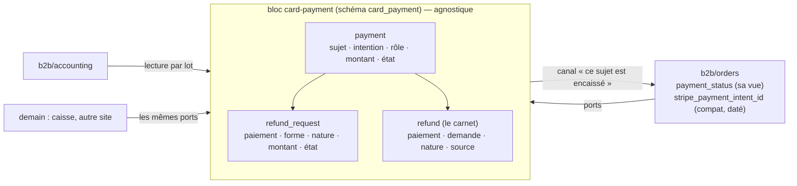
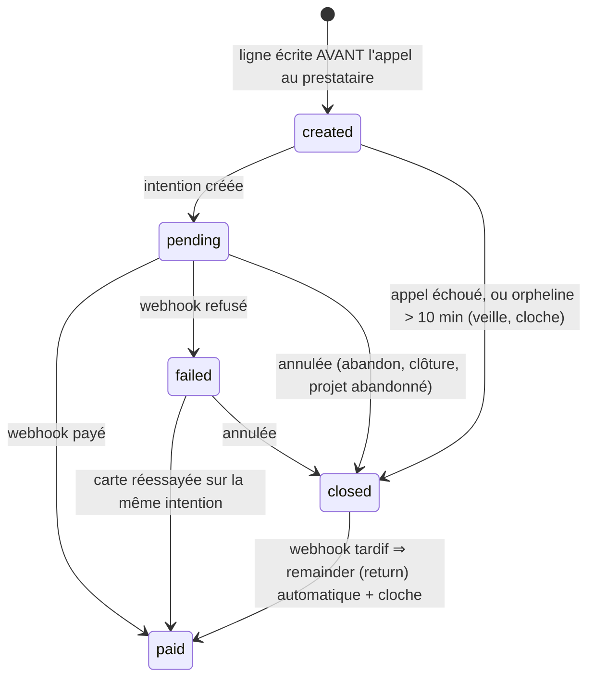
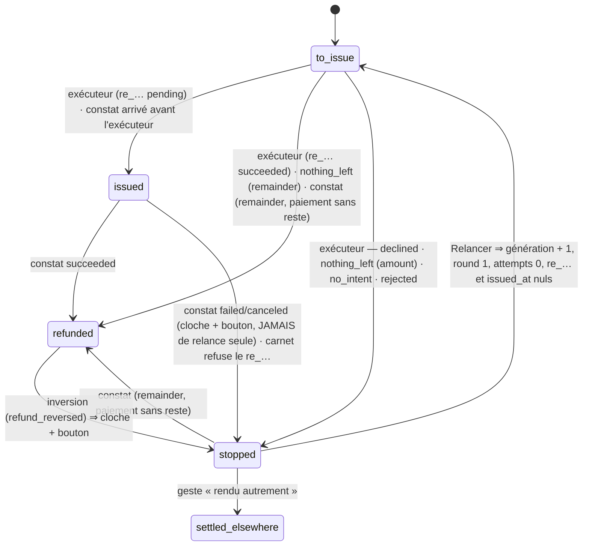
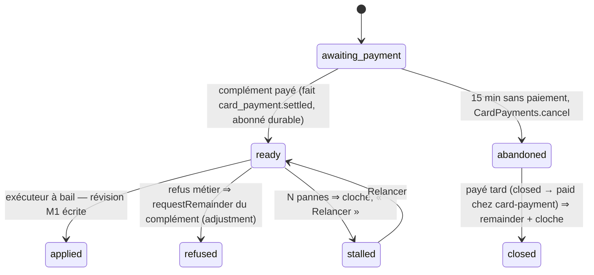

# Plan M2 — modifier une commande payée par carte : l'historique de transactions

> **Doc-first, 2026-11-09. Version 3.** Le plan **unique** de M2, écrit après la
> relecture complète du paiement et du remboursement
> ([`../reglement/relecture-paiement-et-remboursement.md`](../reglement/relecture-paiement-et-remboursement.md),
> à lire d'abord). Il **remplace** les §9 à §20 de
> [`plan-modifier-une-commande-payee-par-carte.md`](plan-modifier-une-commande-payee-par-carte.md).
> Les versions 1 et 2 et leurs contradictions par `vitruve` sont dans
> l'historique git (`d2632e136`, `6eef19357`, `ca3b6c0c4`, `d5e5d7a49`) ; tout
> ce qui en tenait est ici. Rien n'est bâti. Touche l'argent : `vitruve` avant
> Hugo.

## 0. Les décisions de Hugo

| Décision (2026-11-09)                                                                                                     | Où                                                                                     |
| ------------------------------------------------------------------------------------------------------------------------- | -------------------------------------------------------------------------------------- |
| La **forme C** : une commande, un numéro, plusieurs paiements et remboursements par montant                               | §2                                                                                     |
| Une **baisse** est remboursée **tout de suite** ; une **hausse** se paie **tout de suite**, même écran                    | §6, §7                                                                                 |
| **Pas de modification carte après l'arrêt du plan** ; le **bon** sous la différence devient un bon neuf, **plus tard**    | §6.1, §9                                                                               |
| **D'abord le socle**, « 10/10, aucun angle mort » sur **notre** état                                                      | §4, §5, §10, §11                                                                       |
| **Sans rapprochement automatique** : notre donnée fait foi ; **pas de mode test Stripe** : « au culot »                   | §4.9, §4.10, §11                                                                       |
| **Un module de remboursement propre, avec une API**, « une surface compréhensible », « le code doit refléter la surface » | §3 : le bloc **`card-payment`**                                                        |
| **D'autres applications** vivront dans le même monolithe et paieront par le même compte                                   | §3 : `card-payment` est **agnostique du contexte** — un sujet opaque, pas une commande |
| **Pas de virements ni de SEPA** dans ce bloc : la carte seulement                                                         | §3.1                                                                                   |

## 1. Ce qui existe

Dans la relecture. En une ligne : **un paiement par commande**
(`orders.stripe_payment_intent_id`), **une demande de remboursement par
commande**, **un état déduit** à chaque lecture, **un remboursement sans
montant**, **un plafond sur `total_cents`** (quatre adaptateurs), **le
remboursement rangé dans `b2b/orders`** (40 fichiers, 20 lecteurs du port de
la demande, 13 du carnet — compte de `vitruve`), et **aucun regard
périodique** vers le prestataire.

## 2. Le modèle cible, en une image

**Encaissé** d'un sujet = `Σ payment paid`. **Remboursé** = `Σ refund
succeeded`, dont **remboursé d'ajustement** = ceux de nature `adjustment`.
**L'égalité G3** : encaissé − remboursé d'ajustement = total dû du sujet
(vivant, soldé) ; encaissé − remboursé = 0 (sujet annulé, soldé).

## 3. Le bloc `card-payment`

### 3.1 Ce qu'il est, et ce qu'il n'est pas

**Il encaisse et rembourse par carte, pour un sujet qu'il ne connaît pas.** Un
sujet = `(subject_type, subject_id)` opaques (`order` + l'id, demain `ticket`

- l'id). Il tient **tout l'état de l'argent carte** : les paiements, les
  demandes de remboursement, le carnet des remboursements constatés, et c'est
  **lui seul** qui parle au prestataire (ports `PaymentGateway`,
  `PaymentRefunder`, déménagés de `b2b/payments`).

**Il ne sait pas** ce qu'est une commande, une facture, un bon de fidélité, un
total dû. **Il n'inclut pas** les prélèvements SEPA ni les mandats (le
règlement au compte, qui restent au commerce et à la comptabilité), ni les
virements (constatés par la comptabilité sur la facture), ni — pour l'instant
— les liens de paiement de société (`b2b/payments`, qui pourront devenir un
sujet de plus). Le geste « rendu autrement » (§4.4) **note** un remboursement
fait hors plateforme ; il ne déplace aucun argent.

La seule connaissance métier qu'il porte est **agnostique** : la **nature**
d'un remboursement, `return` (la vente n'a pas lieu — annulation, paiement
après annulation, inversion) ou `adjustment` (le montant dû a baissé —
modification). C'est tout ce que la comptabilité a besoin de savoir pour
décider d'un avoir.

**Dans `src/`** : `card-payment/` au premier niveau, la figure de `mail` —
sans métier propre, consommé par tous les blocs métier **par son canal
seulement**, n'importe que `platform` et `staff` (l'autorisation de ses routes
d'équipe). Matrice du `CLAUDE.md` § 3 : une colonne `card-payment` à **port
uniquement** pour `b2b` (et les blocs à venir), ✗ pour les autres ;
`card-payment → *` ✗ sauf `platform`, `staff`. `lint:context-boundaries` et
`lint:prisma-model-ownership` (par bloc) tiennent la frontière **sans porte
neuve** — c'est ce que le sous-contexte de la version 2 ne permettait pas.

### 3.2 La surface : trois ports, un canal, des faits

Déclarés et implémentés par `card-payment`, dans `card-payment/channels/` :

| Port                       | Gestes                                                                                                                                                                             | Appelé par                                              |
| -------------------------- | ---------------------------------------------------------------------------------------------------------------------------------------------------------------------------------- | ------------------------------------------------------- |
| **`CardPayments`**         | `open(subject, amountCents, role)` → `{ paymentId, clientSecret, publishableKey }` ; `cancel(paymentId)` → issue typée (`cancelled \| already_paid \| in_progress \| unavailable`) | la passation, la hausse, l'abandon, la clôture          |
| **`CardRefunds`**          | `requestRemainder(paymentId, nature, reason)` ; `requestAmount(paymentId, amountCents, nature, reason)` — dans la transaction de l'appelant                                        | l'annulation, la baisse, le refus d'une hausse          |
| **`CardSettlementReader`** | `positionOf(subjects[])` → par sujet : paiements (rôle, état, montant), encaissé, remboursé par nature, demandes non terminales par forme, « en vol » par forme — **par lot**      | l'annulation, la révision, la facture carte, les listes |

Un **canal retour**, déclaré par `card-payment` et **implémenté par le bloc
métier** (la figure fournil → commerce) : **`SubjectSettlement`** —
`onPaid(subject, paymentId, amountCents)` → `applied | refused` (le sujet
écrit sa propre vue, `orders.payment_status`, sous **son** verrou, et refuse
s'il est annulé) ; `onPaymentFailed(subject, paymentId)`. Un implémenteur par
`subject_type`, relié dans `appBootstrap/`.

**Les faits durables** publiés par `card-payment`, tous **clés par sujet** :
`card_payment.settled` (avec l'issue du canal : `applied | refused`),
`card_payment.failed`, `card_payment.refund_requested`,
`card_payment.refund_succeeded`, `card_payment.refund_failed`,
`card_payment.refund_reversed`, `card_payment.fully_refunded`,
`card_payment.unmatched`. Les faits **d'aujourd'hui** du commerce
(`order.paid`, `order.payment_failed`, `order.paid_after_cancellation`,
`order.refund_*`) **restent publiés par `b2b/orders`**, qui les tire du canal
et de ces faits : leurs cinq abonnés ne bougent pas.

**Les routes d'équipe** (`card-payment/http/`, ressource `card_payments`
neuve, accordée à l'écran) : « Relancer » une demande, « rendu autrement »,
« Vérifier chez le prestataire », la vue du bandeau ; le **webhook**
(`POST /payments/webhook`, chemin inchangé pour la passerelle).

### 3.3 Les machines à états (relues dans le code, corrigées trois fois)

**`payment.state`**

**`refund_request.state`**

- **Un `re_…` mort est un arrêt** (`issued → stopped`) : cloche et bouton,
  comme aujourd'hui (Q3 de C4) — la version 2 le relançait seule, en boucle,
  et au déploiement aurait relancé des remboursements déjà réglés en espèces.
- **L'inversion** va à `stopped`, pas à `to_issue` : même raison.
- Enum Postgres par machine ; déclencheur `BEFORE UPDATE` : paire hors liste
  refusée, `(x, x)` admis (bail, essais, rejeu), **colonnes immuables**
  refusées (`subject_*`, `payment_id`, `form`, `amount_cents`, `nature`) ;
  `BEFORE DELETE` refusé sauf `current_setting('card_payment.purge', true) =
'on'`, posé par la purge et les semis **dans une transaction**
  (`commerce.purge.ts` l'est ; `siteless-pickups.seed.ts` ne l'est pas : à
  envelopper). **Test exhaustif** des paires (état, transition), agrégat et
  déclencheur comparés.
- **Qui écrit** : l'exécuteur sous bail, par `save` (conditionné sur
  génération et jeton) ; **le constat sans bail**, par `transition(id, from,
to, patch)` = `UPDATE … WHERE id AND state = from` — il ne touche ni au
  bail ni à la génération. Le constat **charge la demande** par le `re_…`,
  ou par la métadonnée (`requestId` **et** `generation`, portées par
  l'événement réduit) ; une génération différente est ignorée ; arrivé avant
  l'exécuteur, il pose `re_…` et `issued_at`, et l'exécuteur, après, voit
  `issued()` rendre `false`.
- **Une `to_issue` sans échéance n'existe plus** : toute `to_issue` a
  `next_attempt_at` ; ce qui attendait le bouton est `stopped`.

### 3.4 Le remboursement par montant

`PaymentRefunder.refund(params)` : sans montant (`remainder`), avec
(`amount`). `findRefund` reconnaît par id de demande, génération, et montant
pour une `amount`. Issues :

| Issue                             | `remainder`                                                                                                                                      | `amount`                                                   |
| --------------------------------- | ------------------------------------------------------------------------------------------------------------------------------------------------ | ---------------------------------------------------------- |
| émis, `pending`                   | `→ issued`                                                                                                                                       | idem ; montant ≠ demandé ⇒ `stopped`, cloche               |
| émis, `succeeded` dès la création | `→ refunded`                                                                                                                                     | idem                                                       |
| `charge_already_refunded`         | relecture ; paiement sans reste ⇒ `→ refunded` ; reste couvert par un `re_…` **en vol** ⇒ `issued` sur ce `re_…` s'il est nôtre, sinon `stopped` | écart ⇒ `stopped` (`nothing_left`), cloche                 |
| montant > reste                   | n/a                                                                                                                                              | `stopped` (`declined:<code>`, code relevé au bâti), cloche |
| `unavailable`                     | round + 1, échéance sur la courbe                                                                                                                | idem                                                       |

**Le bail** d'une `remainder` exige qu'aucune `amount` du même paiement ne
soit `to_issue | issued` (SQL brut — Prisma n'écrit pas de corrélation —, et
revérifié dans `prepare()` sous le verrou du paiement) ; une `amount`
`stopped` ne bloque pas. `dueForSweep` ne reprend que `state = to_issue`.

### 3.5 Le carnet et l'égalité

`refund` : `payment_id` (non nul), `request_id` (nullable : un `re_…` fait
à la main), `nature` (nullable : idem), `source` (`provider | manual`),
`provider_ref` nullable (CHECK `source = 'provider' ⇔ provider_ref IS NOT
NULL`), le reste comme aujourd'hui. **Plafond par paiement** (`Σ succeeded ≤
amount_cents` du paiement) et par sujet. Le constat d'un remboursement
retrouve le paiement par l'intention, dans **une** table.

### 3.6 L'ordre des verrous

**Le sujet d'abord.** Tout geste qui touche l'argent d'un sujet est appelé
**dans la transaction du bloc métier**, qui a pris le verrou de sa ligne
(`orders`) ; `card-payment` verrouille ensuite ses lignes. Le reste de l'ordre
(atelier, BL, bon, puis la demande) est celui de l'annulation d'aujourd'hui et
ne bouge pas. **Le webhook respecte le même ordre** : le contrôleur appelle
d'abord le canal `SubjectSettlement.onPaid` (le commerce prend `orders`,
`markPaid`, publie `order.paid` au franchissement **ou** refuse une annulée),
**puis** écrit la ligne `payment` `paid` et publie `card_payment.settled` avec
l'issue — une annulée encaissée est `paid` chez `card-payment` et `refused`
côté sujet : c'est le commerce qui, sur ce fait, demande le `return` (le
comportement de `refund-paid-after-cancellation` d'aujourd'hui).

## 4. Lot P0 — le bloc, à base constante (réversible)

Déménagement **sans migration** : `card-payment/` naît, prend les ports
Stripe, les trois agrégats, l'exécuteur, le bail, l'enregistreur, le constat,
l'inversion, « Relancer », le balayage, la cloche, les routes d'équipe et le
webhook ; `b2b/orders` et `b2b/accounting` n'atteignent plus une table
d'argent que par les trois ports et le canal. Les modèles Prisma
`order_refund`, `order_refund_request` restent où ils sont (schéma `public`)
mais **écrits par `card-payment` seul** — `lint:prisma-model-ownership` le
vérifie dès ce lot ; `orders.stripe_payment_intent_id` et `payment_status`
restent écrits par `orders` (sa vue). Les lecteurs par **relation**
(`refunds:` dans `prisma-order.reader.ts`, `prisma-card-invoicing.reader.ts`,
`cancellation-subject.row.ts`, `revisable-order.row.ts` ; `refundRequest:`
dans `prisma-order-refund-request.reader.ts`) deviennent des appels à
`CardSettlementReader.positionOf` (par lot pour les listes). Les cinq abonnés
de `order.paid` ne bougent pas.

**Ce que P0 change à l'écran** : rien d'autre que la route des gestes
d'équipe (`admin/card-payments/…`) ; le bandeau lit la même vue.
**Réversible** : un `git revert`, aucune donnée touchée.

## 5. Lot P1 — la migration (irréversible)

### 5.1 Le schéma `card_payment`

- **`payment`** : `id`, `subject_type`, `subject_id`, `provider_ref`
  (`@unique`, nul tant que `created`), `role` (`first | complement`),
  `amount_cents` (> 0), `state`, `created_at`, `paid_at`. Index unique
  `(subject_type, subject_id) WHERE role = 'first'`.
- **`refund_request`** : `id` (ULID), `payment_id`, `form` (`remainder |
amount`), `amount_cents` (CHECK `(form = 'amount') = (amount_cents IS NOT
NULL)`), `nature` (`return | adjustment`), `reason` (texte borné, celui que
  l'appelant nomme : `cancellation`, `paid_after_cancellation`,
  `refund_reversed`, `revision`…), `state`, les colonnes d'aujourd'hui
  (génération, round, essais, bail, échéance, `provider_ref`, `issued_at`).
  Index unique partiel `(payment_id) WHERE form = 'remainder'` — **`NULLS NOT
DISTINCT`** sans objet puisque `payment_id` est non nul (la cause
  `no_payment_intent` d'aujourd'hui est un `last_failure`, pas une demande
  sans paiement).
- **`refund`** : §3.5.

### 5.2 La reprise (dans cet ordre, une migration, rejouable)

1. **`payment` `first`** pour toute commande qui a une intention
   (`orders.stripe_payment_intent_id`) : `amount_cents := total_cents` ;
   `state` : `paid` si `payment_status ∈ {paid, refunded}` **ou** si la
   commande porte une ligne au carnet ou une demande `paid_after_cancellation`
   (payée après annulation) ; **`closed`** si la commande est `cancelled`
   (sinon la veille sonnerait pour tout l'historique) ; `pending | failed`
   selon `payment_status` pour les vivantes.
2. **`refund`** : `payment_id := la ligne first`, `source := 'provider'`,
   `nature := 'return'` (tout remboursement d'aujourd'hui est une annulation
   ou un paiement après annulation), `request_id` quand la demande porte ce
   `re_…`.
3. **`refund_request`** : `id := order_id` (les clés d'idempotence déjà chez
   Stripe gardent leur préfixe), `payment_id`, `form := 'remainder'`,
   `nature := 'return'`, `reason := cause`, et **`state`** par cette priorité
   écrite : (a) le `re_…` est `succeeded`, ou le paiement n'a plus de reste ⇒
   `refunded` ; (b) le `re_…` est `failed | canceled`, ou `next_attempt_at IS
NULL AND last_failure IS NOT NULL` ⇒ **`stopped`** ; (c) un `re_…` vivant
   ⇒ `issued` ; (d) sinon `to_issue`, échéance conservée. Le test de reprise
   compare à **cette règle**.
4. Les anciennes tables sont **gardées vides de lecteurs** (plus aucun code
   ne les lit après P1) et retirées à un déploiement suivant, daté.

**La fenêtre ancien code / nouveau schéma** (`migrate deploy` puis
`wrangler deploy`, quelques secondes à quelques minutes) : les nouvelles
colonnes ont des **défauts**, l'ancien code continue d'écrire les anciennes
tables, et la reprise est **rejouable** : elle est relancée une fois par
l'image neuve au démarrage (commande idempotente), ce qui rattrape un webhook
traité par l'ancien container.

**Deux vérités du premier paiement** : `orders.stripe_payment_intent_id`
reste **en lecture** pour ses 24 lecteurs ; une contrainte différée ne peut
pas traverser deux schémas sans clé étrangère (interdite entre blocs) ; donc
un **test de reprise** et la **veille** (§4.10) vérifient l'égalité des deux,
et la colonne est resserrée en **P2** (lot daté : les 24 lecteurs passent par
`positionOf`).

### 5.3 Ce qui change à l'écran en P1

Le bandeau de remboursement du back-office : plusieurs demandes par commande,
plus d'état `failed` (c'est `stopped`), « Relancer » et « rendu autrement »
par demande ; le contrat `AdminOrderRefund` devient une liste. Pré-release
(`CLAUDE.md` §0), Hugo averti ici.

### 5.4 Ce qui ne change pas

Aucune commande carte modifiable ; les statuts de remboursement restent ceux
de Stripe (§12.1) ; la fidélité intacte ; les colonnes `stripe_*` d'`orders`
et `payment_links` intactes.

## 4 bis. Ce que le socle (P0 + P1) tient aussi

### 4.7 La comptabilité

`CardInvoiceCandidate` lit `positionOf` : `refundedCents` (nature `return`),
`adjustmentRefundedCents`, `adjustmentPending`, `adjustmentStopped`.
`cardInvoiceVerdict` : `awaiting_refund` (pending), **`blocked`** (stopped,
ou encaissé − adjustment ≠ `total_cents`), décidés avant `awaiting_handover`
; `fully_refunded` sur `return` seul. Réveil : abonné durable
`issue-card-invoice-on-refund-settled` sur `card_payment.refund_succeeded`,
publié aussi pour une ligne `manual`. `RefundReconciler` : un `succeeded` de
nature `adjustment` ne produit pas d'avoir et est marqué `credited_reason =
'adjustment'` (écrit par `accounting`, **la seule** écriture d'un autre bloc
dans une table de `card-payment` : déclarée au gate, à ajouter à ses
dérogations — vides aujourd'hui). Inertes avant S1.

### 4.8 L'inversion et le geste manuel

L'inversion retrouve **sa demande par le `re_…`** : `refunded → stopped`,
cloche. Sans demande : sur un sujet dont le canal dit « annulé », rouvrir la
`remainder` existante du paiement (`stopped → to_issue`, échéance : le
bouton — donc `stopped`, cloche) ou en créer une (`return`,
`refund_reversed`) ; sur un sujet vivant, cloche seulement. Un `re_…` sans
demande est constaté (`request_id`, `nature` nuls), cloche « hors
plateforme » ; une `remainder` `to_issue | stopped` d'un paiement sans reste
passe `refunded`. `refund_in_flight` (annulation, révisabilité) compte les
`re_…` en vol **sauf** ceux d'une demande `amount` : une baisse en vol ne
bloque ni une annulation ni une seconde baisse, un remboursement manuel en
vol bloque toujours.

### 4.9 « Vérifier chez le prestataire » — à la main

Commande d'équipe (journal `card_payment.verified`) : `retrieveIntent` (le
port rend `amountReceivedCents`) et `listRefunds` sur chaque paiement du
sujet ; compare ; **affiche** l'écart ; n'écrit rien d'autre.

### 4.10 La veille sur nos données (aucun appel au prestataire)

Cron horaire `watch-card-payments` : `issued` > 7 j ; `stopped` > 24 h ;
`to_issue` dont l'échéance est dépassée > 1 h ; `payment` `created` > 10 min
(⇒ **sonne**, et c'est la veille qui le passe `closed`) ou `pending` > 15 min
sur un rôle `complement` ; `first` et `orders.stripe_payment_intent_id` qui
divergent ; et, côté commerce (dans `b2b/orders`, sa veille à lui) : une
commande `placed` + `pending` dont le jour est passé (épargnée à la clôture),
un projet (§7) `awaiting_payment` > 15 min ou `ready` > 1 h. Cloche + journal.

### 4.11 Le rapprochement automatique — reporté

Quotidien, 30 jours, deux sources possibles (API ou relevé bancaire). Attend
le signal du §12.4. Les lignes `manual` y sont attendues.

### 4.12 Les crons

`sweep-card-refunds` (l'existant, déménagé), `watch-card-payments`,
`abandon-revision-proposals` (§7.3) : chacun son entrée dans
`apps/lfd-api/container/worker.ts` ; `purge-coverage.ts` apprend le schéma
`card_payment`.

## 6. Lot S1 — la baisse

### 6.1 Quand

Comme M1 ; avant l'inscription (`OrderInscriptionReader`, verrou de la
journée) ; pas sur stock ; **jamais à 0 €** ; pas sur un `first` `pending |
failed` (« réglez d'abord, ou annulez ») ; pas sous la part du bon (refus
actuel, jusqu'à C-2b).

### 6.2 Le geste

Dans `ReviseOrderHandler.record()`, après `save`, sous le verrou `orders` :
`CardRefunds.requestAmount` pour `ancien − nouveau`, nature `adjustment`,
raison `revision`, **du dernier paiement encaissé au premier**, en **sautant**
tout paiement qui porte une `remainder` non terminale (remboursable 0) ;
l'exécuteur part après validation. « X € vous seront remboursés ».

### 6.3 L'annulation

`requestRemainder` **par paiement encaissé**, nature `return`, en sautant
ceux qui en ont déjà une ; annoncé = encaissé − réussi − annoncé des `amount`
`to_issue | issued`.

## 7. Lot S2 — la hausse

### 7.1 Le projet (dans `b2b/orders` : c'est une révision)

`order_revision_proposal` : contenu saisi **et** révision composée, total
visé, `complement_cents`, auteur, `payment_id`, `state`, colonnes de reprise
(`attempts`, `next_attempt_at`, bail).

Un seul projet `awaiting_payment | ready | stalled` par commande. Le geste :
composer (M1), écrire le projet (transaction courte), `CardPayments.open`
(`complement`, le montant) — la ligne `created` puis `pending` est à
`card-payment` —, réponse de quoi régler sur le même écran (`GetComplementPayment`,
qui lit `card-payment`). Échec ⇒ `cancel`.

### 7.2 Le paiement

Canal `onPaid` pour un sujet `order` dont le paiement est un `complement` :
le commerce écrit `awaiting_payment → ready` **et rien d'autre** ; `AfterCommit`
lance l'exécuteur à bail `ApplyRevisionProposal` (bail, essais, courbe de la
boîte d'envoi, balayage `sweep-revision-proposals`) : verrou `orders`,
journée, rejugement M1, **total recomposé = total payé**, `record()`,
`→ applied`. Refus (`BusinessError | DomainError`) ⇒ seconde transaction :
`→ refused`, `requestRemainder(complément, adjustment, revision_refused)`,
courriel. Panne ⇒ essai suivant ; après `MAX_DELIVERY_ATTEMPTS` ⇒ `stalled`,
cloche, visible.

### 7.3 L'abandon et l'équipe

Cron : `awaiting_payment` > 15 min ⇒ `CardPayments.cancel` ; `cancelled` ⇒
`abandoned` ; `already_paid` ⇒ rien ; `in_progress | unavailable` ⇒ passage
suivant. Payé après `abandoned` : `card-payment` passe `closed → paid` et
demande le `return` lui-même (§3.3), cloche ; le projet `→ closed`.
L'équipe baisse librement ; pour une hausse, le client reçoit l'URL de
règlement du complément.

## 8. Lot S3 — écrans et courriels

Historique daté des paiements et remboursements (montant, état, nature) côté
client et staff ; la baisse avec le montant rendu ; la hausse réglée sur
place ; côté staff : « Vérifier », « rendu autrement », un projet `stalled`.
Courriels `customer.order-modified`, `customer.order-modification-failed`.

## 9. Lot C-2b — le bon de modification (plus tard)

Deux bloquants propres (ancien plan §17). Plan à part, dans `loyalty`.

## 10. Les garanties

| Étage               | Ce qui tient                                                                                                                                                                                                                                                                                                       |
| ------------------- | ------------------------------------------------------------------------------------------------------------------------------------------------------------------------------------------------------------------------------------------------------------------------------------------------------------------ |
| **G0 la frontière** | un seul bloc touche l'argent carte et le prestataire ; `lint:context-boundaries`, `lint:prisma-model-ownership` (par bloc, dès P0), une dérogation déclarée (`accounting` → `credited_reason`)                                                                                                                     |
| **G1 inexprimable** | montants > 0 ; `form = amount ⇔ amount_cents` ; une `remainder` par paiement ; un `first` par sujet ; un projet non terminal par commande ; `source = provider ⇔ provider_ref` ; `settled_elsewhere ⇔ motif + staff` ; transitions et colonnes immuables par déclencheur ; `DELETE` sous `card_payment.purge`      |
| **G2 agrégat**      | `Σ succeeded ≤ amount_cents` par paiement et par sujet ; `amount` ≤ reste de son paiement ; projet : total recomposé = total payé                                                                                                                                                                                  |
| **G3 l'égalité**    | sujet vivant soldé (demandes `refunded \| settled_elsewhere`, paiements `paid \| closed`, aucun projet non terminal) : encaissé − `adjustment` = total dû ; sujet annulé soldé : encaissé − remboursé = 0. Vérifiée à la facture carte (pro) et par la veille (tous) ; `stopped` ou `stalled` = non soldé, signalé |
| **G4 prestataire**  | « Vérifier » à la main ; la veille attrape ce qui attend trop ; le rapprochement automatique attend son signal. **Laisse passer** le contenu d'un webhook perdu (vu comme une attente trop longue, pas comme un montant)                                                                                           |

## 11. Les tests

- **P0** : les portes vertes après déménagement ; chaque e2e d'aujourd'hui
  (14 suites de remboursement, les courses, le balayage) **inchangée et
  verte** ; les lecteurs par relation remplacés (grep à zéro).
- **P1** : reprise ligne à ligne contre la règle écrite (`first` payé /
  `closed` / `pending`, `failed` ⇒ `stopped`, payée après annulation) ;
  reprise **rejouée** idempotente ; paires (état, transition) exhaustives,
  deux machines + le projet en S2 ; colonnes immuables ; webhook **avant**
  l'enregistreur ; `succeeded` dès la création ; `nothing_left` sur
  `remainder` (sans reste, reste en vol nôtre, reste en vol manuel) et sur
  `amount` ; `re_…` manuel partiel puis total ; inversion avec et sans demande
  retrouvée, sujet vivant et annulé ; intention inconnue ; bail puis `amount`
  écrite avant `prepare` ; `DELETE` refusé / admis ; `settled_elsewhere` ferme
  G3 et réveille la facture ; la veille sur chacun de ses cas ; l'écran et la
  route par demande ; l'égalité des deux vérités du premier paiement.
- **S1** : deux baisses ; baisse puis annulation avant remboursement ; baisse
  sur un paiement portant une `remainder` ; baisse de 70 % facturée sur le
  livré sans avoir ; refus à 0 €, sur `pending`, sous le bon, après
  inscription ; une `amount` en vol ne bloque pas, un manuel en vol bloque.
- **S2** : appliquée ; refusée ⇒ complément rendu ; `stalled` puis relancé ;
  abandon puis paiement tardif ; deux projets ; webhook rejoué / désordonné ;
  redémarrage entre `ready` et l'exécuteur.

Contre le vrai Postgres, prestataire doublé au port ;
`stripe-refund-calls.spec.ts` couvre `refund(amount)`, `listRefunds`, le
montant dans la recherche. **Pas de mode test Stripe** : la première baisse
réelle est faite par l'équipe, sur une commande de l'équipe, « Vérifier »
cliqué après ; les chemins d'erreur ne seront passés chez Stripe que le jour
où ils arriveront — la veille et les cloches les diront.

## 12. À décider (Hugo)

1. **Statuts de remboursement neutres** (traduire ceux de Stripe) : plus tard
   (proposé).
2. **Délai de grâce d'une hausse** : 15 min (proposé).
3. **« Rendu autrement »** et « Vérifier » : la ressource `card_payments`
   neuve, accordée à l'écran (proposé).
4. **Le rapprochement automatique** : au premier webhook perdu constaté, ou
   avant un changement de prestataire (proposé).
5. **Les liens de paiement de société** : restent au commerce (proposé) ;
   deviendront un sujet de `card-payment` si une autre application en veut.

## 13. L'ordre, et l'irréversible

P0 (réversible) → déployé, portes vertes, e2e inchangées → P1 (irréversible :
le schéma `card_payment`, la reprise, les valeurs des enums ; relu par
`lecteur-de-migrations`) → déployé, quelques jours d'annulations ordinaires,
« Vérifier » cliqué, la veille muette → S1 → première baisse réelle vérifiée →
S2 → S3 → P2 (resserrement de `orders.stripe_payment_intent_id`, retrait des
anciennes tables). §4.11, §9 et le CLAUDE.md (colonne `card-payment` de la
matrice, écrite au P0) quand leur tour vient.

## 14. Contredit par `vitruve` (2026-11-09, sur `e1b7f8a75`) — vers la version 4

La machine des demandes tient (B1 levé) ; la **frontière du bloc** est ce qui
ne tient pas encore. Six bloquants, chacun avec le remède retenu :

| #   | Bloquant                                                                                                                                                                                                       | Remède retenu                                                                                                                                                                                                                                            |
| --- | -------------------------------------------------------------------------------------------------------------------------------------------------------------------------------------------------------------- | -------------------------------------------------------------------------------------------------------------------------------------------------------------------------------------------------------------------------------------------------------- |
| 1   | **P0 « à base constante » est impossible** : le carnet et la demande lisent et verrouillent `orders` (plafond, `pi_… → commande`, `payment_status`) ; sans table `payment`, le webhook ne retrouve aucun sujet | **P0 redécoupé** : il crée la table `payment` (migration **additive**, `first` repris), le canal et les ports du **paiement seul** (`open`, `cancel`, `retrieve`, webhook) ; le remboursement **ne déménage qu'en P1**, avec sa reprise                  |
| 2   | **`accounting` écrit déjà `order_refund`** (`credit_note_id`, FK vers `invoice`) ; la porte refuse deux écrivains **avant** toute dérogation ; une FK entre blocs est interdite                                | le lien remboursement → avoir **sort du carnet** : table `accounting.refund_credit (refund_id, credit_note_id, reason)` ; `card-payment` n'a plus aucun état comptable ; un port de lecture `CardRefundsReader.succeededOf(subject)` sert le rapprocheur |
| 3   | **Le webhook porte des événements des liens de paiement** (`link_paid`, `link_expired` → `b2b/payments`), que `card-payment` n'a pas le droit de router                                                        | **deux endpoints Stripe**, chacun son secret : `/payments/webhook` (cartes, `card-payment`) et `/payments/links/webhook` (`b2b/payments`) ; `publishableKey` des mandats lu par le port                                                                  |
| 4   | **Plus personne n'écrirait `orders.stripe_payment_intent_id`** après P1 ; `retrieve` manque à `CardPayments`                                                                                                   | `open` rend `providerRef` ; `CardPayments.retrieve(paymentId)` ; la colonne reste écrite par `orders` jusqu'à P2                                                                                                                                         |
| 5   | **La reprise classe mal une demande qui attend le bouton** (`re_…` nul, échéance nulle, `last_failure` nul : l'inversion) → `to_issue` sans échéance                                                           | règle (b') : `re_…` nul **et** échéance nulle ⇒ `stopped`                                                                                                                                                                                                |
| 6   | **La fenêtre de déploiement** : l'ancienne image répond encore 1–2 min après la bascule et écrit l'ancienne table ; une reprise unique au démarrage la rate                                                    | la reprise est un **cron horaire pendant 48 h** après P1 (par id, prend l'état le plus avancé, insère l'absent), P1 déployé à une heure creuse, et l'ancienne table n'est retirée qu'en P2 après contrôle                                                |

**Sérieux retenus** : nature **`null`** pour un `re_…` manuel (reprise : `return`
seulement quand une demande le porte) et `fully_refunded` sur **toute** nature
(comme aujourd'hui) ; priorité `paid` > `closed` dans la reprise du `first`
(une annulée payée est `paid`) ; un seul demandeur du `return` après
clôture — **le commerce**, sur le fait `settled` + `refused`, idempotent
(`requestRemainder` rend l'existante) ; la veille « deux vérités » vit
**dans `orders`** (il lit sa colonne et `positionOf`, qui rend
`providerRef`) ; le constat d'un remboursement prend le verrou du **sujet
d'abord** par le canal (`SubjectSettlement.onRefundSettled` → `refunded`) ;
P0 porte une **migration d'enum** (`StaffResource.card_payments`) et n'est
donc pas réversible au sens strict — dit ; « Relancer » reste sous
`b2b_cancel_order:write` jusqu'à ce que la ressource soit accordée ; les
relations Prisma `Order.refunds`, `Order.refundRequest`, `Invoice.refunds`
sont **retirées en P1** (plus exprimables), pas en P2 ; la reprise au
démarrage ne fait jamais échouer le démarrage ; les abonnés
`reopen-refund-on-reversal` et `ring-refund-failed` déménagent **avec** leurs
noms de reçu ; `OnRefundWithoutOrder` passe `@DurableHandler`.

**Mineurs** : `already_cancelled` dans `cancel` ; `open`/`cancel` appellent
le prestataire hors transaction ; `context-boundaries` : `BLOCK_OF`,
`ALLOWED`, `"b2b→card-payment": "card-payment/channels/"` ; `mail` ne
déclare aucun canal qu'un autre implémente — la figure est celle de
`production → commerce`, pas de `mail`.

**État** : version 4 à écrire **après lecture** des deux portes
(`prisma-model-ownership.mjs`, `context-boundaries`), du workflow de
déploiement, de `discovered-durable-subscribers.ts`, de
`prisma-refunds-to-credit.ts` et de `admin-order-refunds.controller.ts`.
Rien n'est bâti.
