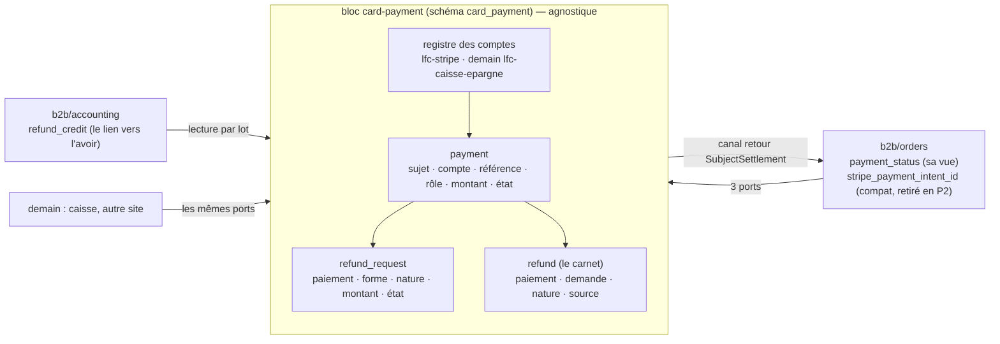
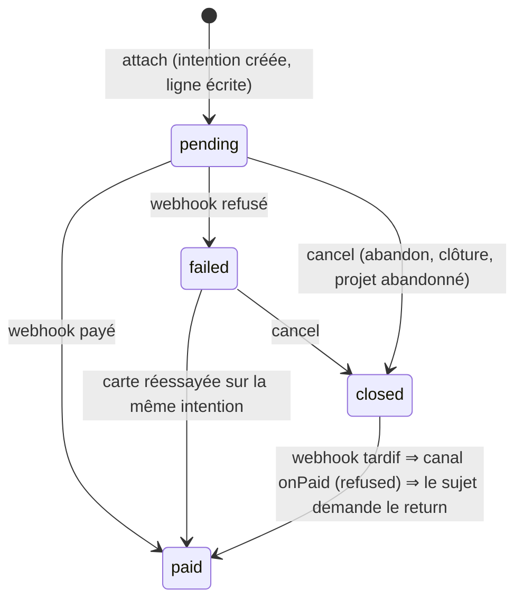
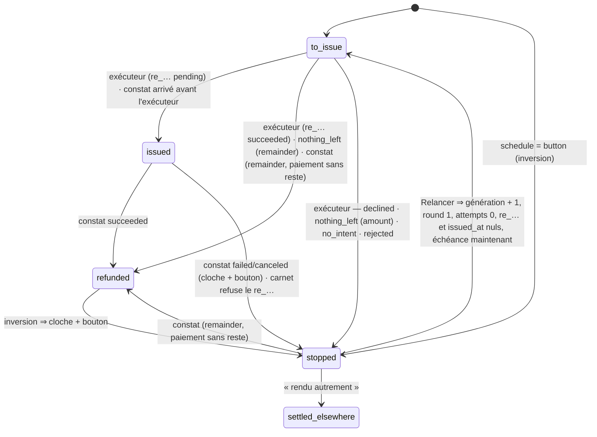
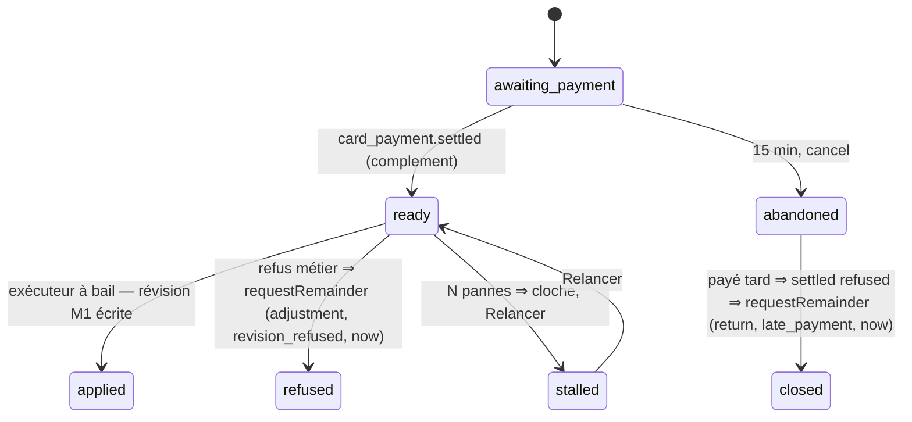

# Plan M2 — modifier une commande payée par carte : l'historique de transactions

> **Doc-first, 2026-11-09. Version 6** (la v5, `2e64016aa`, contredite le même jour : deux bloquants, dix sérieux, intégrés ici). Le plan **unique** de M2, écrit après la
> relecture complète du paiement et du remboursement
> ([`../reglement/relecture-paiement-et-remboursement.md`](../reglement/relecture-paiement-et-remboursement.md),
> à lire d'abord), des deux portes de frontière, du workflow de déploiement,
> du registre des abonnés durables et de l'écriture comptable du carnet. Il
> **remplace** les §9 à §20 de
> [`plan-modifier-une-commande-payee-par-carte.md`](plan-modifier-une-commande-payee-par-carte.md).
> Versions 1 à 4 et leurs contradictions par `vitruve` : `d2632e136`,
> `6eef19357`, `ca3b6c0c4`, `d5e5d7a49`, `e1b7f8a75`, `c290188ed`,
> `eaec69258`, `d87322030`, `68f63d17b`. Rien n'est bâti. Touche l'argent :
> `vitruve` avant Hugo.

## 0. Les décisions de Hugo

| Décision (2026-11-09)                                                                                       | Où                                 |
| ----------------------------------------------------------------------------------------------------------- | ---------------------------------- |
| La **forme C** : une commande, un numéro, plusieurs paiements et remboursements par montant                 | §2                                 |
| **Baisse** remboursée **tout de suite** ; **hausse** payée **tout de suite**, même écran                    | §7, §8                             |
| **Pas de modification carte après l'arrêt du plan** ; le **bon** sous la différence : plus tard             | §7, §10                            |
| **D'abord le socle**, « 10/10, aucun angle mort » sur **notre** état                                        | §4–§6, §11, §12                    |
| **Sans rapprochement automatique** : notre donnée fait foi ; **pas de mode test Stripe** : « au culot »     | §6.5–§6.7, §12                     |
| **Un module propre, avec une API**, « une surface compréhensible », « le code doit refléter la surface »    | §3 : le bloc **`card-payment`**    |
| **D'autres applications** dans le même monolithe ; **la carte seulement** (ni SEPA, ni virements, ni liens) | §3.1 : agnostique, un sujet opaque |
| **Plusieurs comptes et prestataires** (« lfc-caisse-epargne dans pas longtemps »)                           | §3.2 : le compte d'encaissement    |

## 1. Ce qui existe

Dans la relecture. En une ligne : un paiement par commande
(`orders.stripe_payment_intent_id`), une demande de remboursement par
commande, un état déduit à chaque lecture, un remboursement sans montant, un
plafond sur `total_cents`, le remboursement rangé dans `b2b/orders` (14
fichiers lisent les ports de la demande, 18 avec l'entité ; 10 le carnet ; 24
lisent `stripe_payment_intent_id` — comptes de `vitruve`), la comptabilité qui
**écrit** `order_refund.credit_note_id`, une relation Prisma `Invoice.refunds`,
une seule configuration Stripe (`stripeConfig()`, « les trois ou aucune »),
21 fichiers de `test/` qui envoient `ConfirmOrderPaymentCommand` en direct,
et aucun regard périodique vers le prestataire.

## 2. Le modèle cible, en une image

**Encaissé** d'un sujet = `Σ payment paid`. **Remboursé** = `Σ refund
succeeded` ; **remboursé d'ajustement** = ceux de nature `adjustment`.
**L'égalité G3** : encaissé − remboursé d'ajustement = total dû (sujet vivant,
soldé) ; encaissé − remboursé = 0 (sujet annulé, soldé).

## 3. Le bloc `card-payment`

### 3.1 Ce qu'il est, et ce qu'il n'est pas

**Il encaisse et rembourse par carte, pour un sujet qu'il ne connaît pas** :
`(subject_type, subject_id)` opaques. Il tient **tout l'état de l'argent
carte** et, **pour les cartes**, c'est lui seul qui parle au prestataire.

**Il ne sait pas** ce qu'est une commande, une facture, un bon, un total dû.
**Il n'inclut pas** les prélèvements SEPA ni les mandats, ni les virements,
ni — **daté** — les **liens de paiement** de société (`b2b/payments`, qui
gardent leur client Stripe, leur endpoint et leur secret jusqu'au jour où un
lien devient un sujet ; d'ici là, `lfc-stripe` du registre **pointe sur les
mêmes variables** qu'eux, pour qu'une rotation de clé n'ait qu'un endroit).
« Rendu autrement » (§5.5) note un remboursement fait hors plateforme, sans
déplacer d'argent.

Sa seule connaissance métier est agnostique : la **nature** d'un
remboursement, `return` (la vente n'a pas lieu) ou `adjustment` (le montant
dû a baissé).

**Dans `src/`** : `card-payment/` au premier niveau. Sans métier propre
(comme `mail`), il **déclare un canal qu'un autre bloc implémente** (comme
`production/channels/commerce/`). Matrice du `CLAUDE.md` § 3 : colonne
`card-payment` à **port uniquement** pour `b2b` ; ligne `card-payment` : ✓
`staff`, ✓ `platform`, ✗ le reste.

### 3.2 Le compte d'encaissement

- **Le registre** `CardAccounts` vit dans **`platform/config`** (`AppConfig`,
  comme `stripeConfig()` aujourd'hui : `ops` et le rapport de démarrage n'ont
  droit qu'à `platform`) et lit
  `CARD_PAYMENT_ACCOUNTS` — un JSON `{ "lfc-stripe": { "type": "stripe",
"env": "STRIPE" }, "lfc-caisse-epargne": { "type": "lyra", "env":
"LYRA_CE" } }` — et, par compte, les variables **préfixées** `<ENV>_SECRET_KEY`,
  `<ENV>_PUBLISHABLE_KEY`, `<ENV>_WEBHOOK_SECRET` (pour `lfc-stripe`, les trois
  noms d'aujourd'hui). Chaque compte neuf **ajoute ses noms, littéraux**, aux trois listes que
  `runtime-keys.spec.ts` compare (`env-readers.ts`, `RUNTIME_KEYS` de
  `container/worker.ts`, la boucle `for name in` du workflow —
  `CARD_PAYMENT_ACCOUNTS` compris) et se déploie : « une entrée de
  configuration **et** un déploiement », dit. `adapterFor(account)` instancie
  **un adaptateur par compte** (un par **type** de prestataire dans le code :
  `stripe` aujourd'hui, `lyra` demain). Un compte présent en base et absent du registre **ne fait pas tomber la
  production** ([[la-prod-ne-tombe-jamais]]) : la **veille** sonne, le rapport
  de démarrage le dit, et une **porte CI** compare le CHECK de la colonne au
  registre du dépôt ; `StripeProbe` et le rapport lisent **tous** les comptes.
- **Le compte se choisit par type de sujet** : `accounts.default_for = {
"order": "lfc-stripe" }`. **L'appelant ne nomme aucun compte** (une chaîne
  `"lfc-stripe"` dans `orders` serait la chaîne en dur du `CLAUDE.md` § 6).
  **Le paiement mémorise son compte** (`payment.account`, **CHECK** sur la
  liste des comptes connus — valeur persistée, migration par compte neuf) ;
  relire, annuler, rembourser, vérifier lisent le compte **sur la ligne**.
- **Un webhook par compte** : `POST /payments/webhook/:account`, secret du
  compte ; compte inconnu ⇒ **400** journalisé. `/payments/webhook` vaut
  `lfc-stripe` jusqu'à P2.

### 3.3 La surface : trois ports, un canal, des faits

Déclarés et implémentés par `card-payment`, dans `card-payment/channels/requests/` :

| Port                       | Gestes                                                                                                                                                                                                                                                                                                                                                                                                                                                                                                          | Appelé par                                                                                   |
| -------------------------- | --------------------------------------------------------------------------------------------------------------------------------------------------------------------------------------------------------------------------------------------------------------------------------------------------------------------------------------------------------------------------------------------------------------------------------------------------------------------------------------------------------------- | -------------------------------------------------------------------------------------------- |
| **`CardPayments`**         | `prepare(subjectType, amountCents)` → `{ prepared, clientSecret, publishableKey }` (**hors** transaction : le compte est choisi par type, l'intention créée) ; `attach(subject, prepared, role)` → `{ paymentId, providerRef }` (**dans** la transaction de l'appelant : ligne `pending`) ; `release(prepared)` (échec de la transaction : `cancel` au mieux, comme aujourd'hui) ; `retrieve(paymentId)` ; `cancel(paymentId)` → `cancelled \| already_cancelled \| already_paid \| in_progress \| unavailable` | passation, page de règlement, hausse, abandon, clôture                                       |
| **`CardRefunds`**          | `requestRemainder(paymentId, nature, reason, schedule: 'now' \| 'button')` → la demande (**idempotent** : rend la `remainder` non terminale du paiement, sinon crée) ; `requestAmount(paymentId, amountCents, nature, reason)` ; `retry(requestId)` — dans la transaction de l'appelant                                                                                                                                                                                                                         | annulation, baisse, refus d'une hausse, inversion, route d'équipe d'aujourd'hui (jusqu'à P2) |
| **`CardSettlementReader`** | `positionOf(subjects[])` → par sujet : paiements (id, compte, `providerRef`, rôle, état, montant), encaissé, remboursé par nature, demandes non terminales (id, forme, nature, état), en vol par forme ; `succeededRefundsOf(subject)` → chaque remboursement réussi (id, montant, nature, source) — **par lot**                                                                                                                                                                                                | annulation, révision, listes, facture carte, avoirs                                          |

Le **canal retour** `SubjectSettlement` (`card-payment/channels/subjects/`,
un implémenteur par `subject_type`, relié dans `appBootstrap/`) :
`onPaid(subject, paymentId, amountCents)` → `applied | refused |
already_applied` ; `onPaymentFailed(subject, paymentId)` ;
`onRefundSettled(subject, refundId, position)` ; `isCancelled(subject)` → `true | false`
(l'inversion sans demande ne rouvre que sur une **annulée**, jamais sur une
vente livrée) ; `describe(subject)` → `{ label, link }` (les cloches et le journal
des demandes écrivent aujourd'hui `orderNumber` et `/commandes/:id`) ;
`claim(account, providerRef)` → `{ subject, amountCents, role } | null` (« ce
paiement est-il à toi ? », §4.6).

**Les faits durables** de `card-payment`, clés par sujet :
`card_payment.settled` (avec l'issue du canal), `card_payment.failed`,
`card_payment.refund_succeeded`, `card_payment.refund_failed`,
`card_payment.refund_reversed`, `card_payment.fully_refunded`,
`card_payment.unmatched` (avec le **type d'événement** : « hors de mes
sujets » — pas une anomalie en soi ; `b2b/payments` l'écoute et **ne sonne
que sur un remboursement**, comme `OnRefundWithoutOrder` aujourd'hui, qui
passe `@DurableHandler` **en P0**),
et, **transitoire P0**, `card_payment.provider_refund_event` (§4.4). Les faits `order.*` du
règlement (`order.paid`, `order.payment_failed`, `order.paid_after_cancellation`,
`order.refund_succeeded`) **restent publiés par `b2b/orders`** depuis le canal,
et leurs abonnés d'`orders` et d'`accounting` ne bougent pas. Les faits
**du remboursement lui-même** (`refund_failed`, `refund_reversed`,
`refund_rejected`) deviennent en P1 des faits **de `card-payment`**, et
leurs abonnés (`reopen-refund-on-reversal`, `ring-refund-failed`, le
`@EventsHandler` `ring-refund-rejected`) déménagent **avec l'enregistreur**
qui les publie, en changeant de type — ce qui exige, parce que
`outbox-relay.ts` cherche par `(type, nom)`, que **la boîte d'envoi soit vide
de ces types au déploiement de P1** : une étape du déploiement l'attend
(`admin/outbox/sweep` rend le compte) avant la bascule.

**Les routes d'équipe** (`card-payment/http/`, surface `card_payments`,
ressource `StaffResource.card_payments` **en P1**) : « Relancer », « rendu
autrement », « Vérifier », la vue du bandeau, le balayage. **Le webhook est
une commande** (`RecordProviderEventCommand`) : le contrôleur n'injecte que
le bus (`controller-buses` l'admet dans son `SCOPE`, comme
`resend-webhook.controller.ts`).

### 3.4 Les machines à états

**`payment.state`** — pas d'état `created` : une intention naît hors
transaction et n'est rattachée qu'écrite (§3.3) ; une intention orpheline n'est
jamais confirmée et est annulée au mieux, comme aujourd'hui.

Un événement **périmé** (`failed` après `paid` ou après `closed`, `paid` rejoué) est **ignoré**
(200, rien d'écrit, journal), jamais refusé par le déclencheur : Stripe
rejouerait trois jours.

**`refund_request.state`**

- Un `re_…` mort, une inversion : des **arrêts** (Q3 de C4). **Toute
  `to_issue` a une échéance.** Une demande **née** `stopped` attend le bouton.
- Enum Postgres par machine ; déclencheur `BEFORE UPDATE` : paire hors liste
  refusée, `(x, x)` admis, **colonnes immuables** refusées — sur `payment` :
  `subject_*`, `account`, `role`, `provider_ref` une fois posé ; sur
  `refund_request` : `payment_id`, `form`, `amount_cents`, `nature`, `reason` ;
  sur `refund` : `payment_id`, `account`, `provider_ref`, `amount_cents`,
  `nature`, `source` — comparées par `IS DISTINCT FROM` (colonnes nullables) ;
  `BEFORE DELETE` refusé sauf `current_setting('card_payment.purge', true) =
'on'` posé **dans une transaction** (purge ; `siteless-pickups.seed.ts` à
  envelopper). Test exhaustif des paires.
- **Qui écrit** : l'exécuteur sous bail par `save` (génération + jeton) ; le
  constat **sans bail**, par `transition(id, from, to, patch)` conditionnée sur
  l'état ; il charge la demande par le `re_…` ou par la métadonnée
  (`requestId` + `generation` sur l'événement réduit) ; une autre génération
  est ignorée ; arrivé avant l'exécuteur, il pose `re_…` et `issued_at`, et
  l'exécuteur voit `issued()` rendre `false`.

### 3.5 Le remboursement par montant

`refund(params)` : sans montant (`remainder`), avec (`amount`). `findRefund` :
id de demande, génération, montant pour une `amount`. Clé d'idempotence et
métadonnées **inchangées** pour les demandes reprises (`id := order_id`).

| Issue                             | `remainder`                                                                                                                      | `amount`                                              |
| --------------------------------- | -------------------------------------------------------------------------------------------------------------------------------- | ----------------------------------------------------- |
| émis, `pending`                   | `→ issued`                                                                                                                       | idem ; montant ≠ demandé ⇒ `stopped`, cloche          |
| émis, `succeeded` dès la création | `→ refunded`                                                                                                                     | idem                                                  |
| `charge_already_refunded`         | relecture ; sans reste ⇒ `→ refunded` ; reste couvert par un `re_…` en vol nôtre ⇒ `issued` sur lui ; manuel ⇒ `stopped`, cloche | écart ⇒ `stopped` (`nothing_left`), cloche            |
| montant > reste                   | n/a                                                                                                                              | `stopped` (`declined:<code>`, relevé au bâti), cloche |
| `unavailable`                     | round + 1, échéance sur la courbe                                                                                                | idem                                                  |

Le bail d'une `remainder` exige qu'aucune `amount` du même paiement ne soit
`to_issue | issued` (SQL brut, revérifié dans `prepare()` sous le verrou du
paiement) ; `dueForSweep` : `state = to_issue` seul.

### 3.6 L'ordre des verrous, et une seule transaction

**Le sujet d'abord** : tout geste sur l'argent d'un sujet est appelé dans la
transaction du bloc métier, qui a pris le verrou de sa ligne ; `card-payment`
verrouille ensuite ses lignes. Les appels au prestataire (`prepare`,
`cancel`, le remboursement) sont **hors** transaction.

**Le webhook** est une commande de `card-payment` dont l'unité de travail
**contient** l'appel au canal (`UnitOfWork.run` rejoint la transaction
ambiante, vérifié dans `unit-of-work.ts`) : le canal d'abord (`onPaid` : le
commerce prend `orders`, `markPaid`, publie `order.paid` au franchissement,
ou `refused` / `already_applied` ; `onRefundSettled` : le commerce pose sa
vue et publie `order.refund_succeeded` avec le `refundId`), **puis**
`card-payment` écrit sa ligne et publie son fait. **Une transaction, un
ordre.** Une annulée encaissée est `paid` chez `card-payment` et `refused` au
canal ; `orders`, au canal, publie alors **son** fait `order.paid_after_cancellation`
(condition d'aujourd'hui : annulée **et** règlement `failed`,
`prisma-cancelled-order-payment.reader.ts`), et son abonné
`refund-paid-after-cancellation`, inchangé, demande le `return`.

## 4. Lot P0 — le bloc, le paiement seul

### 4.1 Armer avant d'écrire

`prisma-model-ownership.mjs` : `"card-payment"` dans `BLOCKS` ;
`context-boundaries.mjs` : `BLOCK_OF`, `ALLOWED` (`card-payment: {staff,
platform}`, `b2b` gagne `card-payment`), `PORT_SURFACE` (`"b2b→card-payment":
"card-payment/channels/"`) ; `journal-tracked.mjs` : `MONEY_ZONES` est joint sous `src/b2b/` — il lui
faut une **racine par zone** pour viser `src/card-payment/` (sinon l'argent
carte **sort de l'audit en silence**, ou la porte plante) ; `context-boundaries.mjs` :
le jeu `root` gagne `card-payment` ;
`network-outside-transaction.mjs` : ses chemins `b2b/payments/*` suivent ;
`datasource.prisma` : schéma `card_payment` ; `prisma-schema-layout`,
`schema-ops.counter.ts` (`NON_PUBLIC_SCHEMA_OF_MODEL`), `purge-coverage.ts`
(tables sans FK vers `public` : déclarées) ; `rgpd-staff` (`requested_by`,
`settled_by_staff_id` en P1) ; la colonne dans la matrice du `CLAUDE.md`. ([[armer-une-porte-avant-de-demenager]])

### 4.2 Ce qui déménage

Les ports et adaptateurs des cartes (`PaymentGateway`, `PaymentRefunder`,
`stripe-payment-gateway`, `stripe-refund-calls`, la traduction), le
**webhook des cartes** (chemin inchangé), la passation côté argent
(`order-settlement.ts` → `prepare` / `attach` / `release`, l'ordre
d'aujourd'hui ; `order.payByCard(providerRef)` **continue d'écrire**
`orders.stripe_payment_intent_id` ; les trois handlers de passation sont
touchés, et le rejeu lit `retrieve`), la page de règlement (`retrieve`),
l'abandon, l'expiration, la clôture (`cancel`) ; les **mandats**
(`admin-mandates.controller.ts`) lisent `CardPayments.publishableKey()` par le
bus, comme toute route ; `prepare` prend un `tag` opaque (`companyId` ou
`personal`, la métadonnée d'aujourd'hui) que l'adaptateur pose chez le
prestataire. **Le remboursement ne bouge
pas** : il reste dans `b2b/orders`, sur ses tables, et atteint le prestataire
par **`CardProviderRefunds`**, port **transitoire et daté** (= `PaymentRefunder`
d'aujourd'hui, **par `(account, providerRef)`**, sur `card-payment/channels/`,
retiré en P1), et reçoit les
événements `refund.*` par le fait durable `card_payment.provider_refund_event`
(nouvel abonné d'`orders`, qui appelle `RecordOrderRefundCommand` — rien ne
change de type).

### 4.3 La table `card_payment.payment`

`id`, `subject_type`, `subject_id`, `account` (CHECK), `provider_ref`
(unique par `(account, provider_ref)`), `role` (`first | complement`),
`amount_cents` (> 0), `state`, `created_at`, `paid_at`. Index unique
`(subject_type, subject_id) WHERE role = 'first'`. **Reprise** : le SQL de la migration (il lit `orders`, ce qu'une migration
peut faire), **et** la commande `ReplayFirstPayments`, qui vit dans
`card-payment` et **ne lit pas `orders`** : elle demande au canal
`SubjectSettlement.listUnattached(account, since)` (le bloc métier rend ses
sujets qui ont une référence sans ligne `payment`, avec montant, rôle et état
du règlement), et insère ; **horaire**, jusqu'à P2 ; insère l'absent, signale
le différent, n'écrase jamais ; un test compare SQL et TS sur un jeu de
lignes **dès P0** : pour toute commande avec une intention,
`account := lfc-stripe`, `amount_cents := total_cents` (plausible :
`CardOrderNotRevisableError`, aucune révision carte à ce jour), `state` :
`paid` si `payment_status ∈ {paid, refunded}` **ou** carnet non vide **ou**
demande `paid_after_cancellation` (une annulée payée est `paid`) ; sinon
`closed` si `status = cancelled` **ou** si l'intention est annulée chez le
prestataire (lu à la reprise par `retrieve` : un pro abandonné est `placed` +
`failed` avec une intention vivante — il reste `failed`, payable) ; sinon
`pending | failed`.

### 4.4 Le canal, côté commerce

`b2b/orders` implémente `SubjectSettlement` pour `order` : `onPaid` =
`markPaid` + `order.paid` ; `refused` si rien n'a franchi **et** la commande
est annulée ; `already_applied` si rien n'a franchi parce qu'elle est déjà
`paid` (le `cancelledOrderOf` d'aujourd'hui, inversé) ; `onPaymentFailed` ;
`standingOf` ; `describe` ; `claim(account, providerRef)` → lit
`orders.stripe_payment_intent_id` et rend sujet, `total_cents`, `first`.

### 4.5 Deux endpoints chez Stripe — l'ordre

(1) déployer P0 : le contrôleur des cartes **et** celui des liens
(`/payments/links/webhook`, secret `STRIPE_LINKS_WEBHOOK_SECRET` ajouté à
`RUNTIME_KEYS`, `env-readers`, `wrangler secret`) ; le contrôleur des cartes
**continue de router** `checkout.session.*` vers `b2b/payments` par le fait
`card_payment.unmatched`-like dédié `card_payment.checkout_event` **tant que
l'étape (2) n'est pas faite** — jamais un 200 muet ; (2) créer l'endpoint des
liens chez Stripe ; (3) restreindre les événements de chaque endpoint ; (4)
retirer le relais (P2). Un remboursement d'un paiement par lien arrive sur
l'endpoint des cartes et finit `unmatched` : **normal**, `b2b/payments`
sonne comme aujourd'hui (`OnRefundWithoutOrder`, en `@DurableHandler`). P0
**n'est pas réversible par le code seul** (configuration Stripe, table,
schéma) — dit.

### 4.6 La fenêtre de déploiement de P0

Une commande passée par l'ancienne image a une intention sans ligne
`payment`. Le webhook sur une référence inconnue **appelle `claim`** ; si un
sujet la revendique, la ligne est créée et le traitement continue ; sinon
`unmatched`. Les autres chemins (page de règlement, rejeu, abandon,
expiration, clôture, annulation) lisent `positionOf` ; un sujet **sans ligne
`first`** y déclenche le même `claim` (par `orders.stripe_payment_intent_id`,
que le commerce connaît) avant de répondre — **le cron horaire** rattrape le
reste. Un `markPaid` fait par l'ancienne image sans ligne `payment` est
rattrapé par le cron de reprise (`ReplayFirstPayments`, jusqu'à P2). La veille
du commerce (§6.6) compare les deux vérités.

### 4.7 Les tests de P0

`test/card-payments.ts` et `test/order-factory.ts` (importé par ~75 e2e)
**passent par la commande de webhook de `card-payment`** ; les ~20 e2e qui
envoient `ConfirmOrderPaymentCommand` en direct et les ~120 qui doublent
`PaymentGateway` par son jeton changent d'import (le port déménage) et
doublent désormais **l'adaptateur du compte** (`CardAccounts` doublé, pas le
port) ; `forceState` écrit aussi `payment`. Les **scénarios** ne changent
pas ; les **helpers et les imports** si — c'est un lot de tests à part
entière, compté dans P0.

### 4.8 Ce que P0 change

Un schéma et une table neufs (additifs), la configuration (registre,
secret des liens, `RUNTIME_KEYS`), deux endpoints chez Stripe, les imports.
**Aucun écran, aucune route d'équipe, aucune table existante, aucun fait
`order.*`, aucune ressource de droits.**

## 5. Lot P1 — le remboursement déménage (irréversible)

### 5.1 Les tables

- **`refund_request`** : `id` (les ids d'aujourd'hui **conservés**, des
  cuid ; neufs en ULID), `payment_id` (non nul), `form`, `amount_cents`
  (CHECK), `nature`, `reason` (texte borné), `state`, `settled_by_staff_id`,
  `settled_reason`, les colonnes d'aujourd'hui. Index unique partiel
  `(payment_id) WHERE form = 'remainder' AND state IN ('to_issue', 'issued')`
  — une seule `remainder` **en cours** par paiement ; plusieurs `stopped` ou
  `refunded` peuvent coexister (deux inversions), et « Relancer » refuse de
  passer une `stopped` à `to_issue` si une autre est en cours.
- **`refund`** : ids **conservés** ; `payment_id`, `account` (recopié du
  paiement), `request_id` (nullable),
  `nature` (nullable), `source`, `provider_ref` nullable (unique par
  `(account, provider_ref)`, CHECK `source = 'provider' ⇔ provider_ref IS NOT
NULL`), montant, statut, instants. **Sans `credit_note_id`**.
- **`public.refund_credit`** (`accounting` : la comptabilité vit dans
  `public`) : `refund_id @unique`, `credit_note_id @unique`, `reason`
  (`credit_note | adjustment`), **reprise de `order_refund.credit_note_id`**
  (unicité conservée, écriture conditionnée conservée). `Invoice.refunds`
  disparaît ; `RefundsToCreditReader` lit `succeededRefundsOf` + sa table —
  **et, jusqu'à P2, l'ancien `credit_note_id`** que `succeededRefundsOf`
  rend encore (`legacyCreditNoteId`), pour qu'un lien écrit par l'ancienne
  image pendant la fenêtre ne produise jamais un second avoir.
- Les relations `Order.refunds`, `Order.refundRequest` sont **retirées** ; les
  lecteurs par relation passent par `positionOf` (par lot).

### 5.2 La reprise — SQL dans la migration, TS pour la fenêtre, jusqu'à P2

La migration copie en SQL ; une commande `ReplayRefundTakeover`, dans
`card-payment` — qui devient en P1 **le propriétaire des anciennes tables**
`order_refund*` (plus aucun écrivain dans `b2b`), et n'écrit **pas**
`refund_credit` (le SQL le fait une fois ; la fenêtre est couverte par
`legacyCreditNoteId`) — porte **les mêmes règles** (un test compare les deux sur un jeu de lignes), tourne par
cron **jusqu'à P2** (pas de « 48 h » : un cron ne connaît pas la date du
déploiement), **insère l'absent et signale le différent — n'écrase jamais**
(une machine à cycles n'a pas d'« état le plus avancé »). P1 à une heure
creuse. Règles : (1) `refund` : `payment_id := le first`, `source :=
provider`, `request_id` quand une demande porte ce `re_…`, `nature := return`
**alors seulement** (sinon nulle : manuel) ; `refund_credit` depuis
`credit_note_id` ; (2) `refund_request` : `payment_id`, `form := remainder`,
`nature := return`, `reason := cause`, `state` : (a) `re_…` `succeeded`, ou
paiement sans reste ⇒ `refunded` ; (b) `re_…` `failed | canceled`, **ou**
`re_…` nul et échéance nulle ⇒ `stopped` ; (c) `re_…` posé mais **absent du
carnet**, ou vivant ⇒ `issued` ; (d) sinon `to_issue`, échéance conservée.
Un `re_…` émis par l'ancienne image et constaté par la nouvelle avant le cron
est retrouvé **par sa métadonnée** (`requestId` = `order_id` = l'id repris)
: pas de fausse cloche. Les anciennes tables restent sans lecteur jusqu'à P2.

### 5.3 Ce qui change à l'écran

Le bandeau : plusieurs demandes par commande, plus d'état `failed`
(`stopped`), « Relancer » et « rendu autrement » par demande ; le contrat
`AdminOrderRefund` devient une liste ; routes sous `admin/card-payments/` ;
**`StaffResource.card_payments`** (enum, `packages/contracts`) ; la route
d'aujourd'hui `refund/retry` (sous `b2b_cancel_order:write`) appelle
`CardRefunds.retry` jusqu'à P2.

### 5.4 Ce qui déménage avec

L'exécuteur, le bail, l'enregistreur, le constat, le balayage, la cloche
(avec `describe`), « Relancer », et les abonnés du remboursement
(`reopen-refund-on-reversal`, `ring-refund-failed`, `ring-refund-rejected`)
qui écoutent désormais les faits de `card-payment` (§3.3 : boîte d'envoi
vide de l'ancien type au déploiement) ; `CardProviderRefunds` et
`provider_refund_event` sont **retirés**.

### 5.5 « Rendu autrement »

`stopped → settled_elsewhere` (motif, fiche staff) ; ligne `refund` `manual`,
statut `succeeded`, **montant = celui de la demande** (`amount`) ou le reste
du paiement (`remainder`) ; publie `card_payment.refund_succeeded` (réveille
la facture) ; avoir selon la nature, comme un `re_…`.

## 6. Ce que le socle tient aussi

### 6.1 La comptabilité

`CardInvoiceCandidate` lit `positionOf` : `refundedCents` (**toute nature**,
comme aujourd'hui), `adjustmentRefundedCents`, `adjustmentPending`,
`adjustmentStopped`. `cardInvoiceVerdict` : `awaiting_refund`, `blocked`
(stopped, ou encaissé − adjustment ≠ `total_cents`), avant
`awaiting_handover`. Réveil : un abonné durable **neuf** `issue-card-invoice-on-refund-settled`
sur `order.refund_succeeded` (fait du commerce, inchangé ; seul
`reconcile-refunds-on-refund` existe aujourd'hui). `RefundReconciler` : nature `adjustment` ⇒ pas d'avoir,
`refund_credit (reason = adjustment)` ; sinon avoir. Inerte avant S1.

### 6.2 L'inversion et le geste manuel

Par le `re_…` : `refunded → stopped`, cloche. Sans demande : si
`isCancelled(subject)`, `requestRemainder(…, 'button')` → une `remainder`
**née `stopped`** (ou la vivante existante, laissée telle quelle), cloche —
**jamais une relance seule** (Q3) ; si `live`, cloche seulement. Un `re_…`
sans demande : constaté (`request_id`, `nature` nuls), cloche « hors
plateforme » ; une `remainder` `to_issue | stopped` d'un paiement sans reste
⇒ `refunded`. `refund_in_flight` : en vol **sauf** les `amount`.

### 6.3 Le constat d'un remboursement

Retrouve le paiement par `(account, provider_ref)` (une table) ; **une
transaction** : canal `onRefundSettled(subject, refundId, position)` d'abord
(le sujet pose `refunded` quand `Σ succeeded = encaissé`, ou la rend, et
publie `order.refund_succeeded`), puis le carnet et le fait de `card-payment`.

### 6.4 Les deux vérités du premier paiement

`orders.stripe_payment_intent_id` et `payment(first).provider_ref` : égalité
vérifiée par le test de reprise et la veille du commerce ; colonne retirée en
P2 (24 lecteurs → `positionOf`).

### 6.5 « Vérifier chez le prestataire »

Commande d'équipe (journal `card_payment.verified`) : `retrieve`
(`amountReceivedCents` ajouté au port) et `listRefunds` sur chaque paiement
du sujet, **sur son compte** ; compare ; affiche ; n'écrit rien d'autre.

### 6.6 La veille (aucun appel au prestataire)

`watch-card-payments` (horaire, `card-payment`, sur les paiements des
**60 derniers jours**) : `issued` > 7 j ; `stopped` > 24 h ; `to_issue` à
échéance dépassée > 1 h ; `pending` `complement` > 15 min. `watch-order-settlement`
(horaire, `b2b/orders`, même périmètre) : `placed` + `pending` dont le jour
est passé ; les deux vérités divergentes ; projet `awaiting_payment` > 15 min
ou `ready` > 1 h (S2) ; G3 sur les commandes soldées. Cloche + journal.

### 6.7 Le rapprochement automatique — reporté

Quotidien, par compte, deux sources (API ou relevé). Attend le signal du
§13.4. Les lignes `manual` y sont attendues.

### 6.8 Les crons

`sweep-card-refunds` (`admin/card-payments/sweep`, l'ancien nom relayé
jusqu'à P2), `watch-card-payments`, `watch-order-settlement`,
`replay-first-payments` (P0 → P2), `replay-refund-takeover` (P1 → P2),
`abandon-revision-proposals` (S2) : chacun dans `container/worker.ts`.

## 7. Lot S1 — la baisse

**Quand** : comme M1 ; avant l'inscription (`OrderInscriptionReader`, verrou
de la journée) ; pas sur stock ; **jamais à 0 €** ; pas sur un `first`
`pending | failed` ; pas sous la part du bon (refus actuel, jusqu'à C-2b).
**Le geste** : dans `ReviseOrderHandler.record()`, après `save`, sous le
verrou `orders` : `requestAmount` pour `ancien − nouveau`, nature
`adjustment`, raison `revision`, du dernier paiement encaissé au premier, en
sautant tout paiement portant une `remainder` vivante ; exécuteur après
validation ; « X € vous seront remboursés ». **L'annulation** :
`requestRemainder(…, 'now')` par paiement encaissé, nature `return` ;
annoncé = encaissé − réussi − annoncé des `amount` non terminales.

## 8. Lot S2 — la hausse

Le projet (`b2b/orders`, `order_revision_proposal`) : contenu saisi et
révision composée, total visé, `complement_cents`, auteur, `payment_id`,
`state`, colonnes de reprise.

Un seul projet `awaiting_payment | ready | stalled` par commande. Le geste :
composer, `prepare`, écrire le projet et `attach(complement)` dans une
transaction courte, régler **sur le même écran** (`GetComplementPayment`) ;
échec ⇒ `release`. Le paiement : `onPaid` sur un `complement` →
`awaiting_payment → ready` et rien d'autre ; `AfterCommit` → exécuteur à
bail `ApplyRevisionProposal` (bail, essais, courbe, balayage) : verrou
`orders`, journée, rejugement M1, **total recomposé = total payé**,
`record()`, `applied`. Refus (`BusinessError | DomainError`) ⇒ seconde
transaction, `refused`, `requestRemainder`, courriel. Panne ⇒ essai suivant,
puis `stalled`, cloche. L'abandon : cron, `cancel` ; `already_paid` ⇒ rien.
L'équipe baisse librement ; pour une hausse, le client reçoit l'URL du
complément.

## 9. Lot S3 — écrans et courriels

Historique daté des paiements et remboursements (montant, état, nature) ; la
baisse avec le montant rendu ; la hausse réglée sur place ; côté staff :
« Vérifier », « rendu autrement », un projet `stalled`. Courriels
`customer.order-modified`, `customer.order-modification-failed`.

## 10. Lot C-2b — le bon (plus tard), et P2 — le resserrement

C-2b : deux bloquants propres (ancien plan §17), plan à part dans `loyalty`.
P2 : retrait de `orders.stripe_payment_intent_id`, des anciennes tables, de
la route `refund/retry`, des deux crons de reprise, du relais
`checkout_event`, et — **après** avoir repointé l'endpoint Stripe des cartes
vers `/payments/webhook/lfc-stripe` — de `/payments/webhook` sans compte.

## 11. Les garanties

| Étage               | Ce qui tient                                                                                                                                                                                                                                                                                                                                                                                                                                                             |
| ------------------- | ------------------------------------------------------------------------------------------------------------------------------------------------------------------------------------------------------------------------------------------------------------------------------------------------------------------------------------------------------------------------------------------------------------------------------------------------------------------------ |
| **G0 la frontière** | un seul bloc touche l'argent carte et ses prestataires ; `context-boundaries` (imports) et `prisma-model-ownership` (écrivain unique, dès P0) ; relations retirées en P1 ; aucune écriture d'un autre bloc dans `card_payment` ; `journal-tracked` audite le bloc                                                                                                                                                                                                        |
| **G1 inexprimable** | montants > 0 ; `form = amount ⇔ amount_cents` ; une `remainder` **en cours** par paiement ; un `first` par sujet ; un projet non terminal par commande ; `(account, provider_ref)` uniques ; `account` ∈ comptes connus ; `source = provider ⇔ provider_ref` ; `settled_elsewhere ⇔ motif + staff` ; `refund_credit` : un avoir par remboursement et un remboursement par avoir ; transitions et colonnes immuables par déclencheur ; `DELETE` sous `card_payment.purge` |
| **G2 agrégat**      | `Σ succeeded ≤ amount_cents` par paiement et par sujet ; `amount` ≤ reste ; projet : total recomposé = total payé ; un registre qui ne couvre pas la base refuse le démarrage                                                                                                                                                                                                                                                                                            |
| **G3 l'égalité**    | sujet vivant soldé : encaissé − `adjustment` = total dû ; annulé soldé : encaissé − remboursé = 0 ; vérifiée à la facture carte (pro) et par la veille du commerce (tous, 60 j) ; `stopped` ou `stalled` = non soldé, signalé                                                                                                                                                                                                                                            |
| **G4 prestataire**  | « Vérifier » à la main ; la veille attrape ce qui attend trop ; le rapprochement attend son signal. **Laisse passer** le contenu d'un webhook perdu                                                                                                                                                                                                                                                                                                                      |

## 12. Les tests

- **P0** : portes vertes (armées avant) ; les e2e de paiement et
  d'annulation vertes **après le seul changement de `card-payments.ts`** ;
  reprise du `first` contre sa règle (payée après annulation ⇒ `paid` ;
  annulée non payée ⇒ `closed`), rejouée ; `claim` sur une référence
  inconnue revendiquée / non revendiquée ; `onPaid` `applied | refused |
already_applied` ; événement périmé ignoré ; `provider_refund_event` →
  constat d'`orders` ; `checkout_event` relayé ; registre incomplet ⇒
  démarrage refusé.
- **P1** : reprise ligne à ligne contre la règle écrite, SQL = TS sur un jeu
  de lignes, rejouée (insère, signale, n'écrase pas) ; `refund_credit`
  repris, second avoir **impossible** ; une annulation « par l'ancienne
  table » rattrapée ; un `re_…` de l'ancienne image retrouvé par métadonnée ;
  paires (état, transition) exhaustives ; colonnes immuables ; webhook avant
  l'exécuteur ; `succeeded` dès la création ; `nothing_left` (quatre cas) ;
  `re_…` manuel partiel puis total ; inversion avec et sans demande, `live`
  et `closed`, après une `remainder` `refunded` ; bail puis `amount` avant
  `prepare` ; `DELETE` refusé / admis ; `settled_elsewhere` (montant de la
  demande) ferme G3 et réveille la facture ; la veille ; l'écran et les routes
  par demande ; les deux vérités.
- **S1** : deux baisses ; baisse puis annulation avant remboursement ; baisse
  sur un paiement portant une `remainder` ; 70 % remboursés, facturée sur le
  livré, sans avoir ; refus à 0 €, sur `pending`, sous le bon, après
  inscription.
- **S2** : appliquée ; refusée ⇒ complément rendu ; `stalled` puis relancé ;
  abandon puis paiement tardif ; deux projets ; webhook rejoué / désordonné ;
  redémarrage entre `ready` et l'exécuteur.

Contre le vrai Postgres, prestataire doublé au port ;
`stripe-refund-calls.spec.ts` couvre `refund(amount)`, `listRefunds`, le
montant dans la recherche. **Pas de mode test Stripe** : la première baisse
réelle est faite par l'équipe sur une commande de l'équipe, « Vérifier »
cliqué après ; les chemins d'erreur ne seront passés chez Stripe que le jour
où ils arriveront — la veille et les cloches les diront.

## 13. À décider (Hugo)

1. **Statuts de remboursement neutres** : plus tard (proposé).
2. **Délai de grâce d'une hausse** : 15 min (proposé).
3. **Ressource `card_payments`** (P1), accordée à l'écran (proposé).
4. **Le rapprochement automatique** : au premier webhook perdu constaté, ou
   avant un changement de prestataire (proposé).
5. **Les liens de paiement** restent au commerce, avec leur endpoint et leur
   secret, datés (proposé).

## 14. L'ordre, et l'irréversible

Portes, matrice et configuration armées → **P0** (schéma et table additifs,
secret des liens, deux endpoints ; pas réversible par le code seul — dit) →
déployé, e2e vertes, `claim` et le cron rattrapent la fenêtre → **P1**
(irréversible : tables, reprise, `refund_credit`, relations retirées, enum
`card_payments`, valeurs des enums ; `lecteur-de-migrations` ; heure creuse)
→ quelques jours d'annulations ordinaires, « Vérifier » cliqué, la veille
muette → **S1** → première baisse réelle vérifiée → **S2** → **S3** → **P2**.
§6.7 et C-2b quand leur tour vient.

## 15. Contredit par `vitruve` (2026-11-09, sur `2e64016aa`, la v5) — intégré ici

Deux bloquants — les abonnés du remboursement sans émetteur légal, et les
deux commandes de reprise sans emplacement que les portes admettent — et dix
sérieux (tests de P0 bien plus larges que le helper, fenêtre de P0 hors du
webhook, `runtime-keys.spec.ts` et `ops`, refus au démarrage contraire à « la
prod ne tombe jamais », `refunded` non terminal face à l'index, `unmatched`
sans type d'événement, second avoir pendant la fenêtre de P1, immuabilité
plus large que ses déclencheurs, `closed` non défini, portes mal armées).
Tous intégrés dans le corps de cette version 6 ; le détail est au commit de
la contradiction.
