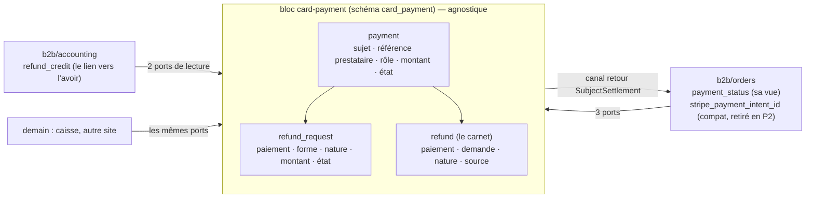
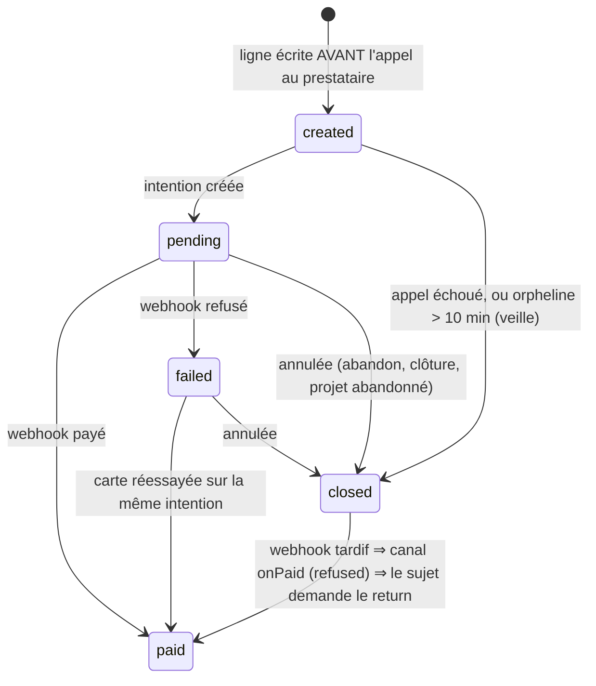
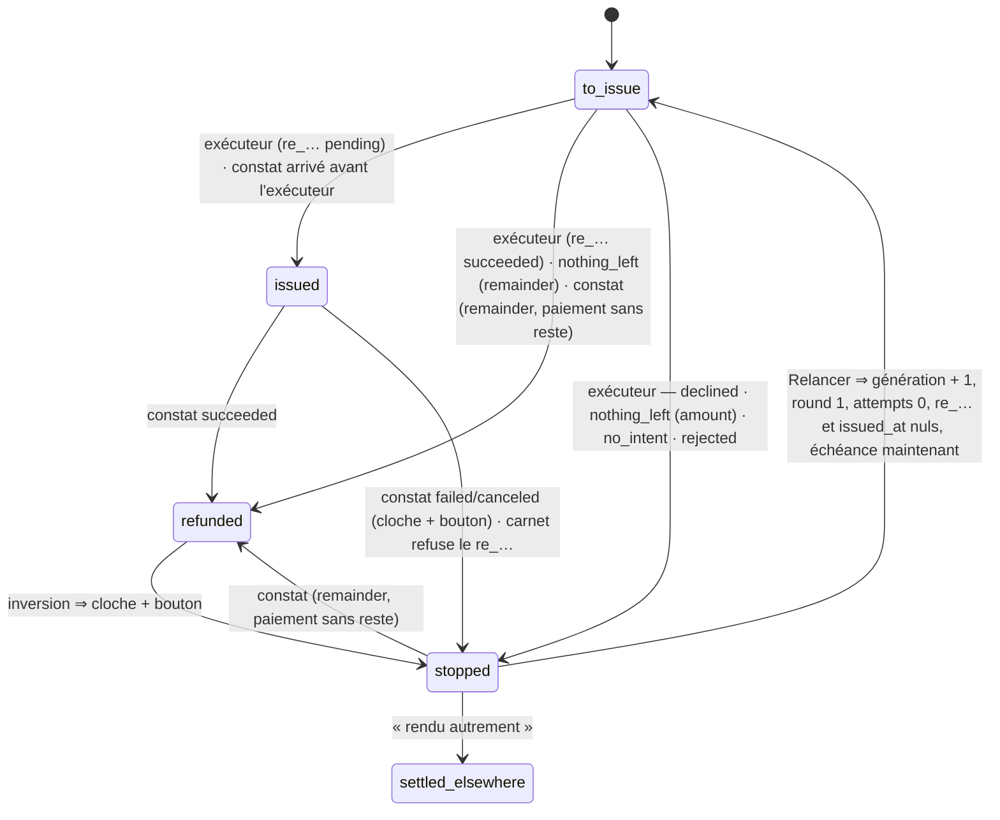
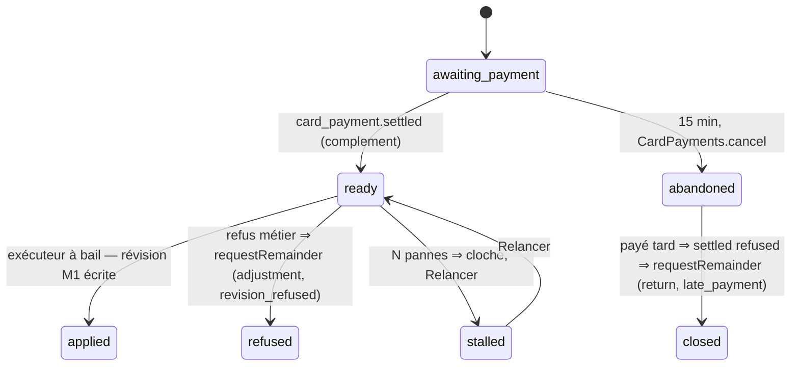

# Plan M2 — modifier une commande payée par carte : l'historique de transactions

> **Doc-first, 2026-11-09. Version 4.** Le plan **unique** de M2, écrit après la
> relecture complète du paiement et du remboursement
> ([`../reglement/relecture-paiement-et-remboursement.md`](../reglement/relecture-paiement-et-remboursement.md),
> à lire d'abord) et, pour cette version, après lecture des deux portes
> (`dev-toolbox/gates/prisma-model-ownership.mjs`, `context-boundaries.mjs`),
> du workflow de déploiement, du registre des abonnés durables, de l'écriture
> comptable du carnet et des routes d'équipe. Il **remplace** les §9 à §20 de
> [`plan-modifier-une-commande-payee-par-carte.md`](plan-modifier-une-commande-payee-par-carte.md).
> Versions 1 à 3 et leurs contradictions : `d2632e136`, `6eef19357`,
> `ca3b6c0c4`, `d5e5d7a49`, `e1b7f8a75`, `c290188ed`. Rien n'est bâti. Touche
> l'argent : `vitruve` avant Hugo.

## 0. Les décisions de Hugo

| Décision (2026-11-09)                                                                                         | Où                                  |
| ------------------------------------------------------------------------------------------------------------- | ----------------------------------- |
| La **forme C** : une commande, un numéro, plusieurs paiements et remboursements par montant                   | §2                                  |
| **Baisse** remboursée **tout de suite** ; **hausse** payée **tout de suite**, même écran                      | §7, §8                              |
| **Pas de modification carte après l'arrêt du plan** ; le **bon** sous la différence : bon neuf, **plus tard** | §7.1, §10                           |
| **D'abord le socle**, « 10/10, aucun angle mort » sur **notre** état                                          | §4–§6, §11, §12                     |
| **Sans rapprochement automatique** : notre donnée fait foi ; **pas de mode test Stripe** : « au culot »       | §6.6–§6.8, §12                      |
| **Un module propre, avec une API**, « une surface compréhensible », « le code doit refléter la surface »      | §3 : le bloc **`card-payment`**     |
| **D'autres applications** dans le même monolithe, même compte Stripe                                          | §3.1 : agnostique — un sujet opaque |
| **La carte seulement** : ni SEPA, ni virements, ni liens de paiement                                          | §3.1                                |

## 1. Ce qui existe

Dans la relecture. En une ligne : un paiement par commande
(`orders.stripe_payment_intent_id`), une demande de remboursement par
commande, un état déduit à chaque lecture, un remboursement sans montant, un
plafond sur `total_cents` (quatre adaptateurs), le remboursement rangé dans
`b2b/orders` (17 fichiers hors tests lisent le port de la demande, 10 le
carnet — recompte de `vitruve`), la comptabilité qui **écrit** dans le carnet
(`credit_note_id`, `prisma-refunds-to-credit.ts`) et une relation Prisma
`Invoice.refunds`, et aucun regard périodique vers le prestataire.

## 2. Le modèle cible, en une image

**Encaissé** d'un sujet = `Σ payment paid`. **Remboursé** = `Σ refund
succeeded` ; **remboursé d'ajustement** = ceux de nature `adjustment`.
**L'égalité G3** : encaissé − remboursé d'ajustement = total dû (sujet vivant,
soldé) ; encaissé − remboursé = 0 (sujet annulé, soldé).

## 3. Le bloc `card-payment`

### 3.1 Ce qu'il est, et ce qu'il n'est pas

**Il encaisse et rembourse par carte, pour un sujet qu'il ne connaît pas** :
`(subject_type, subject_id)` opaques — `order` + l'id aujourd'hui, `ticket` +
l'id demain. Il tient **tout l'état de l'argent carte** et c'est **lui seul**
qui parle au prestataire (`PaymentGateway`, `PaymentRefunder`, déménagés de
`b2b/payments`).

**Il ne sait pas** ce qu'est une commande, une facture, un bon, un total dû.
**Il n'inclut pas** les prélèvements SEPA ni les mandats, ni les virements
(constatés par la comptabilité), ni — pour l'instant — les **liens de
paiement** de société (`b2b/payments`, qui gardent leur propre webhook, §4.4).
« Rendu autrement » (§5.4) **note** un remboursement fait hors plateforme ; il
ne déplace aucun argent.

Sa seule connaissance métier est agnostique : la **nature** d'un
remboursement, `return` (la vente n'a pas lieu) ou `adjustment` (le montant
dû a baissé). C'est ce que la comptabilité lit pour décider d'un avoir.

**Dans `src/`** : `card-payment/` au premier niveau. Comme `mail` il n'a pas
de métier propre et n'importe que `platform` et `staff` ; comme `production`
il **déclare un canal qu'un autre bloc implémente** (`SubjectSettlement`, la
figure `production/channels/commerce/`). Matrice du `CLAUDE.md` § 3 : colonne
`card-payment` à **port uniquement** pour `b2b` ; ligne `card-payment` : ✓
`staff` (autorisation), ✓ `platform`, ✗ le reste.

### 3.1 bis Plusieurs comptes, plusieurs prestataires : le compte d'encaissement

> Hugo, 2026-11-09 : « comment il sait quel Stripe ou quelle banque si on en
> a plusieurs avec plusieurs apps ? » → **c'est l'appelant qui le nomme**.

- `card-payment` tient un **registre de comptes d'encaissement** (`AppConfig`,
  une entrée par compte) : nom (`lfc-stripe` aujourd'hui, `caisse-…` demain),
  **type** de prestataire (`stripe` ; demain `lyra`…), ses clés, le secret de
  **son** webhook.
- `CardPayments.open(subject, amountCents, role, account)` : le bloc métier
  **nomme le compte**. **Le paiement mémorise son compte** (`payment.account`,
  colonne posée dès P0, valeur unique `lfc-stripe` pour l'existant) ; relire,
  annuler, rembourser, vérifier partent sur **ce** compte — un remboursement
  ne peut pas partir sur la mauvaise banque : il suit le paiement.
- **Un webhook par compte** : `POST /payments/webhook/:account`, chacun son
  secret ; le compte est dans l'adresse, l'événement ne peut appartenir qu'à
  son registre. (`/payments/webhook` reste servi pour `lfc-stripe` tant que
  Stripe pointe dessus ; bascule d'adresse datée en P2.)
- Un **adaptateur par type** de prestataire, instancié une fois par compte ;
  les ports ne changent pas. Ajouter un compte = une entrée de configuration
  et des secrets ; ajouter une banque = un adaptateur.

### 3.2 La surface : trois ports, un canal, des faits

Déclarés et implémentés par `card-payment`, dans `card-payment/channels/requests/` :

| Port                       | Gestes                                                                                                                                                                                                                                                                                                                                                                             | Appelé par                                                                         |
| -------------------------- | ---------------------------------------------------------------------------------------------------------------------------------------------------------------------------------------------------------------------------------------------------------------------------------------------------------------------------------------------------------------------------------- | ---------------------------------------------------------------------------------- |
| **`CardPayments`**         | `open(subject, amountCents, role)` → `{ paymentId, providerRef, clientSecret, publishableKey }` (ligne `created` dans la transaction de l'appelant, prestataire **hors** transaction, puis `pending`) ; `retrieve(paymentId)` → état et `clientSecret` ; `cancel(paymentId)` → `cancelled \| already_cancelled \| already_paid \| in_progress \| unavailable` ; `publishableKey()` | passation, page de règlement, hausse, abandon, clôture, mandats (`publishableKey`) |
| **`CardRefunds`**          | `requestRemainder(paymentId, nature, reason)` → la demande (**idempotent** : rend l'existante non terminale) ; `requestAmount(paymentId, amountCents, nature, reason)` — dans la transaction de l'appelant                                                                                                                                                                         | annulation, baisse, refus d'une hausse                                             |
| **`CardSettlementReader`** | `positionOf(subjects[])` → par sujet : paiements (id, `providerRef`, rôle, état, montant), encaissé, remboursé par nature, demandes non terminales (forme, nature, état), en vol par forme ; `succeededRefundsOf(subject)` → chaque remboursement réussi (id, montant, nature, source) — **par lot**                                                                               | annulation, révision, listes, facture carte, avoirs                                |

Un **canal retour**, déclaré par `card-payment` dans
`card-payment/channels/subjects/` et **implémenté par le bloc métier** (un
implémenteur par `subject_type`, relié dans `appBootstrap/`) :
**`SubjectSettlement`** — `onPaid(subject, paymentId, amountCents)` →
`applied | refused` (le sujet écrit sa vue sous **son** verrou ; refuse s'il
est annulé) ; `onPaymentFailed(subject, paymentId)` ; `onRefundSettled(subject,
position)` → le sujet pose sa vue `refunded` ou la rend ; `standingOf(subject)`
→ `live | closed` (l'inversion sans demande en a besoin).

**Les faits durables** de `card-payment`, clés par sujet :
`card_payment.settled` (avec l'issue du canal), `card_payment.failed`,
`card_payment.refund_succeeded`, `card_payment.refund_failed`,
`card_payment.refund_reversed`, `card_payment.fully_refunded`,
`card_payment.unmatched`. **Les faits `order.*` d'aujourd'hui restent publiés
par `b2b/orders`** (depuis le canal et ces faits) ; leurs abonnés ne bougent
pas. Les deux abonnés qui **appartiennent** au remboursement
(`reopen-refund-on-reversal`, `ring-refund-failed`) déménagent **avec leurs
noms de reçu** (`orders.reopen-refund-on-reversal`…, gardés tels quels : le
registre refuse un doublon, pas un nom historique) ; `OnRefundWithoutOrder`
devient `@DurableHandler`.

**Les routes d'équipe** (`card-payment/http/`, surface `card_payments`,
ressource `StaffResource.card_payments` — valeur d'enum **additive**, accordée
à l'écran) : « Relancer », « rendu autrement », « Vérifier », la vue du
bandeau, le balayage. Jusqu'à ce qu'elle soit accordée, « Relancer » reste
servi aussi sous `b2b_cancel_order:write` par la route d'aujourd'hui (retirée
en P2).

### 3.3 Les machines à états

**`payment.state`**

**`refund_request.state`**

- Un `re_…` mort et une inversion sont des **arrêts** (cloche et bouton,
  jamais de relance seule — Q3 de C4). **Toute `to_issue` a une échéance.**
- Enum Postgres par machine ; déclencheur `BEFORE UPDATE` : paire hors liste
  refusée, `(x, x)` admis, **colonnes immuables** refusées (`subject_*`,
  `payment_id`, `form`, `amount_cents`, `nature`, `reason`) ; `BEFORE DELETE`
  refusé sauf `current_setting('card_payment.purge', true) = 'on'`, posé
  **dans une transaction** par la purge (`commerce.purge.ts`) et les semis
  (`siteless-pickups.seed.ts` à envelopper). Test exhaustif des paires.
- **Qui écrit** : l'exécuteur sous bail, par `save` (génération + jeton) ; le
  constat **sans bail**, par `transition(id, from, to, patch)` conditionnée sur
  l'état, sans toucher au bail ni à la génération ; il charge la demande par le
  `re_…` ou par la métadonnée (`requestId` + `generation`, portées par
  l'événement réduit), ignore une autre génération, et arrivé avant
  l'exécuteur pose `re_…` et `issued_at` (l'exécuteur voit alors `issued()`
  rendre `false`).

### 3.4 Le remboursement par montant

`PaymentRefunder.refund(params)` : sans montant (`remainder`), avec
(`amount`). `findRefund` : id de demande, génération, et montant pour une
`amount`.

| Issue                             | `remainder`                                                                                                                                     | `amount`                                              |
| --------------------------------- | ----------------------------------------------------------------------------------------------------------------------------------------------- | ----------------------------------------------------- |
| émis, `pending`                   | `→ issued`                                                                                                                                      | idem ; montant ≠ demandé ⇒ `stopped`, cloche          |
| émis, `succeeded` dès la création | `→ refunded`                                                                                                                                    | idem                                                  |
| `charge_already_refunded`         | relecture ; sans reste ⇒ `→ refunded` ; reste couvert par un `re_…` en vol **nôtre** ⇒ `issued` sur lui ; en vol **manuel** ⇒ `stopped`, cloche | écart ⇒ `stopped` (`nothing_left`), cloche            |
| montant > reste                   | n/a                                                                                                                                             | `stopped` (`declined:<code>`, relevé au bâti), cloche |
| `unavailable`                     | round + 1, échéance sur la courbe                                                                                                               | idem                                                  |

Le bail d'une `remainder` exige qu'aucune `amount` du même paiement ne soit
`to_issue | issued` (SQL brut, et revérifié dans `prepare()` sous le verrou du
paiement) ; `dueForSweep` : `state = to_issue` seul.

### 3.5 L'ordre des verrous : le sujet d'abord

Tout geste sur l'argent d'un sujet est appelé **dans la transaction du bloc
métier**, qui a pris le verrou de sa ligne ; `card-payment` verrouille ensuite
ses lignes (le reste de l'ordre de l'annulation — atelier, BL, bon, puis la
demande — ne bouge pas). Les appels au prestataire (`open`, `cancel`, le
remboursement) restent **hors** transaction (`network-outside-transaction`).
**Les webhooks respectent le même ordre** : le contrôleur appelle le canal
d'abord (`onPaid` : le commerce prend `orders`, `markPaid`, publie `order.paid`
au franchissement, ou refuse une annulée ; `onRefundSettled` : le commerce
pose sa vue), **puis** `card-payment` écrit sa ligne et publie son fait. Une
annulée encaissée est `paid` chez `card-payment` et `refused` au canal : **le
commerce**, sur `card_payment.settled { refused }`, demande le `return`
(`requestRemainder`, idempotent) — un seul demandeur, celui qui sait que le
sujet est annulé.

## 4. Lot P0 — le bloc, le paiement seul (migration additive)

**Avant tout code** : `"card-payment"` dans `BLOCKS` de
`prisma-model-ownership.mjs` et dans `BLOCK_OF` / `ALLOWED` / `PORT_SURFACE`
(`"b2b→card-payment": "card-payment/channels/"`) de `context-boundaries.mjs`,
et la colonne dans la matrice du `CLAUDE.md` ([[armer-une-porte-avant-de-demenager]]).

### 4.1 Ce qui déménage

Les ports et adaptateurs du prestataire (`payment-gateway.ts`,
`payment-refunder.ts`, `stripe-*.ts`, la traduction), le **webhook des cartes**
(`POST /payments/webhook`, chemin inchangé), la passation côté argent
(`order-settlement.ts` appelle `CardPayments.open` ; `order.payByCard(providerRef)`
**continue d'écrire `orders.stripe_payment_intent_id`**), la page de règlement
(`CardPayments.retrieve`), l'abandon, l'expiration et la clôture
(`CardPayments.cancel`). **Le remboursement ne bouge pas** : il reste dans
`b2b/orders`, sur ses tables d'aujourd'hui, et lit `orders` comme aujourd'hui
— c'est ce qui rend P0 possible (la version 3 voulait le déménager « à base
constante », et il lit `orders` à trois endroits).

### 4.2 La table `card_payment.payment` (additive)

`id`, `subject_type`, `subject_id`, **`account`** (§3.1 bis), `provider_ref`
(`@unique` **par compte** : `(account, provider_ref)`), `role`, `amount_cents`
(> 0), `state`, `created_at`, `paid_at`.
Index unique `(subject_type, subject_id) WHERE role = 'first'`. **Reprise** du
`first` pour toute commande qui a une intention : `amount_cents :=
total_cents` ; `state` par priorité : `paid` si `payment_status ∈ {paid,
refunded}` **ou** carnet non vide **ou** demande `paid_after_cancellation`
(une annulée payée est **`paid`**) ; sinon `closed` si `status = cancelled` ;
sinon `pending | failed` selon `payment_status`. Le webhook retrouve le sujet
par `provider_ref` ; une référence inconnue ⇒ `card_payment.unmatched`
(journal + cloche) — **vraie** anomalie, puisque toutes les intentions carte
du compte passent par ce bloc et que les liens ont leur propre endpoint.

### 4.3 Le canal, côté commerce

`b2b/orders` implémente `SubjectSettlement` pour `order` : `onPaid` =
`markPaid` + `order.paid` (ou `refused` si rien n'a franchi parce que la
commande est annulée ; un webhook **rejoué** sur une commande déjà `paid` rend
`already_applied`, troisième issue, et ne demande rien) ; `onPaymentFailed` =
`markPaymentFailed` + `order.payment_failed` ; `standingOf`. Le demandeur du
`return` après annulation : l'abonné durable d'aujourd'hui
(`refund-paid-after-cancellation`), qui écoute désormais
`card_payment.settled { refused }`.

### 4.4 Deux endpoints chez Stripe

`/payments/webhook` (cartes → `card-payment`) et `/payments/links/webhook`
(sessions Checkout des liens → `b2b/payments`), **chacun son secret** et sa
liste d'événements (le second ne reçoit que `checkout.session.*`). Le
contrôleur des cartes ignore (`200`) tout événement sans `provider_ref` connu
**qui porte `paymentLinkId`**, ceinture et bretelles pendant la transition.

### 4.5 Ce que P0 change, et ce qu'il ne change pas

Change : une valeur d'enum `StaffResource` (additive, **pas réversible par
revert**, inerte tant qu'elle n'est pas accordée), une table neuve, les
imports. Ne change pas : aucun écran, aucune route d'équipe, aucune table
existante, aucun fait `order.*`. **Réversible** à la table et à l'enum près :
un revert du code laisse une table que personne ne lit.

## 5. Lot P1 — le remboursement déménage (migration irréversible)

### 5.1 Les tables

- **`refund_request`** : `id` (ULID), `payment_id` (non nul), `form`,
  `amount_cents` (CHECK), `nature`, `reason` (texte borné : `cancellation`,
  `paid_after_cancellation`, `refund_reversed`, `revision`,
  `revision_refused`, `late_payment`…), `state`, les colonnes d'aujourd'hui.
  Index unique partiel `(payment_id) WHERE form = 'remainder'`.
- **`refund`** : `payment_id` (non nul), `request_id` (nullable),
  `nature` (nullable), `source`, `provider_ref` nullable (CHECK `source =
'provider' ⇔ provider_ref IS NOT NULL`), montant, statut, instants. **Sans
  `credit_note_id`** : le lien vers l'avoir devient
  **`accounting.refund_credit (refund_id, credit_note_id, reason)`**, écrit
  par la comptabilité seule — `card-payment` n'a plus aucun état comptable,
  et il n'y a plus de clé étrangère entre blocs. La relation `Invoice.refunds`
  disparaît ; `RefundsToCreditReader` lit `succeededRefundsOf` et sa propre
  table.
- Les relations `Order.refunds`, `Order.refundRequest` sont **retirées**
  (plus exprimables) ; les lecteurs par relation (`prisma-order.reader.ts`,
  `prisma-card-invoicing.reader.ts`, `cancellation-subject.row.ts`,
  `revisable-order.row.ts`, `prisma-order-refund-request.reader.ts`) passent
  par `positionOf`, par lot pour les listes.

### 5.2 La reprise — rejouable, et rejouée

Une **commande** `ReplayRefundTakeover`, idempotente (par id, prend l'état le
plus avancé, insère l'absent), lancée par la migration **et** par un cron
horaire pendant **48 h** après le déploiement, puis retirée en P2 : c'est ce
qui couvre la **fenêtre** où l'ancienne image répond encore (1–2 min après
`wrangler deploy`, constaté dans le workflow) et écrit l'ancienne table. P1 se
déploie à une heure creuse. La reprise **ne fait jamais échouer le démarrage**
(elle journalise et sonne).

Règles, dans l'ordre : (1) `refund` : `payment_id := le first`, `source :=
provider`, `request_id` quand une demande porte ce `re_…`, **`nature :=
return` seulement alors** (un `re_…` sans demande est manuel : nature nulle) ;
(2) `refund_request` : `id := order_id`, `payment_id`, `form := remainder`,
`nature := return`, `reason := cause`, et **`state`** : (a) `re_…`
`succeeded`, ou paiement sans reste ⇒ `refunded` ; (b) `re_…` `failed |
canceled`, **ou** `re_…` nul et échéance nulle (celles qui attendent le
bouton : `last_failure` posé ou non) ⇒ `stopped` ; (c) `re_…` vivant ⇒
`issued` ; (d) sinon `to_issue`, échéance conservée. Le test compare à
**cette règle**. Les anciennes tables restent, sans lecteur, jusqu'à P2.

### 5.3 Ce qui change à l'écran

Le bandeau : plusieurs demandes par commande, plus d'état `failed`
(`stopped`), « Relancer » et « rendu autrement » par demande ; le contrat
`AdminOrderRefund` devient une liste ; les routes sous `admin/card-payments/`.
Pré-release, Hugo averti ici.

### 5.4 « Rendu autrement »

`stopped → settled_elsewhere` ; une ligne `refund` `source = manual`,
**statut `succeeded`**, **montant = celui de la demande** (`amount`) ou le
reste du paiement (`remainder`) ; publie `card_payment.refund_succeeded` (qui
réveille la facture) ; **pas d'avoir** quand la nature est `adjustment`, un
avoir sinon — comme un `re_…`.

## 6. Ce que le socle tient aussi

### 6.1 La comptabilité

`CardInvoiceCandidate` lit `positionOf` : `refundedCents` (**toute nature**,
comme aujourd'hui — un pro remboursé en entier à la main n'est pas facturé),
`adjustmentRefundedCents`, `adjustmentPending`, `adjustmentStopped`.
`cardInvoiceVerdict` : `awaiting_refund` (pending), `blocked` (stopped, ou
encaissé − adjustment ≠ `total_cents`), avant `awaiting_handover`. Réveil :
abonné durable `issue-card-invoice-on-refund-settled` sur
`card_payment.refund_succeeded`. `RefundReconciler` : nature `adjustment` ⇒
pas d'avoir, `refund_credit (reason = adjustment)` ; nature `return` ou nulle
⇒ avoir, comme aujourd'hui. Inerte avant S1.

### 6.2 L'inversion et le geste manuel

Par le `re_…` : `refunded → stopped`, cloche. Sans demande : si
`standingOf(subject) = closed`, `requestRemainder` (idempotent : rouvre
l'existante `stopped → to_issue` avec échéance, ou crée `return` /
`refund_reversed`) ; si `live`, cloche seulement. Un `re_…` sans demande :
constaté (`request_id`, `nature` nuls), cloche « hors plateforme » ; une
`remainder` `to_issue | stopped` d'un paiement sans reste ⇒ `refunded`.
`refund_in_flight` (annulation, révisabilité) : en vol **sauf** les `amount`.

### 6.3 Le constat d'un remboursement

Retrouve le paiement par `provider_ref` (**une** table) ; canal
`onRefundSettled` **d'abord** (le sujet pose `refunded` quand
`Σ succeeded = encaissé`, ou la rend), puis le carnet et le fait. Plafond par
paiement et par sujet.

### 6.4 Les deux vérités du premier paiement

`orders.stripe_payment_intent_id` (écrite par `orders` depuis `providerRef`)
et `payment(first).provider_ref` : égalité vérifiée par le test de reprise
et par la **veille du commerce** (qui lit sa colonne et `positionOf`) ;
colonne retirée en P2 quand les 24 lecteurs passent par `positionOf`.

### 6.5 « Vérifier chez le prestataire »

Commande d'équipe (journal `card_payment.verified`) : `retrieve`
(`amountReceivedCents` ajouté au port) et `listRefunds` sur chaque paiement
du sujet ; compare ; affiche ; n'écrit rien d'autre.

### 6.6 La veille (aucun appel au prestataire)

`watch-card-payments` (horaire, dans `card-payment`) : `issued` > 7 j ;
`stopped` > 24 h ; `to_issue` à échéance dépassée > 1 h ; `payment` `created`

> 10 min (⇒ `closed`, sonne) ; `pending` `complement` > 15 min.
> `watch-order-settlement` (horaire, dans `b2b/orders`) : `placed` + `pending`
> dont le jour est passé ; les deux vérités divergentes ; projet
> `awaiting_payment` > 15 min ou `ready` > 1 h (S2). Cloche + journal.

### 6.7 Le rapprochement automatique — reporté

Quotidien, 30 jours, deux sources (API ou relevé). Attend le signal du
§13.4. Les lignes `manual` y sont attendues.

### 6.8 Les crons

`sweep-card-refunds` (l'existant, déménagé : `admin/card-payments/sweep`),
`watch-card-payments`, `watch-order-settlement`, `replay-refund-takeover`
(48 h), `abandon-revision-proposals` (S2) : chacun son entrée dans
`apps/lfd-api/container/worker.ts` ; `purge-coverage.ts` apprend le schéma
`card_payment` (ses tables n'ont pas de clé étrangère vers `public` : à
déclarer).

## 7. Lot S1 — la baisse

**Quand** : comme M1 ; avant l'inscription (`OrderInscriptionReader`, verrou
de la journée) ; pas sur stock ; **jamais à 0 €** ; pas sur un `first`
`pending | failed` ; pas sous la part du bon (refus actuel, jusqu'à C-2b).

**Le geste** : dans `ReviseOrderHandler.record()`, après `save`, sous le
verrou `orders` : `requestAmount` pour `ancien − nouveau`, nature
`adjustment`, raison `revision`, du dernier paiement encaissé au premier, en
**sautant** tout paiement portant une `remainder` non terminale ; exécuteur
après validation ; « X € vous seront remboursés ».

**L'annulation** : `requestRemainder` par paiement encaissé, nature `return`,
idempotent ; annoncé = encaissé − réussi − annoncé des `amount` non
terminales.

## 8. Lot S2 — la hausse

**Le projet** (`b2b/orders`, `order_revision_proposal`) : contenu saisi et
révision composée, total visé, `complement_cents`, auteur, `payment_id`,
`state`, colonnes de reprise (bail, essais, échéance).

Un seul projet `awaiting_payment | ready | stalled` par commande. Le geste :
composer, écrire le projet, `CardPayments.open(complement)`, régler **sur le
même écran** (`GetComplementPayment`) ; échec ⇒ `cancel`. **Le paiement** :
`onPaid` sur un `complement` → `awaiting_payment → ready` et rien d'autre ;
`AfterCommit` → exécuteur à bail `ApplyRevisionProposal` (bail, essais,
courbe, balayage `sweep-revision-proposals`) : verrou `orders`, journée,
rejugement M1, **total recomposé = total payé**, `record()`, `applied`. Refus
(`BusinessError | DomainError`) ⇒ seconde transaction, `refused`,
`requestRemainder`, courriel. Panne ⇒ essai suivant, puis `stalled`, cloche.
**L'abandon** : cron, `cancel` ; `already_paid` ⇒ rien. **L'équipe** baisse
librement ; pour une hausse, le client reçoit l'URL du complément.

## 9. Lot S3 — écrans et courriels

Historique daté des paiements et remboursements (montant, état, nature) ;
la baisse avec le montant rendu ; la hausse réglée sur place ; côté staff :
« Vérifier », « rendu autrement », un projet `stalled`. Courriels
`customer.order-modified`, `customer.order-modification-failed`.

## 10. Lot C-2b — le bon (plus tard), et P2 — le resserrement

C-2b : deux bloquants propres (ancien plan §17), plan à part dans `loyalty`.
P2 : retrait de `orders.stripe_payment_intent_id` (24 lecteurs →
`positionOf`), des anciennes tables, de la route `refund/retry`, du cron de
reprise.

## 11. Les garanties

| Étage               | Ce qui tient                                                                                                                                                                                                                                                                                                  |
| ------------------- | ------------------------------------------------------------------------------------------------------------------------------------------------------------------------------------------------------------------------------------------------------------------------------------------------------------- |
| **G0 la frontière** | un seul bloc touche l'argent carte et le prestataire ; `context-boundaries` (imports) et `prisma-model-ownership` (écrivain unique, par bloc, dès P0) ; les lectures par relation **n'existent plus** en P1 (relations retirées) ; aucune écriture d'un autre bloc dans `card_payment`                        |
| **G1 inexprimable** | montants > 0 ; `form = amount ⇔ amount_cents` ; une `remainder` par paiement ; un `first` par sujet ; un projet non terminal par commande ; `source = provider ⇔ provider_ref` ; `settled_elsewhere ⇔ motif + staff` ; transitions et colonnes immuables par déclencheur ; `DELETE` sous `card_payment.purge` |
| **G2 agrégat**      | `Σ succeeded ≤ amount_cents` par paiement et par sujet ; `amount` ≤ reste ; projet : total recomposé = total payé                                                                                                                                                                                             |
| **G3 l'égalité**    | sujet vivant soldé : encaissé − `adjustment` = total dû ; annulé soldé : encaissé − remboursé = 0 ; vérifiée à la facture carte (pro) et par la veille du commerce (tous) ; `stopped` ou `stalled` = non soldé, signalé                                                                                       |
| **G4 prestataire**  | « Vérifier » à la main ; la veille attrape ce qui attend trop ; le rapprochement attend son signal. **Laisse passer** le contenu d'un webhook perdu                                                                                                                                                           |

## 12. Les tests

- **P0** : portes vertes (`BLOCKS`, `BLOCK_OF` armés avant) ; chaque e2e de
  paiement et d'annulation d'aujourd'hui **verte sans changement** hors du
  chemin du webhook des liens ; reprise du `first` contre sa règle (payée
  après annulation ⇒ `paid` ; annulée non payée ⇒ `closed`) ; `unmatched`
  sur une référence inconnue ; `onPaid` `applied | refused | already_applied`.
- **P1** : reprise ligne à ligne contre la règle écrite, **rejouée** deux
  fois ; une annulation faite « par l'ancienne table » pendant la fenêtre,
  rattrapée par le cron ; paires (état, transition) exhaustives ; colonnes
  immuables ; webhook avant l'exécuteur ; `succeeded` dès la création ;
  `nothing_left` (sans reste, en vol nôtre, en vol manuel, `amount`) ; `re_…`
  manuel partiel puis total ; inversion avec et sans demande, `live` et
  `closed` ; bail puis `amount` avant `prepare` ; `DELETE` refusé / admis ;
  `settled_elsewhere` ferme G3 et réveille la facture ; `refund_credit` ; la
  veille ; l'écran et les routes par demande ; les deux vérités.
- **S1** : deux baisses ; baisse puis annulation avant remboursement ; baisse
  sur un paiement portant une `remainder` ; 70 % remboursés, facturée sur le
  livré, sans avoir ; refus à 0 €, sur `pending`, sous le bon, après
  inscription.
- **S2** : appliquée ; refusée ⇒ complément rendu ; `stalled` puis relancé ;
  abandon puis paiement tardif ; deux projets ; webhook rejoué / désordonné ;
  redémarrage entre `ready` et l'exécuteur.

Contre le vrai Postgres, prestataire doublé au port ;
`stripe-refund-calls.spec.ts` couvre `refund(amount)`, `listRefunds`, le
montant dans la recherche. **Pas de mode test Stripe** : la première baisse
réelle est faite par l'équipe sur une commande de l'équipe, « Vérifier »
cliqué après ; les chemins d'erreur ne seront passés chez Stripe que le jour
où ils arriveront — la veille et les cloches les diront.

## 13. À décider (Hugo)

1. **Statuts de remboursement neutres** : plus tard (proposé).
2. **Délai de grâce d'une hausse** : 15 min (proposé).
3. **Ressource `card_payments`** pour les gestes d'équipe, accordée à l'écran
   (proposé).
4. **Le rapprochement automatique** : au premier webhook perdu constaté, ou
   avant un changement de prestataire (proposé).
5. **Les liens de paiement** restent au commerce avec leur propre endpoint
   (proposé).

## 14. L'ordre, et l'irréversible

Portes et matrice armées → **P0** (table additive, enum additif ; code
réversible) → déployé, e2e vertes → **P1** (irréversible : schéma
`card_payment`, reprise, `refund_credit`, relations retirées, valeurs des
enums ; `lecteur-de-migrations` ; heure creuse ; cron de reprise 48 h) →
quelques jours d'annulations ordinaires, « Vérifier » cliqué, la veille
muette → **S1** → première baisse réelle vérifiée → **S2** → **S3** → **P2**.
§6.7 et C-2b quand leur tour vient.
