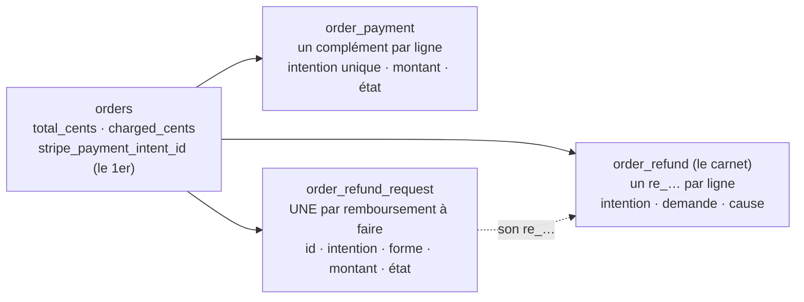
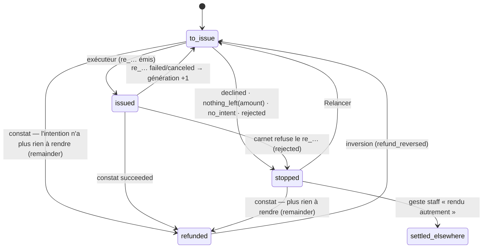

# Plan M2 — modifier une commande payée par carte : l'historique de transactions

> **Doc-first, 2026-11-09.** Le plan **unique** de M2, écrit après la relecture
> complète du paiement et du remboursement
> ([`../reglement/relecture-paiement-et-remboursement.md`](../reglement/relecture-paiement-et-remboursement.md),
> à lire d'abord). Il **remplace** les §9 à §20 de
> [`plan-modifier-une-commande-payee-par-carte.md`](plan-modifier-une-commande-payee-par-carte.md),
> qui gardent l'historique des décisions et des quatre contradictions de
> `vitruve`. Rien n'est bâti. Touche l'argent : `vitruve` avant Hugo.

## 0. Les décisions de Hugo, et ce qu'elles fixent

| Décision (2026-11-09)                                                           | Conséquence dans ce plan                                                                                     |
| ------------------------------------------------------------------------------- | ------------------------------------------------------------------------------------------------------------ |
| La **forme C** : une commande, un numéro, plusieurs paiements et remboursements | §2 — jamais de seconde commande, jamais de renumérotation                                                    |
| Une **baisse** est remboursée **tout de suite**                                 | §5                                                                                                           |
| Une **hausse** se paie **tout de suite**, sur le même écran                     | §6 — le projet ne vit que le temps du règlement ; 15 min de grâce si le client quitte la page                |
| **Pas de modification carte après l'arrêt du plan**                             | §5.1 — jugé comme M1, sous le verrou de la journée                                                           |
| Le reste sous le **bon de fidélité** devient un **bon neuf**                    | hors du cœur : lot **C-2b**, §8 ; d'ici là le refus actuel (`RevisionBelowVoucherError`) reste               |
| **D'abord le cœur**, « 10/10, aucun angle mort » sur **notre** état             | §3 le socle d'abord, sans aucune règle de modification ; §9 les garanties ; §10 les tests                    |
| **Pouvoir changer de prestataire** facilement                                   | §4 — rien de ce plan n'ajoute d'adhérence à Stripe hors des adaptateurs ; ce qui fuit déjà est listé et daté |

## 1. Ce qui existe

Tout est dans la relecture ; ce plan n'en répète que ce qu'il change. En une
ligne : **un paiement par commande** (`orders.stripe_payment_intent_id`,
`@unique`), **une demande de remboursement par commande** (clé `order_id`),
**un état déduit** à chaque lecture (`refundRequestStateOf`), **un
remboursement sans montant** (`refundRemainder`), **un plafond sur
`total_cents`**, et **aucun regard périodique vers le prestataire**.

## 2. Le modèle cible

- **`orders`** garde le premier paiement là où il est : ses 24 lecteurs ne
  changent pas. Elle gagne `charged_cents` (l'encaissé du premier paiement,
  figé à `markPaid`).
- **`order_payment`** : les paiements **suivants** (rôle `complement`), une
  intention chacun.
- **`order_refund_request`** : une ligne par remboursement à faire, avec
  l'intention visée, la **forme** (`remainder` : tout ce qui reste sur cette
  intention — l'annulation ; `amount` : ce montant exactement — une baisse,
  un complément à rendre), le montant, et un **état écrit**.
- **`order_refund`** : le carnet, inchangé dans son rôle, qui sait désormais
  **sur quelle intention**, **pour quelle demande** et **pour quelle cause**
  chaque `re_…` a été fait.

L'encaissé d'une commande = `charged_cents + Σ order_payment paid`. Le
remboursé = `Σ order_refund succeeded`. **L'égalité qui doit tenir** (G3) :
encaissé − remboursé = `total_cents` sur une commande vivante soldée, 0 sur
une annulée soldée.

## 3. Lot S0 — le socle (aucune règle de modification)

Ce lot ne change **rien** au comportement visible : les mêmes annulations
rendent le même argent. Il rend l'état lisible, borné et prêt pour plusieurs
transactions. Il se déploie **seul**, et se vérifie seul.

### S0.1 Les paiements

- Table `order_payment` : `id`, `order_id`, `payment_intent_id` (`@unique`,
  nullable tant que `created`), `role` (`complement`), `amount_cents` (> 0),
  `state` (§3.4), `revision` (la révision qu'il paie, nullable), `created_at`,
  `paid_at`. **La ligne s'écrit `created` AVANT l'appel au prestataire**, puis
  `pending` avec l'intention : une intention orpheline (appel réussi,
  écriture perdue) est une ligne `created` de plus de 10 min, que le
  rapprochement (§3.9) cherche ou abandonne — jamais un paiement dont nous
  n'avons pas trace.
- `orders.charged_cents Int?` : posé par `markPaid` (= `total_cents` à cet
  instant) ; **repris** pour les commandes `paid | refunded` existantes
  (migration : `charged_cents = total_cents`, exact puisqu'aucune commande
  carte n'a jamais été révisée — `CardOrderNotRevisableError`).
- Le webhook de paiement (`confirm-order-payment.handler.ts`) : `markPaid`
  cherche d'abord `orders`, puis `order_payment` ; un complément franchi
  publie `order.complement_paid` (durable). **Une intention inconnue des deux
  tables sonne la cloche** (`payment.unmatched`) et journalise — ferme
  l'angle mort E1.

### S0.2 La demande de remboursement a son identité

- `order_refund_request` : `id` (ULID) devient la clé ; `order_id` reste ;
  `payment_intent_id` (non nul) ; `form` (`remainder | amount`) ;
  `amount_cents` (CHECK : `(form = 'amount') = (amount_cents IS NOT NULL)`) ;
  `state` (§3.4).
- **Reprise** : `id := order_id` (les clés d'idempotence déjà posées chez
  Stripe gardent donc leur préfixe `lfd-order-refund:<id>:…`),
  `payment_intent_id := orders.stripe_payment_intent_id`, `form :=
'remainder'`, `state` calculé **en SQL dans la migration** par la même
  règle que `refundRequestStateOf` (lue au carnet), sauf « arrêtée » :
  `next_attempt_at IS NULL AND stripe_refund_id IS NULL AND last_failure IS
NOT NULL` ⇒ `stopped`. Irréversible (§11).
- **Index unique partiel** `(order_id, payment_intent_id) WHERE form =
'remainder'` : une seule « tout le reste » par intention, tenue par la
  base ; sa violation est traduite en refus nommé (jamais un 500).
- `Order.refundRequest` (1:1) devient `refundRequests[]` : les lecteurs se
  comptent au bâti (grep `refundRequest` : ~15 fichiers de `src/`, 5 e2e,
  d'après `vitruve` — à recompter).
- Le **bail**, la **clé d'idempotence** et la **métadonnée** Stripe prennent
  l'id de la demande ; `lfd_order_id` porte **la commande** (aujourd'hui elle
  porte `requestId`, qui vaut l'id de la commande — E9). `RefundRequestParams`
  gagne `orderId`, `amountCents | null`.

### S0.3 Le remboursement par montant

- `PaymentRefunder.refund(params)` remplace `refundRemainder` : sans montant
  pour une `remainder`, avec pour une `amount` (`refunds.create({ amount })`).
  La recherche (`findRefund`) reconnaît un `re_…` par id de demande et
  génération, **et** par montant pour une `amount`.
- Les issues, par forme :

| Issue Stripe              | `remainder`                                 | `amount`                                                |
| ------------------------- | ------------------------------------------- | ------------------------------------------------------- |
| `issued`                  | émise                                       | émise (montant vérifié ; différent ⇒ `stopped`, cloche) |
| `charge_already_refunded` | relecture ; plus rien à rendre ⇒ `refunded` | **écart** ⇒ `stopped` (`nothing_left`), cloche          |
| montant > reste           | n/a                                         | `stopped` (`declined:amount_too_large`), cloche         |
| `unavailable`             | round +1, reprise                           | idem                                                    |

- L'exécuteur **ne prend une `remainder`** d'une intention **que si aucune
  `amount` de la même intention n'est `to_issue` ou `issued`** : une
  condition dans l'`updateMany` du bail (table des demandes seule) **et**
  revérifiée dans `prepare()` sous le verrou `orders` (la fenêtre bail →
  prepare est hors verrou, `vitruve` §20 S1). Une `amount` `stopped` ne
  bloque pas : sa `remainder` la couvre.

### S0.4 L'état écrit, et ses transitions (relu dans le code)

- Un enum Postgres `OrderRefundRequestState` ; **le déclencheur
  `BEFORE UPDATE`** refuse toute paire `(ancien, nouveau)` hors de cette liste
  et **admet `(x, x)`** (bail, essais, round, échéance, rejeu). Un déclencheur
  `BEFORE DELETE` refuse sauf `current_setting('lfd.purge', true) = 'on'`.
- **Qui écrit quoi** : l'exécuteur (`to_issue → issued | stopped`,
  `issued → to_issue` en rouvrant), **le constat** (`issued → refunded`,
  `→ to_issue` sur `failed/canceled` de son `re_…`, et `to_issue | stopped →
refunded` pour une `remainder` dont l'intention n'a plus rien), « Relancer »
  (`stopped → to_issue`), l'inversion (`refunded → to_issue`), le geste
  « rendu autrement » (`stopped → settled_elsewhere`, motif et fiche staff
  obligatoires, CHECK). Le constat **charge désormais la demande** : il la
  retrouve par le `re_…` (colonne `stripe_refund_id @unique`, existante), ou
  par la métadonnée `lfd_refund_request` que l'événement réduit porte
  désormais (`RefundWebhookEvent.requestId`).
- `refundRequestStateOf` **disparaît** ; l'ancien état lu `failed` est
  remplacé par la transition `issued → to_issue` (génération suivante)
  faite au constat, plus par l'exécuteur à sa prise.
- `settled_elsewhere` **entre dans le carnet** comme une ligne
  `order_refund` de source `manual` (colonne `source` : `provider | manual`),
  sans `re_…` (`stripe_refund_id` devient nullable, CHECK : `source =
'provider' ⇔ stripe_refund_id IS NOT NULL`), montant = le reste de
  l'intention au moment du geste. G3 tient ; la comptabilité la voit comme un
  remboursement réussi.
- Un **test exhaustif** parcourt toutes les paires (état, transition) et
  compare agrégat et déclencheur.

### S0.5 Le carnet

- `order_refund` gagne `payment_intent_id` (non nul), `request_id`
  (nullable : un `re_…` fait à la main n'en a pas), `cause` (nullable pour
  l'existant ; posée depuis la demande retrouvée), `source`.
- **Reprise** : `payment_intent_id := orders.stripe_payment_intent_id` (toutes
  les lignes existantes sont sur le premier paiement), `request_id :=
order_id` quand `order_refund_request.stripe_refund_id` = ce `re_…`,
  `source := 'provider'`.
- `chargedCents` = `charged_cents + Σ order_payment paid` (deux lecteurs à
  changer : `prisma-order-refund.repository.ts`,
  `prisma-order-refund-request.reader.ts`). **Le plafond vaut par intention**
  (`Σ succeeded de l'intention ≤ son encaissé`) **et** pour la commande.
- `settle()` : `paid → refunded` quand `Σ succeeded = encaissé` (plus
  `total_cents`) — ferme E5.

### S0.6 L'inversion et le remboursement à la main

- `ReopenRefundOnReversal` retrouve **sa demande par le `re_…`**, commande
  annulée **ou vivante** (E2). Sans demande : sur une annulée, le comportement
  d'aujourd'hui (une `remainder` `refund_reversed` sans échéance) ; sur une
  vivante, **cloche seulement, rien d'écrit**.
- Un `re_…` **sans demande** sur une commande vivante (geste au tableau de
  bord) : constaté au carnet (`request_id` nul, cause nulle), **cloche**
  (« remboursement fait hors de la plateforme »), et aucune demande
  n'est créée. Si une `remainder` est `to_issue` ou `stopped` et que
  l'intention n'a plus rien : elle passe `refunded` (le comportement
  d'aujourd'hui, désormais écrit).

### S0.7 La comptabilité

- `CardInvoiceCandidate.refundedCents` ne compte que les causes **autres que
  `revision`** ; `cardInvoiceVerdict` gagne `awaiting_refund` (une demande
  `revision` `to_issue | issued`) et `blocked` (encaissé − remboursé ≠
  `total_cents`, ou une demande `revision` `stopped`), décidés **avant**
  `awaiting_handover` et `fully_refunded` ; `blocked` sonne.
- `RefundReconciler` : un `succeeded` de cause `revision` **ne produit pas
  d'avoir** et n'est pas signalé « non crédité » — il est marqué `credit_note_id`
  nul avec `credited_reason = 'revision'` (colonne), pour que le balayage
  cesse de le relire.
- Aucune de ces deux règles ne change rien **avant S1** : aucune demande
  `revision` n'existe.

### S0.8 Les autres abonnés de `order.paid`

Cinq aujourd'hui (recomptés par `vitruve`) : facture carte, points, accusé,
avis à l'invité, avis au principal d'un site. Aucun ne lit
`order.complement_paid` ; S2 dira lesquels doivent le lire.

### S0.9 Le rapprochement quotidien (G4)

Un balayage (`ReconcilePaymentsCommand`, cron) relit chez le prestataire,
**pour chaque commande carte des 30 derniers jours** (premier paiement et
compléments, par leurs identifiants chez nous) : l'intention (état, montant
encaissé) et la liste de ses remboursements. Tout écart avec `orders`,
`order_payment` et `order_refund` — paiement inconnu, remboursement inconnu,
montant ou statut différent, ligne `created` de plus de 10 min — sonne la
cloche et s'écrit au journal (`payment.reconciliation_gap`). **Par nos
identifiants, jamais par une recherche de métadonnée** : l'id d'une commande
n'existe pas avant son écriture (`@default(cuid())`), et une intention
créée avant l'écriture mais jamais confirmée ne déplace aucun argent.
Port : `PaymentGateway.retrieveIntent` existe ; `PaymentRefunder.listRefunds(intent)`
à ajouter (l'appel existe dans `findRefund`).

### S0.10 Ce que S0 ne fait pas

Il ne rend **aucune** commande carte modifiable, ne renomme aucune colonne
`stripe_*`, ne traduit pas les statuts de remboursement de Stripe en statuts
neutres (§4), et ne touche pas à la fidélité.

## 4. La frontière prestataire

Ce plan **n'ajoute aucune adhérence** hors de `payments/infrastructure/` :
`amountCents` dans le port, `requestId` sur l'événement réduit,
`listRefunds` sur le port — trois choses que toute banque sait faire.

Ce qui fuit déjà (relecture, § D) et **reste** après M2, daté pour un chantier
à part : la page de règlement de la boutique (Payment Element), l'enum
`OrderRefundStatus` recopié de Stripe, les noms de colonnes `stripe_*`, le mot
« Stripe » dans ~40 JSDoc et 2 textes de la boutique. Un changement de
prestataire = cinq adaptateurs (~700 l.) + le contrôleur de webhook + la page
de règlement.

## 5. Lot S1 — la baisse

### 5.1 Quand

Comme M1 (qui, quoi, prix figés), **avant l'inscription** jugée par
`OrderInscriptionReader` sous le verrou de la journée ; pas sur stock
(`supply = shelf`) ; **jamais à 0 €** (« pour tout retirer, annulez » — une
commande `refunded` sort de la production, `PAYMENTS_REFUSED`). Une carte
**non encore payée** (`pending | failed`) : « réglez d'abord, ou annulez » —
pas de fermeture/recréation d'intention autour d'un rejugement.

### 5.2 Le geste

Dans la transaction de `ReviseOrderHandler.record()`, après `save` : pour la
différence `ancien total − nouveau`, des demandes `amount` de cause
**`revision`**, **du dernier paiement encaissé au premier** (compléments
d'abord), une par intention touchée, écrites sous le verrou `orders` déjà
pris. Puis `OrderRefundDispatch.afterCommitFor` (l'exécuteur, après
validation, comme l'annulation). Le client lit « X € vous seront
remboursés » dans la réponse et le courriel.

### 5.3 Ce que l'annulation devient

Elle écrit une `remainder` **par intention encaissée**, en **sautant** celles
qui en ont déjà une (H4/H6 de S2) ; le remboursable annoncé = encaissé −
réussi − **annoncé des `amount` `to_issue | issued`** (plus `refundableCents`
nu). Une `amount` en vol **ne bloque plus** l'annulation (le refus
`refund_in_flight` ne vaut que pour une `remainder` en vol) : l'exécuteur
sert la `remainder` après (S0.3).

### 5.4 Le bon

Si le nouveau total passe sous la part du bon déduite : **refus**, comme
aujourd'hui (`RevisionBelowVoucherError`), jusqu'à C-2b.

## 6. Lot S2 — la hausse

### 6.1 Le projet

`order_revision_proposal` : `id`, `order_id`, `base_revision`, le **contenu
saisi** (pour recomposer) et la **révision composée** (pour comparer), le
total visé, `complement_cents`, l'auteur, `state` (`awaiting_payment | ready |
applied | refused | abandoned | closed`), `order_payment_id`. **Un seul
projet non terminal par commande** (index unique partiel sur `state IN
('awaiting_payment','ready')`).

Le geste : composer (M1), écrire le projet **et** la ligne `order_payment`
`created` dans une transaction courte ; `createIntent(complement_cents)` hors
transaction ; écrire l'intention (`pending`). La réponse porte de quoi
régler **sur le même écran** (`clientSecret`, `publishableKey`, montant) — une
requête neuve `GetComplementPayment`, parce que `get-order-payment` ne lit
que le premier paiement.

### 6.2 Le paiement

Le webhook constate (`order_payment` `pending | failed → paid`), publie
`order.complement_paid` ; **l'abonné ne fait que `awaiting_payment → ready`**
et lance **après validation** un exécuteur à bail (`ApplyRevisionProposal`,
la figure de l'exécuteur des remboursements) qui, dans **sa** transaction :
verrou `orders`, verrou de la journée, rejugement M1 complet, **total
recomposé = total payé** sinon refus (« les prix ont changé »), puis
`record()`. Il écrit `ready → applied` ou, dans une **seconde** transaction,
`ready → refused` + une demande `remainder` sur l'intention du complément
(cause `revision`) + courriel « non appliquée, remboursée ».

**Refus ou panne** : refus = `BusinessError | DomainError` de M1 (heure
passée, inscrite, révisée entre-temps, stock, total différent, bon) ;
panne = `TechnicalError`, `ResourceNotFoundError`, erreur Prisma/pg brute →
rejouée sur la courbe de la boîte d'envoi, puis **lettre morte et cloche**,
projet laissé `ready` **et visible** à l'écran staff (« à appliquer à la
main »).

### 6.3 L'abandon

Le client quitte sans payer : un balayage (15 min après la création, cron)
ferme l'intention (`cancelIntent`) ; `cancelled | already_cancelled` ⇒
`order_payment → closed`, projet `→ abandoned` ; `already_paid` ⇒ on laisse
le webhook faire (`ready`) ; `in_progress` ⇒ passage suivant. Un complément
payé **après** `abandoned` (webhook en retard) : `abandoned → closed` et une
`remainder` sur son intention, cloche — jamais un argent sans suite.

### 6.4 L'équipe

Elle baisse librement (S1). Pour une hausse, elle **ne paie pas** : le projet
est créé, et le client reçoit l'URL de règlement du complément (la page de la
commande, `paymentUrlFor`, étendue au complément). Pas de lien Checkout de
société.

## 7. Lot S3 — écrans et courriels

Boutique et back-office : l'historique daté des paiements et remboursements
sur la commande (montant, état, cause) ; la modification en baisse avec le
montant rendu ; la hausse avec le règlement sur place ; côté staff, le projet
`ready` en panne, le geste « rendu autrement ». Courriels :
`customer.order-modified` (avec « X € remboursés » ou « complément de X €
réglé »), `customer.order-modification-failed`.

## 8. Lot C-2b — le bon de modification (plus tard)

Reporté : deux bloquants propres (relecture du 2026-11-09, §17 de l'ancien
plan) — un bon sans parent doit coûter des points et valoir des paliers
(`loyalty_vouchers_amounts_positive`, `whole_steps`), et le reliquat d'une
carte est émis par un **balayage différé** qui rendrait la différence deux
fois. À concevoir dans `loyalty`, avec son propre plan.

## 9. Les garanties

| Étage                       | Ce qui tient                                                                                                                                                                                                                                                                                                                                                                      |
| --------------------------- | --------------------------------------------------------------------------------------------------------------------------------------------------------------------------------------------------------------------------------------------------------------------------------------------------------------------------------------------------------------------------------- |
| **G1 inexprimable**         | montants > 0 ; `form = amount ⇔ amount_cents` ; une `remainder` par intention ; un projet non terminal par commande ; intention unique dans `order_payment` ; `source = provider ⇔ re_…` ; `settled_elsewhere ⇔ motif + staff` ; transitions par déclencheur ; `DELETE` sous `lfd.purge` seul                                                                                     |
| **G2 refusé par l'agrégat** | carnet : `Σ succeeded ≤ encaissé` **par intention** et par commande ; `amount` ≤ reste de son intention ; projet : total recomposé = total payé                                                                                                                                                                                                                                   |
| **G3 l'égalité**            | sur toute commande carte dont les demandes sont `refunded \| settled_elsewhere`, les compléments `paid \| closed`, aucun projet non terminal : encaissé − remboursé = `total_cents` (vivante) ou 0 (annulée). Une demande `stopped` ou un projet `ready` = **non soldée**, signalée, jamais déclarée juste. Vérifiée à la facture carte (pro) et par le balayage quotidien (tous) |
| **G4 le rapprochement**     | §3.9                                                                                                                                                                                                                                                                                                                                                                              |

## 10. Les tests qui prouvent

Chaque course nommée par `vitruve` (§8, §10, §12, §15, §17, §20 de l'ancien
plan) devient un e2e nommé d'après le symptôme, rouge sans le mécanisme :

- S0 : reprise des lignes existantes (état calculé = état lu d'avant) ;
  paires (état, transition) exhaustives ; bail puis `amount` écrite avant
  `prepare` ; `nothing_left` sur une `amount` ; `re_…` manuel partiel puis
  total ; inversion sur vivante et sur annulée ; intention inconnue au webhook ;
  rapprochement avec un écart de chaque sorte ; purge sous `lfd.purge` et
  `DELETE` refusé sans ; `settled_elsewhere` ferme G3.
- S1 : deux baisses ; baisse puis annulation avant remboursement (montant
  annoncé, ordre `amount` puis `remainder`) ; baisse de 70 % facturée sur le
  livré, **sans avoir** ; baisse refusée à 0 €, sur une `pending`, sous le bon,
  après inscription.
- S2 : hausse payée puis appliquée ; refusée (heure, plan, prix, stock) ⇒
  complément rendu ; panne ⇒ `ready` visible ; abandon puis paiement tardif ;
  deux projets ; webhook rejoué / désordonné.

Tous contre le vrai Postgres, prestataire doublé au port ; et **un passage
manuel en mode test Stripe** (clé de test, carte 4242) avant la production.

## 11. Irréversible au premier déploiement

À figer **avant** le merge de S0, relu par `lecteur-de-migrations` : la
nouvelle clé de `order_refund_request` et sa reprise ; `charged_cents` repris
de `total_cents` ; `payment_intent_id` et `source` repris sur `order_refund` ;
les valeurs `remainder | amount`, `revision` (cause), les états des demandes,
des compléments et des projets ; `credited_reason`. Pré-release (§0 du
`CLAUDE.md`) : un contrat peut casser, **une ligne existante ne se réécrit que
par cette reprise, et elle est datée**.

## 12. L'ordre

S0 seul → déployé → une semaine de rapprochement quotidien sans écart → S1 →
S2 → S3. C-2b quand `loyalty` aura son plan.

## 13. À décider (Hugo)

1. **Les statuts de remboursement neutres** (traduire `requires_action` etc.
   dans l'adaptateur) : dans S0, ou dans le chantier « changer de
   prestataire » ? Proposé : plus tard — S0 est déjà une migration lourde.
2. **Le délai de grâce d'une hausse** non payée : 15 min proposées.
3. **« Rendu autrement »** : qui a le droit (une ressource `order_refunds:write`
   neuve ?) ; proposé : la même que « Relancer ».
