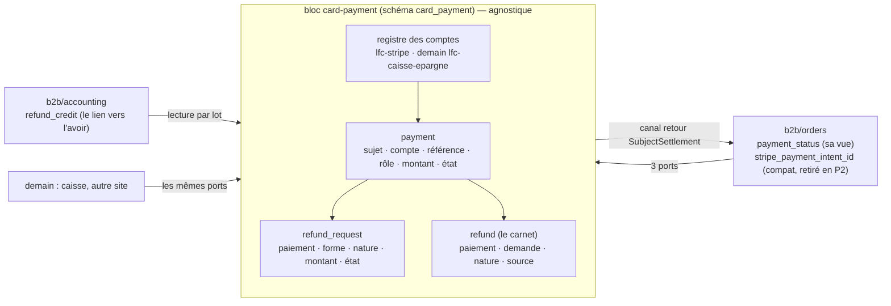
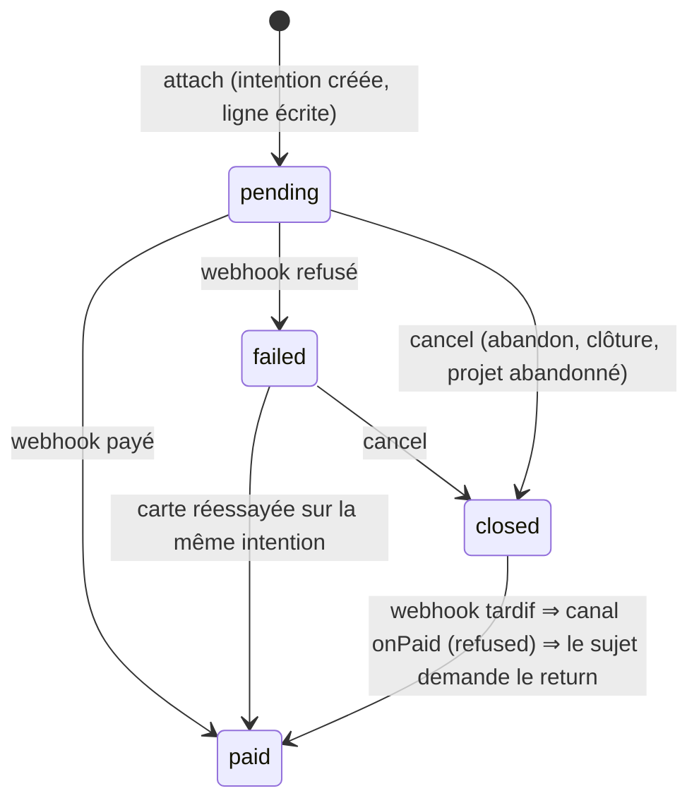
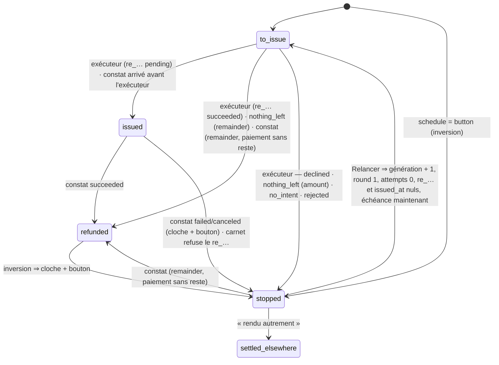
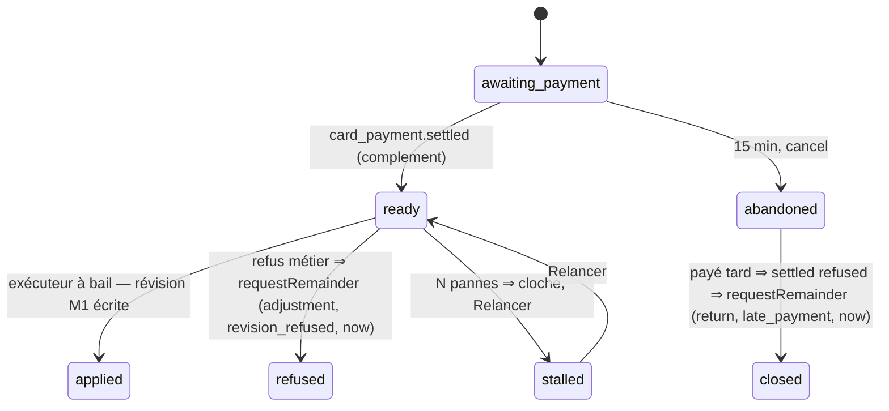

# Plan M2 — modifier une commande payée par carte : l'historique de transactions

> **État au 2026-11-10, nuit.** P0 ✅ en production (`c481bd3dc`). **P1 ✅ en
> production** (`5f92e5cf1`, déployé le 2026-11-10, cinq workflows verts) :
> P1.a `f25ed5ecf` (tables, copie, ressource), P1.b `e29a42880` (le
> remboursement dans `card-payment`), P1.c `0e1655160` (le commerce et la
> comptabilité basculent, l'ancien module part), P1.d `6be57647f` (le bandeau
> du back-office) — détail au §5.6. Les gestes d'après déploiement du
> runbook « Déployer P1 » (contrôle de la copie, droit `card_payments` à
> l'admin, réouverture) sont à faire par Hugo. **S2 (la hausse)** est
> **en production depuis le 2026-11-10** (`f55ad8e6a`) : décrite au présent dans
> [`modifier-une-commande.md`](modifier-une-commande.md), §2.7, son plan retiré ;
> puis S1 (`modifier-une-commande.md` §2.7.12), S3.

> **Version 14, 2026-11-10** — P0 est **bâti et déployé en production** (§4.9). `vitruve` sur la v13 : **« rien ne bloque »** ; trois incohérences de texte et des précisions, corrigées ici (§15 nonies). **Le bâti de P1 commence sur cette version.** La v12 a eu un bloquant de spécification (la source du bandeau) et cinq règles manquantes (§15 octies), toutes écrites ici. La v11 a eu un bloquant de détail (une requête sur une colonne qui n'existe pas) et six sérieux de précision (§15 septies) ; `vitruve` y a déclaré conformes l'union `onRefundOutcome` et l'ordre des verrous. **Décision de Hugo (2026-11-10) : P1 se déploie BOUTIQUE FERMÉE, en pré-release** — toute la mécanique de « fenêtre de bascule » des v9 et v10 (relais, rattrapage borné, colonne miroir, abonné déménagé, champ à côté du contrat) est **retirée** et remplacée par une condition de déploiement vérifiée à la main (§5.2) ; ce que `vitruve` avait de structurel sur la v10 (§15 quinquies) est intégré (§15 sexies). Versions 7 à 10 : `599b24732`, `923f4e4cf`, v9 et v10 non commitées. Le plan **unique** de M2, écrit après la
> relecture complète du paiement et du remboursement
> ([`../reglement/relecture-paiement-et-remboursement.md`](../reglement/relecture-paiement-et-remboursement.md),
> à lire d'abord), des deux portes de frontière, du workflow de déploiement,
> du registre des abonnés durables et de l'écriture comptable du carnet. Il
> **remplace** les §9 à §20 de
> l'ancien plan de la modification par carte (retiré le 2026-11-10 ; son §17
> sur le bon est recopié au §10 ; l'état bâti : [`modifier-une-commande.md`](modifier-une-commande.md)).
> Versions 1 à 4 et leurs contradictions par `vitruve` : `d2632e136`,
> `6eef19357`, `ca3b6c0c4`, `d5e5d7a49`, `e1b7f8a75`, `c290188ed`,
> `eaec69258`, `d87322030`, `68f63d17b`. **P0 et P1 sont bâtis et en production** (§4.9, §5.6 ; `adb9c41e3`). Touche l'argent : `vitruve` avant Hugo.

## 0. Les décisions de Hugo

| Décision (2026-11-09)                                                                                       | Où                                 |
| ----------------------------------------------------------------------------------------------------------- | ---------------------------------- |
| La **forme C** : une commande, un numéro, plusieurs paiements et remboursements par montant                 | §2                                 |
| **Baisse** remboursée **tout de suite** ; **hausse** payée **tout de suite**, même écran                    | §7, §8                             |
| **Pas de modification carte après l'arrêt du plan** ; le **bon** sous la différence : plus tard             | §7, §10                            |
| **D'abord le socle**, « 10/10, aucun angle mort » sur **notre** état                                        | §4–§6, §11, §12                    |
| **Sans rapprochement automatique** : notre donnée fait foi ; **pas de mode test Stripe** : « au culot »     | §6.5–§6.7, §12                     |
| **Un module propre, avec une API**, « une surface compréhensible », « le code doit refléter la surface »    | §3 : le bloc **`card-payment`**    |
| **D'autres applications** dans le même monolithe ; **la carte seulement** (ni SEPA, ni virements, ni liens) | §3.1 : agnostique, un sujet opaque |
| **Plusieurs comptes et prestataires** (« lfc-caisse-epargne dans pas longtemps »)                           | §3.2 : le compte d'encaissement    |

## 1. Ce qui existe

Dans la relecture. En une ligne : un paiement par commande
(`orders.stripe_payment_intent_id`), une demande de remboursement par
commande, un état déduit à chaque lecture, un remboursement sans montant, un
plafond sur `total_cents`, le remboursement rangé dans `lafoliecoffee/orders` (14
fichiers lisent les ports de la demande, 18 avec l'entité ; 10 le carnet ; 24
lisent `stripe_payment_intent_id` — comptes de `vitruve`), la comptabilité qui
**écrit** `order_refund.credit_note_id`, une relation Prisma `Invoice.refunds`,
une seule configuration Stripe (`stripeConfig()`, « les trois ou aucune »),
21 fichiers de `test/` qui envoient `ConfirmOrderPaymentCommand` en direct,
et aucun regard périodique vers le prestataire.

## 2. Le modèle cible, en une image



**Encaissé** d'un sujet = `Σ payment paid`. **Remboursé** = `Σ refund
succeeded` ; **remboursé d'ajustement** = ceux de nature `adjustment`.
**L'égalité G3** : encaissé − remboursé d'ajustement = total dû (sujet vivant,
soldé) ; encaissé − remboursé = 0 (sujet annulé, soldé).

## 3. Le bloc `card-payment`

### 3.1 Ce qu'il est, et ce qu'il n'est pas

**Il encaisse et rembourse par carte, pour un sujet qu'il ne connaît pas** :
`(subject_type, subject_id)` opaques. Il tient **tout l'état de l'argent
carte** et, **pour les cartes**, c'est lui seul qui parle au prestataire.

**Il ne sait pas** ce qu'est une commande, une facture, un bon, un total dû.
**Il n'inclut pas** les prélèvements SEPA ni les mandats, ni les virements,
ni — **daté** — les **liens de paiement** de société (`lafoliecoffee/payments`, qui
gardent leur client Stripe, leur endpoint et leur secret jusqu'au jour où un
lien devient un sujet ; d'ici là, `lfc-stripe` du registre **pointe sur les
mêmes variables** qu'eux, pour qu'une rotation de clé n'ait qu'un endroit).
« Rendu autrement » (§5.5) note un remboursement fait hors plateforme, sans
déplacer d'argent.

Sa seule connaissance métier est agnostique : la **nature** d'un
remboursement, `return` (la vente n'a pas lieu) ou `adjustment` (le montant
dû a baissé).

**Dans `src/`** : `card-payment/` au premier niveau. Sans métier propre
(comme `mail`), il **déclare un canal qu'un autre bloc implémente** (comme
`production/channels/commerce/`). Matrice du `CLAUDE.md` § 3 : colonne
`card-payment` à **port uniquement** pour `b2b` ; ligne `card-payment` : ✓
`staff`, ✓ `platform`, ✗ le reste.

### 3.2 Le compte d'encaissement

- **Le registre a deux moitiés.** Les **noms** des comptes, leur type de
  prestataire, le préfixe de leurs variables et `default_for` sont **dans le
  dépôt** (un fichier **à créer** dans `platform/config/`, le registre `card-accounts` : `lfc-stripe` → type `stripe`,
  préfixe `STRIPE` ; demain `lfc-caisse-epargne` → type `lyra`, préfixe
  `LYRA_CE`) ; les **secrets** sont dans l'environnement, par compte, sous les
  noms **préfixés** `<PREFIXE>_SECRET_KEY`, `_PUBLISHABLE_KEY`,
  `_WEBHOOK_SECRET` (pour `lfc-stripe`, les trois noms d'aujourd'hui).
  `AppConfig` les lit (comme `stripeConfig()`). Chaque compte neuf **ajoute
  ses noms, littéraux**, au fichier du registre et aux trois listes que
  `runtime-keys.spec.ts` compare (`env-readers.ts`, `RUNTIME_KEYS` de
  `container/worker.ts`, la boucle `for name in` du workflow), et se
  déploie : « une entrée de configuration **et** un déploiement », dit.
- Dans `card-payment`, **`CardProviders`** (un jeton) instancie **un
  adaptateur par compte** à partir du registre (un adaptateur par **type**
  dans le code : `stripe` aujourd'hui, `lyra` demain) ; c'est **ce jeton** que
  les e2e doublent. Un compte présent en base et absent du fichier **ne fait
  pas tomber la production** ([[la-prod-ne-tombe-jamais]]) : la **veille**
  sonne, et une **porte CI** compare le CHECK de la colonne au fichier du
  registre ; `StripeProbe` (dans `ops`, qui lit `platform`) sonde **tous** les
  comptes du fichier.
- **Le compte se choisit par type de sujet** : la **forme** `default_for`
  est dans le registre, la **valeur** `order → lfc-stripe` est posée par
  `appBootstrap` (le seul qui connaisse les deux mots). **L'appelant ne nomme aucun compte** (une chaîne
  `"lfc-stripe"` dans `orders` serait la chaîne en dur du `CLAUDE.md` § 6).
  **Le paiement mémorise son compte** (`payment.account`, **CHECK** sur la
  liste des comptes connus — valeur persistée, migration par compte neuf) ;
  relire, annuler, rembourser, vérifier lisent le compte **sur la ligne**.
- **Un webhook par compte** : `POST /payments/webhook/:account`, secret du
  compte ; compte inconnu ⇒ **400** journalisé. `/payments/webhook` vaut
  `lfc-stripe` jusqu'à P2.

### 3.3 La surface : trois ports, un canal, des faits

Déclarés et implémentés par `card-payment`, dans `card-payment/channels/requests/` :

| Port                       | Gestes                                                                                                                                                                                                                                                                                                                                                                                                                                                                                                                                                                                                                                                                                                                                                                                                                                                                                                                                                                                                                                                                                                                                                                                                                                                                                                                                                                                                                                                                                                                                                                                                                                                                                                                                                                                                                                                                                                                                                                                                                                                                                                                                                                              | Appelé par                                                                                |
| -------------------------- | ----------------------------------------------------------------------------------------------------------------------------------------------------------------------------------------------------------------------------------------------------------------------------------------------------------------------------------------------------------------------------------------------------------------------------------------------------------------------------------------------------------------------------------------------------------------------------------------------------------------------------------------------------------------------------------------------------------------------------------------------------------------------------------------------------------------------------------------------------------------------------------------------------------------------------------------------------------------------------------------------------------------------------------------------------------------------------------------------------------------------------------------------------------------------------------------------------------------------------------------------------------------------------------------------------------------------------------------------------------------------------------------------------------------------------------------------------------------------------------------------------------------------------------------------------------------------------------------------------------------------------------------------------------------------------------------------------------------------------------------------------------------------------------------------------------------------------------------------------------------------------------------------------------------------------------------------------------------------------------------------------------------------------------------------------------------------------------------------------------------------------------------------------------------------------------- | ----------------------------------------------------------------------------------------- |
| **`CardPayments`**         | `prepare(subjectType, amountCents)` → `{ prepared, clientSecret, publishableKey }` (**hors** transaction : le compte est choisi par type, l'intention créée) ; `attach(subject, prepared, role)` → `{ paymentId, providerRef }` (**dans** la transaction de l'appelant : ligne `pending`) ; `release(prepared)` (échec de la transaction : `cancel` au mieux, comme aujourd'hui) ; `retrieve(paymentId)` ; `cancel(paymentId)` → `cancelled \| already_cancelled \| already_paid \| in_progress \| unavailable`                                                                                                                                                                                                                                                                                                                                                                                                                                                                                                                                                                                                                                                                                                                                                                                                                                                                                                                                                                                                                                                                                                                                                                                                                                                                                                                                                                                                                                                                                                                                                                                                                                                                     | passation, page de règlement, hausse, abandon, clôture                                    |
| **`CardRefunds`**          | `requestRemainder(paymentId, nature, reason, schedule: 'now' \| 'button')` → la demande (**idempotent** : rend la `remainder` **en cours** (`to_issue \| issued`) du paiement, sinon crée — une `stopped` existante reste, et le bouton la relancera) ; `requestAmount(paymentId, amountCents, nature, reason)` ; `retry(requestId)` — dans la transaction de l'appelant                                                                                                                                                                                                                                                                                                                                                                                                                                                                                                                                                                                                                                                                                                                                                                                                                                                                                                                                                                                                                                                                                                                                                                                                                                                                                                                                                                                                                                                                                                                                                                                                                                                                                                                                                                                                            | annulation, baisse, refus d'une hausse, inversion, « Relancer » (route par demande, §5.3) |
| **`CardSettlementReader`** | `positionOf(subjects[])` → par sujet : paiements (id, compte, `providerRef`, rôle, état, montant), encaissé, remboursé par nature, demandes non terminales (id, forme, nature, état), en vol par forme ; `succeededRefundsOf(subject)` → chaque remboursement réussi (id, montant, nature, source), **triés par `recordedAt, id`** — l'ordre que `RefundReconciler` suppose pour ventiler le dernier avoir au reste exact (`prisma-refunds-to-credit.ts`) ; (v12) `refundsOf(subjects[])` → **tous** les remboursements, avec `source` (`provider` ou `manual`), statut, montant et instant (`refundedAt` : celui du prestataire pour un `provider`, celui du geste pour un `manual`), triés par `recordedAt` (l'ordre d'aujourd'hui, `prisma-order.reader.ts`) — la source d'`OrderView.refunds` (contrat servi, carte des remboursements du back-office), que la relation `Order.refunds` nourrit aujourd'hui ; le contrat gagne `source` ; la vue client ne reçoit toujours que `refundedCents` ; **une seule arithmétique** : `refundedCents` vient de `positionOf`, jamais recalculé depuis `refundsOf` — la carte des remboursements du back-office (`order-refunds-card.ts`, `refundedCentsOf`) lit désormais le total servi au lieu de le recalculer — **par lot** ; (v13) `refundRequestsOf(subjects[])` → **toutes** les demandes d'un sujet, terminées comprises (`id`, `paymentId`, `form`, `nature`, `state`, `reason`, `announcedCents`, `issuedCents` ou nul, `requestedAt`, `issuedAt` ou nul, `attempts`, `generation`, `lastFailure` ou nul, `retryable` — calculé par le bloc : (`stopped`, ou `to_issue` avec `attempts > 0`), pas de bail en cours, et aucune autre `remainder` du même paiement en cours ; `lastFailure` est le **code brut** de l'échec, c'est `orders` qui en fait la phrase (`refundFailurePhraseOf`, `admin-order-refund-view.ts`, étendue aux états `stopped` / `settled_elsewhere`)) — la source du bandeau du back-office, servi par `orders` dans `AdminOrderDetail.refundRequests` (§5.3) sous `b2b_orders:read` comme aujourd'hui (`admin-order-refund-view.ts`) ; le bloc ne sert **pas** de vue de bandeau lui-même — **par lot** | annulation, révision, listes, facture carte, avoirs                                       |

Le **canal retour** `SubjectSettlement` (`card-payment/channels/subjects/`,
un implémenteur par `subject_type`, relié dans `appBootstrap/`) :
`onPaid(subject, paymentId, amountCents)` → `applied | refused |
already_applied` ; `onPaymentFailed(subject, paymentId)` ;
**`lockSubject(subject)`** (v9) — le sujet prend **son** `FOR UPDATE` dans la
transaction ambiante (pour `order`, celui de `orders`, le même que la facture
carte, `prisma-order-invoicing-lock.ts`), et **toute** écriture de
`card-payment` sur l'argent d'un sujet l'appelle **en premier** : le constat,
l'exécuteur, « Relancer », « rendu autrement », `adopt` — **y compris
l'adoption au webhook** (**à bâtir en P1** : `ProviderPaymentResolver` appellera `lockSubject`
entre le `claim` et l'`INSERT` — aujourd'hui il ne verrouille rien, et
`lockSubject` n'existe pas encore dans `subject-settlement.ts` —, sans quoi
une commande du commerce qui tient déjà `orders` et adopte la même
référence s'interbloque avec lui ; `claim.settled` **relu sous ce verrou**,
pas avant) —, **le bail** de
l'exécuteur (`prepare()` prend `lockSubject` avant la ligne `payment`, §3.5), les
crons de reprise ;
`onRefundOutcome(subject, outcome)` (v11) où `outcome` est une **union
discriminée par `kind`**, un type par genre, chacun portant **exactement** ce
que les faits d'`orders` exigent — recopié de
`packages/contracts/src/journal-facts/order-refunds.ts` (relu le
2026-11-10 : `order.refund_recorded { amountCents, refundedCents, status }`
s'écrit pour **chaque** constat, échec et annulation compris ;
`order.refund_rejected { amountCents, currency, status, reason }` ;
`order.refund_attempt_failed { generation, failure }` ; `order.refund_issued
{ announcedCents, issuedCents }`). Tous portent `position` (l'état
**recalculé après l'écriture** des lignes de `card-payment`, d'où `orders`
tire `refundedCents`) et `requestId | null` ; dans cette union **`providerRef`
désigne le `re_…`** (le remboursement chez le prestataire), alors que
partout ailleurs dans `card-payment` il désigne le `pi_…` :
`recorded { refundId, providerRef, amountCents, currency, status: pending |
requires_action }` ; `succeeded { refundId, providerRef, amountCents, currency
}` ; `failed { refundId, providerRef, amountCents, currency, status: failed |
canceled }` ; `reversed { refundId, providerRef, amountCents, currency,
status: failed }` (une inversion est un `succeeded → failed`, §6.2) ;
`rejected { providerRef, amountCents, currency, status, reason }` (pas de
ligne au carnet : `refundId` absent) ; `settled_elsewhere { refundId,
amountCents, staffId, reason }` ; `attempted { generation, failure,
providerRef | null }` ; `issued { generation, providerRef, announcedCents,
issuedCents }`. Le sujet pose sa vue — `refunded` quand Σ succeeded =
encaissé **et qu'il était `paid`** (la règle d'aujourd'hui, `settle()` ne part
que de `paid` ; une annulée encaissée après coup reste `failed` et c'est le
remboursement qui la solde) — ou la rend, et publie **ses** faits et **son**
journal ;
`isCancelled(subject)` → `true | false` (lu par `card-payment` **sous le
verrou du sujet**, que le canal prend) ; `describe(subject)` → `{ label,
link }` (les cloches de `card-payment`) ; `claim(account, providerRef)` →
`{ subject, amountCents, role, settled: paid | pending | failed | closed } |
null` (« ce paiement est-il à toi, et où en es-tu ? », §4.6) ;
`referencesSince(since)` → la liste `{ providerRef, subject, amountCents,
settled }` des sujets du type créés depuis `since` — `settled` est **le
règlement tel que le sujet le voit** (`payment_status`), rien de plus (§4.3,
§5.2) ;
`publishableKey()` est une **requête** du canal pour les mandats (§4.2).

**Les faits durables** de `card-payment`, clés par sujet :
`card_payment.settled` (avec l'issue du canal), `card_payment.failed`,
`card_payment.refund_succeeded`, `card_payment.refund_failed`,
`card_payment.refund_reversed`, `card_payment.fully_refunded`,
`card_payment.unmatched` (avec le **type d'événement** : « hors de mes
sujets » — pas une anomalie en soi ; `lafoliecoffee/payments` l'écoute et **ne sonne
que sur un remboursement**, comme `OnRefundWithoutOrder` aujourd'hui, qui
passe `@DurableHandler` **en P0**), `card_payment.checkout_event` (relais
transitoire, §4.5) et, **transitoire P0**, `card_payment.provider_refund_event`
(§4.2). **Aucun abonné existant ne change de type ni de bloc** : les faits
`order.*` (`order.paid`, `order.payment_failed`, `order.paid_after_cancellation`,
`order.refund_succeeded | _failed | _reversed`, et l'événement en mémoire
`OrderRefundRejectedEvent`) **restent publiés par `lafoliecoffee/orders`** depuis le
canal (`onPaid`, `onRefundOutcome`), et leurs abonnés **restent dans `b2b`** : `refund-paid-after-cancellation`
(appelle `CardRefunds.requestRemainder`), `ring-refund-rejected`
(`@EventsHandler` ; `StaffNotifier`, `Clock`, `BackgroundWork` : la cloche de la commande),
`reconcile-refunds-on-refund` (`accounting`, l'avoir). **Deux disparaissent en P1**, sans relais :
`reopen-refund-on-reversal` — l'inversion appartient à `card-payment` (§6.2) —
et `ring-refund-failed` — `card-payment` sonne, une seule cloche par incident
(clé `notification:card_payment.refund_attention:<requestId>:<generation>:<cause>`
— par demande, libellée par `describe` ; l'ancienne clé par commande meurt
avec l'ancienne cloche, boutique fermée). Pas de relais (v10 : aucun port n'expose le constat à `b2b`, et un relais
rappellerait le constat sur la propre sortie de P1) ; pas de fenêtre à fermer
(v11, §5.2). Les abonnés
**entre blocs** sont nommés et `@DurableHandler` : `lafoliecoffee/payments` sur
`card_payment.unmatched` et `checkout_event` ; (v11) `provider_refund_event` et son abonné d'`orders` sont **retirés en
P1** : boutique fermée et boîte d'envoi vide au déploiement (§5.2), il n'y a
rien à livrer ; le webhook appelle le constat en direct. Un
refus **déterministe** de `CardRefunds` dans un abonné durable (une autre
demande en cours, un paiement inconnu) est **absorbé, journalisé et sonné**
(v9 : la cloche de `card-payment`, par `describe` — un journal seul se lit
trop tard), jamais rejoué ; une panne est rejouée. (v10, v11) Un refus ne peut
être absorbé que s'il est décidé **avant** qu'une instruction SQL échoue (une
instruction en erreur annule la transaction du reçu) : les gardes du port
lisent **sous le verrou du paiement** et refusent avant d'écrire — l'unicité
en base (« une `remainder` en cours ») reste le filet, jamais le chemin
nominal ; pas de `SAVEPOINT` (aucun précédent sous l'unité de travail). L'abonné prend le verrou
`orders` avant d'appeler `CardRefunds` (§3.6 vaut pour lui). (v9)
`requestRemainder` accepte aussi un **sujet** : il crée alors une
`remainder` **par paiement encaissé** du sujet (§7), du dernier au premier —
l'annulation n'a pas à connaître les `paymentId`.

**Le journal** : `card-payment` écrit **ses** faits sous le sujet
`card_payment` (`card_payment.issued`, `attempt_failed`, `stopped`,
`settled_elsewhere`, `verified`, `unmatched`, `reconciled`), libellé par
`describe` ; `orders` garde les siens (`order.refund_recorded`,
`fully_refunded`, `refund_rejected`…), écrits dans `onRefundOutcome`. Aucune
valeur de fait n'est renommée. `journal-tracked` audite `card-payment` comme
zone d'argent : chaque handler de ses commandes et crons trace sous
`UnitOfWork` — et (v9) la porte gagne une fonction d'audit pour les
**services** qui écrivent par `Journal.append` sous `UnitOfWork` sans être des
`@CommandHandler` (l'exécuteur, le constat). Le fichier
`card-payment` de `packages/contracts/src/journal-facts/` et ses phrases
au back-office sont **créés en P1** : en P0 les handlers du bloc sont
`@sans-journal` (§4.9).

**Les routes d'équipe** (`card-payment/http/`, surface `card_payments`,
ressource `StaffResource.card_payments` **en P1**) : « Relancer », « rendu
autrement », « Vérifier », le balayage — pas de vue de bandeau : c'est
`orders` qui la sert, par `refundRequestsOf` (v13). **Le webhook est
une commande** (`RecordProviderEventCommand`) : le contrôleur n'injecte que
le bus (`controller-buses` l'admet dans son `SCOPE`, comme
`resend-webhook.controller.ts`).

### 3.4 Les machines à états

**`payment.state`** — pas d'état `created` : une intention naît hors
transaction et n'est rattachée qu'écrite (§3.3) ; une intention orpheline n'est
jamais confirmée et est annulée au mieux, comme aujourd'hui.



Un événement **périmé** (`failed` après `paid` ou après `closed`, `paid` rejoué) est **ignoré**
(200, rien d'écrit, journal), jamais refusé par le déclencheur : Stripe
rejouerait trois jours.

**`refund_request.state`**



- Un `re_…` mort, une inversion : des **arrêts** (Q3 de C4). **Toute
  `to_issue` a une échéance.** Une demande **née** `stopped` attend le bouton.
- (v13) **« Relancer »** (`CardRefunds.retry(requestId)`) : sur une `stopped`
  ⇒ `to_issue`, génération + 1, round 1, `attempts` 0, `re_…` et `issued_at`
  nuls, échéance maintenant — refusé si une autre `remainder` du même
  paiement est en cours ; sur une **`to_issue` dont `attempts > 0`** (en
  attente d'échéance après `unavailable`) ⇒ **même génération**, échéance
  maintenant — c'est le « Relancer » d'aujourd'hui sur une demande à émettre
  (`retry-order-refund.handler` (retiré au lot P1.c) ne refuse que `refunded`, `issued` et le
  bail tenu) ; refusé sur `issued`, `refunded`, `settled_elsewhere`, sur une
  `to_issue` jamais tentée, et sous bail. `retryable` (§3.3) dit **toute** cette règle au front, y compris « aucune
  autre `remainder` du même paiement en cours » (v14).
- Enum Postgres par machine ; déclencheur `BEFORE UPDATE` : paire hors liste
  refusée, `(x, x)` admis, **colonnes immuables** refusées — sur `payment` :
  `subject_*`, `account`, `role`, `amount_cents`, `provider_ref` une fois posé ; sur
  `refund_request` : `payment_id`, `form`, `amount_cents`, `nature`, `reason` ;
  sur `refund` : `payment_id`, `account`, `provider_ref`, `amount_cents`,
  `nature`, `source` — comparées par `IS DISTINCT FROM` (colonnes nullables) ;
  `BEFORE DELETE` refusé sauf `current_setting('card_payment.purge', true) =
'on'` posé **dans une transaction** (purge ; `siteless-pickups.seed.ts` à
  envelopper). Test exhaustif des paires.
- **Qui écrit** : l'exécuteur sous bail par `save` (génération + jeton) ; le
  constat **sans bail**, par `transition(id, from, to, patch)` conditionnée sur
  l'état ; il charge la demande par le `re_…` ou par la métadonnée
  (`requestId` + `generation` sur l'événement réduit) ; une autre génération
  est ignorée ; arrivé avant l'exécuteur, il pose `re_…` et `issued_at`, et
  l'exécuteur voit `issued()` rendre `false`.

### 3.5 Le remboursement par montant

`refund(params)` : sans montant (`remainder`), avec (`amount`). `findRefund` :
id de demande, génération, montant pour une `amount`. (v14) **Une seule forme** de clé d'idempotence, pour toutes les demandes :
`lfd-card-refund:<requestId>:<generation>:<round>` — une ligne reprise garde
son `id` (`:= order_id`) mais toute relance change de génération ou de round,
et la condition du §5.2 n'admet aucune demande en vol au déploiement : il
n'y a jamais de `re_…` à retrouver sous l'ancienne clé ; les métadonnées
(`lfd_refund_request` = `requestId`, `lfd_generation`) ne changent pas de
forme.

| Issue                             | `remainder`                                                                                                                      | `amount`                                              |
| --------------------------------- | -------------------------------------------------------------------------------------------------------------------------------- | ----------------------------------------------------- |
| émis, `pending`                   | `→ issued`                                                                                                                       | idem ; montant ≠ demandé ⇒ `stopped`, cloche          |
| émis, `succeeded` dès la création | `→ refunded`                                                                                                                     | idem                                                  |
| `charge_already_refunded`         | relecture ; sans reste ⇒ `→ refunded` ; reste couvert par un `re_…` en vol nôtre ⇒ `issued` sur lui ; manuel ⇒ `stopped`, cloche | écart ⇒ `stopped` (`nothing_left`), cloche            |
| montant > reste                   | n/a                                                                                                                              | `stopped` (`declined:<code>`, relevé au bâti), cloche |
| `unavailable`                     | round + 1, échéance sur la courbe                                                                                                | idem                                                  |

Le bail d'une `remainder` exige qu'aucune `amount` du même paiement ne soit
`to_issue | issued` (SQL brut, revérifié dans `prepare()` sous le verrou du
paiement — que `prepare()` prend **après** `lockSubject`, v11) ; `dueForSweep`
: `state = to_issue` seul.

### 3.6 L'ordre des verrous, et une seule transaction

**Le sujet d'abord** : tout geste sur l'argent d'un sujet est appelé dans la
transaction du bloc métier, qui a pris le verrou de sa ligne ; `card-payment`
verrouille ensuite ses lignes. Les appels au prestataire (`prepare`,
`cancel`, le remboursement) sont **hors** transaction.

**Un seul ordre, partout, le même que l'annulation (v9)** — pour toute
écriture de `card-payment` sur l'argent d'un sujet (webhook de
remboursement, exécuteur, « rendu autrement », `adopt`, crons de reprise),
dans **une** transaction (`UnitOfWork.run` rejoint la transaction ambiante,
vérifié dans `unit-of-work.ts`) :

1. **`lockSubject(subject)`** — le sujet prend son `FOR UPDATE` ;
2. **les lignes de `card-payment`** (`FOR UPDATE`), et la décision du
   constat **revérifiée** sous ce verrou (jamais une issue périmée) ;
3. **l'écriture** des lignes et des faits de `card-payment` ;
4. **`onRefundOutcome(subject, outcome)`** avec la `position` recalculée
   **après** l'écriture — le commerce pose sa vue, publie ses faits
   (`order.refund_*`, par `AfterCommit` pour l'événement en mémoire) et son
   journal.

Le **paiement** garde l'ordre bâti en P0 (§4.9) : `onPaid` d'abord (le
commerce prend `orders`, `markPaid`, publie `order.paid` au franchissement,
ou rend `refused` / `already_applied`), puis la ligne relue sous verrou et
écrite, puis `card_payment.settled` ; le verrou `orders` est pris par
`onPaid` lui-même, donc **avant** les lignes — c'est déjà l'ordre sujet →
lignes. À relire en P1 : faire passer `onPaid` par `lockSubject` puis les
lignes puis le canal rendrait les deux chemins identiques ; à décider au
bâti, pas avant. Une annulée encaissée est `paid` chez `card-payment` et `refused` au
canal ; `orders`, au canal, publie alors **son** fait `order.paid_after_cancellation`
(condition d'aujourd'hui : annulée **et** règlement `failed`,
`prisma-cancelled-order-payment.reader.ts`), et son abonné
`refund-paid-after-cancellation`, inchangé, demande le `return`.

## 4. Lot P0 — le bloc, le paiement seul

### 4.1 Armer avant d'écrire

`prisma-model-ownership.mjs` : `"card-payment"` dans `BLOCKS` ;
`context-boundaries.mjs` : `BLOCK_OF`, `ALLOWED` (`card-payment: {staff,
platform}`, `b2b` gagne `card-payment`), `PORT_SURFACE` (`"b2b→card-payment":
"card-payment/channels/"`) ; `journal-tracked.mjs` : `MONEY_ZONES` est joint sous `src/lafoliecoffee/` — il lui
faut une **racine par zone** pour viser `src/card-payment/` (sinon l'argent
carte **sort de l'audit en silence**, ou la porte plante) ; `context-boundaries.mjs` :
le jeu `root` gagne `card-payment` ;
`network-outside-transaction.mjs` : ses chemins `lafoliecoffee/payments/*` suivent ;
`datasource.prisma` : schéma `card_payment` ; `prisma-schema-layout`,
`schema-ops.counter.ts` (`NON_PUBLIC_SCHEMA_OF_MODEL`), `purge-coverage.ts`
(tables sans FK vers `public` : déclarées) ; `rgpd-staff` (`requested_by`,
`settled_by_staff_id` en P1) ; la porte neuve `lint:card-accounts` (CHECK ↔
registre), comptée au § 10 du `CLAUDE.md` (`lint/run.mjs` refuse de tourner
si le compte ment) ; `journal-tracked` : une entrée `ZONES` pour
`card-payment`, et l'exécuteur et le constat tracent sous `UnitOfWork` même
s'ils ne sont pas des `@CommandHandler` ; la colonne dans la matrice du
`CLAUDE.md`. ([[armer-une-porte-avant-de-demenager]])

### 4.2 Ce qui déménage

Les ports et adaptateurs des cartes (`PaymentGateway`, `PaymentRefunder`,
`stripe-payment-gateway`, `stripe-refund-calls`, la traduction), le
**webhook des cartes** (chemin inchangé), la passation côté argent
(`order-settlement.ts` → `prepare` / `attach` / `release`, l'ordre
d'aujourd'hui ; `order.payByCard(providerRef)` **continue d'écrire**
`orders.stripe_payment_intent_id` ; les trois handlers de passation sont
touchés, et le rejeu lit `retrieve`), la page de règlement (`retrieve`),
l'abandon, l'expiration, la clôture (`cancel`) ; les **mandats**
(`admin-mandates.controller.ts`) lisent la clé publique par une **requête** du
canal (`card-payment/channels/`, la seule surface admise), par le bus — une
clé de carte sur l'écran SEPA parce que l'écran l'affiche, pas parce que le
bloc l'encaisse ; `prepare` prend un `tag` opaque (`companyId` ou
`personal`, la métadonnée d'aujourd'hui) que l'adaptateur pose chez le
prestataire. **Le remboursement ne bouge
pas** : il reste dans `lafoliecoffee/orders`, sur ses tables, et atteint le prestataire
par **`CardProviderRefunds`**, port **transitoire et daté** (= `PaymentRefunder`
d'aujourd'hui, **par `(account, providerRef)`**, sur `card-payment/channels/`,
retiré en P1), et reçoit les
événements `refund.*` par le fait durable `card_payment.provider_refund_event`
(nouvel abonné d'`orders`, qui appelle `RecordOrderRefundCommand` — rien ne
change de type).

### 4.3 La table `card_payment.payment`

`id`, `subject_type`, `subject_id`, `account` (CHECK), `provider_ref`
(unique par `(account, provider_ref)`), `role` (`first | complement`),
`amount_cents` (> 0), `state`, `created_at`, `paid_at`. Index unique
`(subject_type, subject_id) WHERE role = 'first'`. **Reprise** : le SQL de la migration (il lit `orders`, ce qu'une migration
peut faire) pose les lignes `first` et **une ligne-témoin**
`card_payment.takeover (lot, migrated_at)`. Puis la commande
`ReplayFirstPayments`, dans `card-payment`, **ne lit pas `orders`** : elle
demande au canal `referencesSince(migrated_at − 1 h)` — le bloc métier rend
ses références créées **depuis le témoin** (borne connue : jamais un balayage
de tout l'existant), avec sujet, montant, rôle et **état du règlement** — et,
pour chacune : absente ⇒ insérée ; présente mais **en retard** sur le sujet
(`pending` quand le sujet dit `paid` : un webhook traité par l'ancienne image)
⇒ transition **en avant seulement** (`pending|failed → paid`, `→ closed`),
jamais en arrière ; différente autrement ⇒ signalée — **sauf** une annulée
que le sujet dit `failed` et la ligne `paid` (encaissée après annulation : le
sujet ne peut pas le savoir), qui est juste. La borne couvre **aussi** toutes
les lignes `pending | failed` antérieures au témoin (une vieille commande
payée pendant la fenêtre). **Horaire**, jusqu'à P2. Sans témoin (base de
test après `ctx.reset()`), la commande ne fait rien et le dit.
Le SQL est conservateur (`pending | failed` selon `payment_status`, `closed`
si annulée) ; seule la commande TS sait fermer par `retrieve` une intention
annulée chez le prestataire (un pro abandonné reste `failed`, payable). Un
test compare SQL et TS sur le jeu de lignes **que le SQL sait juger**, dès
P0. Règle du `first` : `account := lfc-stripe`, `amount_cents :=
total_cents` (plausible : `CardOrderNotRevisableError`), `state` : `paid` si
`payment_status ∈ {paid, refunded}` **ou** carnet non vide **ou** demande
`paid_after_cancellation` ; sinon `closed` si `status = cancelled` ; sinon
`pending | failed`.

### 4.4 Le canal, côté commerce

`lafoliecoffee/orders` implémente `SubjectSettlement` pour `order` : `onPaid` =
`markPaid` + `order.paid` ; `refused` si rien n'a franchi **et** la commande
est annulée ; `already_applied` si rien n'a franchi parce qu'elle est déjà
`paid` (le `cancelledOrderOf` d'aujourd'hui, inversé) ; `onPaymentFailed` ;
`isCancelled` ; `describe` ; `claim(account, providerRef)` → lit
`orders.stripe_payment_intent_id` et rend sujet, `total_cents`, `first`.

### 4.5 Deux endpoints chez Stripe — l'ordre

(1) déployer P0 : le contrôleur des cartes **et** celui des liens
(`/payments/links/webhook`, secret `STRIPE_LINKS_WEBHOOK_SECRET` déclaré dans
`RUNTIME_KEYS`, `env-readers`, et **mappé** dans l'`env:` du workflow (une
valeur absente y est sautée en silence) — **vide** à ce stade : le
contrôleur des liens rend 400 et Stripe réessaie) ; (1 bis) créer l'endpoint
chez Stripe, qui **génère** le secret, puis `wrangler secret put` ; pendant
ce temps les `checkout.*` arrivent par les deux chemins, et
`settle-payment-link` est idempotent (`already_paid`) ; le contrôleur des cartes
**continue de router** `checkout.session.*` vers `lafoliecoffee/payments` par le fait
`card_payment.unmatched`-like dédié `card_payment.checkout_event` **tant que
l'étape (2) n'est pas faite** — jamais un 200 muet ; (2) vérifier qu'un `checkout.*` passe par le nouvel endpoint ; (3) restreindre les événements de chaque endpoint ; (4)
retirer le relais (P2). Un remboursement d'un paiement par lien arrive sur
l'endpoint des cartes et finit `unmatched` : **normal**, `lafoliecoffee/payments`
sonne comme aujourd'hui (`OnRefundWithoutOrder`, en `@DurableHandler`). P0
**n'est pas réversible par le code seul** (configuration Stripe, table,
schéma) — dit.

### 4.6 La fenêtre de déploiement de P0

Une commande passée par l'ancienne image a une intention sans ligne
`payment`. Le webhook sur une référence inconnue **appelle `claim`** ; si le
sujet la revendique, la ligne est créée **dans la transaction du webhook**,
à l'état que le sujet déclare, et le traitement continue ; sinon
`unmatched`. Les chemins du commerce (page de règlement, rejeu, abandon,
expiration, clôture, annulation) lisent `positionOf` — **qui n'écrit
jamais** ; un sujet **sans ligne `first`** y est rendu tel quel, et c'est
**le commerce** qui appelle alors la commande `CardPayments.adopt(subject,
providerRef, amountCents, role, settled)` — depuis **ses commandes**
(abandon, expiration, clôture, annulation) ; la page de règlement et le
rejeu, qui sont des **requêtes**, rendent « paiement à adopter » et l'écran
envoie une commande `AdoptOrderPayment` avant de réafficher (il connaît
`orders.stripe_payment_intent_id`). Le **cron horaire** (§4.3) rattrape le
reste, y compris un `markPaid` fait par l'ancienne image (transition en
avant).

### 4.7 Les tests de P0

`test/card-payments.ts` et `test/order-factory.ts` (importé par ~75 e2e)
**passent par la commande de webhook de `card-payment`** ; les ~20 e2e qui
envoient `ConfirmOrderPaymentCommand` en direct et les ~120 (131 fichiers citent `PaymentGateway`) qui le doublent
par son jeton doublent désormais le jeton **`CardProviders`** de `card-payment`
(le registre des adaptateurs par compte) ; `forceState` écrit aussi `payment`. Les **scénarios** ne changent
pas ; les **helpers et les imports** si — c'est un lot de tests à part
entière, compté dans P0.

### 4.8 Ce que P0 change

Un schéma et une table neufs (additifs), la configuration (registre,
secret des liens, `RUNTIME_KEYS`), deux endpoints chez Stripe, les imports.
**Aucun écran, aucune route d'équipe, aucune table existante, aucun fait
`order.*`, aucune ressource de droits.**

### 4.9 P0 — bâti et déployé en production (2026-11-09 → 2026-11-10, `c481bd3dc`)

| Lot          | Commit      | Contenu                                                                                                                                                                                                                                  |
| ------------ | ----------- | ---------------------------------------------------------------------------------------------------------------------------------------------------------------------------------------------------------------------------------------- |
| P0.a         | `da57794c7` | les portes et la matrice du `CLAUDE.md` connaissent `card-payment` avant qu'il existe (§4.1)                                                                                                                                             |
| P0.b         | `559475809` | schéma `card_payment`, tables `payment` et `takeover`, CHECK, index partiel, déclencheurs, reprise SQL des `first` (§4.3) — relu par `lecteur-de-migrations` : additive, un seul risque (un total ≤ 0 sur une intention ; **0 en prod**) |
| P0.c1        | `707845fb2` | le bloc, complet et débranché : registre `card-accounts`, porte `lint:card-accounts` (70ᵉ), agrégat, ports, canal, webhook-commande par compte, relais durables, rattrapage, purge                                                       |
| P0.c2 + P0.d | `661f514cb` | le commerce implémente le canal et bascule ses consommateurs ; webhook des liens ; cron horaire ; anciens adaptateurs retirés ; 140 fichiers de tests migrés                                                                             |

**Ce que le bâti a tranché, et que le plan ne disait pas** (à relire avant P1) :

- **§4.6, « la vue rend un champ paiement à adopter »** : le contrat `OrderPaymentIntent` exige un `clientSecret`, et une intention sans ligne ne se relit pas par `retrieve(paymentId)`. La page de règlement et le rejeu répondent **409** `orders.payment.awaits_adoption` ; rien n'est écrit ; le cron horaire rattrape ; l'écran enverra `AdoptOrderPayment` (route posée) quand il viendra.
- **§4.3, l'état d'une annulée** : la reprise SQL dit `closed` avant `failed` ; la lecture TS (`orderCardSettled`) faisait l'inverse. Alignée sur le SQL — sinon chaque annulation devenait un écart signalé à chaque passage du rattrapage (`closed → failed` n'est pas une transition). L'exception « encaissée après annulation » du rattrapage lit donc `closed`, pas `failed`.
- **§15 ter, `OrderRefundRejectedEvent` par `AfterCommit`** : valait **déjà en P0**, pas seulement en P1. Le constat d'un remboursement est appelé par un abonné durable, donc dans la transaction du reçu ; sa cloche partait dans cette transaction et s'exécutait après sa fermeture. Trouvé par l'e2e `order-refunds`, corrigé (`record-order-refund.handler` (retiré au lot P1.c)).
- **Le journal de `card-payment`** (`card_payment.unmatched`…) n'est pas écrit en P0 : ses handlers sont `@sans-journal` (motif écrit) ; le catalogue de ses faits de journal arrive avec P1 (§15 bis).
- **`takeover` ne se purge pas** avec le scénario : l'effacer ferait rebalayer tout l'existant ou plus rien ; seule `payment` est déclarée à `purge-coverage.ts`.
- **§4.3, « seule la commande TS sait fermer par `retrieve` une intention annulée chez le prestataire »** : pas bâti — le plan ne dit ni quelles lignes ni quand ; le rattrapage n'appelle pas le prestataire. Une `pending` abandonnée chez Stripe reste `pending`, payable. À trancher en P2 ou à abandonner.
- `StripeProbe` ne sonde pas encore tous les comptes du registre (§3.2) ; `claim` d'une commande ignore le compte (une commande ne sait pas qui l'encaisse — à rouvrir au second compte).
- Dette de tests : des doubles locaux recopiés dans cinq e2e (`NamedIntentCardProvider`, `ParamsRecordingCardProvider`, `RetrieveCountingCardProvider`, `AmountRecordingCardProvider`, `NoRetrievalCardProvider`) à factoriser dans `test/card-payments.ts` ; aucune spec unitaire de passation ne vérifie `attach` dans la transaction ; `payment-links.e2e-spec` passe encore par le relais de l'ancien endpoint, la route `/payments/links/webhook` n'est éprouvée que par sa spec unitaire.
- `admin-pricing.e2e-spec` comptait des ventes jamais réglées : l'ancien double ne savait pas annuler, et `ReplaceUnsettledShopOrders` ne pouvait pas remplacer les impayées du même client. Ses ventes sont réglées désormais — la règle métier était juste, la fixture mentait.

**Côté Stripe** (2026-11-09) : l'endpoint actuel garde les cartes (même URL, même clé, ses 8 événements) ; une destination `lfd-api production — liens de paiement` existe, **désactivée**, et son secret est dans GitHub (`STRIPE_LINKS_WEBHOOK_SECRET`). Au déploiement : déployer → activer la destination des liens → vérifier qu'un `checkout.*` y arrive → retirer les trois `checkout.session.*` de l'ancienne.

## 5. Lot P1 — le remboursement déménage (irréversible)

### 5.1 Les tables

- **`refund_request`** : `id` (ULID ; pour les lignes reprises, `id := order_id`, la clé
  d'aujourd'hui), `payment_id` (non nul), `form`, `amount_cents`
  (CHECK), `nature`, `reason` (texte borné), `state`, `settled_by_staff_id`,
  `settled_reason`, les colonnes d'aujourd'hui. Index unique partiel
  `(payment_id) WHERE form = 'remainder' AND state IN ('to_issue', 'issued')`
  — une seule `remainder` **en cours** par paiement ; plusieurs `stopped` ou
  `refunded` peuvent coexister (deux inversions), et « Relancer » refuse de
  passer une `stopped` à `to_issue` si une autre est en cours.
- **`refund`** : ids **conservés** ; `payment_id`, `account` (recopié du
  paiement), `request_id` (nullable),
  `nature` (nullable), `source`, `provider_ref` nullable (unique par
  `(account, provider_ref)`, CHECK `source = 'provider' ⇔ provider_ref IS NOT
NULL`), montant, **`currency`**, statut, instants (`recorded_at`, l'ordre de
  lecture d'aujourd'hui, et `refunded_at` : l'instant du prestataire pour un
  `provider`, celui du geste pour un `manual`). **Sans `credit_note_id`**.
- **`public.refund_credit`** (`accounting` : la comptabilité vit dans
  `public`) : `refund_id @unique` **sans clé étrangère** (v13 : une clé de
  `public` vers `card_payment` est interdite par l'en-tête de
  `card_payment.prisma` — « aucune ne doit en venir » ; c'est la même règle
  qu'entre `orders` et `card_payment.payment`, identifiant opaque), `credit_note_id` **nullable** (une ligne `adjustment`
  n'a pas d'avoir), unique partiel `WHERE credit_note_id IS NOT NULL`, `reason`
  (`credit_note | adjustment`), **reprise de `order_refund.credit_note_id`**
  (unicité conservée, écriture conditionnée conservée). `Invoice.refunds`
  disparaît ; `RefundsToCreditReader` lit `succeededRefundsOf` + sa table —
  (v11 : plus de `legacyCreditNoteId` — boutique fermée, aucune image
  ancienne n'écrit pendant la bascule).
- Les relations `Order.refunds`, `Order.refundRequest`, `Invoice.refunds` sont
  **retirées** du schéma Prisma — la migration générée **supprime leurs clés
  étrangères** (à relire par `lecteur-de-migrations`) ; les lecteurs par
  relation passent par `positionOf` / `refundsOf` (par lot).

### 5.2 La reprise — SQL dans la migration, boutique fermée (v11)

**Décision de Hugo (2026-11-10) : P1 se déploie en pré-release, boutique
fermée.** Il n'y a donc **pas de fenêtre de bascule** à couvrir : ni relais,
ni rattrapage TS, ni colonne miroir, ni abonné déménagé. Ce qui protégeait
la minute où l'ancienne image sert encore à côté de la nouvelle
(`deploy_lfd_api.yml`, étape « attendre que l'image neuve serve ») n'a
d'objet que s'il se passe quelque chose pendant cette minute. **Au lancement
commercial, si une migration de ce genre devait encore se faire, ces
protections redeviendraient nécessaires** — c'est dit ici pour qu'on ne
l'oublie pas, et c'est pour ça que P1 passe **avant** le lancement.

**La condition de déploiement**, vérifiée à la main par Hugo (comme le
compte de P0), écrite au runbook — **boutique fermée ne gèle que la
passation** (`order-intake.service.ts` : « une commande déjà passée se modifie
boutique fermée, comme elle s'annule »), et la migration tourne **avant** la
bascule de l'image (`deploy_lfd_api.yml` : migrer, déployer le Worker,
attendre que l'image neuve serve) : ce que l'ancienne image écrirait dans
les anciennes tables pendant cette minute serait perdu — d'où les règles 1
à 4, qui rendent cette minute **vide** :

1. **boutique fermée** (le réglage de la vitrine), aucune exemption
   d'ouverture active (`lafoliecoffee/order-opening`), aucune commande en cours de
   passation ; **aucun geste d'équipe sur une commande carte** (annulation,
   relance, rendu autrement) et **aucun geste dans le tableau de bord
   Stripe** (remboursement manuel) **du début de la condition à la
   réouverture** — dix minutes, deux personnes au plus, qui le savent ;
2. **zéro paiement en attente** : `SELECT count(*) FROM card_payment.payment
WHERE state = 'pending'` = 0 (pendant la minute, un webhook tardif va à
   l'une ou l'autre image ; par l'ancienne, `refund-paid-after-cancellation`
   écrirait l'ancienne table après la copie) ;
3. **zéro remboursement en vol**, l'état **calculé** comme le code le fait
   (`refundRequestStateOf`, `order-refund-request` (retiré au lot P1.c) — la table n'a pas de
   colonne `state`) : une demande est en vol si son bail court
   (`claimed_until > now()`), ou si son `stripe_refund_id` est posé sans
   ligne terminale au carnet (`succeeded`, `failed`, `canceled`), ou si son
   `stripe_refund_id` est nul avec une échéance posée et un reste à rendre
   (`total_cents` − Σ `succeeded` > 0) ; plus
   `SELECT count(*) FROM public.order_refund WHERE status IN ('pending','requires_action')`
   = 0 — s'il en reste un, on attend qu'il finisse ; la requête exacte
   s'écrit au runbook, colonnes relues dans `order-refund.prisma` ;
4. **boîte d'envoi vide** pour ce que P1 retire ou dont il dépend — les
   abonnés par leur **nom de reçu** (v13, relus dans les fichiers) :
   `b2b.orders.record-refund-from-card-payment`,
   `orders.reopen-refund-on-reversal`, `orders.ring-refund-failed`,
   `accounting.reconcile-refunds.on-refund` et
   **`orders.refund-paid-after-cancellation`** (son effet écrit
   `order_refund_request` : une livraison remise pendant la minute écrirait
   l'ancienne table après la copie) :
   `SELECT d.subscriber, count(*) FROM platform.outbox_delivery d WHERE d.delivered_at IS NULL AND d.subscriber IN (…les cinq…) GROUP BY 1`
   = vide, **avant** le déploiement **et à nouveau après** que l'image neuve
   serve ; une livraison dont l'abonné n'existe plus finit en **lettre
   morte, visible** (`outbox-relay.ts`) ; si le contrôle « après » en trouve
   une : la lire, et appliquer son contenu à la main dans les nouvelles
   tables (un `INSERT` écrit, boutique encore fermée) — les règles 1 à 3
   rendent le cas à peu près impossible, le geste est écrit quand même ;
5. relire les comptes du §13 bis **le jour même** ;
6. déployer (la migration copie, ci-dessous) ;
7. **contrôle** : `SELECT count(*) FROM card_payment.refund` =
   `SELECT count(*) FROM public.order_refund` ; `SELECT count(*) FROM
card_payment.refund_request` = `SELECT count(*) FROM public.order_refund_request` ;
   Σ `amount_cents` des `succeeded` égale des deux côtés ; `SELECT count(*)
FROM public.refund_credit` = `SELECT count(*) FROM public.order_refund WHERE credit_note_id IS NOT NULL` ;
   **si ça diverge** : la boutique reste fermée, on lit les deux tables
   ligne à ligne, et la correction est un `INSERT` écrit à la main dans les
   nouvelles tables (jamais un retour arrière : les anciennes sont restées
   intactes, elles font foi jusqu'à P2) ;
8. **accorder `card_payments` au rôle admin à l'écran** (`/admin/staff-roles`
   — une ressource neuve n'est accordée à personne, §13.3 ; sans ça « rendu
   autrement » et « Relancer » répondent 403) ;
9. rouvrir la boutique.

**La copie SQL**, dans une migration **à part, sans DDL** (les tables et
les déclencheurs dans la migration précédente) — pour qu'un e2e la rejoue
après `ctx.reset()` — le fichier entier, plusieurs instructions, par
`$executeRawUnsafe(readFileSync(…))` comme
`test/featured-by-audience-migration.e2e-spec.ts` (trois instructions ;
`shop-state-carry-over-migration` n'en rejoue qu'une) — sur des lignes
semées par `ctx.prisma.orderRefund*` (les modèles restent jusqu'à P2) **et
des paiements `first`** dans `card_payment.payment` (la copie lit
`payment.id` pour `payment_id`) ; `prisma migrate deploy` applique chaque migration dans sa
transaction, une copie à moitié faite ne laisse rien (à confirmer par
`lecteur-de-migrations`) —, une fois, **ids conservés** (une ligne
ancienne = une ligne nouvelle, rapprochées par `id` ; les `re_…` par
`(account, provider_ref)`, uniques des deux côtés) ; `card-payment` devient
le **propriétaire des anciennes tables** (plus aucun écrivain dans `b2b` ;
`prisma-model-ownership` se tait sur une table sans écrivain, c'est le retrait
des relations et le test du §5.4 qui chassent les lecteurs). Règles :
(1) `refund` : `payment_id := le first` du sujet (**une ligne de
remboursement sans paiement ferait échouer la migration** : `payment_id` non
nul — compté en production avant de déployer, requête au §13 bis), `source :=
provider`, `request_id` quand une demande porte ce `re_…` **en
`stripe_refund_id`**, `nature := return` alors seulement ; sinon `request_id`
et `nature` nuls — ce qui classe « manuel » un `re_…` d'une génération
antérieure dont `reopenAfterFailure` a effacé le `stripeRefundId`
(`order-refund-request` (retiré au lot P1.c)) : **accepté**, dit ici, et compté avant de
déployer (générations > 1, §13 bis ; une ligne ainsi classée n'empêche rien,
elle est juste sans nature) ; `refund_credit` depuis `credit_note_id` ; `currency` **recopiée** (l'ancienne
table l'a, les genres `succeeded`/`failed`/`reversed` la portent) ;
(2) `refund_request` : `payment_id`, `form := remainder`, `nature := return`,
`reason := cause`, `state` : (a) `re_…` `succeeded`, ou paiement sans reste (**contre
`payment.amount_cents`** — égal à `total_cents` pour les lignes reprises,
§4.3 ; le code d'aujourd'hui lit `totalCents`) ⇒ `refunded` ; (b) `re_…` `failed | canceled`, **ou** `re_…` nul et échéance
nulle ⇒ `stopped` ; (c) `re_…` posé mais **absent du carnet**, ou vivant ⇒
`issued` ; (d) sinon `to_issue`, échéance conservée — mais la condition 2 du
déploiement veut qu'il n'y en ait **aucune** en (c)/(d) : s'il en reste, la
migration les copie quand même, telles quelles, et le balayage reprend.
La métadonnée Stripe (`lfd_refund_request`, `lfd_generation`) est lue par le
**constat** — **travail de P1** : `RefundEvent` (`card-provider-event.ts`) et
`stripe-event-reduction.ts` ne la portent pas encore, seul
`stripe-refund-calls.ts` la pose et la lit dans `findRefund` ; et
`lfd_order_id` y vaut aujourd'hui `params.requestId`, ce qui afficherait un
ULID de demande comme numéro de commande chez Stripe : P1 y met le sujet —,
pas par le SQL ; aucun test « SQL =
TS » : il n'y a plus de TS de reprise. Les anciennes tables restent sans
lecteur jusqu'à P2.

### 5.3 Ce qui change à l'écran

Le bandeau : plusieurs demandes par commande, plus d'état `failed`
(`stopped`), « Relancer » et « rendu autrement » par demande ; le contrat
(v11, pré-release, boutique fermée) le contrat `AdminOrderRefund` devient
**`refundRequests: AdminRefundRequest[]`** — par demande, **tout ce que
`refundRequestsOf` rend** (v14) : `id`, `paymentId`, `form`,
`nature`, `reason`, `state` (`to_issue | issued | refunded | stopped |
settled_elsewhere`), `announcedCents`, `issuedCents | null`, `requestedAt`,
`issuedAt | null`, `attempts`, `lastFailure | null`, `generation` — l'ancien
champ disparaît dans le même lot ; l'API et le back-office ont chacun leur
workflow, et entre les deux le bandeau d'une annulée est cassé **pendant
quelques minutes, boutique fermée** : accepté. `OrderView.refunds` est servi
par `refundsOf` et gagne `source` ; routes sous `admin/card-payments/` : « Relancer » est
`POST admin/card-payments/refund-requests/:requestId/retry` (`card_payments:write`) ;
**l'ancienne route** `POST admin/orders/:id/refund/retry` est **retirée en
P1** (v13 : le bandeau d'aujourd'hui n'affiche son bouton qu'à partir du
champ `refund` qui disparaît — garder la route serait un chemin que
l'écran n'appelle plus, bâti et testé pour rien) ; le back-office passe sur
`refundRequests` et la nouvelle route **dans le même lot** (`orders.service.ts`,
`order-refund-banner.*`, `order-view.*` qui passe `[refund]`, et
`order-refunds-card.ts` qui reçoit le total servi au lieu de
`refundedCentsOf`) ; `AdminRefundRequest` garde
**`retryable`** (le bandeau le lit, et il dépend du bail, invisible au
front) ;
**`StaffResource.card_payments`** — l'enum de `packages/contracts` **et**
l'enum Postgres (`prisma/schema/public/staff.prisma`, migration), sa portée
et son libellé (`staff-resource-scopes.ts`, `staff-access.ts`), et la graine
`ROLE_GRANTS` (admin) pour les bases vierges — l'accord en production se
fait à l'écran (§5.2, règle 8) ; (v14) l'ancienne route `refund/retry`
est retirée (plus haut) — les trois e2e qui l'appellent
(`order-staff-cancel-refund`, `order-staff-cancel-refund-races`,
`order-staff-cancel-refund-sweep`) passent sur la nouvelle, par demande ;
le bouton du bandeau teste désormais **`card_payments:write`**
(`order-refund-banner.ts` teste `b2b_cancel_order:write` aujourd'hui).

### 5.4 Ce qui déménage avec — et ce qui disparaît

L'exécuteur, le bail, l'enregistreur, le constat, le balayage, la cloche
(avec `describe`, clé par demande, §3.3), « Relancer », l'inversion (§6.2) et
le journal de `card-payment` (§3.3) ; le contrat gagne un fichier
`card-payment` **à créer** dans `packages/contracts/src/journal-facts/` et le
back-office ses phrases (`refund-phrases.ts` garde celles d'`order.*`). **Les
abonnés d'`orders` restent dans `b2b`** (§3.3), sauf les **trois** qui
disparaissent. (v11) **Disparaissent en P1, sans relais ; la boîte d'envoi
est vérifiée vide pour eux avant et après la bascule (§5.2, règle 4)** :
`CardProviderRefunds`, le fait `provider_refund_event` et son abonné
(`on-card-provider-refund-event.handler` (retiré au lot P1.c)), `reopen-refund-on-reversal`,
`ring-refund-failed`, les relations `Order.refunds` / `Order.refundRequest` /
`Invoice.refunds` (les clés étrangères tombent avec elles, migration à relire
par `lecteur-de-migrations`). Ce qui chasse les lecteurs des anciennes
tables est le retrait des relations **et un test** qui grep
`\.orderRefund\b` / `\.orderRefundRequest\b` (sur `prisma.` **et** `tx.`)
à zéro dans `apps/lfd-api/src`, `dev/` compris et **`platform/database/client/` exclu** (le client Prisma généré, hors git, cite les modèles) — jusqu'au retrait des modèles
en P2 ; `test/` reste libre (le harnais tronque par le catalogue, et l'e2e de
la copie sème par l'ancien modèle). (v12, v13) **La purge du scénario** passe sur les nouvelles tables dans le
même lot : `card-payment.purge.ts` (qui tourne **après** `purgeCommerce`,
`scenario-purge.ts`) supprime, dans sa transaction sous `card_payment.purge`,
dans cet ordre : `public.refund_credit` (par `refund_id`, sans clé — la
table **tient** `invoice` par `credit_note_id`, elle n'est tenue par
personne, et la purge ne supprime aucune facture : une commande facturée
bloque la purge exprès), `card_payment.refund`, `refund_request`, puis
`payment` ; (v14) **les clés à l'intérieur de `card_payment` sont réelles**
— `refund.payment_id → payment`, `refund_request.payment_id → payment`,
`refund.request_id → refund_request`, toutes `RESTRICT` — et `purge-coverage.ts`
les déclare avec leurs vrais `referencedBy` (`dev-scenario-purge-coverage`
rougit sur toute inscription sans clé réelle) ; `public.refund_credit` n'a
**aucune** clé (ni vers `card_payment`, interdit, ni depuis `payment`) et
n'est **pas** inscrite : elle est purgée par `refund_id` dans ce fichier, et
c'est l'e2e de la purge qui en vérifie l'absence après coup ; les inscriptions d'`order_refund*` « tenues par
`orders` » y sont retirées avec les clés étrangères (sinon
`dev-scenario-purge-coverage.e2e-spec` rougit — la panne du 2026-10-25), et
les lignes `tx.orderRefund*` de `commerce.purge.ts` et
`siteless-pickups.seed.ts` **sont retirées** (les anciennes lignes restent
orphelines en dev jusqu'à P2, sans lecteur : accepté) ; `siteless-pickups.seed.ts`
purge désormais les remboursements **et** les paiements de ses commandes
(il laisse déjà des `payment` orphelins depuis P0). `documentation/commandes/annulation/annulation-par-le-staff.md`
cesse de citer `reopen-refund-on-reversal`.

### 5.5 « Rendu autrement »

`stopped → settled_elsewhere` (motif, fiche staff) ; ligne `refund` `manual`,
statut `succeeded`, **montant = celui de la demande** (`amount`) ou le reste
du paiement (`remainder`) ; **appelle le canal** `onRefundOutcome(subject,
{ kind: settled_elsewhere, refundId, amountCents, staffId, reason, requestId, position })` — c'est ainsi que le
sujet publie `order.refund_succeeded`, que la facture se réveille et que
l'avoir se décide (selon la nature, comme un `re_…`) ; puis publie
`card_payment.refund_succeeded`.

### 5.6 P1 — ce que le bâti a tranché (P1.a → P1.d, 2026-11-10, en production)

P1.a (`f25ed5ecf`) a posé les tables ; **P1.b** a bâti le remboursement dans
`src/card-payment/` (domaine, canal, exécuteur, constat, routes d'équipe,
balayage) et l'implémentation `order` de `lockSubject` / `onRefundOutcome`.
Ce que le plan ne disait pas, tranché au plus simple :

- **Ports** : `CardRefundRequestRepository` (`load` sous verrou, `ofPayment`,
  `paymentOf` lu AVANT `lockSubject`, `save` conditionnée génération + jeton,
  `transition` conditionnée état + génération) ; le bail
  (`CardRefundRequestLease`) et `dueForSweep` (`CardRefundSweepReader`) sont
  deux ports à part (ISP). `transition` n'écrit pas un « patch » de
  primitives : l'agrégat décide, le dépôt écrit son diff sous la condition.
- **`CardRefunds`** prend un objet (`{ nature, reason, schedule, requestedBy }`) ;
  `retry(requestId)` sans fiche staff (l'auteur du journal vient du contexte).
- **Journal** : `card_payment.retried` ajouté (geste d'équipe, la liste du
  §3.3 n'en avait pas) ; `card_payment.unmatched` s'écrit pour TOUT événement
  hors de nos sujets — un remboursement hors commande a donc deux lignes,
  celle-ci et `payment_refund.unmatched` de `lafoliecoffee/payments`.
- **Cloches** : aucune de `card-payment` sur un `rejected` (le commerce sonne,
  une cloche par incident) ; sans demande, `…refund_reversed:<type>:<id>:<re_…>`
  (§6.2) et `…refund_unattributed:<type>:<id>:<re_…>` (la cloche « hors
  plateforme » du §6.2, clé neuve).
- **`order.refund_issued`** ne s'écrit qu'à l'écart annoncé ≠ émis (la règle
  d'aujourd'hui) ; l'issue `issued` part au canal à chaque émission.
- Un `re_…` d'une **génération antérieure** est attribué à sa demande au carnet
  (`request_id`, `nature`) ; la demande ne bouge pas.
- **Position** : `refundedByNature` et `inFlightByForm` ont un seau
  `unattributed` (un `re_…` sans demande).
- **L'inversion sans demande** d'un sujet annulé appelle
  `requestRemainder({ subject }, button)` : une `remainder` née arrêtée par
  paiement encaissé qui a un reste.

🔴 **P1.b ne se déploie pas seul.** L'annulation écrivait encore les
anciennes tables par l'ancien exécuteur, alors que le webhook ne nourrissait
plus que le nouveau carnet. **P1.c** (2026-11-10, en production) a fait la
bascule ; ce qu'il a tranché au plus simple :

- **L'annulation** (`cancellation-refund-requester.ts`) : `cards.ensureFirst`
  (adoption d'une commande d'avant P0 — il n'y en a aucune en production
  depuis la reprise P0, c'est dit, pas codé), puis
  `CardRefunds.requestRemainder({ subject }, { nature: 'return', reason:
'cancellation', schedule: 'now', requestedBy })`, sous le verrou `orders`
  déjà pris ; l'annonce vaut Σ `announcedCents`, ou `null` sans demande. Le
  paiement arrivé après annulation (`refund-paid-after-cancellation.handler`)
  prend `OrderLock.lock` puis `requestRemainder` (motif
  `paid_after_cancellation`).
- **Retiré d'`orders`** : l'agrégat `OrderRefund`, le carnet, la demande, les
  quatre ports, les commandes issue / retry / record / sweep, les abonnés
  `reopen-refund-on-reversal`, `ring-refund-failed`,
  `on-card-provider-refund-event`, les adaptateurs Prisma, la route
  `refund/retry` et le balayage `admin/orders/refunds/sweep` (worker et
  `dev-sweeps` compris — §6.8 et §10 disaient « relayé jusqu'à P2 », le lot a
  tranché le retrait). Retiré de `card-payment` : `CardProviderRefunds` et
  le fait `provider_refund_event`. Le test
  `card-payment/__tests__/no-legacy-refund-readers.spec.ts` interdit tout
  lecteur de `orderRefund*` hors du client généré.
- **Lecteurs** : `refund-position.ts` (value object) et
  `order-card-refund-readings.ts` (infrastructure d'`orders`, lit
  `positionOf` / `refundsOf` par lot, l'argent en vol d'une `amount` exclu)
  composent les lignes des adaptateurs Prisma — pas un port de domaine de
  plus. La comptabilité injecte `CardSettlementReader` directement.
- **Contrats** : `AdminOrderDetail.refund` → `refundRequests:
AdminRefundRequest[]` ; `OrderRefundView.source` ; `refundedCentsOf` reste
  jusqu'à P1.d. Le back-office est rouge jusqu'à P1.d
  (`order-refund-banner.ts`).
- **Comptabilité** : `awaiting_refund` n'est pas ajouté (le `Record`
  exhaustif du front casserait) — un ajustement en cours tombe dans
  `blocked`, phrase `CARD_INVOICE_AWAITS_REFUND`, réveillé par l'abonné
  `accounting.issue-card-invoice.on-refund-settled` ; `refund_credit` écrit
  par `createMany skipDuplicates`, `count ≠ 1` ⇒ `RefundAlreadyCreditedError`.
- **Prisma** : les relations `Order.refunds`, `Order.refundRequest`,
  `Invoice.refunds` et celles d'`order-refund.prisma` sont retirées ; la
  migration `20261110020000_les_anciennes_tables_du_remboursement_sans_lecteur`
  ne porte que les trois `DROP CONSTRAINT` (aucune table, colonne ni ligne).
- **Runbook** : section « Déployer P1 (boutique fermée) » — les neuf points du
  §5.2 avec leurs requêtes.

**P1.d** (`6be57647f`) — le back-office :

- **Le bandeau** (`order-refund-banner`) lit `refundRequests` : une ligne par
  demande, son montant (`issuedCents ?? announcedCents`), son motif, son état
  (en cours d'envoi, à faire avec la phrase de l'échec, envoyé, remboursé,
  rendu autrement). « Relancer » n'est montré que si `retryable` ; « Rendu
  autrement » seulement sur une demande `stopped`, avec un motif obligatoire
  (confirmation en ligne, comme l'annulation). Les deux sous
  `card_payments:write` — gardé à part par Hugo le 2026-11-10 : relancer
  envoie de l'argent, et « rendu autrement » clôt sans Stripe.
- **Routes** : `POST admin/card-payments/refund-requests/:requestId/retry` et
  `…/settle-elsewhere`.
- **La carte des remboursements** affiche le total **servi** par l'API ;
  `refundedCentsOf` n'a plus de lecteur et quitte `@lfd/contracts`. Une ligne
  `source: 'manual'` porte le badge « Rendu autrement ».
- `annulation-par-le-staff.md` §C4.9 décrit l'état réel.

**La migration** des trois clés étrangères a été relue par
`lecteur-de-migrations` : aucune donnée lue, réécrite ni supprimée ; retour
arrière à la main par trois `ADD CONSTRAINT`.

## 6. Ce que le socle tient aussi

### 6.1 La comptabilité

`CardInvoiceCandidate` lit `positionOf` : `refundedCents` (**toute nature**,
comme aujourd'hui), `adjustmentRefundedCents`, `adjustmentPending`,
`adjustmentStopped`. `cardInvoiceVerdict` : `awaiting_refund`, `blocked`
(stopped, ou encaissé − adjustment ≠ `total_cents`), avant
`awaiting_handover`. Réveil : un abonné durable **neuf** `issue-card-invoice-on-refund-settled`
sur `order.refund_succeeded` (fait du commerce, inchangé ; seul
`reconcile-refunds-on-refund` existe aujourd'hui). `RefundReconciler` : nature `adjustment` ⇒ pas d'avoir,
`refund_credit (reason = adjustment)` ; sinon avoir. Inerte avant S1.

### 6.2 L'inversion et le geste manuel — à `card-payment`

**Le constat** d'un `re_…` passé de `succeeded` à `failed | canceled`
(`outcome = reversed`), sous le verrou du sujet puis des siennes : retrouve
**sa** demande par le `re_…` (`provider_ref` sur `refund_request`) et la passe
`refunded → stopped` ; sans demande (un `re_…` manuel) : si
`isCancelled(subject)`, `requestRemainder(…, 'button')` — une `remainder`
**née `stopped`** (ou la `stopped` existante, laissée) ; sinon rien d'écrit ;
dans tous les cas **la cloche de `card-payment`** (par `describe`) et l'appel
au canal `onRefundOutcome(reversed)`, par lequel `orders` publie
`order.refund_reversed` et son journal. Plus d'abonné `reopen-refund-on-reversal`
dans `b2b` dès P1 (§3.3, sans relais). **Jamais une relance seule** (Q3). Un `re_…` sans demande est
constaté (`request_id`, `nature` nuls), cloche « hors plateforme » ; une
`remainder` `to_issue | stopped` d'un paiement sans reste ⇒ `refunded`.
`refund_in_flight` : en vol **sauf** les `amount`. (v9) `reversed` est
**`succeeded → failed` seulement** : `succeeded → canceled` reste illégal chez
le prestataire et chez nous ; la clé de cloche d'une inversion **sans
demande** est `notification:card_payment.refund_reversed:<subjectType>:<subjectId>:<providerRef>` (une par `re_…`, pas une par
rejeu).

### 6.3 Le constat d'un remboursement

Retrouve le paiement par `(account, provider_ref)` (une table) ; **une
transaction, l'ordre du §3.6 (v9)** : `lockSubject`, puis **les lignes de
`card-payment`**, l'issue **relue** sous ce verrou, puis **le carnet et le fait
de `card-payment`**, puis le canal `onRefundOutcome(subject, outcome)` avec la
position **recalculée** (le sujet pose `refunded` quand `Σ succeeded =
encaissé`, ou la rend, et publie ses faits `order.refund_*` et son journal).
Un constat non terminal appelle le canal avec `kind: recorded`.

### 6.4 Les deux vérités du premier paiement

`orders.stripe_payment_intent_id` et `payment(first).provider_ref` : égalité
vérifiée par le test de reprise et la veille du commerce ; colonne retirée en
P2 (24 lecteurs → `positionOf`).

### 6.5 « Vérifier chez le prestataire »

Commande d'équipe (journal `card_payment.verified`) : `retrieve`
(`amountReceivedCents` ajouté au port) et `listRefunds` sur chaque paiement
du sujet, **sur son compte** ; compare ; affiche ; n'écrit rien d'autre.

### 6.6 La veille (aucun appel au prestataire)

`watch-card-payments` (horaire, `card-payment`, sur les paiements des
**60 derniers jours**) : `issued` > 7 j ; `stopped` > 24 h ; `to_issue` à
échéance dépassée > 1 h ; `pending` `complement` > 15 min. `watch-order-settlement`
(horaire, `lafoliecoffee/orders`, même périmètre) : `placed` + `pending` dont le jour
est passé ; les deux vérités divergentes ; projet `awaiting_payment` > 15 min
ou `ready` > 1 h (S2) ; G3 sur les commandes soldées. Cloche + journal.

### 6.7 Le rapprochement automatique — reporté

Quotidien, par compte, deux sources (API ou relevé). Attend le signal du
§13.4. Les lignes `manual` y sont attendues.

### 6.8 Les crons

`sweep-card-refunds` (`admin/card-payments/sweep`, l'ancien nom relayé
jusqu'à P2), `watch-card-payments`, `watch-order-settlement`,
`replay-first-payments` (P0 → P2),
`abandon-revision-proposals` (S2) : chacun dans `container/worker.ts`.

## 7. Lot S1 — la baisse

**Quand** : comme M1 ; avant l'inscription (`OrderInscriptionReader`, verrou
de la journée) ; pas sur stock ; **jamais à 0 €** ; pas sur un `first`
`pending | failed` ; pas sous la part du bon (refus actuel, jusqu'à C-2b).
**Le geste** : dans `ReviseOrderHandler.record()`, après `save`, sous le
verrou `orders` : `requestAmount` pour `ancien − nouveau`, nature
`adjustment`, raison `revision`, du dernier paiement encaissé au premier, en
sautant tout paiement portant une `remainder` vivante ; exécuteur après
validation ; « X € vous seront remboursés ». **L'annulation** :
`requestRemainder(…, 'now')` par paiement encaissé, nature `return` ;
annoncé = encaissé − réussi − annoncé des `amount` non terminales.

## 8. Lot S2 — la hausse

> ✅ **En production depuis le 2026-11-10** (`f55ad8e6a`). L'état bâti est décrit dans [`modifier-une-commande.md`](modifier-une-commande.md), §2.7 (le plan S2 qui détaillait ce lot est retiré) : ce qui suit est l'esquisse d'origine, que le bâti corrige (rendu en `adjustment`, rattrapage chez le prestataire, routage par rôle) et qui **ne fait pas foi**.

Le projet (`lafoliecoffee/orders`, `order_revision_proposal`) : contenu saisi et
révision composée, total visé, `complement_cents`, auteur, `payment_id`,
`state`, colonnes de reprise.



Un seul projet `awaiting_payment | ready | stalled` par commande. Le geste :
composer, `prepare`, écrire le projet et `attach(complement)` dans une
transaction courte, régler **sur le même écran** (`GetComplementPayment`) ;
échec ⇒ `release`. Le paiement : `onPaid` sur un `complement` →
`awaiting_payment → ready` et rien d'autre ; `AfterCommit` → exécuteur à
bail `ApplyRevisionProposal` (bail, essais, courbe, balayage) : verrou
`orders`, journée, rejugement M1, **total recomposé = total payé**,
`record()`, `applied`. Refus (`BusinessError | DomainError`) ⇒ seconde
transaction, `refused`, `requestRemainder`, courriel. Panne ⇒ essai suivant,
puis `stalled`, cloche. L'abandon : cron, `cancel` ; `already_paid` ⇒ rien.
L'équipe baisse librement ; pour une hausse, le client reçoit l'URL du
complément.

## 9. Lot S3 — écrans et courriels

Historique daté des paiements et remboursements (montant, état, nature) ; la
baisse avec le montant rendu ; la hausse réglée sur place ; côté staff :
« Vérifier », « rendu autrement », un projet `stalled`. Courriels
`customer.order-modified`, `customer.order-modification-failed`.

## 10. Lot C-2b — le bon (plus tard), et P2 — le resserrement

C-2b : deux bloquants propres, plan à part dans `loyalty`. Recopiés le
2026-11-10, mot pour mot, du §17 de l'ancien plan
(« modifier une commande payée par carte », contradiction de `vitruve`
du 2026-11-09), qui est retiré :

> 1. **Le bon de modification (V1) ne s'insère pas** : un bon sans parent doit
>    coûter des points et valoir des paliers entiers
>    (`loyalty_vouchers_amounts_positive`, `loyalty_vouchers_whole_steps`) ;
>    « expire à la date du bon d'origine » peut tomber avant l'émission
>    (`loyalty_vouchers_expires_after_issue`). → assouplir les deux CHECK pour
>    un bon `credited_from_order_id` (irréversible), et éteindre la
>    différence quand le bon d'origine est échu, comme un reliquat `lapsed`.
> 2. **Double rendu du bon** : sur une carte, le reliquat n'est pas émis au
>    règlement mais par un **balayage différé**
>    (`settle-voucher-remainders.handler.ts`), qui lit la part imputée
>    actuelle. → pas de bon de modification tant que le bon d'origine n'est
>    pas soldé (`remainderSettledAt`) : le reliquat à venir absorbe déjà la
>    différence.

Et deux sérieux du même §17 qui le concernent : annuler le bon de
modification demande une transition et une méthode de port propres ; une
hausse après une baisse sous le bon ne dit pas si le bon d'origine se
réimpute. D'ici là, une révision sous la part du bon reste refusée
(`RevisionBelowVoucherError`), au compte comme par carte.
P2 : retrait de `orders.stripe_payment_intent_id`, des anciennes tables,
de la route `refund/retry` d'aujourd'hui et de l'ancien nom de route du
balayage (§6.8), du cron `replay-first-payments` et de son témoin, du relais
`checkout_event` (après drainage), et — **après** avoir repointé l'endpoint
Stripe des cartes vers `/payments/webhook/lfc-stripe` — de `/payments/webhook`
sans compte.

## 11. Les garanties

| Étage               | Ce qui tient                                                                                                                                                                                                                                                                                                                                                                                                                                                                                                                                             |
| ------------------- | -------------------------------------------------------------------------------------------------------------------------------------------------------------------------------------------------------------------------------------------------------------------------------------------------------------------------------------------------------------------------------------------------------------------------------------------------------------------------------------------------------------------------------------------------------- |
| **G0 la frontière** | un seul bloc touche l'argent carte et ses prestataires ; `context-boundaries` (imports) et `prisma-model-ownership` (écrivain unique, dès P0) ; relations retirées en P1 ; aucune écriture d'un autre bloc dans `card_payment` ; `journal-tracked` audite le bloc                                                                                                                                                                                                                                                                                        |
| **G1 inexprimable** | montants > 0 ; `form = amount ⇔ amount_cents` ; une `remainder` **en cours** par paiement ; un `first` par sujet ; un projet non terminal par commande ; `(account, provider_ref)` uniques ; `account` ∈ comptes connus ; `source = provider ⇔ provider_ref` ; `settled_elsewhere ⇔ motif + staff` ; `refund_credit` : un avoir par remboursement et un remboursement par avoir ; transitions et colonnes immuables par déclencheur ; `DELETE` sous `card_payment.purge` (un `TRUNCATE`, trigger de table, n'est pas couvert : voulu pour `ctx.reset()`) |
| **G2 agrégat**      | `Σ succeeded ≤ amount_cents` par paiement et par sujet ; `amount` ≤ reste ; projet : total recomposé = total payé ; un compte en base hors du fichier du registre rougit la porte CI et la veille                                                                                                                                                                                                                                                                                                                                                        |
| **G3 l'égalité**    | sujet vivant soldé : encaissé − `adjustment` = total dû ; annulé soldé : encaissé − remboursé = 0 ; vérifiée à la facture carte (pro) et par la veille du commerce (tous, 60 j) ; `stopped` ou `stalled` = non soldé, signalé                                                                                                                                                                                                                                                                                                                            |
| **G4 prestataire**  | « Vérifier » à la main ; la veille attrape ce qui attend trop ; le rapprochement attend son signal. **Laisse passer** le contenu d'un webhook perdu                                                                                                                                                                                                                                                                                                                                                                                                      |

## 12. Les tests

- **P0** : portes vertes (armées avant) ; les e2e de paiement et
  d'annulation vertes après le lot de tests du §4.7 ;
  reprise du `first` contre sa règle (payée après annulation ⇒ `paid` ;
  annulée non payée ⇒ `closed`), rejouée ; `claim` sur une référence
  inconnue revendiquée / non revendiquée ; `onPaid` `applied | refused |
already_applied` ; événement périmé ignoré ; `provider_refund_event` →
  constat d'`orders` ; `checkout_event` relayé ; compte en base hors registre ⇒ porte CI rouge et
  veille.
- **P1** : reprise SQL ligne à ligne contre la règle écrite (e2e : semer
  par `ctx.prisma.orderRefund*` après `ctx.reset()`, rejouer la migration de
  copie — à part, sans DDL —, comparer ; le précédent est
  `shop-state-carry-over-migration.e2e-spec.ts`) ; `dev-scenario-purge-coverage`
  vert avec les nouvelles tables ; `refund_credit` repris, second
  avoir **impossible** ; un `re_…` retrouvé par sa métadonnée (`lfd_refund_request`, `lfd_generation`) ;
  paires (état, transition) exhaustives ; colonnes immuables ; webhook avant
  l'exécuteur ; `succeeded` dès la création ; `nothing_left` (quatre cas) ;
  `re_…` manuel partiel puis total ; inversion avec et sans demande, `live`
  et `closed`, après une `remainder` `refunded` ; bail puis `amount` avant
  `prepare` ; `DELETE` refusé / admis ; `settled_elsewhere` (montant de la
  demande) ferme G3 et réveille la facture ; la veille ; l'écran et les routes
  par demande ; les deux vérités.
- **S1** : deux baisses ; baisse puis annulation avant remboursement ; baisse
  sur un paiement portant une `remainder` ; 70 % remboursés, facturée sur le
  livré, sans avoir ; refus à 0 €, sur `pending`, sous le bon, après
  inscription.
- **S2** : appliquée ; refusée ⇒ complément rendu ; `stalled` puis relancé ;
  abandon puis paiement tardif ; deux projets ; webhook rejoué / désordonné ;
  redémarrage entre `ready` et l'exécuteur.

Contre le vrai Postgres, prestataire doublé au port ;
`stripe-refund-calls.spec.ts` couvre `refund(amount)`, `listRefunds`, le
montant dans la recherche. **Pas de mode test Stripe** : la première baisse
réelle est faite par l'équipe sur une commande de l'équipe, « Vérifier »
cliqué après ; les chemins d'erreur ne seront passés chez Stripe que le jour
où ils arriveront — la veille et les cloches les diront.

## 13. À décider (Hugo)

1. **Statuts de remboursement neutres** : plus tard (proposé).
2. **Délai de grâce d'une hausse** : 15 min (proposé).
3. **Ressource `card_payments`** (P1), accordée à l'écran (proposé).
4. **Le rapprochement automatique** : au premier webhook perdu constaté, ou
   avant un changement de prestataire (proposé).
5. **Les liens de paiement** restent au commerce, avec leur endpoint et leur
   secret, datés (proposé).

### 13 bis. Les comptes à lire en production avant P1 (v11)

```sql
SELECT (SELECT count(*) FROM public.order_refund) AS refunds,
       (SELECT count(*) FROM public.order_refund_request) AS requests,
       (SELECT count(*) FROM public.order_refund_request WHERE generation > 1) AS retried,
       (SELECT count(*) FROM public.order_refund r WHERE NOT EXISTS
          (SELECT 1 FROM card_payment.payment p WHERE p.subject_id = r.order_id)) AS refunds_sans_paiement,
       (SELECT count(*) FROM public.order_refund_request q WHERE NOT EXISTS
          (SELECT 1 FROM card_payment.payment p WHERE p.subject_id = q.order_id)) AS requests_sans_paiement;
```

`refunds_sans_paiement` et `requests_sans_paiement` doivent valoir **0**
(sinon la migration échoue sur `payment_id` non nul) ; `retried` dit combien de lignes seront classées
« manuel » par la règle (1) du §5.2. **Lu par Hugo le 2026-11-10 : 1 / 1 / 0 / 0**
— la reprise de P1 porte une demande et un remboursement (la commande
`cancelled` / `refunded` du §4.9), rien ne sera classé manuel, rien ne peut
faire échouer la migration.

## 14. L'ordre, et l'irréversible

Portes, matrice et configuration armées ✅ → **P0** ✅ bâti le 2026-11-10, en production (§4.9) (schéma et table additifs,
secret des liens, deux endpoints ; pas réversible par le code seul — dit) →
déployé, e2e vertes, `claim` et le cron rattrapent la fenêtre → **P1**
(irréversible : tables, reprise, `refund_credit`, relations retirées, enum
`card_payments`, valeurs des enums ; `lecteur-de-migrations` ; **boutique
fermée, condition du §5.2**)
✅ bâti le 2026-11-10, en production (§5.6)
→ quelques jours d'annulations ordinaires, « Vérifier » cliqué, la veille
muette → **S2** (avancée avant S1, Hugo, 2026-11-10 : les deux lots sont
indépendants) → **S1** → **S3** → **P2**.
§6.7 et C-2b quand leur tour vient.

## 15. Les contradictions de `vitruve` sur ce plan unique

Toutes du 2026-11-09, chacune intégrée dans la version suivante : v1
(`d2632e136`) → six bloquants (`6eef19357`) ; v2 (`ca3b6c0c4`) → trois
(`d5e5d7a49`) ; v3 (`e1b7f8a75`) → six (`c290188ed`) ; v4 (`eaec69258`) →
cinq + le registre (`d87322030`, `68f63d17b`) ; v5 (`2e64016aa`) → deux
bloquants (les abonnés sans émetteur, les reprises sans emplacement) et dix
sérieux, intégrés à la v6 (`cec227b94`) ; v6 → un bloquant
(`listUnattached` inimplémentable par `orders`) et douze sérieux (le refus au
démarrage encore écrit, « boîte d'envoi vide » sans mécanisme,
`ring-refund-rejected` face à `durable-cross-block`, le journal du
remboursement, `positionOf` qui écrivait, le `markPaid` de l'ancienne image
figé, la propriété déclarative des anciennes tables, `amount_cents` mutable,
la règle `closed` hors SQL, le registre à deux sources, `adapterFor` sans
emplacement, l'ordre du secret des liens) — intégrés dans cette version 7 :
**les abonnés ne bougent plus**, le canal porte `onRefundOutcome`,
`referencesSince` borné par une ligne-témoin, `adopt` est une commande, le
registre a deux moitiés, `CardProviders` dans `card-payment`.

### 15 bis. Verdict de `vitruve` sur la version 7 (2026-11-09, soir) — intégré dans la v8

**P0 : plus rien ne bloque.** P1 : deux bloquants, tous deux sur la surface :
`onRefundOutcome(subject, refundId, outcome, position)` ne porte pas ce
qu'`orders` doit publier (`stripeRefundId`, `amountCents`, `reason` pour un
`rejected` qui n'a pas de ligne au carnet) ; et l'inversion n'a pas de geste
de port (`CardRefunds` ne sait pas passer une demande `refunded → stopped` par
son `re_…`) ni de propriétaire unique. **À intégrer en v8, sections P1
seulement** : `onRefundOutcome` porte `{ providerRef, amountCents, reason,
refundId | null }` ; l'inversion est **à `card-payment`** (le constat, sous
son verrou, passe `refunded → stopped` et sonne par `describe` ; l'abonné
d'`orders` ne fait que sa vue et sa cloche de commande) ; `settled_elsewhere`
appelle `onRefundOutcome(succeeded)` ; `provider_refund_event` et
`checkout_event` sont **drainés** (étape du déploiement : attendre que la
boîte d'envoi n'en porte plus, par une route de compte à ajouter) ; en P1
`referencesSince` rend le règlement **tel que le sujet le voit** et le cron
ne compare que « en retard », jamais « différent » sur une annulée ; le
journal gagne un fichier `card-payment` **à créer** dans `packages/contracts/src/journal-facts/` et ses
phrases ; `adopt` est appelé par une **commande** du commerce (la page de
règlement reste une requête et rend « à adopter ») ; la borne du cron de P0
couvre aussi les `pending | failed` antérieurs au témoin ; la décision du
constat est **revérifiée** sous le verrou de `card-payment` ; une seule
cloche par incident (`card-payment` sonne, `ring-refund-failed` disparaît) ;
les refus déterministes de `CardRefunds` dans un abonné durable sont
**absorbés et journalisés**, jamais rejoués ; `default_for` vit dans le
registre mais la **valeur** `order → lfc-stripe` est posée par
`appBootstrap`, pas par `platform`.

### 15 ter. Verdict de `vitruve` sur la version 8 (2026-11-09, nuit) — pour la v9

P0 inchangé (plus de bloquant). **P1 : deux bloquants**, tous deux sur le
canal, et les remèdes retenus pour la v9 :

1. **`outcome` ne couvre pas tout** : `order.refund_recorded` s'écrit pour
   **chaque** statut (`pending`, `requires_action` compris) et exige
   `status`, `order.refund_rejected` exige `currency` ; `position` doit être
   l'état **après** l'écriture. → `onRefundOutcome(subject, outcome)` porte le
   **rapport entier** du constat (`providerRef`, `amountCents`, `currency`,
   `status`, `refundId | null`, `reason | null`), un `kind` **`recorded`** pour
   un constat non terminal, et la `position` **recalculée après l'écriture** ;
   le canal est donc appelé **après** les lignes, et c'est le verrou du sujet
   (point 2) qui garantit l'ordre.
2. **Personne ne prend le verrou du sujet en premier**, et §3.6 / §6.3 se
   contredisent ; l'exécuteur et « rendu autrement » ne sont raccordés à
   rien ; la facture carte se sérialise aujourd'hui sur le `FOR UPDATE` de
   `orders` (`prisma-order-invoicing-lock.ts`). → le canal gagne
   **`lockSubject(subject)`** (le sujet prend son `FOR UPDATE`, dans la
   transaction ambiante), que **toute** écriture de `card-payment` sur
   l'argent d'un sujet appelle **en premier** : webhook, exécuteur
   (`RefundIssuanceRecorder`), « rendu autrement », `adopt`, le cron ; puis
   ses lignes ; puis l'écriture ; puis `onRefundOutcome` avec la position
   recalculée ; **une transaction**. L'ordre sujet → lignes est ainsi le
   même partout que celui de l'annulation.

**Sérieux retenus** : en P1, **des abonnés du même nom restent** (`orders.reopen-refund-on-reversal`,
`orders.ring-refund-failed`, l'abonné de `provider_refund_event`) comme
**relais vers le nouveau constat**, jusqu'à P2 — c'est ce qui ferme la fenêtre,
pas le vidage (une lettre morte compte, et l'image P0 publie jusqu'à la
bascule) ; l'événement en mémoire `OrderRefundRejectedEvent` part par
**`AfterCommit`** ; un refus déterministe absorbé **sonne** (cloche de
`card-payment`, par `describe`), il ne se contente pas du journal ;
`requestRemainder` accepte un **sujet** et choisit le dernier paiement
encaissé ; `journal-tracked` gagne une fonction d'audit pour les services
qui écrivent par `Journal.append` sous `UnitOfWork` ; la borne de P0 pour les
vieux impayés est un `claim` par ligne, **compté** avant le déploiement
(requête SQL sur la production, lue par Hugo) ; `succeeded → canceled` reste
**illégal** (`reversed` = `succeeded → failed` seulement) ; la clé de cloche
d'une inversion sans demande est `subject:providerRef:reversed` ;
`card_payment.attempt_failed` et `issued` sont **aussi** rendus au sujet par
`onRefundOutcome(kind: attempted | issued)` pour que l'historique de la
commande les garde.

**Décision pour Hugo, citée** : le contrat `AdminOrderRefund` devient une
liste dans le même déploiement (pré-release) — à confirmer.

### 15 quater. Version 9 (2026-11-10) — ce qui a été intégré, et le verdict attendu

Intégré dans les sections de P1 : `lockSubject` et l'ordre unique (§3.3,
§3.6, §6.3) ; `onRefundOutcome` portant le rapport entier, `recorded`,
`attempted`, `issued`, la position recalculée (§3.3) ; les relais gardés
jusqu'à P2 (§5.4) ; le refus absorbé qui sonne et `requestRemainder` par sujet
(§3.3) ; l'audit des services par `journal-tracked` et le fichier de journal
créé en P1 (§3.3) ; `reversed` = `succeeded → failed` seulement et la clé de
cloche (§6.2) ; la borne de P0 comptée à zéro (§5.2) ; `AfterCommit` déjà
en place depuis P0 (§4.9).

**Verdict de `vitruve` sur la v9** (2026-11-10, après-midi) : **deux
bloquants** — les « relais jusqu'à P2 » (aucun port n'expose le constat ;
`OrderRefundFailedFact` sans statut ni montant ; double constat sur les faits
que P1 publie lui-même ; jamais drainés ; §3.3/§5.4/§6.2 contradictoires) et
le « rapport entier » (`attempted` exige `generation` + `failure`, `issued`
annoncé/émis ; `currency`/`status` non nullables ; §5.5 à trois champs) ;
**six sérieux** — la fenêtre non fermée et le cron qui signale à chaque
passage ce qui avance légitimement ; le second avoir possible par l'ancienne
image ; `OrderView.refunds` sans source ; l'adoption au webhook qui insère
avant le verrou de la commande (interblocage) et « Relancer » absent de
`lockSubject` ; un `re_…` de l'ancienne image pris pour manuel ;
`AdminOrderRefund` « dans le même déploiement » (deux workflows).

### 15 quinquies. Version 10 (2026-11-10) — ce qui a été intégré

Les relais sont **abandonnés** (§3.3, §5.4) ; la fenêtre se ferme par un
rattrapage **borné et en avant seulement** avec témoin `P1` (§5.2), l'écriture
miroir de `order_refund.credit_note_id` jusqu'à P2 (§5.1, §12) et l'abonné de
`provider_refund_event` déménagé dans `card-payment` sous son nom (§3.3) ;
`onRefundOutcome` est une **union discriminée par `kind`**, chaque genre
portant exactement ce que son fait exige (§3.3, §5.5) ; `refundsOf` sert
`OrderView.refunds` (§3.3, §5.3) ; `lockSubject` entre `claim` et l'`INSERT`
de l'adoption, « Relancer » dans la liste (§3.3) ; la métadonnée Stripe
portée par l'événement réduit et lue par la reprise (§5.2) ; `AdminOrderRefund`
gardé, un champ à côté (§5.3) ; la règle `settle()` depuis `paid` dite
(§3.3) ; la clé de cloche au préfixe d'aujourd'hui (§3.3) ; un refus absorbé
décidé avant toute écriture, `SAVEPOINT` pour l'unicité (§3.3) ;
`credit_note_id` nullable (§5.1) ; les FK retirées dites (§5.1) ; §4.9
titré « déployé ».

**Verdict de `vitruve` sur la v10** (2026-11-10) : deux bloquants (le
rattrapage borné — `order_refund_request` sans `updated_at`, le statut des
lignes `refund` et l'inversion non couverts, les lettres mortes, une
transition hors machine — et trois genres d'`onRefundOutcome` encore
incomplets : `rejected` sans `status`, `failed` / `reversed` sans montant ni
statut) ; six sérieux (métadonnée inutile sur le chemin P0 ; abonné déménagé
qui ne ferme rien ; second avoir et avoir manquant pendant la fenêtre ;
propriétaire du miroir ; projection d'`AdminOrderRefund` ; `refundsOf` contre
`OrderView.refunds`) ; mineurs (clé de cloche, `requestRemainder` par
paiement, bail sans `lockSubject`, périmètre du grep, route du balayage en
P2, `claim.settled` relu, `SAVEPOINT` sans précédent).

### 15 sexies. Version 11 (2026-11-10) — boutique fermée

**Hugo, 2026-11-10 : « pas besoin de fenêtre, personne ne commande, pré-release — boutique fermée. »**
Retirés : relais, rattrapage TS et son cron, colonne miroir, abonné
déménagé, `legacyCreditNoteId`, champ « à côté » du contrat, test « SQL =
TS ». Ajoutés : la condition de déploiement (§5.2), les comptes à lire (§13
bis), la note pour le lancement commercial (§5.2). Intégrés : l'union
`onRefundOutcome` recopiée champ à champ du contrat des faits (§3.3) ;
`AdminOrderRefund` en liste directe et `refund/retry` par demande (§5.3) ;
`refundsOf` avec `source` et l'instant du geste pour un `manual` (§3.3) ;
clé de cloche par demande (§3.3, §6.2) ; `requestRemainder` par paiement
encaissé (§3.3) ; `lockSubject` au bail (§3.5) ; `claim.settled` relu sous
verrou (§3.3) ; pas de `SAVEPOINT` (§3.3) ; périmètre du grep (§5.4) ; route
du balayage en P2 (§10).

**Verdict de `vitruve` sur la v11** (2026-11-10, soir) : un bloquant de
détail (la condition 2 nommait une colonne `state` qui n'existe pas : l'état
d'une demande se calcule) ; six sérieux de précision (boutique fermée ne gèle
pas l'annulation ni le tableau Stripe, et la migration tourne avant la
bascule ; la boîte d'envoi à vérifier pour trois abonnés et l'avoir, avant
et après ; l'e2e de la copie sans mécanisme ; la purge du scénario et
`purge-coverage` ; `refund/retry` contradictoire et `card_payments` accordée
à personne) ; mineurs (faux en présent sur la métadonnée et `lockSubject`,
`retryable`, trois abonnés, `refundsOf` par lot, la vue client, deux
arithmétiques, `currency`, `providerRef` = `re_…`, `lfd_order_id`, demandes
sans paiement, `tx.orderRefund`, la doc d'annulation, l'ordre de
`succeededRefundsOf`). **Conformes** : l'union `onRefundOutcome` champ à
champ, `reversed` = `succeeded → failed`, l'ordre des verrous (annulation,
constat, facture carte, reçu durable — aucun cycle).

### 15 septies. Version 12 (2026-11-10) — la condition de déploiement, complète

La condition du §5.2 en neuf points (gestes gelés, paiements `pending`,
l'état en vol **calculé**, la boîte d'envoi avant et après, les comptes
relus le jour même, le geste de sortie, l'accord de `card_payments` avant la
réouverture) ; la copie dans une migration **à part, sans DDL**, rejouée par
un e2e (§5.2, §12) ; la purge du scénario et `purge-coverage` (§5.4) ;
`refund/retry` tranché, `retryable` gardé (§5.3) ; `currency` et les deux
instants sur `refund` (§5.1) ; `refundsOf` par lot, une seule arithmétique,
`providerRef` = `re_…` (§3.3) ; la métadonnée, `lfd_order_id` et
`lockSubject` listés comme travail de P1 (§3.3, §5.2) ; les demandes sans
paiement comptées (§13 bis).

**Verdict de `vitruve` sur la v12** (2026-11-10, soir) — « un point bloque,
le reste se bâtit » : la source du bandeau par demande (aucun port, et
rangée sous le mauvais droit) ; cinq règles manquantes (« Relancer » sur une
`to_issue`, l'ancienne route gardée pour un bouton qui disparaît,
`refund_credit` sans clé possible vers `card_payment` et sa purge, les vrais
noms des abonnés et `refund-paid-after-cancellation` oublié, le précédent
d'e2e) ; mineurs (lettre morte visible, l'ancienne image reçoit aussi le
webhook, `refundedCentsOf` au back-office, l'ordre de `succeededRefundsOf`,
`commerce.purge.ts` / `siteless-pickups.seed.ts`, l'enum Postgres et la
graine de `card_payments`, la clé d'idempotence d'une demande neuve, « sans
reste » contre quel montant). Remèdes de la v12 **vérifiés justes**.

### 15 octies. Version 13 (2026-11-10) — ce qu'un bâtisseur n'a plus à inventer

`refundRequestsOf` (§3.3), la règle de « Relancer » et `retryable` (§3.4),
l'ancienne route retirée et le back-office dans le lot (§5.3),
`refund_credit` sans clé et la purge dans l'ordre réel (§5.1, §5.4), les
cinq noms de reçu et le geste de sortie (§5.2), le précédent d'e2e et les
paiements semés (§5.2), la clé d'idempotence agnostique (§3.5), les
enums/portée/graine de `card_payments` (§5.3), « sans reste » contre
`payment.amount_cents` (§5.2), l'ordre de `succeededRefundsOf` et le
consommateur de `refundedCentsOf` (§3.3).

**Verdict de `vitruve` sur la v13** (2026-11-10, soir) : **rien ne bloque**.
Trois sérieux de texte (l'ancienne route dite retirée et gardée ; « tenue
par convention sans clé » impossible dans `purge-coverage` ; deux formes de
clé d'idempotence sans discriminant) et des mineurs (`retryable` incomplet,
le nom du champ, `paymentId`/`reason`, la phrase `lastFailure`, le droit du
bouton, `order-view.*` et `order-refunds-card.ts`, le client Prisma généré
dans le grep, le tri du reconciler).

### 15 nonies. Version 14 (2026-11-10) — la version bâtie

Les trois incohérences et les mineurs corrigés dans les sections (§3.3,
§3.4, §3.5, §5.3, §5.4). **P1 se bâtit sur cette version** ; les écarts
que le bâti révélera s'écrivent au §5.6 (à créer, comme le §4.9 pour P0).
