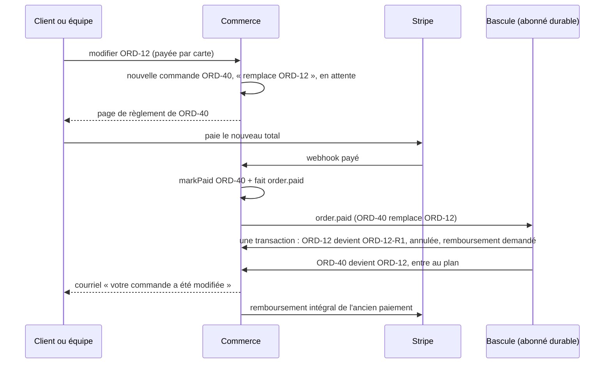
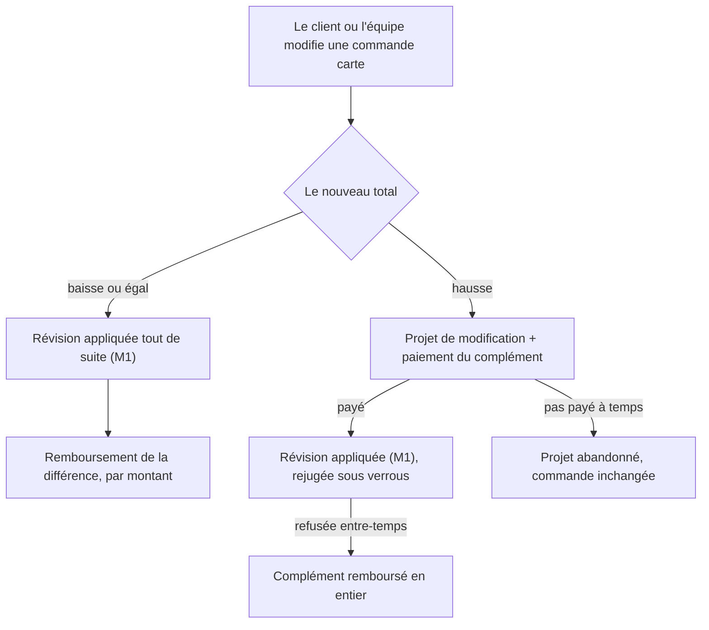

# Plan — modifier une commande payée par carte (M2)

> **Doc-first, 2026-10-23.** Suite de
> [`plan-modifier-une-commande.md`](plan-modifier-une-commande.md) : M1 (commit
> `21aae837c`) refuse une commande payable par carte. Décision de Hugo : un
> article retiré d'une commande payée par carte est **remboursé au retrait**.
> Récapitulatif pour décider : [`recap-modifier-une-commande-carte.md`](recap-modifier-une-commande-carte.md) (2026-11-09).
> Le reste est choisi par l'assistant, avec sa raison. Touche **l'argent** :
> `vitruve` avant de bâtir.

## 0. Ce qui existe (ouvert le 2026-10-23)

- **La carte est débitée tout de suite** (intention sans `capture_method`,
  `b2b/payments/infrastructure/stripe-payment-gateway.ts`) ; une commande porte
  **une** intention (`orders.stripe_payment_intent_id`), par laquelle le
  webhook la retrouve.
- **Les remboursements constatés** sont une table à plusieurs lignes par
  commande (`order_refund`, une par `re_…`), plafonnés au total
  (`orders.total_cents`). La **demande** de remboursement, elle, est unique par
  commande (`order_refund_request`, `orderId @id`), écrite par l'annulation.
- **La facture d'une commande pro payée par carte naît quand la commande est
  retirée ET payée** (`facture-carte-et-remboursements.md`), avec un acquit
  égal au **total de la commande** (`card-invoice-support.ts`,
  `prepayment.amountCents = totalCents`). Chaque remboursement constaté sur une
  commande facturée produit un **avoir**.
- **M1 ne modifie qu'avant l'inscription au plan** : à ce moment, **aucune
  facture carte n'existe** (elle naît au retrait).

## 1. Le découpage

| Lot     | Ce qu'il permet                                                                                                                                                                                                                        |
| ------- | -------------------------------------------------------------------------------------------------------------------------------------------------------------------------------------------------------------------------------------- |
| **M2a** | Une commande **payée par carte** se modifie tant que son total **ne monte pas** : moins d'articles, autre date, autre créneau, autre point, retrait ↔ livraison si le total ne monte pas. La différence est remboursée **au retrait**. |
| **M2b** | Une commande carte **non encore payée** (intention en attente) se modifie librement.                                                                                                                                                   |
| **M2c** | Une commande **payée** dont le total **monte** : le complément.                                                                                                                                                                        |

_(Raison du découpage : M2a et M2b n'ajoutent aucune intention Stripe ; M2c
en ajoute une, et c'est là que vit toute la difficulté — vitruve, objections
2 à 5 du plan M1.)_

## 2. M2a — la baisse, remboursée au retrait

- **R1** — La révision d'une commande payée par carte est admise si le
  nouveau total est **inférieur ou égal** à l'ancien. Au-dessus : refus clair
  (« le total augmenterait : passez une seconde commande pour l'ajout, ou
  demandez au commerce ») jusqu'à M2c.
- **R2** — La différence s'accumule sur la commande dans un montant **dû au
  remboursement au retrait** (`orders.revision_refund_due_cents`, migration
  additive, ≥ 0). Deux baisses s'additionnent. _(Raison : la demande de
  remboursement est unique par commande ; on ne l'écrit qu'une fois, à la
  remise, avec le cumul.)_
- **R3** — **Au retrait** (`mark-order-fulfilled`), si le dû est positif, la
  demande de remboursement est écrite dans la même unité de travail, cause
  nouvelle `revision` (valeur d'énumération ajoutée par migration), montant =
  le dû ; l'exécuteur existant l'émet. Le dû passe à zéro.
- **R4** — **Annulée avant le retrait** : l'annulation rembourse ce qui a été
  **encaissé** (pas le total révisé) et remet le dû à zéro, dans sa
  transaction. Aucun double remboursement.
- **R5** — **La facture carte** naît au retrait sur la commande **révisée** :
  son acquit vaut le total révisé (inchangé : `totalCents`). Le remboursement
  de cause `revision` ne produit **aucun avoir** : il rend un trop-perçu sur
  un montant que la facture n'a jamais porté. _(Raison : sinon la baisse
  serait comptée deux fois, objection 3 du plan M1.)_ Les autres causes
  gardent leur avoir.
- **R6** — **Le plafond** des remboursements reste `Σ succeeded ≤ encaissé`.
  Il lisait `orders.total_cents` ; une commande révisée à la baisse a un total
  inférieur à l'encaissé : le plafond lit désormais **le montant encaissé**,
  conservé sur la commande à l'encaissement (`orders.captured_cents`, migration
  additive, rempli par `markPaid` ; repris de `total_cents` pour les commandes
  payées existantes). `paymentStatus = refunded` quand Σ = encaissé.
- **R7** — **Points de fidélité** : gagnés au retrait sur le total révisé,
  comme aujourd'hui (aucun changement).
- **R8** — **Ce que voit le client** : « 3,10 € vous seront remboursés à la
  remise » sur la commande, et dans le devis de la modification.

## 3. M2b — la carte non encore payée

- **R9** — L'intention en attente est **fermée** chez Stripe (`cancelIntent`)
  **avant** l'écriture, comme l'annulation ; si Stripe répond `already_paid`
  (le client vient de payer), la révision est refusée « le paiement vient
  d'aboutir, rechargez » et se rejoue alors en M2a. `in_progress` :
  refus « paiement en cours ». Après l'écriture, une nouvelle intention au
  nouveau montant est créée **à la demande**, par le chemin du lien de
  paiement existant. _(Raison : c'est l'ordre déjà éprouvé par l'annulation, et
  aucune intention ne survit à son montant.)_

## 4. M2c — le complément (non bâti ici)

Une commande payée dont le total monte demande une **seconde intention**, donc
une table des paiements d'une commande (n intentions), un webhook qui les
retrouve, un remboursement réparti entre elles, une facture acquittée de leur
somme. À concevoir à part, quand le besoin réel se présentera ; d'ici là, R1
refuse avec un geste de sortie (« passez une seconde commande »).

## 5. Tests

- Baisse payée par carte : dû accumulé, remise → demande cause `revision` au
  bon montant, exécutée ; facture carte acquittée du total révisé, **sans
  avoir** pour ce remboursement ; plafond sur l'encaissé.
- Deux baisses : cumul. Annulation après une baisse : remboursement de
  l'encaissé, dû remis à zéro.
- Hausse payée : refus avec le message.
- Carte en attente : intention fermée puis révision ; `already_paid` → refus ;
  nouvelle intention au nouveau montant.

## 6. Contredit par `vitruve` (2026-10-23) — **à reconcevoir, rien n'est bâti**

Trois objections bloquantes, que le plan ne sait pas lever sans changer de
mécanique :

1. **L'exécuteur des remboursements rend TOUT le reste**, pas un montant
   (`issue-order-refund.handler.ts` → `refundRemainder`, sans `amount` chez
   Stripe). Une demande `revision` de 3,10 € rembourserait la commande
   entière, marchandise retirée. Il faudrait un montant dans le port, l'appel
   Stripe, l'état de la demande et sa recherche « plus rien à rendre ».
2. **« Pas d'avoir pour la cause `revision` » n'a pas de mécanisme** : le
   carnet `order_refund` ne connaît pas la cause, la comptabilité émet un
   avoir pour tout remboursement réussi d'une commande facturée
   (`refund-reconciler.ts`), et le webhook peut constater le remboursement
   avant que la demande connaisse son `re_…`.
3. **M2b s'appuie sur un chemin qui n'existe pas** : la page de règlement ne
   crée jamais de nouvelle intention (`get-order-payment.handler.ts`) ; une
   intention fermée laisse la commande impayable.

Et huit sérieuses, dont : le montant facturé lu sur `total_cents` à cinq
endroits ; `captured_cents` mal défini ; un dû sans issue quand la commande
n'est jamais retirée ; les remboursements partiels déjà faits ; le
retournement d'un remboursement ignoré sur une commande retirée ; le
gestionnaire du retrait qui gagnerait une écriture rejouable sans fin ; et
**un écart assumé entre la banque et les factures** (trop-perçu sans avoir),
qui demande l'avis de Hugo.

### La piste plus simple, à proposer à Hugo

**Modifier une commande payée par carte = la remplacer.** L'ancienne est
annulée et **remboursée en entier** par le mécanisme existant (qui rend
justement tout le reste), la nouvelle est passée et payée comme n'importe
quelle commande, avec les prix des lignes déjà présentes conservés (R3 de M1).
Aucune facture n'existe encore (elle naît au retrait), aucun montant partiel,
aucune seconde intention, aucun avoir. Ce qu'on perd : le client est débité
du nouveau total avant d'être recrédité de l'ancien (quelques jours de
découvert sur sa carte), et la commande change de numéro — à moins de
garder l'ancien numéro visible comme « remplace la commande N ». Cela
contredit la décision 6 (« remboursé au retrait ») : c'est à Hugo de
trancher.

## 7. Décision de Hugo (2026-10-23) : le remplacement, sous le même numéro

« Ok pars sur le remplacement, mais j'aurais voulu garder le même numéro de
commande. » Les §1 à §5 sont **abandonnés** ; ce qui suit les remplace.

**Principe.** Modifier une commande payée par carte, c'est la **remplacer** :
une nouvelle commande, payée à part, puis une bascule qui donne son numéro à
la nouvelle et rembourse l'ancienne en entier. Chaque commande garde **sa**
propre intention Stripe : les webhooks, les remboursements et le carnet
retrouvent toujours la bonne commande (objection 3 de M1, objection 3 de M2
levées sans rien changer à leur mécanique).

- **R1 — La nouvelle commande** est composée comme une révision M1 (mêmes
  règles de qui, quand, quoi ; R3 des prix : les lignes déjà présentes gardent
  leur prix), mais **écrite comme une commande neuve**, liée à l'ancienne
  (`orders.replaces_order_id`, migration additive), sous un **numéro
  provisoire**, en attente de paiement par carte, par le chemin de passation
  existant (intention, page de règlement). Elle n'entre pas au fournil tant
  qu'elle n'est pas payée (règle actuelle d'une commande carte non payée — à
  vérifier, sinon l'exclure explicitement).
- **R2 — Tant que la nouvelle n'est pas payée, l'ancienne ne bouge pas.** Si
  le paiement échoue ou expire, la nouvelle est abandonnée comme toute
  commande carte non payée : rien n'a changé pour le client.
- **R3 — La bascule, au paiement réussi de la nouvelle**, en une transaction,
  sous le verrou des deux lignes `orders` et de la journée :
  1. l'ancienne est rejugée (toujours `placed`, non inscrite) ;
  2. son numéro devient un **numéro d'archive** (`<N>-R<k>`) ;
  3. elle est annulée, motif `replaced`, et sa demande de remboursement est
     écrite par le noyau d'annulation existant (remboursement **intégral**,
     ce que l'exécuteur sait faire) ;
  4. la nouvelle prend le numéro `<N>`.
     Si l'ancienne a été inscrite au plan entre-temps (la journée a clos), la
     bascule n'a pas lieu : la nouvelle est annulée et remboursée, le client et
     le staff sont prévenus.
- **R4 — Ce que voit le client** : la commande `<N>`, à jour. Le détail dit
  « remplace votre commande du … ; l'ancien paiement de X € vous est
  remboursé ». Le staff voit l'ancienne sous `<N>-R<k>`, « remplacée ».
- **R5 — Le fournil, la livraison, le colisage** voient une annulation et une
  passation, deux gestes qu'ils savent déjà traiter.
- **R6 — La facture** : aucune n'existe encore (elle naît au retrait) ;
  l'ancienne, annulée, n'est jamais facturée.
- **R7 — Une commande carte non encore payée** (intention en attente) :
  même chemin — la nouvelle remplace l'ancienne à son paiement, et l'ancienne
  est annulée (son intention fermée, comme une annulation).

À vérifier avant de bâtir, et à contredire par `vitruve` : le numéro
(`orders.order_number` unique, son générateur, ses lecteurs figés — bon PDF
archivé, courriels déjà partis, demandes clients, journal) ; l'unicité de
`<N>-R<k>` ; la bascule dans le webhook `markPaid` (idempotence, ordre des
verrous) ; le bon de fidélité imputé sur l'ancienne (restitué par
l'annulation, ré-imputé sur la nouvelle ?) ; la surtaxe et la dérogation
d'heure limite ; les points.

## 8. Le §7 contredit par `vitruve` (2026-10-23) — rien n'est bâti

Cinq bloquants, chacun avec la piste retenue si le chantier est lancé :

1. **Un refus de l'annulation dans le webhook défait le paiement** (l'unité de
   travail rejoint celle de `markPaid`) : Stripe rejoue des jours, le client
   débité reste sur une commande en attente. → Le webhook ne fait que
   `markPaid` + un fait durable `order.replacement_paid` ; **la bascule est un
   abonné durable** avec sa propre transaction et son repli.
2. **L'ancienne carte non payée** : fermer son intention est un appel Stripe,
   qui ne doit pas se faire sous verrou, et le client peut avoir payé les deux
   pages. → Même découpage ; `already_paid` se traite comme une ancienne payée
   (remboursement).
3. **Le bon de fidélité** finirait sur deux commandes, ou restitué alors que la
   nouvelle le déduit encore. → La nouvelle ne porte **aucun** bon à sa
   passation ; la bascule **transfère** l'imputation, sous le verrou du
   titulaire, sans restitution.
4. **L'annulation « remplacée » et l'acteur « système »** sont refusés par les
   contraintes de la base et par le contrat ; et ses abonnés enverraient au
   client « votre commande est annulée » au moment où on lui dit « à jour ».
   → Migration des contraintes, contrat élargi, et un courriel « votre
   commande a été modifiée » à la place de celui d'annulation.
5. **Une nouvelle commande à total nul** n'a pas de paiement, donc pas de
   bascule. → Bascule déclenchée à la passation dans ce cas.

Et des sérieuses : l'expiration d'une commande non payée ne vise que le
particulier (une nouvelle commande de pro resterait en attente sans fin) ; une
seule nouvelle commande en attente par ancienne (index unique partiel) ;
l'ancienne annulée entre-temps ; la nouvelle visible partout pendant
l'attente sous un numéro ordinaire ; les copies figées du numéro (demandes
clients, alertes, courriel) qui dépendent de l'ordre des étapes ; le client
qui avance deux fois le montant (plafond de carte, 5 à 10 jours de
remboursement) ; la dérogation d'heure limite restée sur l'ancienne.

**État** : à présenter à Hugo — c'est un chantier de taille (paiement,
annulation, bon de fidélité, numérotation, courriels), qui se bâtirait en deux
ou trois lots.

## 9. Le plan bâtissable (2026-11-09) — le remplacement, verrouillé

> **Doc-first, 2026-11-09.** Hugo : « vas-y pour M2, fais le plan et
> vitruve ». Ce paragraphe reprend la décision du §7 (le remplacement, sous le
> même numéro) et les pistes du §8, **relues dans le code ce jour-là** ; il
> remplace les deux comme référence pour bâtir. Rien n'est bâti.

### 9.1 Ce que le code dit aujourd'hui (ouvert le 2026-11-09)

- **Le remboursement ne sait rendre que TOUT le reste d'une intention** :
  `PaymentRefunder.refundRemainder` n'a pas de montant
  (`payments/domain/payment-refunder.ts`). C'est la raison du remplacement :
  une ancienne commande remboursée en entier est exactement ce qu'il sait
  faire.
- **Les causes d'une demande de remboursement** sont `cancellation`,
  `paid_after_cancellation`, `refund_reversed` (enum `OrderRefundCause`,
  `order-refund.prisma`) ; la demande est **unique par commande** (clé =
  `order_id`), écrite par `CancellationRefundRequester` sous le verrou de la
  ligne `orders`.
- **Le paiement réussi** (`confirm-order-payment.handler.ts`) fait `markPaid`
  et publie `order.paid` **durable** dans la même unité de travail. Ses
  abonnés : l'accusé (`send-order-settled-mail`), l'avis à l'invité, le
  remboursement d'une commande payée après annulation, les points (seulement
  si la commande est déjà retirée), la facture carte (seulement si elle est
  déjà retirée).
- **Une commande carte non payée n'entre pas au fournil** : `planWhere()`
  exclut `PAYMENTS_AWAITING` (`orders/infrastructure/plan-filter.ts`). Une
  commande carte **payée**, si : la nouvelle, payée et pas encore basculée,
  serait produite **en plus** de l'ancienne si la journée s'arrêtait entre
  les deux (trou non vu au §8).
- **Le fournil et le colisage recopient le numéro à l'inscription**
  (`ProductionOrder.reference`, `PackingOrder.reference`) ; ni la livraison ni
  le retrait n'en gardent une copie. Avant l'inscription, le numéro n'est
  copié que par les **alertes** (`alerts.prisma`, `order_number` figé), les
  **demandes clients** (`contact.prisma`, facultatif), les **factures**
  (nées au retrait seulement) et les courriels déjà partis. Stripe ne le porte
  pas (métadonnée `companyId` seule).
- **Le numéro** est `ORD-<rang>` (`order-number.ts`), unique en base ; un
  ancien format porte deux tirets (`ORD-MV84O2XA-Y9W3`).
- **L'expiration d'une carte non payée** ne vise que le particulier sans
  société (`unsettled-shop-order.where.ts`, clientèle `public`) : 30 min, et
  « la nouvelle passation du même particulier annule l'ancienne non réglée »
  (`replaceEarlier`, cause `replaced`, déjà écrite en base pour
  `order.payment_failed`).
- **Le noyau d'annulation** (`order-cancellation.service.ts`) ne connaît que
  deux acteurs (staff, client) et publie `OrderCancelledEvent`, dont les
  abonnés écrivent au client « votre commande est annulée ».

### 9.2 Le principe, en une image

### 9.3 Les règles

- **P1 — Quand.** Une commande **carte** (payée, ou intention en attente) se
  remplace aux mêmes conditions qu'une révision M1 : qui (client jusqu'à
  l'heure limite, équipe jusqu'à la préparation), quoi (R1–R7 de M1, prix
  figés des lignes déjà présentes), et **seulement avant l'inscription au
  plan** (`status = placed`, non inscrite). Après : la demande M4, que
  l'équipe ne peut appliquer sur une carte qu'en annulant (pas de complément
  après l'arrêt).
- **P2 — La nouvelle commande.** Composée par `OrderRevising.compose` (la
  même recomposition que M1), écrite comme une **commande neuve** par le
  chemin de passation carte existant (intention, page de règlement), avec :
  `replaces_order_id` → l'ancienne (migration additive), `replacement_state =
awaiting_payment` (enum neuf, nul pour toute autre commande), son propre
  numéro de compteur (provisoire), et **l'auteur de la modification**
  (`replaced_by_kind` / `_user_id` / `_staff_id`), qui sera celui de la
  bascule — il n'y a jamais d'acteur « système ».
- **P3 — Une seule à la fois.** Index unique partiel sur `replaces_order_id`
  où `replacement_state IN ('awaiting_payment','awaiting_swap')`. Une seconde
  modification pendant l'attente est refusée (« une modification attend déjà
  son règlement : réglez-la ou abandonnez-la »), avec un geste
  « abandonner ».
- **P4 — Invisible tant qu'elle n'a pas basculé.** `planWhere()`, le dossier
  du jour, la file du comptoir, les listes client et staff **excluent**
  `replacement_state IN ('awaiting_payment','awaiting_swap')`. L'ancienne
  porte, en lecture, « modification en attente de règlement » avec le lien
  de paiement. _(Raison : lève le trou du 9.1 — une nouvelle payée n'est
  jamais produite avant d'avoir pris la place de l'ancienne.)_
- **P5 — Le paiement ne fait que payer.** Le webhook reste tel quel
  (`markPaid` + `order.paid`). Si la commande payée est un remplacement,
  `markPaid` la passe aussi à `awaiting_swap` dans la même écriture.
  _(§8 objection 1 : aucun refus métier dans la transaction du webhook.)_
- **P6 — La bascule** est un abonné durable de `order.paid`
  (`orders.swap-replacement.on-paid`), qui ne fait rien pour une commande
  ordinaire. Dans **une** transaction, verrous dans l'ordre : ligne `orders`
  de l'ancienne, puis de la nouvelle, puis le bon (P9) :
  1. rejuger l'ancienne : toujours `placed`, non inscrite, non annulée ;
  2. l'ancienne prend le numéro d'archive `<N>-R<k>` (k = nombre de
     remplacements déjà faits + 1), `status = cancelled`, motif
     `superseded` (valeur ajoutée à la contrainte `cancelled_by_kind`,
     l'auteur de P2 recopié), et `superseded_by_order_id` ;
  3. si l'ancienne était payée : demande de remboursement, cause neuve
     `superseded`, montant = tout le remboursable, par
     `CancellationRefundRequester` (le même exécuteur) ;
  4. si l'ancienne était une carte non payée : son intention est fermée
     **avant** la transaction (`cancelIntent`, hors verrou) ; `already_paid`
     ⇒ on rejoue la bascule comme pour une payée (le webhook de l'ancienne
     l'aura marquée payée, la demande de remboursement la couvre) ;
     `in_progress` / `unavailable` ⇒ l'abonné échoue et la boîte d'envoi le
     rejoue ;
  5. la nouvelle prend le numéro `<N>` et `replacement_state = swapped` ;
  6. faits durables : `order.superseded` (ancienne → nouvelle, auteur), et
     `CommerceOrderCancelledFact` pour l'ancienne + le fait de passation que
     la livraison lit pour la nouvelle (les mêmes que M1 publie pour un
     changement d'acheminement).
- **P7 — La bascule refusée.** Si 1. échoue (ancienne inscrite entre-temps,
  annulée par ailleurs) : la nouvelle est annulée et intégralement
  remboursée (cause `superseded`, même chemin), `replacement_state =
abandoned`, et le client reçoit « votre modification n'a pas pu être
  appliquée : votre commande ORD-12 reste telle quelle, le nouveau paiement
  vous est remboursé ». L'équipe reçoit la cloche.
- **P8 — L'abandon.** Une nouvelle non payée meurt comme une carte non payée,
  **quelle que soit la clientèle** : 30 min, ou dès l'inscription de
  l'ancienne au plan, ou au geste « abandonner » — intention fermée, puis
  `replacement_state = abandoned`. Rien ne change pour l'ancienne.
  `replaceEarlier` (le particulier qui repasse commande) **ignore** les
  remplacements dans les deux sens.
- **P9 — Le bon de fidélité.** La nouvelle est **calculée** avec le bon de
  l'ancienne (même déduction), mais ne le **porte** pas avant la bascule ; la
  bascule le **déplace** (colonne de l'ancienne → nouvelle) sous le verrou du
  titulaire, sans libération ni restitution. P7 et P8 n'y touchent pas : il
  n'a jamais quitté l'ancienne. _(§8 objection 3.)_
- **P10 — Total nul.** Une nouvelle à total nul n'a pas de paiement : la
  bascule se fait à sa passation, dans la même requête, par le même service.
  _(§8 objection 5.)_
- **P11 — Ce que dit chaque abonné de `order.paid`** pour un remplacement :
  l'accusé de réception et l'avis à l'invité **se taisent** (le courriel est
  celui de la bascule) ; les points et la facture carte ne changent pas
  (la commande n'est pas retirée) ; le remboursement « payée après
  annulation » ne voit rien (la nouvelle n'est pas annulée).
- **P12 — Les courriels.** Un modèle neuf `customer.order-modified`
  (« votre commande ORD-12 a été modifiée — l'ancien paiement de X € vous est
  remboursé, sous 5 à 10 jours ») à la bascule, et
  `customer.order-modification-failed` pour P7. Aucun « annulée ».
- **P13 — Ce que voit chacun.** Le client : ORD-12, à jour, avec
  « modifiée le … ; ancien paiement remboursé ». L'équipe : ORD-12 et, dans
  son historique, ORD-12-R1 « remplacée ». Le journal porte
  `order.superseded` avec ses deux identifiants et ses deux numéros.
- **P14 — L'équipe qui modifie une commande carte** : la nouvelle est créée,
  et son lien de paiement part au client (`create-payment-link`, existant) ;
  l'écran le dit. L'équipe ne paie pas à la place du client.

### 9.4 Les lots

| Lot      | Contenu                                                                                                                                                                                        |
| -------- | ---------------------------------------------------------------------------------------------------------------------------------------------------------------------------------------------- |
| **M2.1** | Serveur : migration (colonnes, enum, index partiel, causes `superseded`), création de la nouvelle (P2–P4), `markPaid` → `awaiting_swap` (P5), bascule et refus (P6, P7), total nul (P10), P11. |
| **M2.2** | L'abandon (P8) et le bon (P9).                                                                                                                                                                 |
| **M2.3** | Courriels (P12, trois langues), écrans boutique et back-office (P3, P4, P13, P14).                                                                                                             |

### 9.5 Ce qui reste à décider (Hugo)

1. **Le client avance deux fois le montant** : il paie le nouveau total
   avant d'être remboursé de l'ancien (5 à 10 jours selon sa banque). Un
   plafond de carte peut refuser. Accepté ?
2. **Le numéro d'archive** `ORD-12-R1` a deux tirets, comme l'ancien
   format : à vérifier que rien ne le prend pour un ancien numéro ; et le
   numéro provisoire de la nouvelle (`ORD-40`) laisse un trou dans la suite.
   Acceptable ?
3. **Après l'arrêt du plan**, une commande carte ne se modifie pas (P1) :
   la demande M4 s'y applique en annulant et en repassant. D'accord ?

## 10. Le §9 contredit par `vitruve` (2026-11-09) — rien n'est bâti

Les cinq bloquants du §8 sont levés sur le papier ; quatre nouveaux, et sept
sérieux.

**Bloquants**

1. **`ORD-12-R1` est refusé par la base** : `orders_order_number_format`
   (`20261025120000_le_numero_de_commande_a_son_format`) n'admet que
   `ORD-<n>` ou l'ancien format ; deux lecteurs analysent le numéro
   (`inbound-message.ts`, `delivery-note-number.ts`).
2. **« Non inscrite » ne se lit pas sur `orders.status`** : le fournil prend
   ses `orderIds` à l'arrêt, le commerce les absorbe plus tard
   (`on-production-day-closed.handler.ts`). La bascule doit passer, comme M1,
   par `OrderInscriptionReader` sous le verrou de la journée — de l'ancienne
   ET de la nouvelle.
3. **La journée de la nouvelle n'est jamais rejugée** : arrêtée pendant
   l'attente, elle bascule sans être au plan.
4. **Une nouvelle de pro abandonnée puis payée tard** repasse à `paid`
   (`PAID_FROM` admet `failed`), invisible, jamais remboursée.

**Sérieux** : P11 oublie l'avis au principal d'un site
(`notify-principal-on-order-paid`) ; la passation de la nouvelle publie déjà
ses faits (journal de croissance, alertes, rattachement à la livraison) ;
**P4 n'a pas de mécanisme** — une cinquantaine de lecteurs de `orders` ne
passent par aucun fragment partagé (vitrine, comptoir, listes, livraison,
croissance, fiche client) ; le motif `superseded` ne peut pas vivre dans
`cancelled_by_kind`, qui porte l'acteur ; le bon a un index unique
« vivant » qui impose un ordre, et sa déduction change si le nouveau total
passe sous sa valeur ; la bascule recopierait le noyau d'annulation ; les
valeurs d'enum sont à figer avant le merge.

### Ce que ça dit du remplacement

Les bloquants 1 à 4 se lèvent chacun en quelques lignes. Le coût est ailleurs :
**une seconde ligne `orders` vivante** que cinquante lecteurs, et les faits
de passation, voient déjà. La rendre invisible demande un fragment partagé et
une porte qui le tienne partout — c'est la plus grosse part du chantier, et
la plus facile à rater.

**L'autre forme, à éprouver avant de choisir** : garder **la même ligne** —
même numéro, même bon, aucune invisibilité à tenir — et ne multiplier que le
paiement. La modification est un **projet** (lignes révisées + une nouvelle
intention au nouveau total) ; au paiement, la révision M1 s'applique à la
commande, et l'**ancienne intention** est remboursée en entier
(`refundRemainder` le sait, par intention). Le coût passe dans le paiement :
une table des intentions d'une commande (le webhook retrouve la commande par
n'importe laquelle), une demande de remboursement par intention et non plus
par commande, le plafond lu sur l'encaissé et non sur `total_cents`, et une
cause qui dit au rapprochement comptable de ne pas émettre d'avoir. Non écrit,
non contredit.

## 11. La forme C — un historique de transactions (2026-11-09)

> **Décision de Hugo, 2026-11-09** (« donc on partirait sur un historique de
> transaction ? » → « vas-y, écris le plan de la forme C ») : la forme de
> Shopify — une commande, un numéro, plusieurs paiements et remboursements,
> chacun avec son montant. **Remplace la décision du §7** (le remplacement)
> et les §9–§10. Récapitulatif :
> [`recap-modifier-une-commande-carte.md`](recap-modifier-une-commande-carte.md).
> Doc-first ; rien n'est bâti.

### 11.1 Ce que le code dit (ouvert le 2026-11-09)

- **Un paiement par commande** : `orders.stripe_payment_intent_id`
  (`@unique`), lu par **24 fichiers** de `b2b/` hors tests ; le webhook
  retrouve la commande par lui (`markPaid`, `prisma-order.repository.ts`).
- **Le remboursement rend tout le reste**, sans montant :
  `stripe-refund-calls.ts` (« 🔴 Sans `amount` »). Stripe, lui, accepte un
  montant. La métadonnée du `re_…` porte déjà la demande et la génération.
- **La demande de remboursement est une par commande** (`order_refund_request`,
  clé `order_id`), causes `cancellation`, `paid_after_cancellation`,
  `refund_reversed`.
- **Le carnet** (`order_refund`, agrégat `OrderRefundLedger`) plafonne
  `Σ succeeded ≤ chargedCents`, et **`chargedCents` est lu sur
  `orders.total_cents`** (`prisma-order-refund.repository.ts`). Il ne porte
  ni l'intention ni la cause d'un remboursement. Le constat
  (`RecordOrderRefundCommand`) ne porte que l'intention et le rapport — pas
  la métadonnée.
- **La comptabilité fait un avoir de TOUT remboursement réussi** d'une
  commande qui a une facture carte, **y compris un remboursement noté avant
  le retrait** (`accounting/application/services/refund-reconciler.ts`, « il
  rattrape donc aussi un remboursement noté avant le retrait »). La facture
  carte naît au retrait, acquittée de `total_cents`.
- **La page de règlement** redemande le `clientSecret` de
  `orders.stripe_payment_intent_id` et affiche `total_cents`
  (`get-order-payment.handler.ts`).

### 11.2 Le principe

### 11.3 Les règles

- **C1 — Quand.** Comme M1 (qui, quoi, prix figés des lignes déjà là) et
  seulement **avant l'inscription au plan**, jugée comme M1 la juge
  (`OrderInscriptionReader`, sous le verrou de la journée — §10 bloquant 2).
  Une commande sur stock (`supply = shelf`) ne se modifie pas par carte en
  C (pas d'inscription qui en ferme la fenêtre). Après : la demande M4,
  appliquée par l'équipe par annulation.
- **C2 — Le paiement d'origine ne bouge pas.** `orders.stripe_payment_intent_id`
  reste le **premier** paiement ; les 24 lecteurs ne changent pas. Un
  complément vit dans une table neuve `order_payment` (une ligne par
  intention : commande, intention `@unique`, montant, statut, rôle
  `complement`, la révision qu'il paie, instants). Le montant **réellement
  encaissé** du premier paiement est figé à `markPaid`
  (`orders.charged_cents`, migration additive ; repris de `total_cents` pour
  les commandes déjà payées, puisqu'aucune n'a pu être révisée par carte).
- **C3 — L'encaissé et le plafond.** `chargedCents` du carnet devient
  `charged_cents + Σ order_payment.succeeded` au lieu de `total_cents`. Le
  règlement passe à `refunded` quand `Σ remboursé = Σ encaissé`.
- **C4 — Baisse (ou total égal avec un changement).** Dans la transaction de
  la révision M1 : la révision s'écrit, puis une **demande de remboursement
  de cause neuve `revision`, avec un montant** (= ancien total − nouveau).
  L'exécuteur la sert en remboursant **le dernier paiement encaissé
  d'abord** (un complément avant le premier), par montant, en plusieurs
  `re_…` si un paiement ne suffit pas. Une commande carte **non encore
  payée** n'a rien à rendre : C7.
- **C5 — Hausse.** La révision n'est **pas** appliquée. Un **projet**
  (`order_revision_proposal` : la révision composée, le total visé, la
  révision de base, l'auteur, l'échéance) est écrit avec son intention de
  complément (montant = nouveau − ancien total), hors transaction pour
  Stripe puis enregistrée. Le client paie sur une page de règlement du
  complément. **Un seul projet vivant par commande** (index unique partiel).
  Tant qu'il vit, la commande se lit telle quelle, avec « une modification
  attend son règlement ».
- **C6 — Le complément payé.** Le webhook ne fait que constater
  (`order_payment` → `succeeded`, fait durable `order.complement_paid`). Un
  **abonné durable** applique le projet par le chemin de M1
  (`ReviseOrderHandler`, même verrous : ligne `orders`, journée, révision
  attendue) — l'auteur est celui du projet. **Refus** (commande inscrite,
  annulée, révisée entre-temps, stock épuisé) : demande de remboursement
  `revision` du complément entier, projet `refused`, courriel « votre
  modification n'a pas pu être appliquée » ; la commande est inchangée.
- **C7 — Une carte non encore payée** (premier paiement en attente) : la
  révision ferme l'intention (`cancelIntent`, hors verrou, issues comme
  l'annulation) puis s'applique et en crée une nouvelle au nouveau total,
  qui remplace `stripe_payment_intent_id` dans la même transaction.
  `already_paid` : la commande est payée, on rejoue comme une payée.
- **C8 — L'abandon d'un projet.** Échéance : 30 min, ou l'inscription de la
  commande au plan, ou le geste « abandonner » — l'intention du complément
  est fermée, le projet `abandoned`. Un complément payé APRÈS l'abandon
  (intention fermée trop tard) : C6 refuse, et le rembourse.
- **C9 — L'annulation** rend **chaque** paiement encaissé, en entier : une
  demande par paiement (`refundRemainder` par intention, comme aujourd'hui).
  Un projet vivant est abandonné d'abord.
- **C10 — La comptabilité.** Le carnet `order_refund` porte la **cause**
  (colonne ajoutée, lue sur la métadonnée du `re_…`, que l'exécuteur pose et
  que le constat transmet désormais) et l'**intention**. Le rapprochement ne
  fait **pas d'avoir** pour un remboursement `revision` constaté **avant** la
  facture : la facture naît sur le total révisé, le trop-perçu n'y a jamais
  figuré. Après la facture, une révision n'est plus possible (C1), donc la
  question ne se pose pas.
- **C11 — La facture carte** reste acquittée de `total_cents` : à
  l'émission, `Σ encaissé − Σ remboursé (revision)` = `total_cents` ; un
  écart est un défaut, signalé et non facturé.
- **C12 — Le bon de fidélité, les points** : la révision M1 les traite déjà ;
  rien de propre à la carte. (À éprouver : la déduction plafonnée par le
  total, §10.)
- **C13 — L'équipe** modifie une commande carte comme le client : en baisse,
  le remboursement part ; en hausse, le lien de paiement du complément part
  au client (`create-payment-link`, à vérifier pour une intention de
  complément).
- **C14 — Ce que voit le client.** Sur sa commande : l'historique des
  paiements et remboursements, chacun daté. Courriels : « commande modifiée,
  X € vous sont remboursés » ; « réglez le complément de X € » ; « votre
  modification n'a pas pu être appliquée ».

### 11.4 Les lots

| Lot     | Contenu                                                                                                                                                                                                              |
| ------- | -------------------------------------------------------------------------------------------------------------------------------------------------------------------------------------------------------------------- |
| **C-1** | Le paiement à plusieurs : `order_payment`, `charged_cents`, plafond C3, webhook qui retrouve un complément, remboursement par montant et par intention, cause dans le carnet, C10–C11. Aucune règle de modification. |
| **C-2** | La baisse (C4) et la carte non payée (C7) : la révision M1 ouverte à la carte quand le total ne monte pas.                                                                                                           |
| **C-3** | La hausse (C5, C6, C8), l'annulation à plusieurs paiements (C9).                                                                                                                                                     |
| **C-4** | Écrans et courriels (C13, C14).                                                                                                                                                                                      |

### 11.5 À décider (Hugo)

1. **Le remboursement d'une baisse part tout de suite** (C4) — et non au
   retrait. D'accord ?
2. **Une hausse attend le paiement du complément** ; non payé en 30 min, la
   modification tombe. D'accord sur le délai ?
3. **Après l'arrêt du plan**, pas de modification par carte (C1). D'accord ?

## 12. Le §11 contredit par `vitruve` (2026-11-09) — et ce qu'il faut changer

La forme tient ; quatre mécanismes sont à reconcevoir avant de bâtir.

| #   | Bloquant                                                                                                                                                                                                                                                                                                  | Ce qu'il faut à la place                                                                                                                                                                                                                 |
| --- | --------------------------------------------------------------------------------------------------------------------------------------------------------------------------------------------------------------------------------------------------------------------------------------------------------- | ---------------------------------------------------------------------------------------------------------------------------------------------------------------------------------------------------------------------------------------- |
| 1   | **Une demande de remboursement par commande** : clé `order_id`, bail, clé d'idempotence et recherche Stripe par commande (`order-refund.prisma`, `issue-order-refund.handler.ts`, `stripe-refund-calls.ts`). Une seconde baisse viole la clé ; une seconde demande retrouverait le `re_…` de la première. | La demande devient une **ligne par remboursement à faire** (id propre, commande, **intention**, montant), et tout ce qui la désigne — bail, clé, métadonnée Stripe — prend cet id. Une baisse qui touche deux paiements = deux demandes. |
| 2   | **L'état d'une demande se lit sur le reste du carnet** (`refundRequestStateOf`) : une demande partielle servie aujourd'hui rendrait tout.                                                                                                                                                                 | Une demande « par montant » est servie quand **son** `re_…` a réussi pour **son** montant ; l'annulation garde « rendre tout le reste de cette intention ». Deux formes, nommées.                                                        |
| 3   | **La révision appelée depuis un abonné durable** s'exécute dans la transaction du reçu (`durable-delivery-guard.ts`, `unit-of-work.ts` rejoint la transaction) : un refus après écriture laisse un état à moitié écrit, ou fait rejouer sans fin.                                                         | L'abonné ne fait que marquer le projet **prêt** ; un exécuteur à bail (la figure de l'exécuteur des remboursements) l'applique dans **sa** transaction, hors du reçu, et écrit le refus et sa demande dans une seconde.                  |
| 4   | **Le montant payé et le total appliqué divergent** : `ReviseOrderCommand` recompose les prix à l'application.                                                                                                                                                                                             | Le projet garde la révision **composée** ; l'application la rejuge et **refuse si le total recomposé diffère** du total payé (prix changé pendant l'attente) — remboursement du complément, « les prix ont changé ».                     |

**Sérieux, à intégrer** : le constat d'un remboursement doit retrouver un
complément (aujourd'hui `unmatched` en silence) et lire la métadonnée ; un
remboursement `revision` qui s'inverse sur une commande vivante est perdu
(`reopen-refund-on-reversal` ne vise que l'annulée) ; un remboursement en
vol bloque l'annulation pendant des jours (`order-refund.ts`) ; le filtre de
l'avoir et l'égalité de la facture doivent se juger **sur la cause**, pas sur
la date ; C7 ferme l'intention avant de juger — juger d'abord, et recréer une
intention si le rejugement refuse ; C13 ne peut pas s'appuyer sur les liens
de paiement (sessions de société, sans commande) — une page de règlement du
complément est à concevoir ; le bon de fidélité sous la valeur du total est
une décision à prendre, pas « à éprouver ».

**Irréversible au premier déploiement de C-1**, à figer avant :
la nouvelle clé de `order_refund_request`, la reprise de `charged_cents`
depuis `total_cents`, les nouvelles valeurs de `OrderRefundCause`.

**État** : la forme C est retenue ; le §11 est à réécrire avec ces quatre
mécanismes avant d'être bâti. C-1 (le paiement à plusieurs transactions) en
porte l'essentiel.

## 13. Décisions de Hugo (2026-11-09)

1. **Une baisse est remboursée tout de suite** (C4 confirmé).
2. **Une hausse se paie tout de suite** : « si il ajoute le paiement doit
   être direct ». Le complément se règle dans le geste même de la
   modification ; si le client quitte sans payer, rien n'est modifié. Pas
   d'attente de 30 minutes : le projet ne vit que le temps du règlement.
3. **Pas de modification par carte après l'arrêt du plan** (C1 confirmé).
   Pour le client, l'heure limite ferme déjà la modification avant l'arrêt ;
   la règle vaut surtout pour l'équipe.
4. **Le bon de fidélité** : si la commande modifiée coûte moins que le bon,
   le client **garde** le reste du bon.

## 14. La forme C, version à bâtir (2026-11-09)

> **Fait foi** à la place du §11 : il en garde le principe, y intègre les
> remèdes du §12 et les décisions du §13. Doc-first ; rien n'est bâti.

### 14.1 En une phrase

Une commande carte garde son numéro et porte **plusieurs paiements et
remboursements, chacun avec son montant** : une baisse est remboursée tout
de suite, une hausse se paie tout de suite, et rien d'autre ne change pour
le reste du système.

### 14.2 Ce qui ne se modifie PAS par carte (choix pour rester simple)

- **Une carte pas encore payée** : « réglez d'abord votre commande, ou
  annulez-la ». _(Raison : fermer puis recréer l'intention autour d'un
  rejugement est la course du §12 ; une carte non réglée de particulier
  expire en 30 min de toute façon.)_
- **Une hausse décidée par l'équipe** : seul le client peut payer un
  complément. L'équipe baisse librement ; pour une hausse, elle le dit au
  client ou annule. _(Raison : les liens de paiement actuels sont des
  sessions de société, sans commande — §12.)_
- **Après l'heure limite (client) ou l'arrêt du plan (équipe)** — §13.3,
  jugé comme M1 (`OrderInscriptionReader`, sous le verrou de la journée).
- **Une commande sur stock** (`supply = shelf`).

### 14.3 Le paiement à plusieurs transactions (lot C-1, sans règle de modification)

- **P1 — Les paiements.** Le premier reste `orders.stripe_payment_intent_id`
  (24 lecteurs inchangés). Un complément est une ligne de `order_payment`
  (id, commande, intention `@unique`, montant, statut, la révision qu'il
  paie). `orders.charged_cents` fige le montant encaissé du premier à
  `markPaid`.
- **P2 — L'encaissé.** `charged_cents + Σ order_payment.succeeded` remplace
  `total_cents` dans les **deux** lecteurs (`prisma-order-refund.repository.ts`,
  `prisma-order-refund-request.reader.ts`).
- **P3 — La demande de remboursement a son identité.** `order_refund_request`
  quitte la clé `order_id` pour un **id propre**, et porte l'**intention**
  visée, la **forme** (`remainder` : tout le reste de cette intention — ce
  que fait l'annulation ; `amount` : ce montant exactement) et le montant.
  Bail, clé d'idempotence (`lfd-order-refund:<demande>:<génération>:<tour>`),
  métadonnée Stripe et recherche du `re_…` prennent l'id de la demande ; la
  recherche compare aussi le montant pour une demande `amount`. Une demande
  `amount` est **servie** quand **son** `re_…` a réussi ; une `remainder`
  quand l'intention n'a plus rien à rendre (l'état d'aujourd'hui).
- **P4 — Le carnet** (`order_refund`) porte l'intention, la demande et la
  **cause**, lues sur la métadonnée du `re_…` que le constat transmet
  désormais. Le constat retrouve la commande par le premier paiement **ou**
  par un complément (aujourd'hui `unmatched` en silence).
- **P5 — La comptabilité juge sur la cause, jamais sur la date.** Un
  remboursement de cause `revision` ne fait **jamais** d'avoir ; à
  l'émission de la facture carte, `Σ encaissé − Σ annoncé des demandes
revision` (réussies ou en vol) doit valoir `total_cents`.
- **P6 — L'inversion** d'un remboursement `revision` sur une commande
  vivante rouvre sa demande (génération suivante) et sonne la cloche ;
  aujourd'hui elle n'est traitée que sur une annulée.
- **P7 — L'annulation** écrit une demande `remainder` **par paiement
  encaissé** ; elle n'est plus bloquée par un remboursement `revision` en
  vol : l'exécuteur sert la `remainder` d'une intention après les `amount`
  en cours sur la même intention.

### 14.4 La baisse (lot C-2)

- **B1** — La révision M1 s'applique, dans sa transaction ; la différence
  devient des demandes `amount`, cause `revision`, en commençant par le
  **dernier** paiement encaissé (un complément avant le premier), une
  demande par intention touchée.
- **B2 — Le bon de fidélité (§13.4)** : si le nouveau total passe sous la
  part du bon déjà déduite, la part déduite descend au nouveau total et le
  **reste revient au bon** (le mécanisme du reliquat,
  `LoyaltyVoucherRedemption.settleRemainder`). ⚠️ **Change M1 pour tous** :
  aujourd'hui la révision refuse ce cas (`RevisionBelowVoucherError`), au
  compte compris.

### 14.5 La hausse, payée tout de suite (lot C-3)

- **H1** — Le client valide la modification ; le serveur compose la
  révision, l'enregistre comme **projet** (révision composée, total visé,
  révision de base, auteur) et crée l'intention du complément (hors
  transaction), puis le règlement s'ouvre **sur le même écran** (§13.2).
  Un seul projet vivant par commande.
- **H2** — S'il quitte sans payer : le projet meurt au bout de **15 min**
  (balayage qui ferme l'intention, comme l'expiration des cartes non
  réglées) ; la commande n'a jamais changé.
- **H3** — Le paiement réussi : le webhook constate (`order_payment`
  `succeeded`) et publie `order.complement_paid` ; l'abonné **marque le
  projet prêt, rien d'autre**. Un **exécuteur à bail** (la figure de
  l'exécuteur des remboursements) l'applique dans **sa** transaction :
  rejugement M1 complet sous les verrous, **et le total recomposé doit
  égaler le total payé**.
- **H4** — Refus à l'application (heure passée, plan arrêté, stock, prix
  changé) : dans une seconde transaction, projet `refused` et demande
  `remainder` sur l'intention du complément ; courriel « votre modification
  n'a pas pu être appliquée, le complément vous est remboursé ».
- **H5** — Ni l'accusé de réception, ni l'avis à l'invité, ni l'avis au
  principal n'écoutent `order.complement_paid` : le courriel est celui de la
  modification.

### 14.6 Écrans et courriels (lot C-4)

L'historique daté des paiements et remboursements sur la commande, côté
client et côté équipe ; les courriels « commande modifiée, X € remboursés »,
« modification non appliquée ».

### 14.7 Irréversible au premier déploiement de C-1

La nouvelle identité de `order_refund_request` (les lignes existantes
reprennent leur `order_id` comme id, l'intention de la commande, la forme
`remainder`) ; la reprise de `charged_cents` depuis `total_cents` pour les
commandes payées ; les valeurs `revision` (cause), `remainder` / `amount`
(forme), et les états du projet. À figer avant le merge, migration relue
par `lecteur-de-migrations`.

## 15. Le §14 contredit par `vitruve` (2026-11-09) — trois bloquants

Les quatre bloquants du §12 sont levés ; trois neufs, chacun avec son remède
proposé (à intégrer au §14 avant de bâtir).

1. **Le reste du bon (B2) ne peut pas « revenir »** : sur une commande carte
   payée, le reliquat du bon est **déjà émis** au paiement
   (`settle-voucher-remainders.handler.ts`), et un second reliquat est
   refusé par construction (`loyalty-voucher-redeeming.ts`). → Rendre la
   différence par un **bon neuf** du montant (ou un complément au reliquat
   émis), décision de mécanisme à prendre côté fidélité ; préciser l'unité
   (TTC pour un particulier, HT pour un pro — `order-revision.ts`). En
   attendant, B2 sort de C-2 dans un lot à lui ; C-2 garde le refus actuel
   (`RevisionBelowVoucherError`).
2. **Plus rien n'empêche deux annulations d'écrire deux remboursements
   « tout le reste »** sur la même intention, une fois la clé `order_id`
   quittée (`cancellation-refund-requester.ts` s'y fiait). → Index unique
   partiel `(order_id, intention)` où forme = `remainder`.
3. **L'annulation annonce un montant faux après une baisse pas encore
   remboursée**, et un « tout le reste » parti avant le remboursement de la
   baisse le rend inutile (`refundPositionOf`, `stripe-refund-calls.ts`). →
   Le remboursable d'une intention = encaissé − réussi − **annoncé des
   demandes `amount` non soldées** ; l'exécuteur ne sert la `remainder`
   d'une intention que quand aucune `amount` n'y est encore à émettre ou en
   vol ; `order_refund` gagne l'intention, reprise pour l'existant depuis
   `orders.stripe_payment_intent_id` (tous les remboursements d'aujourd'hui
   sont sur le premier paiement).

**Sérieux** : l'inversion sur une commande annulée doit retrouver sa demande
par son `re_…` (`reopen-refund-on-reversal.handler.ts`) ; le complément payé
après l'abandon du projet doit être remboursé (règle C8 perdue) ; H4 doit
tracer la frontière refus / panne et faire la comparaison des totaux sous les
verrous dans `record()` ; P5 doit nommer qui refuse la facture
(`cardInvoiceVerdict`) et compter une demande refusée comme non rendue ; le
§14.7 doit chiffrer le passage de `Order.refundRequest` (1:1) à une liste
(~15 fichiers, 5 e2e) et figer les valeurs de `order_payment` et du projet.

**État** : la forme est stable ; ces remèdes vont au §14, puis C-1 peut se
bâtir.
