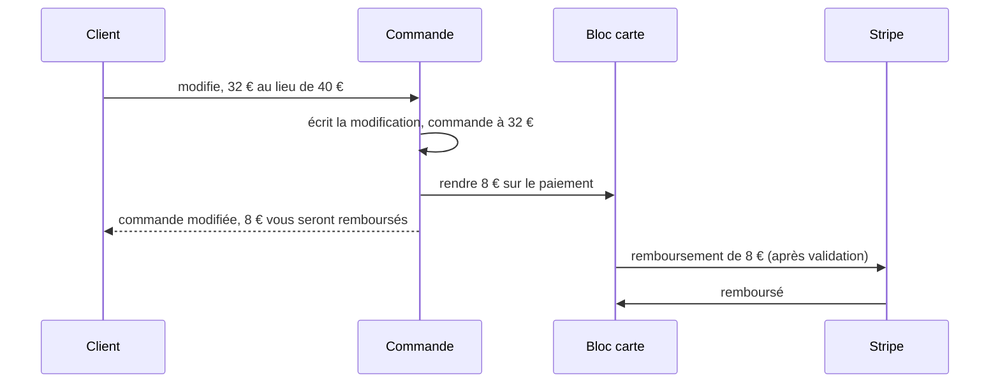

# Plan S1 — modifier à la baisse une commande payée par carte

> **Doc-first, 2026-11-10 — version 4**, après les verdicts de `vitruve` sur la
> v1 (deux bloquants), la v2 (un) et la v3 (**aucun bloquant**, trois
> précisions intégrées ici), §3. Détaille le §7 du
> [plan M2](plan-m2-historique-de-transactions.md), après la hausse
> ([`modifier-une-commande.md`](modifier-une-commande.md), §2.7, en production le
> 2026-11-10). Touche l'argent : `vitruve` avant Hugo. Tout ce que ce plan
> affirme de l'existant a été ouvert le 2026-11-10 ; rien n'est bâti.

## Partie 1 — l'explication simple

Un client a payé 40 € par carte. Il retire une tarte : la commande vaut
32 €. **La commande est modifiée tout de suite, et les 8 € lui sont
rendus sur sa carte**, sans rien à faire de sa part.

- **Pas d'attente, pas de projet** : contrairement à la hausse, on ne
  dépend pas d'un geste du client. La modification et la demande de
  remboursement s'écrivent ensemble.
- **Le remboursement est automatique** : le bloc carte l'émet après
  validation, le relance s'il échoue, et l'équipe le voit dans le bandeau
  des remboursements de la fiche commande (« Relancer », « Rendu
  autrement ») — tout cela existe depuis P1.
- **Une commande payée en deux fois** (40 € puis un complément de 12 €) :
  on rend en partant du **dernier** paiement.
- **Ce qui reste refusé** : une commande pas encore payée, une commande
  partie au fournil, une commande prise sur le stock, une baisse qui
  descendrait sous la part payée par un **bon de fidélité** (le bon est
  reporté à un lot à part, C-2b), et une baisse **pendant qu'une hausse
  attend** (un complément pas encore payé, ou payé mais pas encore
  appliqué) : on finit l'une avant de commencer l'autre.
- **L'équipe aussi peut baisser** une commande carte (« l'équipe baisse
  librement », plan M2 §8) : c'est la seule différence avec la hausse.

## Partie 2 — le détail technique

### 2.1 Vérifié dans le code le 2026-11-10

- **Le tri** : `revisionSettlementOf` (`b2b/orders/domain/entities/revision-settlement.ts`)
  rend aujourd'hui `{ kind: "card_not_revisable", reason: "decrease" }` sur
  une carte encaissée dont le total baisse ; M1 le refuse
  (`CardOrderNotRevisableError`), le devis l'affiche « pas encore possible ».
- **L'écriture de M1** est extraite en `OrderRevisionRecording`
  (`application/services/order-revision-recording.ts`, S2.c) : guichet du
  fournil, `holdSupply`, `save` conditionné, recalage au compte si
  `revision.onAccount`, BL, faits `OrderRevisedEvent` et
  `CommerceOrderRevisedFact`.
- **Le remboursement d'un montant** : `CardRefunds.requestAmount({
paymentId, amountCents, nature, reason, requestedBy })`
  (`card-payment/channels/requests/card-refunds.ts:81`) — refuse un paiement
  non encaissé (`CardRefundPaymentNotPaidError`) et un montant au-delà du
  reste (`CardRefundAmountExceedsRemainderError`, `block-card-refunds.ts:73`) ;
  le verrou passe par `paidPayment` → `scope.lock` → `lockSubject` (le
  verrou `orders`, idempotent sous lui) puis la ligne `payment`
  (`card-refund-scope.ts:39-48`) ; aucun appel réseau, l'exécuteur part après
  validation (`dispatch.afterCommitFor`). Tous les écrivains de
  `card-payment` prennent d'abord `orders FOR UPDATE` : sous ce verrou, les
  restes ne bougent pas.
- **Un complément de hausse est `paid` dès le webhook**, alors que son projet
  est encore `ready` (pas appliqué), et un complément payé en retard reste
  `paid` jusqu'à ce que l'abonné `RefundLateComplement` le rende
  (`order-complement-settlement.ts`, `card-increase-refund.ts:74-86`).
  `positionOf(...).payments` ne dit pas si le projet est appliqué : c'est le
  commerce qui le sait (`order_revision_proposal.payment_id`, `state`).
- **Une demande `amount` arrêtée (`stopped`)** compte dans ce qui est
  « demandé non terminal » (`refund-siblings.ts:44-51`) : elle réduit le
  reste tant que l'équipe ne l'a ni relancée ni marquée « rendue
  autrement ».
- **Le départ incomplet** est déjà refusé par `ensureRevisable`
  (`ensureNoShortfallDecision`, `order-revising.service.ts`). `CardSettlementReader.remainderOf(paymentId)` (S2.a) donne le
  reste d'un paiement (encaissé − remboursé − demandé non terminal).
  `positionOf(subjects).payments` donne les paiements du sujet, du plus
  ancien au plus récent.
- **La facture carte** (`b2b/accounting/domain/services/card-invoicing.ts`) :
  `moneySquares` exige encaissé − remboursé d'**ajustement** = total, et
  `adjustmentPending` (une demande d'ajustement en vol) retient la facture
  (`blocked`), réveillée au remboursement réglé (abonné existant). Une
  baisse de 40 à 32 : 40 − 8 = 32, la facture tombe juste une fois les 8 €
  rendus.
- **L'annulation** lit `refundableCents` = encaissé − remboursé, et ne
  bloque **pas** sur un remboursement `amount` en vol : le blocage
  `refund_in_flight` existe (`order-cancellation.ts:162`), mais
  `orderRefundPositionOf` exclut de l'argent en vol celui des demandes
  `amount` (`order-card-refund-readings.ts:62-65`). Une annulation après
  une baisse rend le reste (`requestRemainder`), les 8 € déjà demandés à
  part.
- **Le bon** : `ensureVoucherCovered` (`order-revision.ts:287`) lève
  `RevisionBelowVoucherError` si le total passe sous le bon imputé.
- **Le chemin de la demande M4** garde `card_settled` sur toute carte
  (purpose `request`, S2 R2 ter) ; `BusOrderChangeApplier` passe par M1.
- Aucun e-mail client ne confirme aujourd'hui une modification au compte
  (M1) ; la liste des modèles `customer.*` n'en a pas.

### 2.2 Les règles

- **R1. Le périmètre.** Une carte **encaissée** (`paid` seulement :
  `refunded` = tout est déjà rendu, refusé avec sa raison), avant
  l'inscription au fournil, hors stock, hors départ incomplet décidé
  (`ensureNoShortfallDecision`), dont le total **baisse**. Client avant
  l'heure limite ; équipe avant l'inscription.
- **R2. Le tri.** `revisionSettlementOf` rend `{ kind: "card_refund",
refundCents }` sur une baisse d'une carte `paid`, et `{ kind:
"card_not_revisable", reason: "refunded" }` sur une carte `refunded`.
  Un total égal : selon Q2 (proposé : `same_settlement`, aucun argent ne
  bouge).
- **R3. Aucun projet de hausse vivant.** Une baisse (et tout changement à
  total égal) est refusée tant qu'un projet de la commande est
  `awaiting_payment`, `ready` ou `stalled` : lu hors verrou par
  `CardIncreaseProposalReader.liveOf`, puis **sous `revisions.lock` par
  `CardIncreaseProposalRepository.lockLiveOf`**
  (`card-increase-proposal.repository.ts:18` : le handler de M1 injecte le
  dépôt ; tous les écrivains de projet prennent d'abord `orders`). La phrase
  `awaiting_payment` s'adresse au client (« payez-le ou abandonnez-le ») ;
  l'équipe la reçoit telle quelle, assumé — elle abandonne le projet depuis
  la fiche. Le refus est **`RevisionProposalPendingError`
  tel qu'il existe** (`card-increase-proposal-errors.ts:119-133`, code
  `orders.card_increase.pending`), avec ses deux phrases actuelles — on ne
  les réécrit pas. C'est le remède du bloquant 1 de la v1 : on ne touche
  jamais à l'argent d'un complément que sa hausse attend.
- **R4. Les paiements qui se rendent** : le premier, et les compléments dont
  le projet est **`applied`** — jamais un complément d'un projet `refused`
  ou `closed` (ses abonnés le rendent eux-mêmes, S2 R11 ; `closed` n'est pas
  `applied`, `card-increase-proposal.ts:29-45`).
  - **Le premier** se désigne par `OrderCardPayments.firstOf`
    (`order-card-payments.ts:45-48`, `role === "first"` de la position) —
    sans lire `card_payment`. **Avant**, sous le verrou, `ensureFirst`
    adopte une commande dont le premier paiement n'a pas de ligne
    (l'image d'avant P0, §4.6 du plan M2 ; sans réseau,
    `order-card-payments.ts:70-89` ; son `unitOfWork.run`, l. 79, rejoint la
    transaction ambiante de M1), comme l'annulation
    (`cancellation-refund-requester.ts:47`) — sinon `remainderOf` rendrait 0
    et le refus mentirait.
  - **Les compléments `applied`** : une méthode neuve
    `CardIncreaseProposalReader.appliedPaymentsOf(orderId): Promise<readonly
string[]>` (les `payment_id` des projets `applied`), avec son adaptateur
    Prisma et son double.
- **R5. L'ordre, nommé** (remède du bloquant 2). Dans la transaction de M1,
  **sous `revisions.lock` et avant toute écriture** : R3 rejugé, les restes
  lus (`remainderOf` par paiement de R4), la répartition calculée (R6) —
  refus nommé s'ils ne suffisent pas. Le montant à rendre vient d'**une
  seule source** : `settlement.refundCents`, le règlement que la composition
  remonte (R5 bis) — jamais un calcul du handler.
  **Puis** `OrderRevisionRecording`,
  **puis** un `requestAmount` par paiement touché (nature `adjustment`,
  raison `revision`, `requestedBy` = la fiche staff de l'auteur, `null` pour
  un client). Sous le verrou `orders`, que prennent tous les écrivains de
  `card-payment`, les restes ne bougent pas entre la lecture et la demande ;
  `CardRefundAmountExceedsRemainderError` n'est plus qu'un filet. Le modèle
  de cet enchaînement (verrou, `remainderOf`, `requestAmount`) existe :
  `card-increase-refund.ts:68-81`.
- **R5 bis. L'agrégat accepte la baisse, et le règlement remonte jusqu'au
  handler.** `Order.revise` impose aujourd'hui
  `ensureSettlementExpected(..., "same_settlement", by)` (`order.ts:239`) et
  `ExpectedSettlement = "same_settlement" | "card_complement"`
  (`revision-settlement.ts`).
  - `ExpectedSettlement` gagne `card_refund`, et `ensureSettlementExpected`
    prend **un ensemble** de règlements admis. Hors de l'ensemble, il lève ce
    qu'il lève aujourd'hui selon l'appelant : `CardOrderNotRevisableError`
    avec sa raison (`cardRefusalOf`) pour M1 ; `CardIncreaseNotApplicableError`
    pour `reviseWithComplement`, qui le reçoit donc sur une baisse comme sur
    un total égal.
  - `Order.revise` admet `{ same_settlement, card_refund }` et rend
    `RecomposedRevision` (la révision **et** son règlement) ;
    `reviseWithComplement` reste `{ card_complement }`.
  - `OrderRevising.compose` (`order-revising.service.ts:226-238`) rend
    `RecomposedRevision` au lieu de `OrderRevisionToSave`, et
    `recomposedOf` (`:553-569`) cesse de rendre `SAME_SETTLEMENT` en dur : il
    passe le règlement de l'agrégat. Le handler de M1 lit
    `settlement.refundCents` (R5).
  - `refunded` (R2) se lit sur `order.paymentStatus` **avant**
    `settlementRegimeOf`, qui le classe en `paid`.
- **R6. La répartition**, pure, dans le domaine : les paiements de R4, **du
  plus récent au plus ancien**, chacun jusqu'à son reste ; la somme vaut
  exactement `refundCents`. Restes insuffisants ⇒ refus
  `CardRefundNotCoveredError`, avec **le geste de sortie réel** : si une
  demande `amount` est `stopped`, « un remboursement est arrêté sur cette
  commande : l'équipe doit le relancer ou le marquer rendu autrement avant
  toute nouvelle baisse » (au client : « contactez-nous ») ; sinon « un
  remboursement est en cours : réessayez quand il sera fait ». La demande
  `stopped` qui fonde ce message est cherchée **parmi les paiements de R4
  seulement** (`openRequests` de la position porte `paymentId`, `form`,
  `state`) : une demande arrêtée sur un complément `refused` ou `closed`
  n'est pas le geste de sortie de cette baisse.
- **R7. Le total vu** (R14 de S2) s'applique tel quel.
- **R8. Plusieurs baisses** s'additionnent (Q1) : chacune est une demande
  `amount` à part, sur les restes du moment.
- **R9. Une hausse appliquée puis une baisse** : la baisse rend d'abord sur
  le complément (le plus récent, R6) ; 52 − 8 = 44, la facture tombe juste.
- **R10. Le bon** : sous la part du bon, refus inchangé
  (`RevisionBelowVoucherError`) jusqu'à C-2b.
- **R11. La demande M4 reste fermée sur une carte** (Q3, proposé : non dans
  ce lot). Le blocage `card_settled` du chemin `request` se décide dans
  `standingBlockOf(decision, subject, purpose)` (`order-revisability.ts:85-97`),
  qui ne voit ni le contenu ni le total : ouvrir à la seule baisse
  demanderait au bloc `contact` de chiffrer la demande avant de la recevoir
  (une requête neuve), et ouvrir à toute carte laisserait déposer des
  hausses que l'équipe ne peut pas appliquer (S2 R15). Reporté avec S3.
- **R12. Le verdict et le devis côté API, et ce qui sort du contrat.**
  - `cardIncreaseOnly` **disparaît** du contrat
    (`packages/contracts/src/order-revision.values.ts`) et
    `isCardIncreaseOnly` (`order-revisability.ts:100-125`) avec lui : une
    carte `paid` est simplement « modifiable ».
  - La raison `decrease` de `CardRevisionRefusal` (`order-revision.values.ts:108`,
    `order-revision-errors.ts:27-28`) **disparaît**, devenue morte ;
    `refunded` entre, avec sa phrase.
  - Le devis porte `{ kind: "card_refund", refundCents }` (R2).
  - **S1.a et S1.b partent dans le même déploiement**, le contrat changeant
    pour la boutique et le back-office (pré-release, `CLAUDE.md` §0) — Q5.

### 2.3 Les données

Aucune table, aucune migration. La raison `revision` est un texte libre
(1 à 64 caractères, `CHECK` de longueur seulement, `refund_request`) : rien
à ajouter en base — mais une fois écrite, elle ne se renomme plus (comme
`late_payment` et `revision_refused`). Le journal : le fait `order.revised` de M1 suffit pour la
commande ; le remboursement a les siens au bloc (`card_payment.*`).

### 2.4 Les écrans

- **Boutique** : le devis d'une baisse carte dit « 8,00 € vous seront
  remboursés sur votre carte » (au lieu de « pas encore possible ») ; le
  bouton redevient « Valider la modification » ; après validation,
  « Commande modifiée — 8,00 € vous seront remboursés ». La phrase sous
  « Modifier ma commande » d'une commande carte ne dit plus « seule une
  hausse ».
- **Back-office** : le devis de l'équipe affiche le remboursement ; le
  bandeau des remboursements de la fiche montre la demande (existant).
- Le contrat du devis : `settlement` gagne `{ kind: "card_refund",
refundCents }`.

### 2.5 Les lots

- **S1.a — l'API** : R1 à R11, la répartition pure et ses tests (un
  paiement, deux paiements, complément non appliqué ignoré, reste partiel,
  reste insuffisant, demande `stopped`), M1 qui lit, refuse, écrit puis
  demande (R5), le contrat du devis ; e2e : baisse client et équipe
  (commande modifiée, demande `adjustment` du bon montant, remboursement
  émis après validation par le prestataire doublé), baisse refusée pendant
  un projet `awaiting_payment` puis `ready`, baisse après une hausse
  appliquée (rendu sur le complément, facture à 44), deux baisses de suite,
  baisse puis annulation (rien de rendu deux fois), baisse puis annulation
  avec l'`amount` `stopped` (8 € à relancer, visibles), baisse sous le bon
  refusée, commande `refunded` refusée, statut `paid` gardé après un
  remboursement partiel, total égal (selon Q2), commande payée avant P0
  sans ligne de paiement (adoptée puis remboursée), deux paiements touchés
  par une même baisse (deux demandes dans une transaction).
- **S1.b — les écrans** (`pablo`) : boutique et back-office, §2.4.

### 2.6 Questions à Hugo

0. **Q0 — Une baisse pendant qu'une hausse attend** : refusée (proposé,
   R3), ou la baisse abandonne le projet en attente ? Refuser est plus sûr :
   un complément payé mais pas appliqué ne doit jamais servir à rembourser
   autre chose.

1. **Q1 — Deux baisses de suite**, la seconde pendant que le premier
   remboursement est en vol : on les additionne (proposé), ou on refuse la
   seconde tant que le premier n'est pas rendu ?
2. **Q2 — Un changement à total égal** (date, point de retrait) sur une
   commande carte : aucun argent ne bouge. On l'ouvre aussi dans ce lot
   (proposé : oui, c'est le cas le plus simple), ou on le garde refusé ?
3. **Q3 — La demande après l'heure limite (M4)** sur une commande carte :
   proposé **non dans ce lot** (R11) — l'ouvrir à la seule baisse demande de
   chiffrer la demande avant de la recevoir ; à reprendre avec S3.
4. **Q4 — Un e-mail** « votre commande est modifiée, 8 € vous seront
   remboursés » ? Aucune modification n'envoie d'e-mail aujourd'hui, même
   au compte. Proposé : pas dans ce lot, avec S3 (les e-mails de
   modification, pour tous les règlements).
5. **Q5 — Un seul déploiement** pour l'API et les deux écrans (le contrat
   du devis change), comme pour le total vu ? Proposé : oui.

## 3. Les verdicts de `vitruve`, intégrés

**v3 (aucun bloquant, trois sérieux)** : `compose` ne remontait pas le
règlement et `refundCents` avait deux sources → une seule, le règlement de
l'agrégat remonté par `compose` (R5, R5 bis) ; `ensureSettlementExpected`
n'admettait qu'un règlement → un ensemble, et les refus hors ensemble nommés
(R5 bis) ; `cardIncreaseOnly`, la raison `decrease` et le déploiement →
retirés du contrat, un seul déploiement (R12, Q5). Mineurs : `lockLiveOf`
est au dépôt, la phrase client reçue par l'équipe assumée (R3), la vraie
raison de « l'annulation ne bloque pas » (§2.1), `ensureFirst` rejoint la
transaction (R4).

**v2 (un bloquant, quatre sérieux)** : ouvrir la demande M4 à la seule
baisse n'avait aucun point d'insertion (le blocage se juge sans le contenu)
→ M4 reste fermée sur une carte dans ce lot, proposé à Hugo (R11, Q3) ;
l'agrégat n'acceptait qu'un règlement → `card_refund` dans
`ExpectedSettlement`, le montant porté par la révision (R5 bis, R5) ; le
premier paiement sans ligne → `ensureFirst` sous le verrou (R4) ; les
compléments `applied` sans lecteur → `appliedPaymentsOf` (R4) ; un `stopped`
hors des paiements de R4 → filtré (R6). Mineurs : la phrase existante de
`RevisionProposalPendingError` réutilisée, `lockLiveOf` (R3), la raison
`refunded` au contrat et le verdict côté API (R12).

### Le verdict sur la v1

Bloquants : R4 prenait dans un complément de hausse pas encore appliqué —
le client perdait l'argent et la facture restait bloquée → aucun projet
vivant (R3), seuls le premier paiement et les compléments `applied` se
rendent (R4) ; R3 et R4 se contredisaient sur le moment du refus → l'ordre
nommé, restes lus et refus sous le verrou avant toute écriture (R5).
Sérieux : le chemin du verrou (§2.1 corrigé) ; une demande `stopped`
bloquait sans geste de sortie → le message dit le geste (R6) ; `refunded`
traité comme encaissé → refusé avec sa raison (R1, R2) ; le départ
incomplet nommé (R1) ; R2/Q2 et R9/Q3 contradictoires → les règles disent
la proposition et les e2e suivent la réponse (R2, R11). Mineurs : baisse
puis annulation avec un `amount` arrêté, hausse puis baisse, statut `paid`
gardé — aux e2e ; la raison `revision` ne se renomme plus (§2.3).
