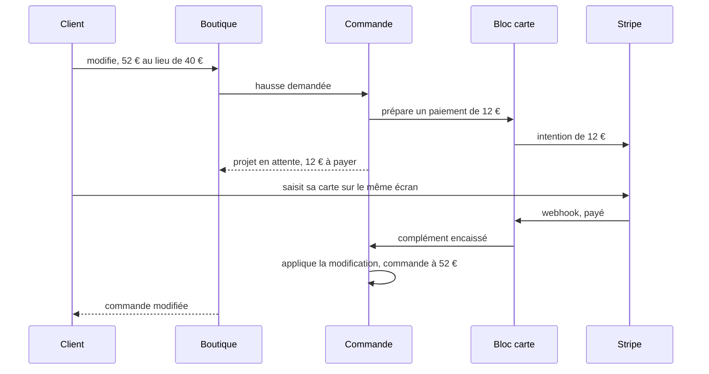
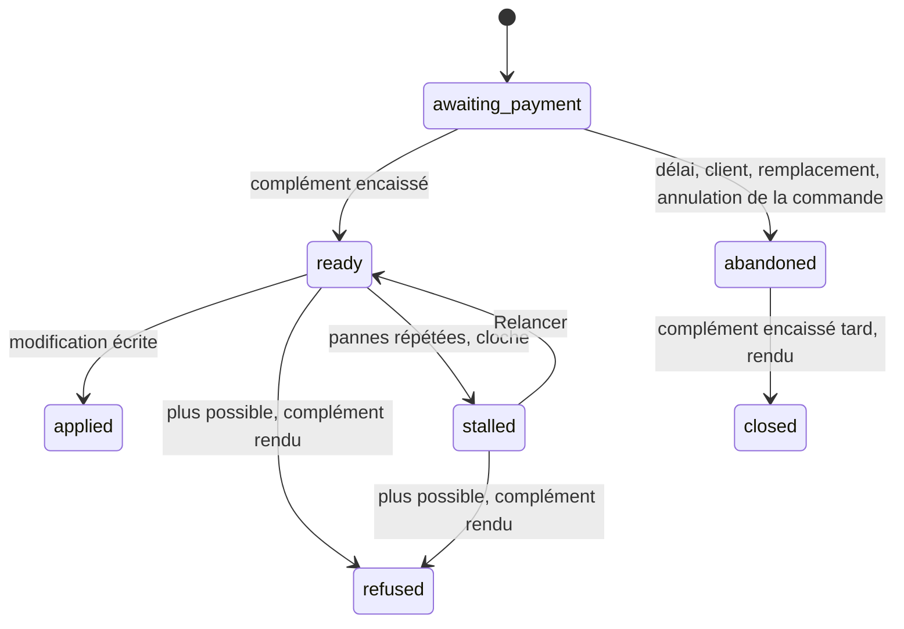

# Plan S2 — modifier à la hausse une commande payée par carte

> **Doc-first, 2026-11-10 — version 8**, avec les décisions de Hugo du 2026-11-10 (§0), après six contradictions de `vitruve`
> (v1 : quatre bloquants, v2 : deux, v3 : aucun, v4 : un, v5 : un), toutes
> intégrées ici, §3. Détaille le §8 du
> [plan M2](plan-m2-historique-de-transactions.md), avancé avant S1 sur
> demande de Hugo (« on peut commencer par la hausse ? », 2026-11-10 : les
> deux lots sont indépendants). Touche l'argent : `vitruve` avant Hugo.
> Tout ce que ce plan affirme de l'existant a été ouvert le 2026-11-10 ;
> rien n'est bâti. Socle supposé : **P1 déployé** (bloc `card-payment`, le
> remboursement par demande, `CardRefunds.requestAmount`).

## 0. Les décisions de Hugo (2026-11-10)

| Question                                    | Décision                                                                                                                                                                                                                                                                                                                                                 |
| ------------------------------------------- | -------------------------------------------------------------------------------------------------------------------------------------------------------------------------------------------------------------------------------------------------------------------------------------------------------------------------------------------------------- |
| Q1 — le délai de paiement                   | **15 minutes**, raccourcies à l'heure limite, automatique                                                                                                                                                                                                                                                                                                |
| Q2 — un prix qui bouge                      | **Le total vu, sur toute modification** : la modification envoie le total qu'elle a montré, comme la passation (`ensureTotalSeen`) — refus avec l'avertissement de la passation avant de payer ; après paiement, un écart rend le complément (R7). « Il le faudra à la baisse » : la règle est posée pour toute révision, pas pour la seule hausse (R14) |
| Q3 — l'équipe                               | **(a) pour l'instant** : seul le client fait une hausse carte ; l'équipe ne peut pas augmenter une commande carte (refus nommé, « demandez au client de modifier sa commande, ou passez une seconde commande »). **(b) plus tard** : l'équipe compose, le client paie par un lien reçu par e-mail (§2.12)                                                |
| Q4 — le délai du lien                       | sans objet tant que (b) n'est pas bâti                                                                                                                                                                                                                                                                                                                   |
| Q5 — l'arrêt du fournil pendant un paiement | **on rend le complément** (proposé, accepté avec la réponse à Q3 : seul le client fait des hausses)                                                                                                                                                                                                                                                      |

## Partie 1 — l'explication simple

Un client a payé 40 € par carte. Il ajoute deux tartes : la commande vaudrait
52 €. On ne touche pas à sa commande tant qu'il n'a pas payé les 12 € de
différence.

- **Rien ne change tant que ce n'est pas payé.** La modification attend dans
  un **projet**. La commande garde sa composition, son total et sa place au
  fournil.
- **Le client paie sur le même écran**, en saisissant sa carte. Nous ne
  gardons aucune carte : chaque paiement est une intention Stripe sans client
  ni carte enregistrée.
- **Le délai pour payer est de 15 minutes**, raccourci à l'heure limite de
  commande si elle tombe avant. Pas payé à temps : le projet est abandonné,
  la commande intacte, et le client peut recommencer.
- **Payé, mais la modification n'est plus possible** (la journée est partie
  au fournil entre-temps, un prix a bougé, quelqu'un d'autre a modifié la
  commande) : on **rend les 12 €** tout de suite, la commande reste à 40 €, et
  le client reçoit un e-mail.
- **Payé après l'abandon** : même chose, les 12 € sont rendus.
- **L'équipe** compose une hausse comme aujourd'hui ; le client reçoit **un
  e-mail avec un lien** vers l'écran de paiement du complément.
- **Une baisse, ou un changement à total égal** (date, retrait) n'est pas ce
  lot : refusés sur une commande carte, comme aujourd'hui, jusqu'à S1.
- **Si Stripe ne nous prévient pas** (le message de paiement se perd), le
  passage de contrôle toutes les 5 minutes **demande à Stripe** où en est le
  paiement et rattrape tout seul.

Le projet, ses états :

## Partie 2 — le détail technique

### 2.1 Vérifié dans le code le 2026-11-10

- **Le refus d'aujourd'hui** : `ensureRevisableSettlement` lève
  `CardOrderNotRevisableError` dès que `isCardSettlement(paymentStatus,
totalCents)` (`order-revision.ts:208`), appelé par l'agrégat dans
  `Order.recompose` (`order.ts:237`) avant que le nouveau total soit connu, et
  par `OrderRevising.ensureRevisable` (`order-revising.service.ts:109`, via
  `standingBlockOf` → `card_settled`, `order-revisability.ts:72`).
- **`ReviseOrderHandler`** (`revise-order.handler.ts`) compose **hors verrou**
  (« aucun appel d'un autre bloc sous un verrou », l. 27-31), puis
  `unitOfWork.run(record)` : `revisions.lock` (`FOR UPDATE` sur `orders`,
  `prisma-order-revision.repository.ts:41-46`, le même que `OrderLock.lock`,
  `prisma-order-lock.ts:15`), rejugement R7 et `ensureRevisable`, guichet du
  fournil (`workshops.note`), `holdSupply`, `revisions.save` conditionné, deux
  faits durables. La composition remplacée est gardée dans
  la table `order_revision` (modèle `OrderRevisionEntry`, `@@map` à
  `orders.prisma:648`), colonnes `revised_by_*` ;
  `order_revision.revised_by_staff_id` est au registre RGPD.
- **Trois appelants de `ReviseOrderCommand`** : les deux contrôleurs
  (`order-revisions.controller.ts`, `admin-order-revisions.controller.ts`,
  sous `@AdminSurface("b2b_orders")`) et **`BusOrderChangeApplier`**
  (`b2b/contact/infrastructure/bus-order-change.applier.ts:31-44`), qui
  applique une demande M4 **dans l'unité de travail de la réponse** et lit
  `result.revision` / `result.totalCents`.
- **`CardPayments`** (`card-payment/channels/requests/card-payments.ts`) :
  `prepare` hors transaction, `attach(subject, prepared, role)` dans celle de
  l'appelant, `release`, `retrieve(paymentId)`, `cancel(paymentId)` — **hors
  transaction**, il ouvre la sienne (`block-card-payments.ts:116-122`) et rend
  une des cinq issues de `IntentCancellation` (`card-provider-types.ts:46-51`) :
  `cancelled`, `already_cancelled`, `already_paid`, `in_progress`,
  `unavailable`. `SubjectPaymentRole = "first" | "complement"` existe
  (`subject-settlement.ts:28`).
- **`IntentOutcomeRecorder.paid`** (`intent-outcome-recorder.ts:44-58`)
  appelle `onPaid` **avant** de marquer la ligne `paid` : pendant `onPaid`, le
  paiement n'est pas encore encaissé pour le bloc, et `requestAmount` le
  refuserait (`paidPayment`, `block-card-refunds.ts:172-179`). Le dépôt rend
  donc l'argent **après validation**, par un fait et un abonné durable —
  `OrderPaidAfterCancellationEvent` → `RefundPaidAfterCancellation`
  (`refund-paid-after-cancellation.handler.ts:41-60`).
- **`onPaid` côté commande** (`order-subject-settlement.ts:75`) ignore
  `paymentId`, prend lui-même le verrou `orders` (`withIntent` → `locked`) et
  marque le premier par `stripe_payment_intent_id`.
- **`Order.recompose`** appelle `revised.deferPayment()` (`order.ts:264`), qui
  écrit `not_required` (`order.ts:354`) ; `revisionOf` (`order-revision.ts:244-266`)
  en déduit le régime d'après (`settlementRegimeOf`). Sur une commande carte,
  ce serait « au compte » : aujourd'hui, seul le refus en amont l'empêche.
- **`RevisionOptions`** (`order-revising.service.ts:392-395`) : `requireChange`
  et `rulesOf: "customer" | "staff"`. `ensureBeforeCutoff` lit l'horloge à
  l'appel (l. 375-385) ; `holdDay` lève `ProductionPlanClosedError` pour un
  client (l. 305-313).
- **Le rattrapage de P0** (`ReplayFirstPaymentsHandler`) ne consulte pas
  Stripe et ne relit que les lignes créées avant le témoin de reprise
  (`unsettledCreatedBefore`, l. 107) : il ne rattrape pas un complément. Le
  §6.5 du plan M2 prévoit « Vérifier chez le prestataire » (`retrieve`), pas
  encore bâti.
- **Trois handlers d'annulation** passent par `OrderCancellation`
  (`order-cancellation.service.ts`) : équipe, client, invité.
  **`claim` / `referencesSince`** (`order-subject-settlement.ts:121-161`) ne
  connaissent que le premier, et rendent `amountCents: totalCents` — faux
  après une hausse appliquée.
- **La facture carte** : `moneySquares` (`card-invoicing.ts:130-136`) exige
  encaissé − remboursé **d'ajustement** = total ; un remboursement `return`
  n'y entre pas. Elle se réveille sur `order.paid`, `order.fulfilled` et le
  remboursement réglé (`accounting/application/handlers/`).
- **La portée A2** (`quantitiesAfterArrestAllowed`,
  `revision-after-arrest.ts:26-32`) est réservée à l'équipe **au compte** :
  une commande carte n'a pas de modification après l'inscription.
- **`CardRefunds.requestAmount({ paymentId, amountCents, nature, reason,
requestedBy })`** (`card-refunds.ts:81`) ; `requestAmount` prend
  `lockSubject` (`card-refund-scope.ts:41-48`), donc `orders`.
- `retrieveFirst` vit dans `OrderCardPayments`
  (`b2b/orders/domain/ports/order-card-payments.ts:35`) ; le prestataire dans
  `card-payment/infrastructure/stripe/stripe-card-provider.ts`.

### 2.2 Les règles

- **R1. Le périmètre.** Une hausse, sur une commande dont le premier
  paiement est **`paid`**, avant l'inscription au fournil, hors stock
  (`supply = shelf`), hors départ incomplet décidé. Refus nommés sinon :
  premier `pending | failed` (« réglez d'abord la commande »), après
  l'inscription (« la commande est partie au fournil »).
- **R2. La révision garde `onAccount` sur une commande carte, et rien
  d'autre.** `revisionOf` (`order-revision.ts:238`) calcule le régime
  d'après sur `revised` pour **deux gardes** de M1 (gratuite → payante,
  `RevisionRequiresPaymentError` ; au compte → gratuite,
  `RevisionFreesAccountOrderError`) **et** pour `onAccount`. Les gardes ne
  changent pas : `after` reste calculé sur `revised`. Seul `onAccount`
  change : il vaut `false` quand le régime d'**avant** est carte (`due |
paid`), quel que soit `after` — sur une commande carte, `deferPayment()`
  faisait passer `revised` pour « au compte ». `revisions.save` n'écrit
  aucune colonne de paiement (vérifié). Les tests de `order-revision.spec.ts`
  sur les deux gardes sont la non-régression à garder verte.
- **R2 bis. Le tri est à l'agrégat**, après la composition, jamais avant :
  `Order.recompose` rend la révision **et** son règlement —
  `{ kind: 'same_settlement' }` (au compte ou à total nul, comme aujourd'hui),
  `{ kind: 'card_complement', complementCents }` (carte `paid`, hausse), ou
  `{ kind: 'card_not_revisable', reason: 'decrease' | 'same_total' |
'unsettled' }`. Il **ne lève pas** : les commandes lèvent
  (`CardOrderNotRevisableError`, qui garde son nom et gagne la raison), le
  devis **affiche**. M1 refuse tout ce qui n'est pas `same_settlement` ; ses
  trois appelants, dont `BusOrderChangeApplier`, gardent donc exactement leur
  comportement d'aujourd'hui sur une commande carte.
- **R2 ter. `ensureRevisable`** ne bloque plus une carte `paid` par
  `card_settled` **sur les chemins de la hausse** (devis, `revisabilityOf`,
  `ProposeCardIncreaseCommand`) ; il le garde pour un premier `pending |
failed`, et **pour le chemin de la demande M4** (`standingBlockOf` reçoit le
  chemin, par un paramètre **`purpose: 'revise' | 'request'`** porté par
  `GetOrderRevisabilityQuery` jusqu'à `verdictOf` — la boutique passe
  `revise`, `order-changeable-order.reader.ts:34` passe `request` ; `request`
  garde `card_settled` sur toute carte). La valeur
  `card_settled` du contrat (`order-revision.values.ts:45`) reste. **R2 ter
  se livre avec S2.b** (le devis, `revisabilityOf`, les libellés de
  `revision-wording.ts`) : S2.a garde `card_settled` tel quel.
- **R3. La hausse est une autre commande**, `ProposeCardIncreaseCommand`,
  avec ses deux routes (client et équipe). Le devis (`quote`) et
  `revisabilityOf` annoncent le règlement : « 12,00 € à payer » sur une
  hausse, « pas encore possible » sur une baisse carte.
- **R4. Une demande M4** sur une commande carte ne peut toujours pas être
  **déposée** : `standingBlockOf` rend `card_settled` sur le chemin `request`
  (R2 ter), donc `order-changeable-order.reader.ts` ne rend pas `too_late`,
  `RequestOrderChangeHandler` refuse, et la boutique n'affiche pas
  « demander ». Si une demande existait déjà, M1 la refuse à l'application
  (R2 bis). L'équipe compose la hausse elle-même (§2.4).
- **R5. Un seul projet vivant par commande** (`awaiting_payment | ready |
stalled`), tenu par un index unique partiel. Une nouvelle hausse pendant
  un `awaiting_payment` : **le même auteur** le remplace (§2.4) ; **un autre**
  est refusé (`RevisionProposalPendingError`, « un complément attend d'être
  payé ») — jamais une violation brute de l'index. Un projet `ready |
stalled` bloque toute modification.
- **R6. Le temps se juge au geste ; l'arrêt du fournil, toujours
  maintenant.** Le délai de paiement (`expires_at`) vaut 15 min, **borné par
  l'heure limite** de la journée. À l'application, `RevisionOptions` gagne
  **`decidedAt: Instant`**, que trois services reçoivent — aujourd'hui aucun
  ne prend d'instant, et S2.a change leurs signatures (la passation passe
  l'horloge, rien ne change pour elle) :
  - `OrderCutoffGate.ensure(skus, day, companyId, opts)` gagne `opts.at`,
    passé à `inputsOf` (`now`, l. 93 et 112) ;
  - `OrderPlanGate.ensureNotTooSoon` gagne `at` au lieu de `today()`
    (`order-plan-gate.service.ts:49-61`) ;
  - `OrderComposition.arrange` gagne `at`, pour les créneaux **et**
    `operations.ensure` (les opérations datées) ;
  - `ensureFirstOrderableDay` (l'admission) juge aussi à `decidedAt`.

  Restent jugés **maintenant**, et c'est voulu : le chiffrage
  (`composition.load`, promotions comprises — un changement refuse par R7),
  `ensureDayOpen`, `holdDay` et le guichet du fournil.

  **L'arrêt du plan refuse le projet, pour tous les auteurs.** Ni
  `ensureRevisable` ni la règle ne jugent l'arrêt (`standingOf(order, null,
…)`) : il est jugé par `ensureDayOpen` (`order-revising.service.ts:328-344`)
  et `holdDay` (l. 310-320), qui **laissent passer l'équipe** à date
  inchangée (« une date inchangée sur une journée arrêtée reste à
  l'équipe »). Pour M1 au compte, c'est voulu et ça ne change pas. Pour un
  projet de complément, l'exécuteur ajoute **sa propre garde**, sous le
  verrou : `plans.isClosed(serviceDay)` ⇒ `refused` (`refusal:
plan_closed`), complément rendu — client comme équipe. Raison : un complément
  payé ne doit pas faire entrer une hausse « hors plan » au fournil sans que
  personne la voie ; l'équipe qui veut augmenter une journée arrêtée le fait
  par une commande au compte ou en encaissant à part. (Q5.) L'arrêt n'étant
  pas daté dans le passé (`production_day` : un `closed_at`, un
  `reopened_at`), il se juge maintenant. L'acteur reste l'auteur, `rulesOf` le
  sien.

- **R7. Le total payé fait foi.** Le projet fige le total visé et le
  complément. À l'application, la révision est recomposée **hors verrou**
  avec les règles figées de l'auteur ; sous le verrou, si le total recomposé
  ≠ total visé, le projet est `refused` et le complément rendu. **Aucune
  variation n'est absorbée, même favorable** : un prix de ligne neuve qui
  bouge, une promotion qui commence ou finit, un bon dont le solde a changé
  — refusé et rendu. Assumé : la fenêtre est de 15 minutes au plus, et un
  écart non vu serait de l'argent pris ou donné sans le dire.
- **R8. Rendre le complément, c'est un ajustement.** `requestAmount({
paymentId: complément, amountCents: complément, nature: 'adjustment',
reason })`, raisons `revision_refused` et `late_payment` — la nature du §8
  du plan M2, celle que la facture carte retranche (encaissé 52 − ajusté 12 =
  40). Jamais `requestRemainder` sur le sujet. **Toujours après validation**,
  par un abonné durable (§2.5, §2.6), jamais dans `onPaid`.
- **R9. L'annulation d'une commande** avec un projet vivant, dans
  `OrderCancellation` (le service des trois handlers ; `abandon-order` ne
  touche qu'un premier non payé, sans projet possible) : dans sa
  transaction, le projet passe `abandoned` (s'il était `awaiting_payment`)
  ou `refused` sans remboursement propre (s'il était `ready | stalled`) ;
  l'annulation rend ensuite **tous** les paiements encaissés
  (`requestRemainder({ subject })`, P1), complément compris. L'intention d'un
  projet abandonné est annulée **après validation** (`AfterCommit` →
  `cards.cancel`) ; payée quand même, elle suit §2.5 (payé tard).
- **R10. La facture pendant un projet `ready | stalled`** : 52 encaissés pour
  40 de total, le verdict est `blocked`. Le retrait reste permis ; le projet,
  rejugé après, est refusé (commande retirée) et le complément rendu, et le
  remboursement réglé réveille la facture (abonné existant).
- **R11. Rendre ce qui reste, et le dire.** Les deux abonnés qui rendent le
  complément font, dans **une** unité de travail, `OrderLock.lock`, lisent le
  reste du paiement du complément (`CardSettlementReader`, encaissé −
  remboursé − demandé non terminal, pour ce `payment_id`) par une méthode
  **neuve** du canal, `CardSettlementReader.remainderOf(paymentId):
Promise<number>` — aucune des quatre méthodes d'aujourd'hui ne raisonne
  par paiement (`card-settlement.reader.ts:139-154`) ; elle reprend le calcul
  de `block-card-refunds.ts:69-75` (`ledger.remainderCents()` − reliquats en
  cours), avec son adaptateur Prisma et ses doubles. Puis :
  - reste = complément ⇒ `requestAmount(complément)` ;
  - reste nul ⇒ journal `order.card_increase_already_returned`, sortie
    normale (l'annulation a tout rendu) ;
  - reste partiel (une demande de l'équipe est passée entre-temps) ⇒
    `requestAmount(reste)` **et** cloche « complément rendu en partie
    ailleurs ».

  `requestedBy: null` (automatique). Sous le verrou `orders`, celui de
  l'annulation, le reste **ne baisse pas** entre la lecture et la demande
  (un remboursement qui échoue chez le prestataire peut le faire remonter,
  ce qui va dans le bon sens) ; `CardRefundAmountExceedsRemainderError`
  reste le filet, rejouée comme une panne.

- **R14. Le total vu, sur toute modification** (Q2). `ReviseOrderCommand`
  et `ProposeCardIncreaseCommand` gagnent `expectedTotalCents`, **obligatoire**
  au contrat, comparé par `ensureTotalSeen` (`seen-total.ts`, la passation
  l'appelle dans `place-order.handler.ts:181`, `place-shop-order.handler.ts:181`
  et `place-order-for-customer.handler.ts:89`) après la composition et
  avant toute écriture ou préparation de paiement : `OrderTotalChangedError`,
  le même message que la passation. Les trois appelants de M1 l'envoient :
  la boutique (le total du devis affiché), le back-office (idem), et
  `BusOrderChangeApplier` — **le total vu est celui de l'équipe** (Hugo,
  2026-11-10 : « c'est une délégation, le vu est par l'équipe, c'est une
  responsabilité commerciale »). Aujourd'hui rien ne le transporte : le front
  poste un corps vide (`customer-requests.service.ts:53`), le contrôleur ne
  lit aucun corps (`admin-order-change-requests.controller.ts:43-51`), le port
  n'a pas de champ (`OrderChangeApplier.apply(orderId, staffUserId,
baseRevision, change)`). La chaîne à poser, de l'écran au handler :
  l'écran a déjà le devis (`order-change-details.ts:88-170`, `GET …/quote`)
  et envoie **son** total (`order-change-details.ts:141`) → un corps
  `{ expectedTotalCents }` au contrat de `POST …/apply` →
  `ApplyOrderChangeCommand` → `ApplyOrderChangeHandler`
  (`apply-order-change.handler.ts:59`) → `OrderChangeApplier.apply(…,
expectedTotalCents)` (`order-change.applier.ts`) → `ReviseOrderCommand`.
  Doubles : `order-change-doubles.ts`, les appels de
  `answer-order-change.handlers.spec.ts`. **Jamais recalculé par
  l'applicateur** : une comparaison avec son propre calcul serait vide.
- **R14 bis. L'écran dit le refus.** Le code `orders.total_changed`
  (`packages/contracts/src/seen-total.values.ts:14`) est attrapé par la
  boutique (`order-revision.gateway.ts`, qui n'attrape aujourd'hui que
  `orders.revise.*`, l. 22-37) et par le back-office (`orders.service.ts`,
  l'écran d'une demande) : l'avertissement de la passation, le devis relu,
  le bouton revalider.
- **R14 ter. Livré d'un bloc** (lot S2.b0) : l'API, la boutique
  (`order-revision.gateway.ts`, `revise` l. 93) et le back-office
  (`orders.service.ts:357`, l'application d'une demande) dans **le même
  commit et le même push sur `main`**. Les trois workflows de déploiement
  partent en parallèle ; pendant les quelques minutes où l'API est neuve et un
  front ancien, une modification répond 400 — **la casse est admise en
  pré-release** (`CLAUDE.md` §0) — **décidé par Hugo le 2026-11-10
  (« option 1 »)** : un seul déploiement, pas de champ optionnel.
- **R15. L'équipe ne fait pas de hausse carte** (Q3 a) :
  `ProposeCardIncreaseCommand` n'a que la route client ; l'équipe reçoit
  `CardOrderNotRevisableError` (raison `increase_by_staff`) avec le geste de
  sortie. Le même refus pour une **demande M4** appliquée par l'équipe dont
  le résultat serait une hausse carte (l'applicateur passe par M1, qui refuse
  tout `card_complement`, R2 bis). **Ordre des refus** : le règlement (R2 bis,
  R15) **avant** le total vu (R14) — on ne demande pas de revalider un
  montant qu'on refusera de toute façon. L'e-mail
  `customer.order-complement-due` passe au §2.12.
- **R12. Chaque transition du projet est journalisée**, dans la transaction
  qui l'écrit : `order.card_increase_proposed`, `_paid`, `_applied`,
  `_refused` (avec `refusal`), `_abandoned` (avec la cause : délai, client,
  remplacement, annulation), `_stalled`, `_closed`, `_relaunched`,
  `_already_returned` ; un fichier neuf dans
  `packages/contracts/src/journal-facts/`, phrases au back-office —
  **`packages` bouge : `pnpm test` à la racine**.
- **R13. Un modèle d'e-mail neuf** : `customer.order-modification-failed`
  (clé déterministe `card-increase-refused:<proposalId>`) ;
  `customer.order-complement-due` attend le §2.12. Entrées au
  dictionnaire, `pnpm tool mail-copy:digest`, sujet déclaré
  (`lint:mail-subject-declared`), spécimen sur la planche.

### 2.3 Les données

`public.order_revision_proposal`, au commerce (`b2b/orders`) :

| colonne                                                        | sens                                                                                 |
| -------------------------------------------------------------- | ------------------------------------------------------------------------------------ |
| `id`                                                           | ULID                                                                                 |
| `order_id`                                                     | clé étrangère `RESTRICT` vers `orders`                                               |
| `base_revision`                                                | la révision corrigée                                                                 |
| `content`                                                      | jsonb — le contenu saisi                                                             |
| `rules`                                                        | jsonb — les règles figées de l'auteur au geste (kind, jour de décision, dérogations) |
| `target_total_cents`, `complement_cents`                       | figés ; `CHECK complement_cents > 0`                                                 |
| `revised_by_kind`, `revised_by_user_id`, `revised_by_staff_id` | l'auteur, mêmes noms et `CHECK` que `order_revision`                                 |
| `payment_id`                                                   | le paiement dans `card_payment.payment`, **unique**, sans clé étrangère (autre bloc) |
| `state`                                                        | sept états, `CHECK`                                                                  |
| `expires_at`                                                   | délai de paiement                                                                    |
| `attempts`, `next_attempt_at`, `leased_until`, `last_failure`  | la reprise de l'exécuteur                                                            |
| `provider_checks`                                              | les appels de contrôle au prestataire en échec (§2.7), compteur à part               |
| `refusal`                                                      | code du refus métier                                                                 |
| `created_at`, `settled_at`, `closed_at`                        |                                                                                      |

Index : unique partiel `(order_id) WHERE state IN ('awaiting_payment',
'ready', 'stalled')` ; `(state, next_attempt_at)` ; `(state, expires_at)`.
Pas de `DELETE` (déclencheur, comme `refund_request`).
`revised_by_staff_id` entre au registre RGPD (`lint:rgpd-staff`), comme sa
jumelle de `order_revision` ; `revised_by_user_id` n'y entre pas (le registre
ne porte que le staff, `rgpd-registre.json:1785`).

**Ordre des verrous, partout** : `orders` (`OrderLock.lock` ou
`revisions.lock`) **puis** le projet (`FOR UPDATE`), puis `card-payment`
(dont `lockSubject` est alors idempotent). Toute transition est
**conditionnée** sur l'état attendu (`WHERE state = …`) : un `abandoned`
écrit après un `ready` n'écrit rien.

### 2.4 Le geste — demander la hausse

`ProposeCardIncreaseCommand` (client seulement, `POST
orders/:id/revisions/card-increase`, R15) :

1. **Hors verrou**, comme M1 : mur, R7, `ensureRevisable`, `compose` ;
   l'agrégat rend `card_complement` (sinon refus nommé) ; **total vu**
   (R14) avant toute préparation.
2. **Remplacement** (R5, même auteur) : `cards.cancel(ancien.payment_id)`
   hors transaction. `cancelled | already_cancelled` ⇒ continuer ;
   `already_paid | in_progress` ⇒ refus « votre premier complément vient
   d'être payé » ; `unavailable` ⇒ refus « réessayez ».
3. `cards.prepare('order', complement, tag)` hors transaction.
4. Transaction : `revisions.lock` ; rejugement (R7, `ensureRevisable`, journée
   **non inscrite** lue par le guichet, sans rien inscrire) ; ancien projet
   `awaiting_payment → abandoned` conditionné — **s'il n'écrit rien**
   (passé `ready` entre-temps), refus « votre précédent complément vient
   d'être payé » et `release` ; nouveau projet ;
   `cards.attach(subject, prepared, 'complement')`.
5. Échec ⇒ `cards.release(prepared)`.
6. Réponse : `{ proposalId, complementCents, clientSecret, publishableKey,
expiresAt }`.

L'équipe n'a pas ce geste (R15, §2.12).

### 2.5 Payer le complément

- **L'écran** : la page de modification monte le formulaire Stripe avec le
  `clientSecret`. Rechargement ou lien : `GET orders/:id/complement`
  (`GetComplementPaymentQuery`) — mur de `ensureOrderVisible`, comme la page
  de règlement (« qui peut la voir peut la payer ») ; relit l'intention par
  `cards.retrieve(payment_id)`, jamais un secret stocké ; refuse un projet
  qui n'est plus `awaiting_payment`, ou une intention `canceled | succeeded`.
- **Abandon par le client** : `DELETE orders/:id/complement`, même mur ;
  `cards.cancel` hors transaction, puis la transition conditionnée sous
  `orders`. Un projet ouvert par l'équipe s'abandonne aussi par
  `DELETE admin/orders/:id/complement`.
- **Le webhook** : le canal passe le **rôle** du paiement —
  `onPaid(subject, paymentId, amount, role)`, la ligne le connaît. `role =
first` ⇒ le chemin d'aujourd'hui, inchangé. `role = complement` ⇒ prend le
  verrou `orders`, puis **lit le projet par `payment_id`** :
  - `awaiting_payment` ⇒ `ready`, `settled_at`, `AfterCommit` réveille
    l'exécuteur ; rend `applied` ;
  - `abandoned` ⇒ `closed`, publie `order.complement_paid_late` (durable) ;
    rend `refused`. L'abonné `RefundLateComplement` (`b2b/orders`, la figure
    de `RefundPaidAfterCancellation`) prend `OrderLock.lock` puis
    `requestAmount(adjustment, late_payment)` — le paiement est alors `paid`
    pour le bloc ;
  - autre état ⇒ `already_applied` (rejeu) ;
  - **aucun projet** ⇒ `TechnicalError` bruyante : la livraison du webhook
    échoue, se rejoue, passe en lettre morte visible — jamais 12 € gardés en
    silence par le chemin du premier.
- **`onPaymentFailed`** sur un complément ne touche pas la commande ; le
  projet reste `awaiting_payment` (le client réessaie jusqu'à `expires_at`).
- **`claim` / `referencesSince`** ne changent pas pour le complément : sa
  ligne `card_payment.payment` naît dans la transaction du projet (§2.4), et
  `ProviderPaymentResolver` la trouve avant tout `claim`. Seule correction :
  le premier rend le montant **de son paiement**, plus `totalCents`, faux
  après une hausse. Le rattrapage d'un webhook perdu est §2.7.

### 2.6 Appliquer — l'exécuteur

`ApplyCardIncrease`, à bail (la figure de l'exécuteur des remboursements de
P1.b), réveillé après validation, rattrapé par un balayage
(`admin/orders/card-increases/sweep`, cron 5 min, worker et `dev-sweeps`) :

1. Prend le bail, sort si pris.
2. **Hors verrou** : relit projet et commande, recompose `content` avec
   `{ rulesOf: auteur, decidedAt: created_at }` (R6). Le balayage tourne dans
   une requête de cron dont l'horloge est gelée (`system-clock.ts:20-25`) :
   `decidedAt` vient du projet, jamais de l'horloge.
3. Transaction : `revisions.lock`, projet `FOR UPDATE`, `ready` exigé ; R7,
   statut, `ensureRevisable` ; **total recomposé = `target_total_cents`** ;
   guichet du fournil, `holdSupply`, `revisions.save` ; projet `applied`. Le
   `record()` de M1 est **extrait** en service (`OrderRevisionRecording`),
   appelé par les deux handlers, avec l'auteur du projet comme acteur.
   Les faits de M1 partent (`OrderRevisedEvent`, `CommerceOrderRevisedFact`),
   plus `order.card_increase_applied` au journal.
4. **Refus métier** : seconde transaction — `OrderLock.lock`, projet `FOR
UPDATE`, `refused` + `refusal`, publie `order.card_increase_refused`
   (durable) ; l'abonné `RefundRefusedIncrease` rend le complément
   (`requestAmount(adjustment, revision_refused)`, R11) et envoie
   `customer.order-modification-failed` (clé d'e-mail déterministe
   `card-increase-refused:<proposalId>`, sans adresse).
5. **Panne** : `attempts + 1`, courbe ; au 5ᵉ, `stalled`, cloche « un
   complément payé n'a pas pu être appliqué ». **Relancer** sous
   `b2b_orders:write` (le droit qui modifie une commande ; pas
   `card_payments`, qui est le droit de l'argent).

### 2.7 L'abandon par le délai

Cron 5 min (`admin/orders/card-increases/expire`) : projets
`awaiting_payment` dont `expires_at` est passé. Pour chacun, hors
transaction, `cards.cancel(payment_id)` :

| issue                            | suite                                                                                                        |
| -------------------------------- | ------------------------------------------------------------------------------------------------------------ |
| `cancelled`, `already_cancelled` | transaction : `orders`, projet `abandoned` conditionné                                                       |
| `already_paid`                   | **`cards.settleFromProvider(payment_id)`** (ci-dessous) : le chemin payé est rejoué, le projet passe `ready` |
| `in_progress`                    | réessai au passage suivant                                                                                   |
| `unavailable`                    | réessai, `provider_checks + 1` ; au troisième, cloche                                                        |

**`CardPayments.settleFromProvider(paymentId)`** — neuf au bloc, la première
brique du « Vérifier » du §6.5 du plan M2 : hors transaction,
`retrieve(paymentId)` sur le compte de la ligne ; `succeeded` ⇒ dans une
unité de travail, **le même `IntentOutcomeRecorder.paid`** que le webhook
(l'identifiant `provider-check:<paymentId>` ne sert qu'au journal :
l'idempotence tient par la machine de la ligne, `moveTo` / `markPaid`) ; `requires_payment_method | processing` ⇒ rien ;
`canceled` ⇒ la ligne `closed`. Le balayage de l'exécuteur l'appelle aussi
sur tout projet `awaiting_payment` dont l'intention est payée côté Stripe
depuis plus de 5 min (webhook perdu en cours de délai). Chaque échec de
l'appel incrémente `provider_checks` (pas `attempts`, qui est à
l'exécuteur) ; au troisième : cloche.

Un paiement validé avant que le cron ait écrit `abandoned` **s'applique** :
le délai est un plancher, pas un couperet — écrit tel quel dans l'écran.

### 2.8 Ce que voient les écrans (S3 en reprendra l'historique)

- **Client** : après « Valider », le formulaire de carte et « 12,00 € à
  payer pour valider la modification », le délai restant ; après paiement,
  « Commande modifiée » quand le projet est `applied` (relecture 2 s, bornée
  à 30 s, puis « Nous finalisons votre modification, vous recevrez un
  e-mail »).
- **Équipe** : sur la fiche commande, le projet vivant (complément, état,
  lien renvoyé), en `stalled` Relancer, et Abandonner.

### 2.9 Ce qui ne se défait pas

- Les demandes de remboursement écrites avec `revision_refused` et
  `late_payment` (texte libre, déjà immuable au déclencheur de
  `refund_request`) : ces codes ne se renomment plus.
- La table `order_revision_proposal`, ses états et son `CHECK`.
- Les deux routes et le contrat de leur réponse, servis à la boutique.
- `CardOrderNotRevisableError` garde son nom et gagne une raison
  (`decrease`, `same_total`, `unsettled`) : les écrans qui lisent son code le
  gardent.

### 2.10 Les lots

- **S2.a — le socle** : migration (lecteur de migrations), agrégat
  `CardIncreaseProposal` (machine d'états, transitions conditionnées), dépôt,
  `Order.recompose` qui garde le règlement et rend son tri (R2, R2 bis, R2 ter — avec les tests de non-régression de M1 au compte d'abord), `decidedAt` dans `RevisionOptions` (R6), `CardPayments.settleFromProvider` au bloc, le rôle passé par le canal (`intent-outcome-recorder.ts:46` le lit sur l'entité ; à toucher : `order-subject-settlement.ts:75` et sa spec, `card-payment-doubles.ts:229`, les chaînes `channel.onPaid:…` de `record-provider-event.handler.spec.ts`) et `onPaid` /
  `onPaymentFailed` qui routent sur lui (régression : un complément ne
  marque jamais le premier ; un complément sans projet est une erreur
  bruyante), `claim` qui rend le montant du paiement. **Sans R2 ter** (§2.2).
- **S2.b0 — le total vu, d'un bloc** (R14, R14 bis, R14 ter) : API, la chaîne
  de la demande appliquée, la boutique et le back-office, leurs specs, tous
  les e2e qui postent sur `/revisions` ou `/apply` ; un seul push.
- **S2.b — le geste** : R15, R2 ter (et `card_settled` gardé sur le chemin
  `request`), `ProposeCardIncreaseCommand`, ses routes, le devis et
  `revisabilityOf`, les libellés de `revision-wording.ts`, le refus de M1 et de l'applicateur M4,
  `GetComplementPaymentQuery`, l'abandon par le client (et par l'équipe sur
  la fiche, `DELETE admin/orders/:id/complement`).
- **S2.c — appliquer et rendre** : extraction d'`OrderRevisionRecording`,
  exécuteur à bail, balayage, les deux abonnés de remboursement, `stalled`,
  cloche, Relancer, cron d'abandon et ses cinq issues, annulation de la
  commande (R9), courriels.
- **S2.d — les écrans** (`pablo`) : boutique (formulaire sur l'écran de
  modification, délai restant, reprise au rechargement) ; back-office
  (projet sur la fiche, Relancer, Abandonner ; le refus nommé quand
  l'équipe tente une hausse carte).
- **S2.e — les tests** : e2e de bout en bout, prestataire doublé — payé puis
  appliqué ; payé puis refusé (journée inscrite entre-temps) et rendu en
  ajustement, facture carte qui tient ; payé tard et rendu après validation ;
  abandon par délai, par le client, par remplacement ; autre auteur refusé ;
  annulation de la commande avec chaque état du projet ; webhook rejoué ;
  webhook perdu rattrapé ; `stalled` puis Relancer ; demande M4 refusée ;
  baisse carte refusée ; facture carte après une hausse appliquée.

### 2.11 Questions à Hugo — tranchées le 2026-11-10 (§0)

1. **Q1 — 15 minutes**, bornées par l'heure limite de commande ?
2. **Q2 — Aucune variation absorbée** (R7) : un prix qui baisse entre la
   saisie et le paiement fait aussi refuser et rendre ?
3. **Q3 — L'équipe** compose la hausse et le client paie par un lien
   (proposé), ou l'équipe ne peut pas augmenter une commande carte ?
4. **Q4 — Le délai d'un lien envoyé par l'équipe** : le client n'est pas
   devant l'écran. Proposé : jusqu'à l'heure limite de la journée (et au plus
   24 h), au lieu de 15 minutes.
5. **Q5 — Le fournil arrête la journée** pendant qu'un complément est payé :
   on refuse et on rend, **même pour un projet de l'équipe** (proposé), alors
   que la modification au compte de l'équipe passe aujourd'hui « hors plan » ?

### 2.12 Plus tard — l'équipe compose, le client paie par un lien (Q3 b)

Noté pour un lot après S3 : `POST admin/orders/:id/revisions/card-increase`
sous `@AdminSurface("b2b_orders")`, réponse sans secret, e-mail
`customer.order-complement-due` (clé d'intention de l'écran), page
`reglement/:id/complement`, délai jusqu'à l'heure limite et au plus 24 h
(Q4 à reposer à ce moment), Abandonner sur la fiche. Le socle de S2 n'a rien
à défaire pour l'accueillir.

## 3. Les verdicts de `vitruve`, intégrés

**v7 (un bloquant, trois sérieux)** : le total vu de l'équipe n'avait aucun
transport → la chaîne de l'écran au handler, nommée fichier par fichier,
jamais recalculée (R14) ; la livraison cassait la modification entre deux
lots → S2.b0 d'un bloc, la casse de quelques minutes posée à Hugo (R14
ter) ; le refus invisible à l'écran → R14 bis ; la demande M4 qui augmente
une commande carte et l'ordre des refus → R15. Mineurs : lignes des trois
passations, §2.12 remis après §2.11.

**v4 (un bloquant, cinq sérieux)** : R2 recopiait le régime d'après et
désarmait deux gardes de M1 au compte → seul `onAccount` change (R2) ; le
chemin `request` sans appelant → `purpose` sur `GetOrderRevisabilityQuery`
(R2 ter) ; aucune garde ne prenait d'instant → signatures nommées, gardes
triées au geste ou maintenant, l'arrêt refuse pour l'équipe aussi (R6) ; le
délai de 15 minutes pour un lien de l'équipe → Q4 ; R11 confondait « rien »
et « une partie » → trois cas (R11) ; contrats, doubles, modèles d'e-mail
neufs → R12, R13, §2.10. La question « journée arrêtée pour un projet de
l'équipe » se pose bien (v5) : voir ci-dessous.

**v5 (un bloquant, deux sérieux)** : « `ensureRevisable` refuse l'arrêt pour
tous » était faux — l'arrêt est jugé par `ensureDayOpen` et `holdDay`, qui
laissent passer l'équipe → une garde propre au projet, posée à Hugo (R6, Q5) ;
le reste d'un paiement n'est pas lisible par le canal → `remainderOf`
(R11) ; « le reste ne bouge pas » → « ne baisse pas », la capture reste le
filet. R2, R2 ter, R12, R13 vérifiés et tenus.

**v3 (aucun bloquant, sept sérieux)** : R2 ter ouvrait le dépôt d'une demande
M4 sur une carte → `card_settled` gardé sur le chemin `request` (R4) ; R2 ter
avant les écrans → livré avec S2.b ; R6 incomplet et `holdDay` sans date
d'arrêt → `decidedAt` pour les seules gardes de temps, l'arrêt juge
maintenant et rend (R6) ; R11 sans mécanisme → verrou, demande, capture
(R11) ; « aucun projet ⇒ premier » gardait 12 € → routage par rôle, erreur
bruyante (§2.5) ; transitions sans journal → R12 ; R2 sans mécanisme → le
seul calcul du régime (R2). Mineurs : `CardOrderNotRevisableError` tranché,
`provider_ref` et la branche `claim` retirés (inutiles), `provider_checks` à
part, la course du remplacement nommée, la phrase de l'idempotence, le
registre.

**v2 (deux bloquants, six sérieux)** : le rattrapage d'un webhook perdu
n'existait pas (`ReplayFirstPayments` ne consulte pas Stripe et est borné au
témoin de P0) → `settleFromProvider`, le premier pas du « Vérifier » du §6.5
(§2.7) ; `recompose` faisait de toute révision carte une révision au compte
(`deferPayment`) → la révision garde le règlement (R2). Sérieux : R6 sans
mécanisme → `decidedAt` dans `RevisionOptions` et son effet sur `holdDay` ;
M1 ouvert en silence au total égal → refusé comme aujourd'hui (R2 bis) ;
`claim` sans `provider_ref` → colonne (§2.3) ; `card_settled` et le devis →
R2 bis et R2 ter ; « déjà rendu » dans les abonnés → R11 ; trois handlers
d'annulation → `OrderCancellation` (R9). Mineurs : table `order_revision` et
colonnes `revised_by_*`, registre RGPD, R10 réécrit, le verrou de `onPaid`,
la clé d'e-mail, l'horloge gelée du cron.

### Le verdict sur la v1

Bloquants : le remboursement « payé tard » dans `onPaid`, refusé tant que la
ligne n'est pas `paid` → fait durable et abonné après validation (R8, §2.5) ;
le complément rendu en `return` bloquait la facture → `adjustment` (R8), et
l'état `ready | stalled` dit (R10) ; `BusOrderChangeApplier` oublié → M1
inchangé, une commande à part (R2–R4) ; `cards.cancel` dans une transaction
→ hors transaction, puis transition conditionnée (§2.4, §2.7, R9).
Sérieux : tri dans le handler → l'agrégat rend le règlement (R2) ; heure
limite qui tombe pendant l'attente → décision au geste, délai borné (R6) ;
`compose` sous verrou → hors verrou (§2.6) ; aucune variation absorbée →
assumé et posé à Hugo (R7, Q2) ; ordre des verrous → `orders` puis projet,
partout (§2.3) ; cinq issues de `cancel` → tableau (§2.7) ; `claim` /
`referencesSince` → routés (§2.5) ; murs et droits → nommés (§2.5, §2.6) ;
autre auteur → refus nommé (R5) ; Relancer → `b2b_orders:write` ;
irréversibilités → §2.9. Mineurs : lignes et chemins corrigés, `stalled →
refused` ajouté, le délai « plancher pas couperet » écrit.
