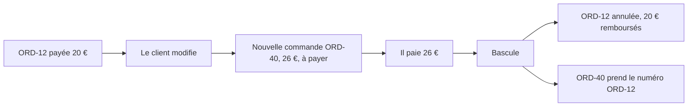
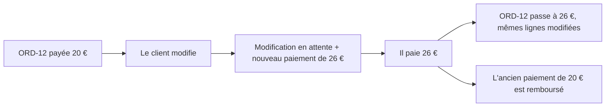

# Modifier une commande payée par carte — le récapitulatif

> **Écrit le 2026-11-09** pour Hugo, avant de choisir. Résume
> [`plan-modifier-une-commande-payee-par-carte.md`](plan-modifier-une-commande-payee-par-carte.md)
> (§7 à §10) et ce que le code permet aujourd'hui. Rien de M2 n'est bâti.
> Les affirmations sur le code ont été vérifiées le 2026-11-09 ; celles que
> `vitruve` a trouvées portent son nom.

## Partie 1 — l'explication simple

### Ce qui marche aujourd'hui

| Le client…                                  | Annuler                             | Modifier                                           |
| ------------------------------------------- | ----------------------------------- | -------------------------------------------------- |
| paie **au compte** (pro, facture mensuelle) | ✅                                  | ✅ jusqu'à l'heure limite, puis demande à l'équipe |
| commande à **0 €** (bon de fidélité)        | ✅                                  | ✅                                                 |
| paie **par carte** (tous les particuliers)  | ✅ (remboursé en entier par Stripe) | ❌ **refusé**                                      |

Les particuliers paient tous par carte : **aujourd'hui, aucun particulier ne
peut modifier sa commande.** Il doit l'annuler et en repasser une.

### Pourquoi la carte est difficile

La carte est **débitée tout de suite**, à la commande. Modifier, c'est donc
toucher à de l'argent déjà pris :

- **le total baisse** → il faut rendre **une partie** du paiement ;
- **le total monte** → il faut prendre **un complément**.

Or notre système ne sait faire **aucun des deux**. Il sait seulement :

- prendre **un** paiement par commande ;
- rendre **tout ce qui reste** de ce paiement (c'est l'annulation).

Toute la question de M2 est : comment modifier avec ces deux gestes-là, ou
lequel apprendre au système.

### Les deux façons possibles

**Forme A — remplacer la commande** (ton choix du 2026-10-23)

- ✅ On n'apprend rien de nouveau à Stripe : payer une commande, rembourser
  une commande en entier — deux gestes qui existent.
- ❌ Le client **avance les deux montants** : il paie 26 € avant de récupérer
  ses 20 € (5 à 10 jours selon sa banque).
- ❌ Pendant l'attente, **deux commandes existent**. La nouvelle doit être
  invisible partout (fournil, vitrine, comptoir, listes, livraison,
  statistiques…) jusqu'à la bascule. `vitruve` a compté **une cinquantaine**
  d'endroits du code qui lisent les commandes sans passer par un filtre
  commun.
- ❌ Il faut **changer les numéros** (l'ancienne devient une archive, la
  nouvelle prend `ORD-12`), ce que la base refuse aujourd'hui.

**Forme B — garder la commande, changer le paiement** (proposée le 2026-11-09)

- ✅ **Une seule commande**, un seul numéro, le bon de fidélité ne bouge pas,
  rien à cacher : tant que le nouveau paiement n'est pas fait, la commande
  est simplement inchangée.
- ✅ La modification elle-même est celle qui marche déjà pour le compte.
- ❌ Le client **avance aussi les deux montants** (même défaut que A).
- ❌ Il faut apprendre au paiement qu'**une commande peut avoir plusieurs
  paiements** : un remboursement par paiement, un plafond calculé sur ce qui a
  été encaissé, et la comptabilité qui ne doit pas faire d'avoir pour ce
  remboursement-là.
- ⚠️ **Pas encore écrite en détail ni contredite par `vitruve`.**

### Le défaut commun : le client avance l'argent

Dans les deux formes, on encaisse le nouveau total **avant** de rendre
l'ancien, parce que Stripe ne sait pas « remplacer » un débit. Une version
plus économe pour le client (prendre seulement 6 € de complément, ou ne rendre
que 4 € sur une baisse) demande les deux gestes que le système n'a pas
(rembourser **une partie**, encaisser **un complément**) — c'est ce que la
première version du plan essayait, et `vitruve` l'a arrêtée le 2026-10-23.

### Ce qu'il faut décider

1. **Forme A ou forme B** — je recommande d'écrire B et de la faire
   contredire avant de choisir : son coût est concentré dans le paiement,
   celui de A est éparpillé sur cinquante lecteurs.
2. **Le double débit** est-il acceptable ? (Commun aux deux.)
3. **Après l'arrêt du plan de production**, une commande carte ne se modifie
   plus (il faut l'annuler) — d'accord ?

## Partie 2 — le détail technique

> **Relecture complète du code, 2026-11-09** :
> [`../reglement/relecture-paiement-et-remboursement.md`](../reglement/relecture-paiement-et-remboursement.md)
> — à lire avant tout plan. Le plan unique qui en découle :
> [`plan-m2-historique-de-transactions.md`](plan-m2-historique-de-transactions.md).

### Ce qui existe (vérifié le 2026-11-09)

- **M1, M3, M4 bâtis** pour le compte et le total nul :
  `b2b/orders/application/commands/revise-order.handler.ts`,
  `OrderRevising.compose` (recomposition, prix figés des lignes déjà
  présentes), révision de la ligne `orders` (`revision` + historique).
- **Le refus carte** : `CardOrderNotRevisableError`
  (`orders/domain/entities/order-revision.ts`, `isCardSettlement`).
- **Le paiement** : une intention par commande
  (`orders.stripe_payment_intent_id`), débitée tout de suite ; le webhook
  (`order-subject-settlement.ts`) fait `markPaid` et publie `order.paid`
  durable.
- **Le remboursement** : `PaymentRefunder.refundRemainder` rend **tout le
  reste** d'une intention, sans montant (`card-payment/channels/requests/card-provider-refunds.ts`) ;
  la demande est **une par commande** (`order_refund_request`, clé `order_id`),
  causes `cancellation`, `paid_after_cancellation`, `refund_reversed`.
- **La facture carte** naît au retrait, acquittée du total ; un remboursement
  sur une commande facturée produit un avoir (`refund-reconciler.ts`).
- **Le fournil** ne lit que les commandes au statut du plan et au règlement
  ni mort ni en attente (`planWhere`, `orders/infrastructure/plan-filter.ts`) ;
  il recopie le numéro à l'arrêt de la journée.

### Les objections de `vitruve` sur la forme A (§10 du plan)

| Gravité  | Objection                                                                                                                                       |
| -------- | ----------------------------------------------------------------------------------------------------------------------------------------------- |
| bloquant | `ORD-12-R1` refusé par la contrainte `orders_order_number_format`                                                                               |
| bloquant | « pas encore au plan » ne se lit pas sur le statut : le fournil retient ses commandes à l'arrêt, le commerce les marque plus tard               |
| bloquant | la journée de la nouvelle commande n'est jamais revérifiée                                                                                      |
| bloquant | une nouvelle commande de pro abandonnée puis payée tard reste invisible et n'est jamais remboursée                                              |
| sérieux  | ~50 lecteurs de commandes sans filtre commun ; les faits de passation de la nouvelle partent dès sa création (statistiques, alertes, livraison) |
| sérieux  | l'avis au principal d'un site oublié ; le motif mélangé à l'acteur ; l'ordre d'écriture du bon ; une seconde copie du noyau d'annulation        |

### Ce que la forme B devra prouver

- une table des intentions d'une commande, par laquelle le webhook retrouve
  la commande quelle que soit l'intention payée ;
- la demande de remboursement par **intention** (clé `order_id` à
  élargir), sans casser l'annulation, qui doit rendre ce qui reste sur
  **chaque** intention encaissée ;
- le plafond `Σ remboursé ≤ encaissé` au lieu de `≤ total_cents` ;
- une cause de remboursement qui ne produit pas d'avoir, même si le
  remboursement est constaté après la facture ;
- la course entre « le nouveau paiement réussit » et « la journée s'arrête »
  — la même que le bloquant 2 de A, sous le verrou de journée comme M1.
