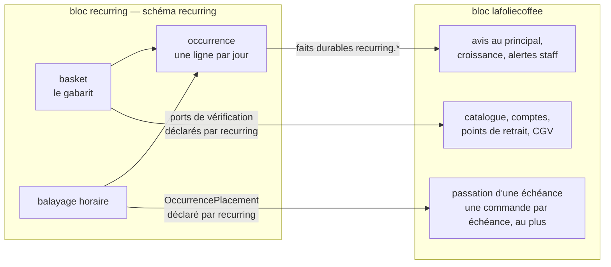
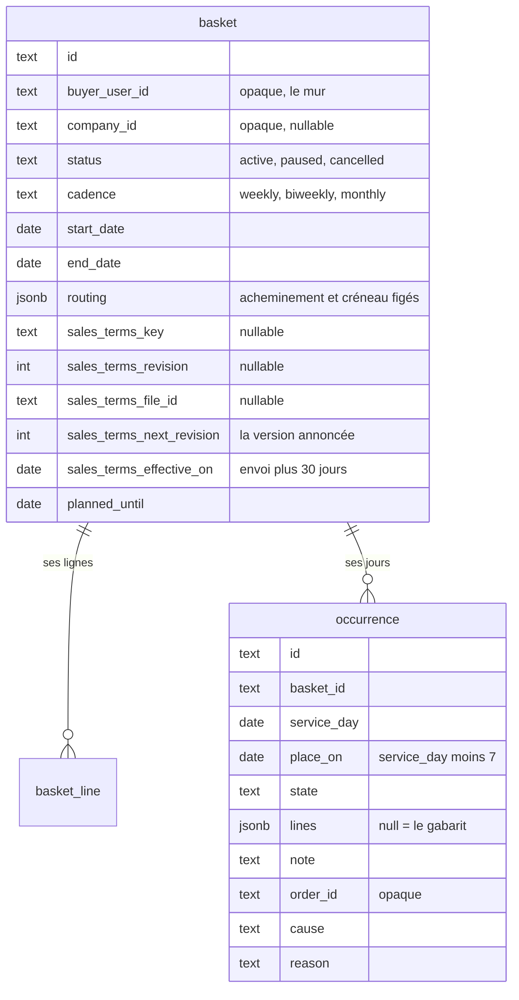
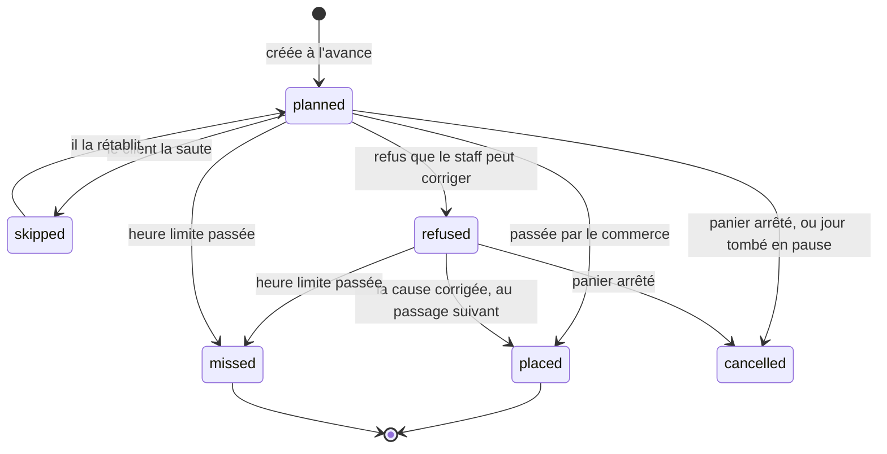

# Le bloc des paniers récurrents

> 📝 **Plan, v2 du 2026-11-24. Rien n'est bâti.** Demandé par Hugo le
> 2026-11-24 (« la meilleure architecture possible pour ce sujet »). Il porte
> une migration de **données vivantes** et touche l'argent : contredit une
> première fois par `vitruve` le même jour (4 bloquants, 7 sérieux, tous
> intégrés, § 10). Toutes les questions sont tranchées par Hugo le même
> jour (§ 9). Le SQL de la migration est écrit et essayé (§ 8 bis) ; il
> reste à le faire contredire avant tout bâti. Il reprend la forme des lots R1 à R4 du
> [planificateur](plan-planificateur.md), dont les décisions (§ 0, § 5 bis,
> § 8) restent vraies. Les questions sont au § 9.

## 0. L'état réel (vérifié le 2026-11-24, base de production lue par Hugo)

- **R1 et R2 sont en production** : leur code a été déployé avec
  `645e1d7bf`, et la migration du registre
  (`20261123140000_le_registre_des_echeances`) est appliquée depuis le
  2026-11-23.
- **R3 et R4 sont en production** depuis le 2026-11-24 (`a169ea13a`) :
  la passation d'une échéance, le créneau du panier (migration
  `20261124230000_le_creneau_du_panier_recurrent` appliquée) et le balayage
  horaire. Les déploiements de `9766608dc` avaient d'abord échoué sur une CI
  rouge, réparée avant la promotion.
- **La production ne contient aucune donnée de panier** (Q-B5) : zéro
  panier, zéro ligne, zéro dérogation, zéro commande issue d'un panier. Le
  registre n'a jamais été écrit, aucun balayage n'ayant tourné.

Conséquence : la reprise n'a **rien à recopier**. Le déménagement se fait
en un seul déploiement (Q-B4) : les tables neuves se créent dans le schéma
`recurring`, les anciennes tables `public.subscription*` se retirent dans la
même migration — vides, elles ne détruisent rien —, et le SQL n'a ni
correspondance d'états ni collision à traiter.

## 1. En deux mots

Aujourd'hui, le panier récurrent est un contexte du bloc `lafoliecoffee`, ses
tables dans `public`, et une échéance n'existe que comme un **calcul** :
chaque passage du planificateur recalcule le calendrier, puis le croise avec
deux tables (les dérogations et le registre).

La cible :

1. **un bloc à lui, `recurring/`**, avec son schéma Postgres `recurring`, sans
   clé étrangère vers personne ;
2. **l'échéance devient une ligne** : une table `occurrence`, une ligne par
   jour visé, créée à l'avance, qui porte son état, sa dérogation et son
   issue ;
3. **le bloc déclare ce dont il a besoin** et le commerce l'implémente : il
   ne sait pas ce qu'est une commande, il demande « passe cette échéance » et
   reçoit « passée » ou « refusée, voici pourquoi » — la forme de
   `production/channels/commerce/` ;
4. **il émet ses faits et publie ses lectures** : personne ne lit ses tables.



## 2. Pourquoi

- **La frontière tenue par les portes.** Dans `lafoliecoffee`, rien
  n'empêche un contexte voisin de lire les tables des paniers :
  `lint:prisma-model-ownership` juge par bloc. Deux voisins le font
  aujourd'hui (§ 3). Un bloc à lui met `lint:context-boundaries` et la
  propriété des modèles de son côté.
- **Un balayage qui coûte ce qui est dû.** Le balayage de R4 charge jusqu'à
  200 paniers, leurs lignes et leurs dérogations, recalcule leurs calendriers
  et relit le registre de chacun, toutes les heures, sur une base facturée à
  l'opération. Avec des lignes d'échéance, il lit `occurrence où état dû et
à passer le ≤ aujourd'hui`, par un index : son coût suit le nombre
  d'échéances dues.
- **Des écrans simples** (R6). « Mes prochaines commandes », « sauter
  celle-ci », « modifier celle du 12 » deviennent une liste de lignes et une
  écriture sur l'une d'elles.
- **Une seule table au lieu de deux.** Dérogation et registre décrivent la
  même chose : une échéance.
- **Le moment où c'est le moins cher.** Pré-release, et aucune échéance
  passée en production (§ 0) : le registre est vide, seules les dérogations
  sont à reprendre (Q-B5 les compte).

## 3. Ce qui existe (vérifié le 2026-11-24)

| Pièce                                                                                                                                                                        | Où                                                                                                       | Ce qu'elle devient                                                                                                           |
| ---------------------------------------------------------------------------------------------------------------------------------------------------------------------------- | -------------------------------------------------------------------------------------------------------- | ---------------------------------------------------------------------------------------------------------------------------- |
| Agrégat `Subscription`, ses value objects, `occurrencesBetween` (R0), `servableOccurrence` (R3)                                                                              | `apps/lfd-api/src/lafoliecoffee/subscriptions/domain/`                                                   | déménagent ; le calendrier sert à **créer** les lignes d'échéance                                                            |
| Tables `subscriptions`, `subscription_lines`, `subscription_occurrences`, `subscription_occurrence_runs`                                                                     | `apps/lfd-api/prisma/schema/public/subscriptions.prisma`                                                 | `basket`, `basket_line`, `occurrence` dans le schéma `recurring` (§ 5)                                                       |
| Clés étrangères vers `users` et `companies`, et leurs relations inverses                                                                                                     | `subscriptions.prisma` ; `account.prisma` (`subscriptions Subscription[]` sur `User` et `Company`)       | retirées ensemble : identifiants opaques                                                                                     |
| `CatalogModule` : unité de vente, opérations datées, **articles réservés** (`catalog/application/reserved-article-guard.service.js`)                                         | `create-subscription.handler.ts`                                                                         | port `BasketArticles` (§ 6.1)                                                                                                |
| `AccountModule` : mur de membre (`MembershipReader`), nom de la société, `SiteGesturePublisher` et ses types (`site-gesture.fact.js`, `journal-names.js` — `PickupPointRef`) | `subscription-gestures.ts`, handlers des gestes                                                          | ports `BasketBuyerStanding` ; faits durables du bloc (§ 6.2)                                                                 |
| `PickupAddressesModule` : le nom d'un point                                                                                                                                  | `delete-subscription.handler.ts`                                                                         | port `BasketPickupPoints`                                                                                                    |
| L'acteur d'intention des routes client (`lafoliecoffee/shared/intent/customer-intent-actor.js`)                                                                              | handlers de création et de gestes                                                                        | la matrice interdit à `recurring` d'importer `lafoliecoffee/shared` : il descend dans `platform/intent/` (B0)                |
| La fiche client compte les paniers actifs en lisant la table                                                                                                                 | `lafoliecoffee/account/infrastructure/prisma-customer-sheet.reader.ts`                                   | lecture publiée `RecurringBasketCounts`                                                                                      |
| L'usage d'un SKU par les paniers, lu en Prisma par le catalogue                                                                                                              | `lafoliecoffee/catalog/infrastructure/prisma-sale-reference-usage.ts`                                    | lecture publiée `RecurringSkuUsage`, comme `ShopCartSkuUsage`                                                                |
| `OnSubscriptionCreated` (croissance), `@EventsHandler` en mémoire                                                                                                            | `lafoliecoffee/growth/application/handlers/on-subscription-created.handler.ts`                           | `@DurableHandler` sur `recurring.basket_opened`, dans le lot B4                                                              |
| Les avis au principal, `@DurableHandler` sur les faits de geste de site                                                                                                      | `lafoliecoffee/sub-account-notices/application/handlers/notify-principal-on-subscription-*.handler.ts`   | abonnés aux faits `recurring.*` par le canal, dans le lot B4                                                                 |
| La passation d'une échéance                                                                                                                                                  | `lafoliecoffee/orders/application/commands/place-recurring-occurrence.handler.ts`                        | implémentation commerce d'`OccurrencePlacement` ; `RECURRING_OCCURRENCE_POLICY` et `recurringRefusalOf` restent              |
| Le balayage et sa route `admin/subscriptions/sweep` (R4, pas sur `main`)                                                                                                     | `subscriptions/application/commands/sweep-recurring-occurrences.handler.ts`                              | réécrit sur les lignes ; la route garde son nom (le Worker et `dev-sweeps.mjs` la citent)                                    |
| `Order.fromSubscriptionId` (sans relation), `recurringDeltas`                                                                                                                | `public.orders`                                                                                          | restent ; s'ajoute `from_occurrence_day` (§ 6.1)                                                                             |
| Faits du journal `subscription.*`                                                                                                                                            | `packages/contracts/src/journal-facts/accounts.ts`                                                       | gardent leur type : valeurs écrites                                                                                          |
| Les écrivains hors du contexte                                                                                                                                               | `src/dev/seeding/reset.seed.ts` (`prisma.subscription*`), e2e qui lisent les modèles Prisma par leur nom | suivent le renommage dans le lot qui le fait                                                                                 |
| Routes `/subscriptions…` (créer, `mine`, dérogation, statut, arrêt) et `/admin/companies/:id/subscriptions`                                                                  | `subscriptions/http/`                                                                                    | gardent leurs chemins. **Aucune route ne modifie la cadence, le début ou la fin d'un panier** : ils sont figés à l'ouverture |

## 4. Le bloc et la matrice

```
src/recurring/
├── basket/           le panier : son agrégat, son calendrier, ses gestes
├── occurrence/       l'échéance : son entité, la création à l'avance, le balayage
├── channels/
│   └── commerce/     ce que le bloc demande au commerce (§ 6.1)
│                     et ce qu'il lui publie (§ 6.2)
└── recurring.module.ts
```

Les arêtes, à écrire dans `dev-toolbox/gates/context-boundaries.mjs` et dans
la matrice de CLAUDE.md (B0) :

| Arête                                               | Règle                                                                    |
| --------------------------------------------------- | ------------------------------------------------------------------------ |
| `recurring → platform`                              | ✓                                                                        |
| `recurring → staff`                                 | ✓ (autorisation de la route du staff)                                    |
| `recurring → mail`                                  | port uniquement : l'e-mail de changement des CGV (§ 7)                   |
| `lafoliecoffee → recurring`                         | port uniquement, par `recurring/channels/`                               |
| `recurring → lafoliecoffee`                         | ✗                                                                        |
| le `RecurringFeedModule` d’`appBootstrap` (à créer) | relie les ports déclarés par `recurring` aux implémentations du commerce |

`prisma-model-ownership.mjs` apprend le bloc et ses modèles ;
`prisma-schema-layout` le dossier `prisma/schema/recurring/`.

## 5. Le schéma `recurring`



- **Le mur** de toute lecture et de tout geste du client est `buyer_user_id`
  (aujourd'hui `placed_by_user_id`), plus l'appartenance actuelle à la
  société pour un panier de société (`BasketBuyerStanding`). Le retrait de la
  clé étrangère ne change pas le mur : il était déjà dans la requête.
- **`company_id` reste nullable.** Un panier sans société (perso, ou d'avant
  la colonne) n'est pas servi (§ 0 du planificateur) : **aucune ligne
  d'échéance ne lui est créée**. Il reste lisible et gérable par son client.
- `occurrence (basket_id, service_day)` est unique : une échéance, une ligne.
  Ce n'est **pas** ce qui empêche deux commandes (§ 6.1).
- Index partiel `occurrence (place_on) WHERE state IN ('planned', 'refused')`.
- `CHECK` de forme par état : `placed` porte une commande et aucune cause ;
  `refused` et `missed` une cause et une phrase ; les autres, ni l'une ni
  l'autre.
- Les colonnes CGV s'alignent sur celles de la commande
  (`orders.sales_terms_key`, `_revision`, `_file_id`).

### Le cycle d'une échéance



- **La création à l'avance** : à l'ouverture, à la reprise et à chaque
  passage, pour un panier actif **d'une société**, le bloc crée les lignes
  manquantes de `max(début, aujourd'hui)` jusqu'à aujourd'hui + N semaines
  (Q-B3), et avance `planned_until`. Les dates viennent du calendrier de R0
  (mois court : dernier jour).
- **L'horizon de passation** est inchangé : une ligne se passe à partir de
  `place_on = service_day − 7 jours` (Q1 du planificateur). La création à
  l'avance est plus longue que l'horizon pour que l'écran montre les
  semaines à venir ; elle ne passe rien plus tôt.
- **La pause** ne touche pas les lignes : le balayage ne passe que les
  lignes d'un panier actif. À la reprise, les lignes `planned` dont
  `service_day` est avant le jour de la reprise passent `cancelled` : elles ne
  sont ni dues ni manquées (la règle de `armed_from`, dite par l'état).
- **Le gabarit ne change pas** aujourd'hui (aucune route, § 3) : rien à
  recréer. Si un jour la cadence ou les dates deviennent modifiables, le geste
  annulera les lignes `planned` sans dérogation et recréera les autres dans
  sa transaction — à concevoir avec ce geste, pas avant.
- **L'arrêt** passe les lignes `planned`, `skipped` et `refused` en
  `cancelled`, dans la transaction du statut.

## 6. Le canal `recurring/channels/commerce/`

### 6.1 Ce que le bloc demande (déclaré par `recurring`, implémenté par le commerce)

| Port                  | Ce qu'il répond                                                                                    | Implémenté par                       |
| --------------------- | -------------------------------------------------------------------------------------------------- | ------------------------------------ |
| `OccurrencePlacement` | « passe cette échéance » → `placed(orderId)` ou `refused(cause, phrase, définitif)`                | `orders` : la passation de R3        |
| `BasketBuyerStanding` | l'acheteur est-il membre actuel ? le nom de la société ? un payeur public ?                        | `account`, par `readCompanyStanding` |
| `BasketArticles`      | ces SKU se vendent-ils à la pièce, hors opération datée, sans être réservés à un autre compte ?    | `catalog`                            |
| `BasketPickupPoints`  | la référence d'un point de retrait                                                                 | `pickup-addresses`                   |
| `BasketSalesTerms`    | la révision en vigueur des CGV d'une clientèle, et le fichier du texte — **dépendance neuve** (B4) | `content`                            |

**Une échéance, au plus une commande — tenu par le commerce, en base.** La
passation et l'inscription de l'issue ne sont plus dans la même transaction
(le bloc ne partage pas la sienne avec le commerce). La garantie descend
donc dans la table qui risque le doublon :

- la commande porte sa provenance complète, `from_subscription_id` **et**
  `from_occurrence_day` (colonne neuve, `DATE`, immuable : la date de
  service de la commande, elle, peut être modifiée par le client) ;
- index unique partiel `orders (from_subscription_id, from_occurrence_day)
WHERE from_subscription_id IS NOT NULL` ;
- une seconde passation de la même échéance échoue sur cet index, et la
  passation rend alors la commande existante comme `placed` : un rejeu, pas
  un doublon. Aucune rétention, aucune clé d'intention — `OncePerIntent`
  n'est **pas** utilisé ici (il garderait le premier refus et empêcherait
  `refused → placed`, et il exige un acteur et un sujet que le balayage n'a
  pas).

Le bloc inscrit ensuite l'issue sous condition d'état (`WHERE state IN
('planned', 'refused')`). Une inscription perdue (panne entre les deux) se
répare au passage suivant : la ligne est encore due, la passation rend la
commande existante, l'issue s'inscrit. Une ligne `planned` d'un panier mis
en pause entre-temps n'est plus balayée, mais sa commande est déjà unique en
base.

### 6.2 Ce que le bloc publie

| Lecture ou fait                                                                                    | Lu par                               |
| -------------------------------------------------------------------------------------------------- | ------------------------------------ |
| `RecurringBasketCounts` : les paniers actifs d'une société                                         | la fiche client (`account`)          |
| `RecurringSkuUsage` : les SKU des paniers vivants                                                  | l'usage des références (`catalog`)   |
| faits durables `recurring.basket_opened`, `_paused`, `_resumed`, `_stopped`, `_occurrence_changed` | les avis au principal, la croissance |
| faits durables `recurring.occurrence_placed`, `_refused` (cause nouvelle), `_missed`               | l'alerte staff (R5), la croissance   |

**La garantie de l'avis au principal change**, et c'est voulu : aujourd'hui
le fait de geste de site s'écrit dans la transaction du geste par le
`SiteGesturePublisher` du commerce ; demain le bloc écrit son propre fait
durable dans sa transaction, et l'avis au principal le suit par l'outbox —
au moins une fois, après validation, comme tous les abonnés entre blocs.
Les deux abonnés (avis au principal, croissance) basculent en
`@DurableHandler` **dans le même lot** (B4), sans quoi
`lint:durable-cross-block` les compterait en dette neuve.

Les faits du journal gardent leurs types `subscription.*`.

## 7. Les CGV d'un panier (Hugo, 2026-11-24)

**La règle, annoncée à l'ouverture du panier** : « Les modifications des
CGV vous sont envoyées 30 jours avant leur application. Sans arrêt de votre
part, elles s'appliquent aux commandes suivantes. Vous pouvez arrêter votre
panier à tout moment, sans frais. » La rédaction exacte est à faire valider
par le rédacteur des CGV.

- **À l'ouverture**, le panier enregistre la version acceptée
  (`sales_terms_key`, `_revision`, `_file_id`, comme une commande).
- **À la publication d'une nouvelle version**, le bloc l'apprend par un fait
  du contenu, envoie à l'acheteur de chaque panier actif l'e-mail qui porte
  le nouveau texte et rappelle le geste « arrêter le panier » (bloc `mail`,
  par son canal), et note sur le panier la **version à venir** et sa **date
  d'effet** : le jour de l'envoi + 30 jours.
- **Contester, c'est arrêter le panier** : le geste existant, sans frais ni
  dernière échéance imposée. Aucun traitement manuel par l'équipe.
- **Aucune échéance n'est jamais bloquée** pour une question de CGV : il n'y
  a pas de refus `terms_outdated`.
- 🔴 **La version figée sur la commande d'une échéance est celle que le
  panier applique à son jour de service**, pas celle en vigueur à l'instant
  de la passation : une échéance se passe 7 jours avant son jour, et une
  échéance passée pendant le préavis prendrait sinon le nouveau texte trop
  tôt. Une échéance dont le jour de service précède la date d'effet garde
  l'ancienne version ; à partir de la date d'effet, la nouvelle. Le port
  `OccurrencePlacement` porte donc la version à figer, et la passation
  l'impose au lieu de la lire au contenu.
- **La preuve** : le suivi de l'e-mail par le bloc `mail` (demandé, accepté,
  remis), et la version figée sur chaque commande.
- **Les paniers ouverts avant cette règle** (Q-B6) : servis par une
  dérogation datée, inscrite à la reprise ; ils reçoivent l'e-mail de la
  prochaine version comme les autres.

## 8. Les lots

| Lot                | Contenu                                                                                                                                                                                                                                                                                                                         | Migration                                                                     |
| ------------------ | ------------------------------------------------------------------------------------------------------------------------------------------------------------------------------------------------------------------------------------------------------------------------------------------------------------------------------- | ----------------------------------------------------------------------------- |
| **B0**             | Les portes et la matrice (§ 4) ; l'acteur d'intention client descend dans `platform/intent/`                                                                                                                                                                                                                                    | —                                                                             |
| **B1a — étendre**  | `CREATE SCHEMA recurring` et le schéma déclaré dans `datasource.prisma` **dans le même commit** ; les tables neuves `basket`, `basket_line`, `occurrence` ; recopie des paniers, lignes et dérogations ; `orders.from_occurrence_day` et son index unique partiel. Les anciennes tables restent, lues par le code en production | **données** : SQL complet dans ce plan, contredit (vitruve 2) avant tout bâti |
| **B1b — basculer** | Le code déménage dans `src/recurring/` et lit les tables neuves ; le canal, ses ports, le `RecurringFeedModule` d’`appBootstrap` (à créer) ; la passation sur l'index unique ; les écritures du semis et des e2e suivent                                                                                                        | —                                                                             |
| **B2**             | L'entité `Occurrence`, la création à l'avance, le balayage sur les lignes dues                                                                                                                                                                                                                                                  | —                                                                             |
| **B3**             | Les lectures et les faits publiés (§ 6.2) ; avis au principal et croissance en `@DurableHandler` ; la fiche client et le catalogue sur les lectures publiées                                                                                                                                                                    | —                                                                             |
| **B4**             | Les CGV du panier (§ 7) : version acceptée à l'ouverture, version à venir et date d'effet, l'e-mail à 30 jours par le bloc `mail`, la version imposée à la passation d'une échéance                                                                                                                                             | additive                                                                      |
| **B5 — resserrer** | Retrait des anciennes tables `public.subscription*` et de leurs relations inverses dans `account.prisma`, une fois B1b déployé et vérifié                                                                                                                                                                                       | **suppression** : sur ordre explicite de Hugo (CLAUDE.md § 0)                 |

Ce que le SQL de B1a doit dire, et que ce plan n'écrit pas encore :

- la correspondance des états : dérogation `skipped` → `skipped` ; dérogation
  à lignes → `planned` avec ses lignes ; ligne du registre `generated` →
  `placed`, `refused` → `refused`, `missed_deadline` → `missed` ; une
  dérogation et une ligne du registre au même jour fusionnent (l'issue du
  registre l'emporte, la dérogation garde ses lignes) ;
- `armed_from` : les lignes recopiées dont `service_day` précède
  `armed_from` passent `cancelled` ;
- les noms d'index et de contraintes tels que Prisma les attend (le nom
  coupé à 63 caractères du registre, déclaré par `map:`), vérifiés par
  `schema-drift` ;
- les colonnes CGV à `NULL` pour les paniers recopiés (Q-B6 décide de la
  suite).

Puis R5 (l'alerte staff, abonnée à `recurring.occurrence_refused`) et R6 (les
écrans, sur les lignes d'échéance) du planificateur.

**R4 n'est pas poussé sur `main`** tant que ce plan n'est pas tranché : il
ferait passer des échéances sur la forme qu'on remplace.

## 8 bis. La migration (écrite le 2026-11-24, à contredire)

Un seul déploiement (Q-B4), sur une production sans panier (Q-B5) : rien
n'est recopié, les tables neuves se créent et les anciennes se retirent.
Nom du dossier : `<horodatage>_le_bloc_des_paniers_recurrents`.

```sql
-- Le bloc des paniers récurrents : son schéma `recurring`, l'échéance devenue
-- une ligne (documentation/commandes/paniers-recurrents/plan-bloc-recurrent.md).
--
-- La production ne contient aucun panier (compté le 2026-11-24, § 0 du plan) :
-- les tables neuves se créent vides, et les anciennes tables
-- `public.subscription*`, vides elles aussi, se retirent dans la même
-- migration (Q-B4). Aucune clé étrangère ne sort de `recurring` : une personne,
-- une société, une commande et un point de retrait s'y désignent par
-- identifiant.
--
-- Retour arrière : recréer les quatre tables `public.subscription*` depuis les
-- migrations qui les ont posées, et retirer le schéma `recurring` ; sans
-- donnée à recopier tant qu'aucun panier n'a été ouvert.

CREATE SCHEMA IF NOT EXISTS "recurring";

-- ─── Le panier ──────────────────────────────────────────────────────────────
CREATE TABLE "recurring"."basket" (
  "id"                        TEXT PRIMARY KEY,
  "buyer_user_id"             TEXT NOT NULL,
  "company_id"                TEXT,
  "from_order_id"             TEXT,
  "cadence"                   TEXT NOT NULL,
  "status"                    TEXT NOT NULL DEFAULT 'active',
  "start_date"                DATE NOT NULL,
  "end_date"                  DATE,
  "fulfillment_method"        TEXT NOT NULL,
  "delivery_address"          JSONB,
  "pickup_address_id"         TEXT,
  "requested_window"          JSONB NOT NULL,
  "note"                      TEXT NOT NULL DEFAULT '',
  "sales_terms_key"           TEXT NOT NULL,
  "sales_terms_revision"      INTEGER NOT NULL,
  "sales_terms_file_id"       TEXT,
  "sales_terms_next_revision" INTEGER,
  "sales_terms_next_file_id"  TEXT,
  "sales_terms_effective_on"  DATE,
  "planned_until"             DATE,
  "created_at"                TIMESTAMPTZ(6) NOT NULL,
  "updated_at"                TIMESTAMPTZ(6) NOT NULL,
  CONSTRAINT "basket_cadence_known"
    CHECK ("cadence" IN ('weekly', 'biweekly', 'monthly')),
  CONSTRAINT "basket_status_known"
    CHECK ("status" IN ('active', 'paused', 'cancelled')),
  CONSTRAINT "basket_dates_ordered"
    CHECK ("end_date" IS NULL OR "end_date" >= "start_date"),
  -- Livraison : une adresse et pas de point ; retrait : jamais d'adresse.
  CONSTRAINT "basket_routing_shape" CHECK (
    ("fulfillment_method" = 'delivery' AND "delivery_address" IS NOT NULL AND "pickup_address_id" IS NULL)
    OR ("fulfillment_method" = 'pickup' AND "delivery_address" IS NULL)
  ),
  -- Une version annoncée a toujours sa date d'effet, et l'inverse (§ 7).
  CONSTRAINT "basket_next_terms_together" CHECK (
    ("sales_terms_next_revision" IS NULL) = ("sales_terms_effective_on" IS NULL)
    AND ("sales_terms_next_file_id" IS NULL OR "sales_terms_next_revision" IS NOT NULL)
  )
);
CREATE INDEX "basket_buyer_user_id_idx" ON "recurring"."basket" ("buyer_user_id");
CREATE INDEX "basket_company_id_idx" ON "recurring"."basket" ("company_id");

-- ─── Ses lignes ─────────────────────────────────────────────────────────────
CREATE TABLE "recurring"."basket_line" (
  "id"        TEXT PRIMARY KEY,
  "basket_id" TEXT NOT NULL,
  "position"  INTEGER NOT NULL,
  "sku"       TEXT NOT NULL,
  "quantity"  INTEGER NOT NULL,
  CONSTRAINT "basket_line_basket_id_fkey"
    FOREIGN KEY ("basket_id") REFERENCES "recurring"."basket" ("id")
    ON DELETE RESTRICT ON UPDATE CASCADE,
  CONSTRAINT "basket_line_quantity_positive" CHECK ("quantity" > 0),
  CONSTRAINT "basket_line_position_positive" CHECK ("position" >= 0)
);
CREATE UNIQUE INDEX "basket_line_basket_id_sku_key" ON "recurring"."basket_line" ("basket_id", "sku");
CREATE UNIQUE INDEX "basket_line_basket_id_position_key" ON "recurring"."basket_line" ("basket_id", "position");

-- ─── Ses échéances ──────────────────────────────────────────────────────────
CREATE TABLE "recurring"."occurrence" (
  "id"          TEXT PRIMARY KEY,
  "basket_id"   TEXT NOT NULL,
  "service_day" DATE NOT NULL,
  "place_on"    DATE NOT NULL,
  "state"       TEXT NOT NULL DEFAULT 'planned',
  "lines"       JSONB,
  "note"        TEXT NOT NULL DEFAULT '',
  "order_id"    TEXT,
  "cause"       TEXT,
  "reason"      TEXT,
  "created_at"  TIMESTAMPTZ(6) NOT NULL,
  "updated_at"  TIMESTAMPTZ(6) NOT NULL,
  CONSTRAINT "occurrence_basket_id_fkey"
    FOREIGN KEY ("basket_id") REFERENCES "recurring"."basket" ("id")
    ON DELETE RESTRICT ON UPDATE CASCADE,
  CONSTRAINT "occurrence_state_known"
    CHECK ("state" IN ('planned', 'skipped', 'placed', 'refused', 'missed', 'cancelled')),
  CONSTRAINT "occurrence_placed_before_served" CHECK ("place_on" <= "service_day"),
  -- La forme de chaque état : une commande seulement si passée ; une cause et
  -- sa phrase seulement si refusée ou manquée.
  CONSTRAINT "occurrence_state_shape" CHECK (
    ("state" = 'placed' AND "order_id" IS NOT NULL AND "cause" IS NULL AND "reason" IS NULL)
    OR ("state" IN ('refused', 'missed') AND "order_id" IS NULL AND "cause" IS NOT NULL AND "reason" IS NOT NULL)
    OR ("state" IN ('planned', 'skipped', 'cancelled') AND "order_id" IS NULL AND "cause" IS NULL AND "reason" IS NULL)
  )
);
CREATE UNIQUE INDEX "occurrence_basket_id_service_day_key" ON "recurring"."occurrence" ("basket_id", "service_day");
-- Ce que le balayage lit : les échéances encore à passer, par leur jour de passation.
CREATE INDEX "occurrence_due_idx" ON "recurring"."occurrence" ("place_on")
  WHERE "state" IN ('planned', 'refused');

-- ─── La commande : une échéance, au plus une commande (§ 6.1) ──────────────
ALTER TABLE "public"."orders" ADD COLUMN "from_occurrence_day" DATE;
CREATE UNIQUE INDEX "orders_one_per_occurrence"
  ON "public"."orders" ("from_subscription_id", "from_occurrence_day")
  WHERE "from_occurrence_day" IS NOT NULL;

-- ─── Les anciennes tables, vides en production ──────────────────────────────
DROP TABLE "public"."subscription_occurrence_runs";
DROP TABLE "public"."subscription_occurrences";
DROP TABLE "public"."subscription_lines";
DROP TABLE "public"."subscriptions";
```

**Essayée le 2026-11-24** sur la base e2e locale, dans une transaction
annulée : toutes les instructions passent ; une échéance `placed` sans
commande, un second jour identique pour un même panier, une livraison sans
adresse et une version annoncée sans date d'effet sont refusés par leurs
contraintes ; l'annulation ne laisse rien.

Ce que ce SQL décide, et que le code devra suivre :

- **Les CGV sont exigées dès la création** (`sales_terms_key`,
  `sales_terms_revision` `NOT NULL`) : la capture de la version acceptée
  (B4) part dans le même déploiement que le bloc. Sans panier en production,
  la dérogation datée de Q-B6 n'a personne à couvrir ; elle n'est pas écrite.
- **Le créneau est exigé** (`requested_window` `NOT NULL`) : plus de panier
  sans créneau, donc plus de refus `no_window`.
- **L'acheminement en `TEXT` avec `CHECK`**, pas l'énum `FulfillmentMethod`
  de `public` : un type d'un autre schéma serait une dépendance de plus.
- **Les identifiants sont posés par l'application** (`IdGenerator`), sans
  défaut en base, comme le registre de R2.
- **Les lignes du gabarit portent leur rang** (`position`, unique par
  panier) et un SKU au plus une fois par panier.
- **`orders.from_occurrence_day`** est nullable et sans `CHECK` contre
  `from_subscription_id` : les commandes semées en développement portent un
  panier sans jour, et l'index unique ne lit que les lignes qui ont un jour.
- **Les relations inverses** `User.subscriptions` et `Company.subscriptions`
  quittent `account.prisma` dans le même commit ; `public.orders` garde
  `from_subscription_id`, qui désigne désormais un `recurring.basket`.

À vérifier au bâti, pas encore ouvert :

- `datasource.prisma` déclare `recurring` dans le même commit que la
  migration, et `schema-drift` passe : les deux index partiels
  (`occurrence_due_idx`, `orders_one_per_occurrence`) et les `CHECK` ne
  s'écrivent pas tous en Prisma ; ceux qu'il ne sait pas dire entrent dans
  `schema-drift-admitted.json`, chacun avec sa raison, comme l'unicité du
  panier de la boutique.
- La base de développement de Hugo perd ses paniers semés au retrait des
  anciennes tables : le semis (`reset.seed.ts`) est réécrit dans le même
  lot.

## 9. Les décisions de Hugo (2026-11-24) et ce qui reste ouvert

- **Q-B1 — Le nom** : `recurring/` et le schéma `recurring`. ✅
- **Q-B2 — Les CGV changent** : **préavis de 30 jours, arrêt libre.** ✅
  Un e-mail porte le nouveau texte ; sans arrêt du panier, il s'applique aux
  échéances dont le jour suit la date d'effet ; contester, c'est arrêter le
  panier, sans frais (§ 7).
- **Q-B3 — La création à l'avance** : 8 semaines. ✅
- **Q-B4 — L'ordre** : **tout d'un coup**, l'activité n'ayant pas commencé.
  ✅ B1a, B1b et B5 se fondent en un seul déploiement : les tables
  déménagent, le code bascule et les anciennes tables sont retirées
  ensemble (§ 8, à réécrire avec le SQL).
- **Q-B5 — La production** : **vide.** ✅ Compté par Hugo le 2026-11-24 :
  aucun panier, aucune ligne, aucune dérogation, aucune commande issue d'un
  panier (§ 0).
- **Q-B6 — Les paniers déjà ouverts** : **dérogation datée.** ✅ Ils sont
  servis, et la reprise l'inscrit comme telle (« ouvert avant les CGV au
  panier »), sans fabriquer d'acceptation.

## 10. La contradiction de `vitruve` (v1, 2026-11-24)

| Objection                                                                                     | Sort                                                                                                                                 |
| --------------------------------------------------------------------------------------------- | ------------------------------------------------------------------------------------------------------------------------------------ |
| B1 — « R1 à R4 jamais déployés » faux : R1–R3 sont sur `main`                                 | vérifiée (`git merge-base`) ; § 0 écrit, § 2, § 8 et Q-B4 réécrits                                                                   |
| B2 — la clé d'intention garde le premier refus                                                | `OncePerIntent` abandonné (§ 6.1)                                                                                                    |
| B3 — `OncePerIntent` exige un acteur et un sujet                                              | sans objet : abandonné                                                                                                               |
| B4 — l'atomicité commande + issue disparaît                                                   | index unique sur la provenance de la commande, côté commerce (§ 6.1) ; `requested_delivery_date` écarté : le client peut la modifier |
| S5 — dépendances oubliées (articles réservés, acteur d'intention, types du geste, semis, e2e) | ajoutées au § 3 et aux lots                                                                                                          |
| S6 — `company_id` nullable et le mur                                                          | § 5 : aucune ligne pour un panier sans société ; mur `buyer_user_id`                                                                 |
| S7 — CGV des paniers existants ; colonnes de `orders`                                         | § 7 et Q-B6 ; colonnes alignées ; la comparaison au panier de la boutique retirée                                                    |
| S8 — le SQL de B1                                                                             | exigences écrites au § 8 ; le SQL complet et vitruve 2 avant tout bâti ; retrait des anciennes tables dans un lot distinct           |
| S9 — horizon et changement de cadence                                                         | § 5 : l'horizon de passation reste 7 jours ; aucune route ne change la cadence aujourd'hui                                           |
| S10 — les arêtes de la matrice                                                                | § 4                                                                                                                                  |
| S11 — la garantie de l'avis au principal                                                      | § 6.2 : dite, et les deux abonnés basculent ensemble                                                                                 |
| Mineurs (`recurringDeltas`, « arrêté », `content`, comparaison à `shop-cart`)                 | intégrés (§ 3, § 5, § 6.1)                                                                                                           |
