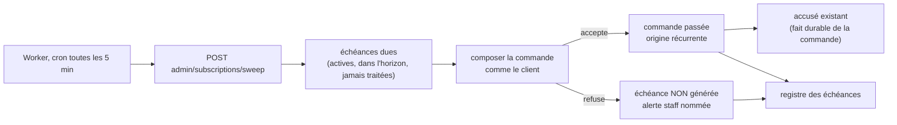

# Le planificateur des paniers récurrents

> 📝 **Plan, rédigé le 2026-11-22. Rien n'est bâti.** Il touche l'argent :
> contredit par `vitruve` le même jour (3 bloquants, 5 sérieux, tous intégrés,
> § 9). Toutes les questions sont tranchées par Hugo (§ 8) : le plan est
> prêt à bâtir, lot par lot.

## 0. Le périmètre : les pros, et eux seuls

Décidé par Hugo le 2026-11-23 : le planificateur ne sert d'abord que les
**paniers récurrents pros**, c'est-à-dire ceux qui portent une société
(`companyId` non nul), et **pas les entités publiques**.

- **Paniers perso** (`companyId` nul, y compris les abonnements d'avant la
  colonne) : le balayage ne les lit pas. Rien ne s'inscrit au registre et
  aucune alerte ne part.
- **Payeurs publics** (société qui exige un engagement budgétaire, E2′) : le
  balayage ne les lit pas non plus. Le chantier est remis à plus tard,
  avec la question de l'engagement porté par l'abonnement.
- L'écran de création dit aux deux qu'aucune commande ne sortira du panier
  pour le moment.

## 1. En deux mots

Un client enregistre un **panier récurrent** : « ces articles, toutes les
semaines, livrés à cette adresse ». Aujourd'hui, ce panier n'est qu'un modèle.
Aucune commande n'en sort.

Le planificateur fait passer, à chaque échéance, **une vraie commande**,
exactement comme si le client l'avait passée lui-même ce jour-là : même prix
du jour, mêmes limites, même heure limite, même mur.

Trois règles, et tout le plan en découle :

1. **Jamais une commande amputée.** Si une ligne ne passe plus (article
   retiré, plus réservé, limite dépassée, trop tard), l'échéance entière
   n'est pas générée et le staff reçoit une alerte qui nomme le cas et le
   geste. C'est la règle déjà écrite par Hugo le 2026-10-30 pour la
   réservation (`occurrenceVerdict`, Q7), étendue à toutes les causes.
2. **Une seule arithmétique.** Le planificateur ne calcule rien : il compose
   la commande par `OrderDrafting`, comme la passation du client et celle
   du staff. Le prix est celui du jour de la génération, pas celui de
   l'ouverture du panier.
3. **Une échéance, au plus une commande.** Le registre des échéances garde
   une ligne par `(abonnement, date)`, unique en base. Rejouer le balayage
   ne double rien. Un refus, lui, se rejoue tant que l'heure limite est
   ouverte : le staff qui corrige la cause voit l'échéance repartir.
4. **Une machine n'a aucun passe-droit.** Ni dérogation d'heure limite, ni
   frais de retard, ni dépassement de limite, ni réception hors plan : elle
   passe par la porte du **client**, jamais par celle de l'équipe.

## 2. Ce qui existe (vérifié le 2026-11-22)

| Pièce                                                                                  | Où                                                                                                                                                                           | État                                                                                                                 |
| -------------------------------------------------------------------------------------- | ---------------------------------------------------------------------------------------------------------------------------------------------------------------------------- | -------------------------------------------------------------------------------------------------------------------- |
| Agrégat `Subscription` : `open`, `pause`, `resume`, `overrideOccurrence`               | `apps/lfd-api/src/lafoliecoffee/subscriptions/domain/entities/subscription.ts`                                                                                               | bâti, sans calendrier : rien ne calcule les dates d'échéance                                                         |
| Tables `subscriptions`, `subscription_lines`, `subscription_occurrences` (dérogations) | `apps/lfd-api/prisma/schema/public/subscriptions.prisma`                                                                                                                     | `status` vaut `active \| paused` ; lignes sans prix                                                                  |
| `companyId` de l'abonnement, figé, `null` en perso                                     | idem                                                                                                                                                                         | les abonnements antérieurs à la colonne restent `null`                                                               |
| Verdict de réservation (`occurrenceVerdict`)                                           | `subscriptions/domain/services/reserved-occurrence.ts`                                                                                                                       | pur, **aucun appelant**                                                                                              |
| `Order.fromSubscriptionId`, `recurringDeltas`                                          | `prisma/schema/public/orders.prisma`                                                                                                                                         | lus (origine, métriques croissance, liste admin, journée du fournil), **écrits par le seul semis**                   |
| Passation au nom du client                                                             | `orders/application/commands/place-order-for-customer.handler.ts`                                                                                                            | modèle à suivre : `prepareStaffOrder` → `OrderDrafting`, `OrderDeadline`, `holdSupply`, `orders.place`, fait durable |
| Déclencheur périodique                                                                 | Worker `container/worker.ts`, cron `*/5` (`KEEP_WARM_CRON`) → routes `admin/*/sweep` sous `RecomputeGuard`                                                                   | sert l'outbox et la fidélité                                                                                         |
| Suppression d'un abonnement                                                            | `delete-subscription.handler.ts`                                                                                                                                             | **physique**, contre CLAUDE.md §3 ; son JSDoc attend le planificateur pour passer à `cancelled`                      |
| Écrans                                                                                 | boutique : `legacy/commandes/recurring-order-panel`, `occurrence-override-panel`, `client/client-subscriptions.service.ts` ; back-office : `fiche-client/paniers-recurrents` | création et dérogations ; aucune échéance listée                                                                     |

Il n'y a ni `ScheduleModule` ni `@Cron` dans l'API : le rythme vient du Worker.

## 3. Le calendrier

Une fonction pure du domaine, `occurrencesBetween(subscription, from, to)`,
rend les dates d'échéance d'un abonnement dans une fenêtre :

- `weekly` : `startDate + 7k` ; `biweekly` : `startDate + 14k` ;
- `monthly` : même quantième que `startDate` ; un mois qui ne l'a pas
  (31 → 30 avril) prend **le dernier jour du mois** (Q4) ;
- bornées par `startDate` et `endDate` ;
- une dérogation `skipped` retire la date ; une dérogation à lignes en
  remplace les lignes.

Les dates sont des jours (`IsoDate`), jamais des instants. Le jour fermé
(dimanche, fermeture exceptionnelle) n'est **pas** décalé en silence :
c'est un refus nommé, comme le reste (§ 5). ⚠️ La garde qui refuse un jour
fermé à la passation n'a pas été trouvée dans `OrderDrafting.ensureDayOpen`
(qui ne regarde que le plan arrêté et le jour même) ; les jours servis se
lisent dans `order-cutoffs/application/list-fulfillment-days.handler.ts`. Le
lot R3 la localise, ou l'ajoute avec son test.

**La borne basse.** Le balayage ne regarde jamais avant
`max(startDate, armedFrom)`, où `armedFrom` est une colonne de l'abonnement
posée à l'armement du planificateur (sa première mise en service), puis à
chaque reprise (`resume`). Ainsi le premier armement ne produit pas une
avalanche d'échéances « manquées » depuis l'ouverture de chaque panier, et
une échéance tombée pendant une **pause** n'est pas un retard : elle n'est
pas due, et rien ne s'inscrit au registre.

## 4. Quand une échéance se génère

**L'horizon** : une échéance est due dès que sa journée de service tombe à
**J+H** ou plus près, `H` étant un réglage du commerce (proposition :
**7 jours**, Q1). Assez tôt pour que le fournil la voie dans son plan et que
le client puisse la modifier ou l'annuler par les gestes existants
(modification, annulation) jusqu'à l'heure limite ; assez tard pour que le
prix et le catalogue soient ceux du moment.

Une échéance due (après la borne basse) dont l'heure limite est passée sans
qu'aucune commande en soit sortie (abonnement créé trop près, panne longue
du Worker, refus jamais corrigé) n'est pas rattrapée : elle passe au
registre `missed_deadline` et alerte le staff. Jamais de dérogation d'heure
limite dépensée par une machine.

## 5. La génération d'une échéance

Un handler `PlaceRecurringOccurrenceHandler` dans `lafoliecoffee/orders`
(il écrit une commande, c'est le propriétaire de la commande qui le fait).
Le contexte `subscriptions` tient le registre et en **déclare le port
d'écriture** (`OccurrenceRunLedger.record`), que le handler appelle dans son
unité de travail (la transaction se partage par le CLS). Aucune porte ne
tient cette propriété : `lint:prisma-model-ownership` raisonne par bloc de
premier niveau, et `orders` comme `subscriptions` sont dans `lafoliecoffee`.
C'est le port qui la tient.

**Qui passe la commande : l'acheteur, sans équipe.** `placedByStaffId` vaut
`null`. Le handler n'emprunte **pas** `prepareStaffOrder` (qui exige un
`staffUserId`, et dont la présence ouvre la porte de l'équipe : réception
« hors plan » sur un plan arrêté, règle du jour même de l'équipe —
`order-drafting.service.ts`, `holdSupply` / `receiveOffPlan`). Il compose
par `OrderDrafting` directement, avec les parties du client, sans
`ensureCounterLinkCause`. Pour une échéance :

1. **Le mur sur l'acheteur.** `placedByUserId` doit être encore actif et,
   si `companyId` n'est pas nul, encore membre de la société, lu par
   `readCompanyStanding`. Sinon : refus `buyer_left`.
2. **La composition** par `OrderDrafting` (lignes de l'échéance, acheminement
   figé de l'abonnement, journée = date de l'échéance).
3. **Les juges**, sans aucun passe-droit :
   - l'heure limite, jugée par `OrderDrafting` (le handler n'appelle pas
     `OrderDeadline` lui-même) : ⚠️ `OrderDrafting` demande aujourd'hui le
     verdict avec `waiver: "consider"` (`order-drafting.service.ts`, vers la
     l. 330) et `admitWithinDeadline` rend alors `waiverUsed` et `lateFee`.
     Le lot R3 ajoute à `OrderDrafting` une option explicite (`waiver:
"ignore"`) que seul ce handler passe, et un e2e « échéance en retard ⇒
     refusée, dérogation intacte, aucun frais » ;
   - `exceedItemLimits: false`, et aucune limite de produit dépassée — pas
     de motif inventé (ce que rend le draft dans ce cas, refus levé ou liste
     `exceeded`, est à lire au bâti) ;
   - `occurrenceVerdict` : aucun article réservé ailleurs (il attend un
     `companyName` : le panier sans société ne l'appelle pas, aucune
     réservation ne le concerne) ;
   - le SKU existe et se vend encore dans le canal ;
   - un payeur public n'arrive jamais jusqu'ici : il est écarté par le
     balayage (§ 0).
4. **Le règlement** (§ 6). Refus `no_settlement` s'il n'y en a aucun de
   possible.
5. **L'écriture**, dans une transaction : `holdSupply` (porte client : un
   plan arrêté refuse), `orders.place` avec `fromSubscriptionId`,
   `recurringDeltas` (l'écart entre lignes de l'échéance et gabarit), le
   registre en `generated` par le port, et le fait durable
   `CommerceOrderPlacedFact`. **Aucun e-mail n'est demandé ici** :
   l'accusé part déjà de ce fait (`apps/lfd-api/src/lafoliecoffee/orders/notices/application/handlers/send-order-placed-mail.handler.ts`,
   `@DurableHandler`) ; s'il faut un texte propre aux commandes récurrentes,
   c'est ce handler qui le choisit sur `fromSubscriptionId`. De même,
   `notify-principal-on-order-placed` (`sub-account-notices`) avertira le
   principal à chaque échéance d'un sous-compte : voulu, puisque c'est une
   commande comme une autre.
6. Hors transaction : `OrderPlacedEvent`, l'acheteur comme auteur.

**Un refus métier** (une des causes ci-dessus) : rien n'est écrit sauf la
ligne du registre (`refused`, la cause, la phrase) et l'alerte staff (le
canal d'alertes de la fiche client). La ligne **se rejoue** à chaque
balayage tant que l'heure limite est ouverte : elle est mise à jour (même
clé), jamais doublée ; la correction du staff (« réservez-le à nouveau »)
fait donc repartir l'échéance. L'alerte ne part qu'au **premier** refus
d'une cause, pas à chaque balayage. **Le client ne reçoit rien** : le staff
seul est prévenu, et le commercial appelle (Q5).

**Une erreur technique** (lecteur indisponible, base qui coupe) ne
s'inscrit pas au registre : elle se journalise et le balayage suivant
réessaie. Seule l'heure limite passée transforme l'échéance en
`missed_deadline`.

`recurringDeltas` sert déjà aux métriques : `{ added, removed }` par SKU.

## 5 bis. Le créneau du panier (Hugo, 2026-11-24)

Une commande sans créneau est refusée (décision du 2026-10-14) ; le panier en
porte donc un, choisi à son ouverture (`subscriptions.requested_window`,
obligatoire au contrat de création). L'écran de création le reprend de la
commande d'origine, et refuse une commande qui n'en a pas.

- **Le créneau est honoré**, même si l'adresse ne le propose plus le jour
  servi : la commande générée une semaine à l'avance tient l'engagement pris
  à l'ouverture, pas le réglage du moment (`SUBSCRIPTION_WINDOW`).
- **Le client n'est pas responsable du remplissage du créneau** par le reste
  de l'activité. Aucune capacité de créneau n'est jugée aujourd'hui à la
  passation d'un pro (vérifié le 2026-11-24 : seuls les créneaux publics de
  retrait des particuliers en portent une) ; une capacité future exemptera
  l'échéance d'un panier.
- Un panier ouvert avant la colonne n'a pas de créneau : ses échéances sont
  refusées (`no_window`), avec une phrase qui dit au staff d'en faire ouvrir
  un nouveau depuis une commande.
- La date d'un panier est celle du **retrait ou de la livraison**, pas celle
  de la passation : l'écran disait « livraison le lendemain de chaque
  commande », il dit maintenant « premier retrait ou livraison ».

**Doute écrit, non tranché** : la passation du client confronte les CGV
cochées au texte en vigueur ; une échéance n'a personne pour cocher. Elle
fige les CGV en vigueur, comme toute commande, sans acceptation nouvelle.
Si les CGV changent pendant la vie d'un panier, faut-il suspendre ses
échéances jusqu'à une nouvelle acceptation ? À trancher avant la mise en
service du balayage (R4).

## 6. Le règlement — le cœur du risque

Une commande générée **sans personne devant l'écran** ne peut pas saisir une
carte, et un lien de paiement envoyé à chaque échéance ferait entrer en
production des commandes que personne n'a payées (à vérifier dans le code
avant le bâti : comment le fournil traite aujourd'hui une commande `link`
non réglée).

Décidé pour le premier bâti (Q2) :

- **Au compte seulement.** L'échéance se règle au compte si la société a un
  crédit réellement accordé — le même prédicat que
  `staffSettlementRefusal`. Sinon : refus `no_settlement`, alerte.
- **Les pros sans crédit** ne
  génèrent donc rien. L'écran de création le dit dès l'ouverture, plutôt
  que de laisser croire qu'un abonnement tourne.
- La carte enregistrée (prélèvement hors session, `off_session`) est un
  chantier du bloc `card-payment`, hors de ce plan.

Une échéance à **total nul** passe comme une commande au compte
(`deferPayment`, comme la passation staff) : rien à encaisser, aucun lien.
La question des commandes `link` non réglées en production est donc sans
objet ici.

Le total n'est pas « vu » par le client avant la passation
(le handler ne passe pas par `ensureTotalSeen` ; à vérifier au bâti qu'une
valeur attendue absente y est bien un « rien à comparer ») : c'est assumé, le prix est
celui du jour, et l'e-mail de passation l'annonce avec le délai pour
modifier ou annuler.

## 7. Les lots

| Lot                      | Contenu                                                                                                                                                                                                                                                                                                                                                                                                                                                                                                                                                                                                                                                                                                                                                                             | Migration                                                                                                                                                                                                                                                                                        |
| ------------------------ | ----------------------------------------------------------------------------------------------------------------------------------------------------------------------------------------------------------------------------------------------------------------------------------------------------------------------------------------------------------------------------------------------------------------------------------------------------------------------------------------------------------------------------------------------------------------------------------------------------------------------------------------------------------------------------------------------------------------------------------------------------------------------------------- | ------------------------------------------------------------------------------------------------------------------------------------------------------------------------------------------------------------------------------------------------------------------------------------------------ |
| ~~**R0**~~ ✅ 2026-11-23 | Le calendrier pur `occurrencesBetween` (`subscriptions/domain/services/occurrence-calendar.ts`, et `Subscription.occurrencesBetween`) et ses tests (mois courts, bornes, dérogations)                                                                                                                                                                                                                                                                                                                                                                                                                                                                                                                                                                                               | —                                                                                                                                                                                                                                                                                                |
| ~~**R1**~~ ✅ 2026-11-23 | `cancelled` remplace la suppression physique : `Subscription.cancel()`, et l'agrégat arrêté refuse pause, reprise, dérogation et lecture de son état (`SubscriptionCancelledError`) ; la route `DELETE` arrête ; `load` et les deux listes l'écartent (le compte de la fiche client ne lisait déjà que `active`) — les trois lecteurs de la table, comptés par la table                                                                                                                                                                                                                                                                                                                                                                                                             | aucune. Le contrat public n'est **pas** élargi : un panier arrêté ne se lit plus, le type `SubscriptionLifecycle` reste au domaine, et aucun front ne change. Les paniers déjà supprimés sont perdus ; `fromSubscriptionId` n'a pas de clé étrangère, les lecteurs tolèrent un abonnement absent |
| ~~**R2**~~ ✅ 2026-11-23 | Le registre `subscription_occurrence_runs` : une ligne par (panier, jour), unique ; `outcome` (`generated \| refused \| missed_deadline`), `order_id` opaque, `cause` (code stable), `reason` (la phrase), `recorded_at` ; un `CHECK` tient la forme de chaque issue. Port `OccurrenceRunLedger` (`record`, `runsBetween`) exporté par le module des paniers : l'unicité tranche l'insertion, une échéance générée ou manquée est close, un refus se réécrit et dit si sa cause est nouvelle (l'alerte ne repart qu'à ce moment). `subscriptions.armed_from` : `arm()` la pose une fois, `resume(today)` la déplace au jour de Paris de la reprise                                                                                                                                  | additive (`20261123140000_le_registre_des_echeances`), relue par le lecteur de migrations ; l'index unique garde le nom coupé à 63 caractères par Postgres, déclaré par `map:` dans le schéma                                                                                                    |
| ~~**R3**~~ ✅ 2026-11-24 | Le créneau entre dans le panier (§ 5 bis). `OrderDrafting` compose sous une politique : `RECURRING_OCCURRENCE_POLICY` (dérogation ignorée, créneau `SUBSCRIPTION_WINDOW` honoré). Le panier publie `RecurringOccurrences` (l'échéance d'un jour, décidée par `servableOccurrence`) ; `PlaceRecurringOccurrenceHandler` (`orders`) passe l'échéance au compte, avec sa provenance (`OrderRepository.place(order, recurring)`), et traduit les refus par `recurringRefusalOf`. Tests unitaires et e2e (`recurring-occurrence-placement`) : passée, double balayage, hors rythme, pause, sans crédit, acheteur parti, trop tard avec dérogation intacte. La garde du jour fermé reste celle de la passation (plan arrêté, jour même) : aucune liste de jours fermés n'existe à opposer | additive (`20261124230000_le_creneau_du_panier_recurrent`), relue par le lecteur de migrations                                                                                                                                                                                                   |
| **R4**                   | Le balayage `POST admin/subscriptions/sweep`, limité aux paniers d’une société non publique (§ 0), sous `RecomputeGuard`, `@Idempotent`, appelé par le cron `*/5` du Worker ; borné par lot ; le test de `dev-toolbox` des routes de cron                                                                                                                                                                                                                                                                                                                                                                                                                                                                                                                                           | —                                                                                                                                                                                                                                                                                                |
| **R5**                   | L'alerte staff d'un refus (premier refus d'une cause) ; aucun e-mail au client (Q5). L'accusé « passée » existe déjà, au plus un texte choisi sur `fromSubscriptionId`                                                                                                                                                                                                                                                                                                                                                                                                                                                                                                                                                                                                              | —                                                                                                                                                                                                                                                                                                |
| **R6**                   | Les écrans : prochaines échéances et leur sort, côté client (sortie de `legacy/`) et sur la fiche client du back-office                                                                                                                                                                                                                                                                                                                                                                                                                                                                                                                                                                                                                                                             | —                                                                                                                                                                                                                                                                                                |

Les portes concernées : `lint:write-idempotence` (la route de balayage),
`lint:mail-through-block`, `lint:mail-subject-declared`,
`lint:order-deadline-door` (tant que le handler n'appelle pas le verdict
lui-même), `lint:company-role-readers`, `lint:durable-cross-block`. La
propriété du registre n'est tenue par aucune porte (§ 5).

## 8. Les décisions de Hugo (2026-11-23)

- **Q1 — L'horizon** : la commande se génère **7 jours** avant la journée de
  service (réglage du commerce).
- **Q2 — Le règlement** : **au compte**. Un pro sans crédit accordé ne
  génère rien, et l'écran le dit.
- **Q3 — Les payeurs publics** : hors périmètre, remis à plus tard (§ 0).
- **Q4 — Le mois court** : une échéance au-delà du dernier jour du mois
  tombe **le dernier jour du mois**.
- **Q5 — Un refus** : prévenir le **staff seulement**, par l'alerte ; aucun
  e-mail au client.
- **Q6 — Les abonnements sans société** : écartés avec les paniers perso
  (§ 0).

## 9. La contradiction de `vitruve` (2026-11-22)

| Objection                                                                       | Sort                                                                                  |
| ------------------------------------------------------------------------------- | ------------------------------------------------------------------------------------- |
| B1 — `OrderDrafting` dépense la dérogation (`waiver: "consider"`)               | intégrée : option `ignore`, e2e (§ 5, R3) — vérifiée dans le code                     |
| B2 — porte de l'équipe ou du client : le plan disait les deux                   | tranchée : porte du client, `placedByStaffId` nul, pas de `prepareStaffOrder` (§ 5)   |
| B3 — l'accusé partirait deux fois                                               | intégrée : aucun `mail.send`, l'accusé sort du fait existant — vérifié (§ 5)          |
| S4 — pas de borne basse ; la pause traitée en retard                            | intégrée : `armed_from` (§ 4)                                                         |
| S5 — un refus définitif contredit l'alerte                                      | intégrée : rejeu tant que l'heure est ouverte, erreurs techniques hors registre (§ 5) |
| S6 — la porte de propriété ne voit pas l'intérieur d'un bloc                    | intégrée : port `OccurrenceRunLedger`, garantie retirée (§ 5, § 7)                    |
| S7 — garde du jour fermé non trouvée                                            | assumée et dite : à localiser ou bâtir en R3 (§ 3)                                    |
| S8 — R1 sans compte des lecteurs ; paniers déjà supprimés                       | intégrée : compte au bâti, refus dans l'agrégat ; perte dite (R1)                     |
| Mineurs (total nul, `companyName`, avis au principal, juge appelé par le draft) | intégrés (§ 5, § 6)                                                                   |
