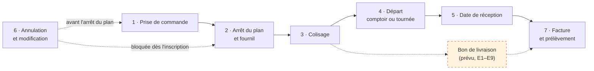
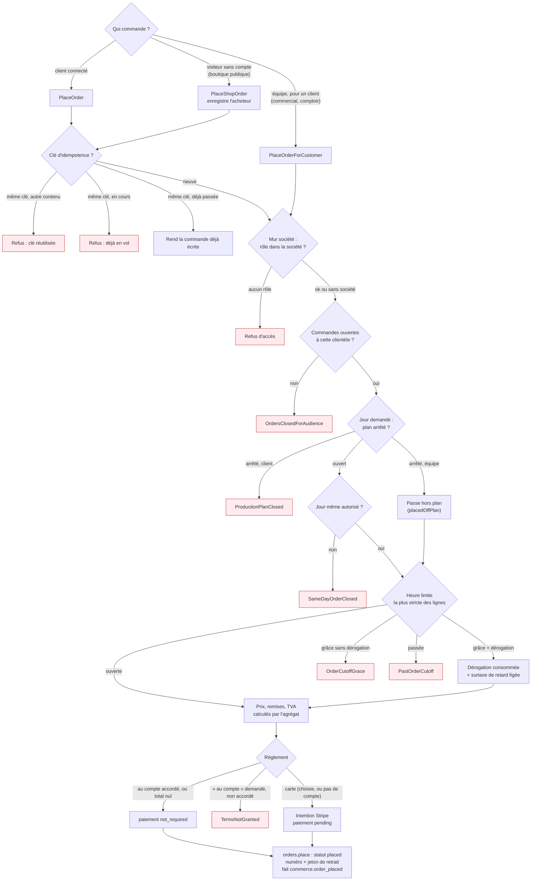
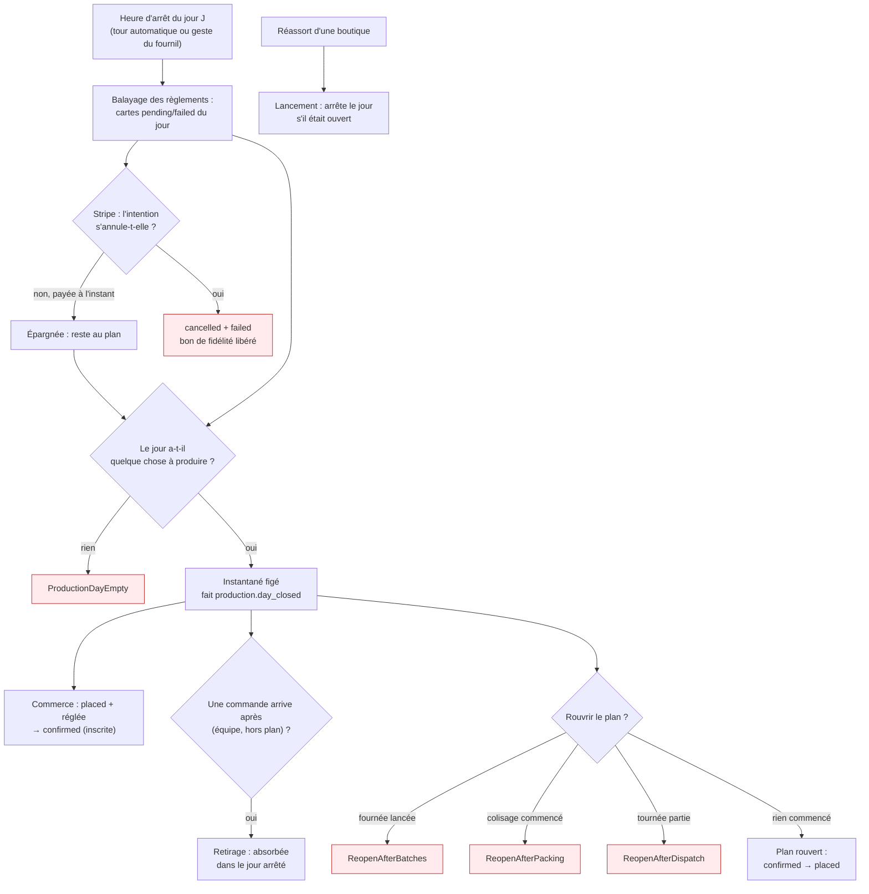
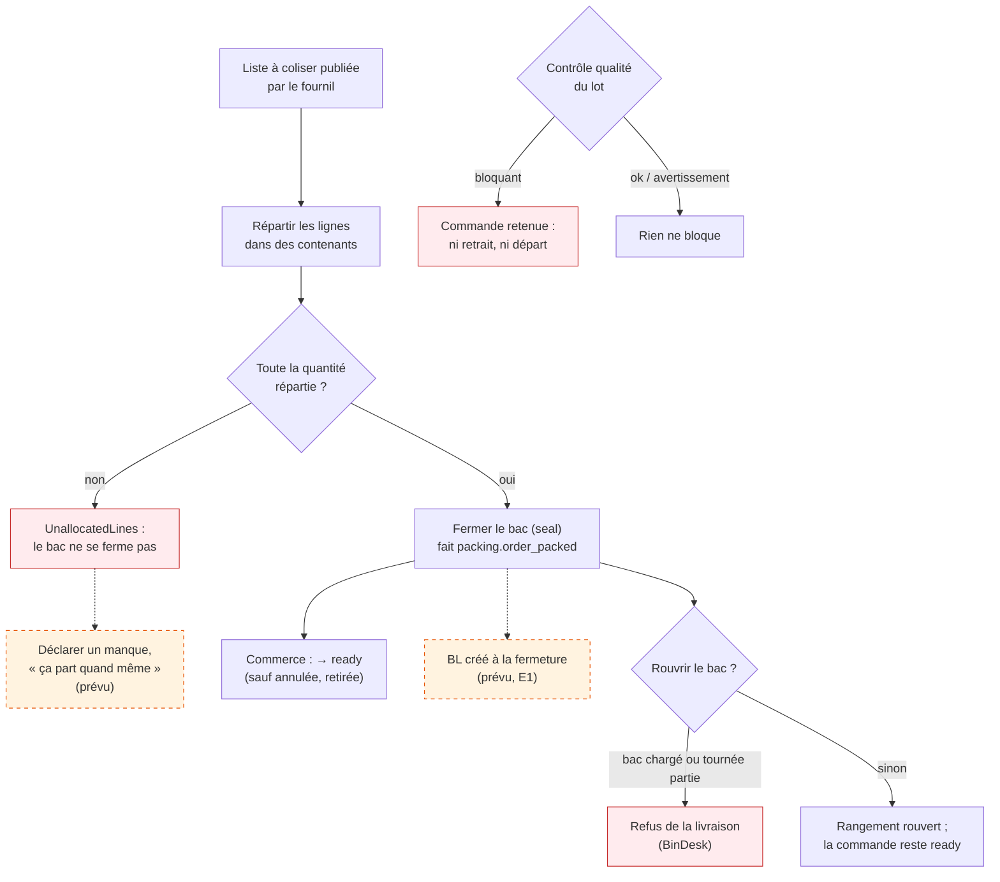
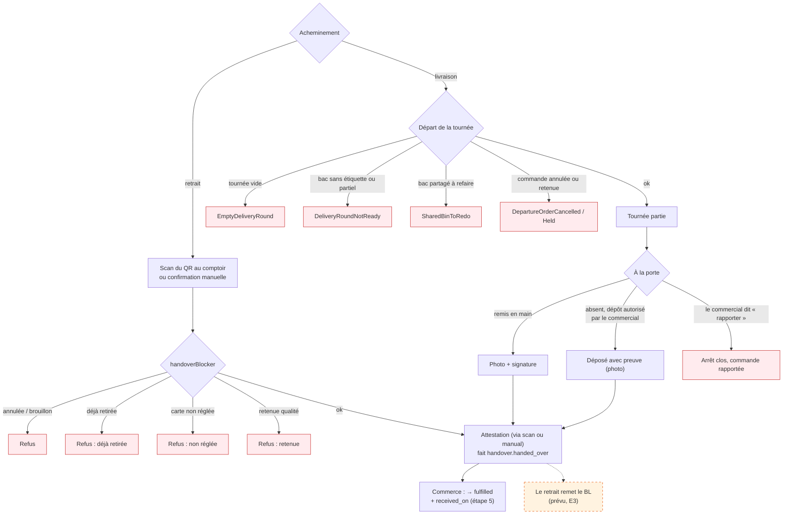
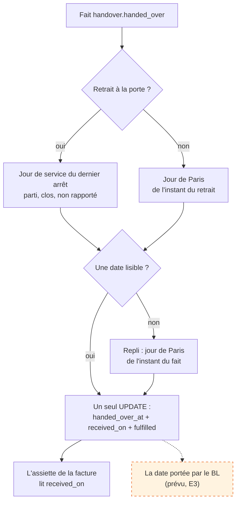
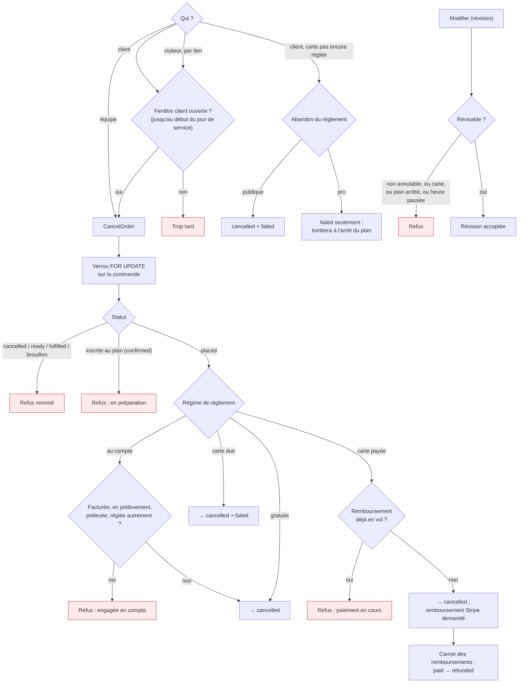
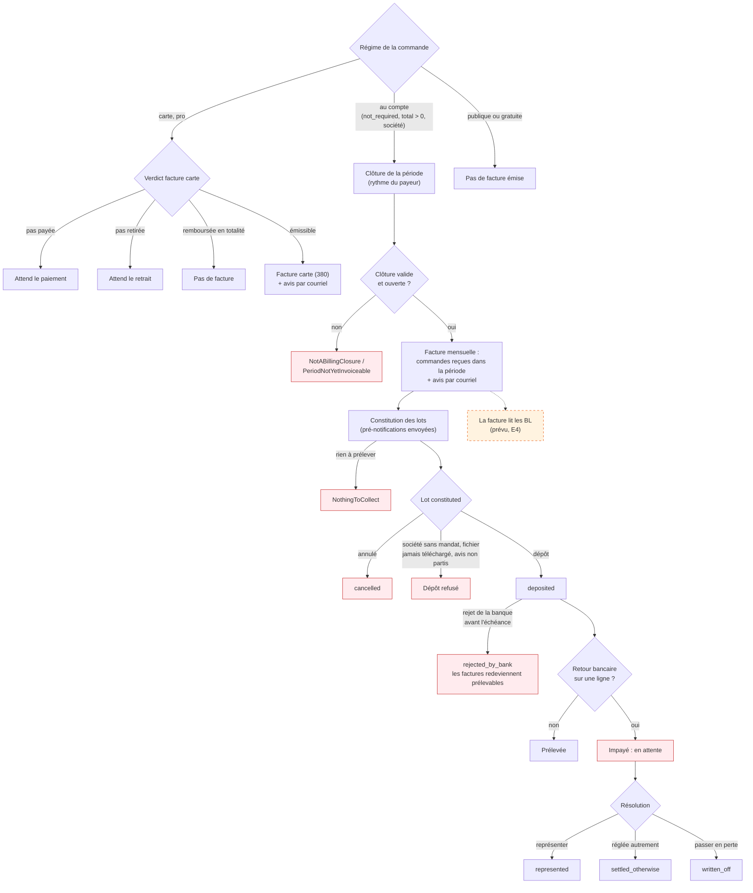
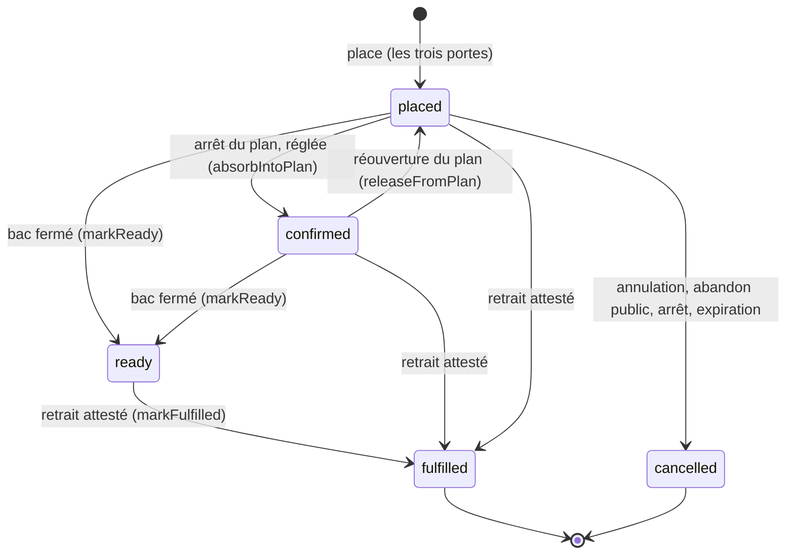
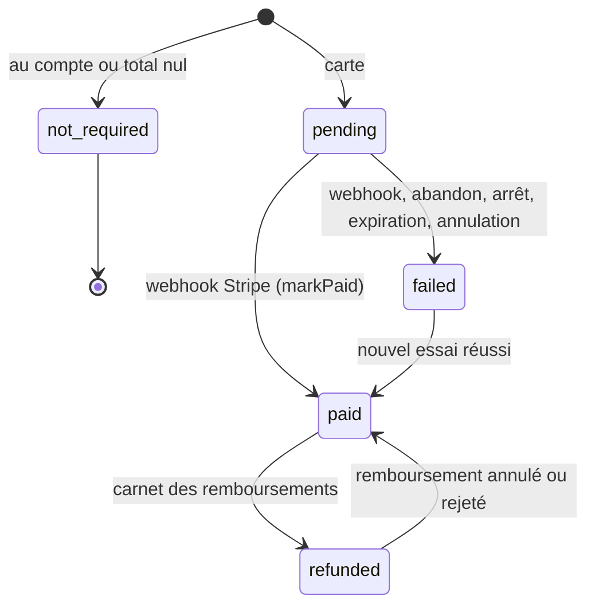

# Le parcours complet d'une commande, de la prise à la facturation

> **État réel, relu contre le code le 2026-10-24.** Chaque état, refus et
> décision dessiné ici a été ouvert dans `apps/lfd-api/src/` ce jour-là (chemins
> relatifs à `apps/lfd-api/` sauf mention). Ce qui n'est **pas bâti** est
> marqué **« prévu »**, en pointillé et en orange, avec le lien vers son plan :
> le bon de livraison ([`plan-commande-bon-de-livraison-facture.md`](plan-commande-bon-de-livraison-facture.md),
> lots E1–E9) et le départ incomplet ([`modification/commandes-incompletes.md`](modification/commandes-incompletes.md)).
> Ce document ne décrit pas : il montre, puis renvoie au document d'état de
> chaque étape.

Légende commune : losange = décision ; boîte rouge = refus ou sortie triste ;
boîte orange en pointillé = **prévu, pas bâti**.

## 0. Vue d'ensemble — les sept étapes

| Étape | Qui agit                      | Ce qui en sort                                                   |
| ----- | ----------------------------- | ---------------------------------------------------------------- |
| 1     | client, équipe, visiteur      | une commande `placed`, un règlement `not_required` ou `pending`  |
| 2     | le fournil (ou l'arrêt auto)  | les commandes réglées deviennent `confirmed`, les autres tombent |
| 3     | le coliseur                   | la commande devient `ready` à la fermeture du bac                |
| 4     | le comptoir, le livreur       | l'attestation de retrait, la commande devient `fulfilled`        |
| 5     | personne : une règle          | `received_on`, écrit dans la même instruction que le retrait     |
| 6     | client, équipe                | `cancelled`, et un remboursement si la carte avait payé          |
| 7     | l'automate ou la comptabilité | facture (mensuelle au compte, ou carte), lot de prélèvement      |

## 1. La prise de commande

Documents d'état : [`passation/architecture-flux-commande-zero-friction.md`](passation/architecture-flux-commande-zero-friction.md),
[`passation/architecture-commande-saisie-par-l-equipe.md`](passation/architecture-commande-saisie-par-l-equipe.md),
[`passation/architecture-commande-sans-compte.md`](passation/architecture-commande-sans-compte.md),
[`../comptoir/architecture-commande-au-comptoir.md`](../comptoir/architecture-commande-au-comptoir.md),
[`passation/architecture-idempotence-de-passation.md`](passation/architecture-idempotence-de-passation.md),
[`../limites-de-commande/README.md`](../limites-de-commande/README.md).

| Décision                | Qui décide                                                | Ce qui se passe                                                                                                    |
| ----------------------- | --------------------------------------------------------- | ------------------------------------------------------------------------------------------------------------------ |
| Idempotence             | `place-order.handler.ts`, `place-shop-order.handler.ts`   | clé + empreinte du contenu : rejeu rendu, clé détournée ou en vol refusée                                          |
| Mur société             | `OrderGuardReader.roleOf` (rôle relu en base)             | sans rôle dans la société, la commande ne part pas                                                                 |
| Ouverture par clientèle | `order-intake.service.ts`                                 | réglage d'ouverture de la boutique, par audience                                                                   |
| Plan arrêté             | `order-drafting.service.ts` (`ensureDayOpen`, `holdPlan`) | client refusé ; équipe acceptée, la commande est marquée hors plan                                                 |
| Jour même               | `order-plan-gate.service.ts`                              | réglage « commande le jour même » ; sinon refus                                                                    |
| Heure limite            | `order-cutoff-guard.ts` (la plus stricte des lignes)      | ouverte : passe ; grâce : seulement avec une dérogation, qui ajoute la surtaxe de retard ; passée : refus          |
| Carte ou au compte      | `order-settlement.ts`                                     | au compte accordé ou total nul → `not_required` ; sinon carte → `pending` ; « au compte » forcé sans droit → refus |

## 2. L'arrêt du plan et le fournil

Documents d'état : [`../production/arret-du-plan.md`](../production/arret-du-plan.md),
[`../production/architecture-contexte-production.md`](../production/architecture-contexte-production.md),
[`reglement/architecture-reglement-et-compte-de-production.md`](reglement/architecture-reglement-et-compte-de-production.md),
[`../reassort-boutiques/plan-reapprovisionnement.md`](../reassort-boutiques/plan-reapprovisionnement.md).

| Décision             | Qui décide                                                  | Ce qui se passe                                                                           |
| -------------------- | ----------------------------------------------------------- | ----------------------------------------------------------------------------------------- |
| Une carte non réglée | `pending-settlement-sweep.service.ts`                       | annulée à l'arrêt, sauf si Stripe refuse d'annuler (elle vient d'être payée)              |
| Qui entre au plan    | `production-plan.ts` (`absorbedByPlan`) et `plan-filter.ts` | statut `placed` et règlement ni `pending`, ni `failed`, ni `refunded`                     |
| Le jour vide         | `ProductionDay.close`                                       | refusé s'il n'y a ni commande, ni réassort                                                |
| Retirage             | `ProductionDay.retake`                                      | une arrivée après l'arrêt est absorbée ; rien de neuf, rien d'écrit                       |
| Réouverture          | `production-day.reopening.ts`                               | seulement si rien n'est cuit, colisé ou parti ; le commerce rend les commandes à `placed` |
| Réassort             | `ProductionDay.launchResupply`                              | un réassort lancé arrête le jour s'il était ouvert                                        |

## 3. Le colisage

Documents d'état : [`../colisage/colisage.md`](../colisage/colisage.md),
[`../colisage/parcours-du-coliseur.md`](../colisage/parcours-du-coliseur.md),
[`../colisage/chargement-les-bacs.md`](../colisage/chargement-les-bacs.md),
[`../production/plan-controle-qualite.md`](../production/plan-controle-qualite.md).

| Décision         | Qui décide                                                                                           | Ce qui se passe                                                                  |
| ---------------- | ---------------------------------------------------------------------------------------------------- | -------------------------------------------------------------------------------- |
| Fermer le bac    | `PackingSheet.seal`                                                                                  | refusé tant qu'une ligne n'est pas entièrement répartie — **pas de manque bâti** |
| Passer `ready`   | `mark-order-ready.handler.ts`, `markReady` (statut en `where`)                                       | refusé pour une commande annulée, brouillon ou déjà retirée                      |
| Rouvrir le bac   | `PackingSheet.reopen` + `BinDesk` de la livraison                                                    | refusé si le bac est chargé ou parti ; la commande reste `ready`                 |
| Retenue qualité  | `QualityCheck` (verdict `blocking`)                                                                  | la commande ne peut ni être retirée, ni partir en tournée                        |
| Départ incomplet | **prévu** — [`modification/commandes-incompletes.md`](modification/commandes-incompletes.md), lot E6 | rien n'existe : aujourd'hui une commande incomplète ne ferme pas son bac         |

## 4. Le départ : comptoir ou tournée

Documents d'état : [`la-commande/vie-du-qr-d-une-commande.md`](la-commande/vie-du-qr-d-une-commande.md),
[`../production/architecture-contexte-retrait.md`](../production/architecture-contexte-retrait.md),
[`../livraisons/tournees/composition-automatique.md`](../livraisons/tournees/composition-automatique.md),
[`../livraisons/livreur/a-la-porte.md`](../livraisons/livreur/a-la-porte.md),
[`../livraisons/livreur/parcours-du-livreur.md`](../livraisons/livreur/parcours-du-livreur.md),
[`../supervision/architecture-supervision-du-jour.md`](../supervision/architecture-supervision-du-jour.md).

| Décision             | Qui décide                                         | Ce qui se passe                                                                  |
| -------------------- | -------------------------------------------------- | -------------------------------------------------------------------------------- |
| Retrait au comptoir  | `OrderHandover.attest` → `handoverBlocker`         | refus si annulée, déjà retirée, carte non réglée ou retenue qualité              |
| Départ de la tournée | `DeliveryRound.depart`, feuille de départ          | refus si vide, bac incomplet, bac partagé à refaire, commande annulée ou retenue |
| Dépôt à la porte     | `StopDecision.authorizeDeposit` (le commercial)    | le livreur peut alors « déposer avec preuve » ; la dernière réponse l'emporte    |
| Rapporter            | `StopDecision.bringBack`                           | l'arrêt se clôt sans retrait ; la commande n'est pas `fulfilled`                 |
| Clore sans retrait   | `close-stop-without-handover.handler.ts`           | permis seulement si la commande n'est plus « à remettre » (annulée, etc.)        |
| Passer `fulfilled`   | `mark-order-fulfilled.handler.ts`, `markFulfilled` | une seule fois (`handed_over_at` nul), jamais sur une annulée                    |

## 5. La date de réception

Document d'état : [`la-commande/date-de-reception.md`](la-commande/date-de-reception.md).

| Décision       | Qui décide                                   | Ce qui se passe                                                      |
| -------------- | -------------------------------------------- | -------------------------------------------------------------------- |
| Quel jour      | `receivedOnOrDayOf` (`monthly-invoicing.ts`) | porte → jour de l'arrêt ; sinon jour de Paris ; repli : jour du fait |
| Inséparabilité | contraintes `CHECK` de `orders`              | la base refuse un retrait sans date, ou une date sans retrait        |

## 6. Annulation et modification

Documents d'état : [`annulation/annulation-par-le-staff.md`](annulation/annulation-par-le-staff.md),
[`annulation/annulation-par-le-client.md`](annulation/annulation-par-le-client.md),
[`annulation/verrous-de-l-annulation.md`](annulation/verrous-de-l-annulation.md),
[`reglement/architecture-abandon-du-reglement.md`](reglement/architecture-abandon-du-reglement.md),
[`modification/plan-modifier-une-commande.md`](modification/plan-modifier-une-commande.md).

| Décision                  | Qui décide                                              | Ce qui se passe                                                                          |
| ------------------------- | ------------------------------------------------------- | ---------------------------------------------------------------------------------------- |
| Annulable ?               | `order-cancellation.ts` (`cancellationOf`)              | seulement `placed` et non inscrite ; au compte, seulement si rien n'est engagé en compta |
| Jusqu'à quand (client)    | `customer-cancellation-window.ts`                       | ancrée sur le début du jour de service (ou du créneau) ; après, « trop tard »            |
| Écriture                  | `prisma-order-cancellation.repository.ts`               | quatre `updateMany` exclusifs par régime, tous conditionnés par `status: placed`         |
| Remboursement             | carnet `OrderRefundLedger`, balayage des remboursements | règlement inchangé à l'annulation ; `refunded` quand Stripe a rendu                      |
| Paiement après annulation | `refund-paid-after-cancellation.handler.ts`             | `markPaid` refuse une annulée ; l'argent arrivé est rendu                                |
| Abandon                   | `order-abandon.ts`, `markAbandoned`                     | publique : annulée ; pro : règlement `failed`, la commande attend l'arrêt                |
| Expiration boutique       | `unsettled-shop-order-expiry.ts` (30 min)               | une commande boutique non réglée expire : `cancelled` + `failed`                         |
| Modifier                  | `order-revisability.ts`                                 | refusé si non annulable, réglée par carte, plan arrêté ou heure limite passée            |

## 7. Facture et prélèvement

Documents d'état : [`../comptabilite/facturation/README.md`](../comptabilite/facturation/README.md),
[`../comptabilite/facturation/facture-emise.md`](../comptabilite/facturation/facture-emise.md),
[`../comptabilite/facturation/facture-carte-et-remboursements.md`](../comptabilite/facturation/facture-carte-et-remboursements.md),
[`../comptabilite/facturation/le-prelevement-suit-la-facture.md`](../comptabilite/facturation/le-prelevement-suit-la-facture.md),
[`../comptabilite/prelevement/procedure-de-prelevement.md`](../comptabilite/prelevement/procedure-de-prelevement.md),
[`../comptabilite/prelevement/lot-de-prelevement-fige.md`](../comptabilite/prelevement/lot-de-prelevement-fige.md),
[`../comptabilite/prelevement/retours-bancaires.md`](../comptabilite/prelevement/retours-bancaires.md),
[`../comptabilite/prelevement/plan-lot-rejete-par-la-banque.md`](../comptabilite/prelevement/plan-lot-rejete-par-la-banque.md).

| Décision                   | Qui décide                                                    | Ce qui se passe                                                                                            |
| -------------------------- | ------------------------------------------------------------- | ---------------------------------------------------------------------------------------------------------- |
| Facturable au compte       | `billable-order-criterion.ts`                                 | `not_required`, total > 0, non annulée, avec société, `received_on` dans la période                        |
| Facture mensuelle          | `issue-monthly-invoices.handler.ts` (et son automate)         | refusée hors clôture ou avant son ouverture ; avis envoyé au payeur                                        |
| Facture carte              | `card-invoicing.ts`, déclenchée au paiement **et** au retrait | émise au second des deux ; jamais pour un particulier, ni remboursée en totalité                           |
| Relevé (arrêté)            | `BillingStatement`, à la constitution                         | les payeurs hors régime « facture » sont prélevés sur un arrêté figé                                       |
| Constitution d'un lot      | `constitute-collection-batches.handler.ts`                    | refusée s'il n'y a rien ; pré-notifications mises en file                                                  |
| Dépôt                      | `CollectionBatch.markDeposited`                               | refusé si un payeur n'a pas de mandat, si le fichier n'a jamais été téléchargé, si un avis n'est pas parti |
| Rejet du lot par la banque | `CollectionBatch.rejectByBank`                                | seulement un lot déposé, avant l'échéance, sans aucun retour                                               |
| Retour (impayé)            | `CollectionReturn`                                            | sur un lot déposé, montant exact ; puis représenter, régler autrement ou passer en perte                   |

## 8. Les statuts réels

`OrderStatus` et `PaymentStatus` (`prisma/schema/public/orders.prisma`), avec
leur seul écrivain. Deux valeurs de `OrderStatus` existent dans l'énuméré
**sans aucun écrivain** dans le code au 2026-10-24 : `draft` (les brouillons
vivent dans `order_drafts`) et `in_production`. Elles ne sont que lues.

| Transition                           | Écrivain (`src/b2b/orders/infrastructure/`)                                                                             |
| ------------------------------------ | ----------------------------------------------------------------------------------------------------------------------- |
| → `placed`                           | `prisma-order.repository.ts` `place`                                                                                    |
| `placed` → `confirmed`               | `absorbIntoPlan`, sur le fait `production.day_closed`                                                                   |
| `confirmed` → `placed`               | `prisma-order-plan-release.ts`, sur le fait de réouverture                                                              |
| → `ready`                            | `markReady`, sur le fait `packing.order_packed`                                                                         |
| → `fulfilled`                        | `markFulfilled`, sur le fait `handover.handed_over`                                                                     |
| → `cancelled`                        | `prisma-order-cancellation.repository.ts`, `markAbandoned`, `failAtClosing`, `prisma-unsettled-shop-order.canceller.ts` |
| `pending`/`failed` → `paid`/`failed` | `markPaid`, `markPaymentFailed` (refusés sur une annulée)                                                               |
| `paid` ↔ `refunded`                  | `prisma-order-refund.repository.ts` `save`                                                                              |

## 9. Ce qui est prévu, et seulement prévu

| Sujet                                      | Plan                                                                                     |
| ------------------------------------------ | ---------------------------------------------------------------------------------------- |
| Le bon de livraison, créé au bac (E1)      | [`plan-e1-bon-de-livraison-prevu.md`](plan-e1-bon-de-livraison-prevu.md)                 |
| BL partiel, reliquat, solde (E2–E9)        | [`plan-commande-bon-de-livraison-facture.md`](plan-commande-bon-de-livraison-facture.md) |
| Déclarer un manque, « ça part quand même » | [`modification/commandes-incompletes.md`](modification/commandes-incompletes.md)         |
