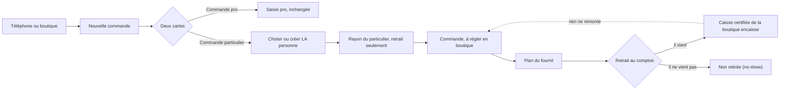

# La commande d'un particulier, notée au comptoir, réglée à la caisse de la boutique

> **Doc d'état, 2026-11-20.** Bâti et poussé sur `dev` le 2026-11-20. Les
> décisions de Hugo sont datées ; ce qui reste à faire est au § 7.

## Partie 1 — en simple

Un particulier appelle, ou passe en boutique : « deux baguettes et une tarte
pour samedi, je paierai en venant ». L'équipe note la commande au comptoir ;
elle part au plan du fournil comme les autres ; samedi, le client la retire et
**paie sur la caisse de la boutique** — la caisse certifiée, celle des clients
de passage. Notre système, lui, **ne sait jamais qu'il a payé**.

Quatre choses ne se mélangent **jamais** (Hugo, 2026-11-20) :

| Ne pas mélanger                        | Ce qui le tient                                                                     |
| -------------------------------------- | ----------------------------------------------------------------------------------- |
| deux particuliers entre eux            | l'équipe **choisit** la personne à l'écran ; aucun rattachement automatique         |
| la saisie particulier et la saisie pro | deux cartes, deux écrans, deux routes d'API                                         |
| les prix des deux clientèles           | la saisie lit le rayon d'un particulier connecté : TTC public, promotions publiques |
| les règlements                         | un lieu de règlement à lui, figé en base ; jamais « payé » chez nous                |

## Partie 2 — technique

### 1. Pourquoi c'est possible sans caisse certifiée chez nous

[`pas-de-logiciel-de-caisse.md`](../../comptabilite/caisse/pas-de-logiciel-de-caisse.md)
§ 4 : un seul paiement enregistré hors carte en ligne fait tomber la tolérance
du BOFiP. **La commande est notée, le paiement ne l'est jamais** (Hugo,
2026-11-20). Tout est structurel :

- aucun champ, aucune route, aucun bouton ne dit « encaissé », un montant reçu
  ou un moyen de paiement pour ces commandes ;
- `paid_at` et `stripe_payment_intent_id` restent `NULL`, et la base le tient
  (§ 4.3) ;
- le retrait remet sans rien demander sur l'argent ; il affiche seulement le
  montant à encaisser sur l'autre caisse.

La question au cabinet est au § 5 (point 4) de la doc caisse. Hugo la pose
lui-même ; l'écran est ouvert d'ici là (décidé par Hugo le 2026-11-20).

### 2. L'entrée : « Nouvelle commande », deux cartes

L'onglet du comptoir **« Nouvelle commande »** ouvre deux cartes
(`comptoir/order-kind-choice-page/`) : **Commande pro** (`nouvelle-commande/pro`,
la saisie d'un compte, qui continue sous `nouvelle-commande/:id`) et
**Commande particulier** (`nouvelle-commande/particulier`). Toutes sous
`COUNTER_ORDER_GUARDS` (Hugo, 2026-11-20 : mêmes droits que la saisie pro).

La saisie particulier (`comptoir/particular-order-page/`) :

- **la personne** (`particular-picker/`) — § 3 ;
- **les articles** : le rayon du particulier (`particular-shelf.ts`), à son TTC,
  promotion publique barrée ; sans rayon, la page ne s'ouvre pas. Le catalogue
  admin (`/admin/catalog/sellable`) n'y sert qu'à décrire les rangées (famille,
  unité, pas) ;
- **le panier** (`particular-cart/`) : point de retrait (par défaut celui du
  comptoir), jour, créneau public, note ; devis par `/estimate` ; la mention
  « À régler à la caisse de la boutique, au retrait » ; aucun champ de
  règlement ;
- **la confirmation** : numéro, total TTC, lien vers la fiche.

L'onglet « Modèles de réassort » n'est plus dans la barre du comptoir : la page
Réassort y mène, sous `resupply_templates:read` (demande de Hugo, 2026-11-20).

### 3. La personne — ne jamais mélanger deux particuliers

Le registre des invités de la boutique (`PrismaGuestBuyerRegistrar`) retrouve
un invité par son e-mail sans le dire. Au comptoir ce serait la faute : une
adresse mal entendue au téléphone rattacherait la commande à quelqu'un
d'autre. Cette surface ne l'emploie donc pas.

- **Chercher, puis choisir** : `GET /admin/counter/particulars?q=` (2
  caractères minimum, 10 fiches), par téléphone (`+33` et `0` rapprochés),
  prénom ou e-mail. Est particulier toute fiche non désactivée sans aucune
  adhésion à une société, en attente comprise — comptes connectables et
  invités. La carte montre prénom, nom s'il y en a, e-mail et téléphone en
  partie masqués, « compte » ou « invité », et le nombre de commandes non
  retirées. L'équipe **clique**, même sur un résultat unique.
- **Ou créer** : `POST /admin/counter/particulars` (clé d'intention), avec
  **e-mail, prénom, téléphone, tous obligatoires** (Hugo, 2026-11-20). La
  création refuse (409 `account.counter_particular.contact_taken`) un e-mail
  ou un téléphone normalisé déjà pris par un particulier, en nommant le prénom
  de la fiche. L'enveloppe d'erreur ne publie aucun identifiant : **l'écran
  relance la recherche** avec le contact saisi, et la fiche apparaît à
  choisir. `email` et `phone` n'ont aucune unicité en base : deux comptoirs
  qui créent la même personne à la même seconde font deux fiches, et le
  doublon se voit à la recherche suivante.
- **Le propriétaire est `account`** (il possède `users`) : il déclare et
  implémente `ParticularFinder`, `ParticularRegistry` et
  `ParticularStandingReader`, que `orders` appelle. La création n'écrit aucun
  fait au journal : `user.registered` crédite le bonus de bienvenue et
  rattache aux prospects ; l'auteur et l'instant sont sur la fiche
  (`invited_by`, `created_at`).
- Un compte connectable choisi n'ouvre aucun accès à l'équipe : elle commande
  **pour** lui ([`commande-passee-par-l-equipe.md`](commande-passee-par-l-equipe.md) § 1).

### 4. Le règlement — ne pas mélanger

#### 4.1 Le modèle : `not_required` et un lieu de règlement

`PaymentStatus` dit où en est l'argent **chez nous** ; « à la caisse de la
boutique » dit **où** il sera encaissé. Une commande à régler en boutique a
donc `payment_status = 'not_required'` (rien n'est attendu chez nous) et
`settlement_venue = 'shop_till'` (enum `SettlementVenue`, `NULL` pour toute
autre commande). Une valeur de plus dans `PaymentStatus` aurait cassé en
silence une vingtaine de lecteurs (`vitruve`, 2026-11-20) : retrait refusé
(`isSettled`), commande dite « payée » (`settlementRegimeOf`), accusé non
envoyé, contrat `paymentStatusSchema` fermé.

Ce qui fait juste sans rien lire de plus : le retrait (`isSettled`), l'accusé
de commande (`settlementDecidedAtPlacement`), le prélèvement
(`billable-order-criterion.ts` exige une société), la facture carte
(`card-invoicing.ts` exclut le public), le remboursement (il vise `paid`).

#### 4.2 Ce qui lit le lieu

- **Le régime** : `settlementRegimeOf(paymentStatus, totalCents, venue)` rend
  `shop_till` ; la fiche et la liste staff (`settlementStatusLabel`,
  `@lfd/b2b-ui`), l'espace client (`payShopTill`) et l'accusé
  (`totalLabel.shopTill`) disent « À régler en boutique ».
- **Le retrait** : `OrderHandoverView.settleAtShopTill = { totalCents }`, seul
  montant qui traverse `HandoverSubject` ; le comptoir affiche « encaisser sur
  la caisse de la boutique — X € TTC ». Une information, aucun geste.
- **L'annulation** lit `shop_till` comme un total nul (`free`) : rien
  d'encaissé, rien à facturer. L'e-mail dit « Rien ne vous sera facturé ».
- **La révision** : l'équipe garde la révision des quantités après l'arrêt du
  plan, comme pour une commande au compte ; une révision vers une livraison
  est refusée (`orders.revision.shop_till_delivery`), par le service puis par
  l'agrégat.
- **Le chiffre d'affaires web ne la compte pas** (Hugo, 2026-11-20) :
  `REVENUE_SETTLEMENT_VENUE = null` (`revenue-scope.ts`), écrit « le lieu est
  nul » et non « ≠ `shop_till` » à cause du `NULL`, traduit une fois par
  `revenueWhere` et `madeToOrderLinesFrom`. La comptent : la production, les
  habitudes, les co-achats et les audiences — c'est ce que la personne achète.
- **Le rapport à part** (Hugo, 2026-11-20) : `GET /admin/growth/shop-till-orders?from=&to=`
  sous `b2b_growth`, écran Analytics › À régler en boutique
  (`analytics/a-regler-en-boutique/`). Par **jour de retrait** et par point :
  TTC commandé, remis (`fulfilled`) et non retiré, avec leurs nombres, sur 366
  jours au plus. « Commandé », « remis » — jamais « encaissé », et aucun total
  ne l'additionne au CA web.
- **La fidélité** : aucun point (`COMPLETED_WHERE` exige `settlementVenue: null`) —
  on ne sait pas que la commande est payée.

#### 4.3 Ce que la base tient

- `20261120130000_le_lieu_de_reglement` : le type et la colonne, nullable.
- `20261120130100_la_forme_du_reglement_en_boutique` :
  - `CHECK orders_shop_till_shape` : `settlement_venue IS NULL OR (payment_status
= 'not_required' AND clientele IS NOT NULL AND clientele = 'public' AND
entry_origin IS NOT NULL AND entry_origin = 'counter' AND company_id IS
NULL AND paid_at IS NULL AND stripe_payment_intent_id IS NULL)` — les
    `IS NOT NULL` ferment le trou du `NULL` (`clientele` et `entry_origin`
    sont nullables) ;
  - le déclencheur `orders_settlement_venue_frozen` refuse toute modification
    du lieu après la passation, et qu'une ligne `shop_till` quitte
    `not_required`. L'agrégat ne suffirait pas : des écritures nues posent
    `failed` à l'annulation d'une commande non réglée. Annuler reste permis :
    le statut de la commande change, pas celui du règlement.
- Seul `Order.settleAtShopTill()` pose le lieu, à la passation.
- Retours arrière dans `apps/lfd-api/prisma/rollback/`.

#### 4.4 Ce qui ne bouge pas

`StaffSettlement` (contrat `admin-order.ts`) ne connaît que `account` et
`link` : la surface particulier a son propre contrat, sans champ de règlement.
Le lieu y est implicite, donc inexprimable autrement.

### 5. Prix et règles — ne pas mélanger

La commande est calculée **comme si le particulier la passait dans son
espace** pour le **prix** et les **promotions** : même composition que toutes
les passations, sans société, audience publique résolue par le serveur. Les
articles proposés viennent de `GET /admin/counter/particular-orders/shelf-prices`,
qui rend `RecognisedShelf.read(null)` — le rayon, la clé et le cache d'un
particulier connecté (`/shop/catalogue/mine`), sans recalcul. Ni article
réservé à une société, ni promotion des pros ne l'atteignent (e2e
`counter-particular-shelf-prices`).

- `POST /admin/counter/particular-orders/estimate` (le devis) et
  `POST /admin/counter/particular-orders` (clé d'intention, rejouable), sous
  `b2b_place_order:write`, surface du comptoir. La préparation est partagée
  (`counter-particular-order-preparation.ts`) : le devis n'annonce pas un total
  que la validation refuse.
- `clientele = public`, `entryOrigin = counter`, `buyerKind = registered` —
  même pour une fiche invitée (`orders_buyer_kind_guest_shape` interdit `guest`
  avec un auteur de l'équipe) : une promotion « invités seulement » ne
  l'atteint pas.
- **Retrait seulement** (`orders.shop_till.not_pickup`), au point choisi ; par
  défaut celui du comptoir (Hugo, 2026-11-20). Un membre de société est refusé
  comme acheteur (409).
- Les **gestes du comptoir** sont ceux de la saisie pro : créneau jugé côté
  équipe, jour même par la porte du comptoir, plan arrêté → hors plan. Aucune
  dérogation d'heure limite : elles sont tenues par société. L'exception d'un
  particulier passe par le « hors plan ».
- Aucun bon de fidélité dépensé, aucun point crédité.
- Le rayon de la boutique ne dépend ni du point ni du jour : celui de la
  saisie non plus. Le jour et le point sont jugés par le devis.

### 5 bis. Le client ne vient pas : un no-show

Une commande produite et jamais retirée n'est ni annulée (personne ne l'a
décidé) ni refusée (rien n'a été payé) : c'est un **no-show**, état terminal à
lui (Hugo, 2026-11-20).

- **La base** : `OrderStatus.no_show`, seul dans son dossier
  (`20261120160000_la_commande_non_retiree` — Postgres refuse d'utiliser une
  valeur d'enum dans la transaction qui l'ajoute), puis
  `20261120160100_la_trace_de_la_commande_non_retiree` : quatre colonnes
  (`no_show_at`/`_by_staff_id`, `no_show_notice_requested_at`/`_by_staff_id`)
  et trois `CHECK` — `no_show` seulement sur `shop_till`, déclaration posée si
  et seulement si `no_show`, demande d'e-mail seulement sur une `no_show`.
- **« Le client n'est pas venu »** : `POST /admin/counter/particular-orders/:id/no-show`
  (clé d'intention, `b2b_place_order:write`), sur la fiche commande
  (`commandes/order-no-show/`) et au rail du retrait
  (`handover-shop/handover-no-show/`). L'agrégat `OrderNoShow` refuse hors
  `shop_till`, une commande annulée, retirée (même en partie), déjà déclarée,
  ou **avant la fin du créneau** — sans créneau, 23:59 le jour du retrait.
  Pas d'automate : un client en retard d'un jour vient encore chercher son
  pain.
- **Effets** : sortie de la file du comptoir, retrait refusé, rangée avec les
  annulées en Supervision, BL annulé, ni annulable ni modifiable. Fait durable
  `order.no_show` au journal. Libellé « Non retirée ». Ligne « non retirées »
  du rapport à part. La fiche du particulier compte ses no-shows
  (`ParticularNoShowCountsReader`, déclaré et implémenté par `orders`, composé
  par la recherche d'`account`, relié par `appBootstrap/particular-no-show-counts.module.ts`) ;
  aucune règle ne le bloque.
- **L'e-mail se décide par un superviseur** (Hugo, 2026-11-20) : le no-show
  n'en envoie aucun. « Prévenir le client » (`POST …/:id/no-show-notice`,
  `b2b_supervision:write`, sur la fiche commande) envoie
  `customer.order-not-collected` (fr, en, it ; sans montant ni moyen de
  paiement) par `mail.send`, une fois par commande. La fiche dit qui a
  déclaré, qui a **demandé** l'e-mail, et quand — « demandé », jamais
  « envoyé ».

### 6. Les tests qui le tiennent

| Suite e2e                          | Ce qu'elle prouve                                                                    |
| ---------------------------------- | ------------------------------------------------------------------------------------ |
| `order-shop-till-shape`            | la base refuse une forme fausse, la modification du lieu, le passage à `failed`      |
| `counter-particulars`              | deux Jean distingués, contact pris refusé sous une autre graphie, un pro exclu       |
| `counter-particular-order`         | passation, devis, livraison refusée, membre de société refusé, rejeu de la même clé  |
| `counter-particular-order-readers` | régime affiché, montant au retrait, hors CA web, rapport, pas de points, révision    |
| `counter-particular-shelf-prices`  | parité SKU par SKU avec la boutique, article et promotion des pros absents           |
| `counter-particular-no-show`       | trop tôt refusé, déclaré après le créneau, sorti du retrait, e-mail sous supervision |

### 7. Ce qui reste

- **Le bon PDF** ne dit ni « À régler en boutique » ni « Non retirée » : la
  feuille transporte déjà le régime, le rendu (`order-sheet*.ts`) reste à faire.
- **Les commandes passées et les habitudes** d'un particulier ne sont pas
  proposées dans sa saisie : aucune lecture admin n'existe pour une fiche
  sans société.
- **La date de dernière commande** n'est pas sur la carte de recherche :
  `orders` doit la publier comme il publie le compte des no-shows.
- **Le cabinet** : la question du § 1, que Hugo pose lui-même.
