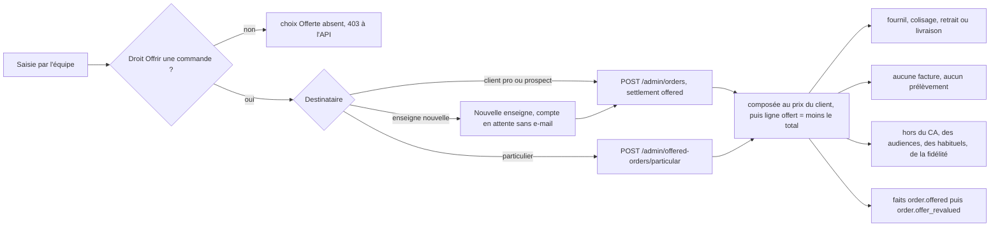

# La commande offerte — l'équipe offre une commande depuis le back-office

**État : ✅ implémenté.** Les questions comptables (§ 3) sont notées et ne
bloquent rien.

---

## Partie 1 — en simple

Quand l'équipe saisit une commande, elle choisit qui la règle : **au compte**
(facturée), **par lien** (le client paie par carte), ou **offerte**. Une
commande offerte sert pour une dégustation, un événement, un geste
commercial, un remplacement après une réclamation, un échantillon.

C'est **une vraie commande** : elle part au fournil, au colisage, en
livraison ou au comptoir comme les autres. Le client ne paie rien, aucune
facture n'est émise, rien n'est prélevé.

On garde **ce qu'elle valait** : la commande se compose d'abord comme si le
client la payait (ses prix, ses promotions, les frais de livraison), puis une
ligne « offert » retranche exactement ce total, taux de TVA par taux de TVA.
La comptabilité peut ainsi dire combien on a offert, à qui et pourquoi.

**À qui on peut l'offrir :**

- un **client pro existant**, même une société pas encore active (un
  prospect) — elle est alors servie au prix particulier ;
- une **enseigne nouvelle** : depuis « Nouvelle commande pro », le bouton
  « Nouvelle enseigne » crée le compte en attente et son détenteur (prénom,
  e-mail, téléphone) **sans lui écrire** ; on passe ensuite la commande
  offerte sur ce compte ;
- un **particulier** : dans la saisie du particulier, la case « Offrir cette
  commande », en retrait ou en livraison à une adresse dictée.

**Qui peut le faire :** seulement qui a le droit **« Offrir une commande »**
(`b2b_offer_order`), accordé à l'écran des rôles. Pouvoir saisir une commande
ne suffit pas ; sans ce droit, le choix « Offerte » n'apparaît pas.

**Le motif** est obligatoire : une nature (dégustation, événement, geste
commercial, remplacement après réclamation, échantillon) et un texte court.
Une case « Prévenir le client par e-mail », **décochée par défaut** : le
client n'a pas passé cette commande, et lui écrire « votre commande est
prête » serait faux.

**Dans le back-office :** la saisie montre « Valeur offerte » ; la fiche et la
liste disent « Offerte » avec le motif ; le bon de livraison porte « Commande
offerte — sans facturation » ; le journal note l'offre et chaque
réévaluation. Le motif n'est jamais montré au client.

---

## Partie 2 — technique

### 2.1 Le contrat

`packages/contracts/src/admin-order.ts` :

- `staffSettlementSchema = z.enum(["account", "link", "offered"])`, sans
  défaut ; libellé « Offerte ».
- `orderOfferSchema` : `nature` (registre `ORDER_OFFER_NATURES` : `tasting`,
  `event`, `goodwill`, `replacement`, `sample`), `note` (1 à
  `ORDER_OFFER_NOTE_MAX_LENGTH` = 280 caractères), `notifyCustomer`
  (`false` par défaut).
- La passation exige `offer` **si et seulement si** `settlement === "offered"`.
  L'estimation admet `offered` sans motif (l'écran estime dès le choix, et
  chiffre alors la valeur pleine) ; un motif sans `offered` reste refusé.

Le registre des natures est distinct de `FREE_CHARGE_NATURES`, qui qualifie
un encaissement sans commande : deux questions différentes.

Le contrat du particulier : `packages/contracts/src/offered-particular-order.ts`
(`offeredParticularOrderPayloadSchema`, motif toujours exigé ;
`offeredParticularOrderEstimatePayloadSchema`, motif facultatif).

### 2.2 La forme : un ajustement, pas une remise

L'offre n'est **pas** une remise de panier. Une remise ne touche que les
lignes couvertes (`chainBasketDiscounts`), les frais de livraison s'ajoutent
après, elle exige un `promotionId`, compte dans le plafond de remises et
allume `pickup_discount_eligible`. L'offre est posée **après** la composition
complète : une ligne égale à **moins** le montant de chaque taux, déjà
arrondi — le total retombe à 0 exactement, sans nouvel arrondi, frais
compris.

Domaine (`apps/lfd-api/src/lafoliecoffee/orders/domain/`) :

- `value-objects/order-offer.ts` — `OrderOfferReason` (`nature`, `note`,
  `notifyCustomer`), `OrderOfferedValue` (`totalCents` TTC, `htCents` =
  TTC − TVA, `vatCents`, `vatShares` par taux), `OrderOffer` = motif + valeur.
  Le HT n'est pas gardé par taux : le calcul des pros ne produit que la TVA
  par taux.
- `entities/order-offered-amounts.ts` — `offeredAmountsOf` (pose l'offre sur
  les montants composés), `offerAppliedTo`, `offerCarriedOn` (recompose à la
  révision).
- `errors/order-offer-errors.ts` — dont `OfferedOrderWithVoucherError` (bon de
  fidélité et offre refusés ensemble) et `OfferChangeOnRevisionError`.
- `services/settlement-regime.ts` — régime `offered` quand `offer_nature` est
  posée.

Après l'offre, la commande garde ses lignes et ses termes (sous-total,
remise, frais) ; TVA, parts par taux, total et TTC par taux valent zéro. Un
lecteur qui recalculerait un total depuis les lignes se tromperait : la
valeur offerte se lit sur les colonnes d'offre.

**La composition est celle du client, sans sélection**, promotions comprises
(elles consomment leur usage) — décidé par Hugo le 2026-11-23 : « on ne refait
pas le calcul de manière sélective ». Seul le bon de fidélité reste hors de la
saisie de l'équipe.

### 2.3 La persistance

Colonnes de `public.orders` (`apps/lfd-api/prisma/schema/public/orders.prisma`) :
`offer_nature`, `offer_note`, `offered_total_cents`, `offered_vat_cents`,
`offered_vat_shares` (`[{ rate, amountCents }]`), `offer_notifies_customer`.
Tout ou rien (CHECK `orders_offer_together`), nature du registre (CHECK
`orders_offer_nature_known`), total nul (CHECK `orders_offered_is_free`).
NULL pour toute commande payée. Le mapping : `orders/infrastructure/order-offer.columns.ts`.

Une commande offerte se distingue donc en SQL d'une commande tombée à 0 par
une promotion à 100 %.

### 2.4 Le droit

`b2b_offer_order` est une valeur de `StaffResource`
(`prisma/schema/public/staff.prisma`), inscrite dans
`packages/contracts/src/staff-access.ts` (« Offrir une commande », portée
`write`). La migration ne l'accorde à aucun rôle (`lint:no-role-grants-in-migrations`) :
il s'accorde à l'écran des rôles.

La garde est `ensureMayOffer` (`orders/application/services/order-offering.ts`),
appelée par les deux passations **avant** la clé d'intention : 403 sans le
droit. Les routes elles-mêmes exigent `b2b_place_order:write`.

### 2.5 Les routes

| Route                                                | Contrôleur (`orders/http/`)                     | Ce qu'elle fait                                                                                                                                        |
| ---------------------------------------------------- | ----------------------------------------------- | ------------------------------------------------------------------------------------------------------------------------------------------------------ |
| `POST /admin/orders` avec `settlement: "offered"`    | saisie habituelle                               | `PlaceOrderForCustomerHandler` : une société et un acheteur membre. Le refus d'`offered` ne lit ni le statut de la société ni son crédit.              |
| `POST /admin/orders/estimate`                        | `admin-order-estimates.controller.ts`           | avec motif : total nul et `offeredTotalCents` (calculé au serveur) ; sans : la valeur pleine.                                                          |
| `POST /admin/offered-orders/particular`              | `admin-offered-particular-orders.controller.ts` | `PlaceOfferedParticularOrderHandler`, une fois par intention (`@IntentKey`, `OncePerIntent`).                                                          |
| `POST /admin/offered-orders/particular/estimate`     | idem                                            | `EstimateOfferedParticularOrderHandler`, `@Idempotent`, n'écrit rien. Un refus de composition revient en `refusal`. Le droit d'offrir ne s'y juge pas. |
| `POST /admin/companies` avec `announceHolder: false` | `account/http/admin-companies.controller.ts`    | crée la société `pending` et ouvre son détenteur sans annonce (`holder: "attached"`, `mailSent: false`) ; il attend dans « Accès à remettre ».         |

`announceHolder` vaut `true` par défaut (`account/http/payloads.ts`). Ouvrir
sans annonce ne fait rien partir : l'identité Auth0 naît avec
`verify_email: false`, et aucun lien n'est émis sans `announce()`. La personne
est retrouvée par son e-mail le jour où on lui remet l'accès.

**Le particulier** passe par une route à part parce que `companyId` est typé
`string` tout au long de la saisie des pros. Le mur est `ensureParticular`
(`orders/application/services/particular-buyer-wall.ts`), partagé avec le
comptoir : un particulier non désactivé, sans adhésion à une société. La
composition (`offered-particular-order-preparation.ts`, par `OrderDrafting`)
est celle du public : clientèle `public`, prix `exact_ht`, CGV particuliers ;
retrait, ou livraison jugée par `deliveryRoute` (une livraison fermée aux
particuliers ou un code postal non desservi est refusé). La commande porte
l'origine `commercial`, `not_required`, et le délai d'annulation du
particulier. Pas de brouillon : il est rangé par société.

Les gestes communs aux deux passations vivent dans `order-offering.ts` :
`ensureMayOffer`, `offerPartyOf`, `publishOrderOffered`.

### 2.6 Les faits

`packages/contracts/src/journal-facts/order-offers.ts` :

- `order.offered` — à la passation : commande, qui a offert, nature, valeur
  TTC et TVA.
- `order.offer_revalued` — à chaque modification d'une commande offerte
  (`orders/revision/application/services/order-revision-recording.ts`) : le
  numéro de révision et la valeur après le geste.

Écrits dans la boîte d'envoi, dans la transaction de la commande. **Le texte
du motif n'est jamais recopié au journal** : il peut nommer une personne, il
reste sur la commande. Une commande offerte annulée se lit par
`order.cancelled`. Abonnés : `growth/application/handlers/on-order-offered.handler.ts`
et `on-order-offer-revalued.handler.ts`.

### 2.7 La révision

Une commande offerte reste offerte : la révision recompose comme toute
révision et recalcule la ligne d'offre, le total reste 0. L'offre se relit sur
la commande (`RevisableOrder.offer`), jamais sur la demande ; rendre offerte
une commande qui ne l'était pas, ou l'inverse, est refusé
(`OfferChangeOnRevisionError`) — changer qui paie est une annulation puis une
nouvelle saisie. L'équipe modifie une offerte sans société (particulier) :
`RevisionWall` ne juge le mur que pour un client.

### 2.8 Ce qui l'écarte des lecteurs

Les lecteurs qui comptent des achats écartent `offer_nature IS NOT NULL` :
chiffre d'affaires (`growth/domain/revenue-scope.ts`,
`growth/infrastructure/revenue.where.ts`), audiences
(`audiences/domain/audience-scope.ts`), habituels et « acheté avec »
(`recommendations/domain/services/usuals.ts`, `bought-with.ts`), fidélité
(`loyalty/domain/services/order-earning.ts`, `earningFor` : l'assiette aurait
gardé la valeur pleine). Une dégustation ne fait pas d'un prospect un client
actif.

La commande n'entre ni dans l'assiette du prélèvement ni dans la facture
carte (total nul). Elle n'est pas tenue par l'ouverture de la boutique, comme
toute saisie de l'équipe (`ouverture-de-la-boutique.md`). Aucune deuxième
validation, quel que soit le montant (décidé par Hugo le 2026-11-23).

### 2.9 Les e-mails et documents

Sans `notifyCustomer`, les e-mails automatiques se taisent : commande passée
(`orders/notices/application/handlers/send-order-placed-mail.handler.ts`),
prête (`order-ready-mail.service.ts`), en route
(`delivery-en-route-mail.service.ts`), modifiée
(`orders/revision/application/handlers/send-order-revised-mail.handler.ts`),
annulée (`orders/cancellation/application/handlers/send-order-cancelled-mail.handler.ts`).
Les gestes de l'équipe (rappel de retrait, qui partage le service « prête »)
partent quand même : ils sont décidés par quelqu'un. Prévenu, le client lit
« offerte » à la place d'un montant. Le bon de livraison et la feuille
portent « Commande offerte — sans facturation »
(`orders/domain/services/order-sheet-pdf-totals.ts`) ; le bon reste imprimé,
il sert à la commerciale et au colisage.

### 2.10 Les écrans (back-office)

- Saisie pro : `apps/lfd-backoffice-frontend/src/app/commandes/nouvelle-commande/`
  — troisième choix « Offerte » dans `panier-commande/`, absent sans le droit
  (`panier-blockers.ts`) ; motif par `offer-reason-fields/` ; nature, texte et
  case gardés dans le brouillon ; « Valeur offerte » au devis.
- Nouvelle enseigne : `apps/lfd-backoffice-frontend/src/app/comptoir/nouvelle-commande-pro/`
  — `ProspectPanel` (droits `b2b_companies:write` et `b2b_place_order:write`),
  puis ouverture de la saisie. La liste de cette page ne montre que les
  comptes actifs : un prospect se retrouve par la liste des comptes clients
  ou des brouillons.
- Particulier : `apps/lfd-backoffice-frontend/src/app/comptoir/` —
  `particular-order-page/`, `particular-cart/`, `particular-delivery-fields/`,
  `particular-offer-draft.ts`, `offered-particular-orders.service.ts`. Avec
  `b2b_offer_order:write`, la case « Offrir cette commande » ouvre le motif
  (`OfferReasonFields`, partagé avec le panier pro) et le choix retrait ou
  livraison à une adresse dictée (pays France). La validation passe sous la
  clé d'intention du geste (`GestureIntents`).

Tests de bout en bout : `apps/lfd-api/test/admin-place-order.e2e-spec.ts`,
`offered-particular-order.e2e-spec.ts`, `offered-order-readers.e2e-spec.ts`.

---

## 3. Les questions comptables — notées, non bloquantes

**Décidé par Hugo le 2026-11-23 : on ne reverse aucune TVA pour le moment.**
Ces questions sont écrites pour que la réflexion ne se perde pas, et pour que
le jour où le cabinet répondra, les données soient là : les faits du § 2.6
gardent, pour chaque commande offerte, le bénéficiaire, la nature et la valeur
par taux après le dernier geste. Rien ne calcule, ne déclare ni ne passe
d'écriture de TVA sur les cadeaux.

### 3.1 La TVA sur les biens offerts

Ce que l'on croit savoir, **à faire confirmer par le cabinet** :

- un bien remis sans contrepartie n'est pas une vente, donc pas de TVA
  collectée sur la commande offerte (d'où le total à 0) ;
- en revanche, la TVA **déduite** à l'achat de ce qui a servi à le fabriquer
  (matières, emballages) n'est en principe pas déductible pour un cadeau, et
  devrait être reversée ;
- sauf pour les **cadeaux de faible valeur** : un plafond annuel par
  bénéficiaire, 73 € TTC selon le BOFiP (valeur à vérifier) ;
- les **échantillons** commerciaux suivent en principe un régime à part.

La ligne « offert » qui met tout à zéro a été retenue contre une remise de
100 % par article plus la livraison offerte (Hugo, 2026-11-23) : la question
de la TVA récupérée ne dépend pas de la façon d'arriver à zéro.

### 3.2 Les questions à poser

- **Q-C1.** Le seuil de faible valeur s'apprécie-t-il sur la valeur de vente
  (ce que les faits portent) ou sur le coût de revient (que le dépôt ne
  connaît pas aujourd'hui) ?
- **Q-C2.** Faut-il suivre le cumul par bénéficiaire et par année civile, et
  qui est le bénéficiaire : la société, ou la personne pour un particulier ?
- **Q-C3.** Une dégustation, un événement, un échantillon, un remplacement
  après réclamation : lesquels sont des cadeaux au sens fiscal ? Un
  remplacement est peut-être l'exécution de la vente d'origine plutôt qu'un
  don. Le registre des natures les distingue déjà, pour pouvoir répondre par
  nature.
- **Q-C4.** Qui passe l'écriture (compte de cadeaux à la clientèle,
  reversement de TVA), à quelle fréquence, et faut-il un état que la
  comptabilité exporte ?
- **Q-C5.** Une commande offerte à un particulier se traite-t-elle comme une
  dégustation commerciale ou comme un don ?

### 3.3 Ce qu'il faudrait bâtir si la réponse l'exige

Un état annuel « valeur offerte par bénéficiaire et par nature », lu sur les
faits, et un seuil d'alerte. Pas avant la réponse du cabinet.

## 4. Limites et ce qui reste

- **RGPD des contacts d'enseigne démarchée — décidé par Hugo le 2026-11-23 :
  conservation sans limite pour l'instant.** Le contact sert à la
  prospection, une finalité nouvelle, et aucun e-mail ne l'informe. La durée
  et l'information restent à revoir, avec un avis RGPD. Le registre
  (`documentation/legal/rgpd-registre.json`) couvre le staff, les
  réceptionnaires et les tiers, pas les contacts clients
  (`public.companies.contact_*`, `public.users`) : la finalité
  « prospection » n'y est pas inscrite, et l'y faire entrer est un chantier du
  registre.
- **Livraison offerte au particulier** : l'adresse dictée ne connaît pas les
  zones (la desserte est dite par le refus du devis, pas avant), et aucune
  livraison offerte n'est passée en e2e de bout en bout avec une zone
  desservie.
- **Promotion à usage limité** : elle est consommée par une commande que le
  client n'a pas payée — conséquence assumée d'un calcul unique (Hugo,
  2026-11-23). Si elle gêne, on ne proposera pas la promotion à la saisie ; on
  ne la retirera pas du calcul.
- **Pas fait** : offrir une **partie** d'une commande (la forme retranche un
  total, pas une ligne) ; un **plafond** par commande ou par mois (rien n'a
  été demandé ; le droit à part et les faits suffisent) ; offrir **après
  coup** une commande payée — c'est un remboursement, par le bloc `payment`.
- **Écart voisin, hors de ce sujet** : la révision ne garde pas `due`/`paid →
free` ; il se ferme à part
  (cf. [`modifier-une-commande.md`](../modification/modifier-une-commande.md)).
