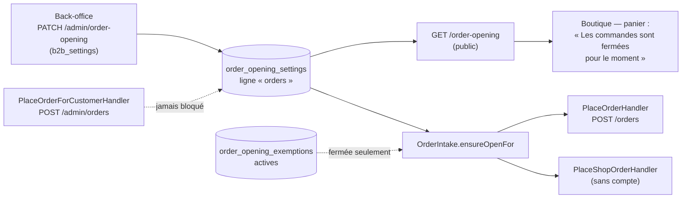

# L'ouverture de la boutique à la commande

> ⚠️ **Relu le 2026-10-12.** `POST /shop/orders` est **servie** depuis le
> 2026-10-11 (`shop-orders.controller.ts`, `orders.module.ts`). La migration
> `20261009130000_la_boutique_reste_fermee` reprend `feature_access_overrides.shop`
> (`closed` ou `browse`) en fermant les deux clientèles dans
> `order_opening_settings` ; la ligne `shop` n'est ni lue ensuite ni effacée.

> ⚠️ **2026-10-26 — décision de Hugo : les exemptions et l'encadré de
> fermeture.** Bâties le même jour, non commitées à l'écriture : voir
> « Les exemptions à la fermeture » ci-dessous. Migration
> `20261026130000_les_exemptions_a_la_fermeture`, additive.

> État au 2026-10-09 — **implémenté** (non commité à l'écriture). Demande de
> Hugo du 2026-10-09 ; remplace la clé `shop` de l'accès aux fonctionnalités,
> retirée le même jour (`63fde9aac`).

## Ce que c'est

Un réglage global, **une case par clientèle** : la boutique prend-elle les
commandes des **pros** ? des **particuliers** ? Il se pose dans le back-office,
« E-commerce LFC → Réglages → Ouverture de la boutique ».

**Fermée = le catalogue et les prix restent visibles, les commandes sont
refusées.** Rien d'autre ne change : une commande déjà passée garde son suivi,
son règlement et son QR de retrait.

| Clientèle   | Qui c'est (règle `audienceOf`, la même que la remise et la livraison) |
| ----------- | --------------------------------------------------------------------- |
| pros        | une personne qui agit pour une société **active**                     |
| particulier | l'espace perso, une société non validée, une commande sans compte     |

## Où c'est appliqué

- **Le serveur refuse** en **409** `orders.closed_for_audience`, avec « La
  boutique ne prend pas de commandes des pros / des particuliers pour le
  moment. Le catalogue reste consultable : réessayez plus tard. » Le refus a
  lieu **avant** toute composition : la clé d'idempotence est rendue, et la
  commande sans compte n'inscrit pas de porteur. Un **rejeu** d'une commande
  déjà passée sous la même clé passe toujours.
- **Le staff n'est jamais bloqué** : `OrderIntake` n'est appelé que par les
  deux passations client, et pas par `OrderDrafting`, que la saisie de
  l'équipe partage. Une commande prise au téléphone se saisit boutique fermée.
- **Le devis et le panier ne sont pas gardés** : ils calculent des prix, ce
  que la fermeture laisse voir ; la commande se décide à la passation.
- **La boutique** lit `GET /order-opening` (`OrderOpeningStore`) et remplace,
  dans le pied du panier, le bouton de commande par la phrase. Tant que le
  réglage n'est pas lu, ou si sa lecture échoue, ou tant que la clientèle de
  la personne n'est pas connue, le bouton reste : le serveur garde la porte.

## Les exemptions à la fermeture (décision de Hugo du 2026-10-26)

Certains clients commandent **malgré** la fermeture de leur clientèle. Une
exemption vise :

- une **société**, choisie parmi les sociétés existantes — refusée à l'ajout si
  elle n'existe pas (404) ou si elle est **résiliée** (`terminated`, l'état
  d'archivage d'une société, 409) ; son nom est figé au geste ;
- une **adresse e-mail** — une personne connectée avec cette adresse, ou une
  commande sans compte passée avec elle. Normalisée par `EmailAddress`
  (espaces retirés, minuscules) : ` Jean@Folie.FR` exempte `jean@folie.fr`.

La garde (`admitsOrder`, pure, dans `order-opening/domain/order-admission.ts`) :
ouverte à la clientèle → passe ; fermée → passe seulement si une exemption
active couvre la société agissante **ou** l'adresse de qui commande. Ouverte,
ni la liste ni l'adresse ne sont lues. Une exemption n'ouvre que la passation.

Une cible n'a qu'une exemption **active** : un doublon est refusé (409) par
l'agrégat, et deux ajouts simultanés se départagent par deux index uniques
partiels. **Retirer archive** (`withdrawn_at` + auteur), n'efface pas : « qui
a laissé ce client commander pendant la fermeture » se relit. Même droit que
le réglage, `lfc_order_opening` (lecture pour la liste, écriture pour ajouter
et retirer) ; la migration n'en accorde aucun.

| Route                                        | Effet                                                                     |
| -------------------------------------------- | ------------------------------------------------------------------------- |
| `GET /admin/order-opening/exemptions`        | les actives, les plus récentes d'abord                                    |
| `POST /admin/order-opening/exemptions`       | `{ kind: "company", companyId }` ou `{ kind: "email", email }` → `{ id }` |
| `DELETE /admin/order-opening/exemptions/:id` | archive l'exemption (204)                                                 |

Chaque geste écrit `order_opening.exemption_granted` /
`order_opening.exemption_withdrawn` (libellé = nom de la société ou adresse),
rangés sous « commandes ». Le back-office le dit : « Colette Martin a laissé
commander la société Chez Paul malgré la fermeture de la boutique ».

**À l'écran**, un `fold-callout` d'avertissement en tête dit l'état quand la
boutique est fermée — « La boutique est fermée aux pros / aux particuliers /
à tous », ce que ça veut dire, et le nombre d'exemptions actives ; rien quand
tout est ouvert. La carte « Exemptions » liste, ajoute (panneau : une adresse,
ou une société cherchée comme dans les comptes clients) et retire (zone de
danger).

⚠️ **Non bâti : la boutique ne connaît pas les exemptions.** Le pied du panier
remplace le bouton de commande par la phrase dès que la clientèle est fermée ;
un client exempté n'y voit donc pas de bouton. L'exemption tient aujourd'hui
au serveur — une commande arrivée par la boutique d'un exempté passe — mais
l'écran de la boutique ne la lui propose pas.

## Le modèle

Un réglage sans transition ni invariant : un CRUD honnête (CLAUDE.md §3.1),
calqué sur « Livraison » (`delivery_settings`). Sa **propre table**,
`order_opening_settings`, et non deux colonnes de `delivery_settings` : celle-ci
est le réglage de la livraison, et y loger la commande aurait fait de chaque
geste de l'un une réécriture de l'autre.

| Colonne                                                     | Sens                            |
| ----------------------------------------------------------- | ------------------------------- |
| `key`                                                       | toujours `orders`               |
| `orders_open_to_b2b`, `orders_open_to_b2c`                  | `BOOLEAN NOT NULL DEFAULT true` |
| `updated_at`                                                | instant du geste, lu du `Clock` |
| `updated_by_staff_id`, `updated_by_name`, `updated_by_role` | l'auteur, figé au geste         |

**Ligne absente = ouverte aux deux** : rien ne se ferme au déploiement
(migration `20261009120000_l_ouverture_de_la_boutique`, additive). Le droit
est celui de « Livraison », `b2b_settings` ; la migration n'en accorde aucun.

Chaque bascule écrit `order_opening.updated` au journal — l'état posé et
l'état remplacé de chaque clientèle —, rangé sous « commandes », et le
back-office le dit : « Colette Martin a fermé les commandes aux particuliers ;
elles restent ouvertes aux professionnels ».

## Code

- `apps/lfd-api/src/b2b/order-opening/` — le réglage (domaine, ports, routes).
- `apps/lfd-api/src/b2b/orders/application/services/order-intake.service.ts`
  — la garde ; l'erreur dans `domain/errors/orders-closed-for-audience.error.ts`.
- `apps/lfd-api/src/b2b/order-opening/domain/order-opening-exemption.ts` —
  l'agrégat des exemptions ; `order-admission.ts` — la règle de passation.
- `packages/contracts/src/order-opening-exemptions.ts` — vue, forme de l'ajout,
  codes de refus.
- `packages/contracts/src/order-opening{,.values}.ts` — vues, défaut,
  `ordersOpenTo`, code du refus (sans zod pour la boutique, par `shop-values`).
- Back-office : `reglages/commandes/order-opening-page/` (encadré :
  `closure-notice.ts`), `order-opening-exemptions-card/`,
  `grant-exemption-panel/` — Réglages ›
  Commandes › Ouverture du e-commerce (`/reglages/commandes/ouverture`), sous
  `lfc_order_opening` depuis le 2026-10-13 (`plan-reglages-commandes.md`).
- Boutique : `client/shop/order-opening.store.ts`, pied de `cart-dialog`.

## Ce qui reste

- `POST /shop/orders` n'est pas servie (contrôleur non enregistré) : la
  commande sans compte est gardée au handler, éprouvée par l'e2e
  `order-opening.e2e-spec.ts` sans passer par HTTP.
- La boutique ne relit pas le réglage pendant la session : une fermeture se
  voit au prochain chargement ; entre-temps, le serveur refuse.
