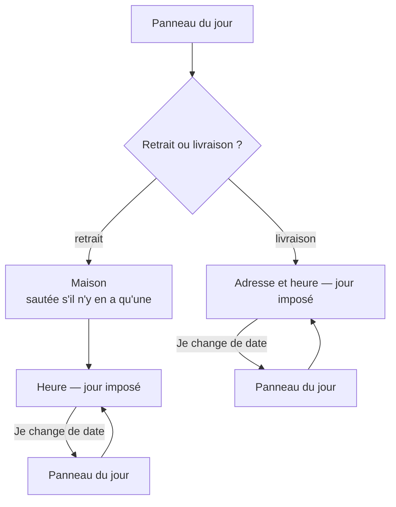

# Le parcours de service — jour, mode, lieu, heure

> **Doc d'état**, écrite le 2026-10-27 à partir du code. Elle remplace le plan
> « le jour se choisit en premier » (supprimé ; il reste dans l'historique git).
> Demande de Hugo ce jour-là, après trois incohérences vues en production :
> « je ne veux aucune incohérence », « j'ai vraiment besoin que cette partie
> soit fiable ».

Toutes les questions de service de la boutique (« quand ? retrait ou
livraison ? où ? à quelle heure ? ») sont posées par **un seul service**,
`OrderDoors` (`apps/lfc-ecommerce-frontend/src/app/client/shop/order-doors.ts`),
en dialogues. Aucun écran ne les pose lui-même ; chacun appelle une porte
nommée.

## 1. La règle

1. **L'ordre est unique : jour, puis mode, puis maison ou adresse, puis heure.**
2. **Le jour se choisit à UN endroit**, le panneau du jour (`DayPickerDialog` :
   aujourd'hui, les six jours suivants, autre date).
3. **Les dialogues d'heure et d'adresse exigent un jour.**
   `SlotPickerData.day` et `DeliveryAddressData.day` sont des `string`
   obligatoires : il est inexprimable de les ouvrir sans. Ils affichent le jour
   comme un fait, sans onglets ni liste de journées.
4. **« Je change de date »**, dans l'heure ou dans l'adresse, ferme le dialogue
   avec `CHANGE_DAY` ; la porte rouvre le panneau du jour, puis **le même
   dialogue, sur la même maison ou la même adresse**.
5. **Ce qui est connu ne se redemande pas.** Un choix déjà posé garde son jour
   quand on change de maison, d'adresse, d'heure ou de mode.
   **Changer de maison garde aussi l'heure** quand la nouvelle maison a le
   même créneau ouvert ce jour-là : l'heure ne se redemande pas
   (`sameSlotAt`, 2026-10-27). Une seule maison servie : « Changer de
   maison » n'apparaît ni dans la barre ni dans « Modifier ».
6. **Toucher une maison la choisit** ; toucher une heure la prend. Il n'y a pas
   de bouton de confirmation. La croix ferme, et fermer ne pose rien.

Le jour manquant passe toujours par `dayOr(day)` : le jour connu, sinon le
panneau du jour.

### Ce qui a disparu

- Les **onglets de la semaine** du sélecteur d'heure : ouverts sans jour, ils
  faisaient du sélecteur le « vieux panneau qui mêlait jour et heure ».
- La **liste de journées** du dialogue de livraison, qui glissait en silence
  vers une autre journée quand celle du panneau n'avait pas d'heure inscrite à
  l'adresse. Le refus « aucune heure inscrite » le dit désormais, à côté de
  « Je change de date ».
- Le pied **« Choisir mon heure »** du choix de la maison.

## 2. Les portes

| Porte                                             | Appelée par                                                                                | Sans service choisi                    | Avec un service choisi                    |
| ------------------------------------------------- | ------------------------------------------------------------------------------------------ | -------------------------------------- | ----------------------------------------- |
| `choose()`                                        | « Choisir », « Régler »                                                                    | jour → mode → …                        | reprend le brouillon                      |
| `resume()`                                        | la barre du panier                                                                         | ce qui manque au brouillon             | —                                         |
| `startPickup()` / `startDelivery()` / `startAt()` | les cartes de l'accueil                                                                    | jour → maison → heure / jour → adresse | —                                         |
| `pickup(id)`                                      | « Changer de maison » (barre de la boutique)                                               | jour → maison → heure                  | maison → heure, **jour gardé**            |
| `time(…)`                                         | « Changer l'heure »                                                                        | jour → heure                           | heure, **jour gardé**                     |
| `delivery(id)`                                    | « Changer d'adresse »                                                                      | jour → adresse                         | adresse, **jour gardé**                   |
| `switchMode()`                                    | « La récupérer en boutique », « Me faire livrer » (panier, barre de la boutique au bureau) | = `choose()`                           | l'autre mode, **jour gardé**              |
| `changeDate()`                                    | l'encart « ce jour n'est plus possible », « Changer le jour » en livraison (barre)         | = `choose()`                           | jour → heure de la même maison ou adresse |
| `modify()`                                        | « Modifier » (barre, panier)                                                               | = `choose()`                           | « Modifier mes choix » → l'étape choisie  |
| `askChoice()` / `askTime()`                       | la modification d'une commande passée                                                      | jour → mode → …                        | — (n'écrit pas le brouillon)              |

`modify()`, `switchMode()` et `changeDate()` partagent une seule branche,
`apply(change, choice)` : « mode » et « Changer la date » ne peuvent donc pas
diverger entre le panneau « Modifier » et les gestes directs.

## 3. Ce qui le tient

- **Les types** : les deux dialogues d'heure n'ont pas de champ de jour
  optionnel. Un appelant qui l'oublie ne compile pas. C'est ainsi que les
  appelants restants ont été trouvés le 2026-10-27.
- **La matrice des parcours** (`order-doors.spec.ts`, « la matrice des
  parcours ») : pour chaque porte, la **suite exacte** des dialogues ouverts et
  le jour reçu par l'heure ou l'adresse, avec et sans service choisi, avec
  « Je change de date », et l'invariant « aucune heure sans jour ». Éprouvée
  par mutation le 2026-10-27 : retirer le jour gardé de `pickup()` fait
  échouer la ligne « Changer de maison ».
- **Les scènes de l'aperçu** (`preview/app/journeys/`) partent d'un brouillon
  qui porte déjà le jour, comme un parcours réel arrivé à cette étape.

## 4. Limites connues

- **« Jour servi » est une fenêtre, pas une liste** : `GET /fulfillment-days` ne
  rend que la première journée par porte. Un jour de fermeture au-delà n'est
  pas grisé dans le panneau ; l'heure le dit ensuite (« aucun créneau »).
- **« Autre date » est un `fold-date` borné**, pas un calendrier :
  `fold-calendar-month` n'a ni jour désactivable ni jour sélectionné.
- Le libellé « Aujourd'hui »/« Demain » des dialogues se calcule à leur
  ouverture : un dialogue laissé ouvert passé minuit garde le mot de la veille.
