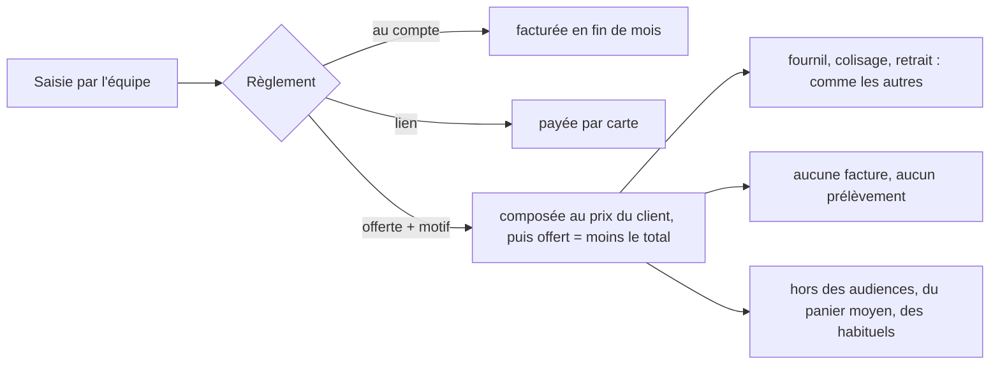

# La commande offerte — l'équipe offre une commande depuis le back-office

**État : 📝 plan ; O0 à O6 bâtis le 2026-11-23 (O3b et O5 compris) ; restent O5b (mentions « offerte » de l'e-mail, du bon et des fiches) et O7 (destinataire libre).** Demandé par Hugo le
2026-11-23 : « l'équipe passe une commande offerte depuis le back-office ».
Contredit par `vitruve` le 2026-11-23 : cinq bloquants sur la première version
(une remise de panier « offerte »), tous levés par le changement de forme du
§ 2.2. Les questions comptables sont au § 3 ; elles ne bloquent rien.

---

## Partie 1 — en simple

Aujourd'hui, quand l'équipe saisit une commande pour un client, elle choisit
entre deux façons de la régler : **au compte** (elle sera facturée) ou **par
lien** (le client paie par carte). Il manque une troisième façon : **offerte**.
Ça sert pour une dégustation, un geste commercial, un remplacement après une
réclamation, un échantillon.

Une commande offerte est **une vraie commande** : elle part au fournil, au
colisage, en livraison ou au comptoir, comme les autres. La seule différence
porte sur l'argent : le client ne paie rien, on n'émet aucune facture, et on ne
prélève rien.

Mais on garde **ce qu'elle valait**. La commande se compose d'abord comme si le
client la payait (ses prix, les frais de livraison), puis une ligne « offert »
retranche exactement ce total, taux de TVA par taux de TVA. Trois raisons :

1. la comptabilité doit pouvoir dire combien on a offert, à qui et pourquoi ;
2. au-delà d'un certain montant offert à une même personne dans l'année, la TVA
   déjà déduite devrait être reversée — pour le moment on ne reverse rien, la question est notée au § 3 ;
3. une commande offerte « à 0 € » sans trace de sa valeur cacherait la décision
   prise, ce qu'on refuse pour toute exception de l'équipe.

Offrir est un **droit à part** : pouvoir saisir une commande ne suffit pas. Ce
droit s'accorde à l'écran des rôles, comme tous les autres.

---

## Partie 2 — technique

### 2.1 Ce qui existe (vérifié le 2026-11-23, et par `vitruve` le même jour)

- `staffSettlementSchema = z.enum(["account", "link"])`
  (`packages/contracts/src/admin-order.ts:48`) ; son JSDoc justifie l'absence
  d'une troisième valeur.
- `PlaceOrderForCustomerHandler` appelle `order.deferPayment()` quand
  `settlement === "account" || order.totalCents <= 0`
  (`place-order-for-customer.handler.ts:293`). `staffSettlementRefusal`
  (`application/services/staff-settlement-refusal.ts`) ne connaît que `account`
  et `link`.
- `settlementRegimeOf` rend `free` pour `not_required` à total nul
  (`orders/domain/services/settlement-regime.ts`). L'assiette du prélèvement
  exige `total_cents > 0` (`accounting/infrastructure/billable-order-criterion.ts`),
  la facture carte écarte `totalCents <= 0` (`outsideCardInvoicing`,
  `accounting/domain/services/card-invoicing.ts`). Le schéma « publique ou
  gratuite → pas de facture » est dans `documentation/commandes/parcours-complet.md`.
- **Les remises de panier ne touchent que les lignes** : `chainBasketDiscounts`
  (`packages/money/src/basket-discounts.ts`) ne remise que les `coveredLines`,
  et `deliveryFeeCents` s'ajoute après. Une remise ne peut donc pas ramener une
  commande livrée à 0. Une remise de panier exige un `promotionId`
  (`DraftBasketDiscount`, `order-shapes.ts`), elle compte dans
  `MAX_BASKET_DISCOUNTS_PER_ORDER = 5`, et elle allume `pickup_discount_eligible`
  sur les lignes couvertes. C'est pourquoi l'offre **n'est pas** une remise.
- La révision (`order-revision.ts`, `revisionOf`) garde `free → ≠free` et
  `account → ≠account`, **pas** `due`/`paid → free`.
- Lisent `not_required` comme une commande réelle : les audiences
  (`AUDIENCE_COUNTED_PAYMENT_STATUSES`, `audiences/domain/audience-scope.ts`),
  le chiffre d'affaires (`REVENUE_PAYMENT_STATUSES`, `growth/domain/revenue-scope.ts`),
  les recommandations (`usuals.ts`, `bought-with.ts`).
- Droit de saisie : `b2b_place_order` (`prisma/schema/public/staff.prisma:67`).
  Un droit neuf s'inscrit aussi dans `packages/contracts/src/staff-access.ts`
  (liste, libellés, dérivation) et `staff-resource-scopes.ts`.
- Les liens `free_charge` (`payments/application/free-charge/`) encaissent un
  montant **sans commande** ; les dérogations (`order-waivers/`) portent l'heure
  limite et la pénalité de retard, pas le prix. Aucun des deux n'offre une
  commande.

### 2.2 Décisions proposées

| #    | Décision                                                                                                                                                                                                                                                                                          | Raison                                                                                                                                                                               |
| ---- | ------------------------------------------------------------------------------------------------------------------------------------------------------------------------------------------------------------------------------------------------------------------------------------------------- | ------------------------------------------------------------------------------------------------------------------------------------------------------------------------------------ |
| O-1  | Troisième valeur `offered` dans `staffSettlementSchema`, toujours sans défaut. Le JSDoc est réécrit au présent.                                                                                                                                                                                   | Offrir est une décision commerciale, au même rang que facturer ou réclamer.                                                                                                          |
| O-2  | **L'offre est un ajustement de commande, pas une remise de panier.** La commande se compose entière par le chemin du client (lignes, remises de clientèle, frais de livraison). L'agrégat ajoute ensuite une ligne d'offre égale à **moins** le montant de chaque taux, déjà arrondi : HT et TVA. | Retrancher des montants déjà arrondis donne 0 exactement, sans nouvel arrondi. Les frais sont couverts. Aucune interaction avec la chaîne, le plafond ni `pickup_discount_eligible`. |
| O-3  | **La composition est celle du client, sans sélection** : promotions comprises, elles consomment leur usage comme sur toute commande. Seul le bon de fidélité reste hors de la saisie de l'équipe, comme aujourd'hui.                                                                              | Décidé par Hugo le 2026-11-23 : « on ne refait pas le calcul de manière sélective ». Une seule arithmétique : la valeur offerte est ce que le client aurait payé.                    |
| O-4  | Colonnes sur `orders` : `offer_nature` (nullable, CHECK contre le registre), `offer_note`, `offered_value_cents` (TTC). Les montants par taux vont dans la table des montants de TVA déjà tenue par la commande, sous une ligne d'offre.                                                          | Un discriminant en SQL : une commande offerte se distingue d'une commande tombée à 0 par une promotion à 100 %. Ce choix ne se défait plus après le premier merge.                   |
| O-5  | Motif obligatoire : nature du registre `ORDER_OFFER_NATURES` (`tasting`, `event`, `goodwill`, `replacement`, `sample`) et texte court.                                                                                                                                                            | Distinct de `FREE_CHARGE_NATURES`, qui qualifie un encaissement sans commande : les deux registres répondent à deux questions et divergeront.                                        |
| O-6  | Nouveau droit `b2b_offer_order` : valeur de `StaffResource` par migration, **jamais accordée par elle**, inscrite dans `staff-access.ts` et `staff-resource-scopes.ts`. `staffSettlementRefusal` refuse `offered` sans ce droit.                                                                  | Règle du § 3 de `CLAUDE.md`, porte `lint:no-role-grants-in-migrations`. La garde vit dans le refus existant, pas à côté.                                                             |
| O-7  | **Révision.** Une commande offerte reste offerte : la révision recompose comme toute révision et recalcule la ligne d'offre (O-2), donc le total reste 0. Elle refuse de rendre offerte une commande qui ne l'était pas, et l'inverse.                                                            | Changer qui paie après coup est une autre décision : annulation, puis nouvelle saisie.                                                                                               |
| O-8  | Fait `order.offered` à la passation, **et** `order.offer_revalued` à chaque révision ou annulation qui change la valeur offerte, avec la valeur par taux après le geste.                                                                                                                          | Le cumul par bénéficiaire (§ 3) se lit sur le dernier fait de chaque commande, jamais sur une valeur périmée.                                                                        |
| O-9  | **Les lecteurs qui comptent des achats écartent les commandes offertes** (`offer_nature IS NULL`) : audiences, chiffre d'affaires et panier moyen, habituels et « acheté avec ». La fidélité aussi, si elle crédite `not_required` (à vérifier au lot O4).                                        | Une dégustation offerte à un prospect ne le fait pas basculer en client actif, ni n'apprend ses « habituels ».                                                                       |
| O-10 | E-mail de commande passée : « offerte » à la place du montant à régler, sans prix. Bon de livraison : mention « Commande offerte — sans facturation ». Back-office : libellé « Offerte » et motif sur la fiche.                                                                                   | Le client n'a rien à faire. La valeur offerte est un document interne.                                                                                                               |

**Écart découvert, hors de ce chantier** : la révision ne garde pas `due`/`paid
→ free`, alors qu'une commande à lien pourrait devenir gratuite par révision.
Il n'est pas créé par ce plan. Il se ferme à part, avec un test de régression
(cf. `documentation/commandes/modification/modifier-une-commande.md`).

### 2.3 Lots

| Lot | Contenu                                                                                                                                                                                                                                                                                                                                                                                                                                                                                                                                                             | Tests                                                                                                                                                                               |
| --- | ------------------------------------------------------------------------------------------------------------------------------------------------------------------------------------------------------------------------------------------------------------------------------------------------------------------------------------------------------------------------------------------------------------------------------------------------------------------------------------------------------------------------------------------------------------------- | ----------------------------------------------------------------------------------------------------------------------------------------------------------------------------------- |
| O0  | ✅ bâti le 2026-11-23. Contrat : `offered`, libellés, `ORDER_OFFER_NATURES`, champ `offer` exigé ssi `settlement === "offered"`. L'API refuse `offered` (`OfferedOrderUnavailableError`) jusqu'à O3. Le droit va avec sa migration, en O2 : un droit au contrat sans valeur en base casserait l'écran des rôles.                                                                                                                                                                                                                                                    | Spec du contrat : `offered` sans motif refusé, motif sans `offered` refusé.                                                                                                         |
| O1  | ✅ bâti le 2026-11-23 (`order-offered-amounts.ts`, `value-objects/order-offer.ts`). Domaine : ligne d'offre (O-2) posée après la composition complète (O-3), recomposition à la révision (O-7).                                                                                                                                                                                                                                                                                                                                                                     | Unitaire : total 0 en retrait **et** en livraison, avec une promotion, avec plusieurs taux, avec un poids au kilo ; révision qui garde 0 ; refus des deux bascules.                 |
| O2  | ✅ bâti le 2026-11-23 (migrations `20261123150000`, `20261123150100`). Migration additive : `b2b_offer_order` (et son inscription dans `staff-access.ts`, `staff-resource-scopes.ts`), colonnes O-4 nullables avec leur CHECK. Passe par `lecteur-de-migrations`.                                                                                                                                                                                                                                                                                                   | `schema-drift`, `lint:no-role-grants-in-migrations`, `lint:rgpd-staff` si la note nomme une personne.                                                                               |
| O3  | ✅ bâti le 2026-11-23, sans les faits (lot O3b). Application : garde du droit `b2b_offer_order` au handler (403, avant la clé d'intention), motif passé à l'agrégat par `OrderParties.offer`, `offered` sans crédit ni statut ni payeur à juger, exemption de l'ouverture de la boutique (§ 4).                                                                                                                                                                                                                                                                     | Unitaire : refus sans le droit, total nul, prospect non actif, boutique fermée. e2e : passation, aller-retour en base par la révision, 403.                                         |
| O3b | ✅ bâti le 2026-11-23. Faits `order.offered` (passation : qui, nature, valeur TTC et TVA) et `order.offer_revalued` (chaque modification : la valeur après le geste), dans la transaction ; abonnés du journal dans `growth`, phrases et libellés au back-office. **Le texte du motif n'est jamais recopié au journal** : il peut nommer une personne, il reste sur la commande. Une commande offerte annulée se lit par `order.cancelled`.                                                                                                                         | Spec des abonnés (charge passée au catalogue), du handler (le fait part avec la commande, sans le motif), des phrases ; e2e : les deux faits dans la boîte d'envoi.                 |
| O4  | ✅ bâti le 2026-11-23. Lecteurs O-9 : CA (`revenueWhere`, lignes sur commande), audiences, habituels, « acheté avec » (`offer_nature IS NULL`). **Fidélité : un vrai trou, fermé** — l'assiette (sous-total − remise − bon) gardait la valeur pleine d'une commande offerte et l'aurait créditée ; `earningFor` l'écarte (`offered`).                                                                                                                                                                                                                               | Un test par lecteur : une commande offerte n'y compte pas.                                                                                                                          |
| O5  | ✅ bâti le 2026-11-23. « Prévenir le client » (§ 4) : rangé dans le motif de l'offre (`OrderOfferReason.notifyCustomer`, colonne `offer_notifies_customer`, migration `20261123160000`), décoché par défaut. La commande lue par les envoyeurs dit `customerNotified` ; les cinq e-mails automatiques (passée, prête, en route, modifiée, annulée) se taisent sans l'accord. Le rappel de retrait, qui partage le service « prête », part quand même : c'est un geste de l'équipe. Case « Prévenir le client par e-mail » dans la saisie, gardée dans le brouillon. | Un test « se tait » par envoyeur, le rappel qui part quand même ; e2e : le choix fait l'aller-retour en base, décoché comme coché.                                                  |
| O5b | Les mentions « offerte » : l'e-mail de commande passée (quand le client est prévenu) dit « offerte » au lieu d'un montant ; bon de livraison « Commande offerte — sans facturation » ; fiche et liste du back-office « Offerte » et motif. Sorti de O5 le 2026-11-23 : l'e-mail vit dans l'éditeur (manifeste, spécimens) et le bon est un PDF tenu par sa planche.                                                                                                                                                                                                 | Planche des PDF (`lint:pdf-specimens`), manifeste des e-mails régénéré (`pnpm tool mail-copy:digest`).                                                                              |
| O6  | ✅ bâti le 2026-11-23. Écran de saisie : troisième choix « Offerte », **absent** sans le droit (comme « Annuler », `order-cancel.ts`), nature et texte obligatoires, gardés dans le brouillon (`offerNature`, `offerNote`). L'estimation admet `offered` sans motif et chiffre alors la valeur pleine ; avec le motif complet, elle rend 0 et la valeur offerte (`offeredTotalCents`, calculée au serveur), affichée en ligne « Valeur offerte ».                                                                                                                   | Specs de composant, du brouillon, de l'estimation et des blocages.                                                                                                                  |
| O7  | **Destinataire libre** (demandé par Hugo le 2026-11-23) : offrir à quelqu'un qui n'est pas dans le système. L'équipe saisit prénom, nom, e-mail ou téléphone, et une adresse de livraison ou un point de retrait. Le destinataire est enregistré par `GuestBuyerRegistrar` (un `User` sans `auth0Sub`, la figure de `architecture-commande-sans-compte.md`), la commande se compose sans société au prix particulier, et seule `offered` est admise sur ce chemin.                                                                                                  | e2e : commande offerte sans société, en retrait et en livraison ; refus de `account` et `link` sans société ; un second don à la même adresse e-mail retrouve le même destinataire. |

### 2.3 bis Ce que O1 a établi

- **La valeur offerte ne garde pas le HT par taux.** Elle porte le TTC, la TVA
  totale, la TVA par taux et le HT total (TTC − TVA). Le calcul des pros
  (`line_ht`) ne produit que la TVA par taux (`computeOrderTotals`, vérifié le
  2026-11-23) ; le seuil des cadeaux de faible valeur se lit en TTC. O-6 et
  O-8 sont à lire avec cette forme.
- **Après l'offre**, la commande garde ses lignes et ses termes (sous-total,
  remise, frais) ; TVA, parts par taux, total et parts TTC par taux
  (`ttc_by_rate`, vides en `exact_ht`) valent zéro. Un lecteur qui recalcule
  un total depuis les lignes se tromperait sur une commande offerte : O4 et
  O5 le vérifient lecteur par lecteur.
- **Un bon et une offre ensemble sont refusés** (`OfferedOrderWithVoucherError`).
- **La révision relit l'offre sur la commande** (`RevisableOrder.offer`), jamais
  sur la demande ; une demande qui en porte une sur une commande payée est
  refusée (`OfferChangeOnRevisionError`). Tant que O2 ne persiste pas l'offre,
  le chargeur de la révision ne la remplit pas : aucune commande offerte ne
  peut exister avant O3, qui lève le refus.
- **O2 doit persister** `OrderToPlace.offer` (motif et valeur) et le relire
  dans `RevisableOrder.offer`.

### 2.4 Ce qui n'est pas fait ici

- **Offrir une partie** d'une commande (une ligne sur trois). La forme O-2
  retranche un total, pas une ligne.
- **Un plafond** par commande ou par mois. Rien n'a été demandé ; le droit à
  part et les faits suffisent pour commencer.
- **Le registre RGPD** pour O7 : un destinataire libre est une personne dont
  on garde des données sans qu'elle ait créé de compte. À traiter au lot O7,
  avec le texte d'information de la commande sans compte.
- **Offrir après coup** une commande déjà payée : c'est un remboursement, par
  le bloc `payment`.

---

## 3. Les questions comptables — notées, non bloquantes

**Décidé par Hugo le 2026-11-23 : on ne reverse aucune TVA pour le moment.**
Ces questions ne retiennent aucun lot. Elles sont écrites pour que la
réflexion ne se perde pas, et pour que le jour où le cabinet répondra, les
données soient déjà là : les faits O-8 gardent, pour chaque commande offerte,
le bénéficiaire, la nature et la valeur par taux après le dernier geste.

Rien dans ce chantier ne calcule, ne déclare ni ne passe d'écriture de TVA
sur les cadeaux.

### 3.1 La TVA sur les biens offerts

Ce que l'on croit savoir, **à faire confirmer par le cabinet** :

- un bien remis sans contrepartie n'est pas une vente, donc pas de TVA
  collectée sur la commande offerte (d'où le total à 0) ;
- en revanche, la TVA **déduite** à l'achat de ce qui a servi à le fabriquer
  (matières, emballages) n'est en principe pas déductible pour un cadeau, et
  devrait être reversée ;
- sauf pour les **cadeaux de faible valeur** : un plafond annuel par
  bénéficiaire, 73 € TTC selon le BOFiP (valeur à vérifier) ;
- les **échantillons** commerciaux suivent en principe un régime à part.

### 3.2 Les questions à poser

- **Q-C1.** Le seuil de faible valeur s'apprécie-t-il sur la valeur de vente
  (ce que les faits O-8 portent) ou sur le coût de revient (que le dépôt ne
  connaît pas aujourd'hui) ?
- **Q-C2.** Faut-il suivre le cumul par bénéficiaire et par année civile, et
  qui est le bénéficiaire : la société, ou la personne pour un particulier ?
- **Q-C3.** Une dégustation, un événement, un échantillon, un remplacement
  après réclamation : lesquels sont des cadeaux au sens fiscal ? Un
  remplacement est peut-être l'exécution de la vente d'origine plutôt qu'un
  don. Le registre O-5 les distingue déjà, pour pouvoir répondre par nature.
- **Q-C4.** Qui passe l'écriture (compte de cadeaux à la clientèle, reversement
  de TVA), à quelle fréquence, et faut-il un état que la comptabilité exporte ?
- **Q-C5.** Une commande offerte à un particulier se traite-t-elle comme une
  dégustation commerciale ou comme un don ?

### 3.3 Ce qu'il faudrait bâtir si la réponse l'exige

Un état annuel « valeur offerte par bénéficiaire et par nature », lu sur les
faits O-8, et un seuil d'alerte. Pas avant la réponse du cabinet.

## 4. Décisions de Hugo (2026-11-23)

- **Une commande offerte ne prévient pas le client par défaut.** L'usage
  type : une dégustation, que le fournil produit et que la commerciale
  apporte elle-même chez le client. Le client n'a pas passé cette commande ;
  lui écrire « votre commande est passée, prête, en route » serait faux.
  La saisie porte une case « Prévenir le client », **décochée** pour une
  commande offerte, et le choix est figé sur la commande. Ce qu'il couvre,
  relevé le 2026-11-23 dans `orders/` : les e-mails qui partent seuls
  (commande passée, prête, en route, modifiée, annulée, lettre du départ
  incomplet). Les gestes de l'équipe sur une commande (rappel de retrait,
  avertissement de retard, avis de non-présentation) restent possibles : ils
  sont décidés par quelqu'un, pas automatiques. Le bon de livraison reste
  imprimé : il sert à la commerciale et au colisage. Bâti au lot O5.

- **La ligne « offert » qui met tout à zéro** (O-2) est retenue contre une
  remise de 100 % par article plus la livraison offerte. La TVA facturée est
  nulle dans les deux cas ; la question de la TVA récupérée sur les achats
  (§ 3) ne dépend pas de la façon d'arriver à zéro.

- **Pas de deuxième validation**, quel que soit le montant.
- **Une société non active peut recevoir une commande offerte** : des
  dégustations servent à l'acquisition, donc à des prospects. Le refus
  d'`offered` n'interroge ni le statut de la société ni son crédit, à la
  différence du compte. La saisie exige toujours une fiche de société et un
  acheteur qui en est membre (vérifié le 2026-11-23 dans
  `staff-order-preparation.ts` : le statut n'est lu que pour le lien au
  comptoir). Conséquence : une société non active est servie en clientèle
  particulier (`commande-passee-par-l-equipe.md`, § 2), et la valeur offerte
  est son prix de particulier.
- **Un particulier peut recevoir une commande offerte** : c'est un usage
  attendu (dégustations de mariage, événements), d'où la nature `event`.
- **Une société qui n'est pas dans le système** : l'équipe crée sa fiche
  depuis le back-office (`POST /admin/companies`, puis son détenteur par
  `POST /admin/companies/:companyId/holder`), sans SIRET si on ne l'a pas
  (le SIRET est facultatif, `LegalRegistration.declare`, vérifié le
  2026-11-23). La fiche reste non active, donc un prospect, et la commande
  offerte se passe sur elle. C'est voulu pour l'acquisition : le prospect
  existe ensuite pour le suivi commercial, et son activation se fait plus
  tard par le geste habituel. Le destinataire libre (O7) reste pour une
  personne sans société.
- **Une commande offerte n'est pas tenue par l'ouverture de la boutique**
  (demandé par Hugo le 2026-11-23) : ni la fermeture à la clientèle
  (`OrdersClosedForAudienceError`), ni le premier jour commandable
  (`ServiceDayBeforeFirstOrderableDayError`), tous deux levés par
  `prepareStaffOrder` (vérifié le 2026-11-23). Une dégustation se prépare
  souvent avant l'ouverture, ou pour une clientèle encore fermée. C'est un
  **geste nommé** de l'équipe, au même titre que le retrait immédiat : il ne
  vaut que pour `offered`. Le reste tient : le jour doit être un jour où le
  fournil produit, et l'heure limite de commande s'applique (la dérogation
  existante reste le geste pour la dépasser). Branché au lot O3.
- **La valeur offerte est le calcul normal**, promotions comprises (O-3).
  Doute assumé : une promotion à usage limité est consommée par une commande
  que le client n'a pas payée. C'est la conséquence d'un calcul unique ; si
  elle gêne, la réponse sera de ne pas proposer la promotion à la saisie, pas
  de la retirer du calcul.
