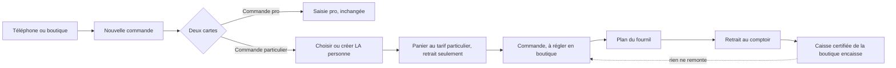

# Plan — la commande d'un particulier, notée au comptoir, réglée à la caisse de la boutique

> **Doc-first, 2026-11-20.** Rien n'est bâti. Les décisions de Hugo de ce jour
> sont marquées **H** ; ce qui reste à trancher est au § 7.
> Contredit par `vitruve` le 2026-11-20 : six bloquants, tous intégrés
> (§ 3, § 4, § 6).

## Partie 1 — en simple

Un particulier appelle (ou passe en boutique) : « deux baguettes et une tarte
pour samedi, je paierai en venant ». L'équipe note la commande au comptoir ;
elle part au plan du fournil comme les autres ; samedi, le client la retire et
**paie sur la caisse de la boutique** — la caisse certifiée, celle des clients
de passage. Notre système, lui, **ne sait jamais qu'il a payé**.

Quatre choses ne doivent **jamais se mélanger** (Hugo, 2026-11-20) :

| Ne pas mélanger                        | Ce qui le tient                                                              |
| -------------------------------------- | ---------------------------------------------------------------------------- |
| deux particuliers entre eux            | l'équipe **choisit** la personne à l'écran ; aucun rattachement automatique  |
| la saisie particulier et la saisie pro | deux cartes, deux écrans, deux routes d'API                                  |
| les prix et règles des deux clientèles | le particulier commande comme dans son espace : TTC public, règles publiques |
| les règlements                         | un lieu de règlement à lui, figé en base ; jamais « payé » chez nous         |

## Partie 2 — technique

### 1. Pourquoi c'est possible sans caisse certifiée chez nous (H)

[`pas-de-logiciel-de-caisse.md`](../../comptabilite/caisse/pas-de-logiciel-de-caisse.md)
§ 4 : un seul paiement enregistré hors carte en ligne fait tomber la tolérance
du BOFiP. **H, 2026-11-20 : la commande est notée, le paiement ne l'est
jamais.** Conséquences, toutes structurelles :

- aucun champ, aucune route, aucun bouton ne dit « encaissé », un montant reçu
  ou un moyen de paiement pour ces commandes ;
- `paidAt` reste `NULL`, `stripePaymentIntentId` aussi — un `CHECK` le dit en
  base (§ 4) ;
- le retrait ne demande rien sur l'argent : il remet, comme pour une commande
  au compte.

À ajouter au § 5 de la doc caisse, comme question au cabinet : « une commande
notée chez nous et encaissée sur la caisse certifiée de la boutique laisse-t-elle
notre logiciel hors du champ ? ».

### 2. L'entrée : « Nouvelle commande », deux cartes (H)

L'onglet du comptoir `Nouvelle commande pro` devient **`Nouvelle commande`** et
mène à un écran de choix simple, deux cartes : **Commande pro** (l'écran actuel
`NouvelleCommandeProPage`, inchangé, déplacé sous `nouvelle-commande/pro`) et
**Commande particulier** (`nouvelle-commande/particulier`). Les droits restent
ceux de `COUNTER_ORDER_GUARDS`, pour les deux cartes (§ 7, Q5).

À reprendre : `comptoir-workspace-page.spec.ts` (le libellé y est attendu) et
les titres de route de `app.routes.ts`.

### 3. La personne — ne jamais mélanger deux particuliers

Aujourd'hui, `PrismaGuestBuyerRegistrar.register` **retrouve un invité par
son e-mail** sans le dire (D8 de la commande sans compte, vérifié le
2026-11-20) et garde l'ancien prénom et téléphone. Au comptoir ce serait la
faute : une adresse mal entendue au téléphone rattacherait la commande à
quelqu'un d'autre.

Donc, pour cette surface :

- **chercher, puis choisir** : l'écran cherche parmi les particuliers (comptes
  connectables **et** invités, sans société) par téléphone, nom ou e-mail, et
  montre de quoi reconnaître (prénom, nom, téléphone en partie masqué, date de
  dernière commande ; pas de nom de famille, la fiche n'en a pas). L'équipe **clique** sur la personne ;
- **ou créer** une fiche neuve, explicitement. La route reçoit soit un
  `buyerId` choisi, soit une identité à créer, **jamais** une identité qu'elle
  rapprocherait seule ;
- la création refuse si l'e-mail ou le téléphone **normalisé** correspond déjà
  à une fiche, en la nommant (« cette adresse est celle de X — la choisir ? »).
  Ce refus est applicatif : `email` et `phone` n'ont aucune unicité en base
  (`account.prisma:457`, `:463`) et ne peuvent pas en avoir (D2). Deux
  comptoirs qui créent la même personne à la même seconde font deux fiches :
  assumé, le doublon se voit à la recherche suivante ;
- **le propriétaire est `account`** (§ 3 de `CLAUDE.md`, « le propriétaire
  parle de ce qui est à lui ») : la recherche ET la création sont deux ports
  nommés déclarés et implémentés par `account`, que `orders` appelle. Le
  registrar des invités, qui écrit `users` depuis `orders`, n'est pas étendu
  (`lint:prisma-model-ownership` raisonne par bloc et ne verrait pas l'écart) ;
- **bâti (B2, 2026-11-20)** : `GET /admin/counter/particulars?q=` (2
  caractères minimum, 10 fiches) et `POST /admin/counter/particulars` (clé
  d'intention), sous `b2b_place_order:write`. Est particulier toute fiche non
  désactivée sans aucune adhésion à une société, en attente comprise. La
  carte montre le nom quand la fiche en a un (compte connectable) ; la date de
  dernière commande n'y est pas — elle vit dans `orders`, et `account` ne la
  lit pas sans une lecture nommée que `orders` publierait (reste à faire). Le
  409 « contact déjà pris » nomme le prénom de la fiche ; l'enveloppe
  d'erreur ne publie aucun identifiant, donc **l'écran relance la recherche
  avec l'e-mail ou le téléphone saisi**, et la fiche apparaît à choisir ;
- un compte connectable choisi n'ouvre aucun accès à l'équipe : on commande
  **pour** lui ([`commande-passee-par-l-equipe.md`](commande-passee-par-l-equipe.md) § 1).

**Identité : e-mail, prénom, téléphone, les trois obligatoires** (H,
2026-11-20) — les trois champs de l'invité de la boutique, pas de nom de
famille. `User.email` est non nul (`account.prisma:457`), et la confirmation
écrite d'une commande à distance en a besoin. La fiche de recherche montre
donc prénom, e-mail et téléphone en partie masqués.

### 4. Le règlement — ne pas mélanger

#### 4.1 Le modèle : `not_required` + un lieu de règlement, pas une valeur d'enum

La première version ajoutait `at_shop_till` à `PaymentStatus`. `vitruve` l'a
retournée (2026-11-20) : `PaymentStatus` dit où en est l'argent **chez nous** ;
« à la caisse de la boutique » dit **où** il sera encaissé. Une valeur d'enum
cassait d'un coup, et en silence, vingt lecteurs qui dérivent tout de
`paymentStatus` :

| Lecteur (vérifié le 2026-11-20)                                           | Avec `at_shop_till`                        | Avec `not_required` + lieu      |
| ------------------------------------------------------------------------- | ------------------------------------------ | ------------------------------- |
| `isSettled` (`order-settlement.values.ts:21` (contrats)) → retrait        | **retrait refusé** (`handover.ts:127`)     | retrait permis, QR affiché      |
| `settlementRegimeOf` (`settlement-regime.ts:43`)                          | **« payée »**                              | « au compte » — **à corriger**  |
| `settlementDecidedAtPlacement` → accusé de commande                       | **aucun e-mail**                           | accusé envoyé                   |
| périmètres SQL du CA (`revenue-scope.ts:32`, habitudes, co-achats)        | exclue sans le dire                        | comptée — **à exclure** (§ 4.2) |
| prélèvement (`billable-order-criterion.ts:157`, `company_id IS NOT NULL`) | —                                          | exclue (pas de société)         |
| facture carte (`card-invoicing.ts:123`, exclut `public`)                  | —                                          | exclue                          |
| `paymentStatusSchema` (`order.ts:73` (contrats), `z.enum` fermé)          | **parse cassé** sur un front non redéployé | inchangé                        |
| remboursement (`prisma-order-refund-status.writer.ts:20`, `where paid`)   | —                                          | jamais atteinte                 |

Donc : **`payment_status = 'not_required'`** (rien n'est attendu chez nous, ce
qui est vrai) et une colonne neuve **`settlement_venue`** (enum
`shop_till`, nullable — `NULL` = tout le reste). Les lecteurs qui font juste
par défaut restent tels quels ; ceux qui doivent dire « à régler en
boutique » lisent la colonne.

#### 4.2 Ce qui lit le lieu

- `settlementRegimeOf` : nouveau régime **`shop_till`** (le contrat
  `settlementRegimeSchema` grandit — ajout, tolérable en pré-release, dit ici) ;
  fiche admin, liste, espace client et bon disent « À régler en boutique ».
- Le comptoir, au retrait : un bandeau « encaisser sur la caisse de la
  boutique — X € TTC ». C'est une **information**, pas un geste : rien à
  cocher, rien d'écrit.
- **Le chiffre d'affaires web ne la compte pas** (H, 2026-11-20) : le
  périmètre `revenue-scope.ts` et ses usages (`revenue.where.ts`,
  `made-to-order-lines.sql.ts`) excluent `settlement_venue = 'shop_till'`,
  **par la condition, écrite une fois**, que tous relisent. Les lectures de
  **production** (plan du fournil, colisage, retrait) la comptent, elles :
  la marchandise se fabrique.
- **Un CA parallèle, suivi à part** (H) : « commandes notées au comptoir, à
  régler en boutique » — montant TTC commandé et remis, par point et par jour.
  C'est un montant **commandé**, jamais **encaissé** : le libellé le dit, et
  aucun total ne l'additionne au CA web.
- Pas de points de fidélité : on ne sait pas qu'elle est payée.
- Habitudes et co-achats du particulier (`prisma-purchase-history.reader.ts`,
  `prisma-co-purchase.reader.ts`) : elle y compte — c'est ce qu'il a acheté.

#### 4.3 Ce que la base tient

- Migration additive en **deux dossiers** : le type et la colonne, puis le
  `CHECK` (même précaution que
  `20260730045900_company_status_pending/migration.sql:3-7`, sans nécessité
  stricte ici puisqu'aucune valeur n'est ajoutée à un enum existant, mais un
  dossier par geste se relit mieux).
- `CHECK orders_shop_till_shape` : `settlement_venue IS NULL OR (payment_status
= 'not_required' AND clientele IS NOT NULL AND clientele = 'public' AND
entry_origin IS NOT NULL AND entry_origin = 'counter' AND company_id IS NULL
AND paid_at IS NULL AND stripe_payment_intent_id IS NULL)` — les `IS NOT
NULL` ferment le trou de `NULL` (`clientele` et `entry_origin` sont
  nullables, `orders.prisma:173`, `:419`).
- `settlement_venue` se fige à la passation : un déclencheur refuse sa
  modification, et refuse qu'une ligne `shop_till` quitte `not_required`.
  L'agrégat ne suffit pas : des écritures nues posent `failed` ou
  `not_required` à l'annulation (`prisma-order-cancellation.repository.ts:90-114`).
  Annuler reste permis (le statut de **commande** change, pas le règlement).

#### 4.4 Ce qui ne bouge pas

`StaffSettlement` (`admin-order.ts:48` (contrats)) **ne grandit pas** : la
surface particulier a son propre contrat, sans champ de règlement — le lieu
est implicite, donc inexprimable autrement.

### 5. Prix et règles — ne pas mélanger

Comme `PlaceOrderForCustomerHandler` pour une société : la commande est
calculée **comme si le particulier la passait dans son espace** — tarif
public TTC, promotions publiques, mêmes créneaux, même heure limite (dérogation
pour une exception), même ouverture de la boutique, même arithmétique que
`PlaceShopOrderHandler`. Aucun prix ni promotion pro ne peut l'atteindre :
l'acheteur n'a pas de société, la résolution d'audience le dit au serveur.

- `clientele = public`, `entryOrigin = counter`.
- **Retrait seulement**, au point choisi parmi les points de retrait ;
  **par défaut, le point du comptoir qui saisit** (H, 2026-11-20). Mêmes
  créneaux et capacités que si le client le choisissait en ligne.
- Pas de fidélité dépensée par l'équipe, et aucun point crédité (§ 4.2).
- **bâti (B3, 2026-11-20)** : `POST /admin/counter/particular-orders/estimate`
  et `POST /admin/counter/particular-orders` (clé d'intention), surface du
  comptoir, sous `b2b_place_order:write`. La composition est celle de toutes
  les passations, sans société ; la fiche est vérifiée par
  `ParticularStandingReader` (`account`) ; `Order.settleAtShopTill` pose
  `not_required` et `shop_till`. Une livraison est refusée
  (`orders.shop_till.not_pickup`), un membre de société aussi (409). Aucune
  dérogation d'heure limite : elles sont tenues par société, un particulier
  n'en a pas. Une révision par l'équipe garde `not_required` et le lieu.
- **Tranché au bâti (2026-11-20)** :
  - pas de dérogation par personne en v1 — l'exception d'un particulier se
    traite par le geste « hors plan » que l'équipe a déjà ;
  - la composition applique les règles de l'**équipe** (créneau jugé côté
    équipe, jour même par la porte du comptoir, plan arrêté → hors plan),
    exactement comme la saisie pro : « comme dans son espace » vaut pour le
    PRIX et les PROMOTIONS, pas pour les gestes nommés du comptoir ;
  - `buyerKind` vaut `registered` même pour une fiche invitée
    (`orders_buyer_kind_guest_shape` interdit `guest` avec un auteur de
    l'équipe) : une promotion « invités seulement » ne l'atteint pas ;
  - une révision ne doit jamais passer une commande `shop_till` en
    livraison : garde ajoutée au lot B4.

### 5 bis. Le client ne vient pas : un no-show (H, 2026-11-20)

Une commande produite et jamais retirée n'est ni annulée (personne ne l'a
décidé) ni refusée (rien n'a été payé) : c'est un **no-show**, état terminal à
lui.

- Nouvelle valeur `OrderStatus.no_show` (migration en un dossier à elle :
  Postgres refuse d'utiliser une valeur d'enum dans la transaction qui
  l'ajoute, cf. `20260730045900_company_status_pending`).
- Elle ne vaut **que** pour `settlement_venue = 'shop_till'` (`CHECK`).
- **Qui la déclare** (proposé) : le comptoir, d'un geste nommé « Le client
  n'est pas venu », à partir de la fin du créneau de retrait. Pas
  d'automate en v1 : un client en retard d'un jour vient encore chercher son
  pain ; un passage automatique l'effacerait du comptoir.
- **L'e-mail au client se décide par un superviseur** (H, 2026-11-20) : le
  no-show n'en envoie aucun de lui-même. Un geste distinct, « Prévenir le
  client », réservé au droit de supervision du comptoir, envoie l'e-mail
  « commande non retirée » par la porte `Mail` (clé d'intention de l'écran,
  `mail.send`). La fiche dit s'il a été demandé, et par qui — « demandé », pas
  « reçu » (`lint:mail-status-honest`).
- Ce qu'elle déclenche : sortie de la liste du retrait, une ligne au CA parallèle « non retirées » (montant perdu), un fait
  `order.no_show` au journal.
- La fiche du particulier compte ses no-shows (l'équipe voit « 2 commandes
  non retirées » en le choisissant) ; aucune règle ne le bloque en v1.
- Le statut `failed` de l'annulation des non-réglées
  (`prisma-unsettled-shop-order.canceller.ts:21`) ne s'applique jamais ici : le
  déclencheur du § 4.3 l'interdit.

### 6. Lots

| Lot | Contenu                                                                                                                                      |
| --- | -------------------------------------------------------------------------------------------------------------------------------------------- |
| B0  | question au cabinet dans la doc caisse ; **bloque B5** (rien ne s'ouvre à l'équipe avant la réponse)                                         |
| B1  | migrations `settlement_venue` + `CHECK` + déclencheur                                                                                        |
| B2  | `account` : recherche des particuliers (normalisation e-mail/téléphone) et création explicite, deux ports nommés                             |
| B3  | `PlaceParticularOrderAtCounter` (commande + handler, idempotent par intention) et son devis, même arithmétique que `PlaceShopOrderHandler`   |
| B4  | régime `shop_till` et ses lecteurs : fiche, liste, espace client, bon, accusé, bandeau du retrait ; exclusion du CA web, CA parallèle        |
| B4b | `no_show` : migration, geste du comptoir, fait au journal, compte sur la fiche ; « Prévenir le client » (superviseur) et son modèle d'e-mail |
| B5  | front : « Nouvelle commande », deux cartes, écran particulier                                                                                |
| B6  | e2e : deux particuliers de même nom, aucun prix pro, retrait permis, jamais `paid`, pas de prélèvement                                       |

### 7. Questions

Tranchées par Hugo le 2026-11-20 : Q1 (e-mail, prénom, téléphone), Q2 (point
au choix, défaut le comptoir qui saisit), Q3 (hors CA web, CA parallèle), Q4
(no-show), Q5 (droits), Q6 (e-mail sur décision d'un superviseur). Reste :

- **Q5** : la carte particulier **et** le geste
  no-show sont sous les mêmes droits que la saisie pro
  (`COUNTER_ORDER_GUARDS` côté écran, le droit de passation de l'équipe côté
  API). Seul « Prévenir le client » demande la supervision : le droit qui la
  porte se lit dans `StaffResource` au lot B4b, avant d'en créer un.
- **Cabinet** — la question du § 1, qui bloque l'ouverture (B0).
