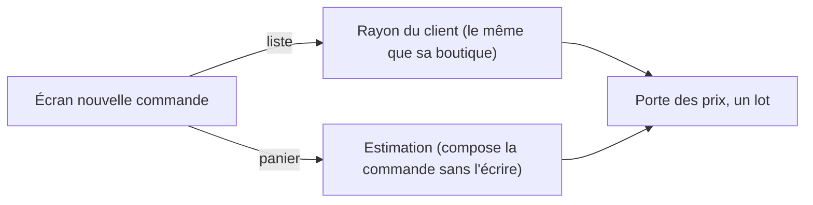

# Plan — la liste de la commande de l'équipe, au prix du client (P1)

> 📐 **Plan, 2026-11-11, contredit par `vitruve` le même jour** (trois
> BLOQUANTS, quatre SÉRIEUX — tous repris ci-dessous, § 6). Pas encore bâti. Demandé par Hugo : « comment je
> fais pour afficher le bon prix quand c'est l'équipe qui commande ? ». Ce plan
> touche l'affichage d'un prix : il passe par `vitruve` avant Hugo. État de
> l'existant : [`commande-passee-par-l-equipe.md`](commande-passee-par-l-equipe.md) § 8.

## 1. En simple

Quand l'équipe passe une commande pour un client
(`/comptes-clients/:id/nouvelle-commande`), l'écran a deux colonnes :

- **le panier**, à droite : il est déjà au prix du client — une estimation
  du serveur compose la commande qu'on passerait, sans l'écrire ;
- **la liste**, à gauche (le catalogue et les habitudes du client) : elle
  montre le **prix d'étiquette**, le même pour tous. Un client avec une
  mercuriale à −30 % voit, à gauche, un prix qui n'est pas le sien.

**Le geste** : la liste garde ses articles, ses familles et son tri, mais
chaque article y prend **le prix du rayon du client** — celui qu'il voit dans
son espace, barré quand une promotion ou une mercuriale le baisse. Un article réservé à un autre client est absent, comme dans sa boutique (le
défaut, `reserved_visibility = hidden`), ou verrouillé si l'article est réglé
`visible_locked` ; un article absent de son rayon est grisé, « pas proposé à ce
client ». C'est la règle « commander à la place du client »
(Hugo, 2026-11-03) : on voit ce qu'il verrait.

**Ce que la liste ne montre pas, et c'est assumé comme dans la boutique** : un
palier « à partir de 50 ». Le rayon tarife à la quantité 1
(`shop-catalogue-pricing.service.ts`, `withPrices`). Le panier, lui, calcule à
la quantité réelle.

## 2. Ce qui existe (vérifié le 2026-11-11)

- **La liste** : `apps/lfd-backoffice-frontend/src/app/commandes/catalog.service.ts`
  lit `GET /admin/catalog/sellable` (`orders/http/admin-catalog.controller.ts`,
  surface `b2b_orders`, `ListCatalogQuery`) → `CatalogItemView[]`, au tarif.
  L'écran le charge dans `nouvelle-commande-page.ts` (~l. 480), à côté des
  habitudes (`GET /admin/catalog/companies/:companyId`).
- 🔴 **`/admin/catalog/sellable` a d'autres lecteurs** : récapitulatif de
  production, prévisionnel, fiche d'atelier (JSDoc du contrôleur). On ne la
  change pas : elle reste le catalogue au tarif.
- **Le rayon d'un client** : `ShopCataloguePricing.priced(companyId,
"registered", language)` (`catalog/application/shop-catalogue-pricing.service.ts`)
  — lit ce que ce client a le droit de voir (`CatalogViewers.forShelf`,
  réservations, retraits, sous-compte via `pricingCompanyOf`), puis appelle
  **une fois** la porte des prix pour tout le lot (`Pricer.load`). Le lot ne
  tombe pas sur un article refusé : il ne contient que ce que ce client voit.
- **Le magasin des rayons pro** : `RecognisedShelf.read(key)`
  (`catalog/application/recognised-shelf.service.ts`), clé = la société,
  durée de vie 5 min au plus, purgé par `ShelfChanges`. C'est ce que lit la
  route reconnue de la boutique (`ReadMyShopCatalogueHandler`).

La raison qu'on donnait pour ne pas faire P1 (« un SKU refusé fait tomber le
lot ; un appel par SKU coûte trop cher ») ne tient donc pas : le rayon a déjà
résolu ces deux problèmes.

## 2 bis. Client et staff voient le même objet, par construction

La liste du staff ne recalcule rien : elle lit **le même rayon, sous la même
clé, au même cache** que la boutique du client (`RecognisedShelf.read`). Les
deux ne peuvent pas diverger, et toute optimisation du rayon (cache, lecture,
calcul) s'applique aux deux sans rien toucher ici.

- **La clé** est celle de la route reconnue du client. Vérifié au bâti le
  2026-11-11 : `@ActingCompany` rend la société résolue par `resolveCompany`
  (`platform/auth/resolve-company.ts`) — **la société elle-même**, site
  compris, jamais son principal — et `ReadMyShopCatalogueHandler` la passe
  telle quelle à `RecognisedShelf.read`. Le principal n'intervient qu'ensuite,
  dans le calcul (`ReservationHolders`, `pricingCompanyOf`). Il n'y a donc pas
  de fonction de clé à partager : la clé du staff est l'identifiant de la
  société, **une fois lu en base** (`ServedCompanyReader.servedOf`, désormais
  exporté par `CatalogModule`) — jamais rangée sans cette lecture.
- **Un e2e de parité** le tient : pour une société à mercuriale, un
  sous-compte et un article réservé, la table du staff est égale, SKU par SKU,
  au rayon reconnu du client. Une divergence future rougit.

## 3. Le bâti

**Le choix de forme (après `vitruve`, BLOQUANT 3)** : on ne remplace pas la
liste par le rayon. `catalogue` (`CatalogItemView[]`) nourrit le rangement par
famille, la reprise d'un brouillon, le stock du retrait immédiat et l'ajout
(`nouvelle-commande-page.ts` l. 228-233, 454, 527-539, 628-635) ; `ShopItemView`
n'a ni `family` ni `vatRate`. La route sert donc **une table de prix par
SKU**, que l'écran pose **par-dessus** la liste existante. Rien de ce qui
range, reprend ou ajoute ne change de type.

### L1 — serveur : les prix du rayon d'un client

- Contrat `CustomerShelfPricesView` (`packages/contracts/src/admin-order.ts`) :
  `{ items: [{ sku, unitPriceMillicents, struckFromMillicents | null,
unitPriceTtcCents, struckFromTtcCents | null, lockedReason | null }],
audience: "pro" | "public" }` (le TTC ajouté au bâti, 2026-11-11 : l'écran
  choisit HT ou TTC selon `audience`) — tiré du
  `ShopItemView` du rayon, rien d'autre (ni marge, ni trace).
- Requête `ReadCustomerShelfPricesQuery(companyId)`, **un fichier**
  (à créer, `orders/application/queries/read-customer-shelf-prices`), comme son
  voisin `read-my-shop-catalogue.ts`.
- 🔴 **La clé du cache se vérifie en base avant** `RecognisedShelf.read`
  (BLOQUANT 1) : la société est lue (port existant des comptes, à nommer au
  bâti) ; inconnue → 404 `ResourceNotFoundError` ; **terminée** → 409, avec
  le refus que la passation lèverait (`forBilling` la refuse,
  `catalog-viewers.service.ts:79`). Sans cette lecture, `forShelf` servirait
  le rayon public et le rangerait sous un identifiant venu de l'URL. Coût :
  une lecture de plus par ouverture d'écran.
- Route `GET /admin/catalog/companies/:companyId/shelf-prices`
  (`orders/http/admin-catalog.controller.ts`). **Droit : celui de
  l'estimation, `b2b_place_order:write`** — pas seulement `b2b_orders` en
  lecture : la route montre la mercuriale effective d'une société, et ne doit
  pas l'ouvrir à qui ne peut pas commander pour elle (SÉRIEUX « le mur »).
- `caller` : celui du rayon (`"shelf"`), inchangé (Q2) ; le cache est
  partagé avec le client, au même contenu (Q3).

### L2 — écran : le prix du client posé sur la liste

- `AdminCatalogService.shelfPricesOf(companyId)`, chargé en parallèle des
  autres lectures (`nouvelle-commande-page.ts` ~l. 480).
- Un `computed` qui joint `catalogue` et la table par SKU ; la liste
  (`source-produits.ts`) affiche le prix du client, barré si
  `struckFromMillicents`, un verrou si `lockedReason`, grisé si absent. Un
  article verrouillé ou absent ne s'ajoute pas.
- **Le prix d'un article suit l'audience du rayon**, comme dans la boutique :
  HT pour un pro, TTC pour un particulier (`audience` de la table). **Le
  total du panier suit le règlement**, comme aujourd'hui (`order-estimate.ts`,
  `orderTotalRows` : HT seul au compte, TTC au lien).
- Si la table n'arrive pas : la liste reste au prix d'étiquette **et le dit**
  (`fold-callout`, « prix du client indisponibles, le panier fait foi ») —
  jamais un prix d'étiquette présenté comme celui du client.
- **L2b — la modification d'une commande** (`modifier-commande-page.ts`,
  `revision-draft.ts`) prend la même table (SÉRIEUX) : deux écrans de saisie
  ne divergent pas.

### L3 — tests

- Requête : société inconnue → 404, terminée → 409, aucune lecture du rayon
  dans ces deux cas ; sinon la table reprend le rayon SKU par SKU.
- e2e : une société à −30 % de mercuriale lit, sur la route du staff, les
  mêmes prix que son principal sur `GET /shop/catalogue` reconnu ; un article
  réservé à une autre société est **absent** par défaut (`hidden`), et
  **verrouillé** (`reserved_to_other_account`) s'il est réglé `visible_locked` ; sans `b2b_place_order:write` → 403.
- Écran : prix barré, verrou, absent grisé non ajoutable, table en échec →
  bandeau et prix d'étiquette annoncés comme tels ; HT pour un pro, TTC
  pour un particulier.

## 4. Les réponses aux questions (vérifiées par `vitruve`)

- **Q1 — les SKU** : les mêmes. `all()` et `shownByShopSku` filtrent tous deux
  par `isShownAsTile` et indexent par `shopSkuOf` ; la passation résout les
  deux formes. La vente au poids porte les mêmes champs.
- **Q2 — `caller`** : celui du rayon.
- **Q3 — le cache** : 5 minutes de retard au plus, acceptable (prix
  d'étiquette ; la passation relit ; le panier vient de l'estimation).
- **Q4 — un particulier** : hors périmètre, l'écran est par société.
- **Q5 — `buyerKind`** : `registered` des deux côtés
  (`staff-order-preparation.ts:68`, `recognised-shelf.service.ts:84`). Seules
  les promotions d'acheminement diffèrent : mentionnées au rayon, appliquées
  par l'estimation — attendu.

## 5. Ce qu'on ne fait pas

- Pas de prix aux paliers dans la liste (cf. § 1).
- Pas de changement de `/admin/catalog/sellable` ni de ses autres lecteurs.
- Pas de calcul au navigateur.
- Pas de 404 sur les habitudes (`companies/:companyId`) : elles rendent une
  liste vide pour une société inconnue, et l'écran a déjà refusé la société
  par sa propre lecture du compte.

## 6. Ce que `vitruve` a relevé, et ce qui en est fait

| Objection                                                                    | Fait                                                                        |
| ---------------------------------------------------------------------------- | --------------------------------------------------------------------------- |
| BLOQUANT 1 — société inconnue servie au public et rangée sous une clé d'URL  | lecture en base avant le cache ; 404 / 409 (L1)                             |
| BLOQUANT 2 — un article réservé peut revenir verrouillé                      | comme le rayon : absent par défaut, verrouillé si `visible_locked` (L2, L3) |
| BLOQUANT 3 — remplacer `CatalogItemView` casse rangement, brouillon, retrait | table de prix posée par-dessus la liste (§ 3)                               |
| SÉRIEUX — le rayon applique opérations datées et réservations                | voulu (« ce qu'il verrait ») : verrouillé ou grisé                          |
| SÉRIEUX — la modification de commande resterait au tarif                     | L2b                                                                         |
| SÉRIEUX — les habitudes rendent vide là où la voisine rend 404               | assumé (§ 5)                                                                |
| SÉRIEUX — le mur : lecture de la mercuriale par `b2b_orders`                 | droit `b2b_place_order:write`, comme l'estimation (L1)                      |
| MINEUR — HT pour un pro                                                      | le prix suit l'audience du rayon ; le total, le règlement (L2)              |
| MINEUR — fichiers séparés                                                    | un fichier, comme le voisin (L1)                                            |

**Non vérifié par `vitruve`, à ouvrir au bâti** : la clé de cache d'un
sous-compte (site ou principal) côté `@ActingCompany` — ouvert le 2026-11-11 :
le site, cf. § 2 bis ; que `OrderDrafting`
tarife un sous-compte par `pricingCompanyOf` comme le rayon ; le contenu de
`source-produits.ts` et `immediate-pickup.ts`.
