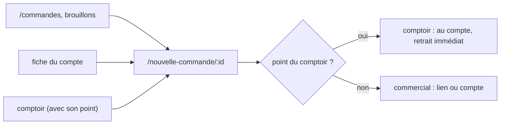

# Une seule saisie de commande pro

> **Doc d'état, 2026-11-21.** Décidé par Hugo le 2026-11-21 (« il faut
> simplifier ») ; le lien de règlement reste refusé au comptoir (E4).
> Contredit par vitruve avant le bâti.

## En simple

Une commande pro se saisit sur **une seule page**, à **une seule adresse** :
`/nouvelle-commande/:id`. On y arrive par la liste des commandes, l'onglet
Brouillons, la fiche du compte ou le comptoir. Ce qui change selon d'où l'on
vient tient à une seule chose : **le comptoir passe son point de retrait**.

|                       | Avec le point du comptoir                                      | Sans point                             |
| --------------------- | -------------------------------------------------------------- | -------------------------------------- |
| Règlement             | au compte (le lien est refusé, E4)                             | lien ou compte                         |
| Retrait immédiat      | proposé (avec `handover_counter:write`)                        | non                                    |
| Trace sur la commande | « comptoir »                                                   | « commercial »                         |
| Lien retour           | le choix du compte                                             | l'écran d'où l'on vient                |
| Après validation      | le choix du compte, qui montre le lien et l'issue de la remise | la commande, dans le dossier du compte |

## Technique

- **L'origine** : `orderEntryOriginOf(point, canCounter)`
  (`apps/lfd-backoffice-frontend/src/app/commandes/nouvelle-commande/order-entry-origin.ts`)
  — `counter` quand `?point=` est là **et** que la personne a
  `b2b_counter:read` ; sans ce droit, un point tapé dans l'adresse fabriquerait
  la trace. Plus d'origine en `data` de route.
- **Le serveur ne change pas** : `entryOrigin: counter` refuse le lien
  (`ensureCounterSettlement`, `orders/domain/services/order-supply-rules.ts`)
  et garde ses refus du compte propres au comptoir.
- **Le client** se lit selon les droits de la personne : la fiche
  (`CommercialOrderEntrySource`) avec `b2b_companies:read`, le détail du
  comptoir (`CounterOrderEntrySource`) sinon.
- **La garde** de `/nouvelle-commande/:id` : `b2b_place_order:write` et l'un de
  `b2b_companies:read` ou `b2b_counter:read`. Le choix du compte
  (`/nouvelle-commande/pro`) reste au comptoir (`b2b_counter:read`), parce qu'il
  lit `GET /admin/counter/customers`.
- **Le retour** : `backLinkOf(origin, retour)` reprend l'adresse exacte de
  `?retour=` (paramètres compris, « Ses commandes » pour la fiche) ; au
  comptoir, le choix du compte, l'origine et le point suivant.
- **L'ancienne adresse** `/comptes-clients/:id/nouvelle-commande` renvoie vers
  `/nouvelle-commande/:id?retour=/comptes-clients/:id/commandes`. Les anciennes
  adresses du comptoir (`/comptoir/nouvelle-commande/:rest`) arrivent sans
  point, donc en mode commercial.

## Ce qui reste à part

- La saisie particulier (`/nouvelle-commande/particulier`), avec son panier.
- Le choix du compte, réservé au comptoir.
