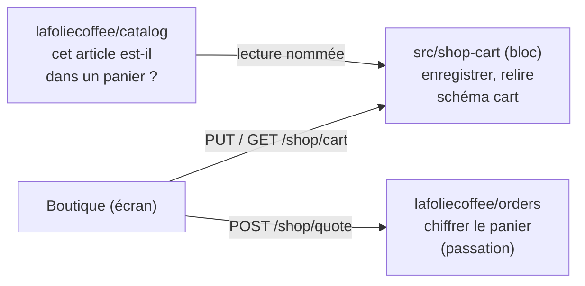

# Plan — le panier sort de `orders`, avec son schéma

> **Plan, 2026-11-20.** Candidat §2.4 de
> [`domaines-a-decouper.md`](domaines-a-decouper.md). Rien n'est bâti. Chaque
> affirmation sur l'existant a été ouverte le 2026-11-20 ; les chemins sont
> relatifs à `apps/lfd-api/` sauf mention. Contredit par `vitruve` le
> 2026-11-20 : deux bloquants et quatre sérieux, tous repris ci-dessous (§3).
> **Deux questions restent à Hugo** (§2.5).

## Partie 1 — l'idée simple

Le panier, c'est ce qu'un client met de côté **avant** de commander, pour le
retrouver sur un autre appareil. Il n'a aucune règle : on l'enregistre en
entier, on le relit. Il vit aujourd'hui dans `orders` parce qu'il y est né, pas
parce qu'il en a besoin.

On le sort dans son propre contexte, avec sa propre table dans son propre
schéma Postgres. La commande ne change pas : le **chiffrage** du panier (« que
coûterait-il si je commandais maintenant ? ») reste au commerce, parce que
c'est le calcul même de la passation.



## Partie 2 — la partie technique

### 2.1 Ce qui existe (ouvert le 2026-11-20)

| Fichier (`src/lafoliecoffee/orders/…`)                     | Rôle                                                    |
| ---------------------------------------------------------- | ------------------------------------------------------- |
| `application/commands/save-shop-cart.{command,handler}.ts` | remplace le panier (personne, espace)                   |
| `application/queries/get-shop-cart.{query,handler}.ts`     | relit, ou `null`                                        |
| `domain/ports/shop-cart.repository.ts`                     | `find` / `save`, sans agrégat (aucun invariant)         |
| `infrastructure/prisma-shop-cart.repository.ts`            | `INSERT … ON CONFLICT` brut sur `"public"."shop_carts"` |
| `http/shop-cart.controller.ts`                             | `GET` / `PUT /shop/cart`, `@Idempotent`                 |

- **Table** `public.shop_carts` (`prisma/schema/public/orders.prisma`, modèle
  `ShopCart`) : `user_id` → `users` et `company_id` → `companies`, les deux en
  `ON DELETE CASCADE`. L'unicité `(user_id, company_id) NULLS NOT DISTINCT`
  (`shop_carts_user_company_unique`) vit dans la migration
  `20260915180000_panier_par_espace`, pas dans le schéma Prisma.
- **Un seul lecteur extérieur** :
  `catalog/infrastructure/prisma-sale-reference-usage.ts:54` lit
  `prisma.shopCart` en direct (« ce SKU est-il dans un panier ? »).
- **Tests** : `test/shop-cart.e2e-spec.ts` (compte les lignes en Prisma),
  `test/sale-reference-usage.e2e-spec.ts:54` (sème un panier par
  `prisma.shopCart.create`).
- **Le chiffrage ne part pas** : `cart-adjustments.service` est importé par la
  passation, la composition, le brouillon, le devis et le contexte de prix ;
  `shop-cart-quoting.service` et `quote-*-shop-cart` sont le devis de la
  passation. Ils restent dans `orders` (« une seule arithmétique »).
- **Aucun effacement physique de compte** en production : le seul
  `user.deleteMany` est dans `src/dev/seeding/reset.seed.ts`.

### 2.2 Décisions

- **D1 — un bloc `src/shop-cart/`**, pas un contexte de `lafoliecoffee`.
  C'est la seule forme où une porte tient la frontière :
  `lint:prisma-model-ownership` raisonne par **bloc**
  (`dev-toolbox/gates/prisma-model-ownership.mjs`, `BLOCKS`), et deux contextes
  d'un même bloc y partagent leurs tables ; `lint:context-boundaries` ne
  connaît aucun sous-contexte de `lafoliecoffee`. Un contexte interne serait
  donc une frontière de discipline seulement. Le prix : une ligne et une
  colonne dans la matrice du CLAUDE.md §3 — `lafoliecoffee → shop-cart : port
uniquement` (la lecture du catalogue, D6), `shop-cart` n'important que
  `staff` (autorisation) et `platform`. Le panier n'a besoin de rien du
  commerce : le devis reçoit les lignes de l'écran (`POST /shop/quote`), il ne
  relit pas le panier enregistré.
- **D2 — un schéma Postgres `cart`.** C'est ce qui rend la frontière physique
  côté données : `lint:cross-schema-join` refusera une jointure
  `public × cart`, et `lint:prisma-schema-layout` exigera
  un fichier `cart` (`.prisma`, à créer sous `prisma/schema/`).
- **D3 — aucune clé étrangère ne sort de `cart`.** `user_id` et `company_id`
  deviennent des identifiants opaques, comme dans `card_payment`. La cascade
  disparaît. Ce qu'on perd : rien en production aujourd'hui (§2.1, aucun
  effacement physique) ; le jour où l'effacement RGPD d'un compte existera, il
  devra vider ses paniers — par un abonné durable au fait d'effacement, à
  écrire **avec** cet effacement, pas avant. Deux effaceurs hors production
  laisseraient des orphelins, et les traitent : `src/dev/seeding/reset.seed.ts`
  (l. 231-232, `deleteMany` sur sociétés et personnes) vide d'abord
  `cart.shop_carts` avec le même filtre (`user_id IN userIds OR company_id IN
companyIds`) ; `test/principal-stamp.e2e-spec.ts` (`DELETE` brut sur `users`
  et `companies`) ne sème aucun panier, et l'orphelin y est sans effet.
- **D4 — `order_drafts` reste dans `orders`.** Le brouillon appartient à la
  société, se partage dans l'équipe, est saisi au back-office et devient une
  commande. C'est la saisie d'une commande, pas un panier.
- **D5 — pas de gestes « ajouter » / « retirer » un produit.** Le panier n'a
  aucune règle à tenir (le handler le dit : « aucune règle, et c'est la
  règle »). La boutique tient sa copie dans le navigateur, la fusionne à la
  première visite reconnue et écrit le panier entier en différé ; un geste par
  ligne multiplierait les appels sans rien refuser de plus. Ces gestes
  viendront le jour où une règle existera (un plafond par produit dans un
  panier, une réservation de stock), et ce contexte sera le bon endroit.
- **D6 — le catalogue lit par une lecture nommée.** Le bloc déclare et
  implémente dans `shop-cart/channels/commerce/` le port
  `ShopCartSkuUsage.skusInCarts(skus): Promise<ReadonlySet<string>>` — les SKU
  de la liste présents dans au moins un panier, le contrat exact
  d'`inPayloads` aujourd'hui, avec la même requête sur le `payload`. Le
  catalogue l'appelle à la place de `prisma.shopCart`. Dans le même fichier,
  `orderLine`, `orderDraft`, `subscriptionLine`, `priceRule`… restent lus en
  Prisma direct : ce sont des tables du même bloc `lafoliecoffee`, ce que la
  porte admet. Le panier y est seul en port parce qu'il est seul à changer de
  bloc, pas par cérémonie.

### 2.3 Lots

**K1 — la migration.** Elle **déplace** la table et retire deux clés : elle
n'est pas additive (Q1, §2.5).

```sql
CREATE SCHEMA IF NOT EXISTS "cart";
ALTER TABLE "public"."shop_carts" DROP CONSTRAINT "shop_carts_user_id_fkey";
ALTER TABLE "public"."shop_carts" DROP CONSTRAINT "shop_carts_company_id_fkey";
ALTER TABLE "public"."shop_carts" SET SCHEMA "cart";
```

`SET SCHEMA` emporte la clé primaire et les index, dont
`shop_carts_user_company_unique` (`NULLS NOT DISTINCT`), sans copie de
données. Les noms des deux contraintes sont ceux des migrations
`20260906100000…` (l. 33) et `20260915180000…` (l. 42) ; `lecteur-de-migrations`
les confronte à la production (`\d public.shop_carts`) avant `main`.

Retour arrière (`prisma/rollback/`, fichier du lot) : purger d'abord les
paniers orphelins (`user_id` sans personne, `company_id` sans société), puis
`SET SCHEMA "public"` et recréer les deux clés — sans la purge, la
recréation échoue.

Dans le même lot :

- `cart` ajouté à `schemas` de `datasource.prisma` (la remise à zéro e2e le
  lit, rien d'autre à faire) ;
- modèle déplacé dans un fichier `cart` (`.prisma`, à créer sous `prisma/schema/`) (`@@schema("cart")`, sans
  relation), avec le commentaire sur l'unicité que `migrate dev` proposera de
  supprimer ; relations `shopCarts` retirées de `User` et `Company` ; le renvoi
  de `public/promotions.prisma:140` suit ;
- `ShopCart: "cart"` dans `NON_PUBLIC_SCHEMA_OF_MODEL`
  (`src/platform/database/schema-ops.counter.ts`), que ses tests confrontent au
  schéma ;
- `prisma/rollback/20261029180000_le_defaut_se_vend_sous_sa_reference.sql:272`
  cite `public.shop_carts` en dur : la ligne passe à `cart.shop_carts`, sans
  quoi ce retour arrière échoue après K1. Les `migration.sql` appliquées ne se
  touchent pas ;
- l'`INSERT` brut pointe `"cart"."shop_carts"`.

**K2 — le bloc.** Les cinq fichiers et leurs tests vont dans
`src/shop-cart/` (mêmes couches), avec un `ShopCartModule` importé par
`AppModule` (`appBootstrap/`). `orders.module.ts` perd la liaison du port et le
contrôleur. Les portes connaissent le bloc **avant** le déménagement :
`shop-cart` ajouté à `BLOCKS` de `prisma-model-ownership.mjs` et à la matrice
de `context-boundaries` — sans quoi le déménagement désarme la porte qu'il
invoque. La
route reste `/shop/cart`, le contrat `@lfd/contracts` ne change pas.

**K3 — la lecture du catalogue.** `ShopCartSkuUsage` (D6) ;
`prisma-sale-reference-usage.ts` l'appelle ; les deux e2e sèment et comptent
par le port ou la route, plus par `prisma.shopCart`.

**K4 — la doc.** Le propriétaire de `ShopCart` se déduit de qui l'écrit :
rien à déclarer à `prisma-model-ownership`. Le CLAUDE.md (§1 liste des
schémas, §3 arborescence et matrice) et §2.4 de `domaines-a-decouper.md`
marqué bâti.

### 2.5 Questions à Hugo

- **Q1 — un trou de quelques secondes au déploiement.** Entre le
  `migrate deploy` de K1 et le démarrage du nouveau conteneur, l'ancien code
  écrit dans `public.shop_carts`, qui n'existe plus : `GET` et `PUT
/shop/cart` répondent 500. La boutique garde sa copie dans le navigateur et
  la reverse au prochain enregistrement, donc rien n'est perdu. **Recommandé :
  l'accepter**, en pré-release (CLAUDE.md §0, 2026-10-04). Sinon : trois
  déploiements (une vue `public.shop_carts` le temps de la bascule).
- **Q2 — un bloc plutôt qu'un contexte** (D1). Recommandé : le bloc, seule
  forme qu'une porte tient ; l'alternative est un contexte de `lafoliecoffee`
  dont la frontière ne tient que par discipline.

### 2.4 Vérification

- `pnpm --filter lfd-api test -- shop-cart sale-reference-usage` (e2e ciblés) ;
- `pnpm gate prisma-model-ownership cross-schema-join prisma-schema-layout context-boundaries` ;
- `lecteur-de-migrations` sur K1 avant toute promotion vers `main`.

## 3. Ce que `vitruve` a relevé (2026-11-20)

| Gravité  | Objection                                                                                | Reprise          |
| -------- | ---------------------------------------------------------------------------------------- | ---------------- |
| BLOQUANT | `prisma-model-ownership` raisonne par bloc : un contexte interne n'aurait aucune porte   | D1 → un bloc, Q2 |
| BLOQUANT | `NON_PUBLIC_SCHEMA_OF_MODEL` oublié                                                      | K1               |
| SÉRIEUX  | 500 entre migration et conteneur ; « additive » faux                                     | K1, Q1           |
| SÉRIEUX  | retour arrière impossible avec des orphelins ; seed et e2e qui effacent                  | D3, K1           |
| SÉRIEUX  | `prisma/rollback/20261029180000…:272` cite `public.shop_carts`                           | K1               |
| SÉRIEUX  | D6 seul en port dans un fichier qui lit d'autres tables en direct ; contrat du port flou | D6               |

Non vérifié par lui comme par moi : une vérification de dérive `migrate diff`
en CI que le déplacement ferait rougir — à regarder au début de K1.
