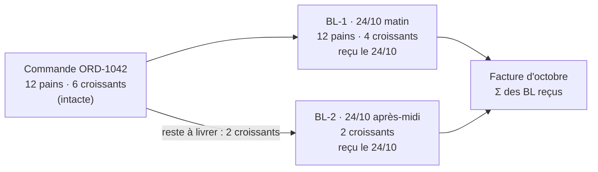

# Plan — commande, bon de livraison, facture : trois documents

> **Doc-first, 2026-10-24.** Décision de Hugo le même jour : « fais le modèle
> ERP avant le lancement ». Touche **l'argent**, porte des **migrations de
> données** et finira dans un **runbook** : `vitruve` avant Hugo, puis un plan
> détaillé (et un `vitruve`) **par lot**. Ce document fixe le modèle, les
> invariants et l'ordre ; il ne remplace pas les plans de lot. **Rien n'est
> bâti.**
>
> Il remplace la piste « commande de suite liée » de
> [`modification/plan-commandes-incompletes.md`](modification/plan-commandes-incompletes.md)
> (v1 à v3, contredites trois fois le 2026-10-24) : le reliquat redevient ce
> que Hugo avait dit d'abord, **la suite de la même commande**.

## 0. Pourquoi

Aujourd'hui **la commande sert de bon de livraison** : la facture somme ses
lignes, la date de réception est la sienne, le QR, la fiche de colisage et
l'arrêt de tournée sont les siens. Tant que tout part complet, ça ne se voit
pas. Dès que ce qui part diffère de ce qui est commandé, il n'y a nulle part où
l'écrire — et chaque tentative de le loger dans la commande heurte une règle
juste, posée pour le cas complet.

Les systèmes de gestion séparent trois documents, et ce plan fait de même :

| Document                  | Dit                      | Naît                  | Change                                                  |
| ------------------------- | ------------------------ | --------------------- | ------------------------------------------------------- |
| **Commande**              | ce que le client demande | à la passation        | par avenant (révision), jamais par la réalité du départ |
| **Bon de livraison** (BL) | ce qui part, en une fois | à la fermeture du bac | jamais : un BL partiel est suivi d'un autre BL          |
| **Facture**               | ce qu'on fait payer      | à l'émission          | jamais (avoir)                                          |

## 1. Le modèle

**Les invariants**

1. Une commande a **zéro, un ou plusieurs** BL ; un BL appartient à **une**
   commande.
2. Pour chaque ligne : **livré = Σ des quantités des BL**, **reste à livrer =
   commandé − livré**, jamais négatif (la base le tient).
3. Une ligne de BL recopie le **prix unitaire et le taux** de la ligne de
   commande : un reliquat garde les conditions de prix, par construction.
4. **La facture somme des BL**, jamais des commandes. Un BL ne se facture
   qu'une fois.
5. **La date de réception est celle du BL** (le jour où il change de mains).
6. Une commande est **soldée** quand plus rien ne reste à livrer, ou quand le
   reste est **abandonné** par décision (Q-E3) — jamais avant.
7. Une commande complète a **exactement un BL**, identique à ses lignes : le
   cas courant ne change pas de forme, il gagne un document.

## 2. Les termes au panier (décision Q-I2 de Hugo, reprise)

Remise en pourcentage : appliquée **par BL**, à son sous-total. Montants fixes
(remise fixe, port, surtaxe) : portés **entiers par le premier BL**. Un BL de
reliquat n'a ni port ni surtaxe. La TVA se ventile **par BL**
(`invoice-order-split.ts` travaille aujourd'hui par bon : il passe au BL).

## 3. Ce qui bascule, bloc par bloc

Inventaire ouvert le 2026-10-24 (comptes par `grep -l`, hors tests et client
généré) ; chaque plan de lot le **rouvre** fichier par fichier.

| Où                 | Aujourd'hui (ouvert)                                                                                                                                                                                          | Demain                                                                                                                                                    |
| ------------------ | ------------------------------------------------------------------------------------------------------------------------------------------------------------------------------------------------------------- | --------------------------------------------------------------------------------------------------------------------------------------------------------- |
| Colisage           | une `packing_order` par `(service_day, order_id)` (`packing.prisma`), lignes `packing_line` à la quantité due figée par `packing_list_drawn` ; `seal` exige tout réparti                                      | une **préparation** par BL à venir : clé élargie d'un rang ; `seal` d'une préparation **crée le BL** avec le contenu réel des contenants                  |
| Fait « bac fermé » | `PackingOrderPackedEvent`, clé `packing.order_packed:<orderId>`, sans quantités ; une refermeture après « Rouvrir » est absorbée, un rescan publie `…:reannounced:<instant>` (`production/channels/packing/`) | clé par préparation, **porte les lignes** du BL                                                                                                           |
| Commerce           | `MarkOrderReady` à la fermeture ; `ready` / `fulfilled` sur la commande                                                                                                                                       | le BL est `prêt` puis `remis` ; la commande passe `ready` dès un BL prêt, `fulfilled` quand **soldée**                                                    |
| Retrait            | `handoverToken` unique sur `orders` (11 fichiers le lisent) ; `order_handover` unique par `order_id` (bloc `handover`)                                                                                        | le QR **reste celui de la commande** (Q-E1) ; il remet **le BL prêt** ; la preuve devient par BL                                                          |
| Livraison          | `DeliveryRoundStop.orderId` (nullable, sans unicité vue)                                                                                                                                                      | un arrêt **par BL**                                                                                                                                       |
| Date de réception  | `orders.received_on` + deux CHECK + déclencheur figé ([`la-commande/date-de-reception.md`](la-commande/date-de-reception.md)), 26 fichiers lisent `receivedOn`                                                | `received_on` **sur le BL**, mêmes règles ; la commande la dérive (Q-E2)                                                                                  |
| Facture            | `invoice_order` (pk `(invoice_id, order_id)`, `invoice_order_invoiced_once`) ; 37 fichiers citent `invoice_order` ; la facture relit lignes et totaux de la commande (`frozen-invoice-order.mapper.ts`)       | `invoice_delivery_note` (pk `(invoice_id, delivery_note_id)`, un BL facturé une fois) ; les lignes et totaux se lisent **sur le BL**, figés à sa création |
| Bon imprimé        | le bon de commande (`order-sheet.ts`)                                                                                                                                                                         | le bon de commande reste ; **le BL a son PDF** (« commandé / livré / reste »)                                                                             |
| Fournil            | compte à produire lu sur les commandes (`plan-filter.ts`, `planWhere`)                                                                                                                                        | inchangé pour la commande ; le **reste à livrer** d'un même jour entre au compte par l'ajout tardif (lot E7)                                              |

## 4. La migration (pré-release)

On est en pré-release (CLAUDE.md § 0, corrigé le 2026-10-04) : un contrat peut
casser dans le même déploiement. Ce qui reste vrai : **aucune donnée détruite**.

- Chaque commande **remise** reçoit **un** BL = ses lignes, sa `received_on`,
  ses totaux ; chaque ligne `invoice_order` reçoit sa ligne
  `invoice_delivery_note` vers ce BL. Une facture émise **recalculée sur ses
  BL rend le même centime** : la migration le **vérifie** et échoue sinon.
- Les colonnes de la commande (`received_on`, `handed_over_at`…) restent en
  base, mortes, jusqu'à un ordre de Hugo (CLAUDE.md § 0 : « une colonne morte
  reste en base »).

## 5. Lots, dans l'ordre

Chaque lot a son plan détaillé et son `vitruve` avant d'être bâti.

| Lot | Contenu                                                                                                                                                                            | Pourquoi à ce rang                        |
| --- | ---------------------------------------------------------------------------------------------------------------------------------------------------------------------------------- | ----------------------------------------- |
| E1  | Le BL : tables, agrégat, invariants 1–3 et 7 ; **créé à la fermeture du bac** pour toute commande, en ombre (personne ne le lit)                                                   | le document existe avant qu'on s'y appuie |
| E2  | Rattrapage : un BL par commande déjà remise                                                                                                                                        | E3 doit trouver un BL partout             |
| E3  | La date de réception sur le BL ; le retrait et la livraison remettent le BL                                                                                                        | la facture date des BL                    |
| E4  | **La facture lit les BL** ; `invoice_delivery_note` ; migration des factures émises avec contrôle au centime                                                                       | le cœur de l'argent, seul dans son lot    |
| E5  | Le PDF du BL ; « commandé / livré / reste » sur les écrans                                                                                                                         | le client voit ce qui part                |
| E6  | Le manque : signaler au colisage, décider (permission), BL partiel, reste à livrer — décisions de [`modification/commandes-incompletes.md`](modification/commandes-incompletes.md) | le premier BL partiel                     |
| E7  | Le reliquat : seconde préparation (même jour : ajout tardif au fournil et au colisage), BL-2                                                                                       | le second BL                              |
| E8  | Solder : abandonner un reste par décision ; commande `fulfilled` quand soldée                                                                                                      | ferme le cycle                            |
| E9  | Particulier payé par carte : rembourser un reste abandonné (attend M2)                                                                                                             | l'argent rendu                            |

## 6. Questions pour Hugo

- **Q-E1.** Le QR reste **celui de la commande** (le client garde un seul QR ;
  le comptoir remet le BL prêt) — proposé — ou un QR par BL ?
- **Q-E2.** « Reçue le » d'une commande en plusieurs BL : la date du
  **dernier** BL (proposé : la commande est reçue quand elle est soldée) ?
- **Q-E3.** Abandonner un reste à livrer : même permission que la décision de
  départ incomplet (proposé) ?
- **Q-E4.** Le numéro du BL : `BL-1042-1`, `BL-1042-2` (proposé : lisible avec
  la commande) ?

## 7. Contradiction de `vitruve` (2026-10-24) — l'emporte sur les § 1 à § 5

Le modèle tient ; il manquait des règles. Corrigées ici, chacune devient une
règle du modèle et non un détail de lot.

**BLOQUANT 1 — une commande remise sans être passée au colisage.**
`handoverBlocker` (`handover/domain/services/handover.ts`) ne refuse que
`cancelled`, `draft`, déjà retirée, non réglée, retenue qualité : une commande
`placed` jamais mise au bac se remet aujourd'hui. **Règle** : si on remet une
commande qui n'a **aucun BL préparé**, le retrait **crée un BL plein** (toutes
les lignes restant à livrer) dans la même unité de travail. Le colisage n'est
pas la seule naissance d'un BL ; il est la seule naissance d'un BL **partiel**.
Q-E5 : ce cas doit-il rester permis ?

**BLOQUANT 2 — rouvrir un bac.** **Règle** : un BL a deux états, **préparé**
puis **remis**. Préparé, il appartient à sa préparation : « Rouvrir » l'**annule**
(il reste en base, annulé, jamais supprimé) et la refermeture en crée un neuf,
au contenu du moment. Remis, il ne change plus jamais. Le BL est clé par
**préparation** : un rescan ou une réannonce de la même préparation ne crée
rien (idempotent), et le fait « bac fermé » porte l'identifiant de la
préparation et ses lignes.

**BLOQUANT 3 — la facture carte et l'ordre des bascules.** Une commande carte
est encaissée en entier à la passation. **Règle** : la facture carte (380)
s'émet quand la commande est **soldée**, et somme ses BL ; un reste abandonné
se rembourse (E9). L'invariant « un BL ne se facture qu'une fois » se tient
par la même table pour la carte et le mensuel. **Ordre** : E3 pose la date et
le retrait sur le BL **et continue d'écrire** `orders.handed_over_at` /
`received_on` (au **premier** BL remis, que le déclencheur figé tient déjà) ;
E4 bascule **ensemble** tous les lecteurs de la facture, du relevé, du
prélèvement, du dossier et de la procédure (`monthly-invoicing.ts`,
`card-invoicing.ts`, `collection-procedure-invoices.ts`,
`invoice-dossier-history*.ts`, `prisma-procedure-orders.reader.ts`, et ce que
le plan d'E4 recomptera). Aucun état intermédiaire ne laisse une commande
reçue invisible.

**SÉRIEUX, corrigés :**

- **« Reçue le » de la commande** : en base, la colonne de la commande garde
  le **premier** BL remis (compatibilité, figée) jusqu'à sa mort après E4 ;
  à l'écran, une commande soldée affiche la date de son **dernier** BL,
  dérivée. Q-E2 tranche l'affichage, pas la colonne.
- **Le retrait par BL** est le cœur d'E3 : `order_handover` (unique par
  commande), le refus « déjà retirée » et les preuves à la porte
  (`handover-attestation.service.ts`, `handover-proof-exhibit.ts`,
  `prisma-handover-proof.reader.ts`) passent au BL.
- **L'argent sur plusieurs BL — règle d'allocation, pas de recalcul.** Les
  termes du panier (remises, port, surtaxe) restent **calculés une fois sur la
  commande**, comme aujourd'hui, puis **alloués** aux BL : les montants fixes
  au premier BL ; une remise en pourcentage au prorata du sous-total livré,
  par la méthode du plus fort reste. Conséquence vérifiable : **pour une
  commande entièrement livrée, Σ des BL = la commande, au centime**, quel que
  soit le nombre de BL. Pour un reste abandonné, la remise en pourcentage
  suit le livré. La TVA se ventile par BL à partir de ces montants alloués.
  Le contrôle « même centime » de la migration vaut alors pour toute commande,
  pas seulement les commandes à un BL.
- **Livraison** : passer à un arrêt par BL migre les tournées existantes —
  ajouté à E3.
- **Point de non-retour** : après E4, des factures sont émises sur des BL ;
  revenir à `invoice_order` demanderait de réécrire des pièces émises. E4 se
  déploie seul, après une relecture `lecteur-de-migrations`, et Hugo le sait.

**Non vérifié par `vitruve`, à rouvrir au plan de lot** : les comptes du § 3
(son grep a échoué sous zsh), `invoice-order-split.ts`,
`frozen-invoice-order.mapper.ts`, Factur-X, `order-sheet.ts`, la création des
commandes du comptoir et à 0 €, l'unicité SQL des arrêts.

## 8. Questions pour Hugo (s'ajoutent au § 6)

- **Q-E5.** Remettre une commande jamais passée au colisage (le retrait crée
  alors un BL plein) : à garder (proposé, c'est le comportement d'aujourd'hui)
  ou à interdire ?

## 9. Décisions de Hugo (2026-10-24)

- **Q-E1 — oui** : le QR reste celui de la commande ; le comptoir remet le BL
  prêt.
- **Q-E2 — oui** : une commande soldée affiche « Reçue le » à la date de son
  dernier BL (dérivée ; la colonne de la commande garde le premier, § 7).
- **Q-E3 — oui** : abandonner un reste à livrer demande la même permission que
  décider d'un départ incomplet.
- **Q-E4 — oui** : les BL se numérotent `BL-1042-1`, `BL-1042-2`.
- **Q-E5 — oui** : une commande remise sans être passée au colisage reçoit un BL plein au retrait.
- Lot E1 : [`plan-e1-bon-de-livraison-prevu.md`](plan-e1-bon-de-livraison-prevu.md) — BL prévu à l'arrêt du plan (idée de Hugo, 2026-10-24).
