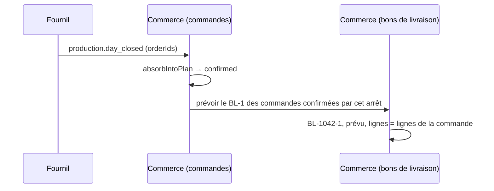

# Plan E1 — le bon de livraison prévu, né à l'arrêt du plan

> ✅ **Bâti le 2026-10-24** (contexte `apps/lfd-api/src/b2b/delivery-notes/`,
> migration `20261024190000_le_bon_de_livraison_prevu`, relue par
> `lecteur-de-migrations` : additive). Choix du bâtisseur que le plan ne
> disait pas : `plannedAt` figé à la première prévision ; l'ordre des lignes
> suit leurs identifiants ; la réannonce n'est éprouvée qu'en test
> d'application.

> **Doc-first, 2026-10-24.** Premier lot de
> [`plan-commande-bon-de-livraison-facture.md`](plan-commande-bon-de-livraison-facture.md).
> Porte une **migration** (tables neuves, additive) : `vitruve`, puis
> `lecteur-de-migrations` au bâti. **Rien n'est bâti.** E1 est une **ombre** :
> le BL existe, personne ne le lit.

## 0. Ce qui existe (ouvert le 2026-10-24)

- **L'arrêt du plan** publie `ProductionDayClosedEvent`
  (`production/channels/commerce/production-day-closed.event.ts`), fait
  durable `production.day_closed`, payload `{ serviceDay, closedAt, orderIds,
reannouncedAt, resupplyIds }`. `orderIds` est l'instantané compté par le
  fournil. Une **réannonce** (retirage) a sa propre clé et peut ajouter des
  commandes.
- **Le commerce l'écoute** par `OnProductionDayClosed`
  (`b2b/orders/application/handlers/on-production-day-closed.handler.ts`,
  abonné `b2b.orders.absorb-into-plan`), qui appelle
  `OrderRepository.absorbIntoPlan` : `updateMany` sur `id IN orderIds`, la
  date du jour, et `planWhere()` (statut `placed`, règlement ni mort ni en
  vol), vers `confirmed` (`b2b/orders/infrastructure/prisma-order.repository.ts`).
  Les commandes filtrées par `planWhere` ne passent pas `confirmed`.
- **Une ligne de commande** fige `sku`, `productNameSnapshot`,
  `unitPriceMillicents`, `vatRate`, `quantity`, `lineTotalCents` et leurs
  pendants TTC (`OrderLine`, `prisma/schema/public/orders.prisma`).
- **La révision M1** refuse une commande inscrite au fournil
  (`order-revisability.ts`, `standingBlockOf` ; `revise-order.handler.ts`,
  `noteAtBakery`) : après l'arrêt, les lignes d'une commande ne bougent plus
  par révision.
- **Le commerce publie** `order-cancelled.event.ts` à l'annulation
  (`b2b/orders/domain/events/`).

## 1. Ce que fait E1

À l'arrêt du plan, **chaque commande que l'arrêt fait passer `confirmed`
reçoit son BL-1, prévu, égal à ses lignes.** Rien d'autre ne change : aucun
écran, aucune facture, aucun retrait ne le lit.

- **Même unité de travail que l'absorption** : `OnProductionDayClosed` absorbe,
  puis appelle la prévision pour les commandes de l'instantané **désormais
  `confirmed` et sans BL**. Un BL n'existe jamais pour une commande que
  l'arrêt n'a pas confirmée.
- **Idempotent** : unicité `(order_id, rank)`. Une seconde livraison du fait,
  une réannonce, un rescan ne créent rien de plus ; une réannonce qui ajoute
  des commandes leur prévoit leur BL.
- **Annulée après l'arrêt** : le BL prévu passe **annulé** (jamais supprimé),
  dans l'unité de travail de l'annulation.

## 2. Le modèle

Nouveau contexte `b2b/delivery-notes/` (le langage : « bon de livraison »).

**`DeliveryNote`** (agrégat) — `id`, `orderId`, `rank` (1, 2…), `number`
(`BL-1042-1` : le numéro de la commande sans son préfixe `ORD-`, puis le rang ;
Q-E4), `status` (`planned` · `prepared` · `handed_over` · `voided`), `plannedAt`,
`voidedAt`. E1 n'écrit que `planned` et `voided` ; les autres arrivent aux lots
suivants.

**`DeliveryNoteLine`** — `noteId`, `orderLineId` (la ligne de commande dont
elle procède), `sku`, `productName`, `unitPriceMillicents`, `vatRate`,
`quantity`, `lineTotalCents`, et les pendants TTC : **recopiés** de la ligne de
commande (invariant 3 du plan-cadre).

Factory `DeliveryNote.planFromOrder(order)` : refuse une commande sans ligne ;
une ligne à quantité 0 n'est pas recopiée.

**Base** : `delivery_note` (unicité `(order_id, rank)`, `number` unique, CHECK
`rank >= 1`) ; `delivery_note_line` (CHECK `quantity > 0`, unicité
`(note_id, order_line_id)`) ; énuméré `DeliveryNoteStatus`. Pas de clé
étrangère vers `order_lines` en `CASCADE` : `RESTRICT`, un BL ne disparaît pas
avec une ligne.

## 3. Ce qu'E1 ne fait pas

Pas de totaux sur le BL (l'allocation des termes du panier arrive en E4) ; pas
de `prepared` (E3 avec le colisage) ; pas de rattrapage des commandes déjà
confirmées ou remises (E2) ; pas de lecture.

## 4. Tests

- Domaine : `planFromOrder` recopie prix, taux, quantités ; refuse sans ligne.
- Handler : l'absorption puis la prévision, dans la même unité de travail ;
  une commande filtrée par `planWhere` n'a pas de BL ; une seconde livraison
  ne crée rien.
- E2E : arrêt d'un plan → un BL-1 par commande confirmée, lignes égales ;
  réannonce avec une commande ajoutée → son BL ; annulation après l'arrêt →
  BL annulé.

## 5. Questions

- **Q-E1-1.** Le BL d'une commande au numéro ancien (`ORD-MV84O2XA-Y9W3`) :
  `BL-MV84O2XA-Y9W3-1` (proposé : la même règle, sans cas à part) ?

## 6. Contradiction de `vitruve` (2026-10-24) — l'emporte sur les § 0 à § 5

**BLOQUANT 1 — la réouverture d'un plan, absente du § 0.** `OnProductionDayReopened`
(`b2b/orders/application/handlers/on-production-day-reopened.handler.ts`,
abonné `b2b.orders.release-from-plan`) appelle
`PrismaOrderPlanRelease.releaseFromPlan`, qui repasse `confirmed` → `placed`
(`confirmedAt: null`) quand `confirmedAt = closedAt` et `readyAt` est nul. La
commande redevient révisable et annulable. **Règle** : **un BL prévu se
réécrit, il ne s'annule pas.** Tant qu'il est `planned`, c'est un brouillon qui
appartient à la commande : à chaque arrêt (première clôture, re-clôture après
réouverture, réannonce), la prévision **réécrit ses lignes** sur celles de la
commande. Le rang 1 et le numéro restent ceux du premier BL ; l'invariant 7 du
cadre (« exactement un BL » pour une commande complète) tient. La réouverture
ne touche pas le BL : la re-clôture le remet à jour.

**BLOQUANT 2 — « annulée après l'arrêt » n'existe pas.** `cancellationOf`
(`b2b/orders/domain/services/order-cancellation.ts`) refuse « inscribed » dès
que `status !== "placed"`, pour le client comme pour le staff. **Règle** : le
BL passe `voided` quand on annule une commande **`placed` qui porte un BL
prévu** (une commande libérée par une réouverture), dans l'unité de travail de
l'annulation. Le test E2E devient : arrêt → réouverture → annulation → BL
annulé.

**BLOQUANT 3 — quelles commandes l'arrêt a confirmées.** `absorbIntoPlan` ne
rend qu'un compte (`prisma-order.repository.ts`). **Règle** : la prévision
porte sur les commandes de l'instantané dont **`confirmedAt = closedAt`** — le
marqueur que `releaseFromPlan` utilise déjà. Une seconde livraison du fait ou
une réannonce réécrivent les mêmes BL, sans en créer.

**SÉRIEUX, corrigés :**

- **Une commande prête ou remise sans arrêt** (`markReady` admet `placed`, le
  retrait aussi) n'a pas de BL en E1. E1 ne tient pas l'invariant « une
  commande prête a un BL » : E3 le tient (BL plein au retrait, Q-E5), E2
  rattrape l'existant.
- **TTC** : `unitPriceTtcCents` / `lineTotalTtcCents` sont nullables sur
  `delivery_note_line` et **recopiés tels quels** ; un `NULL` (pro, ou
  commande d'avant R3) n'est jamais rempli par calcul.
- **La trace de résolution du prix** n'est pas recopiée : le BL renvoie à sa
  commande pour la provenance.
- **Une ligne à quantité 0** : aucun CHECK n'existe sur `order_lines`. Elle est
  recopiée telle quelle (le CHECK du BL devient `quantity >= 0`), pour que
  « livré = Σ des BL » ne perde aucune ligne.
- **Pas de clé étrangère vers `order_lines`** : la révision supprime puis
  recrée les lignes (`prisma-order-revision.repository.ts`, `deleteMany` puis
  `create`). Le BL porte le SKU, le nom, le prix et le taux recopiés ;
  `order_line_id` est retiré du modèle. La clé étrangère va vers `orders`.
- **Un BL `voided` consomme son rang et son numéro** : un numéro ne se réemploie
  jamais. Irréversible dès le premier BL émis — dit ici.
- **Qui lit la commande** : un port du contexte des commandes
  (`OrderLinesForDeliveryNote`, implémenté dans `b2b/orders/infrastructure/`),
  jamais une lecture Prisma directe depuis `b2b/delivery-notes/`. Aucune porte
  ne le tient à l'intérieur de `b2b` : la relecture de E1 le vérifie.
- **Le payload** de `production.day_closed` porte bien `reannouncedAt` et
  `resupplyIds` (l. 63-72 du fichier) ; c'est la phrase « rien d'autre » de son
  JSDoc (l. 18) qui est périmée — à corriger dans E1.

**Q-E1-1 — oui (Hugo, 2026-10-24)** : une commande à l'ancien format donne `BL-MV84O2XA-Y9W3-1`, même règle, sans cas à part.
