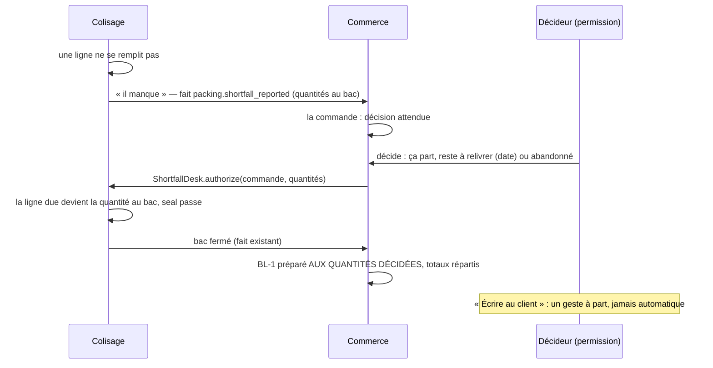

# Plan E6 — le départ incomplet, du colisage à la facture

> 🟡 **E6a bâti le 2026-10-25** (migration `20261025090000_le_manque_signale`) :
> « Il manque » au poste de colisage, faits `packing.shortfall_reported` /
> `packing.shortfall_cleared`, agrégat `OrderShortfall` (le fait le plus
> récent gagne), « Manque signalé — décision attendue » dans la page Commandes
> et la Supervision. **E6b + E6c attendent Hugo** (§ 8, § 10). Limite notée
> par le bâtisseur : une décision prise en E6b devra aussi lever la marque côté
> colisage.

> **Doc-first, 2026-10-24 (nuit).** Lot E6 du plan-cadre
> [`plan-commande-bon-de-livraison-facture.md`](plan-commande-bon-de-livraison-facture.md),
> fusionné avec E4b ([`plan-e4b-la-facture-lit-les-bons.md`](plan-e4b-la-facture-lit-les-bons.md) § 6).
> Décisions métier de Hugo : [`modification/commandes-incompletes.md`](modification/commandes-incompletes.md) § 4.
> Choix de conception : **l'assistant** (Hugo, 2026-10-24 : « prends les
> décisions »), chacun marqué _Décidé par l'assistant_. Touche **l'argent** :
> `vitruve` avant le bâti. **Rien n'est bâti.**

## 0. Ce qui existe (ouvert le 2026-10-24)

- **Fermer le bac** : `ClosePackingOrderHandler`
  (`packing/application/station/close-packing-order.handler.ts`) verrouille la
  fiche, `sheet.seal(…)` (refuse `UnallocatedLinesError` tant qu'une ligne due
  n'est pas entièrement répartie), publie `PackingOrderPackedEvent`
  (`production/channels/packing/`, sans quantités).
- **Le commerce** passe la commande `ready` par l'abonné
  `on-packing-order-packed.handler.ts`, puis le BL suit (E2,
  `DeliveryNoteFollowing.prepare`, sous l'écriture gagnée). Un BL `planned`
  est **réaligné sur les lignes de la commande** avant d'avancer (E2).
- **Une seule définition des totaux** : `computeOrderTotals`, appelée par
  `Order.draft` (`b2b/orders/domain/entities/order.ts`, l. 135-147) — lignes
  (HT, taux, éligibilité à la remise de retrait), remise, bon, port, mode de
  TVA du port, surtaxe et son taux → TVA, ventilation, total.
- **Les ajustements figés** sur la commande : `discountAdjustment`,
  `deliveryFeeAdjustment`, `lateFeeAdjustment` (`CartAdjustment` : % ou montant
  fixe ; `cartAdjustmentCents` dans `packages/contracts/src/cart-adjustment.ts`).
- **La facture** lit la commande par la couture `FROZEN_INVOICE_ORDER_SELECT`
  et treize lecteurs (recensement du § 0 d'E4b, complété par le § 5) ; une
  commande se facture une fois (`invoice_order_invoiced_once`).

## 1. Le parcours

## 2. Les lots

| Lot     | Contenu                                                                                                                                                                                                                                           | Argent                  |
| ------- | ------------------------------------------------------------------------------------------------------------------------------------------------------------------------------------------------------------------------------------------------- | ----------------------- |
| **E6a** | « Il manque » au colisage, le fait, la commande « décision attendue » (colonne `shortfall_reported_at` + quantités), visible dans la page Commandes et la Supervision                                                                             | non                     |
| **E6b** | La décision : ressource `b2b_orders_shortfall`, écran sur la fiche commande, table `order_shortfall_decision`, `ShortfallDesk` (déclaré **et** implémenté par le colisage dans `packing/channels/commerce/`), BL-1 préparé aux quantités décidées | les quantités seulement |
| **E6c** | Les totaux d'un BL partiel (répartition), la commande **soldée**, la facture qui lit les montants facturables                                                                                                                                     | **oui**                 |
| **E6d** | « Écrire au client » : gabarit modifiable, envoi tracé sur la décision                                                                                                                                                                            | non                     |

## 3. E6a — le signal

- **Colisage** : un geste « Il manque » sur une fiche ouverte dont une ligne
  n'est pas entièrement répartie ; il fige les quantités **actuellement au
  bac** par SKU et publie `packing.shortfall_reported`, déclaré dans
  `packing/channels/commerce/` (clé `shortfall:<orderId>` ; un second
  signalement avant la décision **remplace** les quantités). La fiche reste
  ouverte.
- **Commerce** : un `@DurableHandler` pose `shortfall_reported_at` et les
  quantités sur la commande ; la page Commandes et la Supervision montrent
  « décision attendue ».
- _Décidé par l'assistant_ : un signalement **ne bloque rien d'autre** (la
  commande peut encore être complétée si le fournil livre la pièce ; refermer
  le bac complet efface le signal).

## 4. E6b — la décision

- **Permission** `b2b_orders_shortfall`, accordée à l'écran ; geste au
  déploiement écrit au runbook.
- **La décision** (agrégat `ShortfallDecision`, une par commande, définitive —
  Q-I4) : auteur, instant, quantités partantes (celles du signal), reste :
  `to_redeliver` + date, ou `abandoned`.
- **`ShortfallDesk.authorize`** : le colisage réduit la ligne due de la fiche
  aux quantités décidées, dans la transaction de la décision ; `seal` passe
  sans exception à sa règle (la ligne due **est** la quantité au bac).
- **Le BL-1** : au bac fermé, le suivi d'E2 prépare le BL-1 **aux quantités de
  la décision** (et non plus en le réalignant sur la commande) ; le reste
  n'est pas sur ce BL. _Décidé par l'assistant_ : le réalignement d'E2 ne
  s'applique pas à une commande qui porte une décision.
- `to_redeliver` : la date est enregistrée ; le BL-2 naît en **E7**.
  `abandoned` : la commande est **soldée** à la remise du BL-1 (E6c).

## 5. E6c — l'argent

### 5.1 Les totaux d'un BL partiel — `computeOrderTotals`, jamais une seconde formule

Les lignes du BL (quantités livrées, prix et taux figés de la commande, HT de
ligne par la fonction de prix de ligne existante) passent par
**`computeOrderTotals`**, avec ces termes répartis :

| Terme de la commande                     | Sur le BL-1 partiel                                        | Sur un BL de reliquat (E7)          |
| ---------------------------------------- | ---------------------------------------------------------- | ----------------------------------- |
| remise en **%** (`discountAdjustment` %) | recalculée sur le sous-total du BL (`cartAdjustmentCents`) | idem                                |
| remise **fixe**                          | entière, **plafonnée** au sous-total du BL                 | 0                                   |
| bon de fidélité                          | entier, plafonné à l'assiette du BL                        | 0                                   |
| frais de port                            | entiers (Q-I2 de Hugo)                                     | 0 (Q-I2 : c'est nous qui relivrons) |
| surtaxe                                  | entière (Q-I2)                                             | 0                                   |

_Décidé par l'assistant_ : plafonner une remise fixe ou un bon au sous-total
du BL plutôt que de reporter un reste — un BL n'a jamais un total négatif ;
la part non consommée n'est pas due au client (elle portait sur des articles
non livrés). Conséquence assumée et dite : pour une commande livrée en
**plusieurs** BL, Σ des BL peut différer de la commande de quelques centimes
d'arrondi de TVA ; la facture somme les BL, qui sont ce qui a été livré.

### 5.2 La commande soldée et facturable

- **Soldée** : tout ce qui reste à livrer est livré, ou abandonné par
  décision. Une commande sans décision est soldée à sa remise, comme
  aujourd'hui.
- _Décidé par l'assistant_ : les montants facturables sont **tenus sur la
  commande**, dans des colonnes `billable_*` (sous-total, remises, bon, port,
  surtaxe, TVA, ventilation, total), écrites **au solde** = Σ des BL remis
  (ou recopie exacte de la commande pour une commande à un BL complet,
  c'est-à-dire aujourd'hui). Les treize lecteurs gardent leur forme SQL et
  lisent `billable_*` au lieu des totaux de commande ; la couture lit les
  **lignes** des BL remis. Une commande non soldée n'a pas de `billable_*` et
  n'est pas facturable (garde-fou : elle est écartée et nommée, comme
  `invoice-issuance-blockers.ts`).
- **La date** qui range une commande dans une facture reste
  `orders.received_on` (la première remise). _Décidé par l'assistant_ : pour
  un reliquat livré plus tard, la commande se range au mois de son **solde**
  par une colonne `settled_on`, posée au solde ; le critère `billableOrderWhere`
  lit `settled_on`. Aujourd'hui `settled_on = received_on` pour toute commande.
- **Rattrapage** : le réconciliateur pose `billable_*` et `settled_on` sur
  toute commande remise sans décision (recopie), avant que les lecteurs
  basculent ; la bascule ne part qu'à **zéro écart** (contrôle d'E4a étendu).

## 6. Questions laissées à Hugo (pour demain)

- Le plafonnement d'une remise fixe sur un BL partiel (§ 5.1) : d'accord ?
- `settled_on` (une commande à reliquat se facture au mois de son solde) :
  d'accord ?

## 7. Contradiction de `vitruve` (2026-10-24, nuit) — l'emporte sur les § 2 à § 6

**BLOQUANTS, et ce qui change :**

1. **La facture carte** part à la première remise, au montant entier
   (`issue-card-invoice-on-fulfilled.handler.ts` écoute `OrderHandedOverEvent`),
   et un départ incomplet d'une commande payée par carte laisserait un
   trop-perçu que personne ne rend. _Décidé par l'assistant_ : **E6 ne vise
   que les commandes au compte** (Q-I3 de Hugo) ; la décision est **refusée**
   sur une commande carte (refus nommé : « commande réglée par carte : le
   départ incomplet viendra avec le remboursement partiel, E9 »).
2. **Le prélèvement** lit `order.totalCents` (`prisma-collection-candidates.reader.ts`,
   l. 96 et 207) et `order_collection.amount_cents` : il entre dans le
   périmètre d'E6c, nommé.
3. **Le contrôle de cohérence** (`invoice-order-consistency.ts`,
   `inconsistentOrders`) recompose et compare à `order.totalCents` : en E6c,
   il recompose sur les montants facturables et compare à `billable_total` ;
   ce changement est décidé dans le plan d'E6c, pas laissé au bâti.

**SÉRIEUX — à reprendre dans le plan d'E6c avant tout bâti** :

- Les totaux d'un BL partiel ne se calculent pas « avec `computeOrderTotals`
  et des termes répartis » à la main : les règles vivent dans `Order.draft`
  (`ensureDiscountMatches` sur l'assiette **éligible**, `voucherDiscountOf`,
  `ensureLateFeeMatches`). E6c extrait ces règles en fonctions du domaine et
  les applique au BL par **une** fabrique (même rôle qu'`Order.draft`),
  pour qu'aucune formule n'existe en double ; l'asymétrie remise % / surtaxe %
  y est tranchée et justifiée.
- `billable_*` : nommer l'agrégat qui les écrit et ce qui interdit de les
  réécrire ; prévoir les déploiements (colonnes nullables, rattrapage, bascule)
  et l'écrivain des commandes remises entre deux ; les deux critères
  `billableOrderWhere` **et** `billableSinceWhere` ; recompter les lecteurs ;
  Factur-X. Signaler que `billable_*` et `settled_on` deviennent des faits
  comptables à la première facture émise.
- `ShortfallDesk` et la fiche réécrite par le fournil (`on-packing-list-drawn`,
  `on-production-day-reopened`) : qui gagne après une décision ; l'ordre des
  verrous commande / fiche ; une décision qui arrive sur une fiche déjà
  scellée ; « la pièce arrive après la décision ».

## 8. Ce qui se bâtit, et quand (_décidé par l'assistant_, 2026-10-24, nuit)

- **E6a se bâtit maintenant** : le signal et « décision attendue » ne touchent
  ni l'argent ni la fiche du fournil, et rendent déjà le manque visible.
- **E6b et E6c attendent la validation de Hugo** du plan d'E6c corrigé, et
  partiront **ensemble** : une décision sans la facture qui la suit
  produirait un BL partiel facturé en entier.
- **E6d** (l'e-mail à la main) suit E6b.

## 9. E6c réécrit (2026-10-25, nuit) — l'emporte sur le § 5

### 9.1 Ce qui a été rouvert

- `Order.draft` (`b2b/orders/domain/entities/order.ts`) calcule les termes par
  les gardes de `entities/order-amount-guards.ts` : `ensureDiscountMatches`
  (`discountCentsOf` sur l'assiette **éligible** à la remise de retrait,
  borné par le panier), `ensureLateFeeMatches` et `ensureDeliveryFeeMatches`
  (`cartAdjustmentCents` sur le **sous-total**, non borné pour les frais),
  `ensurePickupDiscountOnlyOnPickup`, `voucherDiscountOf` (bon refusé sur une
  commande de société : `VoucherNotForCompanyOrderError`), puis
  `computeOrderTotals` (`domain/services/vat.ts`).
- Les ajustements figés de la commande (`discountAdjustment`,
  `deliveryFeeAdjustment`, `lateFeeAdjustment`) sont des `CartAdjustment` :
  pourcentage **ou** montant fixe.

### 9.2 La règle — _décidée par l'assistant_, fidèle à Q-I2 de Hugo

**Un BL partiel se recompose comme une commande** : on **réapplique les
ajustements figés de la commande** à ses lignes livrées, par **les mêmes
fonctions** que `Order.draft` (extraites, jamais recopiées), puis
`computeOrderTotals`.

- un ajustement en **pourcentage** se recalcule sur ce qui part ;
- un ajustement en **montant fixe** reste entier (la remise fixe déjà bornée
  par `discountCentsOf` à l'assiette éligible du BL) ;
- **le bon de fidélité** n'existe pas sur une commande de société, et E6 ne
  vise que les commandes au compte (§ 7) : il n'y a pas de cas.

C'est exactement Q-I2 (« la remise en % suit le livré ; les montants fixes —
remise fixe, port, surtaxe — restent entiers »), et une remise, un port ou une
surtaxe **en pourcentage** suit le livré pour la même raison qu'une remise en
pourcentage : c'est la règle que la commande a figée, appliquée à ce qui part.

**Le BL de reliquat (E7)** : ajustements en pourcentage réappliqués ; montants
fixes, port et surtaxe à **zéro** (Q-I2 : « la suite n'a ni frais de port ni
surtaxe ») — dit en E7.

### 9.3 La facture — la commande soldée

- `Order.settle(notesRemises)`, méthode de l'agrégat, pose **une fois** les
  montants facturables (`billable_subtotal_cents`, `billable_discount_cents`,
  `billable_delivery_fee_cents`, `billable_late_fee_cents`, `billable_vat_cents`,
  `billable_vat_shares`, `billable_total_cents`) = Σ des BL remis, et
  `settled_on`. Un déclencheur les fige une fois posés (modèle
  `orders_received_on_frozen`). Une commande à un BL complet : recopie exacte.
- **Écrivain unique** : le suivi d'E2 au BL remis (commande soldée), et le
  réconciliateur pour l'existant. Trois temps de déploiement : colonnes
  nullables + écriture ; rattrapage et contrôle à zéro écart ; bascule des
  lecteurs.
- **La bascule** : les deux critères (`billableOrderWhere`, `billableSinceWhere`)
  lisent `settled_on` et `billable_total_cents > 0` ; la couture, le relevé,
  le prélèvement (`prisma-collection-candidates.reader.ts`), l'encaissement
  (`order_collection.amount_cents` à sa création), les impayés, la procédure
  et les bons à constater lisent `billable_*` ; le contrôle de cohérence
  recompose sur les lignes des BL et compare à `billable_total_cents`. La
  liste est **recomptée au plan de bâti** sur tout `b2b/accounting`.
- **Factur-X** : une commande partielle porte ses lignes livrées, sa remise,
  son port tels que recomposés — la forme ne change pas.
- **Irréversible** dès la première facture émise sur `billable_*` : dit au
  runbook, déploiement d'E6b + E6c seul, sur ordre de Hugo.

### 9.4 Ce qui reste ouvert pour le plan de bâti d'E6b

`ShortfallDesk` face à la fiche réécrite par le fournil (`on-packing-list-drawn`,
`on-production-day-reopened`), l'ordre des verrous commande / fiche, une
décision qui arrive sur une fiche scellée, la pièce qui arrive après la
décision.

## 10. Seconde contradiction d'E6c (2026-10-25, nuit) — E6c attend Hugo

`vitruve` sur le § 9 : **deux bloquants**, et une réinterprétation de Hugo
que l'assistant ne peut pas trancher seul. **E6c n'est pas bâti ; E6b non
plus** (§ 8 : ils partent ensemble).

**BLOQUANTS à résoudre dans le plan de bâti :**

1. **L'assiette éligible d'un BL** : `delivery_note_line.pickup_discount_eligible`
   est nullable (BL d'avant E4a), la ligne de commande non
   (`orders.prisma`, `Boolean @default(true)`). _Proposé_ : relire le drapeau
   sur la ligne de commande, jamais sur le BL.
2. **La fabrique du BL partiel n'est pas nommée** : les `ensure*` de
   `order-amount-guards.ts` **vérifient**, ils ne calculent pas ; seules
   `cartAdjustmentCents`, `discountCentsOf` et `computeOrderTotals` calculent.
   Il faut une fabrique nommée qui calcule chaque terme, puis passe les mêmes
   gardes, avec `deliveryVatMode` et `lateFeeAdjustment.vatRatePercent` de la
   commande (sinon `MissingLateFeeVatRateError`, une 500 au solde).

**SÉRIEUX, notés pour le plan de bâti** : les invariants de la commande
soldée (annulée avec BL remis ; commande carte ; CHECK tout ou rien sur
`billable_*` ; déclencheur qui refuse aussi NOT NULL → NULL) ; `settled_on`
face aux deux critères et à « Bons à constater » ; une commande au compte à BL
valorisé 0 € qui sortirait en silence (garder `totalCents > 0` **et** un refus
nommé) ; le **recensement** (61 fichiers de `b2b/accounting` lisent un total,
dont les avoirs `refund-credit-note.ts` et « Mes factures ») ; l'encaissement
constitué avant le solde (exclure les commandes non soldées des candidats) ;
le contrôle de cohérence circulaire (garder la comparaison à `totalCents` pour
les commandes à un BL complet) ; `settled_on` figé dès le premier prélèvement
constitué ; le verbe (`settle` désigne déjà le RÈGLEMENT ici).

**Questions pour Hugo (demain)** :

- **Q-E6-1.** Q-I2 dit : « la remise en % suit le livré ; les montants fixes —
  remise fixe, port, surtaxe — restent entiers ». Un **port ou une surtaxe en
  pourcentage** (le barème le permet) : suit-il le livré, ou reste-t-il
  entier ? (L'assistant l'avait étendu « suit le livré » : c'est une décision
  nouvelle, qui revient à Hugo.)
- **Q-E6-2.** Une **remise fixe** plus grande que ce qui part : plafonnée au
  BL (le code existant borne déjà au panier), ou reportée ?
- **Q-E6-3.** Une commande partielle se **facture au mois de son solde**
  (`settled_on`) : d'accord ?

## 11. Décisions (Hugo, 2026-10-25 : « prends les meilleures décisions »)

- **Q-E6-1 — un port ou une surtaxe en POURCENTAGE suit ce qui part.** Un
  pourcentage décrit un rapport au panier, comme une remise en pourcentage ; le
  facturer sur ce qui n'est pas parti serait injuste. Un montant FIXE reste
  entier (Q-I2).
- **Q-E6-2 — une remise fixe est plafonnée au BL.** Un BL n'a jamais un total
  négatif, `discountCentsOf` borne déjà au panier, et la part restante portait
  sur des articles non livrés.
- **Q-E6-3 — une commande se facture au mois de son solde** (`settled_on`) :
  une commande reste sur une seule facture ; relevés, avoirs, prélèvements
  inchangés.
- **Les deux bloquants du § 10, tranchés par l'assistant** : l'assiette éligible
  d'un BL se lit sur la **ligne de commande** (non nullable), jamais sur le BL ;
  la fabrique du BL partiel est nommée au plan de bâti d'E6b+E6c, et calcule
  chaque terme par `cartAdjustmentCents` / `discountCentsOf` avec le
  `deliveryVatMode` et le taux de surtaxe de la commande, puis passe les mêmes
  gardes que `Order.draft`.
- ✅ **Le texte de facture** (bâti le 2026-10-25) « Bons de commande : … » devient « Confirmations de
  commande : … » (Hugo).
- **La ligne de référence de la facture, en E6c** (Hugo, 2026-10-25) : elle
  cite les commandes **et** les bons de livraison facturés —
  « Commandes : ORD-1042, ORD-1043 — Bons de livraison : BL-1042-1,
  BL-1043-1 » — dans le PDF et la note Factur-X (`facturx-mentions.ts`,
  `ordersText`). Le titre « FACTURE » et le numéro de facture ne changent pas ;
  une facture déjà émise garde son texte archivé.

## 12. Plan de bâti d'E6b et d'E6c (2026-10-25) — l'emporte sur les § 4, § 5, § 9

### 12.1 Ce qui a été rouvert pour E6b

- **Le tirage de la liste** : `PrismaPackingShadowLedger.drawOrder`
  (`packing/infrastructure/prisma-packing-shadow.ledger.ts`) écrit la fiche et
  ses lignes en `createMany … skipDuplicates` : un second tirage n'écrase pas
  une fiche existante. Une ligne due réduite par une décision **survit** à un
  retirage.
- **La réouverture d'une journée** : `withdrawUntouched`
  (`packing-list-withdrawal` / son adaptateur) ne retire que les fiches **non
  touchées** (`packedAt` nul, aucun contenant, aucune ligne colisée). Une fiche
  qui porte un manque a des pièces au bac : elle **reste**.

### 12.2 E6b — la décision (_décidé par l'assistant_)

- **Agrégat `ShortfallDecision`** (commerce) : une par commande, définitive
  (Q-I4) ; auteur, instant, quantités partantes (celles du signal en vigueur),
  reste `to_redeliver` (+ date) ou `abandoned`. Refuse : pas de signal en
  vigueur ; commande carte (§ 7) ; commande non `confirmed`.
- **`ShortfallDesk.authorize(commande, quantités)`**, déclaré **et** implémenté
  par le colisage (`packing/channels/commerce/`), appelé dans la transaction de
  la décision : réduit les lignes dues de la fiche aux quantités décidées et
  efface la marque « manque » côté colisage (la limite notée en E6a). Refuse
  une fiche **déjà fermée** (409 nommé : « le bac est déjà fermé complet »).
- **Ordre des verrous** : la décision verrouille la **commande** puis la
  **fiche** ; la fermeture du bac ne verrouille que la fiche, et l'abonné
  « prête » verrouille la commande après, dans sa propre transaction : pas de
  cycle.
- **Réouverture de la journée après une décision** : la fiche reste (§ 12.1) ;
  la commande repasse `placed` par `releaseFromPlan` — _décidé_ : une
  commande qui porte une décision **refuse la révision** (garde ajoutée à la
  révision M1), pour que la décision et la commande ne divergent jamais.
- **La pièce qui arrive après la décision** : la ligne due est réduite, le bac
  ne la prend plus ; elle part au reliquat (E7) si le reste est
  `to_redeliver`, sinon elle reste en réserve. Dit à l'écran de la décision.
- **Le BL-1** est préparé aux **quantités décidées** : le suivi d'E2 lit la
  décision et ne réaligne pas le BL sur la commande.
- **Écran** : sur la fiche commande, sous « Manque signalé — décision
  attendue », le geste « Décider du départ » (quantités en lecture, reste à
  relivrer avec une date, ou abandonné), réservé à `b2b_orders_shortfall`.

🔴 **E6b ne part pas en production sans E6c2** : un BL partiel facturé sur la
commande entière serait faux.

### 12.3 E6c en deux temps

**E6c1 — l'ombre de l'argent (aucun lecteur ne change).**

- Colonnes `billable_*` et `settled_on` sur `orders`, nullables, un CHECK tout
  ou rien, ~~un déclencheur qui refuse toute réécriture d'une valeur posée
  (NOT NULL → autre, et NOT NULL → NULL)~~ — dépassé par le § 13 : le gel se
  pose en E6c2, l'ombre d'E6c1 reste corrigeable.
- La **fabrique du BL partiel** (`DeliveryNoteTerms.composePartial`) : chaque
  terme calculé par `cartAdjustmentCents` / `discountCentsOf` sur les lignes
  livrées, assiette éligible lue sur la **ligne de commande**, mode de TVA du
  port et taux de surtaxe de la **commande**, puis `computeOrderTotals` et les
  mêmes gardes que `Order.draft` ; décisions Q-E6-1/2 (§ 11).
- **`Order.closeBilling`** (le verbe `settle` désigne déjà le règlement) : pose
  `billable_*` = Σ des BL remis et `settled_on`, quand la commande est
  soldée ; une commande annulée n'est jamais soldée ; une commande carte est
  soldée comme aujourd'hui (recopie). Écrivain unique : le suivi d'E2 à la
  remise qui solde ; le réconciliateur pour l'existant.
- **Contrôle** : pour toute commande à un BL complet, `billable_*` =
  totaux de la commande, à zéro écart ; pour une commande partielle, la
  recomposition par la fabrique = `billable_*`.

**E6c2 — la bascule (sur ordre de Hugo, irréversible à la première facture).**

- Le **recensement** des lecteurs de `b2b/accounting` (61 fichiers lisent un
  total, domaine compris) dressé fichier par fichier dans son plan : bascule
  sur `billable_*` / `settled_on`, ou reste sur la commande, avec la raison.
- Les deux critères gardent `totalCents > 0` **et** exigent `billable_total_cents`
  posé ; une commande au compte non soldée est écartée **et nommée**.
- L'encaissement et les candidats au prélèvement excluent les commandes non
  soldées ; le contrôle de cohérence garde la comparaison à `totalCents` pour
  les commandes à un BL complet ; la ligne de référence de la facture cite
  commandes et BL (§ 11).

## 13. Contradiction du plan de bâti (2026-10-25) — l'emporte sur le § 12

_Toutes décidées par l'assistant (« prends les meilleures décisions »)._

**BLOQUANTS, résolus :**

1. **Trois écrivains réécrivent le BL sur la commande**, pas un : la règle
   d'alignement partagée par le suivi et le réconciliateur
   (`delivery-note-alignment.ts`, `replanFrom` / `completeTermsFrom`) et le
   planificateur d'E1 (`delivery-note-planner.ts`, `replanFrom` à chaque
   clôture). **La décision devient une entrée** de la règle d'alignement et du
   planificateur : un port de lecture (`ShortfallDecisionReader`) fournit les
   quantités décidées ; quand une décision existe, les trois réécrivent le BL
   sur **ces** quantités, jamais sur la commande entière.
2. **`composePartial` passe dans E6b** : E6b et E6c1 se bâtissent **ensemble**
   (un BL partiel porte toujours ses montants).
3. **Une fiche signalée sans aucune pièce** : la décision **refuse « rien ne
   part »** (refus nommé : « aucune pièce au bac — annulez la commande ») ;
   `withdrawUntouched` **épargne** une fiche qui porte une décision ; et
   `releaseFromPlan` **épargne** une commande décidée (elle reste confirmée,
   comme une commande prête) — la re-clôture ne la refabrique donc pas en
   entier.

**SÉRIEUX, résolus :**

- `authorize` vérifie, **sous le verrou de la fiche**, que le contenu des
  contenants est exactement les quantités décidées (sinon 409 : « le bac a
  changé depuis le signal — signalez de nouveau ») ; `reportShortfall` refuse
  une fiche autorisée.
- `authorize` **ne publie pas** `shortfall_cleared` : le commerce passe lui-même
  son `OrderShortfall` à l'état **décidé** dans la transaction de la décision
  (le signal n'est pas effacé, il est résolu).
- **Les verrous** : le bâtisseur recense toutes les transactions qui touchent
  la fiche ou les bacs (`BinDesk`, `ContainerManagedOrders`, l'annulation,
  `packing_stock`) et établit l'ordre « commande, puis fiche » partout, ou dit
  où il ne tient pas.
- **`closeBilling`, deux écrivains** (suivi et réconciliateur) : exclusion par
  le `WHERE billable_total_cents IS NULL` de l'écriture conditionnelle, sous le
  verrou de la commande.
- **Le gel de `billable_*` se pose en E6c2**, pas en E6c1 : l'ombre reste
  corrigeable ; E6c1 écrit un geste de correction (le réconciliateur recompose
  une commande dont `billable_*` diffère de la fabrique, tant que rien n'est
  facturé).
- **Refus nommés** à la décision : commande **carte** ; commande portant un
  **bon de fidélité** (`voucherDiscountCents > 0`) ; commande dont un
  ajustement figé manque alors que son montant n'est pas nul (commandes
  d'avant le 2026-09-09) — « commande trop ancienne pour un départ
  incomplet ».
- **« À relivrer » attend E7.** _Décidé_ : la première version n'offre que
  **« reste abandonné »** ; « à relivrer » arrive avec E7. Sinon une commande
  à reliquat ne serait jamais soldée, donc jamais facturée.
- **Le recensement** (56 fichiers hors tests lisent un total, compté par
  `vitruve` le 2026-10-25) se dresse **dans le plan d'E6c2**, avant toute
  bascule ; E6c2 ne part pas sans lui.

**Ordre de bâti et de déploiement** : **E6b + E6c1** (décision « abandonné »,
BL partiel avec ses montants, `billable_*` en ombre, contrôle) → plan et
`vitruve` d'**E6c2** → E6c2 → les trois partent **ensemble** en production,
sur ordre de Hugo. E6d (l'e-mail) suit. E7 rouvre « à relivrer ».

## 14. Réimprimer un BL qui a changé (Hugo, 2026-10-25) — dans E6b

« Dans tous les cas il faut signaler qu'il faut imprimer un nouveau BL s'il
n'est pas conforme à l'original. » Le BL de transport a pu être imprimé au
colisage avant la décision : après un départ incomplet, le papier annonce des
articles qui ne sont pas au bac.

_Décidé par l'assistant_ :

- **Le BL porte une version de contenu** (`content_version`, entier, +1 à
  chaque changement de ses lignes ou de ses montants : réécriture d'un BL prévu,
  décision de départ incomplet).
- **Chaque impression est tracée** : la version imprimée, l'instant, l'auteur
  (`printed_version`, `printed_at`, `printed_by` — la dernière impression
  suffit), au téléchargement du PDF de transport et du PDF chiffré équipe.
- **Si une impression existe et que `printed_version ≠ content_version`**,
  l'avertissement « **Le bon de livraison a changé depuis son impression —
  réimprimez-le** » s'affiche, bouton d'impression à côté : au **poste de
  colisage** (fiche du bac), sur la **fiche commande** du back-office, et dans
  la **confirmation de la décision**. Un BL jamais imprimé ne déclenche rien.
- La lecture le calcule côté serveur (`reprintNeeded: boolean`), comme
  `canReportShortfall` : l'écran n'en déduit rien lui-même.

**Précision de Hugo (2026-10-25)** : « pas de changement en chemin normal,
seulement sur décision ; “il manque” ne déclenche pas encore ; la décision de
traitement = changement de BL ». `content_version` n'avance **que** si le
contenu imprimable change réellement : la **décision** (cas principal), et la
réécriture d'un BL prévu dont les lignes diffèrent après réouverture et
révision. N'avancent **pas** : la création à l'arrêt du plan, la préparation,
la remise, la complétion des totaux par le réconciliateur, un réalignement
sans effet, et le signal « Il manque ». Un test garde que le chemin normal ne
déclenche jamais l'avertissement.
