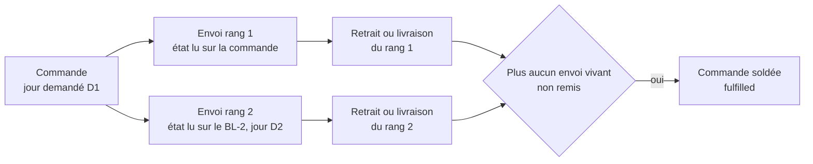
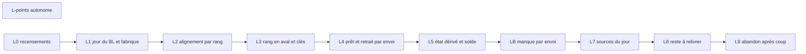

# Plan E7 — le reliquat, plan de bâti

> **Doc-first, 2026-10-25 au soir, révisé deux fois le même soir après
> `vitruve`.** Remplace, pour le bâti, [`plan-e7-1-le-jour-du-bon.md`](plan-e7-1-le-jour-du-bon.md),
> et s'appuie sur [`plan-e7-le-reliquat.md`](plan-e7-le-reliquat.md) (le
> programme et les décisions de Hugo, §3 et §4) et
> [`e7-recensement.md`](e7-recensement.md). **Mandat de Hugo (2026-10-25)** :
> tout le reliquat, sans question ; E9 (rembourser un reste payé par carte)
> **exclu**, il dépend de M2, reporté le 2026-10-23. Touche l'argent et des
> clés en base : contredit deux fois par `vitruve` (§6, onze points ; §6 bis,
> treize points), tous traités. **Rien n'est bâti.**

## Coût réel (compté le 2026-10-25, seconde révision)

| Mesure                   | Valeur                                                                                                                                                                                                                                                                                                                                                                                                                                                                                                                                                                                                      |
| ------------------------ | ----------------------------------------------------------------------------------------------------------------------------------------------------------------------------------------------------------------------------------------------------------------------------------------------------------------------------------------------------------------------------------------------------------------------------------------------------------------------------------------------------------------------------------------------------------------------------------------------------------- |
| Lots                     | **11** : L-points (autonome), L0 (doc), L1 à L9                                                                                                                                                                                                                                                                                                                                                                                                                                                                                                                                                             |
| Tables migrées           | **15** : `delivery_note`, `production_order`, `packing_order`, `packing_line`, `packing_container`, `order_handover`, `order_departure`, `order_handover_proof`, `delivery_round_stop`, `delivery_stop_execution`, `delivery_stop_decision`, `delivery_day_readiness` (sa liste quitte la table pour une table fille **neuve**, la 16ᵉ), `orders` (valeur d'énum `partially_handed_over`, colonnes du manque abandonnées en place), `order_shortfall_decision` (unicité par envoi), et **une table neuve** `order_shortfall` (le manque par envoi). Une migration de **données** : le manque rang 1 recopié |
| Clés d'idempotence       | **44** émetteurs d’outbox lus, **25** portent une commande ou un jour (annexe A.1) : **8** changent de clé au-delà du rang 1, **4** gardent leur clé et portent `rank` dans le payload, **13** restent ; hors outbox, **15** clés construites avec une commande (annexe A.2) : **5** changent (dont une par l’arrêt), **10** restent                                                                                                                                                                                                                                                                        |
| Lecteurs                 | **130** fichiers de l'annexe B (classés par jeton, à lire en L0) + **27** lecteurs des colonnes du manque (LB, choix 15) + **12** des faits de départ, de retirage et de `deliveryOrderIds` (choix 12) + **10** du jeton de retrait (choix 13) ; des recoupements entre ces listes, non dédoublonnés                                                                                                                                                                                                                                                                                                        |
| Estimation (non mesurée) | L3 seul : deux à trois sessions de bâtisseur, e2e compris. Les dix autres : une session chacun, L0 et L-points moins. Soit **environ trois semaines** de bâti, un lot à la fois (`documentation/carte-des-chantiers.md`), revue et e2e comprises — une estimation, pas une mesure                                                                                                                                                                                                                                                                                                                           |
| Bâtissable tout de suite | **L-points** : un bug de l'existant (E6), indépendant d'E7, sans migration                                                                                                                                                                                                                                                                                                                                                                                                                                                                                                                                  |

## 0. Ce qui existe (ouvert le 2026-10-25)

Chemins relatifs à `apps/lfd-api/`. Chaque bâtisseur rouvre ce qu'il touche.

- `prisma/schema/public/delivery-notes.prisma:20-69` — `DeliveryNote` porte
  `rank` (CHECK ≥ 1) et `@@unique([orderId, rank])` (l.69), **aucun jour** ;
  ses lignes sont `DeliveryNoteLine` (l.78). Sa **seule** fabrique de domaine
  est `DeliveryNote.planFromOrder` (`src/b2b/delivery-notes/domain/entities/delivery-note.ts:127`),
  qui ne sait faire que le rang 1.
- **L'alignement refuse deux BL vivants** :
  `src/b2b/delivery-notes/domain/services/delivery-note-alignment.ts:122-125`
  rend `UNREPAIRABLE("several_live_notes")` ; « vivant » = non annulé
  (`domain/entities/delivery-note.ts:168`), donc un BL-1 **remis** reste
  vivant. L'aligneur (`application/services/delivery-note-aligner.ts`) tourne
  dans la transaction du geste ; le rattrapage est
  `application/commands/reconcile-delivery-notes.handler.ts`.
- `prisma/schema/production.prisma` — `ProductionOrder @@unique([serviceDay,
orderId])` (l.180) ; `OrderHandover.orderId @unique` (l.206) et
  `reference @unique` (l.208) ; `OrderDeparture.orderId @id` (l.238) ;
  `OrderHandoverProof.orderId @id` (l.265) ; `OrderWithdrawal.orderId @id`
  (l.745).
- `prisma/schema/packing.prisma` — `PackingOrder @@id([serviceDay, orderId])`
  (l.63), cible de **deux FK composites** : `PackingLine` (l.72, PK l.84) et
  `PackingContainer` (l.178) ; `PackingStock @@id([serviceDay, sku])`
  (l.95-109), partagé par toutes les feuilles du jour, et qui ne grandit **que**
  par les remises du fournil (`received`, l.99, écrit par
  `src/packing/infrastructure/prisma-packing-shadow.ledger.ts:84-90`).
- `prisma/schema/delivery.prisma` — les arrêts sont clés par **leur** id
  (`DeliveryRoundStop` l.214, `DeliveryStopExecution` l.347,
  `DeliveryStopDecision` l.467) et portent `orderId` en colonne (l.217, 349, 469) ; `DeliveryDayReadiness.deliveryOrderIds` (l.829) est un `String[]`
  d'`orderId`.
- **Le manque est unique par commande** :
  `prisma/schema/public/orders.prisma:330-335` porte le signal en colonnes de
  `orders` (`shortfall_reported_at`, `shortfall_lines`, `shortfall_cleared_at`,
  `shortfall_decided_at`) ; `OrderShortfallDecision.orderId @unique`
  (l.466-483). `OrderBilling.partial` vaut « une décision existe »
  (`src/b2b/orders/infrastructure/prisma-order-billing.repository.ts:33`).
- `src/b2b/orders/infrastructure/prisma-order.repository.ts:312-331` —
  `markReady` écrit **sur la commande**, par `orderNumber`, sous
  `readyAt: null` ; `markFulfilled` (l.336) sous `handedOverAt: null`.
- `src/b2b/orders/domain/entities/shortfall-decision.ts:122-135` —
  `ensureDecidable` exige `subject.status === "confirmed"` (le statut **de la
  commande**) et **refuse toute commande payée par carte**
  (`CardOrderShortfallError`, l.126-127).
- `src/packing/domain/entities/packing-sheet.ts:165-172` — le bac signalé
  « il manque » ne se ferme plus tant que le commerce n'a pas décidé ;
  `assertAllAllocated` (l.442). Le disponible d'un article est
  `received − returned − packed − sentToShop − reserved`
  (`src/packing/domain/entities/packing-stock.ts:102`).
- **Ce que le fournil voit à faire** : le reste d'une ligne est
  `max(0, quantité − Σ fournées)` (`src/production/domain/services/production-output.ts:90-103`) ;
  une fournée est remise au colisage (`production-handoff.ts:42`) et devient
  `received`. L'attendu d'une journée **ouverte** est lu par
  `src/b2b/orders/infrastructure/prisma-expected-production.reader.ts:59`
  (commandes `placed`, fragment `planWhere()`), celui d'une journée **tirée**
  est son plan (`production_order`). Les fournées se déclarent sur une journée
  tirée (`retake-production-day.handler.ts:117-119` en recopie).
- `src/production/application/commands/retake-production-day.handler.ts:40-50` — le
  retirage n'absorbe que des commandes `placed` ; il publie
  `ProductionDayRetakenEvent(…, orderIds)` (l.126), des `orderId` nus.
  `src/delivery/application/delivery-departure-support.ts:112` publie de même
  `DeliveryRoundDepartedFact(…, round.orderIds)`.
- **Le jeton de retrait** : `orders.handover_token @unique`
  (`prisma/schema/public/orders.prisma:375`) ; le scan le résout en
  **commande** (`src/b2b/orders/infrastructure/prisma-handover-subject.reader.ts:51`),
  la saisie par numéro de commande aussi (l.55). Côté écran, le scan et le
  panneau du bon sont `apps/lfd-backoffice-frontend/src/app/handover-shop/scan-dialog/`
  et `…/handover-shop/sheet-panel/`, servis au comptoir par
  `comptoir/comptoir-workspace/comptoir-workspace-page.ts:4`.
- **Points de fidélité** : crédités sur `ORDER_FULFILLED`
  (`src/b2b/loyalty/application/handlers/credit-points-on-handover.handler.ts:37`),
  sur les montants **de la commande** : `prisma-completed-order.reader.ts:18-29`
  sélectionne `subtotalCents`, `discountCents`, `voucherDiscountCents`, rendus
  l.109-111.
- **La facture au compte** : `OrderBilling.settlementOf`
  (`src/b2b/orders/domain/entities/order-billing.ts:162-170`) ne solde que
  sous `fulfilled`, et somme les BL remis quand `partial`. Le gel
  `orders_billable_frozen` (migration `20261025160000`, l.37) n'interdit que
  la **réécriture** de montants déjà posés sur une commande engagée ; la pose
  NULL → valeur reste permise. `prisma-unconfirmed-deliveries.reader.ts:35`
  liste les commandes au compte non soldées dont le jour est passé, et nomme
  déjà « en attente du reste » celles remises en partie (l.66).
- **Courriels au client** : « prête » part sur `order.ready`
  (`src/b2b/orders/application/handlers/send-order-ready-mail.handler.ts:59`),
  « en route » au départ de la tournée
  (`src/b2b/orders/application/services/delivery-en-route-mail.service.ts:62`) ;
  le courrier du manque existe (« Écrire au client », E6d), une clé par
  décision (`src/b2b/orders/domain/entities/shortfall-notice.ts:29-30`).
- Base de dev (`lfc_b2b_dev`, lecture seule, 2026-10-25) : 26 BL, **tous de
  rang 1** (6 `planned`, 19 `prepared`, 1 `handed_over`). Aucune donnée à
  reprendre côté BL.
- Dernière migration commitée : `20261026040000_la_photo_du_bon_signe`. Les
  migrations de ce plan viennent **après** elle.

## 1. Le modèle

Un **envoi** = (commande, rang). Le rang 1 est la commande elle-même ; un BL
de rang > 1 est un **reliquat**, né d'une décision, qui porte son jour.

## 2. Choix de l'assistant (2026-10-25, révisés deux fois après `vitruve`)

1. **Le BL-1 ne change pas de source.** Les sources du jour lisent `orders` /
   `order_lines` par `requestedDeliveryDate`, comme aujourd'hui.
2. **`delivery_note.service_day` nullable**, `CHECK (rank = 1 OR service_day
IS NOT NULL)`. Il **reste NULL au rang 1**, pour toujours : la date du BL-1
   est celle de la commande, sans copie.
3. **Deux vérités, une par rang**. Le BL-1 suit la commande ; un BL de rang > 1
   a son propre état (`planned` → `prepared` → `handed_over` | `voided`) que
   seuls les gestes **de son envoi** font avancer. L'alignement aligne **le
   BL-1** sur la commande et ignore les rangs > 1. `several_live_notes`
   devient « deux BL vivants **de même rang** ». La commande ne recopie jamais
   l'état d'un BL-2 : `orders.ready_at` / `status = ready` restent ceux du
   rang 1.
4. **Prêt par envoi.** Le scan de fermeture d'une feuille de rang > 1 écrit
   `prepared` **sur le BL** (sous `status = planned`, même arbitrage en base
   que `readyAt: null`), et n'appelle pas `markReady`.
5. **Identité aval = `(orderId, rank)`**, colonne `rank int NOT NULL DEFAULT
1`, sur `production_order`, `packing_order`, `packing_line`,
   `packing_container`, `order_handover`, `order_departure`,
   `order_handover_proof`, et les trois tables d'arrêt de `delivery`. **Pas**
   `order_withdrawal` : un retrait du fournil vise la commande entière.
6. **Les clés** (annexe A, **refaite** le 2026-10-25 en lisant les 44
   émetteurs d'outbox et les clés hors outbox, multi-lignes comprises) :
   celles qui décrivent un **envoi** gagnent `:r<rank>` **seulement quand
   rank > 1** (rang 1 = clé d'aujourd'hui à l'identique, rien ne se rejoue) ;
   celles dont la clé porte un **instant** ou une **tournée** gardent leur clé
   et portent `rank` (ou des envois) dans le payload ; celles qui décrivent la
   **commande** restent. `ORDER_FULFILLED` reste unique : il ne part qu'au
   **solde**. Un test « deux rangs, deux lignes » par clé qui change.
7. **Le reste se fabrique — révisé (SÉRIEUX 4 de la seconde contradiction).**
   La première version disait « le fournil n'ajoute rien » sans dire qui fait
   cuire le reste. Ce qui est vérifié : le fournil voit à faire
   `quantité − Σ fournées` par article et par jour (`production-output.ts:90-103`),
   ses fournées deviennent `received` au colisage (`prisma-packing-shadow.ledger.ts:84-90`),
   et le colisage ne manque d'un article que si son disponible est épuisé
   (`packing-stock.ts:102`). Donc, **quand le manque vient du four** (moins de
   fournées que le plan), le reste à faire du fournil **contient déjà** le
   manque : la ligne n'est pas complète, et la prochaine fournée entre dans
   `received` puis s'alloue à la seconde feuille. La règle, réécrite :
   - **Même jour** : le BL-2 n'ajoute **rien** au plan de D1 — l'attendu reste
     `commande` (le BL-1 n'en retire pas ses quantités non plus) ; il n'y a
     pas de double compte parce que le reste n'a **jamais été reçu**. Le
     colisage ouvre une feuille `(D1, orderId, 2)` sur le même stock.
   - **Garde** : le même jour n'est proposé que si, pour chaque article du
     reste, le reste à faire du fournil de D1 le couvre
     (`quantité − Σ fournées ≥ reste`). Sinon — le four a tout sorti et les
     pièces sont parties ailleurs (`sentToShop`, `packing-stock.ts:102`) —
     personne ne les cuirait : la décision ne propose qu'un **autre jour**.
     La lecture passe par un port que **le fournil déclare** dans
     `production/channels/commerce/` et implémente (`b2b → production` :
     port uniquement). Cas assumé : deux manques le même jour sur le même
     article se partagent ce reste ; la garde compare au reste **non déjà
     promis** à un BL-2 du jour.
   - **Autre jour (D2 ≠ D1)** : le BL-2 est un envoi **en plus** de D2 ; le
     plan de D2 l'ajoute (journée ouverte) ou le retirage l'absorbe (journée
     tirée), ce qui demande d'étendre le retirage
     (`retake-production-day.handler.ts:40-50` n'absorbe que des `placed`).
8. **Soldée = `fulfilled`** ; `partially_handed_over` à la remise d'un envoi
   qui n'est pas le dernier. `handed_over_at` / `received_on` restent la
   **première** remise (CHECK B4) ; « Reçue le » se lit sur le dernier BL.
9. **Le reliquat est réservé aux commandes au compte.** `shortfall-decision.ts:126-127`
   refuse le départ incomplet sur carte, et on **garde** ce refus (E9 exclu) :
   une commande carte n'a jamais de BL-2. **Les points** se créditent au
   solde, sur `ORDER_FULFILLED`, sur les montants **facturables**
   (`billable_*`) et non ceux de la commande — c'est le lot autonome
   **L-points** (choix 16).
10. **Date du BL-2** : choisie dans la décision, ≥ D1, jamais un jour fermé.
    **Montants** par la fabrique E6c1 (pourcentages réappliqués, fixes, port
    et surtaxe à zéro), calculés **sur les lignes du BL-2 seul**. Aucune
    commande ne corrige un BL remis (`src/b2b/delivery-notes/application/commands/`
    n'en a pas, ouvert le 2026-10-25) ; ce qui se réécrit avant engagement,
    ce sont les montants facturables de la commande, par le rapprochement
    (`order-billing.ts:105`). Un BL-1 « corrigé » ainsi ne touche pas le BL-2 :
    le solde est la somme des BL, chacun avec ses montants.
11. **Un manque sur un BL-2 a une issue.** `ensureDecidable` lit le statut
    **de l'envoi signalé**, plus celui de la commande (SÉRIEUX → BLOQUANT 3
    de la seconde contradiction) : rang 1 → `orders.status === "confirmed"`
    comme aujourd'hui ; rang > 1 → BL `planned`. Le même jour, le rang 1 peut
    être `ready` pendant que le rang 2 colise : c'est le rang 2 qui décide.
    Le signal et la décision sont **par envoi** (choix 15). La décision peut
    créer le rang suivant ou abandonner (L9).
12. **Q-R1** : preuve et arrêt par envoi. Un arrêt de livraison gagne `rank`
    (défaut 1). **La référence d'un envoi est un value object**
    `ShipmentRef { orderId, rank }` (révisé, SÉRIEUX 10) — jamais une chaîne
    `orderId#r` : `DeliveryDayReadiness.deliveryOrderIds` (`String[]`,
    `delivery.prisma:829`) est remplacé par une **table fille**
    `delivery_day_readiness_shipment (service_day, order_id, rank)`, PK sur les
    trois ; les faits qui portaient des `orderIds` nus —
    `ProductionDayRetakenEvent` (`retake-production-day.handler.ts:126`),
    `DeliveryRoundDepartedFact` (`delivery-departure-support.ts:112`),
    `DeliveryOrdersBroughtBackFact` — portent une liste `shipments:
[{ orderId, rank }]` ; leur `fromPayload` lit l'ancienne forme `orderIds`
    comme rang 1, pour les faits déjà écrits. Chaque BL suit la règle de
    signature de **son** arrêt.
13. **Le QR et la saisie (révisé, SÉRIEUX 8).** `orders.handover_token` reste
    **un par commande** : le client garde un seul QR pour toute la commande.
    Le scan résout la commande, puis le serveur rend **les envois prêts non
    remis** de cette commande. Un seul : le panneau du bon
    (`handover-shop/sheet-panel/`) s'ouvre sur lui, comme aujourd'hui. Deux
    (le même jour, le client n'est pas venu entre les deux) : le panneau liste
    les deux, **cochés par défaut**, « Remettre » remet chaque envoi coché dans
    une transaction, une preuve par envoi. `order_handover.reference` garde sa
    valeur au rang 1 et prend `-2`… au-delà ; la saisie d'un numéro de commande
    mène au même panneau.
14. **Migrations** : une par lot, dans le déploiement du code (pré-release,
    Hugo 2026-10-04), ordonnées après `20261026040000`. Pour `packing_order` :
    ajouter `rank` aux trois tables, **DROP** les FK de `packing_line` et
    `packing_container`, DROP puis RECREATE la PK de `packing_order` sur
    `(service_day, order_id, rank)`, RECREATE la PK de `packing_line` sur
    `(service_day, order_id, rank, sku)`, RECREATE les deux FK sur les trois
    colonnes. Un seul `migration.sql`, une transaction. Aucune donnée
    supprimée.
15. **Le manque par envoi (BLOQUANT 2, neuf).** Table neuve `order_shortfall
(order_id, rank, reported_at, lines jsonb, cleared_at, decided_at)`, PK
    `(order_id, rank)` ; `order_shortfall_decision` perd `order_id @unique`
    pour `@@unique([orderId, rank])` (colonne `rank NOT NULL DEFAULT 1`). La
    migration **recopie** les colonnes de `orders` (l.330-335) en lignes de
    rang 1 ; les colonnes restent en base, mortes (CLAUDE.md §0 : pas de
    suppression en production) — un lot de resserrement ultérieur, hors de ce
    plan, les retirera. `OrderBilling.partial` devient « une décision existe
    pour un envoi de la commande ». Les 27 lecteurs (listés au lot LB, §3)
    lisent la table. Le fait `packing.shortfall_reported` porte `rank` dans
    son payload ; sa clé (à instant) ne change pas.
16. **Les points au solde, lot autonome (SÉRIEUX 5).** Bug **de l'existant**
    depuis E6 : un reste abandonné rapporte des points sur le tout, parce que
    `prisma-completed-order.reader.ts:109-111` rend les montants commandés. Le
    lecteur rend les `billable_*` (`orders.prisma:344-348`), posés par
    `closeBilling` dans l'unité de travail du geste qui solde
    (`order-billing-closer.ts:66-72`), donc présents quand `ORDER_FULFILLED`
    arrive. **Non vérifié** : que ce chemin pose `billable_*` aussi pour une
    commande **carte** (`settlementOf` rend `null` sans `received_on`,
    `order-billing.ts:168`) ; c'est le premier test du lot. Si `billable_*`
    est nul au crédit, on **refuse** (erreur nommée), on n'invente pas de
    repli. **Bâti le 2026-10-25** : la carte pose bien `billable_*` à la
    remise, dans les deux ordres des faits (`apps/lfd-api/test/loyalty-earning.e2e-spec.ts`) ;
    `findCompleted` refuse par `CompletedOrderUnsettledError`, les parcours
    de rattrapage n'ont que les commandes soldées. Constaté au bâti : le bug
    est **latent** — le départ incomplet n'existe qu'au compte, et aucune
    route ne fait passer une commande au compte à `paid` ;
    `apps/lfd-api/test/loyalty-partial-order.e2e-spec.ts` pose ce `paid` par écriture brute
    datée.
17. **Le client est prévenu de chaque envoi (BLOQUANT 1, choix de
    l'assistant, 2026-10-25).** Oui : le BL-2 envoie « prête » (retrait) quand
    il est `prepared`, et « en route » (livraison) au départ de sa tournée —
    **un courriel par envoi**, sinon un client qui a reçu « prête » le matin
    vient chercher le reste au hasard. Le texte dit « le reste de votre
    commande » (une variante du gabarit, donc `pnpm mail-copy:digest`). Clés :
    `order.ready:<id>` et `delivery.en_route:<id>:<tournée>` gagnent
    `:r<rank>` au-delà du rang 1. Le courrier du manque (E6d) annonce la date
    du BL-2 quand le reste est à relivrer.
18. **La facture au compte (SÉRIEUX 6), point par point.**
    - `settlementOf` ne solde que sous `fulfilled` (`order-billing.ts:164`) :
      **voulu**, `fulfilled` = dernier envoi remis (choix 8) ; une commande
      `partially_handed_over` n'a rien de facturable.
    - Le lecteur des livraisons non confirmées (`prisma-unconfirmed-deliveries.reader.ts:35`)
      range une commande à BL-2 entre D1 et D2, et la nomme déjà « en attente
      du reste » (l.66) : **gardé**, en ajoutant la date du BL-2 (« reste
      prévu le D2 ») pour que la comptabilité ne relance pas un client qui
      attend.
    - Le gel `orders_billable_frozen` : sans effet avant le solde, puisque
      rien n'est posé (`migration.sql` l.37 : `OLD.billable_total_cents IS NOT
NULL`). Après le solde, un BL-2 abandonné **ne repose rien** : le solde
      est déjà la somme des BL remis.
    - Montants du BL-2 quand le BL-1 a été corrigé : choix 10.

## 3. Les lots

| Lot          | Contenu                                                                                                                                                                                                                                                                                                                                                                                                                                                                                                                                                                                                                                                                                             | Preuve                                                                                                                                       |
| ------------ | --------------------------------------------------------------------------------------------------------------------------------------------------------------------------------------------------------------------------------------------------------------------------------------------------------------------------------------------------------------------------------------------------------------------------------------------------------------------------------------------------------------------------------------------------------------------------------------------------------------------------------------------------------------------------------------------------- | -------------------------------------------------------------------------------------------------------------------------------------------- |
| **L-points** | ✅ bâti le 2026-10-25 (non commité à l'écriture) — choix 16 : `PrismaCompletedOrderReader` rend les `billable_*` ; refus nommé s'ils sont nuls ; aucune migration                                                                                                                                                                                                                                                                                                                                                                                                                                                                                                                                   | régression : une commande à reste abandonné (E6) crédite sur la somme des BL remis ; une commande complète, inchangée ; une carte            |
| **L0**       | Classer, **en lisant chaque fichier**, les 130 de l'annexe B (remise d'un envoi / soldée / jour) ; confirmer l'annexe A (envoi, payload, commande) ; toutes les listes de statuts explicites face à `partially_handed_over`. Doc seule                                                                                                                                                                                                                                                                                                                                                                                                                                                              | annexes A et B tranchées, une ligne par fichier                                                                                              |
| **L1**       | `service_day` nullable + CHECK ; **fabrique de domaine** `DeliveryNote.planRemainder(id, source, rank, serviceDay, at)` qui refuse rang 1 et jour absent (SÉRIEUX 7 : les lots suivants s'en servent pour leurs données de test, jamais d'`INSERT` brut, CLAUDE.md §5)                                                                                                                                                                                                                                                                                                                                                                                                                              | la base refuse un rang 2 sans jour ; la fabrique refuse les mêmes cas                                                                        |
| **L2**       | alignement par rang (choix 3) dans `delivery-note-alignment.ts` et le rattrapage ; `several_live_notes` par rang                                                                                                                                                                                                                                                                                                                                                                                                                                                                                                                                                                                    | un BL-1 remis + un BL-2 (fabrique L1) vivant : aligné, pas `UNREPAIRABLE`                                                                    |
| **L3**       | `rank` et clés (choix 5, 14) ; `ShipmentRef` et la table fille de `delivery_day_readiness` (choix 12) ; les 8 clés d'outbox et 5 clés hors outbox qui changent, les 4 payloads (annexe A) ; `rank` dans `PackingListOrder` et les contrats de canal ; `fromPayload` qui lit l'ancienne forme ; adaptateurs à `rank: 1`                                                                                                                                                                                                                                                                                                                                                                              | e2e plan, colisage, retirage, tournées inchangés ; clé de rang 1 identique ; « deux rangs, deux lignes » par clé qui change                  |
| **L4**       | prêt par envoi (choix 4) ; `order_handover`, `OrderDeparture`, `OrderHandoverProof` par envoi ; QR, panneau à deux envois et saisie (choix 13) ; courriels « prête » et « en route » par envoi (choix 17)                                                                                                                                                                                                                                                                                                                                                                                                                                                                                           | double scan refusé par envoi, preuve par envoi, deux envois prêts remis d'un geste, deux courriels                                           |
| **L5**       | `partially_handed_over` (valeur d'énum), solde dérivé ; verrous d'annulation et de révision sur « un envoi remis » ; facture au compte (choix 18) ; CA, volumes ; listes de statuts de L0 ; lecteurs de l'annexe B. **La transition partielle est prouvée ici**, avec un BL-2 fabriqué par `planRemainder`, **avant** L8 qui le crée en vrai (SÉRIEUX 7)                                                                                                                                                                                                                                                                                                                                            | identique avec un seul envoi ; BL-1 remis + BL-2 `planned` ⇒ `partially_handed_over`, puis BL-2 remis ⇒ `fulfilled` et solde = Σ BL          |
| **LB**       | le manque par envoi (choix 15) : table `order_shortfall`, unicité `(order_id, rank)` de la décision, migration de recopie ; `ensureDecidable` lit l'envoi (choix 11) ; `partial` ; les **27 lecteurs** : 19 sous `b2b/` (`prisma-shortfall-*.{reader,repository}.ts` ×5, `prisma-order-shortfall.{reader,repository}.ts`, `prisma-order-billing.repository.ts`, `prisma-day-supervision.reader.ts`, `day-supervision.ts` et son port, `get-day-supervision.handler.ts`, `handover-order.query.ts`, `prisma-admin-order-list.reader.ts`, `revisable-order.row.ts`, `prisma-order-plan-release.ts`, trois de `accounting/infrastructure/`), 7 sous `packing/`, `dev/scenario/purge/commerce.purge.ts` | rang 1 inchangé ; un manque au rang 2 pendant que le rang 1 est `ready` : décidable ; deux décisions, une par rang                           |
| **L7**       | `DayShipmentsReader.extraShipments(D)` → `{ shipment: ShipmentRef, serviceDay, status, lines }` des BL vivants de rang > 1 du jour, avec leur état ; les 14 sources du jour l'ajoutent ; règle du même jour et sa garde (choix 7)                                                                                                                                                                                                                                                                                                                                                                                                                                                                   | sans BL-2 : sorties identiques ; BL-2 à D2 paraît à D2, pas à D1 ; même jour : plan de D1 inchangé                                           |
| **L8**       | « reste à relivrer » avec date ; BL-2 (fabrique L1) et montants ; seconde feuille le même jour ; entrée au plan de D2 ou au retirage étendu ; manque sur un BL-2 ; « reste relivré le <date> » sur colisage, Supervision, comptoir, feuille de route, fiche commande ; courrier du manque daté (choix 17)                                                                                                                                                                                                                                                                                                                                                                                           | e2e un autre jour, le même jour (fournée après la décision allouée à la seconde feuille), le même jour refusé par la garde, manque au rang 2 |
| **L9**       | abandon du BL-2 par le superviseur, puis solde                                                                                                                                                                                                                                                                                                                                                                                                                                                                                                                                                                                                                                                      | e2e                                                                                                                                          |

**Ne change pas** : la passation et la réservation du jour, les documents
de type « demande », la facture au compte hors solde, l'interdiction du
départ incomplet sur carte. **E9 exclu.**

**Irréversible** : dès qu'un BL-2 est remis en production, les clés « une
remise par commande » ne se resserrent plus.

## 4. Les risques, dans l'ordre

1. **L3**, le plus large : 13 clés qui changent, 4 payloads, huit tables, trois
   blocs (`production`, `packing`, `delivery`) et leurs contrats. Une clé
   oubliée **avale** le second envoi sans erreur (`ON CONFLICT DO NOTHING`,
   `src/platform/outbox/prisma-outbox.ts:47`) : la première annexe A en
   oubliait deux, dont la remise (`handover.handed_over`) — d'où le test par
   clé.
2. **L5** : 130 lecteurs, classés par jeton seulement (annexe B) — L0 les
   lit un à un ; tant qu'il ne l'a pas fait, le nombre réel de lecteurs à
   toucher est inconnu.
3. **LB** : la seule migration de **données** du plan (recopie du manque),
   27 lecteurs.
4. Le retirage étendu aux BL-2 d'un jour tiré (choix 7, D2 ≠ D1).
5. La garde du même jour (choix 7) lit le fournil depuis le commerce au
   moment de décider : une fournée annulée après la décision peut la rendre
   fausse. Assumé : la feuille de rang 2 reste ouverte, et un nouveau manque
   y est décidable (choix 11).

**Le même jour n'est pas reporté.** Hugo a dit que le cas courant est une
seconde livraison le jour même ; son coût réel est une seconde feuille sur
le même stock et une garde — L3 et L4 paient le reste de toute façon pour
l'autre jour.

## 5. Ce qui reste en dehors

E9 et donc tout reliquat sur carte ; la réception avec réserve à la porte
(R1) ; l'avertissement de retard sur un BL-2 (`warn-customer-of-delay.handler.ts:94`
reste « une fois par commande », rang 1) ; le resserrement des colonnes
mortes du manque sur `orders` (choix 15). La phrase « aucun courriel n'existe
pour le départ incomplet au compte » était **fausse** à la première
révision : le courrier E6d existe (`shortfall-notice.ts:29-30`).

## 6. Contradiction de `vitruve` (2026-10-25) et ce qui en a été fait

| #   | Objection                                     | Sort                                                                                                                |
| --- | --------------------------------------------- | ------------------------------------------------------------------------------------------------------------------- |
| B1  | l'alignement refuse deux BL vivants           | **corrigé** : choix 3, lot L2                                                                                       |
| B2  | aucun lot ne rend un envoi prêt               | **corrigé** : choix 4, lot L4                                                                                       |
| B3  | clés d'outbox en `orderId`                    | **corrigé** puis **refait** au §6 bis (l'annexe A de cette révision était incomplète)                               |
| S4  | facture carte au solde                        | **corrigé** : travail nul, interdiction gardée ; points : voir §6 bis S5                                            |
| S5  | manque sur le BL-2 sans issue                 | **corrigé** : choix 11, puis par envoi au §6 bis                                                                    |
| S6  | `extraShipments` sans état, listes de statuts | **corrigé** : état porté (L7), listes recensées en L0 et touchées en L5                                             |
| S7  | `delivery` absent                             | **corrigé** : choix 12, lot L3                                                                                      |
| S8  | comptes faux                                  | **corrigé** : 49 / 42 / 78 / 62, 130 au total, mesurés (annexe B) ; classement fichier par fichier **assumé en L0** |
| S9  | même jour compté deux fois, stock partagé     | **corrigé**, puis **révisé** au §6 bis S4 : la première réponse ne disait pas qui fait cuire le reste               |
| S10 | ordre DROP/RECREATE des FK                    | **corrigé** : choix 14                                                                                              |
| S11 | saisie manuelle et suffixe `-2`               | **corrigé** : choix 13, révisé au §6 bis S8                                                                         |
| m   | 15 vs 14 sources                              | **corrigé** : 14 (recensement)                                                                                      |
| m   | `order_withdrawal` au rang inutile            | **corrigé** : retiré (choix 5)                                                                                      |
| m   | ordre après `20261026040000`                  | **corrigé** : §0, choix 14                                                                                          |
| m   | `service_day` NULL au rang 1                  | **corrigé** : choix 2                                                                                               |
| m   | aucun BL de rang > 1 en base dev              | **vérifié** le 2026-10-25 : 26 BL, tous rang 1 (§0)                                                                 |

## 6 bis. Seconde contradiction de `vitruve` (2026-10-25) et ce qui en a été fait

| #   | Objection                                                                    | Sort                                                                                                                                                                                                                                                        |
| --- | ---------------------------------------------------------------------------- | ----------------------------------------------------------------------------------------------------------------------------------------------------------------------------------------------------------------------------------------------------------- |
| B1  | annexe A incomplète (clés multi-lignes, hors outbox) ; le BL-2 prévient-il ? | **corrigé** : annexe A refaite en lisant les 44 émetteurs et les clés hors outbox — 25 + 15 lignes, dont les deux manquées (`handover.handed_over`, `packing.order_packed`) ; **décidé** : un courriel par envoi (choix 17)                                 |
| B2  | manque et décision uniques par commande                                      | **corrigé** : choix 15, lot **LB** neuf, avant L7/L8, avec sa migration de recopie et ses 27 lecteurs                                                                                                                                                       |
| B3  | `ensureDecidable` lit le statut de la commande                               | **corrigé** : choix 11, il lit l'envoi signalé (lot LB)                                                                                                                                                                                                     |
| S4  | personne ne fait cuire le reste le même jour                                 | **corrigé** : choix 7 réécrit — le reste à faire du fournil contient le manque quand il vient du four (vérifié dans `production-output.ts`, `packing-stock.ts`, le registre du reçu) ; garde quand il ne le contient pas ; double compte écarté et justifié |
| S5  | points sur les montants de la commande                                       | **corrigé** : lot autonome **L-points**, bâtissable tout de suite (choix 16) ; le cas carte reste à vérifier, c'est son premier test                                                                                                                        |
| S6  | facture au compte : solde, non confirmées, gel, BL-1 corrigé                 | **traité** point par point au choix 18 : trois **assumés** (voulu ou sans effet, dit pourquoi), un **corrigé** (date du reste dans le lecteur des non confirmées)                                                                                           |
| S7  | lots non testables seuls                                                     | **corrigé** : fabrique `planRemainder` en L1 ; transition partielle prouvée en L5, avant L8                                                                                                                                                                 |
| S8  | le QR résout la commande                                                     | **corrigé** : choix 13, un QR par commande, panneau à deux envois cochés                                                                                                                                                                                    |
| S9  | retirage et départ portent des `orderIds` nus                                | **corrigé** : choix 12, `shipments` dans le payload, ancienne forme lue comme rang 1                                                                                                                                                                        |
| S10 | `orderId#r` en chaîne                                                        | **corrigé** : `ShipmentRef` et table fille (choix 12)                                                                                                                                                                                                       |
| m   | compte « 18 » faux                                                           | **corrigé** : 25 clés d'outbox portent une commande ou un jour, 15 hors outbox (annexe A)                                                                                                                                                                   |
| m   | `packing.shortfall_reported` / `cleared` : clé à instant                     | **corrigé** : classés « payload », clé inchangée                                                                                                                                                                                                            |
| m   | classer `delivery.round_departed` et `production.day_retaken`                | **corrigé** : tous deux « payload » (annexe A.1)                                                                                                                                                                                                            |

## Annexe A — les clés d'idempotence qui portent une commande ou un jour (refaite le 2026-10-25)

Méthode : la liste des fichiers qui définissent `durableFact()` hors tests
(**44** émetteurs, `src/platform/outbox/durable-event.ts:18` pour le contrat),
chaque `key` lue **avec ses lignes suivantes** (les `const base =` et les
`+` multi-lignes compris) ; puis, hors outbox, chaque `idempotencyKey`, chaque
chaîne gabarit préfixée qui interpole une commande, et chaque `ON CONFLICT`
de `src/`. Les 15 émetteurs qui ne portent ni commande ni jour (gestes de
site, catalogue, médias, factures, transferts, remises du fournil,
réassorts, retours) sont omis. « Envoi » = `:r<rank>` au-delà du rang 1 ;
« payload » = clé inchangée, `rank` ou `shipments` dans le payload ;
« commande » = inchangée. L0 confirme.

### A.1 — Outbox (25)

| Fichier (`src/`)                                                     | Clé                                                | Classe                      |
| -------------------------------------------------------------------- | -------------------------------------------------- | --------------------------- |
| `production/channels/packing/packing-list-drawn.event.ts:79-81`      | `…:<jour>:<orderId>[:after-reopening:<t>]`         | envoi                       |
| `production/domain/events/order-withdrawn-after-close.events.ts:56`  | `…:<jour>:<orderId>`                               | envoi                       |
| `packing/domain/events/packing-sheet-withdrawn.events.ts:65`         | `…:<jour>:<orderId>`                               | envoi                       |
| `production/channels/packing/packing-order-packed.event.ts:40-46`    | `packing.order_packed:<orderId>[:reannounced:<t>]` | envoi (**manquait**)        |
| `handover/channels/commerce/order-handed-over.event.ts:68-74`        | `handover.handed_over:<orderId>[:reannounced:<t>]` | envoi (**manquait**)        |
| `b2b/orders/domain/events/order-ready.fact.ts:27`                    | `order.ready:<orderId>`                            | envoi                       |
| `b2b/orders/domain/events/order-shortfall-decided.event.ts:36`       | `…:<orderId>`                                      | envoi                       |
| `delivery/channels/handover/delivery-orders-brought-back.fact.ts:34` | `…:<roundId>:<orderIds joints>`                    | envoi (liste d'envois)      |
| `packing/channels/commerce/packing-shortfall-reported.event.ts:48`   | `…:<orderId>:<instant>`                            | payload                     |
| `packing/channels/commerce/packing-shortfall-cleared.event.ts:32`    | `…:<orderId>:<instant>`                            | payload                     |
| `delivery/channels/handover/delivery-round-departed.fact.ts:43`      | `…:<roundId>`                                      | payload (`shipments`)       |
| `production/channels/delivery/production-day-retaken.event.ts:46`    | `…:<jour>:<instant>`                               | payload (`shipments`)       |
| `production/domain/events/order-quantities-raised.events.ts:58`      | `…:<jour>:<orderId>:r<revision>`                   | commande (révision, rang 1) |
| `b2b/orders/domain/events/order-handed-over.event.ts:55`             | `order.fulfilled:<orderId>`                        | commande (solde)            |
| `b2b/orders/domain/events/order-cancelled.event.ts:108`              | `…:<orderId>`                                      | commande                    |
| `b2b/orders/domain/events/order-paid.fact.ts:30`                     | `…:<orderId>`                                      | commande                    |
| `b2b/orders/domain/events/order-paid-after-cancellation.event.ts:34` | `…:<orderId>`                                      | commande                    |
| `b2b/orders/domain/events/order-payment-failed.event.ts:79`          | `…:<orderId>:<cause>`                              | commande                    |
| `b2b/orders/domain/events/order-revised.event.ts:35`                 | `…:<orderId>:<revision>`                           | commande                    |
| `b2b/orders/domain/events/order-refund-failed.fact.ts:35`            | `…:<refundId>`                                     | commande                    |
| `b2b/orders/domain/events/order-refund-succeeded.fact.ts:27`         | `…:<refundId>`                                     | commande                    |
| `b2b/contact/domain/order-problem-reported.fact.ts:47`               | `…:<requestId>`                                    | commande                    |
| `delivery/channels/commerce/commerce-order-placed.fact.ts:38`        | `…:<orderId>`                                      | commande                    |
| `delivery/channels/commerce/commerce-order-revised.fact.ts:33`       | `…:<orderId>:<revision>`                           | commande                    |
| `delivery/channels/commerce/commerce-order-cancelled.fact.ts:31`     | `…:<orderId>`                                      | commande                    |

Hors compte, parce qu'ils ne portent qu'un jour sans commande et ne
distinguent aucun envoi : `production-day-closed.event.ts:61-67`,
`production-day-reopened.event.ts:47`, `resupply-launched.event.ts:50-52`,
`resupply-list-drawn.event.ts:61-63` (tous sous `production/channels/`).

### A.2 — Hors outbox (15)

| Fichier (`src/`)                                                                                                       | Clé                                                     | Classe                                                   |
| ---------------------------------------------------------------------------------------------------------------------- | ------------------------------------------------------- | -------------------------------------------------------- |
| `b2b/growth/application/handlers/on-order-ready.handler.ts:47`                                                         | activité `…:<orderId>`                                  | envoi                                                    |
| `b2b/growth/application/handlers/on-order-shortfall-decided.handler.ts:48`                                             | activité `…:<orderId>`                                  | envoi                                                    |
| `b2b/orders/application/handlers/send-order-ready-mail.handler.ts:59`                                                  | courriel `order.ready:<orderId>`                        | envoi (choix 17)                                         |
| `b2b/orders/application/services/delivery-en-route-mail.service.ts:62`                                                 | courriel `delivery.en_route:<orderId>:<roundId>`        | envoi (choix 17)                                         |
| `delivery/infrastructure/prisma-stop-loading.repository.ts:160`                                                        | `ON CONFLICT` sur `(stop_id, …)`                        | envoi (par l'arrêt, qui a son rang)                      |
| `b2b/orders/domain/entities/shortfall-notice.ts:29-30`                                                                 | courriel `order-shortfall:<decisionId>`                 | commande → envoi **par la décision** (LB), clé inchangée |
| `b2b/growth/application/handlers/on-order-handed-over.handler.ts:89`                                                   | activité `…:<orderId>`, écoute `ORDER_FULFILLED` (l.71) | commande (solde)                                         |
| `b2b/growth/application/handlers/on-order-placed.handler.ts:57`                                                        | activité `…:<orderId>`                                  | commande                                                 |
| `b2b/growth/application/handlers/on-order-cancelled.handler.ts:62`                                                     | activité `…:<orderId>`                                  | commande                                                 |
| `b2b/growth/application/handlers/on-order-revised.handler.ts:48`                                                       | activité `…:<orderId>:<revision>`                       | commande                                                 |
| `b2b/growth/application/handlers/on-order-abandoned.handler.ts:39`                                                     | activité `…:<orderId>`                                  | commande                                                 |
| `b2b/orders/application/commands/warn-customer-of-delay.handler.ts:94`                                                 | courriel `order.delay-warning:<orderId>`                | commande (§5)                                            |
| `b2b/orders/application/handlers/send-order-cancelled-mail.handler.ts:73`                                              | courriel `…:<orderId>`                                  | commande                                                 |
| `b2b/orders/application/handlers/send-order-placed-mail.handler.ts:154` et `services/order-placed-mail.service.ts:105` | courriel `order.placed:<orderId>`                       | commande                                                 |
| `b2b/alerts/domain/evaluate-order.ts:53-55` (cloche et courriel, `dispatch-alert-channels.service.ts:66,98`)           | `<kind>:<orderId>`                                      | commande (alertes de passation)                          |

Classées « commande » sans ligne propre, parce que leur clé ne porte qu'une
cause de paiement ou de remboursement : `send-payment-failed-mail.handler.ts:105`,
`send-payment-expired-mail.handler.ts:75`, `ring-failed-pro-settlement.handler.ts:84`,
`refund-attention-bell.ts:61`, `resend-order-payment-link.handler.ts:69`,
`settle-voucher-remainders.handler.ts:120`. Et deux unicités en base, déjà
justes : `delivery_note @@unique([orderId, rank])` (`delivery-notes.prisma:69`)
et l'index `loyalty_ledger_entries_earned_order_key` (un gain par commande,
au solde). `order_withdrawal` reste par commande (choix 5).

## Annexe B — les lecteurs de `fulfilled`, `handedOverAt`, `requestedDeliveryDate` (2026-10-25)

Mesuré par `grep -rl` sur `apps/lfd-api/src` hors `__tests__` et client
Prisma généré : `fulfilled` 49 fichiers, `handedOverAt` 42, union 78,
`requestedDeliveryDate` 62 ; 130 fichiers en tout (`vitruve` en comptait
50 / 42 / 79 / 62 ; l'écart d'un fichier tient au motif, non élucidé). La
classe est **déduite du jeton**, pas d'une lecture : `fulfilled` → « soldée »,
`handedOverAt` → « remise de quelque chose », `requestedDeliveryDate` →
« jour ». L0 la remplace par une lecture fichier par fichier.

| Fichier (`src/`)                                                                 | Lit                                          | Classe provisoire                       |
| -------------------------------------------------------------------------------- | -------------------------------------------- | --------------------------------------- |
| `b2b/account/infrastructure/prisma-customer-sheet.reader.ts`                     | fulfilled                                    | soldée                                  |
| `b2b/accounting/application/document-specimens/specimen-data.ts`                 | requestedDeliveryDate                        | jour                                    |
| `b2b/accounting/application/handlers/issue-card-invoice-on-fulfilled.handler.ts` | fulfilled                                    | soldée                                  |
| `b2b/accounting/application/queries/get-invoice-dossier.handler.ts`              | requestedDeliveryDate                        | jour                                    |
| `b2b/accounting/card-invoice.providers.ts`                                       | fulfilled                                    | soldée                                  |
| `b2b/accounting/domain/entities/billing-statement.ts`                            | requestedDeliveryDate                        | jour                                    |
| `b2b/accounting/domain/services/card-invoicing.ts`                               | handedOverAt                                 | remise de quelque chose                 |
| `b2b/accounting/domain/services/invoice-dossier-calendar.ts`                     | requestedDeliveryDate                        | jour                                    |
| `b2b/accounting/domain/services/invoice-dossier-csv.ts`                          | requestedDeliveryDate                        | jour                                    |
| `b2b/accounting/domain/services/invoice-dossier-history.ts`                      | handedOverAt                                 | remise de quelque chose                 |
| `b2b/accounting/domain/services/invoice-dossier.types.ts`                        | requestedDeliveryDate                        | jour                                    |
| `b2b/accounting/domain/services/invoice-lines.ts`                                | requestedDeliveryDate                        | jour                                    |
| `b2b/accounting/domain/services/monthly-invoicing.ts`                            | handedOverAt                                 | remise de quelque chose                 |
| `b2b/accounting/infrastructure/frozen-invoice-order.mapper.ts`                   | requestedDeliveryDate                        | jour                                    |
| `b2b/accounting/infrastructure/prisma-card-invoicing.reader.ts`                  | handedOverAt                                 | remise de quelque chose                 |
| `b2b/accounting/infrastructure/prisma-procedure-orders.reader.ts`                | handedOverAt requestedDeliveryDate           | remise de quelque chose · jour          |
| `b2b/accounting/infrastructure/prisma-unconfirmed-deliveries.reader.ts`          | requestedDeliveryDate                        | jour                                    |
| `b2b/alerts/infrastructure/prisma-order-history.reader.ts`                       | fulfilled                                    | soldée                                  |
| `b2b/contact/application/commands/report-order-problem.handler.ts`               | fulfilled                                    | soldée                                  |
| `b2b/contact/domain/ports/reportable-order.reader.ts`                            | fulfilled                                    | soldée                                  |
| `b2b/contact/infrastructure/order-reportable-order.reader.ts`                    | fulfilled                                    | soldée                                  |
| `b2b/delivery-notes/domain/entities/delivery-note.ts`                            | handedOverAt                                 | remise de quelque chose                 |
| `b2b/delivery-notes/domain/services/delivery-note-alignment.ts`                  | fulfilled handedOverAt                       | soldée · remise de quelque chose        |
| `b2b/delivery-notes/domain/services/delivery-note-sheet.ts`                      | handedOverAt                                 | remise de quelque chose                 |
| `b2b/delivery-notes/domain/services/delivery-note-terms-control.ts`              | fulfilled                                    | soldée                                  |
| `b2b/delivery-notes/infrastructure/delivery-note.rows.ts`                        | handedOverAt                                 | remise de quelque chose                 |
| `b2b/delivery-notes/infrastructure/prisma-delivery-note.repository.ts`           | handedOverAt                                 | remise de quelque chose                 |
| `b2b/growth/application/handlers/on-order-handed-over.handler.ts`                | fulfilled handedOverAt                       | soldée · remise de quelque chose        |
| `b2b/growth/domain/revenue-scope.ts`                                             | fulfilled                                    | soldée                                  |
| `b2b/loyalty/application/handlers/credit-points-on-handover.handler.ts`          | fulfilled                                    | soldée                                  |
| `b2b/orders/application/commands/mark-order-fulfilled.handler.ts`                | fulfilled handedOverAt                       | soldée · remise de quelque chose        |
| `b2b/orders/application/commands/place-order-for-customer.handler.ts`            | requestedDeliveryDate                        | jour                                    |
| `b2b/orders/application/commands/place-order.handler.ts`                         | requestedDeliveryDate                        | jour                                    |
| `b2b/orders/application/commands/place-shop-order.handler.ts`                    | requestedDeliveryDate                        | jour                                    |
| `b2b/orders/application/document-specimens/specimen-data.ts`                     | requestedDeliveryDate                        | jour                                    |
| `b2b/orders/application/document-specimens/specimen-order-summary.ts`            | requestedDeliveryDate                        | jour                                    |
| `b2b/orders/application/handlers/on-order-handed-over.handler.ts`                | fulfilled handedOverAt                       | soldée · remise de quelque chose        |
| `b2b/orders/application/queries/get-guest-order-cancellation.handler.ts`         | requestedDeliveryDate                        | jour                                    |
| `b2b/orders/application/queries/get-packing.handler.ts`                          | requestedDeliveryDate                        | jour                                    |
| `b2b/orders/application/queries/order-handover-proof-view.ts`                    | handedOverAt                                 | remise de quelque chose                 |
| `b2b/orders/application/queries/quote-order.handler.ts`                          | requestedDeliveryDate                        | jour                                    |
| `b2b/orders/application/services/delivery-en-route-mail.service.ts`              | fulfilled handedOverAt                       | soldée · remise de quelque chose        |
| `b2b/orders/application/services/order-composition.service.ts`                   | requestedDeliveryDate                        | jour                                    |
| `b2b/orders/application/services/order-content.ts`                               | requestedDeliveryDate                        | jour                                    |
| `b2b/orders/application/services/order-drafting.service.ts`                      | requestedDeliveryDate                        | jour                                    |
| `b2b/orders/application/services/order-revising.service.ts`                      | requestedDeliveryDate                        | jour                                    |
| `b2b/orders/domain/entities/order-billing.ts`                                    | fulfilled                                    | soldée                                  |
| `b2b/orders/domain/entities/order-customer-nudges.ts`                            | fulfilled handedOverAt                       | soldée · remise de quelque chose        |
| `b2b/orders/domain/entities/order-revision.ts`                                   | requestedDeliveryDate                        | jour                                    |
| `b2b/orders/domain/entities/order-shapes.ts`                                     | requestedDeliveryDate                        | jour                                    |
| `b2b/orders/domain/entities/order.ts`                                            | requestedDeliveryDate                        | jour                                    |
| `b2b/orders/domain/errors/order-fulfilled-payload.error.ts`                      | fulfilled                                    | soldée                                  |
| `b2b/orders/domain/events/order-handed-over.event.ts`                            | fulfilled handedOverAt                       | soldée · remise de quelque chose        |
| `b2b/orders/domain/ports/completed-order.reader.ts`                              | fulfilled                                    | soldée                                  |
| `b2b/orders/domain/ports/order-progress-for-delivery-note.ts`                    | fulfilled handedOverAt                       | soldée · remise de quelque chose        |
| `b2b/orders/domain/ports/order.reader.ts`                                        | handedOverAt requestedDeliveryDate           | remise de quelque chose · jour          |
| `b2b/orders/domain/ports/order.repository.ts`                                    | handedOverAt                                 | remise de quelque chose                 |
| `b2b/orders/domain/ports/site-arrival-orders.reader.ts`                          | fulfilled                                    | soldée                                  |
| `b2b/orders/domain/services/customer-cancellation-refusal.ts`                    | fulfilled                                    | soldée                                  |
| `b2b/orders/domain/services/day-supervision.ts`                                  | fulfilled                                    | soldée                                  |
| `b2b/orders/domain/services/order-cancellation.ts`                               | fulfilled                                    | soldée                                  |
| `b2b/orders/domain/services/order-fingerprint.ts`                                | requestedDeliveryDate                        | jour                                    |
| `b2b/orders/domain/services/order-revisability.ts`                               | fulfilled                                    | soldée                                  |
| `b2b/orders/domain/services/order-revision-refusal.ts`                           | fulfilled                                    | soldée                                  |
| `b2b/orders/domain/services/order-sheet.ts`                                      | requestedDeliveryDate                        | jour                                    |
| `b2b/orders/domain/services/packing.ts`                                          | fulfilled                                    | soldée                                  |
| `b2b/orders/domain/services/production-plan.ts`                                  | fulfilled                                    | soldée                                  |
| `b2b/orders/infrastructure/cancellation-subject.row.ts`                          | requestedDeliveryDate                        | jour                                    |
| `b2b/orders/infrastructure/delivery-note-order-progress.row.ts`                  | handedOverAt                                 | remise de quelque chose                 |
| `b2b/orders/infrastructure/handover-order.query.ts`                              | requestedDeliveryDate                        | jour                                    |
| `b2b/orders/infrastructure/prisma-admin-order-list.reader.ts`                    | requestedDeliveryDate                        | jour                                    |
| `b2b/orders/infrastructure/prisma-company-order-list.reader.ts`                  | requestedDeliveryDate                        | jour                                    |
| `b2b/orders/infrastructure/prisma-company-order-summary.reader.ts`               | requestedDeliveryDate                        | jour                                    |
| `b2b/orders/infrastructure/prisma-completed-order.reader.ts`                     | fulfilled                                    | soldée                                  |
| `b2b/orders/infrastructure/prisma-customer-cancellation-subject.reader.ts`       | requestedDeliveryDate                        | jour                                    |
| `b2b/orders/infrastructure/prisma-customer-nudge-trace.reader.ts`                | requestedDeliveryDate                        | jour                                    |
| `b2b/orders/infrastructure/prisma-day-orders.source.ts`                          | requestedDeliveryDate                        | jour                                    |
| `b2b/orders/infrastructure/prisma-day-supervision.reader.ts`                     | fulfilled requestedDeliveryDate              | soldée · jour                           |
| `b2b/orders/infrastructure/prisma-deadline-orders.reader.ts`                     | requestedDeliveryDate                        | jour                                    |
| `b2b/orders/infrastructure/prisma-delivery-order-states.reader.ts`               | fulfilled handedOverAt                       | soldée · remise de quelque chose        |
| `b2b/orders/infrastructure/prisma-delivery-orders.reader.ts`                     | requestedDeliveryDate                        | jour                                    |
| `b2b/orders/infrastructure/prisma-expected-production.reader.ts`                 | requestedDeliveryDate                        | jour                                    |
| `b2b/orders/infrastructure/prisma-order-customer-nudges.repository.ts`           | handedOverAt requestedDeliveryDate           | remise de quelque chose · jour          |
| `b2b/orders/infrastructure/prisma-order-notice-summary.reader.ts`                | requestedDeliveryDate                        | jour                                    |
| `b2b/orders/infrastructure/prisma-order-plan-release.ts`                         | requestedDeliveryDate                        | jour                                    |
| `b2b/orders/infrastructure/prisma-order-revision-history.reader.ts`              | requestedDeliveryDate                        | jour                                    |
| `b2b/orders/infrastructure/prisma-order-revision.repository.ts`                  | requestedDeliveryDate                        | jour                                    |
| `b2b/orders/infrastructure/prisma-order.reader.ts`                               | handedOverAt requestedDeliveryDate           | remise de quelque chose · jour          |
| `b2b/orders/infrastructure/prisma-order.repository.ts`                           | fulfilled handedOverAt requestedDeliveryDate | soldée · remise de quelque chose · jour |
| `b2b/orders/infrastructure/prisma-orders-to-reconcile-delivery-notes.ts`         | fulfilled                                    | soldée                                  |
| `b2b/orders/infrastructure/prisma-pending-orders.reader.ts`                      | fulfilled requestedDeliveryDate              | soldée · jour                           |
| `b2b/orders/infrastructure/prisma-site-arrival-orders.reader.ts`                 | requestedDeliveryDate                        | jour                                    |
| `b2b/orders/infrastructure/prisma-transfer-orders.reader.ts`                     | requestedDeliveryDate                        | jour                                    |
| `b2b/orders/infrastructure/prisma-unpaid-link-order.reader.ts`                   | requestedDeliveryDate                        | jour                                    |
| `b2b/orders/infrastructure/prisma-unsettled-settlement.reader.ts`                | requestedDeliveryDate                        | jour                                    |
| `b2b/orders/infrastructure/prisma-voucher-order.reader.ts`                       | requestedDeliveryDate                        | jour                                    |
| `b2b/orders/infrastructure/revisable-order.row.ts`                               | requestedDeliveryDate                        | jour                                    |
| `b2b/orders/infrastructure/revised-composition.ts`                               | requestedDeliveryDate                        | jour                                    |
| `b2b/orders/orders.module.ts`                                                    | fulfilled                                    | soldée                                  |
| `b2b/pricing/infrastructure/prisma-customer-volume.reader.ts`                    | fulfilled                                    | soldée                                  |
| `b2b/pricing/infrastructure/prisma-sku-volume.reader.ts`                         | fulfilled                                    | soldée                                  |
| `delivery/application/commands/bring-stop-back.handler.ts`                       | fulfilled                                    | soldée                                  |
| `delivery/application/commands/deposit-stop.handler.ts`                          | fulfilled                                    | soldée                                  |
| `delivery/application/doorstep-handover.ts`                                      | fulfilled                                    | soldée                                  |
| `delivery/channels/handover/doorstep-handover.attestor.ts`                       | fulfilled                                    | soldée                                  |
| `dev/scenario/purge/outbox.purge.ts`                                             | fulfilled                                    | soldée                                  |
| `dev/scenario/purge/scenario-scope.ts`                                           | requestedDeliveryDate                        | jour                                    |
| `dev/seeding/counter-day.seed.ts`                                                | handedOverAt                                 | remise de quelque chose                 |
| `dev/seeding/invoice-handovers.seed.ts`                                          | fulfilled handedOverAt requestedDeliveryDate | soldée · remise de quelque chose · jour |
| `dev/seeding/order-placing.seed.ts`                                              | requestedDeliveryDate                        | jour                                    |
| `handover/application/commands/confirm-handover.handler.ts`                      | fulfilled                                    | soldée                                  |
| `handover/application/queries/get-handover-queue.handler.ts`                     | handedOverAt                                 | remise de quelque chose                 |
| `handover/application/queries/get-handover.handler.ts`                           | handedOverAt requestedDeliveryDate           | remise de quelque chose · jour          |
| `handover/application/services/handover-attestation.service.ts`                  | fulfilled handedOverAt                       | soldée · remise de quelque chose        |
| `handover/application/services/handover-departure-holds.ts`                      | requestedDeliveryDate                        | jour                                    |
| `handover/application/services/quality-hold.ts`                                  | requestedDeliveryDate                        | jour                                    |
| `handover/channels/commerce/handover-subject.reader.ts`                          | handedOverAt requestedDeliveryDate           | remise de quelque chose · jour          |
| `handover/channels/commerce/index.ts`                                            | fulfilled                                    | soldée                                  |
| `handover/channels/commerce/order-handed-over.event.ts`                          | fulfilled handedOverAt                       | soldée · remise de quelque chose        |
| `handover/channels/commerce/order-handover-history.reader.ts`                    | handedOverAt                                 | remise de quelque chose                 |
| `handover/domain/entities/order-handover.ts`                                     | handedOverAt                                 | remise de quelque chose                 |
| `handover/domain/ports/handover-attestations.reader.ts`                          | handedOverAt                                 | remise de quelque chose                 |
| `handover/domain/services/handover-proof-exhibit.ts`                             | handedOverAt                                 | remise de quelque chose                 |
| `handover/domain/services/handover.ts`                                           | handedOverAt                                 | remise de quelque chose                 |
| `handover/http/handover.controller.ts`                                           | fulfilled                                    | soldée                                  |
| `handover/infrastructure/prisma-attested-handovers.reader.ts`                    | handedOverAt                                 | remise de quelque chose                 |
| `handover/infrastructure/prisma-handover-attestations.reader.ts`                 | handedOverAt                                 | remise de quelque chose                 |
| `handover/infrastructure/prisma-handover-proof.reader.ts`                        | handedOverAt                                 | remise de quelque chose                 |
| `handover/infrastructure/prisma-order-handover-history.reader.ts`                | handedOverAt                                 | remise de quelque chose                 |
| `handover/infrastructure/prisma-order-handover.repository.ts`                    | handedOverAt                                 | remise de quelque chose                 |
