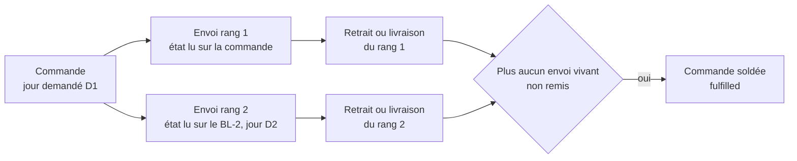

# Plan E7 — le reliquat, plan de bâti

> **Doc-first, 2026-10-25 au soir, révisé le même soir après `vitruve`.**
> Remplace, pour le bâti, [`plan-e7-1-le-jour-du-bon.md`](plan-e7-1-le-jour-du-bon.md),
> et s'appuie sur [`plan-e7-le-reliquat.md`](plan-e7-le-reliquat.md) (le
> programme et les décisions de Hugo, §3 et §4) et
> [`e7-recensement.md`](e7-recensement.md). **Mandat de Hugo (2026-10-25)** :
> tout le reliquat, sans question ; E9 (rembourser un reste payé par carte)
> **exclu**, il dépend de M2, reporté le 2026-10-23. Touche l'argent et des
> clés en base : contredit par `vitruve` (§6, onze points, tous traités).
> **Rien n'est bâti.**

## 0. Ce qui existe (ouvert le 2026-10-25)

Chemins relatifs à `apps/lfd-api/`. Chaque bâtisseur rouvre ce qu'il touche.

- `prisma/schema/public/delivery-notes.prisma:20-69` — `DeliveryNote` porte
  `rank` (CHECK ≥ 1) et `@@unique([orderId, rank])` (l.69), **aucun jour** ;
  ses lignes sont `DeliveryNoteLine` (l.78).
- **L'alignement refuse deux BL vivants** :
  `src/b2b/delivery-notes/domain/services/delivery-note-alignment.ts:122-125`
  rend `UNREPAIRABLE("several_live_notes")` ; « vivant » = non annulé
  (`domain/entities/delivery-note.ts:168`), donc un BL-1 **remis** reste
  vivant. L'aligneur (`application/services/delivery-note-aligner.ts`) tourne
  dans la transaction du geste ; le rattrapage est
  `application/commands/reconcile-delivery-notes.handler.ts`.
- `prisma/schema/production.prisma` — `ProductionOrder @@unique([serviceDay,
orderId])` (l.180) ; `OrderHandover.orderId @unique` (l.206) et
  `reference @unique` (l.208) ; `OrderDeparture.orderId @id` (l.238) ;
  `OrderHandoverProof.orderId @id` (l.265) ; `OrderWithdrawal.orderId @id`
  (l.745).
- `prisma/schema/packing.prisma` — `PackingOrder @@id([serviceDay, orderId])`
  (l.63), cible de **deux FK composites** : `PackingLine` (l.72) et
  `PackingContainer` (l.178) ; `PackingStock @@id([serviceDay, sku])`
  (l.95-109), partagé par toutes les feuilles du jour.
- `prisma/schema/delivery.prisma` — les arrêts sont clés par **leur** id
  (`DeliveryRoundStop` l.214, `DeliveryStopExecution` l.347,
  `DeliveryStopDecision` l.467) et portent `orderId` en colonne (l.217, 349, 469) ; `DeliveryDayReadiness.deliveryOrderIds` (l.829) est une liste
  d'`orderId`.
- `src/b2b/orders/infrastructure/prisma-order.repository.ts:312-331` —
  `markReady` écrit **sur la commande**, par `orderNumber`, sous
  `readyAt: null` ; `markFulfilled` (l.336) sous `handedOverAt: null`.
- `src/b2b/orders/domain/entities/shortfall-decision.ts:122-127` —
  `ensureDecidable` exige `status === "confirmed"` et **refuse toute
  commande payée par carte** (`CardOrderShortfallError`).
- `src/packing/domain/entities/packing-sheet.ts:172-179` — le bac signalé
  « il manque » ne se ferme plus tant que le commerce n'a pas décidé ;
  `assertAllAllocated` (l.442).
- `src/production/application/commands/retake-production-day.handler.ts:40-50` — le
  retirage n'absorbe que des commandes `placed`.
- `src/b2b/loyalty/application/handlers/credit-points-on-handover.handler.ts:37` — les
  points s'écoutent sur `ORDER_FULFILLED`.
- Base de dev (`lfc_b2b_dev`, lecture seule, 2026-10-25) : 26 BL, **tous de
  rang 1** (6 `planned`, 19 `prepared`, 1 `handed_over`). Aucune donnée à
  reprendre.
- Dernière migration commitée : `20261026040000_la_photo_du_bon_signe`. Les
  migrations de ce plan viennent **après** elle.

## 1. Le modèle

Un **envoi** = (commande, rang). Le rang 1 est la commande elle-même ; un BL
de rang > 1 est un **reliquat**, né d'une décision, qui porte son jour.

## 2. Choix de l'assistant (2026-10-25, révisés après `vitruve`)

1. **Le BL-1 ne change pas de source.** Les sources du jour lisent `orders` /
   `order_lines` par `requestedDeliveryDate`, comme aujourd'hui.
2. **`delivery_note.service_day` nullable**, `CHECK (rank = 1 OR service_day
IS NOT NULL)`. Il **reste NULL au rang 1**, pour toujours : la date du BL-1
   est celle de la commande, sans copie.
3. **Deux vérités, une par rang** (BLOQUANTS 1 et 2). Le BL-1 suit la
   commande ; un BL de rang > 1 a son propre état (`planned` → `prepared` →
   `handed_over` | `voided`) que seuls les gestes **de son envoi** font
   avancer. L'alignement ne compte plus « les vivants » : il aligne **le
   BL-1** sur la commande et ignore les rangs > 1. `several_live_notes`
   devient « deux BL vivants **de même rang** ». La commande ne recopie
   jamais l'état d'un BL-2 : `orders.ready_at` / `status = ready` restent ceux
   du rang 1.
4. **Prêt par envoi.** Le scan de fermeture d'une feuille de rang > 1 écrit
   `prepared` **sur le BL** (sous `status = planned`, même arbitrage en base
   que `readyAt: null`), et n'appelle pas `markReady`.
5. **Identité aval = `(orderId, rank)`**, colonne `rank int NOT NULL DEFAULT
1`, sur `production_order`, `packing_order`, `packing_line`,
   `packing_container`, `order_handover`, `order_departure`,
   `order_handover_proof`. **Pas** `order_withdrawal` : un retrait au sens
   « commande retirée du fournil » vise la commande entière, et le rang n'y
   distingue rien (MINEUR de `vitruve`).
6. **Les 18 clés d'outbox** de l'annexe A sont classées en L0 : celles qui
   décrivent un **envoi** gagnent `:r<rank>` **seulement quand rank > 1**
   (rang 1 = clé d'aujourd'hui à l'identique, rien ne se rejoue) ; celles qui
   décrivent la **commande** (payée, annulée, révisée) restent.
   `ORDER_FULFILLED` reste unique : il ne part qu'au **solde** (choix 9).
7. **Le même jour est bâti, sans double compte** (SÉRIEUX 9). Quand D2 = D1,
   le reste est **déjà** dans l'attendu du jour (la commande l'y porte), et
   `PackingStock` du jour a été dimensionné pour lui : le fournil n'ajoute
   rien, le colisage ouvre une **seconde feuille** `(D1, orderId, 2)` dont
   les lignes sont le reste, et l'alloue sur le même stock. Quand D2 ≠ D1, le
   BL-2 est un envoi **en plus** de D2 : le plan de D2 l'ajoute, et si D2 est
   déjà arrêté, le retirage l'absorbe — ce qui demande d'étendre le retirage
   (`retake-production-day.handler.ts:46` n'absorbe que des `placed`). La
   règle tient en une ligne : **un BL-2 compte dans l'attendu de son jour sauf
   si la commande y compte déjà**.
8. **Soldée = `fulfilled`** ; `partially_handed_over` à la remise d'un envoi
   qui n'est pas le dernier. `handed_over_at` / `received_on` restent la
   **première** remise (CHECK B4) ; « Reçue le » se lit sur le dernier BL.
9. **Le reliquat est réservé aux commandes au compte** (piste b de
   `vitruve`). C'est déjà le cas : `shortfall-decision.ts:126-127` refuse le
   départ incomplet sur carte, et on **garde** ce refus (E9 exclu). Donc la
   « facture carte au solde » (Q-R4) est un **travail nul** : une commande
   carte n'a jamais de BL-2. Les **points de fidélité** se créditent au
   solde, sur `ORDER_FULFILLED` comme aujourd'hui, et sur le montant **de la
   somme des BL remis** (un reste abandonné ne rapporte rien) — un seul gain
   par commande, l'index `loyalty_ledger_entries_earned_order_key` le tient
   déjà.
10. **Date du BL-2** : choisie dans la décision, ≥ D1, jamais un jour fermé.
    Montants par la fabrique E6c1 (pourcentages réappliqués, fixes, port et
    surtaxe à zéro).
11. **Un manque sur un BL-2 a une issue** (SÉRIEUX 5) : `ensureDecidable`
    accepte `confirmed` **et** `partially_handed_over` ; le fait
    `packing.shortfall_reported` porte `rank` ; la décision vise l'envoi
    signalé et peut créer le rang suivant ou abandonner (L8). Sans décision,
    la feuille de rang > 1 reste ouverte, comme au rang 1.
12. **Q-R1** : preuve et arrêt par envoi. Côté livraison (SÉRIEUX 7), un
    arrêt porte déjà son `orderId` en colonne : il gagne `rank` (défaut 1) ;
    `deliveryOrderIds` devient une liste d'envois (`orderId` ou
    `orderId#r`), et le canal `delivery/channels/handover/` parle d'envois.
    Chaque BL suit la règle de signature de **son** arrêt.
13. **`order_handover.reference`** garde sa valeur au rang 1 et prend `-2`…
    au-delà (SÉRIEUX 11). La saisie manuelle au comptoir **retrouve par
    préfixe** : un numéro de commande saisi rend l'envoi prêt non remis de
    plus petit rang, et propose le choix si deux le sont.
14. **Migrations** : une par table, dans le déploiement du code
    (pré-release, Hugo 2026-10-04), ordonnées après `20261026040000`. Pour
    `packing_order` (SÉRIEUX 10) : ajouter `rank` aux trois tables, **DROP**
    les FK de `packing_line` et `packing_container`, DROP puis RECREATE la PK
    de `packing_order` sur `(service_day, order_id, rank)`, RECREATE la PK de
    `packing_line` sur `(service_day, order_id, rank, sku)`, RECREATE les deux
    FK sur les trois colonnes. Un seul `migration.sql`, une transaction.
    Aucune donnée supprimée.

## 3. Les lots

```mermaid
flowchart LR
    L0["L0 recensements"] --> L1["L1 jour du BL"]
    L1 --> L2["L2 alignement par rang"]
    L2 --> L3["L3 clés par rang"]
    L3 --> L4["L4 prêt et retrait par envoi"]
    L4 --> L5["L5 état dérivé et solde"]
    L5 --> L6["L6 sources du jour"]
    L6 --> L7["L7 reste à relivrer"]
    L7 --> L8["L8 abandon après coup"]
```

| Lot    | Contenu                                                                                                                                                                                                                                                                                                                                         | Preuve                                                                     |
| ------ | ----------------------------------------------------------------------------------------------------------------------------------------------------------------------------------------------------------------------------------------------------------------------------------------------------------------------------------------------- | -------------------------------------------------------------------------- |
| **L0** | Classer, **en lisant chaque fichier**, les 130 de l'annexe B (remise d'un envoi / soldée / jour) ; les 18 clés de l'annexe A (envoi ou commande) ; toutes les listes de statuts explicites (au moins 6 fichiers par le motif `in: [OrderStatus.…]`, à compléter) face à `partially_handed_over` ; les lecteurs de `deliveryOrderIds`. Doc seule | annexes A et B tranchées, une ligne par fichier                            |
| **L1** | `service_day` nullable + CHECK                                                                                                                                                                                                                                                                                                                  | la base refuse un rang 2 sans jour                                         |
| **L2** | alignement par rang (choix 3) dans `delivery-note-alignment.ts` et le rattrapage ; `several_live_notes` par rang                                                                                                                                                                                                                                | un BL-1 remis + un BL-2 vivant : aligné, pas `UNREPAIRABLE`                |
| **L3** | `rank` et clés (choix 5, 14) ; clés d'outbox (choix 6) ; `rank` dans `PackingListOrder` et les contrats de canal ; arrêts de livraison et `deliveryOrderIds` (choix 12) ; adaptateurs à `rank: 1`                                                                                                                                               | e2e plan, colisage, retirage, tournées inchangés ; clé de rang 1 identique |
| **L4** | prêt par envoi (choix 4) ; `order_handover`, `OrderDeparture`, `OrderHandoverProof` par envoi ; QR et saisie (choix 13)                                                                                                                                                                                                                         | double scan refusé par envoi, preuve par envoi                             |
| **L5** | `partially_handed_over`, solde dérivé ; verrous d'annulation et de révision sur « un envoi remis » ; points au solde (choix 9) ; CA, volumes ; listes de statuts de L0 ; lecteurs de l'annexe B                                                                                                                                                 | identique avec un seul envoi                                               |
| **L6** | `DayShipmentsReader.extraShipments(D)` → `{orderId, rank, serviceDay, status, lines}` des BL vivants de rang > 1 du jour, **avec leur état** (SÉRIEUX 6) ; les 14 sources du jour l'ajoutent ; règle du même jour (choix 7)                                                                                                                     | sans BL-2 : sorties identiques ; BL-2 à D2 paraît à D2, pas à D1           |
| **L7** | « reste à relivrer » avec date ; BL-2 et montants ; seconde feuille le même jour ; entrée au plan de D2 ou au retirage étendu ; manque sur un BL-2 (choix 11) ; « reste relivré le <date> » sur colisage, Supervision, comptoir, feuille de route, fiche commande ; solde au dernier BL                                                         | e2e un autre jour, le même jour, et un manque au rang 2                    |
| **L8** | abandon du BL-2 par le superviseur, puis solde                                                                                                                                                                                                                                                                                                  | e2e                                                                        |

**Ne change pas** : la passation et la réservation du jour, les documents
de type « demande », la facture au compte hors solde, l'interdiction du
départ incomplet sur carte. **E9 exclu.**

**Irréversible** : dès qu'un BL-2 est remis en production, les clés « une
remise par commande » ne se resserrent plus.

## 4. Les risques, dans l'ordre

1. **L3**, le plus large : 18 clés d'outbox, sept tables, trois blocs
   (`production`, `packing`, `delivery`) et leurs contrats. Une clé oubliée
   **avale** le second envoi sans erreur (`ON CONFLICT DO NOTHING`) : chaque
   clé de l'annexe A a son test « deux rangs, deux lignes d'outbox ».
2. **L5** : 130 lecteurs, classés par jeton seulement (annexe B) — L0 les
   lit un à un ; tant qu'il ne l'a pas fait, le nombre réel de lecteurs à
   toucher est inconnu.
3. Le retirage étendu aux BL-2 d'un jour arrêté (choix 7, D2 ≠ D1).
4. Le choix de l'envoi au scan quand deux sont prêts (choix 13).

**Le même jour n'est pas reporté.** Hugo a dit que le cas courant est une
seconde livraison le jour même ; son coût réel, une fois le double compte
levé (choix 7), est une seconde feuille sur le même stock — L3 et L4 le
paient de toute façon pour l'autre jour. Le reporter aurait laissé le cas
courant sans issue pour économiser peu.

## 5. Ce qui reste en dehors

E9 et donc tout reliquat sur carte ; le courriel « reste relivré » au client
(aucun courriel n'existe pour le départ incomplet au compte,
`bon-de-livraison.md`) ; la réception avec réserve à la porte (R1).

## 6. Contradiction de `vitruve` (2026-10-25) et ce qui en a été fait

| #   | Objection                                     | Sort                                                                                                                |
| --- | --------------------------------------------- | ------------------------------------------------------------------------------------------------------------------- |
| B1  | l'alignement refuse deux BL vivants           | **corrigé** : choix 3, lot L2                                                                                       |
| B2  | aucun lot ne rend un envoi prêt               | **corrigé** : choix 4, lot L4                                                                                       |
| B3  | clés d'outbox en `orderId`                    | **corrigé** : recensées (annexe A, 18 clés), choix 6, lot L3                                                        |
| S4  | facture carte au solde                        | **corrigé** : travail nul, interdiction gardée, points au solde sur la somme des BL remis (choix 9)                 |
| S5  | manque sur le BL-2 sans issue                 | **corrigé** : choix 11, lot L7                                                                                      |
| S6  | `extraShipments` sans état, listes de statuts | **corrigé** : état porté (L6), listes recensées en L0 et touchées en L5                                             |
| S7  | `delivery` absent                             | **corrigé** : choix 12, lot L3                                                                                      |
| S8  | comptes faux                                  | **corrigé** : 49 / 42 / 78 / 62, 130 au total, mesurés (annexe B) ; classement fichier par fichier **assumé en L0** |
| S9  | même jour compté deux fois, stock partagé     | **corrigé** : choix 7 ; le retirage étendu reste un risque (§4)                                                     |
| S10 | ordre DROP/RECREATE des FK                    | **corrigé** : choix 14                                                                                              |
| S11 | saisie manuelle et suffixe `-2`               | **corrigé** : choix 13                                                                                              |
| m   | 15 vs 14 sources                              | **corrigé** : 14 (recensement)                                                                                      |
| m   | `order_withdrawal` au rang inutile            | **corrigé** : retiré (choix 5)                                                                                      |
| m   | ordre après `20261026040000`                  | **corrigé** : §0, choix 14                                                                                          |
| m   | `service_day` NULL au rang 1                  | **corrigé** : choix 2                                                                                               |
| m   | aucun BL de rang > 1 en base dev              | **vérifié** le 2026-10-25 : 26 BL, tous rang 1 (§0)                                                                 |

## Annexe A — les clés d'outbox qui portent un `orderId` (2026-10-25)

Mesuré par grep sur `src/` hors tests : 18 clés. « Envoi » = gagne `:r<rank>`
au-delà du rang 1 ; « commande » = inchangée ; L0 confirme.

| Fichier (`src/`)                                                     | Clé                                                     | Classe provisoire |
| -------------------------------------------------------------------- | ------------------------------------------------------- | ----------------- |
| `production/channels/packing/packing-list-drawn.event.ts:80`         | `packing_list_drawn:<jour>:<orderId>[:after-reopening]` | envoi             |
| `production/domain/events/order-quantities-raised.events.ts:58`      | `…:<jour>:<orderId>:r<revision>`                        | envoi             |
| `production/domain/events/order-withdrawn-after-close.events.ts:56`  | `…:<jour>:<orderId>`                                    | envoi             |
| `packing/domain/events/packing-sheet-withdrawn.events.ts:65`         | `…:<jour>:<orderId>`                                    | envoi             |
| `packing/channels/commerce/packing-shortfall-reported.event.ts:48`   | `…:<orderId>:<instant>`                                 | envoi (payload)   |
| `packing/channels/commerce/packing-shortfall-cleared.event.ts:32`    | `…:<orderId>:<instant>`                                 | envoi (payload)   |
| `b2b/orders/domain/events/order-ready.fact.ts:27`                    | `order.ready:<orderId>`                                 | envoi             |
| `b2b/orders/domain/events/order-shortfall-decided.event.ts:36`       | `…:<orderId>`                                           | envoi             |
| `b2b/orders/domain/events/order-handed-over.event.ts:55`             | `order.fulfilled:<orderId>`                             | commande (solde)  |
| `b2b/orders/domain/events/order-cancelled.event.ts:108`              | `…:<orderId>`                                           | commande          |
| `b2b/orders/domain/events/order-paid.fact.ts:30`                     | `…:<orderId>`                                           | commande          |
| `b2b/orders/domain/events/order-paid-after-cancellation.event.ts:34` | `…:<orderId>`                                           | commande          |
| `b2b/orders/domain/events/order-payment-failed.event.ts:79`          | `…:<orderId>:<cause>`                                   | commande          |
| `b2b/orders/domain/events/order-revised.event.ts:35`                 | `…:<orderId>:<revision>`                                | commande          |
| `delivery/channels/commerce/commerce-order-placed.fact.ts:38`        | `…:<orderId>`                                           | commande          |
| `delivery/channels/commerce/commerce-order-revised.fact.ts:33`       | `…:<orderId>:<revision>`                                | commande          |
| `delivery/channels/commerce/commerce-order-cancelled.fact.ts:31`     | `…:<orderId>`                                           | commande          |
| `delivery/channels/handover/delivery-orders-brought-back.fact.ts:34` | `…:<roundId>:<orderIds>`                                | envoi             |

## Annexe B — les lecteurs de `fulfilled`, `handedOverAt`, `requestedDeliveryDate` (2026-10-25)

Mesuré par `grep -rl` sur `apps/lfd-api/src` hors `__tests__` et client
Prisma généré : `fulfilled` 49 fichiers, `handedOverAt` 42, union 78,
`requestedDeliveryDate` 62 ; 130 fichiers en tout (`vitruve` en comptait
50 / 42 / 79 / 62 ; l'écart d'un fichier tient au motif, non élucidé). La
classe est **déduite du jeton**, pas d'une lecture : `fulfilled` → « soldée »,
`handedOverAt` → « remise de quelque chose », `requestedDeliveryDate` →
« jour ». L0 la remplace par une lecture fichier par fichier.

| Fichier (`src/`)                                                                 | Lit                                          | Classe provisoire                       |
| -------------------------------------------------------------------------------- | -------------------------------------------- | --------------------------------------- |
| `b2b/account/infrastructure/prisma-customer-sheet.reader.ts`                     | fulfilled                                    | soldée                                  |
| `b2b/accounting/application/document-specimens/specimen-data.ts`                 | requestedDeliveryDate                        | jour                                    |
| `b2b/accounting/application/handlers/issue-card-invoice-on-fulfilled.handler.ts` | fulfilled                                    | soldée                                  |
| `b2b/accounting/application/queries/get-invoice-dossier.handler.ts`              | requestedDeliveryDate                        | jour                                    |
| `b2b/accounting/card-invoice.providers.ts`                                       | fulfilled                                    | soldée                                  |
| `b2b/accounting/domain/entities/billing-statement.ts`                            | requestedDeliveryDate                        | jour                                    |
| `b2b/accounting/domain/services/card-invoicing.ts`                               | handedOverAt                                 | remise de quelque chose                 |
| `b2b/accounting/domain/services/invoice-dossier-calendar.ts`                     | requestedDeliveryDate                        | jour                                    |
| `b2b/accounting/domain/services/invoice-dossier-csv.ts`                          | requestedDeliveryDate                        | jour                                    |
| `b2b/accounting/domain/services/invoice-dossier-history.ts`                      | handedOverAt                                 | remise de quelque chose                 |
| `b2b/accounting/domain/services/invoice-dossier.types.ts`                        | requestedDeliveryDate                        | jour                                    |
| `b2b/accounting/domain/services/invoice-lines.ts`                                | requestedDeliveryDate                        | jour                                    |
| `b2b/accounting/domain/services/monthly-invoicing.ts`                            | handedOverAt                                 | remise de quelque chose                 |
| `b2b/accounting/infrastructure/frozen-invoice-order.mapper.ts`                   | requestedDeliveryDate                        | jour                                    |
| `b2b/accounting/infrastructure/prisma-card-invoicing.reader.ts`                  | handedOverAt                                 | remise de quelque chose                 |
| `b2b/accounting/infrastructure/prisma-procedure-orders.reader.ts`                | handedOverAt requestedDeliveryDate           | remise de quelque chose · jour          |
| `b2b/accounting/infrastructure/prisma-unconfirmed-deliveries.reader.ts`          | requestedDeliveryDate                        | jour                                    |
| `b2b/alerts/infrastructure/prisma-order-history.reader.ts`                       | fulfilled                                    | soldée                                  |
| `b2b/contact/application/commands/report-order-problem.handler.ts`               | fulfilled                                    | soldée                                  |
| `b2b/contact/domain/ports/reportable-order.reader.ts`                            | fulfilled                                    | soldée                                  |
| `b2b/contact/infrastructure/order-reportable-order.reader.ts`                    | fulfilled                                    | soldée                                  |
| `b2b/delivery-notes/domain/entities/delivery-note.ts`                            | handedOverAt                                 | remise de quelque chose                 |
| `b2b/delivery-notes/domain/services/delivery-note-alignment.ts`                  | fulfilled handedOverAt                       | soldée · remise de quelque chose        |
| `b2b/delivery-notes/domain/services/delivery-note-sheet.ts`                      | handedOverAt                                 | remise de quelque chose                 |
| `b2b/delivery-notes/domain/services/delivery-note-terms-control.ts`              | fulfilled                                    | soldée                                  |
| `b2b/delivery-notes/infrastructure/delivery-note.rows.ts`                        | handedOverAt                                 | remise de quelque chose                 |
| `b2b/delivery-notes/infrastructure/prisma-delivery-note.repository.ts`           | handedOverAt                                 | remise de quelque chose                 |
| `b2b/growth/application/handlers/on-order-handed-over.handler.ts`                | fulfilled handedOverAt                       | soldée · remise de quelque chose        |
| `b2b/growth/domain/revenue-scope.ts`                                             | fulfilled                                    | soldée                                  |
| `b2b/loyalty/application/handlers/credit-points-on-handover.handler.ts`          | fulfilled                                    | soldée                                  |
| `b2b/orders/application/commands/mark-order-fulfilled.handler.ts`                | fulfilled handedOverAt                       | soldée · remise de quelque chose        |
| `b2b/orders/application/commands/place-order-for-customer.handler.ts`            | requestedDeliveryDate                        | jour                                    |
| `b2b/orders/application/commands/place-order.handler.ts`                         | requestedDeliveryDate                        | jour                                    |
| `b2b/orders/application/commands/place-shop-order.handler.ts`                    | requestedDeliveryDate                        | jour                                    |
| `b2b/orders/application/document-specimens/specimen-data.ts`                     | requestedDeliveryDate                        | jour                                    |
| `b2b/orders/application/document-specimens/specimen-order-summary.ts`            | requestedDeliveryDate                        | jour                                    |
| `b2b/orders/application/handlers/on-order-handed-over.handler.ts`                | fulfilled handedOverAt                       | soldée · remise de quelque chose        |
| `b2b/orders/application/queries/get-guest-order-cancellation.handler.ts`         | requestedDeliveryDate                        | jour                                    |
| `b2b/orders/application/queries/get-packing.handler.ts`                          | requestedDeliveryDate                        | jour                                    |
| `b2b/orders/application/queries/order-handover-proof-view.ts`                    | handedOverAt                                 | remise de quelque chose                 |
| `b2b/orders/application/queries/quote-order.handler.ts`                          | requestedDeliveryDate                        | jour                                    |
| `b2b/orders/application/services/delivery-en-route-mail.service.ts`              | fulfilled handedOverAt                       | soldée · remise de quelque chose        |
| `b2b/orders/application/services/order-composition.service.ts`                   | requestedDeliveryDate                        | jour                                    |
| `b2b/orders/application/services/order-content.ts`                               | requestedDeliveryDate                        | jour                                    |
| `b2b/orders/application/services/order-drafting.service.ts`                      | requestedDeliveryDate                        | jour                                    |
| `b2b/orders/application/services/order-revising.service.ts`                      | requestedDeliveryDate                        | jour                                    |
| `b2b/orders/domain/entities/order-billing.ts`                                    | fulfilled                                    | soldée                                  |
| `b2b/orders/domain/entities/order-customer-nudges.ts`                            | fulfilled handedOverAt                       | soldée · remise de quelque chose        |
| `b2b/orders/domain/entities/order-revision.ts`                                   | requestedDeliveryDate                        | jour                                    |
| `b2b/orders/domain/entities/order-shapes.ts`                                     | requestedDeliveryDate                        | jour                                    |
| `b2b/orders/domain/entities/order.ts`                                            | requestedDeliveryDate                        | jour                                    |
| `b2b/orders/domain/errors/order-fulfilled-payload.error.ts`                      | fulfilled                                    | soldée                                  |
| `b2b/orders/domain/events/order-handed-over.event.ts`                            | fulfilled handedOverAt                       | soldée · remise de quelque chose        |
| `b2b/orders/domain/ports/completed-order.reader.ts`                              | fulfilled                                    | soldée                                  |
| `b2b/orders/domain/ports/order-progress-for-delivery-note.ts`                    | fulfilled handedOverAt                       | soldée · remise de quelque chose        |
| `b2b/orders/domain/ports/order.reader.ts`                                        | handedOverAt requestedDeliveryDate           | remise de quelque chose · jour          |
| `b2b/orders/domain/ports/order.repository.ts`                                    | handedOverAt                                 | remise de quelque chose                 |
| `b2b/orders/domain/ports/site-arrival-orders.reader.ts`                          | fulfilled                                    | soldée                                  |
| `b2b/orders/domain/services/customer-cancellation-refusal.ts`                    | fulfilled                                    | soldée                                  |
| `b2b/orders/domain/services/day-supervision.ts`                                  | fulfilled                                    | soldée                                  |
| `b2b/orders/domain/services/order-cancellation.ts`                               | fulfilled                                    | soldée                                  |
| `b2b/orders/domain/services/order-fingerprint.ts`                                | requestedDeliveryDate                        | jour                                    |
| `b2b/orders/domain/services/order-revisability.ts`                               | fulfilled                                    | soldée                                  |
| `b2b/orders/domain/services/order-revision-refusal.ts`                           | fulfilled                                    | soldée                                  |
| `b2b/orders/domain/services/order-sheet.ts`                                      | requestedDeliveryDate                        | jour                                    |
| `b2b/orders/domain/services/packing.ts`                                          | fulfilled                                    | soldée                                  |
| `b2b/orders/domain/services/production-plan.ts`                                  | fulfilled                                    | soldée                                  |
| `b2b/orders/infrastructure/cancellation-subject.row.ts`                          | requestedDeliveryDate                        | jour                                    |
| `b2b/orders/infrastructure/delivery-note-order-progress.row.ts`                  | handedOverAt                                 | remise de quelque chose                 |
| `b2b/orders/infrastructure/handover-order.query.ts`                              | requestedDeliveryDate                        | jour                                    |
| `b2b/orders/infrastructure/prisma-admin-order-list.reader.ts`                    | requestedDeliveryDate                        | jour                                    |
| `b2b/orders/infrastructure/prisma-company-order-list.reader.ts`                  | requestedDeliveryDate                        | jour                                    |
| `b2b/orders/infrastructure/prisma-company-order-summary.reader.ts`               | requestedDeliveryDate                        | jour                                    |
| `b2b/orders/infrastructure/prisma-completed-order.reader.ts`                     | fulfilled                                    | soldée                                  |
| `b2b/orders/infrastructure/prisma-customer-cancellation-subject.reader.ts`       | requestedDeliveryDate                        | jour                                    |
| `b2b/orders/infrastructure/prisma-customer-nudge-trace.reader.ts`                | requestedDeliveryDate                        | jour                                    |
| `b2b/orders/infrastructure/prisma-day-orders.source.ts`                          | requestedDeliveryDate                        | jour                                    |
| `b2b/orders/infrastructure/prisma-day-supervision.reader.ts`                     | fulfilled requestedDeliveryDate              | soldée · jour                           |
| `b2b/orders/infrastructure/prisma-deadline-orders.reader.ts`                     | requestedDeliveryDate                        | jour                                    |
| `b2b/orders/infrastructure/prisma-delivery-order-states.reader.ts`               | fulfilled handedOverAt                       | soldée · remise de quelque chose        |
| `b2b/orders/infrastructure/prisma-delivery-orders.reader.ts`                     | requestedDeliveryDate                        | jour                                    |
| `b2b/orders/infrastructure/prisma-expected-production.reader.ts`                 | requestedDeliveryDate                        | jour                                    |
| `b2b/orders/infrastructure/prisma-order-customer-nudges.repository.ts`           | handedOverAt requestedDeliveryDate           | remise de quelque chose · jour          |
| `b2b/orders/infrastructure/prisma-order-notice-summary.reader.ts`                | requestedDeliveryDate                        | jour                                    |
| `b2b/orders/infrastructure/prisma-order-plan-release.ts`                         | requestedDeliveryDate                        | jour                                    |
| `b2b/orders/infrastructure/prisma-order-revision-history.reader.ts`              | requestedDeliveryDate                        | jour                                    |
| `b2b/orders/infrastructure/prisma-order-revision.repository.ts`                  | requestedDeliveryDate                        | jour                                    |
| `b2b/orders/infrastructure/prisma-order.reader.ts`                               | handedOverAt requestedDeliveryDate           | remise de quelque chose · jour          |
| `b2b/orders/infrastructure/prisma-order.repository.ts`                           | fulfilled handedOverAt requestedDeliveryDate | soldée · remise de quelque chose · jour |
| `b2b/orders/infrastructure/prisma-orders-to-reconcile-delivery-notes.ts`         | fulfilled                                    | soldée                                  |
| `b2b/orders/infrastructure/prisma-pending-orders.reader.ts`                      | fulfilled requestedDeliveryDate              | soldée · jour                           |
| `b2b/orders/infrastructure/prisma-site-arrival-orders.reader.ts`                 | requestedDeliveryDate                        | jour                                    |
| `b2b/orders/infrastructure/prisma-transfer-orders.reader.ts`                     | requestedDeliveryDate                        | jour                                    |
| `b2b/orders/infrastructure/prisma-unpaid-link-order.reader.ts`                   | requestedDeliveryDate                        | jour                                    |
| `b2b/orders/infrastructure/prisma-unsettled-settlement.reader.ts`                | requestedDeliveryDate                        | jour                                    |
| `b2b/orders/infrastructure/prisma-voucher-order.reader.ts`                       | requestedDeliveryDate                        | jour                                    |
| `b2b/orders/infrastructure/revisable-order.row.ts`                               | requestedDeliveryDate                        | jour                                    |
| `b2b/orders/infrastructure/revised-composition.ts`                               | requestedDeliveryDate                        | jour                                    |
| `b2b/orders/orders.module.ts`                                                    | fulfilled                                    | soldée                                  |
| `b2b/pricing/infrastructure/prisma-customer-volume.reader.ts`                    | fulfilled                                    | soldée                                  |
| `b2b/pricing/infrastructure/prisma-sku-volume.reader.ts`                         | fulfilled                                    | soldée                                  |
| `delivery/application/commands/bring-stop-back.handler.ts`                       | fulfilled                                    | soldée                                  |
| `delivery/application/commands/deposit-stop.handler.ts`                          | fulfilled                                    | soldée                                  |
| `delivery/application/doorstep-handover.ts`                                      | fulfilled                                    | soldée                                  |
| `delivery/channels/handover/doorstep-handover.attestor.ts`                       | fulfilled                                    | soldée                                  |
| `dev/scenario/purge/outbox.purge.ts`                                             | fulfilled                                    | soldée                                  |
| `dev/scenario/purge/scenario-scope.ts`                                           | requestedDeliveryDate                        | jour                                    |
| `dev/seeding/counter-day.seed.ts`                                                | handedOverAt                                 | remise de quelque chose                 |
| `dev/seeding/invoice-handovers.seed.ts`                                          | fulfilled handedOverAt requestedDeliveryDate | soldée · remise de quelque chose · jour |
| `dev/seeding/order-placing.seed.ts`                                              | requestedDeliveryDate                        | jour                                    |
| `handover/application/commands/confirm-handover.handler.ts`                      | fulfilled                                    | soldée                                  |
| `handover/application/queries/get-handover-queue.handler.ts`                     | handedOverAt                                 | remise de quelque chose                 |
| `handover/application/queries/get-handover.handler.ts`                           | handedOverAt requestedDeliveryDate           | remise de quelque chose · jour          |
| `handover/application/services/handover-attestation.service.ts`                  | fulfilled handedOverAt                       | soldée · remise de quelque chose        |
| `handover/application/services/handover-departure-holds.ts`                      | requestedDeliveryDate                        | jour                                    |
| `handover/application/services/quality-hold.ts`                                  | requestedDeliveryDate                        | jour                                    |
| `handover/channels/commerce/handover-subject.reader.ts`                          | handedOverAt requestedDeliveryDate           | remise de quelque chose · jour          |
| `handover/channels/commerce/index.ts`                                            | fulfilled                                    | soldée                                  |
| `handover/channels/commerce/order-handed-over.event.ts`                          | fulfilled handedOverAt                       | soldée · remise de quelque chose        |
| `handover/channels/commerce/order-handover-history.reader.ts`                    | handedOverAt                                 | remise de quelque chose                 |
| `handover/domain/entities/order-handover.ts`                                     | handedOverAt                                 | remise de quelque chose                 |
| `handover/domain/ports/handover-attestations.reader.ts`                          | handedOverAt                                 | remise de quelque chose                 |
| `handover/domain/services/handover-proof-exhibit.ts`                             | handedOverAt                                 | remise de quelque chose                 |
| `handover/domain/services/handover.ts`                                           | handedOverAt                                 | remise de quelque chose                 |
| `handover/http/handover.controller.ts`                                           | fulfilled                                    | soldée                                  |
| `handover/infrastructure/prisma-attested-handovers.reader.ts`                    | handedOverAt                                 | remise de quelque chose                 |
| `handover/infrastructure/prisma-handover-attestations.reader.ts`                 | handedOverAt                                 | remise de quelque chose                 |
| `handover/infrastructure/prisma-handover-proof.reader.ts`                        | handedOverAt                                 | remise de quelque chose                 |
| `handover/infrastructure/prisma-order-handover-history.reader.ts`                | handedOverAt                                 | remise de quelque chose                 |
| `handover/infrastructure/prisma-order-handover.repository.ts`                    | handedOverAt                                 | remise de quelque chose                 |
