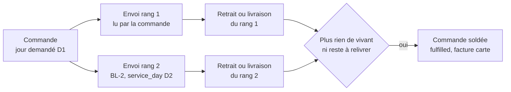
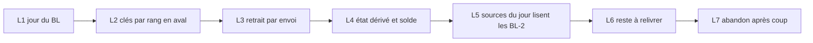

# Plan E7 — le reliquat, plan de bâti

> **Doc-first, 2026-10-25 au soir.** Remplace, pour le bâti,
> [`plan-e7-1-le-jour-du-bon.md`](plan-e7-1-le-jour-du-bon.md), et s'appuie
> sur [`plan-e7-le-reliquat.md`](plan-e7-le-reliquat.md) (le programme et les
> décisions de Hugo, §3 et §4) et [`e7-recensement.md`](e7-recensement.md).
> **Mandat de Hugo (2026-10-25)** : tout le reliquat, sans question ; E9
> (rembourser un reste payé par carte) **exclu**, il dépend de M2, reporté le
> 2026-10-23. Touche l'argent et des clés en base : contredit par `vitruve`
> avant tout bâti (§6). **Rien n'est bâti.**

## 0. Ce qui existe (ouvert le 2026-10-25)

- `prisma/schema/public/delivery-notes.prisma:20-69` — `DeliveryNote` porte
  `rank` (CHECK ≥ 1) et `@@unique([orderId, rank])` (l.69), **aucun jour** ;
  ses lignes sont `DeliveryNoteLine` (l.78, index `noteId` l.97).
- `prisma/schema/production.prisma` — `ProductionOrder @@unique([serviceDay,
orderId])` (l.180) ; `OrderHandover.orderId @unique` (l.206) et
  `reference @unique` (l.208) ; `OrderDeparture.orderId @id` (l.238) ;
  `OrderHandoverProof.orderId @id` (l.265) ; `OrderWithdrawal.orderId @id`
  (l.745).
- `prisma/schema/packing.prisma` — `PackingOrder @@id([serviceDay, orderId])`
  (l.63) ; `PackingLine @@id([serviceDay, orderId, sku])` (l.84) ;
  `PackingContainer` indexé `[serviceDay, orderId]` (l.196).
- `src/b2b/orders/infrastructure/prisma-order.repository.ts` — `markReady`
  (l.312) écrit sous `readyAt: null` ; `markFulfilled` (l.336) sous
  `handedOverAt: null`.
- Le filtre par jour de `listForProduction` :
  `src/b2b/orders/infrastructure/prisma-order.reader.ts:286`.
- `src/b2b/delivery-notes/domain/services/departing-source.ts` (E6b) réécrit
  le BL-1 aux quantités décidées.

Chemins relatifs à `apps/lfd-api/`. Chaque bâtisseur rouvre ce qu'il touche.

## 1. Le modèle

Un **envoi** = (commande, rang). Le rang 1 existe avant le BL-1 (implicite) ;
un BL de rang > 1 est un **reliquat**, qui porte son jour de service.

## 2. Choix de l'assistant (2026-10-25)

1. **Le BL-1 ne change pas de source.** Les sources du jour lisent `orders` /
   `order_lines` par `requestedDeliveryDate`, comme aujourd'hui. Le BL-1
   réécrit par E6b n'est la source d'aucun écran du jour (lève le BLOQUANT 1
   d'E7.1).
2. **`delivery_note.service_day` nullable**, `CHECK (rank = 1 OR service_day
IS NOT NULL)` : ni rattrapage ni `SET NOT NULL` (BLOQUANT 3), et la date
   du BL-1 suit la commande sans réécriture.
3. **Un BL-2 est un envoi supplémentaire** : un lecteur commerce unique,
   `DayShipmentsReader.extraShipments(D)` → `{orderId, rank, serviceDay,
lines}` des BL vivants de rang > 1 du jour ; chaque source du jour l'ajoute
   à sa lecture. Pas de `where` partagé (BLOQUANT 2).
4. **Les canaux** gagnent `rank` et `serviceDay` dans leurs contrats ; ports
   déclarés par le bloc consommateur, implémentés par le commerce (matrice §3
   de CLAUDE.md). `quality-hold.ts` et `handover-departure-holds.ts` reçoivent
   le jour par le contrat.
5. **Identité aval = `(orderId, rank)`**, colonne `rank int NOT NULL DEFAULT 1`
   sur les tables clées par commande.
6. **Migrations en un temps par table**, dans le déploiement du code
   (pré-release, Hugo 2026-10-04) : ajout de `rank DEFAULT 1`, puis
   remplacement de la clé. Aucune donnée supprimée. `order_handover.reference`
   garde sa valeur pour le rang 1 et prend un suffixe `-2`… au-delà.
7. **Le même jour est bâti** : la clé par rang retire la collision ; le BL-2
   entre au jour arrêté sur le modèle du retirage. Le fournil compte des
   envois : attendu = commande + BL-2. **Risque assumé** : un reste déjà rendu
   sur l'étagère serait refabriqué ; le reliquat demande une fabrication, il
   ne réserve pas de stock.
8. **Soldée = `fulfilled`** ; statut `partially_handed_over` à la remise d'un
   envoi qui n'est pas le dernier. `handed_over_at` / `received_on` restent
   la **première** remise (CHECK B4) ; « Reçue le » se lit sur le dernier BL.
9. **Facture carte au solde, somme des BL** (Q-R4) : le déclencheur passe de
   « fulfilled + payée » à « soldée + payée ». Facture au compte inchangée.
10. **Date du BL-2** : choisie dans la décision, ≥ D1, jamais un jour fermé.
    Montants par la fabrique E6c1 (pourcentages réappliqués, fixes, port et
    surtaxe à zéro).
11. **E8** : « Abandonner le reste » sur un BL-2 non préparé, par le
    superviseur, même geste que le départ incomplet (Q-R2) ; le BL-2 est
    annulé et sorti de son jour ; la commande se solde si plus rien ne reste.
12. **Q-R1** : preuve et arrêt par envoi ; chaque BL suit la règle de son
    arrêt.

## 3. Les lots

| Lot            | Contenu                                                                                                                                                                                                                      | Preuve                                                         |
| -------------- | ---------------------------------------------------------------------------------------------------------------------------------------------------------------------------------------------------------------------------- | -------------------------------------------------------------- |
| **L1** (E7.1a) | `service_day` nullable + CHECK                                                                                                                                                                                               | la base refuse un rang 2 sans jour                             |
| **L2** (E7.4a) | `rank` et clés par rang : `production_order`, `packing_order`, `packing_line`, contenants, `order_withdrawal` ; adaptateurs à `rank: 1`                                                                                      | e2e plan, colisage, retirage inchangés                         |
| **L3** (E7.3)  | `order_handover`, `OrderDeparture`, `OrderHandoverProof` par envoi ; le QR de la commande remet l'envoi prêt, le comptoir choisit s'il y en a deux                                                                           | double scan refusé par envoi, preuve par envoi                 |
| **L4** (E7.2)  | `partially_handed_over`, solde dérivé ; verrous d'annulation et de révision sur « un envoi remis » ; facture carte, points, CA, volumes au solde ; les 67 lecteurs reclassés (recensement §2–§3)                             | identique avec un seul envoi                                   |
| **L5** (E7.1b) | `DayShipmentsReader` ; les 15 sources du jour ajoutent les BL-2 ; contrats de canal                                                                                                                                          | sans BL-2 : sorties identiques ; un BL-2 paraît à D2, pas à D1 |
| **L6** (E7.5)  | « reste à relivrer » avec date ; BL-2 et montants ; entrée au plan de D2, y compris un jour arrêté ; « reste relivré le <date> » sur colisage, Supervision, comptoir, feuille de route, fiche commande ; solde au dernier BL | e2e un autre jour, et le même jour                             |
| **L7** (E8)    | abandon du BL-2 par le superviseur, puis solde                                                                                                                                                                               | e2e                                                            |

**Ne change pas** : la passation et la réservation du jour, les documents
de type « demande », la facture au compte hors solde. **E9 exclu.**

**Irréversible** (rappel du programme) : dès qu'un BL-2 est remis en
production, les clés « une remise par commande » ne se resserrent plus.

## 4. Les risques, dans l'ordre

1. Le même jour au fournil (choix 7).
2. L4 : 67 lecteurs reclassés, dont la facture carte et les points.
3. Les clés primaires multiples en un temps, avec les FK des contenants.
4. Le choix de l'envoi au scan quand deux sont prêts.

## 5. Ce qui reste en dehors

E9 ; le courriel « reste relivré » au client (aucun courriel n'existe pour le
départ incomplet au compte, `bon-de-livraison.md`) ; la réception avec
réserve à la porte (R1).

## 6. Contradiction de `vitruve`

À venir.
