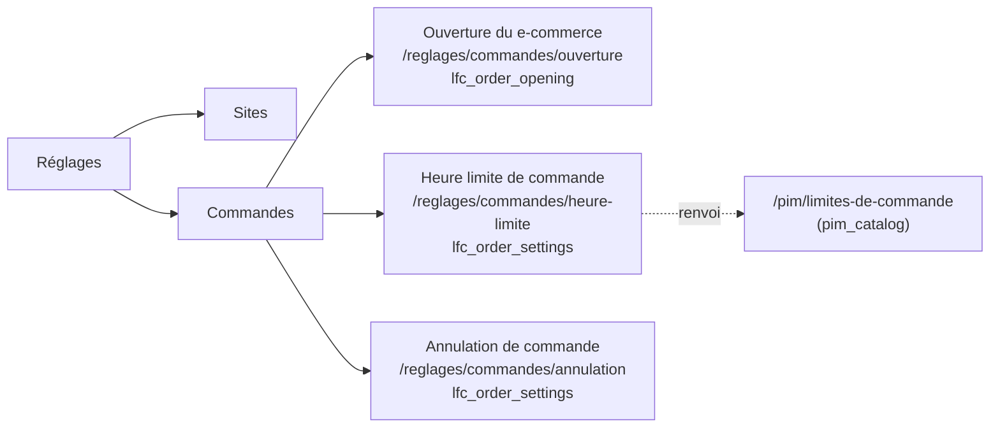
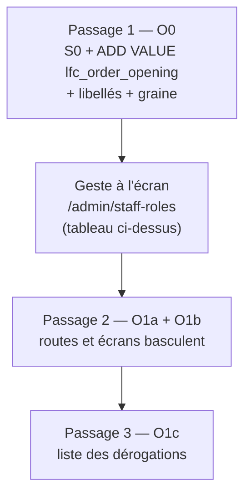

# Réglages › Commandes — ouverture, heure limite et annulation

**Statut** : 📐 plan, rien n'est bâti. Écrit le 2026-10-13, contredit par
`vitruve` le même jour (§7), **Q1, Q3, Q4, Q5 et la carte B2C tranchées par
Hugo le 2026-10-13** (§5). Annoncé par le
§5.4 du plan commun des sites (2026-10-13, découpé le même jour) ; les
droits granulaires qui le fondent sont décrits dans
[`../sites/sites.md`](../sites/sites.md) §5 (lot O1), et élargi ici.

**Pourquoi un document à part, et ici** : le plan des sites parle de lieux, de
transferts et de couleurs ; ce lot parle de la **règle qui refuse une
commande**, et doit se tenir à côté de ce qu'il touche —
[`architecture-heure-limite-de-commande.md`](architecture-heure-limite-de-commande.md),
[`demontage-order-cutoff.md`](demontage-order-cutoff.md),
[`plan-heure-limite-par-clientele.md`](plan-heure-limite-par-clientele.md) et
[`annulation/annulation-par-le-client.md`](annulation/annulation-par-le-client.md).
Les documents de commande vivent dans `commandes/` (CLAUDE.md §8). Le lot O1
grossissait aussi d'un déplacement d'écran (taille S) à une question d'argent
et de frontière : il n'a plus sa place en une ligne d'un autre plan.

⚠️ Le plan touche une **frontière de sécurité** (deux surfaces changent de
ressource) : `vitruve` d'office avant Hugo (CLAUDE.md §9 bis). Fait le
2026-10-13 ; le sort de chaque objection est au §7.

## 0. La demande (Hugo, 2026-10-13)

Dans **Réglages**, une section **« Commandes »** à **trois entrées**, dans
cet ordre proposé :

1. **« Ouverture du e-commerce »** — aujourd'hui « Ouverture de la boutique »
   (`/b2b/reglages/ouverture-boutique`) : la boutique prend-elle les commandes
   des pros ? des particuliers ? (ajout de Hugo, 2026-10-13) ;
2. **« Heure limite de commande »** — la limite générale du commerce **par
   clientèle** (B2B avec son rattrapage et ses dérogations ; B2C à venir), et
   un **renvoi** vers la limite de fabrication par article, qui reste au
   référentiel (`/pim/limites-de-commande`) ;
3. **« Annulation de commande »** — l'annulation par le client, aujourd'hui
   `/b2b/reglages/commandes`.

L'ordre suit la vie d'une commande : **peut-on** commander, **jusqu'à quand**,
puis **peut-on revenir dessus**. Un autre ordre ne se justifie que par la
fréquence d'usage (l'heure limite est la plus touchée) — Q7.

L'heure limite et l'annulation sous **`lfc_order_settings`** (ajouté à
`StaffResource` au lot S0, migration `20261013500000_les_droits_des_sites_et_des_commandes`,
accordé à aucun rôle par migration) ; l'ouverture sous un droit à elle,
**`lfc_order_opening`** (Hugo, 2026-10-13, Q5). La limite **par point de retrait n'est pas
reprise** : le démontage d'`OrderCutoff` est décidé
([`demontage-order-cutoff.md`](demontage-order-cutoff.md), Hugo 2026-09-04).

## 1. Ce qu'est « la limite générale » aujourd'hui (vérifié le 2026-10-13)

Il y a **deux** systèmes, et la garde les compose.

|                                  | L'échelle du référentiel                                                                | La règle du commerce                                                               |
| -------------------------------- | --------------------------------------------------------------------------------------- | ---------------------------------------------------------------------------------- |
| Table                            | `pim.order_time_limit` (`OrderTimeLimit`, `prisma/schema/pim/sales-contexts.prisma`)    | `public.order_cutoff` (`OrderCutoff`, `prisma/schema/public/orders.prisma` l. 715) |
| Portée                           | `scopeType` / `scopeId` — global, puis rangs plus fins                                  | `pickupAddressId` (null = tous) × `weekday` (null = tous)                          |
| Champs                           | `daysBefore?`, `time?`, `graceMinutes?` — tous nullables                                | `daysBefore` (défaut 1), `time`, `graceMinutes` (défaut 0)                         |
| Écran                            | `/pim/limites-de-commande`                                                              | `/b2b/reglages/heures-limites` (`OrderCutoffsPage`)                                |
| Route                            | `order-time-limits`                                                                     | `admin/order-cutoffs` (GET/POST/PATCH/DELETE)                                      |
| Droit                            | `@AdminSurface("pim_catalog")`                                                          | `@AdminSurface("b2b_settings")`                                                    |
| Comment elle atteint la commande | résolue par `resolveOrderTimeLimit`, figée à l'ingestion dans `CatalogItem.orderLimit*` | lue à chaque passation par `OrderDrafting` (port `OrderCutoffReader`)              |

**La garde** — `ensureWithinOrderCutoff`
(`apps/lfd-api/src/b2b/orders/domain/services/order-cutoff-guard.ts`) :
ligne par ligne, une limite d'article décide **seule** ; un article sans
limite retombe sur le commerce (`decideOrderCutoff`,
`packages/contracts/src/order-cutoff.ts`), calculé une fois par panier ; la
décision la plus fermée l'emporte (`open` < `grace` < `closed`). Rien nulle
part → tout passe.

**Donc « la limite générale » est aujourd'hui la ligne `OrderCutoff` à
`pickupAddressId = null` (et `weekday = null`)** — sous `b2b_settings`, à
`/b2b/reglages/heures-limites` — **mais seulement pour les articles que le
référentiel n'a pas limités**. Le rang global de l'échelle, s'il pose délai
**et** heure, et une fois une livraison ingérée et validée, la remplace pour
chaque article.

**Le rattrapage** (« période de grâce ») est un champ de chaque règle,
`graceMinutes` des deux côtés ; dans la fenêtre, le client est refusé avec
`OrderCutoffGraceError` (message « appelez-nous ») au lieu de
`PastOrderCutoffError`. Borne au contrat : `0..720`
(`orderCutoffPayloadSchema`).

**Les dérogations** — `OrderCutoffWaiver` (`orders.prisma` l. 685) : une
société × une **date de retrait**, un motif, un staff, consommée par **une**
commande (`usedByOrderId`). Accordées **pendant la saisie d'une commande par
l'équipe** (`commandes/nouvelle-commande/nouvelle-commande-page.ts`, si
`b2b_order_waivers:write`), lues par `GET admin/order-cutoff-waivers/:companyId`,
révoquées par `DELETE …/:id`, sous **`b2b_order_waivers`**. Ce n'est **pas**
un réglage : c'est un geste ponctuel. Il n'existe aujourd'hui **aucune** liste
transverse des dérogations.

**L'ouverture** — `admin/order-opening`
(`b2b/order-opening/http/admin-order-opening.controller.ts`, GET/PATCH),
`@AdminSurface("b2b_settings")` ; agrégat `OrderOpening`
(`ordersOpenToB2b`, `ordersOpenToB2c`, `b2b/order-opening/domain/order-opening.ts`) ;
écran `OrderOpeningPage` à `/b2b/reglages/ouverture-boutique`. Fermée = le
catalogue et les prix restent visibles, les commandes sont refusées
([`ouverture-de-la-boutique.md`](ouverture-de-la-boutique.md)). C'est déjà
un réglage **par clientèle** : le seul des trois qui l'est aujourd'hui.

**L'annulation par le client** : `admin/customer-cancellation`
(`b2b/order-opening/http/admin-customer-cancellation.controller.ts`),
`@AdminSurface("b2b_settings")`, écran `CustomerCancellationPage` à
`/b2b/reglages/commandes`, vue `commandes` de la section « Réglages » de
l'espace e-commerce (`workspaces.ts`).

## 2. Où doit vivre la règle générale — A retenue pour O1, B ou C à trancher

Le démontage reste bloqué par ce que son document consigne : les préconditions
sont des **états réversibles que rien ne tient** (§1 : échelle vidée,
`orderLimit*` remis à `null` à chaque upsert, `DELETE` du rang global sans
garde côté commerce), le déploiement A ne peut pas partir avec les lots 0–7
(§3), et ses tests se **reportent** (§4, treize `seedCutoffPassedBy`, trois
tests d'accès qui prennent `/admin/order-cutoffs` comme exemple de
`b2b_settings`).

### Option A — garder `OrderCutoff` « défaut » le temps du démontage

L'écran « Heure limite » n'édite que **la ligne générale**
(`pickupAddressId = null`, `weekday = null`) d'`OrderCutoff` ; les lignes par
point ou par jour, s'il en existe en production, sont **affichées en lecture**
avec la mention « non reprise, retirée au démontage ».

- ✅ Aucune migration, aucun changement de garde : O1 reste un déplacement
  d'écran + un changement de ressource. Ne durcit ni n'ouvre rien.
- ⚠️ Fait éditer, sous un droit neuf, une table promise au démontage : l'écran
  sera **réécrit** au déploiement B du démontage.
- ⚠️ « Par clientèle » n'existe pas : la ligne vaut pour tous les clients du
  commerce. Le B2C ne la lit déjà pas
  ([`plan-heure-limite-par-clientele.md`](plan-heure-limite-par-clientele.md) §4,
  à vérifier au moment du lot) — l'écran le dit, il ne le règle pas.

### Option B — la règle générale devient le rang global de l'échelle PIM

Réglages › Commandes **n'édite rien** de la limite : la page montre le rang
global (lecture) et renvoie au référentiel.

- ✅ Cohérent avec l'arbitrage du 2026-09-04 (« l'échelle est le bon système ») ;
  une seule source.
- 🔴 Ne lève aucun des bloquants : un rang global supprimé au référentiel
  ouvre toujours toute la plateforme. Et le droit qui règle la limite
  générale du commerce reste `pim_catalog` — `lfc_order_settings` n'y règle
  plus que l'annulation.
- ⚠️ Pas de « par clientèle » : l'échelle ne connaît pas la clientèle (elle
  parle d'articles), et ne doit pas l'apprendre (frontière `pim` / `b2b`).

### Option C — une table du commerce par clientèle (`order_time_policy`)

Une ligne par clientèle (`professional`, puis `public`) : `daysBefore`,
`time`, `graceMinutes`. Le repli de la garde lit **cette** ligne au lieu
d'`OrderCutoff` ; le démontage devient « remplacer » au lieu de « supprimer ».

- ✅ C'est la seule qui donne un sens à « par clientèle » et à
  `lfc_order_settings` ; elle **ferme le trou du §1 du démontage** : le filet
  du commerce n'est plus suspendu à un rang du référentiel. Le B2C y trouve sa
  place quand sa règle sera décidée.
- 🔴 Contredit l'arbitrage du 2026-09-04 tel qu'il est écrit (« l'échelle
  seule ») : le commerce garde un repli. C'est une décision, pas un détail.
- ⚠️ Migration de données (copier la ligne générale d'`OrderCutoff`) →
  `vitruve` et `lecteur-de-migrations` d'office ; trois déploiements
  (étendre / basculer la garde / retirer `OrderCutoff`).

**Décision (Hugo, 2026-10-13, Q1 : « fais ce qui a le plus de sens »)** :
**A pour O1.** Constat qui la rend sûre (vitruve B1) : en production,
`OrderCutoff` ne porte qu'**une** règle, le défaut « la veille à 19:00, tous
les jours » — aucune règle par point ou par jour ne décide à sa place.

**Ce que A coûte, dit honnêtement** :

- **(vitruve S3)** le droit neuf `lfc_order_settings` gouverne, pour sa part
  « heure limite », une table **promise à la suppression**. Une valeur d'enum
  Postgres ne s'ôte pas : si B est choisi, `lfc_order_settings` ne gouvernera
  plus que l'annulation, et son libellé devra être réécrit une seconde fois.
  Si C est choisi, il gouvernera la nouvelle table — la valeur survit.
- **(vitruve S4)** A **ne lève aucun bloquant** du démontage, et laisse
  ouvert le trou « rang global de l'échelle supprimé + livraison ingérée =
  plus rien ne refuse » pour tout article limité au référentiel. Ce trou
  existe **déjà** aujourd'hui ; O1 ne l'agrandit pas, il ne le ferme pas.

**L'échéance du choix B/C** : **avant de reprendre le démontage
d'`OrderCutoff`** (son déploiement A). Reprendre le démontage sans l'avoir
tranché, c'est retirer le seul filet du commerce sans savoir ce qui le
remplace. Le plan du démontage doit porter ce préalable en tête.

## 3. L'écran

**Convention vérifiée** (`reglages/reglages.routes.ts`, `workspaces.ts`) : les
Réglages sont des enfants de la route `reglages`, chacun gardé par son
`permissionGuard` ; leur rail est `EXPLOITATION_VIEWS`, une vue par entrée,
`section` = le titre de la section (`'Sites'` aujourd'hui). « Commandes » y
devient une section à **trois vues**, dans l'ordre Ouverture → Heure limite →
Annulation : `needs: 'lfc_order_opening:read'` pour la première,
`'lfc_order_settings:read'` pour les deux autres. Une section dont aucune vue
n'est ouverte disparaît d'elle-même (`groupRailItems`).

### 3.0 « Ouverture du e-commerce » — `/reglages/commandes/ouverture`

`OrderOpeningPage` déplacée telle quelle, libellés « boutique » →
« e-commerce » (titre seulement ; la doc garde son nom de fichier).
⚠️ C'est l'interrupteur qui **ferme toute prise de commande** d'une
clientèle : d'où son droit à part, `lfc_order_opening` (Q5). Bouton
d'enregistrement suivant `lfc_order_opening:write`.

### 3.1 « Annulation de commande » — `/reglages/commandes/annulation`

`CustomerCancellationPage` déplacée telle quelle (dossier `reglages/commandes/`),
bouton d'enregistrement suivant `lfc_order_settings:write`.

### 3.2 « Heure limite de commande » — `/reglages/commandes/heure-limite`

Trois blocs, dans cet ordre :

1. **Clientèle professionnelle** — délai, heure, **rattrapage** (minutes,
   0–720) avec la phrase de ce qu'il ouvre (« le client est invité à
   appeler ») ; en option A, la ligne générale d'`OrderCutoff`. Sous le bloc,
   **Dérogations** : la liste des dérogations ouvertes (société, date, motif,
   qui, consommée ou non), révoquables si `b2b_order_waivers:write`. L'accord
   reste dans la saisie de commande (c'est là qu'il a un motif) ; ⚠️ la liste
   transverse **n'existe pas** côté serveur (seul `GET …/:companyId`) : une
   requête `ListOpenOrderCutoffWaivers` est à bâtir (lot O1c, retenu par
   Hugo le 2026-10-13).
2. **Clientèle particulière — à venir** (affichée dès O1b, Hugo
   2026-10-13) — carte sans réglage qui dit ce que le public
   suit aujourd'hui (le délai d'article, pas la règle du commerce) et renvoie
   au plan.
3. **Limite de fabrication par article** — le renvoi : « Certains articles
   demandent plus de temps : réglé au référentiel », lien
   `/pim/limites-de-commande`, affiché seulement si `pim_catalog:read`. Ce
   n'est qu'un **affichage** : rien de l'échelle ne se lit ni ne s'édite
   depuis le commerce (vitruve, mineur).

**JSDoc des trois pages** (vitruve, mineur) : `order-opening-page.ts`,
`customer-cancellation-page.ts` et `cutoffs-section.ts` écrivent
qu'enregistrer exige `b2b_settings:write` (vérifié le 2026-10-13) ; chacune
est corrigée dans O1b avec le droit qu'elle suit désormais.

### 3.3 Redirections et arbres de navigation

- `/b2b/reglages/commandes` → `/reglages/commandes/annulation` ;
- `/b2b/reglages/heures-limites` → `/reglages/commandes/heure-limite` ;
- `/b2b/reglages/ouverture-boutique` → `/reglages/commandes/ouverture` ;
- `/reglages/commandes` → `/reglages/commandes/heure-limite` (la vue sous
  `lfc_order_settings`, que commercial, comptabilité et dev liront) ;
- **la section « Réglages » de l'e-commerce après O1** : « Motifs des
  demandes » en est déjà partie (Commercial › Réglages, `16ddbc9d3`) ; il ne
  lui reste que **« Contact »** (`b2b_contact`), seule vue sous ce titre.
  Proposition : « Contact » rejoint la section **« Contenu »** de l'espace
  (elle y porte déjà les mentions légales — c'est un texte publié, pas un
  réglage), la section « Réglages » disparaît, et `/b2b/reglages` (`''`
  redirige aujourd'hui vers `heures-limites`) redirige vers
  `/reglages/commandes/heure-limite`. Les routes enfants qui restent sous
  `/b2b/reglages` sont des redirections ; Q8 ;
- **les deux arbres** (CLAUDE.md du back-office) : retirer les vues
  `ouverture-boutique`, `heures-limites` et `commandes` de la section « Réglages » de l'e-commerce,
  ajouter les trois vues dans `EXPLOITATION_VIEWS` — une table pour le rail et
  le lanceur mobile, comme Sites ; vérifier les tuiles de l'accueil et
  `FALLBACK_HOMES` de `permission.guard.ts` (une entrée
  `lfc_order_settings:read` → `/reglages/commandes/heure-limite`, une
  `lfc_order_opening:read` → `/reglages/commandes/ouverture`, sans quoi un
  staff qui n'a que l'un de ces droits rebondit) ;
- `lint:router-links` sur les `routerLink` qui pointaient l'ancienne adresse.

### 3.4 Routes serveur qui changent de ressource

| Route                         | Aujourd'hui         | Après O1                                    |
| ----------------------------- | ------------------- | ------------------------------------------- |
| `admin/order-opening`         | `b2b_settings`      | `lfc_order_opening`                         |
| `admin/order-cutoffs`         | `b2b_settings`      | `lfc_order_settings`                        |
| `admin/customer-cancellation` | `b2b_settings`      | `lfc_order_settings`                        |
| `admin/order-cutoff-waivers`  | `b2b_order_waivers` | **inchangé** (geste de saisie, pas réglage) |
| `order-time-limits` (PIM)     | `pim_catalog`       | **inchangé**                                |

🔴 **Les tests à reporter (vitruve B2)** — les trois routes apparaissent dans
**huit** fichiers e2e (relevé le 2026-10-13, `grep` sur `apps/lfd-api/test/`) :

| Fichier                             | Ce qu'il en fait (à relire dans O1a)                   |
| ----------------------------------- | ------------------------------------------------------ |
| `order-cutoffs.e2e-spec.ts`         | règles du commerce posées par la route admin           |
| `order-opening.e2e-spec.ts`         | ouverture / fermeture par clientèle                    |
| `order-customer-cancel.e2e-spec.ts` | réglage de l'annulation par la route admin             |
| `order-customer-cancel-scene.ts`    | scène partagée de ces suites (sème le réglage)         |
| `production-settings.e2e-spec.ts`   | passe par l'une des trois routes                       |
| `fulfillment-days.e2e-spec.ts`      | sème une règle par `admin/order-cutoffs`               |
| `staff-access.e2e-spec.ts`          | `/admin/order-cutoffs` comme exemple de `b2b_settings` |
| `staff-roles.e2e-spec.ts`           | idem, la preuve « lit sans pouvoir écrire »            |

Les staffs semés de ces suites reçoivent le nouveau droit ; les deux suites
d'accès se **reportent** sur une autre route `b2b_settings` (ex.
`admin/platform-content`), jamais supprimées, et gagnent les cas
« `b2b_settings` seul est refusé » sur les trois routes déplacées.

### 3.5 Les droits, leur libellé, et l'ordre des passages en `main`

**Qui reçoit quoi (Hugo, 2026-10-13, Q3 et Q5)** — à accorder **à l'écran**
`/admin/staff-roles`, jamais par migration (`lint:no-role-grants-in-migrations`) :

| Rôle                          | `lfc_order_settings` | `lfc_order_opening` |
| ----------------------------- | -------------------- | ------------------- |
| admin                         | écriture             | écriture            |
| commercial, comptabilité, dev | lecture              | lecture             |

Ce sont exactement ceux qui lisent ces écrans aujourd'hui par
`b2b_settings: read`. Pour le commercial (vitruve S5), la graine dit qu'il
« doit pouvoir dire à un client si la boutique est ouverte » : c'est la
**lecture** de `lfc_order_opening` qui le tient. La graine `ROLE_GRANTS`
(`packages/contracts/src/staff-access.ts`, qui n'accorde aujourd'hui
`lfc_order_settings` qu'à l'admin, l. 753) suit le même tableau — elle ne sert
qu'aux bases vierges, dev et e2e.

**Le libellé (vitruve S1)** : `staff-resource-scopes.ts` l. 171 ne parle que de
l'annulation. Il est réécrit **dans le premier lot** — `lfc_order_settings` :
« l'heure limite de commande, son rattrapage, et l'annulation par le client » ;
`lfc_order_opening` : « ouvrir ou fermer la prise de commande, par
clientèle ». L'admin doit lire ce qu'il accorde **avant** de l'accorder.

**L'ordre des passages en `main` (vitruve S2)** — S0 n'est pas encore en
production :

1. **O0** part seul : les valeurs d'enum existent, accordées à l'admin
   nulle part par migration, libellés justes. Rien ne change de mur.
2. **Le geste** : l'admin accorde le tableau ci-dessus. Tant qu'il n'est pas
   fait, rien ne se perd (les routes sont encore sous `b2b_settings`).
3. **O1a + O1b** ensemble : sans le geste, plus personne n'ouvre ni ne ferme
   le e-commerce. Le message de livraison rappelle le geste.

## 4. Lots

| Lot     | Taille | Contenu                                                                                                                                                                                                                                       | Migration                          |
| ------- | ------ | --------------------------------------------------------------------------------------------------------------------------------------------------------------------------------------------------------------------------------------------- | ---------------------------------- |
| **O0**  | XS     | migration `ADD VALUE 'lfc_order_opening'` seule (aucun droit), contrat `staff-access.ts`, libellés `staff-resource-scopes.ts` des deux ressources, graine `ROLE_GRANTS` ; part en `main` avec S0 si S0 n'y est pas encore                     | additive → `lecteur-de-migrations` |
| **O1a** | S      | serveur : `@AdminSurface` du §3.4 ; les huit fichiers e2e du §3.4                                                                                                                                                                             | aucune                             |
| **O1b** | S      | front : section Commandes (trois vues, deux droits), pages déplacées, page Heure limite (ligne générale, carte B2C « à venir », renvoi PIM), redirections, « Contact » vers « Contenu », deux arbres, `FALLBACK_HOMES`, JSDoc des trois pages | aucune                             |
| **O1c** | S      | `ListOpenOrderCutoffWaivers` sous `b2b_order_waivers:read`, bloc Dérogations                                                                                                                                                                  | aucune                             |
| **O2**  | M      | B ou C (§2), **à trancher avant de reprendre le démontage**                                                                                                                                                                                   | selon le choix → `vitruve`         |

O1a et O1b partent ensemble (un serveur sous le nouveau droit avec un front
encore sous l'ancien rendrait 403).

## 5. Questions à Hugo

**Tranchées le 2026-10-13** :

- **Q1** — option A pour O1 ; B ou C avant de reprendre le démontage (§2).
- **Q3** — `lfc_order_settings` : lecture commercial, comptabilité, dev ;
  écriture admin ; à l'écran ; la graine suit (§3.5).
- **Q4** — la liste des dérogations dans la page Heure limite : oui (O1c).
- **Q5** — l'ouverture a son droit, `lfc_order_opening` (§3.5).
- **Q6** — la carte B2C s'affiche maintenant, « à venir ».
- **Q2** — levée par constat : une seule règle `OrderCutoff` en production.

**Restantes** :

- **Q7** — l'ordre des entrées : Ouverture → Heure limite → Annulation (le
  cycle de la commande) est appliqué ; le garder ?
- **Q8** — « Contact » rejoint « Contenu » et la section « Réglages » de
  l'e-commerce disparaît (§3.3) ?
- **Q9** — B ou C (§2), à l'échéance dite.

## 6. Ce que ce plan n'a pas ouvert

Les tuiles de l'accueil du back-office ; le texte de
`plan-heure-limite-par-clientele.md` §4 sur ce que lit le public aujourd'hui ;
le détail de ce que `production-settings.e2e-spec.ts` fait de la route (le
fichier la cite, son usage n'est pas relu).

## 7. Contradiction par `vitruve` (2026-10-13) — et son sort

| #             | Objection                                                                                                      | Sort                                                                                                                                       |
| ------------- | -------------------------------------------------------------------------------------------------------------- | ------------------------------------------------------------------------------------------------------------------------------------------ |
| B1 (BLOQUANT) | Option A : une règle par point ou par jour décide à la place de la ligne générale et ne serait plus modifiable | **Levée par constat** : une seule règle en production, le défaut « la veille à 19:00, tous les jours ». Point de départ d'O1 : `1b286aaf6` |
| B2 (BLOQUANT) | Report des tests sous-compté : huit fichiers e2e                                                               | **Corrigé** : les huit nommés au §3.4, dans O1a                                                                                            |
| S1 (SÉRIEUX)  | Libellé de `lfc_order_settings` limité à l'annulation                                                          | **Corrigé** : réécrit dans O0, avant le geste (§3.5)                                                                                       |
| S2 (SÉRIEUX)  | Ordre du geste ; S0 pas en production ; droit propre = migration de plus                                       | **Corrigé** : trois passages ordonnés (§3.5)                                                                                               |
| S3 (SÉRIEUX)  | Avec A, le droit neuf gouverne une table promise à la suppression                                              | **Assumé** (Q1) et écrit au §2                                                                                                             |
| S4 (SÉRIEUX)  | A ne lève aucun bloquant et laisse le trou sans échéance                                                       | **Assumé** avec une échéance : B/C avant de reprendre le démontage (§2)                                                                    |
| S5 (SÉRIEUX)  | Commercial, comptabilité, dev lisent par `b2b_settings`                                                        | **Corrigé** : lecture des deux droits (§3.5)                                                                                               |
| mineur        | `lfc_order_settings` accordé à l'admin par la graine                                                           | conservé, et la graine suit le tableau (O0)                                                                                                |
| mineur        | Section Réglages de l'e-commerce vide après O1                                                                 | proposition au §3.3, Q8                                                                                                                    |
| mineur        | JSDoc « exige `b2b_settings:write` » dans trois pages                                                          | corrigé dans O1b (§3.2)                                                                                                                    |
| mineur        | Le lien vers le PIM n'est qu'un affichage                                                                      | écrit au §3.2                                                                                                                              |
